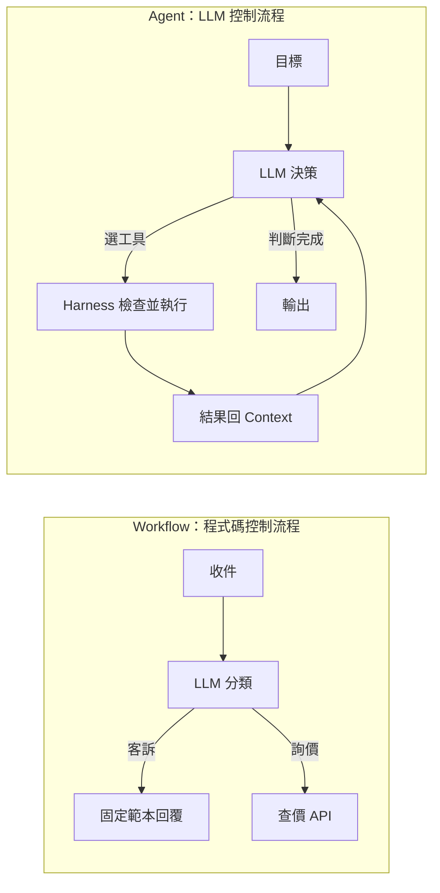
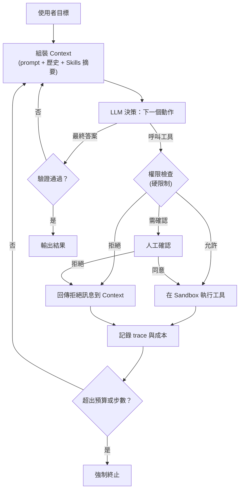

# 🤖 AI Agent 分層模型：LLM、Context、Harness 與 Workflow ↔ Agent 光譜

> **最後更新時間**: 2026-10-16 11:20:00 (UTC+8)
> **使用模型**: Claude Sonnet 5.5
> **執行 Agent**: Claude Code
> **筆記分類**: AI / Agent 架構 / Harness Engineering / Context Engineering

---

## 📖 一、核心概念剖析 (Core Concepts)

### 1.1 原始想法與需修正之處

原始想法：以 LLM 為中心圓，外圍是 prompt、prompt engineering、chain of thought、tools、context，再擴展到 harness，讓 agent 知道可以做什麼、有哪些工作、有哪些 Skills 與 Tools，以及哪些是硬限制。

| 問題 | 說明 |
|---|---|
| 層次混在同一圈 | Prompt、context、tools 是「放進去的東西」；prompt engineering 與 CoT 是「使用的技巧」，不應與元件並列 |
| Harness 被畫成外圍延伸 | Harness 負責**執行 agent loop**（組裝 context、呼叫模型、執行工具、檢查結果、決定停止），公式為 **Agent = Model + Harness** |
| Prompt 與 context 的關係 | Prompt 只是 context 的一部分；重點從 prompt engineering 轉向 **context engineering** |
| Tools 與 Skills 同類化 | Tools = 能做什麼；Skills = 該怎麼做 |
| 缺少軟、硬限制區分 | 這是原想法最有價值的部分，需明確分類 |
| 缺少回饋與驗證 | 少了「做完怎麼知道對不對」，圖就只有單向 |

### 1.2 修正後的六層同心模型（由內而外）

```
┌──────────────────────────────────────────────────────────────┐
│ L5 環境與人：使用者、程式碼庫、外部 API、組織政策                  │
│ ┌──────────────────────────────────────────────────────────┐ │
│ │ L4 Harness（執行與治理層）                                  │ │
│ │  Agent loop ｜ 權限 ｜ Hooks ｜ Sandbox ｜ 預算 ｜ 驗證 ｜ 記憶 │ │
│ │ ┌──────────────────────────────────────────────────────┐ │ │
│ │ │ L3 能力層：Tools / MCP / Skills / Subagents            │ │ │
│ │ │ ┌──────────────────────────────────────────────────┐ │ │ │
│ │ │ │ L2 推理策略：CoT / ReAct / Plan / Reflection       │ │ │ │
│ │ │ │ ┌──────────────────────────────────────────────┐ │ │ │ │
│ │ │ │ │ L1 Context：System prompt、使用者指令、歷史、 │ │ │ │ │
│ │ │ │ │ 檢索資料、記憶、工具回傳結果                   │ │ │ │ │
│ │ │ │ │ ┌──────────────────────────────────────────┐ │ │ │ │ │
│ │ │ │ │ │ L0 LLM（權重、機率性的推理核心）           │ │ │ │ │ │
│ │ │ │ │ └──────────────────────────────────────────┘ │ │ │ │ │
│ │ │ │ └──────────────────────────────────────────────┘ │ │ │ │
│ │ │ └──────────────────────────────────────────────────┘ │ │ │
│ │ └──────────────────────────────────────────────────────┘ │ │
│ └──────────────────────────────────────────────────────────┘ │
└──────────────────────────────────────────────────────────────┘
```

| 層 | 回答的問題 | 內容 |
|---|---|---|
| L0 LLM | 能**思考**什麼 | 模型能力、上下文長度、機率性輸出 |
| L1 Context | 現在**知道**什麼 | Prompt 為其中一部分，另含歷史、檢索、記憶、工具結果；prompt engineering 屬此層技巧 |
| L2 推理策略 | **怎麼想** | CoT、ReAct、規劃、自我反思，是使用模型的方式而非獨立元件 |
| L3 能力 | 能**做**什麼、**怎麼做** | Tools（動作）、MCP（標準化接入）、Skills（流程知識，按需載入）、Subagents（分工與隔離 context） |
| L4 Harness | **允許**做什麼、做得**對不對** | Agent loop、權限、Hooks、Sandbox、預算、驗證、記憶、可觀測性 |
| L5 環境 | 在**什麼世界**裡做 | 真實系統、使用者、組織規範 |

### 1.3 軟限制 vs 硬限制（Harness 的核心）

| | 軟限制（Soft） | 硬限制（Hard） |
|---|---|---|
| 實作位置 | 在 context 內：prompt、AGENTS.md、Skill 說明 | 在 harness 內：由程式碼強制執行 |
| 性質 | 機率性，模型可能忽略或被誘導 | 確定性，模型無法繞過 |
| 範例 | 「不要刪除檔案」「請先寫測試」 | 權限白名單、sandbox、禁寫路徑、網路封鎖、Hooks 攔截、token／時間預算、輸出 schema 驗證、危險操作需人工確認 |
| 適合 | 風格、慣例、流程建議 | 安全、不可逆操作、合規 |

> **設計原則**：重要規則不能只寫在 prompt 裡，必須由 harness 強制執行。Prompt 負責引導，harness 負責保證。

Harness 另有三項常被忽略的職責：

1. **Context 管理**：壓縮、截斷、決定何時載入哪個 Skill。
2. **驗證迴圈**：測試、lint、評審 agent、人工審核；模型不能只自己宣稱完成。
3. **可觀測性**：日誌、trace、成本統計，供除錯與稽核。

### 1.4 Workflow ↔ Agent 光譜

兩者的核心差異是**控制流程由誰決定**。

| | Workflow | Agent |
|---|---|---|
| 控制流程由誰決定 | **開發者預先寫好**（程式碼決定下一步） | **LLM 在執行時決定**（模型決定下一步） |
| 路徑 | 固定或有限分支 | 動態生成，事先不知道會走幾步 |
| 工具使用 | 在指定節點呼叫 | 模型自己選擇何時、用哪個工具 |
| 終止條件 | 流程走完 | 模型判斷達成目標，或碰到預算、步數上限 |
| 可預測性 | 高 | 低 |
| 成本與延遲 | 低且穩定 | 高且變動 |

「生成性與主動性」可進一步拆解：

- **生成性**：流程本身由 LLM 生成（動態規劃），不只是內容。
- **主動性**：LLM 自行判斷下一步、調整策略，並自己發現錯誤與修正。

```
固定 ◄──────────────────────────────────────────────► 自主

單次 LLM   Prompt      Routing    Orchestrator   Autonomous   Multi-agent
呼叫       Chaining    Parallel   -Workers       Agent Loop   協作
           (串接)      (路由/平行)  (動態分派)     (自主迴圈)    (多代理)

 程式碼控制流程  ◄─────────────────────────►  LLM 控制流程
```

| 模式 | 說明 | 誰控制流程 |
|---|---|---|
| Prompt Chaining | A → B → C，每步輸出餵下一步 | 程式碼 |
| Routing | LLM 分類後走固定分支 | 程式碼定義分支，LLM 選分支 |
| Parallelization | 同時處理子任務再合併 | 程式碼 |
| Orchestrator-Workers | LLM 動態拆解並分派任務 | LLM 拆解，程式碼執行 |
| Evaluator-Optimizer | 生成後由 LLM 評審並迴圈改進 | 混合 |
| Autonomous Agent | 模型在迴圈中自行規劃、用工具、驗證 | LLM |

### 1.5 與 Harness 的整合：控制權的轉移

```
Workflow：  Harness（固定流程）─► 呼叫 LLM（做單點任務）─► 呼叫 Tool ─► 下一節點
            控制權在 Harness，LLM 是被呼叫的元件

Agent：     LLM（決策者）─► 選 Tool ─► Harness 執行並設限 ─► 結果回 Context ─► LLM 再決策
            控制權在 LLM，Harness 是護欄與執行環境
```

- Workflow 中，harness 是**導演**，決定每一步。
- Agent 中，harness 是**護欄加執行環境**，負責權限、驗證、預算、記錄，不決定下一步。
- 因此**自主性越高，硬限制越重要**，因為流程不再替你擋掉錯誤。

### 1.6 一句話整合

> **Agent = Model + Context + Capabilities + Constraints + Loop**
>
> - **Context** 決定它**知道**什麼
> - **Capabilities**（Tools、Skills）決定它**能做**什麼、**會怎麼做**
> - **Constraints**（權限、sandbox、Hooks）決定它**可以做**什麼
> - **Loop**（觀察 → 推理 → 行動 → 驗證）決定它**如何持續逼近目標**
>
> **Workflow 是人類寫好的路徑，agent 是模型在邊界內自己找路。** 決策權越交給模型，harness 的硬限制、驗證與可觀測性就越不能省。

---

## 🛠️ 二、實作與應用範例 (Practical Examples)

### 2.1 Workflow 與 Agent 的程式碼對照

**邏輯流程圖：**



```python
# ---------- Workflow：流程由程式碼決定，LLM 只負責單點判斷 ----------
def workflow(email: str) -> str:
    category = llm(f"分類為 complaint 或 pricing：{email}")  # LLM 只做分類
    if category == "complaint":                              # 分支由程式碼寫死
        return TEMPLATE_REPLY
    return price_api(email)                                  # 固定呼叫查價工具
```

### 2.2 帶硬限制的 Agent Loop（Harness 範例）

**邏輯流程圖：**



```python
# ---------- Agent Loop：LLM 決定下一步，Harness 強制執行硬限制 ----------
ALLOWED_TOOLS = {"read_file", "search", "write_file"}   # 能力白名單（硬限制）
NEEDS_CONFIRM = {"write_file"}                           # 不可逆操作需人工確認
MAX_STEPS = 20                                           # 步數預算（硬限制）

def agent(goal: str) -> str:
    context = [system_prompt(), goal]                    # L1：組裝初始 context
    for step in range(MAX_STEPS):                        # 迴圈有上限，避免失控
        action = llm(context)                            # L0：模型決定下一步
        if action.type == "final":                       # 模型宣稱完成
            if verify(action.answer):                    # 驗證，不能只信模型
                return action.answer
            context.append("驗證未通過，請修正")           # 回饋進 context 後重試
            continue
        if action.tool not in ALLOWED_TOOLS:             # 硬限制：白名單
            context.append(f"工具 {action.tool} 不被允許")
            continue
        if action.tool in NEEDS_CONFIRM and not ask_human(action):
            context.append("人工拒絕此操作")              # 硬限制：人工確認
            continue
        result = run_in_sandbox(action)                  # 在 sandbox 中執行
        log_trace(step, action, result)                  # 可觀測性
        context.append(result)                           # 工具結果回到 context
    return "已達步數上限，任務中止"                         # 預算耗盡時強制終止
```

### 2.3 應用場景：混合架構

外層用 workflow 保證流程與稽核，關鍵節點內嵌 agent 處理開放問題：

```
收件 → 分類 → [ Agent：研究並處理 ] → 驗證 → 寄出
固定    固定      有自主性（有硬限制）      固定    固定
```

### 2.4 選擇準則

| 條件 | 建議 |
|---|---|
| 步驟已知、可枚舉 | **Workflow** |
| 需要穩定、可稽核、低成本 | **Workflow** |
| 步驟數無法預知、需依中間結果調整 | **Agent** |
| 問題開放、需探索（除錯、研究） | **Agent** |
| 錯誤成本高 | Workflow，或 agent 加嚴格硬限制與人工確認 |

---

## 🔭 三、延伸思考與進階主題 (Extensions & Advanced Topics)

1. **Context engineering 比 prompt engineering 重要**：長任務失敗多半來自 context 污染或遺失，不是 prompt 寫得不好。
2. **Skills 的漸進式揭露**：先放名稱與描述，需要時才載入全文，節省 context。Skill 是中間地帶：把固定流程知識（類似 workflow）交給 agent 按需取用。
3. **Subagent 的意義**：除平行處理外，更重要的是以獨立 context 隔離雜訊，只回傳摘要。
4. **自主性與安全的權衡**：限制越硬越安全，但自主性與效率越低。依操作風險分級：唯讀自動放行、可逆寫入通知、不可逆操作需確認。
5. **自主性可逐項授權**：agent 能自主規劃，但寫入或對外發送仍須確認。
6. **評估方式不同**：Workflow 測每個節點的正確性；agent 測最終結果與軌跡（trajectory）。Harness 應能量化成功率、成本、人工介入次數。
7. **原則**：從最簡單的方案開始，只在簡單方案確實不夠時才增加自主性。Agent 用可預測性換取彈性，只有彈性真的帶來價值才值得。

### 參考資料

- Anthropic, *Building effective agents*（workflow 與 agent 的區分、各種組合模式）

---

## 💬 四、討論紀錄 (Discussion Log)

### 🔸 討論 1：如何修正並完善 Agent 的同心圓想法

- **使用者提問**：原本以 LLM 為中心，外圍依序是 prompt、prompt engineering、chain of thought、tools、context，再擴展到 harness，讓 agent 知道可做哪些工作、有哪些 Skills 與 Tools、哪些是硬限制。希望修正並更完整表達。
- **指出的問題**：
  - 「元件」與「技巧」混在同一圈（prompt、context、tools 是元件；prompt engineering、CoT 是技巧）。
  - Harness 不只是外圍延伸，而是執行 agent loop 的本體（Agent = Model + Harness）。
  - Prompt 是 context 的一部分，重點應是 context engineering。
  - Tools 是「能做什麼」，Skills 是「該怎麼做」，需區分。
  - 缺少軟限制與硬限制的明確分類，也缺少驗證與回饋。
- **結論**：重構為 L0 LLM、L1 Context、L2 推理策略、L3 能力、L4 Harness、L5 環境六層；提出公式 **Agent = Model + Context + Capabilities + Constraints + Loop**；核心原則為「Prompt 負責引導，harness 負責保證」。

### 🔸 討論 2：Workflow 與 Agent 的差異

- **使用者觀點**：Workflow 是固定的工作流程，依固定流程處理資料流與工具使用；Agent 則帶有生成性與主動性。
- **回應與補充**：
  - 觀點正確，核心差異是**控制流程由誰決定**：workflow 由開發者預先寫好，agent 由 LLM 在執行時決定。
  - 兩者是光譜而非二分：Prompt Chaining → Routing／Parallelization → Orchestrator-Workers → Evaluator-Optimizer → Autonomous Agent。
  - 「生成性」指流程本身由 LLM 生成，「主動性」指自行判斷下一步並修正錯誤。
  - 與 harness 的關係：workflow 中 harness 是導演；agent 中 harness 是護欄加執行環境，因此**自主性越高，硬限制越重要**。
  - 實務多為混合架構，並建議從最簡單的方案開始，只在必要時增加自主性。
- **結論**：Workflow 是人類寫好的路徑，agent 是模型在邊界內自己找路。

### 🔸 討論 3：整理成筆記

- **使用者指示**：同意將兩段討論合併成筆記（回覆 `GO`）。
- **產出**：依 `AGENTS.md` 規範建立本文件，同時輸出 md 與 html（含 PDF 匯出按鈕、程式碼複製按鈕、流程圖），並更新 index。

### 🔸 討論 4：加入討論紀錄

- **使用者指示**：將以上討論列在文件下方作為紀錄。
- **處理**：新增本節，置於提示詞歷史區塊之前，使 Prompt Archive 維持在文件最底部。

### 🔸 討論 5：六層同心模型改用 SVG 呈現

- **使用者指示**：1.2 修正後的六層同心模型使用 SVG 圖形，md 檔保留 ASCII。
- **處理**：HTML 的 1.2 以 SVG 同心圓取代 ASCII（右側附各層「問題與內容」圖例）；md 檔維持原 ASCII 圖。

---

## 📝 提示詞歷史與變更記錄 (Prompt Archive)

### 🔹 [2026-10-16 10:50:00] Claude Sonnet 5.5 初始建立
- **模型/Agent**: Claude Sonnet 5.5 / Claude Code
- **Prompt 原文**:
  ```text
  關於 ai agents的地的思考是以LLM為中心圓 外圍是prompt, prompt engineering, chain of thought, tools, context,然後擴展到harness,讓透過harness讓agent知道什麼可以做有哪些工作跟SKILLS TOOLS,那些適硬限制,如何修正跟完善這個想法，更完整的表達
  ```
  ```text
  另外在WORKFLOW到AGENTS之間 我覺得前者是固定的工作流程，根據固定流程處理資料流與工具的使用，AGENTS則帶有生成性與主動性
  ```
  ```text
  GO
  ```
  ```text
  將以上的討論列在文件下方作為紀錄
  ```
- **變更摘要**: 建立 Agent 六層同心模型（L0 LLM 至 L5 環境）、軟／硬限制分類、Workflow ↔ Agent 光譜與控制權轉移分析；提供 workflow 與帶硬限制 agent loop 的程式碼對照（含流程圖與註解）、混合架構與選擇準則、延伸思考；並於文件下方新增討論紀錄（Discussion Log）。

### 🔹 [2026-10-16 11:20:00] Claude Sonnet 5.5 圖形調整
- **模型/Agent**: Claude Sonnet 5.5 / Claude Code
- **Prompt 原文**:
  ```text
  1.2 修正後的六層同心模型（由內而外）1.2 修正後的六層同心模型（由內而外） 使用svg圖形(md檔保留ascii)
  ```
- **變更摘要**: HTML 中 1.2 六層同心模型改以 SVG 同心圓與圖例呈現；md 檔保留 ASCII；並於討論紀錄新增討論 5。
