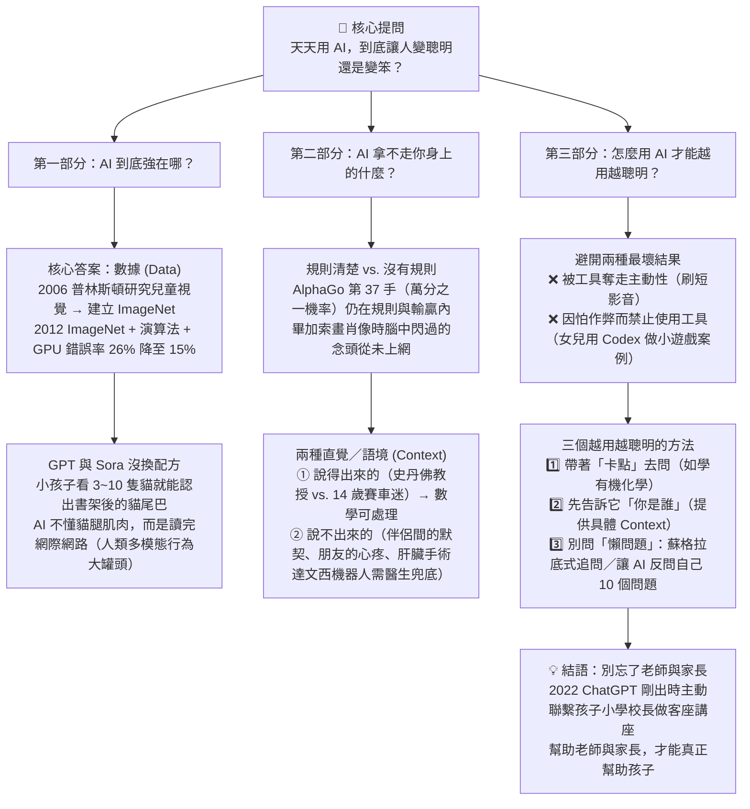

# 🏛️ 黃叔精讀李飛飛：人類最強的提示詞工程師死了 2400 年（逐字稿整理與勘誤還原）

> **最後更新時間**: 2026-11-18 08:52:00 (UTC+8)
> **使用模型**: Gemini 4 Argon (Medium)
> **執行 Agent**: Antigravity
> **原始檔案**: `黄叔精读李飞飞人类最强的提示词工程师死了 2400 年.txt`（共 352 行）
> **語音轉文字工具**: [Whisper_WebUI](https://github.com/joelhoty/Whisper_WebUI)

---

## 🧭 文章邏輯結構圖

以下流程圖根據逐字稿原文結構繪製，完整呈現本篇訪談精讀的三大核心段落與脈絡：



---

## 📖 一、逐字稿整理文章（中文還原＋李飛飛英文原聲對照）

> [!NOTE]
> **整理說明**：原始 `.txt` 檔為中英夾雜影片經語音轉譯（Whisper Translate）產生的英文逐字稿。以下嚴格依照原稿順序與語意整理成通順文章，**不添加任何外部資訊**，並完整保留李飛飛（Fei-Fei Li）與主持人安德魯·胡伯曼（Andrew Huberman）的英文原話及修正後的語意。

### 【片頭精選原聲】

> **李飛飛**：`"Here's a quiz. Who is humanity's best prompter?"`
> （來個小測驗：誰是人類最強的提示詞工程師／提問者？）
>
> **胡伯曼**：`"I'm gonna flunk this quiz."`
> （這題我要不及格了。）
>
> **李飛飛**：`"Socrates, if he were alive. Because that is the method of prompting."`
> （如果蘇格拉底還活著的話，就是他。因為那就是提示［追問］的方法。）

> **李飛飛**：`"Say it when the machine says, 'I'm sorry you're so sick today.' It's very different from how your friend says it to you."`
> （當機器對你說：「很抱歉你今天病得這麼重」，這跟你的朋友對你說這句話，是非常不同的。）

> **李飛飛**：`"A childhood moment that [an apricot / a teacup] might mean something that only me and my best friend share. That is never uploaded on the internet. And no matter how mighty AI is today, cannot access that."`
> （童年的一個瞬間——某個東西可能代表著只有我和我最好的朋友才懂的意義。那從未被上傳到網際網路上；無論今天的 AI 有多強大，都無法觸及那一部分。）

---

### 【引言】AI 到底讓人變聰明了，還是變笨了？

「AI 教母」、前首席科學家李飛飛，最近跟史丹佛大學的學者胡伯曼（Huberman）聊了兩個小時。核心問題只有一個：**AI 到底讓人變聰明了，還是變笨了？**

大家好，我是黃叔。這一期我們來聊：AI 到底強在哪、哪裡還不夠，以及我們應該怎麼用它，才能越用越聰明：
1. **第一，AI 到底強在哪？**
2. **第二，你身上有什麼是它拿不走的？**
3. **最後，我們怎麼用它，才能越用越聰明？**

---

### 第一部分：AI 到底強在哪？

李飛飛的回答只有兩個字：**數據（Data）**。

2006 年，當她剛到普林斯頓大學（Princeton）時，當時所有人都在比誰的演算法更聰明。她卻反過來去研究「人」，結果發現：小孩子在六歲的時候，就能認出成千上萬種東西。所以當其他人都在死磕演算法時，她說：**得先有數據**。

這就是 **ImageNet**——來自 167 個國家、將近 5 萬人參與標註的 1,400 萬張圖片。到了 2012 年（註：原稿語音誤植為 2008），ImageNet、深度學習演算法與 GPU 三者湊齊，電腦看圖認物的錯誤率一下子從 26% 掉到了 15%。這一輪 AI 浪潮就是從這裡開始的。

後來的 GPT、Sora，看起來很玄，但其實沒有改變配方。李飛飛說：

> `"What happened there is actually not as revolutionary as you might think, because the bottom line is, it's still data."`
> （那裡發生的事情其實沒有你想像的那麼具革命性，因為說到底，底層依然是數據。）

舉個例子，Sora 生成一隻貓，它有模型，但它知道貓腿上的肌肉是怎麼長的嗎？不知道。它只是把網路上關於貓的影片看了太多遍。李飛飛說：

> `"Because that child, who learns about what you say 'kitty cat', will not have the chance to download the Internet of images of cats. They likely have seen three cats, ten cats."`
> （因為那個學會你說「小貓咪」的孩子，並沒有機會把整個網際網路上的貓咪圖片下載下來。他們可能只見過三隻貓、十隻貓。）

你看，小孩子只看過三隻貓，就能認出書架後面露出來的一截貓尾巴；而 AI 卻得看遍全世界的貓。

那麼，網際網路到底是什麼？李飛飛說：

> `"What exactly is the Internet? It's interesting. Internet is not some random thing. Internet is the biggest collection of human behavior. In multimodal form."`
> （網際網路到底是什麼？很有意思，網際網路不是什麼隨機的東西，它是人類行為最大的集合體，而且是以多模態的形式存在。）

你打的字、你拍的照片、你發的影片，全都裝在這個大罐頭（資料庫）裡。過去幾十年我們人類累積下來的東西，AI 全都讀了一遍，能不強嗎？

那麼，那些沒有進到這個罐頭裡的東西呢？

---

### 第二部分：AI 拿不走你身上的什麼？

先講一個例子：**AlphaGo 的第 37 手**。

2016 年 AlphaGo 對戰李世石的第二局，這第 37 手棋一下出來，現場的職業解說全都看傻了。後來 DeepMind 去翻 AlphaGo 自己的判斷：人類棋手走出這一步的機率，只有萬分之一。

這算不算創造力？你說它不算吧，但它確實走出了人想不到的棋；但前提是它沒有打破規則。為什麼？因為圍棋的規則是清楚的，輸贏也是清楚的。只要給足數據與算力，它就能走出人類想不到的棋步。

但人腦子裡的大多數事情，並沒有這麼清楚的規則。她舉了畢加索（或畫家）畫肖像畫時的例子——當他畫肖像時，腦海裡閃過的那個念頭：

> `"That thought is not captured. Therefore, it's not on the internet. Therefore, AI has not seen it."`
> （那個念頭沒有被捕捉下來，因此它不在網際網路上，因此 AI 也從未見過它。）

片頭那句話說的就是這個意思：你的童年、你的經歷、你說不出來的那種感覺，從來沒有上過網。

那「直覺／語境」呢？她把這種東西分成兩種：

#### 1. 第一種：你能說得出來的（Context）
李飛飛說：

> `"I'm a Stanford professor and a neuroscientist. Give me this information. That is already called context. If I type that I'm a 14-year-old teenager, you know, loving race cars, even if we ask the same question, it'll have customized answer."`
> （如果我說「我是史丹佛教授兼神經科學家，給我這個資訊」，這就已經叫做上下文語境［Context］。如果我輸入「我是個熱愛賽車的 14 歲青少年」，就算我們問同一個問題，它也會給出量身定做的回答。）

她說這不是直覺，這是數學。只要你能說得出來，AI 就能接得住。

這一點我深有體會。前陣子我計畫帶家人出去玩（或做規劃），我就把我的路線、可能的方向寫成一份文檔，丟給 Claude。說白了，你得先告訴 AI「你是誰」。

#### 2. 第二種：你自己都說不出來的
李飛飛與胡伯曼在對談中舉了伴侶相處的例子：

> **李飛飛**：`"Sometimes, as a couple, you might have a moment that you're just rubbing each other in the wrong way."`
> （有時候作為伴侶，你們可能會有一刻覺得彼此有點鬧彆扭。）
>
> **胡伯曼**：`"Never. No, I'm just kidding. Yeah, of course."`
> （從來沒有。不，我開玩笑的，當然會有。）
>
> **李飛飛**：`"So, if you're really familiar with each other, you can kind of sense it, but you can't quite tell it. Maybe you just leave, quietly leave that person alone."`
> （所以如果你們彼此非常熟悉，你能隱約感覺到，但你說不太出來。也許你就會安靜地走開，讓對方自己靜一靜。）

連你自己都說不出來的東西，誰也沒辦法讓 AI 讀懂。所以 AI 對你說「我很抱歉你生病了」，那是因為數據裡大家都這麼說；而朋友對你說這句話，是因為他真的心疼你。

這條人與 AI 的邊界，她自己家裡就剛經歷過。在錄製這期節目前，她父親剛做完一台肝臟手術：

> `"But the surgery was done by a robot. The Da Vinci robot system. Because it was a liver surgery. And the surgeon, incredible surgeon, was driving the robot. So, it was a deep human-machine collaboration."`
> （但這台手術是由機器人完成的——達文西機器人系統。因為這是肝臟手術，而那位極其出色的外科醫生在操控這個機器人。所以這是一場深度的人機協作。）

手術後她問主刀主任：如果把全世界肝臟手術的數據都切出來餵給 AI，能派一個 AI 自己動手術嗎？醫生的回答是：**很難說**。因為肝臟裡的血管非常多，每個人長得都不一樣；全世界一年的肝臟手術加起來，數據可能都不夠。

她說，AI 是從規律裡學出來的，規律不夠的地方，就得靠人小心兜底。所以這一次是醫生帶著機器人做，比單純沒有人操控的機器（或傳統開刀）好太多了，手術非常順利，出血量只有常規手術的十分之一。

所以你看：**數據夠的地方，AI 可以頂上去；數據不夠的地方，還得由人來拍板。** 放到你身上也是一樣：你的工作裡，越是那些沒辦法從網路上直接拿到的部分，別人就越難把你踢開（取代）。

---

### 第三部分：怎麼用 AI，才能越用越聰明？

好，AI 強在哪、哪裡不夠，都清楚了。回到開頭的問題：人天天用它，到底會不會變笨？

李飛飛說，有兩種最壞的結果：

1. **第一種壞結果：主動性被工具奪走**
   > `"Their agency and human-level motivation of learning and living is taken away by tools. So, doom-scrolling, passive watching of shorts."`
   > （他們的主動性［Agency］以及人類層面學習和生活的內在動力，被工具奪走了。例如無止境地刷負面資訊［Doom-scrolling］、被動地看短影音。）

2. **第二種壞結果：因噎廢食，拒絕讓學生接觸工具**
   > `"The other kind of danger is in the name of agency and motivation, the tools are denied to our students because we're worried you cheat. We're worried you only got your answer from ChatGPT. That is very bad as well."`
   > （另一種危險是，以保護主動性和動力為名，拒絕讓我們的學生使用這些工具，因為擔心你作弊、擔心你只從 ChatGPT 拿答案。這同樣非常糟糕。）

第一種很好理解，第二種很多人卻沒想到：不讓孩子用，反而廢了孩子。

這件事我在家裡就遇到過。我女兒有一次跟我說：「爸，我平時學習已經做得很好、很不容易了，我很累，你還要讓我學 AI？」她以為學 AI 是要再給她報一個課外班。

後來我沒有給她報班。有一次她在工作室，聽老師說 AI 可以做遊戲，她轉頭就跑回來找我。等我回到家，她趴在我背上，我打開 Codex，教她怎麼把自己的想法講出來，結果她做出了屬於自己的小遊戲。所以，如果只是逼她學或禁止她用都沒用，得讓她自己擁有主動權，她才有動力去駕馭它。

那麼，具體怎麼用 AI 才能越用越聰明？我從訪談裡挑出了三個方法：

#### 方法一：帶著「卡點」去問它
李飛飛回憶自己當年學醫預科／有機化學的時候，學得很痛苦，花了好長的時間，還去上了別的課。她說：

> `"If today I were to have an AI companion, I would ask so many questions about organic chemistry because I know where I'm stuck. I have the motivation to learn. I just need a guide."`
> （如果今天我有一個 AI 學伴，我會問它好多關於有機化學的問題，因為我知道自己卡在哪裡。我有學習的動力，我只需要一個引導者。）

注意這句話：**「我知道自己卡在哪裡（I know where I'm stuck）。」** 不是把問題直接丟給 AI，而是你知道自己卡在什麼地方，讓 AI 來帶你過關。

#### 方法二：先告訴它「你是誰」
這就是前面講的「史丹佛教授」和「14 歲賽車迷」的例子。你的背景交代得越具體，你從 AI 那裡得到的回答就越精準。

#### 方法三：別問「懶問題」
李飛飛自己都承認：

> `"I realized before ChatGPT, sometimes I get lazy. If I have a question, I ask the person I think is smart next to me. Now I realize I should not ask lazy questions."`
> （我意識到在有 ChatGPT 之前，我有時候會偷懶。如果我有個問題，我就直接問身邊我覺得聰明的人。現在我意識到，我不應該問懶問題。）

先自己看一看、想一想，太簡單的問題不要一上來就伸手要答案。連「AI 教母」都怕自己問出懶問題。

**那什麼才叫「好問題」？** 這就回到開頭了：人類最強的提示詞工程師——2400 年前的**蘇格拉底（Socrates）**，他的方法就是一路追問真相。李飛飛說：

> `"What is Socrates' method? It's prompting and seeking truth by asking questions."`
> （蘇格拉底的方法是什麼？就是透過提問來引導［Prompting］並追尋真理。）

我自己的做法也是往這個方向走。之前有一位創始人說過一句話讓我印象很深：「60% 的人，問不出 80 分的問題。」所以我會讓 AI 反過來問我 10 個問題，並且讓它站在我的反方。**蘇格拉底是追問別人，我是讓 AI 來追問我。**

所以李飛飛說，只要保住孩子們的主動性，並且把工具交給他們、教他們怎麼使用：

> `"Then this generation, this coming generation and many generations to come will be way smarter than us. Because they have superpower."`
> （那麼這一代、即將到來的下一代以及未來的許多代人，將會比我們聰明得多。因為他們擁有超能力。）

---

### 【結語】總結與李飛飛最擔心的事：別忘了老師與家長

回到最開頭的問題：天天用 AI，到底是變聰明還是變笨？
* **第一**，AI 強，是因為它讀完了整個網際網路的人類行為連結；
* **第二**，你沒有寫上網的經歷與感受，它拿不走，這是屬於你的；
* **最後**，主動權在你手裡：帶著卡點去問、先說清楚你是誰、別問懶問題。

當然，李飛飛也沒有只唱讚歌。她最擔心的其實不是孩子：

> `"What I worry about are teachers and some parents. Because I think our society today and especially Silicon Valley are not doing them a service. We're forgetting about them."`
> （我擔心的是老師和一些家長。因為我認為我們今天的社會，尤其是矽谷，並沒有服務好他們。我們正在遺忘他們。）

那她自己做了什麼呢？2022 年（註：原稿語音誤植為 2012）ChatGPT 剛出來的時候，身為國際知名學者的她，做的第一件事是：

> `"The first thing I did was emailing the principal of the elementary school my kid was in and said, 'I would like to come and guest lecture for your students and teachers.' It's not because I'm so special. It's because I want them in real time to know what's happened. I have hope for kids. But in order not to have a blind hope, I think we should all remember our teachers and help our teachers and parents so that we can help our kids."`
> （我做的第一件事，就是給我孩子就讀的小學校長發郵件說：「我想來為你們的學生和老師做一場客座講座。」這不是因為我有多特別，而是因為我希望他們能即時知道發生了什麼事。我對孩子們抱有希望；但為了不讓這種希望變成盲目的希望，我認為我們都應該記住我們的老師，去幫助我們的老師和家長，這樣我們才能真正幫助到我們的孩子。）

---

## 🔧 二、逐字稿錯字與語音轉譯（ASR）修正對照表

由於原始文字檔是由中英夾雜音訊透過語音辨識轉譯產生，出現了多處「中文諧音誤聽為英文單字」、「專有名詞拼寫錯誤」與「性別代名詞混淆」。以下為根據上下文語意處理之修正明細：

| 行號 | 原文錯字／誤譯片段 | 根據上下文語意修正後 | 錯誤原因解析 |
| :--- | :--- | :--- | :--- |
| L14 | `I'm gonna go to AMD to be the first scientist.` | **AI 教母、前首席科學家（李飛飛）** | 中文「AI 教母」諧音被誤聽為 `AMD`，「首席科學家」被直譯為 `first scientist` |
| L15 | `two students from Hebrew` | **史丹佛大學的胡伯曼（Andrew Huberman）** | 播客主持人 `Huberman` 諧音被誤聽為 `Hebrew` |
| L18 | `Uncle Wang` | **黃叔（Uncle Huang）** | 中文「黃叔」被語音轉譯為常見姓氏 `Wang` |
| L27 | `when he first came to Plinston` | **當她（she）剛來到普林斯頓（Princeton）** | 中文「她／他（tā）」同音導致全篇誤用 `he`；`Princeton` 拼寫誤聽為 `Plinston` |
| L38 | `In 2008, ImageNet and GPU, three of them...` | **2012 年，ImageNet、演算法與 GPU 三者湊齊** | AlexNet 奪冠並將錯誤率從 26% 降至 15% 為 **2012 年** |
| L70, L74 | `all in this management` | **全裝在這個大罐頭（資料庫／館藏）裡** | 口語「罐頭／館藏」被誤譯為 `management` |
| L73 | `Can it not be forced?` | **能不強嗎？** | 中文「強（強大）」被一詞多義誤譯為「強迫（forced）」 |
| L78 | `in the second part of the history of history` | **在贏李世石（Lee Sedol）的第二局** | 中文「李世石（Lǐ Shìshí）」發音與英文 `history` 高度相似導致誤聽 |
| L86 | `The bookshelf is also clear.` | **輸贏（勝負）也是清楚的** | 中文「輸贏（shūyíng）」被誤聽為同音近義詞「書架（shūjià -> bookshelf）」 |
| L91 | `He took an example from the secretary.` | **她舉了畢加索（Picasso）的例子** | 中文「畢加索」在快速口語中被語音辨識誤判為 `secretary` |
| L97 | `The back of the head is what it means.` | **片頭（開頭）那句話說的就是這個意思** | 中文「片頭（piāntóu）」被誤聽為「偏頭／後腦（back of the head）」 |
| L106 | `That is already called contact.` | **`That is already called context.`（上下文語境）** | 英文原聲 `context` 被 ASR 誤聽為 `contact` |
| L111 | `He said that this is not a choice.` | **她說這不是直覺（Intuition），這是數學** | 中文「直覺（zhíjué）」被誤聽為「抉擇（choice）」 |
| L128 | `you can't kind of consent it` | **`you can kind of sense it`（你能隱約感覺到）** | 英文原聲 `sense it` 被 ASR 誤聽為 `consent it` |
| L240, L323 | `I took a card to ask her` / `ask with cards` | **帶著「卡點」去問它** | 中文「卡點（kǎdiǎn，卡住的地方）」的「卡」被直譯為卡片 `card` |
| L259-260 | `Professor Stamford and 14-year-old Saichemi` | **史丹佛教授（Stanford）與 14 歲賽車迷** | `Stanford` 誤拼為 `Stamford`；中文「賽車迷（sàichēmí）」被直接音譯為 `Saichemi` |
| L268 | `ChargeGPT` / L204 `chat GBT` | **`ChatGPT`** | `ChatGPT` 語音辨識拼寫誤差 |
| L278 | `Even AI parents are afraid of lazy questions.` | **連「AI 教母」都怕問出懶問題** | 中文「AI 教母」被誤譯為 `AI parents` |
| L282, L287 | `Sugarati` / `Sakurita` | **蘇格拉底（Socrates）** | 中文「蘇格拉底（Sūgélādǐ）」被音譯為 `Sugarati` 與 `Sakurita` |
| L337 | `He just came out of the GPT in 2012.` | **2022 年 ChatGPT 剛出來的時候** | ChatGPT 發佈年份為 **2022 年**，口語或辨識誤植為 `2012` |
| L343 | `come and gas lecture` | **`come and guest lecture`（做客座講座）** | 英文原聲 `guest lecture` 被 ASR 誤聽為 `gas lecture` |

---

## 📜 三、原始逐字稿完整保留與行間勘誤對照（Lines 1–352）

以下 100% 完整保留 `黄叔精读李飞飞人类最强的提示词工程师死了 2400 年.txt` 的全部原文，僅將斷行依自然語句合併並加上 `[更正: ...]` 標註，方便直接核對原文：

```text
[001-005] Here's a quiz. Who is humanity's best prompter? I'm gonna flunk this quiz. Socrates, if he were alive. Because that is the method of prompting.
[006-008] Say it when the machine says, I'm sorry you're so sick today. It's very different from how your friend says it to you.
[009-013] A childhood moment that a great cop [更正: an apricot / 某個童年物件] might mean something that only me and my best friend share. That is never uploaded on the internet. And no matter how mighty AI is today, cannot access that.
[014-017] I'm gonna go to AMD to be the first scientist. [更正: AI 教母、前首席科學家李飛飛] This is a two-hour talk with two students from Hebrew. [更正: 與史丹佛大學的胡伯曼 Andrew Huberman 聊了兩小時] The question is, does AI make people smarter or more stupid?
[018-024] Hello, everyone. I'm Uncle Wang. [更正: Uncle Huang / 黃叔] This time, I'm gonna talk about where AI is really strong and not enough. We should use it to make it [更正: us] smarter. First, AI is so strong. Second, it's not enough for you [更正: what on you it cannot take away]. The last one, we use it to make it [更正: ourselves] smarter.

[025-035] First, AI is so strong. Li Feifei's answer is two words, data. In 2006, when he [更正: she] first came to Plinston [更正: Princeton], he was much smarter than anyone else [更正: 當時大家都在比誰的演算法更聰明]. He [更正: She] went back to research people and found out that children can recognize tens of thousands of things when they are six years old. So he [更正: she] and everyone else made the same calculation [更正: 當所有人都在死磕演算法時]. He [更正: She] said, there must be data first. This is ImageNet.
[036-043] 14 million pictures from 167 countries, nearly 50,000 people. In 2008 [更正: 2012], ImageNet and GPU, three of them [更正: ImageNet、深度學習演算法與 GPU 三者湊齊], got one picture. The total number of pictures [更正: 圖片辨識錯誤率 error rate] dropped from 26% to 15%. This round, AI was created from here.
[044-048] Then, the next GPT, SORA, looked like it didn't change the formula. "What happened there is actually not as revolutionary as you might think, because the bottom line is, it's still data."
[049-062] For example, SORA is [更正: generates] a cat. It has a model. Does it know the muscles on the cat's legs? No, it doesn't. It's the cat's video on the Internet. It looks too much [更正: 看了太多遍]. "Because that child, who learns about what you say kitty cat, will not have the chance to download the Internet of images of cats. They likely have seen three cats, ten cats." Look, children have seen three cats. They can recognize the cat tail that came out of the bookshelf. AI has to look at all the cats.
[063-074] What exactly is the Internet? "What exactly is the Internet? It's interesting. Internet is not some random thing. Internet is the biggest collection of human behavior. In multimodal form." The words you play [更正: type], the photos you take, the video you post are all in this management [更正: 罐頭/資料庫]. The things that we have developed in the past decades, AI has read them all over again. Can it not be forced? [更正: 能不強嗎？] What about those who didn't get into this management [更正: 罐頭/資料庫]?

[075-090] The second part, AI can't get what's on your body. Let's talk about an example. AlphaGo's 37th hand. In 2016, in the second part of the history of history [更正: 贏李世石 Lee Sedol 的第二局], this hand, the professional hand of解說 [更正: 現場職業解說], was all messed up. Later, DeepMind went to turn AlphaGo's own judgment. Human hand made this step, only one in ten thousand. Does that count as creativity? You say it doesn't, but don't break the rules. Why? The rules are clear. The bookshelf [更正: 輸贏 win/loss] is also clear. If you give enough, it will be able to get out of the game that people can't think of. But most of the things in the brain don't have such a clear rule.
[091-100] He [更正: She] took an example from the secretary [更正: 畢加索 Picasso]. When he drew the portrait, the head [更正: 念頭 thought] that was shining in his head. "That thought is not captured. Therefore, it's not on the internet. Therefore, AI has not seen it." The back of the head [更正: 片頭開頭那句話] is what it means. Your childhood, your experience, your feeling that you can't say it, you've never been online.
[101-120] What about the intuition? He [更正: She] took the intuition into two kinds. The first one, you can say it. "I'm a Stanford professor and a neuroscientist. Give me this information. That is already called contact [更正: context]. If I type that I'm a 14-year-old teenager, you know, loving race cars, even if we ask the same question, it'll have customized answer." He [更正: She] said that this is not a choice [更正: 直覺 intuition]. It's math. If you can say it, AI will be able to accept it. I have an understanding of this. The year before last [更正: 前陣子], I planned to take it and take it away [更正: 規劃行程]. I'll write down my line, the possible direction, and write it into a document and throw it to Claude. To be honest, you have to tell him who is AI [更正: 你得先告訴 AI 你是誰].
[121-139] The second kind of intuition, you can't say it yourself. "Sometimes, as a couple, you might have a moment that you're just rubbing each other in the wrong way." "Never. No, I'm just kidding. Yeah, of course." "So, if you're really familiar with each other, you can't kind of consent it [更正: you can kind of sense it], but you can't quite tell it. Maybe you just leave, quietly leave that person alone." You can't even say it yourself. For example, AI, no one can read it. So, AI tells you, I'm sorry, you're sick. It's because of the data. Everyone says the same thing. Friends say the same thing. It's because he's hurt [更正: 心疼你].
[140-177] This border, his [更正: her] own family is in trouble [更正: 剛親身經歷過]. Before recording this episode, his [更正: her] father just finished a liver surgery. "But the surgery was done by a robot. The Da Vinci robot system. Because it was a liver surgery. And the surgeon, incredible surgeon, was driving the robot. So, it was a deep human machine collaboration." After the surgery, he [更正: she] asked the director, If you can cut [更正: collect/feed] the data of liver surgery all over the world, can you send an AI to do it yourself? The answer is, it's hard to say. There are a lot of liver blood vessels. Everyone is different. The liver surgery in the world is added a year. The data may not be enough. He [更正: She] said, AI is learned from the rules [更正: 規律 patterns]. The rules are not enough. You have to be careful [更正: 靠人兜底]. So, this time, the doctor brought the robot to do it. It's much better than a robot with no blood [更正: 單純機器或傳統開刀]. The surgery went well. He [更正: She] said, the amount of bleeding is only one tenth of the regular surgery. So, you see, where the data is enough, where the AI can go, where the data is not enough, you have to put it in the table [更正: 由人拍板]. It's the same with you. The more you work, the harder it is for you to see the part you can't get online. The harder it is for you to kick it off [更正: 你的工作裡越是網路上拿不到的部分，別人就越難把你替換掉].

[178-205] OK. Where is the AI strong? Where is it not enough? It's clear. Back to the question at the beginning. Do people use it every day? Will it be stupid? The third part. How to use AI? The more you use it, the smarter it is [更正: you get]. He [更正: She] said, there are two bad results. The first one. "Their agency and human-level motivation of learning and living is taken away by tools. So, doom-scrolling, passive watching of short [更正: shorts]." "The other kind of danger is in the name of agency and motivation, the tools are denied to our students because we're worried you cheat. We're worried you only got your answer from chat GBT [更正: ChatGPT]. That is very bad as well."
[206-235] The first one is good understanding [更正: 很好理解]. The second one is smart [更正: 很多人沒想到，不讓孩子用反而廢了孩子]. Many people didn't expect that it's useless to be a child. I met this at home. My daughter once told me, Dad, I've done well in learning. It's not easy. I'm tired. Do you want me to learn AI? She thought she would learn more from a class [更正: 以為又要多報一個補習班]. Later on, I didn't sign up. She was in a studio. I heard from the teacher that AI can make games. She told me to turn around and go back to work [更正: 她轉頭就跑回來找我]. When I got home, she sat on my back. I opened Codex and taught her how to tell her thoughts and made her own little game. So she thought she could use AI and make it useless. She had to let her own her own [更正: 得讓她自己擁有主動權]. She had the power to do it all.
[236-262] How to use it to become more and more smart? I picked three ways. First, I took a card [更正: 帶著「卡點」] to ask her [更正: it]. When she was studying medicine [更正: 有機化學/預科], it was hard for her to study. It took her a long time to study. She also took other classes. "If today I were to have an AI companion, I would ask so many questions about organic chemistry because I know where I'm stuck. I have the motivation to learn. I just need to [更正: a] guide." Pay attention to this sentence. "I know where I'm stuck." AI will take the problem [更正: 知道卡在哪裡，再讓 AI 帶你過關]. Second, first tell her [更正: it] who you are. That's the example of Professor Stamford [更正: Stanford] and 14-year-old Saichemi [更正: 賽車迷 race car fan]. The more specific your background is, the more you will get.
[263-310] Third, don't ask lazy questions. Li Feifei admits it herself. "I realized before ChargeGPT [更正: ChatGPT], sometimes I get lazy. If I have a question, I ask the person I think is smart next to me. Now I realize I should not ask lazy questions." Let's look at it first. It's too easy. Don't come up and take the time. Even AI parents [更正: AI 教母] are afraid of lazy questions. What is a good question? Let's go back to the beginning. The most powerful human Sugarati [更正: Socrates 蘇格拉底], 2400 years ago, his method was to follow and ask the truth all the way. "What is Sakurita's [更正: Socrates'] method? It's prompting and seeking truth by asking questions." My method is to get there [更正: 反過來用]. Before, a founder said I have a deep impression that 60% of people can't ask 80% [更正: 80 分] of the questions. So I will ask AI to ask me 10 questions and let it stand in the opposite direction. Sugarati [更正: Socrates 蘇格拉底] is to ask others. I am to ask AI to ask me. So he [更正: she] said to keep the children's initiative and give them the tools to teach them how to use them. "Then this generation, this coming generation and many generations to come will be way smarter than us. Because they are [更正: have] super power."

[311-352] Back to the beginning. AI is becoming smarter or smarter [更正: stupid] every day. First, AI is [strong] because it has finished the whole Internet of Connections. Second, the experience you didn't write, [AI] feels that it's not enough. This is yours. Finally, the initiative is in your hands. You can ask with cards [更正: 帶著卡點去問]. You can say who you are first. Don't ask lazy questions. Of course, he [更正: she] didn't just sing well [更正: 只唱讚歌]. What he [更正: she] is most worried about is not the children. "What I worry about are teachers and some parents. Because I think our society today and especially Silicon Valley are not doing them a service. We're forgetting about them." What did he [更正: she] do? He [更正: ChatGPT] just came out of the GPT in 2012 [更正: 2022]. He [更正: She] is an international student [更正: 國際知名學者/大教授]. "The first thing I did was emailing the principal of the elementary school my kid was in and said I would like to come and gas lecture [更正: guest lecture] for your students and teachers. It's not because I'm so special. It's because I want them in real time to know what's happened. I have hope for kids. But in order not to have a blind hope, I think we should all remember our teachers and help our teachers and parents so that we can help our kids."
```

---

## 📝 提示詞歷史與變更記錄 (Prompt Archive)

### 🔹 [2026-11-18 08:36:00] [Gemini 4 Argon (Medium) / Antigravity] 變更紀錄
- **模型/Agent**: Gemini 4 Argon (Medium) / Antigravity
- **Prompt 原文**:
  ```text
  "C:\Users\User\Downloads\黄叔精读李飞飞人类最强的提示词工程师死了 2400 年.txt"  把逐字稿整理成文章，不添加其他資訊，保留原文，但是如果有需要更正錯字，可以根據上下文語意處理
  ```
- **變更摘要**: 讀取 `黄叔精读李飞飞人类最强的提示词工程师死了 2400 年.txt`（共 352 行），在不添加任何外部無關資訊的前提下，將語音轉譯逐字稿還原為結構清晰的中文文章（並保留李飛飛與胡伯曼的英文原聲對照），整理 21 處語音辨識（ASR）與機翻錯字更正對照表（如 `Plinston` → `Princeton`、`the history of history` → `李世石`、`bookshelf` → `輸贏`、`Saichemi` → `賽車迷`、`Sugarati / Sakurita` → `Socrates`、`took a card` → `帶著卡點`、`gas lecture` → `guest lecture` 等），並於文末 100% 完整保留 352 行英文逐字稿原文與行間勘誤標註，同步輸出 `.md` 與 `.html` 並更新全站索引。

### 🔹 [2026-11-18 08:52:00] [Gemini 4 Argon (Medium) / Antigravity] 補充語音轉文字工具來源紀錄
- **模型/Agent**: Gemini 4 Argon (Medium) / Antigravity
- **Prompt 原文**:
  ```text
  繼續 以上兩篇文字是透過 https://github.com/joelhoty/Whisper_WebUI
  ```
- **變更摘要**: 於 Metadata 標註本篇逐字稿係透過 `https://github.com/joelhoty/Whisper_WebUI` 轉錄生成，同步更新 `.md` 與 `.html`。
