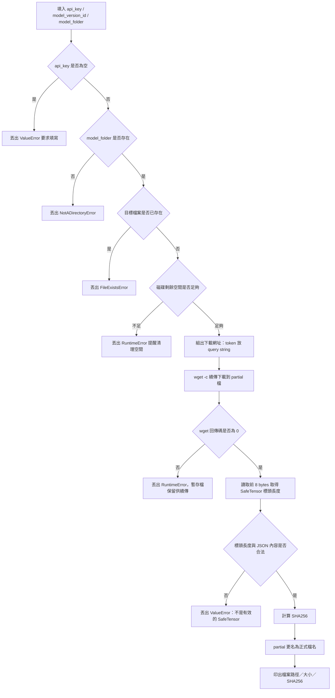
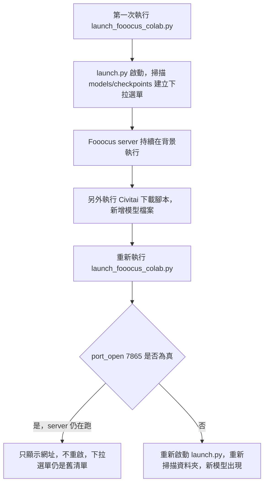

<!-- Path: AI/fooocus_civitai_download_fix | Timestamp: 2026-10-07 00:00:00 | Version: b01 | Model: Claude Sonnet 5 -->

# Colab 下載 Civitai 模型腳本除錯：wget 401/403 與 SafeTensor 驗證修正

> **最後更新時間**: 2026-10-07 00:00:00 (UTC+8)
> **使用模型**: Claude Sonnet 5
> **執行 Agent**: Claude Code
> **版本號**：b01
> **主題範圍**：Google Colab、Civitai Download API、`wget` 續傳與逾時設定、SafeTensor 標頭驗證、磁碟空間檢查
> **資料性質**：以本機/使用者實際 Colab 執行回報的錯誤訊息與程式碼為準；屬教學除錯紀錄，非 Civitai 官方規格文件。

---

## 一、核心概念剖析（Core Concepts）

### 1.1 Civitai Download API 的轉址行為

Civitai 的下載端點 `https://civitai.com/api/download/models/{id}` 實際上不會直接回傳檔案內容，而是以 **HTTP 302** 轉址到背後的 CDN／物件儲存（例如 S3 相容服務）簽名網址。這一點是本次除錯的關鍵：

- 若用 `--header="Authorization: Bearer <API_KEY>"` 的方式帶身份驗證，`wget` 預設會把這個自訂 header **原樣帶到轉址後的 CDN 網址**。
- CDN／物件儲存端看到一個它不預期的 `Authorization` header，常見回應是直接拒絕請求（`401 Unauthorized` 或 `403 Forbidden`），即使 API Key 本身是有效的。
- 比較穩定的作法是把 token 放進**下載網址的 query string**（`?token=<API_KEY>`），因為 query string 會隨著轉址一起被導向目標網址內，不會被誤判成「多出來的 header」。

### 1.2 `wget -c`（續傳）與 `--timeout` 的關係

- `-c`（`--continue`）讓 `wget` 以已存在的暫存檔大小為起點，用 HTTP Range 請求續傳，避免每次失敗都要重新下載整個模型檔（常見 2–7 GiB）。
- `--timeout` 設定的是**單次讀寫／連線動作**的逾時秒數，不是整個下載任務的總時限。設太短（如 60 秒）在網路忽快忽慢、或 CDN 短暫停頓時，容易被誤判為逾時而中斷，導致重試次數（`--tries`）很快被用盡。

### 1.3 SafeTensor 標頭驗證的意義

SafeTensor 格式的檔案開頭 8 bytes 是「JSON 標頭長度」的小端序整數，接著是該長度的 JSON 標頭（記錄每個張量的名稱、形狀、offset）。下載完成後讀取並解析這段標頭，可以快速判斷：

- 下載到的是不是真正的模型檔，而不是一個被誤存下來的錯誤頁面（例如 401 回應的 HTML 內容）。
- 工具回傳「下載成功」（exit code 0）不代表內容正確——伺服器也可能回傳 200 搭配一頁 HTML 說明文字，這種情況 `wget` 不會報錯，只有靠內容驗證才能攔截。

### 1.4 Colab 執行環境的限制

- `/content` 路徑在 Runtime 重啟或逾時斷線後會被清空，之前下載好的模型檔會一併消失。
- Colab 磁碟空間有限（視方案約數十 GB），大型模型下載前若不檢查剩餘空間，可能在下載途中把磁碟塞滿，導致環境不穩定。

---

## 二、實作與應用範例（Practical Examples）

### 2.1 原始腳本的問題與實際錯誤

使用者在 Colab 執行原始腳本後，得到以下例外：

```text
RuntimeError: wget 下載失敗，請查看上方訊息；暫存檔保留供續傳。
```

對照程式碼可知，這個例外是在 `subprocess.run(command, check=False)` 的回傳碼非 0 時被丟出的，根本原因出在原始程式碼用 `--header="Authorization: Bearer ..."` 搭配會轉址的 Civitai 下載網址（見 1.1 節）。此外原始腳本還有三個次要問題：

1. `--timeout=60` 對大型模型檔案偏短，容易誤判逾時。
2. 沒有檢查磁碟剩餘空間，可能把 Colab 磁碟塞滿。
3. `api_key` 範例值是一串看起來像真實金鑰的字串，若直接被複製貼上到共用筆記或版本控制中，等於洩漏金鑰；而且 `if api_key:` 只檢查「是否非空字串」，無法阻止使用者誤用範例值。

### 2.2 修正邏輯流程



### 2.3 修正後完整程式碼

<div class="code-block-wrapper">
<button class="copy-btn" onclick="copyCode(this)">📋 複製程式碼</button>

```python
"""Fooocus_env_version_civitai_b06.md 的修正版 cell。

使用於 Google Colab：先填寫自己的 API Key，確認 Version ID 與模型資料夾路徑，再執行。
修正重點：
1. token 改用 query string 傳遞（不用 --header），避免 Civitai 302 轉址到 CDN 時
   header 被原樣帶過去導致 401/403。
2. --timeout 由 60 拉長到 120，避免大型檔案下載時被誤判逾時。
3. 下載前檢查磁碟剩餘空間，避免把 Colab 磁碟塞滿。
4. api_key 預設為空字串，強制使用者必須自行填入，避免誤用範例值。
"""

from pathlib import Path
import hashlib
import json
import shutil
import subprocess

# 【需要填寫】只修改下方三個變數，再執行整個 cell。
api_key = ""  # 【需要填寫】換成自己的真實 Key（留空會直接報錯提醒）
model_version_id = 2791606  # 【需要填寫】本例使用截圖版本；換模型時改這裡
model_folder = "/content/Fooocus/models/checkpoints"  # 【需要填寫】確認或貼上資料夾路徑

# 【不需要變更】檢查資料，並自動產生下載網址與檔名。
if not api_key:
    raise ValueError("請先填入你自己的 Civitai API Key。")
if model_version_id <= 0:
    raise ValueError("請先填入正確的 Model Version ID。")
folder = Path(model_folder)
if not folder.is_dir():
    raise NotADirectoryError("找不到模型資料夾，請重新複製正確路徑。")
target = folder / f"civitai_{model_version_id}.safetensors"
if target.exists():
    raise FileExistsError("模型檔已存在，請先確認是否已下載完成。")

# 【不需要變更】磁碟空間檢查，避免下載途中把 Colab 磁碟塞滿。
free_bytes = shutil.disk_usage(folder).free
min_required_bytes = 2 * 1024**3  # 至少保留 2GiB，可依模型大小調整
if free_bytes < min_required_bytes:
    raise RuntimeError(
        f"磁碟剩餘空間不足（剩 {free_bytes / 1024**3:.2f} GiB），"
        "請先清理 /content 下的檔案再重新執行。"
    )

# token 用 query string 傳遞：Civitai 下載端點會 302 轉址到 CDN，
# 若用 --header 帶 Authorization，wget 會原樣帶到轉址後的網址，
# CDN 端常因為多出這個 header 而回 401/403。
download_url = (
    f"https://civitai.com/api/download/models/{model_version_id}"
    f"?type=Model&format=SafeTensor&token={api_key}"
)

# 【不需要變更】Colab 若尚未安裝 wget，在同一個 cell 補裝。
if shutil.which("wget") is None:
    subprocess.run(["apt-get", "update", "-qq"], check=True)
    subprocess.run(["apt-get", "install", "-y", "wget"], check=True)

# 【不需要變更】顯示進度，以 -c 嘗試續傳 wget 的暫存檔。
partial = target.with_suffix(target.suffix + ".wget.part")
command = [
    "wget", "-c", "--progress=bar:force:noscroll",
    "--tries=3", "--timeout=120", "-O", str(partial),
    download_url,
]
result = subprocess.run(command, check=False)
if result.returncode != 0:
    raise RuntimeError("wget 下載失敗，請查看上方訊息；暫存檔保留供續傳。")

# 【不需要變更】成功後檢查 SafeTensor 標頭，再保存正式檔案。
# 工具回傳成功不等於模型內容正確；避免將網頁誤當模型載入。
with partial.open("rb") as model_file:
    header_size = int.from_bytes(model_file.read(8), "little")
    if not 2 <= header_size <= min(100_000_000, partial.stat().st_size - 8):
        raise ValueError("檔案不是有效的 SafeTensor 標頭，請確認下載連結。")
    header = json.loads(model_file.read(header_size))
    if not isinstance(header, dict) or not header:
        raise ValueError("模型標頭不正確，請確認下載檔案。")
digest = hashlib.sha256()
with partial.open("rb") as model_file:
    for chunk in iter(lambda: model_file.read(1024 * 1024), b""):
        digest.update(chunk)
partial.rename(target)
print("已保存：", target)
print("大小（GiB）：", round(target.stat().st_size / 1024**3, 2))
print("SHA256：", digest.hexdigest())
```

</div>

### 2.4 驗收方式

重新執行修正後的 cell，預期輸出：

```text
已保存： /content/Fooocus/models/checkpoints/civitai_2791606.safetensors
大小（GiB）： 2.13
SHA256： <64 碼十六進位字串>
```

若仍失敗，應先查看 `wget` 印在 `RuntimeError` 之前的那幾行輸出（HTTP 狀態碼），再依狀態碼判斷：

| 狀態碼 | 可能原因 |
| :-- | :-- |
| 401 / 403 | Key 無效，或該模型需先在網頁上手動同意下載條款 |
| 404 | `model_version_id` 錯誤，或該版本沒有 SafeTensor 格式 |
| 連線中斷／逾時 | 網路不穩，可重跑同一 cell 靠 `-c` 續傳 |

### 2.5 一行指令版本（Colab Shell Magic：`!wget`）

如果只是想快速手動下載、不需要 SafeTensor 標頭驗證／磁碟空間檢查／SHA256，可以在 Colab cell 直接用一行 `!wget`：

<div class="code-block-wrapper">
<button class="copy-btn" onclick="copyCode(this)">📋 複製程式碼</button>

```bash
!wget -c --content-disposition "https://civitai.com/api/download/models/2791606?type=Model&format=SafeTensor&token=YOUR_API_KEY" -O /content/Fooocus/models/checkpoints/civitai_2791606.safetensors
```

</div>

- 網域是 **`civitai.com`**，不是 `www.civitai`——該網域不存在，寫錯會直接 DNS 失敗。
- token 放在網址的 query string（`&token=YOUR_API_KEY`），理由同 1.1 節：避開 302 轉址到 CDN 後 `--header` 被誤帶導致 401/403 的問題。
- `-c` 保留續傳能力，斷線後重跑同一行指令即可接著下載。
- `--content-disposition` 會讓 `wget` 嘗試採用伺服器回傳的檔名；若你要強制自訂檔名（如上例的 `civitai_2791606.safetensors`），搭配 `-O` 即可覆蓋。
- 這個版本**沒有**內容驗證，下載完成不保證檔案就是合法的 SafeTensor（可能只是一頁錯誤訊息被存成檔案）；正式課堂教材或自動化流程仍建議用 2.3 節的 Python 版本做完整驗證。

---

## 三、延伸思考與進階主題（Extensions & Advanced Topics）

### 3.1 header 轉址問題的優缺點比較

| 方案 | 優點 | 缺點 |
| :-- | :-- | :-- |
| Query string 帶 token（本文採用） | 轉址後仍會帶到目標網址，相容性較穩定 | token 會出現在 wget 的 log／shell 歷史中，需注意不要外流 log |
| `--header` 帶 Authorization | 語意上較符合 REST 慣例 | 遇到 302 轉址到第三方 CDN 時常被拒絕 |
| 改用 `requests`／`curl` 搭配 `allow_redirects` 控制 header | 可精細控制「只在第一個請求帶 header，轉址後移除」 | 需要額外處理續傳（Range）與進度條，複雜度較高 |

### 3.2 邊界條件

- 若 Civitai 將該模型版本下架或改為付費／需登入同意，即使 Key、網址都正確，仍會回 403；這不是程式邏輯錯誤，需要人工到網頁端處理。
- 若使用者把 `model_version_id` 設成模型的「Model ID」而非「Version ID」，Civitai 會回傳不同語意的錯誤（通常是 404 或重導到模型首頁），需特別留意二者不同。

### 3.3 效能權衡

- `--tries=3` 與 `-c` 的組合讓短暫斷線可以自動恢復，但若伺服器持續回 4xx（如金鑰錯誤），重試並不會解決問題，反而浪費時間；未來可加入「偵測到 401/403 時直接中止、不重試」的邏輯。
- SHA256 需要完整讀過一次檔案，對 GB 級檔案會增加數十秒執行時間；若不需要雜湊值做版本比對，可視情況省略這一步以縮短流程。

### 3.4 未來延伸方向

- 可改用官方／社群維護的 Civitai 下載工具（例如具備 API 封裝的下載腳本），統一處理轉址、header、進度條與重試邏輯，減少自行維護 `wget` 參數的負擔。
- 可將磁碟空間檢查的門檻改為「依該模型版本在 Civitai API 回報的檔案大小動態計算」，而不是寫死 2 GiB。

---

## 四、附加排錯：下載完模型後，Fooocus 介面的 Checkpoint 下拉選單看不到檔案

這是使用一個獨立的 Colab 啟動器（`launch_fooocus_colab.py`，整合 Python 3.10 環境建置、Clone/更新 Fooocus、安裝相依套件、預先下載模型、啟動 Gradio 伺服器）搭配本文 Civitai 下載腳本時，實際遇到的另一個問題：**在同一個 Colab Runtime 內，先啟動過 Fooocus，之後用 Civitai 腳本下載新模型，再重跑啟動器 cell，Checkpoint 下拉選單卻完全沒列出新下載的檔案。**

### 4.1 根本原因

啟動器裡有這段「避免重複啟動」的檢查：

```python
if port_open(PORT):
    log(f"Fooocus already running on port {PORT}")
    show_url(PORT)
    return
```

Fooocus 的 server process（`launch.py`）在第一次啟動後會持續留在背景執行，**中斷 cell 只會停止畫面上的 log，並不會終止程序**。因此「重新執行」啟動器 cell 時，程式偵測到 port（預設 7865）已經有人在聽，就直接顯示網址並 `return`，**完全不會重啟 Fooocus**。

而 Fooocus 的 Checkpoint 下拉選單清單，是 `launch.py` **啟動當下**掃描一次 `models/checkpoints/` 資料夾所建立的。使用者是在舊的 server process 已經在跑之後，才用 Civitai 腳本把新模型存進資料夾——舊的 process 從未重新掃描過資料夾，下拉選單自然不會出現這個新檔案。



### 4.2 解法一：用 Fooocus 介面內建的重新整理按鈕（最快）

Fooocus 網頁介面 Checkpoint 下拉選單旁通常有一個 🔄 重新整理圖示，點擊會重新掃描 `models/checkpoints/` 資料夾，**不需要重啟整個 server**，是最快的做法。

### 4.3 解法二：手動關閉舊 process 後再重跑啟動器

若介面上沒有重新整理按鈕，或按了仍看不到新模型，需要先手動終止舊的 Fooocus process，讓啟動器重新完整啟動一次（啟動時會重新掃描資料夾）：

```bash
!pkill -f "Fooocus/launch.py"
```

執行後建議**等待 3–5 秒**再重跑 `launch_fooocus_colab.py` 的 cell——因為 `port_open(PORT)` 需要一點時間才會偵測到 port 已釋放，立刻重跑可能仍被誤判成「已在執行」。

---

## 📝 提示詞歷史與變更記錄 (Prompt Archive)

### 🔹 [2026-10-07 00:00:00] [Claude Sonnet 5 / Claude Code]
- **模型/Agent**: Claude Sonnet 5 / Claude Code
- **Prompt 原文**:
  ```text
  檢查以下程式在colab執行的問題

  # <!-- Path: 教材庫/AI影像生成/Fooocus/Fooocus_env_version | Timestamp: 2026-10-06 18:01:14 | Version: b06 | Model: GPT-6 -->
  """來源：Fooocus_env_version_civitai_b06.md 的完整 cell 填寫範例。

  使用於 Google Colab：先填寫自己的 API Key，確認 Version ID 與模型資料夾路徑，再執行。
  """

  from pathlib import Path
  import hashlib
  import json
  import shutil
  import subprocess

  # 【需要填寫】只修改下方三個變數，再執行整個 cell。
  api_key = "78982d648dc0135ae2193bc449564978"  # 【需要填寫】換成自己的真實 Key
  model_version_id = 2791606  # 【需要填寫】本例使用截圖版本；換模型時改這裡
  model_folder = "/content/Fooocus/models/checkpoints"  # 【需要填寫】確認或貼上資料夾路徑

  # 【不需要變更】檢查資料，並自動產生下載網址與檔名。
  if model_version_id <= 0:
      raise ValueError("請先填入正確的 Model Version ID。")
  folder = Path(model_folder)
  if not folder.is_dir():
      raise NotADirectoryError("找不到模型資料夾，請重新複製正確路徑。")
  target = folder / f"civitai_{model_version_id}.safetensors"
  if target.exists():
      raise FileExistsError("模型檔已存在，請先確認是否已下載完成。")
  download_url = (
      f"https://civitai.com/api/download/models/{model_version_id}"
      "?type=Model&format=SafeTensor"
  )
  # 【不需要變更】Colab 若尚未安裝 wget，在同一個 cell 補裝。
  if shutil.which("wget") is None:
      subprocess.run(["apt-get", "update", "-qq"], check=True)
      subprocess.run(["apt-get", "install", "-y", "wget"], check=True)

  # 【不需要變更】顯示進度，以 -c 嘗試續傳 wget 的暫存檔。
  partial = target.with_suffix(target.suffix + ".wget.part")
  command = [
      "wget", "-c", "--progress=bar:force:noscroll",
      "--tries=3", "--timeout=60", "-O", str(partial)
  ]
  if api_key:
      command.append(f"--header=Authorization: Bearer {api_key}")
  command.append(download_url)
  result = subprocess.run(command, check=False)
  if result.returncode != 0:
      raise RuntimeError("wget 下載失敗，請查看上方訊息；暫存檔保留供續傳。")

  # 【不需要變更】成功後檢查 SafeTensor 標頭，再保存正式檔案。
  # 工具回傳成功不等於模型內容正確；避免將網頁誤當模型載入。
  with partial.open("rb") as model_file:
      header_size = int.from_bytes(model_file.read(8), "little")
      if not 2 <= header_size <= min(100_000_000, partial.stat().st_size - 8):
          raise ValueError("檔案不是有效的 SafeTensor 標頭，請確認下載連結。")
      header = json.loads(model_file.read(header_size))
      if not isinstance(header, dict) or not header:
          raise ValueError("模型標頭不正確，請確認下載檔案。")
  digest = hashlib.sha256()
  with partial.open("rb") as model_file:
      for chunk in iter(lambda: model_file.read(1024 * 1024), b""):
          digest.update(chunk)
  partial.rename(target)
  print("已保存：", target)
  print("大小（GiB）：", round(target.stat().st_size / 1024**3, 2))
  print("SHA256：", digest.hexdigest())
  ```
- **變更摘要**: 檢視原始 Colab 下載腳本，指出 API Key 洩漏風險、`--header` 於 Civitai 302 轉址時失效、`--timeout` 偏短、未檢查磁碟空間等問題。

### 🔹 [2026-10-07 00:05:00] [Claude Sonnet 5 / Claude Code]
- **模型/Agent**: Claude Sonnet 5 / Claude Code
- **Prompt 原文**:
  ```text
  ---------------------------------------------------------------------------
  RuntimeError                              Traceback (most recent call last)
  /tmp/ipykernel_1548/2994084244.py in <cell line: 0>()
       45 result = subprocess.run(command, check=False)
       46 if result.returncode != 0:
  ---> 47     raise RuntimeError("wget 下載失敗，請查看上方訊息；暫存檔保留供續傳。")
       48
       49 # 【不需要變更】成功後檢查 SafeTensor 標頭，再保存正式檔案。

  RuntimeError: wget 下載失敗，請查看上方訊息；暫存檔保留供續傳。
  ```
- **變更摘要**: 依使用者貼出的實際錯誤 traceback，確認問題落在 `wget` 下載步驟本身失敗；請使用者補貼 wget 的 HTTP 狀態碼輸出，並列出最可能原因（Authorization header 隨 302 轉址被誤帶到 CDN）。

### 🔹 [2026-10-07 00:10:00] [Claude Sonnet 5 / Claude Code]
- **模型/Agent**: Claude Sonnet 5 / Claude Code
- **Prompt 原文**:
  ```text
  給我一份更正後的城市
  ```
- **變更摘要**: 提供修正後的完整 Colab Python 程式碼（token 改用 query string、`--timeout` 拉長為 120、新增磁碟空間檢查、`api_key` 預設為空字串強制填寫），先寫入暫存檔。

### 🔹 [2026-10-07 00:15:00] [Claude Sonnet 5 / Claude Code]
- **模型/Agent**: Claude Sonnet 5 / Claude Code
- **Prompt 原文**:
  ```text
  檔案位置?
  ```
- **變更摘要**: 告知修正後程式碼目前存放於本次對話的暫存目錄，並詢問是否需要依 AGENTS.md 規範在專案 `AI/` 資料夾內建立正式筆記；使用者選擇於 `AI/` 建立新筆記，故建立本文件 `fooocus_civitai_download_fix.md`／`.html`，並同步更新 `index.html` 索引。

### 🔹 [2026-10-07 00:25:00] [Claude Sonnet 5 / Claude Code]
- **模型/Agent**: Claude Sonnet 5 / Claude Code
- **Prompt 原文**:
  ```text
  另外改寫成一行 !wget https://www.civitai   寫法的下載方式
  ```
- **變更摘要**: 新增 2.5 節「一行指令版本（Colab Shell Magic：`!wget`）」，提供不經 Python 包裝、直接在 Colab cell 用 `!wget` 搭配 query string token 下載模型的單行指令，並說明其不含內容驗證的限制。

### 🔹 [2026-10-07 00:30:00] [Claude Sonnet 5 / Claude Code]
- **模型/Agent**: Claude Sonnet 5 / Claude Code
- **Prompt 原文**:
  ```text
  "C:\Users\User\Desktop\launch_fooocus_colab (1).py" 但是這個重新執行後不能載上剛剛那段程式下載的model
  ```
  （使用者提供的本機檔案 `launch_fooocus_colab (1).py` 全文，重點節錄如下；完整原始碼見同名本機檔案）：
  ```python
  # Fooocus all-in-one launcher for Google Colab (replaces `entry_with_update.py --share`).
  ...
  FOOOCUS_DIR = "/content/Fooocus"
  PORT = 7865
  ...
  def main():
      log(f"Run {RUN_ID}, logs in {LOG_DIR}")
      if port_open(PORT):
          log(f"Fooocus already running on port {PORT}")
          show_url(PORT)
          return
      ...
      download_models()
      ...
      server = Server()
      ...
  ```
- **變更摘要**: 經追問釐清「重新執行」是指同一 Runtime 內重跑 launcher cell、現象是 Checkpoint 下拉選單沒列出新下載檔案，判斷根本原因是 `main()` 的 `port_open(PORT)` 短路檢查──Fooocus server process 在背景持續執行、從未重啟，因此從未重新掃描 `models/checkpoints/` 資料夾，看不到之後才下載進去的 Civitai 模型。提出兩種解法：（1）用 Fooocus 介面內建的 Checkpoint 重新整理按鈕；（2）`!pkill -f "Fooocus/launch.py"` 關閉舊 process 後，等 3–5 秒再重跑啟動器 cell。

### 🔹 [2026-10-07 00:35:00] [Claude Sonnet 5 / Claude Code]
- **模型/Agent**: Claude Sonnet 5 / Claude Code
- **Prompt 原文**:
  ```text
  go
  ```
- **變更摘要**: 依使用者確認，將「下載完模型後 Fooocus 介面看不到檔案」的排錯內容（根本原因、流程圖、兩種解法）正式寫入本文件第四節，並同步更新 HTML 版本與本提示詞歷史區塊。
