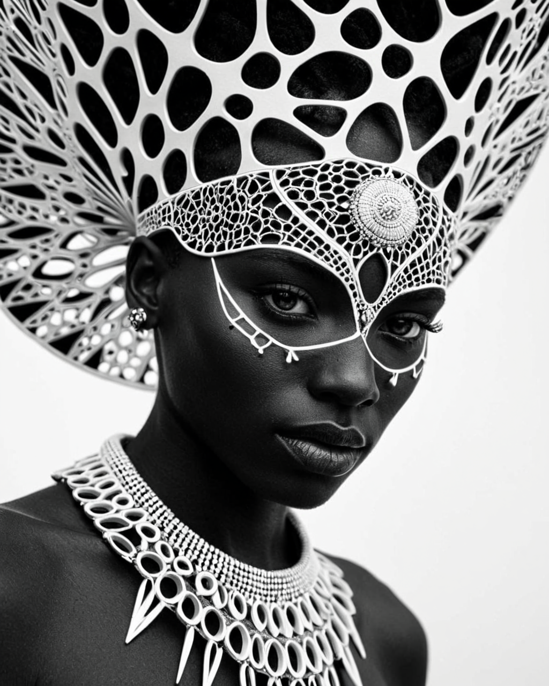
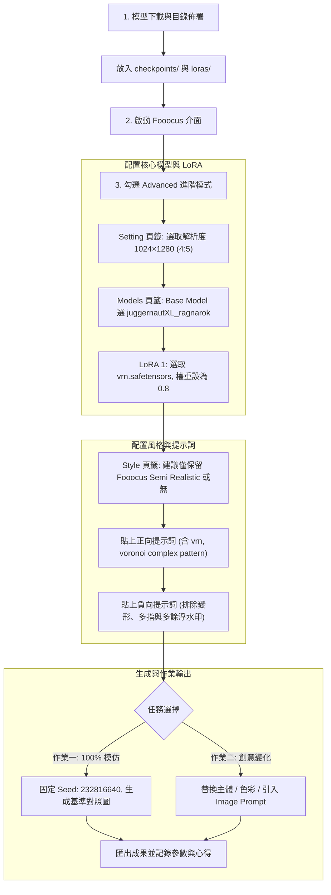

<!-- Path: AI/fooocus_voronoi_juggernaut_assignment | Timestamp: 2026-10-21 11:36:10 | Version: b01 | Model: Gemini 3.8 Flash -->

# Fooocus 影像生成課堂作業指引：以 Juggernaut XL 與 Voronoi LoRA 實現幾何細胞風格肖像的模仿與創意變化

> **最後更新時間**: 2026-10-21 11:36:10 (UTC+8)  
> **使用模型**: Gemini 3.8 Flash  
> **執行 Agent**: Antigravity  
> **版本號**：b01  
> **作業主題**：SDXL 幾何風格化、Juggernaut XL 底模、Voronoi LoRA 權重調控、Fooocus 模仿與創意變化實作  
> **參考來源**：  
> - 目標範例圖：[Civitai Image #145848150](https://civitai.com/images/145848150)  
> - 基礎模型：[Juggernaut XL (Ragnarok)](https://civitai.com/models/133005/juggernaut-xl?modelVersionId=1759168)  
> - 風格 LoRA：[Voronoi (vrn.safetensors)](https://civitai.com/models/3004897/voronoi?modelVersionId=3409217)  

---

## 🎯 課堂作業目標與學習成果

本作業旨在讓學員掌握 **SDXL 大模型架構**、**低秩適應（LoRA）權重調控**，以及在 **Fooocus 整合環境** 中的實際操作能力。透過解析 Civitai 上優質範例圖像的生成元數據（Metadata），學員將依序完成兩大任務：
1. **精準模仿（Exact Reproduction）**：理解 Prompt 結構、觸發詞（Trigger Words）、採樣器與 CFG 參數，在本地端或雲端 Fooocus 成功復刻出具備細胞鑲嵌紋理的黑白肖像。
2. **創意變化（Creative Variations）**：學會抽換主題主體、引入色彩系統、結合 Fooocus 特有的 Image Prompt / CPDS 多模態控制，創作出獨特且具備幾何藝術美感的衍生作品。

---

## 一、核心概念剖析（Core Concepts）

### 1.1 Voronoi 鑲嵌幾何原理與視覺美學（Voronoi Tessellation & Cellular Aesthetics）

**Voronoi 圖（泰森多邊形 / Dirichlet 鑲嵌）** 是一種將空間劃分為複數個多邊形單元的數學演算法：給定平面上一組離散種子點（Seed points），平面上任何一點都會歸屬於「距離它最近的那個種子點」所對應的多邊形區域。

```
     ┌─────────────┬──────────────┐
     │  • Seed 1   │   • Seed 2   │
     │   Cell A    │    Cell B    │
     ├─────────────┴──────┬───────┤
     │      • Seed 3      │•Seed 4│
     │       Cell C       │Cell D │
     └────────────────────┴───────┘
```

- **自然界中的相似態**：長頸鹿皮膚斑塊、植物葉脈輸送網、昆蟲複眼及翅膀脈絡、乾燥泥土裂縫、肥皂泡膜聚集。
- **神經網路視角**：本作業使用的 LoRA 模型 `vrn.safetensors` 是透過大量帶有「多邊形細胞網狀結構（intricate cell networks）」的藝術作品進行微調訓練。它將 Cross-Attention（交叉注意力機制）與空間卷積層特徵進行綁定，當文本出現觸發詞 `vrn` 或 `voronoi complex pattern` 時，模型會主動在人體表面、衣物及飾品邊界生成由粗細多邊形線條交織的網絡。

### 1.2 SDXL 底模 Juggernaut XL (Ragnarok) 架構特性

Juggernaut XL 是 SDXL 1.0 系列中極具代表性的微調檢查點（Checkpoint）：
- **雙文本編碼器（Dual CLIP）優勢**：結合了 OpenCLIP ViT-bigG/14 與 CLIP ViT-L/14，大幅強化對長語意句、鏡頭角度（如 `camera angle front`）、人物特徵的解析精度。
- **強健的人體結構與微光影**：相較於一般的二次元或高度繪畫風格模型，Juggernaut XL 具有極高的寫實皮膚質地、體積光、陰影階調表現。
- **與幾何 LoRA 結合的互補性**：高幾何風格化的 LoRA 容易導致人物五官變形或融化，而 Juggernaut XL 具備強大的臉部解剖先驗知識，能確保在套用 `weight: 0.8` 的強烈幾何網格時，依然維持端正深邃的肖像結構。

### 1.3 Fooocus 工具特色與 WebUI 映射邏輯

Fooocus 是專為 SDXL 設計的高效能開源生成軟體，其內建機制與標準 AUTOMATIC1111 WebUI 有顯著差異：

| 功能項目 | SD WebUI / ComfyUI | Fooocus 實作機制 | 課堂設定要點 |
| :--- | :--- | :--- | :--- |
| **LoRA 語法** | 需在 Prompt 寫 `<lora:vrn:0.8>` | 在 UI 的 **Models -> LoRA** 欄位選取並設滑桿 | **Prompt 內不需寫 `<lora:...>` 標籤**，只需寫觸發詞 `vrn` |
| **預設風格（Styles）** | 需手動載入 Negative Embedding | 預設自動勾選 "Fooocus V2"、"Fooocus Masterpiece" | **幾何黑白風格請特別注意**：若線條被過度平滑，可關閉 Fooocus V2，改用 None 或 Semi Realistic |
| **採樣器配置** | 手動設定 DPM++ 2M SDE Karras | 預設封裝於 Speed (30步) / Quality (60步) | 本作業建議選擇 **Speed (30步)** 或在 Developer Debug 開啟 20 步自訂 |
| **Guidance (CFG)** | 預設常為 7.0 | SDXL 建議 3.5 ~ 5.5 | 原圖使用 **CFG = 5.0**，兼顧提示詞遵循與動態範圍 |
| **多模態影像引導** | ControlNet / T2I-Adapter | **Input Image (Image Prompt / CPDS / FaceSwap)** | 變化作業可直接將真人照片以 CPDS 模式注入網格結構 |

---

## 二、實作與應用範例（Practical Examples）

### 2.1 目標原圖與 Civitai 生成元數據解析



- **目標作品網址**：[https://civitai.com/images/145848150](https://civitai.com/images/145848150)
- **核心主角**：非洲戰士肖像、頭飾、細緻細胞網格皮膚與飾品、黑白高對比。
- **官方完整元數據擷取**：

```json
{
  "seed": 232816640,
  "Model": "juggernautXL_ragnarok",
  "Model_hash": "dd08fa32f9",
  "steps": 20,
  "sampler": "DPM++ 2M SDE",
  "Schedule type": "Karras",
  "cfgScale": 5,
  "width": 512,
  "height": 640,
  "Hires upscale": "2 (Latent, Denoise 0.7) -> 1024x1280",
  "prompt": "breathtaking \"vrn, voronoi complex pattern, portrait of an African warrior with a headdress, skin and ornaments rendered in intricate cell networks, black and white, camera angle front.\" <lora:vrn:0.8>, . award-winning, professional, highly detailed",
  "negativePrompt": "fat, obese, overweight, chubby, pudgy, bbw, plus size, Watermark, Text, censored, deformed, bad anatomy, disfigured, poorly drawn face, mutated, extra limb, ugly, poorly drawn hands, missing limb, floating limbs, disconnected limbs, disconnected head, malformed hands, long neck, mutated hands and fingers, bad hands, missing fingers, cropped, worst quality, low quality, mutation, poorly drawn, huge calf, bad hands, fused hand, missing hand, disappearing arms, disappearing thigh, disappearing calf, disappearing legs, missing fingers, fused fingers, abnormal eye proportion, Abnormal hands, abnormal legs, abnormal feet, abnormal fingers, sitting, seated, kneeling, crouching, lying down, muscular, bodybuilder, bulky muscles, masculine muscles, ugly, deformed, noisy, blurry, distorted, grainy",
  "resources": [
    { "name": "juggernautXL_ragnarok", "type": "model", "hash": "dd08fa32f9" },
    { "name": "vrn", "type": "lora", "weight": 0.8, "hash": "87a25679e04f" }
  ]
}
```

---

### 2.2 實作與生成流程圖（Fooocus Workflow）

在進入參數配置前，先透過以下流程圖掌握在 Fooocus 中實作本作業的標準步驟：



---

### 2.3 模型下載與配置輔助腳本

若使用 Google Colab 或本機終端機，可利用以下 Bash / Python 腳本快速將模型下載到 Fooocus 對應路徑：

```bash
#!/bin/bash
# ==============================================================================
# Fooocus 課堂作業：Juggernaut XL 與 Voronoi LoRA 快速佈署腳本
# 說明：下載指定版本的 Checkpoint 與 LoRA，並自動校驗存放路徑。
# ==============================================================================

FOOOCUS_ROOT="./Fooocus"
CHECKPOINT_DIR="${FOOOCUS_ROOT}/models/checkpoints"
LORA_DIR="${FOOOCUS_ROOT}/models/loras"

# 建立存放目錄
mkdir -p "${CHECKPOINT_DIR}"
mkdir -p "${LORA_DIR}"

echo "[INFO] 開始下載 Juggernaut XL (Ragnarok)..."
# Juggernaut XL Ragnarok 模型 (約 6.6 GB)
wget -c --timeout=600 \
  "https://civitai.com/api/download/models/1759168?fileId=1659952" \
  -O "${CHECKPOINT_DIR}/juggernautXL_ragnarok.safetensors"

echo "[INFO] 開始下載 Voronoi SDXL LoRA..."
# Voronoi LoRA 模型 (約 177 MB)
wget -c --timeout=300 \
  "https://civitai.com/api/download/models/3409217?fileId=3301060" \
  -O "${LORA_DIR}/vrn.safetensors"

echo "[SUCCESS] 下載完成！請在 Fooocus 介面中重新整理模型清單。"
```

---

### 2.4 任務一：100% 精確模仿操作步驟（Exact Reproduction）

請依照以下具體設定在 Fooocus 中操作：

1. **勾選 `[x] Input Image` 與 `[x] Advanced`**。
2. **Setting 標籤頁**：
   - **Performance**：選擇 `Speed`（或 `Quality`）。
   - **Aspect Ratios**：選擇 `1024×1280 (4:5)`。
   - **Image Number**：設為 `1`。
3. **Models 標籤頁**：
   - **Base Model (SDXL only)**：選擇 `juggernautXL_ragnarok.safetensors`。
   - **Refiner (SDXL or None)**：選擇 `None`（Juggernaut XL 本身已具備極高細節，不需額外 Refiner）。
   - **LoRA 1**：選擇 `vrn.safetensors`，右側數值拉至 `0.8`。
   - **LoRA 2 ~ 5**：設為 `None`。
4. **Style 標籤頁**：
   - 取消勾選預設的 `Fooocus V2`（避免其自動補詞稀釋黑白幾何結構）。
   - 勾選 `Fooocus Semi Realistic`（或只保留 Default）。
5. **Prompt 填寫（正向提示詞）**：
   ```text
   breathtaking "vrn, voronoi complex pattern, portrait of an African warrior with a headdress, skin and ornaments rendered in intricate cell networks, black and white, camera angle front.", award-winning, professional, highly detailed
   ```
6. **Negative Prompt 填寫（負向提示詞）**：
   ```text
   fat, obese, overweight, chubby, pudgy, bbw, plus size, Watermark, Text, censored, deformed, bad anatomy, disfigured, poorly drawn face, mutated, extra limb, ugly, poorly drawn hands, missing limb, floating limbs, disconnected limbs, disconnected head, malformed hands, long neck, mutated hands and fingers, bad hands, missing fingers, cropped, worst quality, low quality, mutation, poorly drawn, huge calf, bad hands, fused hand, missing hand, disappearing arms, disappearing thigh, disappearing calf, disappearing legs, missing fingers, fused fingers, abnormal eye proportion, Abnormal hands, abnormal legs, abnormal feet, abnormal fingers, sitting, seated, kneeling, crouching, lying down, muscular, bodybuilder, bulky muscles, masculine muscles, ugly, deformed, noisy, blurry, distorted, grainy
   ```
7. **Developer Debug Mode（進階微調，可選）**：
   - 若欲完全還原原圖 Seed，至 Debug Mode 勾選固定 Seed 並輸入 `232816640`。
   - Guidance Scale 設為 `5.0`。
8. **點擊「Generate」**，產出你的模仿作業基準圖。

---

### 2.5 任務二：五大創意變化方向範例（Creative Variations）

為引導學員完成延伸作業，以下提供 5 個不同面向的創意靈感與提示詞模板，可以直接套用並觀察 LoRA 在不同主題下的幾何重構能力：

#### 變化方向 A：未來賽博格生化戰士（Cyberpunk Voronoi Android）
* **設計理念**：將黑白肖像轉為未來科幻，讓細胞網格變成透明矽膠與電路發光管，結合機械光影。
* **Prompt**：
  ```text
  breathtaking "vrn, voronoi complex pattern, portrait of a female cyborg android, translucent skin and cybernetic ornaments rendered in intricate glowing cell networks, neon blue and amber fiber optics pulsing under ceramic plates, cinematic lighting, sharp focus, 8k masterpiece."
  ```
* **Negative Prompt**：`organic tissue, gore, blurry, bad anatomy, deformed face, low resolution, watermark`
* **推薦設定**：LoRA 權重 `0.85`，Style 加上 `Fooocus Sharp`。

#### 變化方向 B：神話靈獸狂嘯（Mythological Beast - Howling Wolf）
* **設計理念**：將人物肖像延伸到生物形體，呈現毛皮與肌肉被幾何星空網絡包覆的超現實視覺（對應 Civitai 示範圖二）。
* **Prompt**：
  ```text
  breathtaking "vrn, voronoi complex pattern, a magnificent spirit wolf howling at a glowing crescent moon, body and fur formed by layered cell networks, deep night sky background with glittering nebula, side profile view, mystic aura, epic scale."
  ```
* **Negative Prompt**：`deformed limbs, extra legs, mutated paws, text, low quality, blurry`
* **推薦設定**：LoRA 權重 `0.75`，Aspect Ratio `1280×1024`（橫幅風景）。

#### 變化方向 C：琉璃彩繪大教堂（Stained Glass Sacred Art）
* **設計理念**：打破黑白限制，將 Voronoi 多邊形直接轉化為哥德式教堂的彩色鑲嵌玻璃，強烈後光穿透。
* **Prompt**：
  ```text
  masterpiece "vrn, voronoi complex pattern, majestic portrait of a guardian angel with grand wings, face and feather wings rendered in vibrant stained glass cell networks, brilliant morning sunlight beaming through translucent colorful crystal polygons, dramatic volumetric rays, high contrast, black lead lines."
  ```
* **Negative Prompt**：`monochrome, dull colors, oversaturated, deformed hands, cartoonish, lowres`
* **推薦設定**：LoRA 權重 `0.9`，Style 勾選 `Fooocus Masterpiece`。

#### 變化方向 D：現代金繼與碎裂大理石雕塑（Kintsugi Marble Bust）
* **設計理念**：結合古典雕塑與日本「金繼」美學，將細胞多邊形的接縫轉化為流動的黃金填縫。
* **Prompt**：
  ```text
  stunning studio photograph, "vrn, voronoi complex pattern, classical marble bust of a Greek philosopher, facial surface divided into geometric cell networks joined by molten liquid gold kintsugi seams, elegant black velvet museum background, dramatic rim lighting, tactile stone texture."
  ```
* **Negative Prompt**：`plastic look, flat lighting, text, watermark, bad symmetry`
* **推薦設定**：LoRA 權重 `0.7`，CFG `4.5`。

#### 變化方向 E：Fooocus 獨門玩法——上傳真人照片轉幾何 Voronoi（Image Prompt + CPDS）
* **設計理念**：利用 Fooocus 的多模態圖像引導功能，把學員自己的生活照或大頭照轉換成原圖風格的非洲戰士幾何藝術！
* **操作 SOP**：
  1. 勾選底部 `[x] Input Image` -> 切換到 `Image Prompt` 標籤。
  2. 點擊 `Advanced`，將輸入模式切換為 **CPDS**（Contrast-Preserving Decoupling Structure，對比度結構保持）或 **ImagePrompt**。
  3. 上傳一張清晰的大頭照，`ImagePrompt Stop At` 設為 `0.85`，`Weight` 設為 `0.6`。
  4. 提示詞填寫：
     ```text
     "vrn, voronoi complex pattern, person rendered in intricate geometric cell networks, black and white portrait, dramatic contrast, studio lighting"
     ```
  5. 點擊生成，模型將完美保持原圖的五官臉型，但全面覆蓋上 Voronoi 幾何細胞藝術！

---

## 三、延伸思考與進階主題（Extensions & Advanced Topics）

### 3.1 LoRA 權重梯形效應分析（Weight Ramp Analysis）

在調整 `vrn.safetensors` 的權重滑桿時，模型對圖像結構的干預呈現非線性變化：

```
LoRA 權重 (Weight)
0.0 ──────────────── 0.4 ──────────────── 0.8 ──────────────── 1.2+
[完全寫實人像]      [局部幾何微紋]       [黃金平衡點]         [極度解構抽象]
- 無細胞網絡         - 僅在邊緣有淡痕     - 五官立體、網格深刻 - 臉孔破碎、雜訊溢出
```

- **0.3 ~ 0.5**：適合微量風格化。人物依然是高度逼真的照片，僅在光影交界處有些微多邊形肌理。
- **0.7 ~ 0.85（原圖推薦點）**：**最佳黃金平衡點**。LoRA 的結構引導充分發揮，細胞網絡深刻刻劃在皮膚與頭飾上，且 Juggernaut XL 仍能精準維持面部神情與眼部銳利度。
- **1.0 以上**：幾何多邊形強度過高，面部特徵容易開始崩解破碎，皮膚可能出現不自然的偽影（Artifacts）。

### 3.2 樣式溢出（Style Bleeding）與提示詞隔離

當我們在提示詞中加入強烈的色彩指令（例如 `glowing blue cybernetics`），有時會發現背景也莫名其妙變成藍色幾何塊，這在注意力機制中稱為「**樣式溢出（Style Bleeding）**」。
* **解決技巧 1（主體錨定）**：使用明確的受詞子句，將形容詞限定在主體身上，如 `a woman with glowing blue cybernetic face, against an absolute dark pure black background`。
* **解決技巧 2（反向提示詞壓制）**：在 Negative Prompt 中明確加入被污染的特徵，例如在黑白創作時加入 `color, colorful, saturated`。

### 3.3 商業設計與跨領域落地價值

Voronoi 幾何圖元生成不僅限於二維圖片展示，在當前產業設計中具備高價值延伸應用：
1. **3D 列印與參數化建築（Parametric Design）**：生成的 Voronoi 網格常被轉為 Depth Map（深度圖）或 Normal Map（法線圖），匯入 Blender / Rhino 進行置換貼圖（Displacement Mapping），製作出參數化鏤空外殼與燈具。
2. **潮玩與時尚公仔（Art Toys & Figurines）**：將 Voronoi 戰士或靈獸輸出為手辦模型概念圖，作為 3D 雕刻師 ZBrush 建模的幾何風格參考。
3. **雷射雕刻與金屬蝕刻**：黑白高對比的 Voronoi 向量化後，非常適合用於雷射切割木雕、金屬陽極蝕刻面板與皮革烙印。

---

## 四、作業繳交標準與驗收檢核表（Submission Checklist）

學員繳交作業時，請附上以下成果：

- [ ] **任務一成果圖**：100% 模仿 African Warrior 之產出圖（需附完整截圖含 Seed 與 LoRA 設定）。
- [ ] **任務二成果圖**：自選 1~2 個方向之創意變化圖（主題變更、色彩引入、或個人照片轉換）。
- [ ] **參數紀錄表**：記錄你的 Prompt、Negative Prompt、LoRA 權重數值與使用的 Fooocus Style。
- [ ] **心得反思（150 字內）**：說明你在調整 LoRA 權重時觀察到的畫質變化，以及遇到哪些問題（如多指、網格碎裂）是如何透過負向詞或參數調整排除的。

---

## 📝 提示詞歷史與變更記錄 (Prompt Archive)

### 🔹 [2026-10-21 11:36:10] Gemini 3.8 Flash 變更紀錄
- **模型/Agent**: Gemini 3.8 Flash / Antigravity
- **Prompt 原文**:
  ```text
  今天影像生成的課程，用fooocus指定生成一張作業，使用的圖片是 https://civitai.com/images/145848150 根據這個圖片的生成資料，下載了模型與lora，可以在fooocus生成的時候模仿與變化， https://civitai.com/models/133005/juggernaut-xl?modelVersionId=1759168 https://civitai.com/models/3004897/voronoi?modelVersionId=3409217 這是模型與lora
  ```
- **變更摘要**: 建立完整 Fooocus 課堂作業指引，涵蓋 Juggernaut XL 與 Voronoi LoRA 之幾何原理、Civitai 145848150 官方元數據還原、Fooocus 操作 SOP、下載腳本、五大創意變化提案與權重調校分析。
