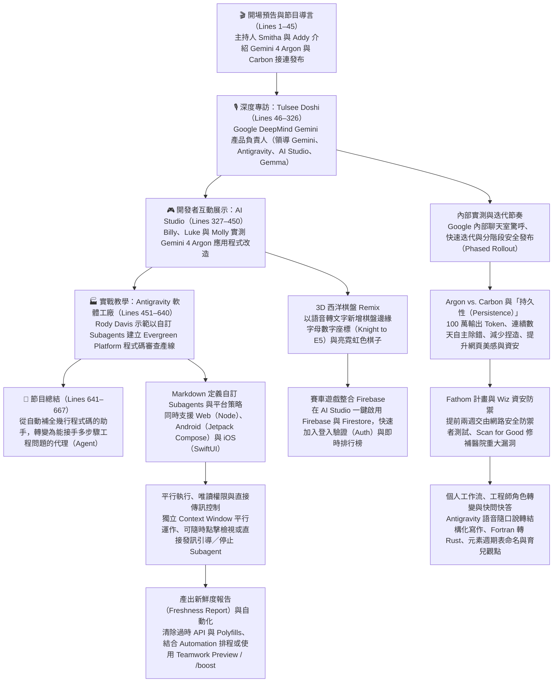

# 🚀 How Gemini 4 Argon & Carbon Were Built ft. DeepMind's Head of Gemini Product（Gemini 4 Argon 與 Carbon 研發幕後專訪與實戰展示：中英對照與逐字稿勘誤還原）

> **最後更新時間**: 2026-11-18 11:36:00 (UTC+8)
> **使用模型**: Gemini 4 Argon (Medium)
> **執行 Agent**: Antigravity
> **原始檔案**: `How Gemini 4 Argon  Carbon were built ft. DeepMinds Head of Gemini Product.txt`（共 667 行）
> **語音轉文字工具**: [Whisper_WebUI](https://github.com/joelhoty/Whisper_WebUI)

---

## 🧭 節目段落結構圖

以下流程圖完全依據原始逐字稿內容繪製，呈現本期《The Google Cloud Show》的四個核心段落：



---

## 📖 一、中英文對照逐字稿整理文章（保留原文語意與上下文錯字更正）

> [!NOTE]
> **整理說明**：本節嚴格依據原始逐字稿（共 667 行）之順序與內容整理為自然段落，**不添加任何外部資訊**，完整保留所有對話與轉場；針對語音辨識（ASR）產生的同音錯字（如 `Argonne / our gun / R gone` → `Argon`、`Full feed, though, she / Pulsi / to fit / tools he` → `Tulsee Doshi / Tulsee`、`anti-gravity / Enter gravity` → `Antigravity`、`FairWin / Farron` → `Fathom`、`for Trent rust` → `Fortran to Rust` 等），已根據上下文語意更正於英文段落中，並提供逐段中文對照翻譯。100% 原始未改動之 667 行逐行文本與行間勘誤對照，請見文末第三節。

---

### 【開場預告與節目導言】Opening Teaser & Show Introduction (Lines 1–45)

#### 🔹 節目精彩預告 (Lines 1–13)
* **English (Corrected Transcript)**:
  > **Tulsee Doshi**: "I woke up in the morning and we see all of these chats being like, 'Oh my god, wait, this model is awesome.'"
  > **Smitha**: "Be honest, does Gemini ever make it to the dance studio?"
  > **Tulsee Doshi**: "Gemini makes it more to the dance studio than I would like to admit. I think it is currently making it into all facets of my life."
  > **Luke / Molly**: "All of these different apps that people have already made with Argon... I'm ready to see. Oh! Go, go, go, go! Five, four, three, two..."
  > **Rody Davis**: "And Antigravity has some options that really help here. With Gemini 4 Argon, which is really good at running really long-horizon tasks, you can use Teamwork Preview."
* **中文對照**:
  > **Tulsee Doshi**：「我早上醒來，看到所有聊天室都在說：『天啊，等等，這個模型太棒了！』」
  > **Smitha**：「老實說，Gemini 曾經進過舞蹈教室嗎？」
  > **Tulsee Doshi**：「Gemini 進入舞蹈教室的頻率比我願意承認的還要高。我覺得它目前已經滲透到我生活的各個層面了。」
  > **Luke / Molly**：「人們已經用 Argon 做出了這所有不同的應用程式……我準備好要看了。喔！衝、衝、衝、衝！五、四、三、二……」
  > **Rody Davis**：「而且 Antigravity 有一些非常實用的選項。搭配非常擅長執行超長程（long-horizon）任務的 Gemini 4 Argon，你可以使用 Teamwork Preview。」

#### 🔹 主持人開場：Gemini 4 Argon 與 Carbon 雙模型重磅發布 (Lines 14–45)
* **English (Corrected Transcript)**:
  > **Smitha**: Welcome to the Google Cloud Show, I'm Smitha.
  > **Addy**: Hi, I'm Addy. You know, it's been a pretty exciting few weeks for Gemini 4. We've got two major model releases, one right after another. So today, let's break down what is new.
  > **Smitha**: Exactly. Recently, Google actually launched Gemini 4 Argon, which was built for deep reasoning and multi-step workflows. And it has an output capacity of 1 million tokens.
  > **Addy**: Yeah, and shortly after, we've got Gemini 4 Carbon. Carbon took the number one spot on the Artificial Analysis Intelligence Index. But what we find even more interesting is what it can actually do. You know, internally, engineering teams have seen Carbon work autonomously for days, tracking down bugs, working through challenges, and even fixing issues across large codebases.
  > **Smitha**: And another thing is that the cybersecurity numbers are also a huge part of that story. Both Argon and Carbon actually rolled out to trusted cybersecurity defenders first through the Fathom program.
  > **Addy**: Yeah, and safety is another big part of the story. You know, on Terminal-Bench 4.0 and the Gray Swan benchmark, Carbon brought successful jailbreaking and indirect prompt injection attack rates down to 0%. Which brings up a really interesting question: So how do you build a model that can work on its own for days, while still making sure it stays on track?
  > **Smitha**: So to find out exactly that, I actually chatted with the person leading the product strategy behind it all: Tulsee Doshi, Senior Director and Head of Product for the Gemini model family at Google DeepMind, where she leads product for Gemini, Antigravity, AI Studio, and Gemma. Before that, she actually spent five years as the Head of Product for Responsible AI at Google. So let's jump right into my conversation with Tulsee.
* **中文對照**:
  > **Smitha**：歡迎收看《Google Cloud Show》，我是 Smitha。
  > **Addy**：嗨，我是 Addy。這幾週對 Gemini 4 來說相當令人振奮，我們接連迎來了兩個重大模型發布。所以今天，讓我們來拆解有哪些新亮點。
  > **Smitha**：沒錯。最近 Google 推出了專為深度推理與多步驟工作流打造的 **Gemini 4 Argon**，而且它具備高達 100 萬個 Token 的輸出容量（output capacity）。
  > **Addy**：對，而且緊接著不久後，我們推出了 **Gemini 4 Carbon**。Carbon 在 Artificial Analysis 智慧指數（Intelligence Index）奪下了第一名寶座。但我們覺得更有趣的是它實際上能做到的事——在內部，工程團隊親眼見證 Carbon 連續數天自主運作，追查程式臭蟲（bugs）、克服難關，甚至跨大型程式碼庫（codebases）修復問題。
  > **Smitha**：另一點是，網路安全數據也是這個故事中極重要的一環。Argon 和 Carbon 都是透過 **Fathom 計畫**，優先提供給受信任的網路安全防禦者使用。
  > **Addy**：是的，安全性也是故事的另一大重點。在 Terminal-Bench 4.0 和 Gray Swan 基準測試中，Carbon 將成功的越獄（jailbreaking）與間接提示詞注入攻擊（indirect prompt injection attack）成功率降到了 **0%**。這引出了一個非常有趣的問題：究竟要如何打造一個能獨立運作好幾天，同時又能確保它不偏離軌道的模型？
  > **Smitha**：為了找出確切答案，我特別與主導這一切背後產品策略的負責人進行了對談：**Tulsee Doshi**，她是 Google DeepMind 的資深總監暨 Gemini 模型家族產品負責人，負責領導 Gemini、Antigravity、AI Studio 與 Gemma 的產品團隊。在此之前，她曾擔任 Google 負責任 AI（Responsible AI）產品負責人長達五年。現在就讓我們直接進入我與 Tulsee 的對談。

---

### 【第一部分】深度專訪：Google DeepMind 產品負責人 Tulsee Doshi (Lines 46–326)

#### 1. 實驗室裡的「Aha Moment」與內部即時測試 (Lines 46–79)
* **English (Corrected Transcript)**:
  > **Smitha**: Welcome to the Google Cloud Show, Tulsee. It's so nice to have you here.
  > **Tulsee Doshi**: Thanks, and thanks for having me, Smitha. Excited to be here. And yes, Gemini has been having an exciting month, so I'm glad to be here to talk about it.
  > **Smitha**: Amazing. So Tulsee, it's actually been an absolute whirlwind couple of weeks for you and the team. You know, you launched Gemini 4 Argon and then immediately unveiled Gemini 4 Carbon just two weeks later. So before we dive in, can you take us back to the lab before anyone outside Google actually had seen these models? What was the very first "Wait, this one is different" moment when the team was working on Argon or Carbon that was a surprise to you and the team?
  > **Tulsee Doshi**: Yeah, I mean, I think one of the things that I feel like is amazing about the Gemini 4 development process is how quickly we've been putting these models in the hands of Googlers. And so we've actually been really robust at creating kind of like a teamfood, live experiment program with Googlers. And I think the first moment of being really excited about this model is actually we have a few chat rooms where, you know, early testers are trying the model. And I woke up in the morning and we see all of these chats being like, "Oh my god, wait, this model is awesome." Like, and just examples of folks actually doing things with the model, just that like level of excitement and like level of just like, "Hey, there's something here." And I think actually this was before even I had tried the checkpoint properly. And so it actually gave me like a level of enthusiasm to try the checkpoint too. But I think it's that moment of really seeing that you are, that you've like hit something, you know, that you're like actually making something magical with users.
* **中文對照**:
  > **Smitha**：歡迎來到《Google Cloud Show》，Tulsee，非常高興邀請到妳。
  > **Tulsee Doshi**：謝謝，也謝謝妳邀請我，Smitha，很興奮來到這裡。是的，Gemini 這個月非常精彩，很高興能來聊聊。
  > **Smitha**：太棒了。Tulsee，這幾週對妳和團隊來說完全是一場旋風。妳們先推出了 Gemini 4 Argon，接著僅僅兩週後又立即揭曉了 Gemini 4 Carbon。在我們深入探討之前，妳能帶我們回到 Google 外部還沒有任何人見過這些模型之前的實驗室嗎？當團隊在研發 Argon 或 Carbon 時，第一個讓妳和團隊感到驚喜、覺得「等等，這一個很不一樣」的時刻是什麼？
  > **Tulsee Doshi**：好的，我覺得 Gemini 4 開發過程中非常棒的一點，是我們以極快的速度把這些模型交到 Google 員工（Googlers）手中。我們建立了一個非常健全的內部團隊實測（teamfood）即時實驗計畫。我覺得對這個模型感到超級興奮的第一個時刻，其實是在我們幾個早期測試者試用模型的聊天室裡。我早上醒來，看到所有聊天室都在說：「天啊，等等，這個模型太棒了！」裡面全是大家實際用這個模型做出各種成果的例子，那種興奮感、那種「嘿，這裡真的有點東西」的氛圍。而且這其實還在我自己正式試用那個檢查點（checkpoint）之前，所以這也讓我充滿熱情想去試試那個 checkpoint。我認為就是那個時刻，讓妳真正看見自己擊中了某個關鍵點、正在與使用者一起創造某種神奇的事物。

#### 2. 發布節奏的演進：內部高頻迭代與分階段安全發布 (Lines 80–112)
* **English (Corrected Transcript)**:
  > **Smitha**: I love that story, and kind of going from those internal aha moments to actually shipping them to the world is its own marathon, right? So you've launched Gemini 2, 2.5, and the 3 family, and now 4. Personally, what actually felt different for you about this rollout window for you, like compared to the past generations?
  > **Tulsee Doshi**: Relentless shipping—you know, Gemini has always been that way. Actually, if you look at even our history of Gemini 2, with some of the experimental models we released leading up to that, our Gemini 2.5 launch in which we actually also had a series of model releases that were in pretty close proximity to one another. So I think actually one of the things that we are very proud of is this idea of showcasing that velocity and building almost with the public, right? Like actually launching models, getting that feedback, using that feedback to quickly iterate. I think there is no substitute for putting a model in the hands of users and actually getting that response and getting that feedback on the other side. And so that's actually something that is, I think, a part of our DNA.
  > I think what is different for Gemini 4 has been actually how quickly we've been iterating internally, right? So like what I spoke about earlier, in terms of how quickly we're putting these models in the hands of Googlers, I think one thing that's been really special with this model development is how frequently we've been actually iterating with our internal population, getting that feedback, and then using that feedback to drive iteration. And then between the announcement and the launch, part of the reason we're structuring these launches this way is we want to be really intentional about safety and security, and we want to be really intentional about trust as we release these models. And so the announcement gives us the opportunity to first give the model to a set of testers to stress test them in a number of ways, and then to release them more broadly. And I think that iteration process is new for us—safety and security and caring about that is not, but this process of kind of announcing and then releasing. But I think that process is going to continue to be a part of how we develop models as they get more capable and as we have to be intentional about those capabilities.
* **中文對照**:
  > **Smitha**：我很喜歡這個故事。而從內部的「頓悟時刻（aha moments）」到真正將產品發布給全世界，本身就是一場馬拉松，對吧？妳已經發布過 Gemini 2、2.5、3 系列，現在則是 4。就妳個人而言，與過去幾代相比，這次的發布窗口讓妳覺得有什麼不同？
  > **Tulsee Doshi**：不間斷地持續發布（Relentless shipping）——妳知道，Gemini 一直都是如此。其實如果回顧我們 Gemini 2 的歷史，包括在那之前發布的一些實驗性模型，以及 Gemini 2.5 發布時，我們也曾密集推出一系列時間非常接近的模型。所以我認為我們非常自豪的一點，就是展現這種速度感，並且幾乎是「與公眾一起打造」：實際推出模型、獲取回饋，並利用這些回饋快速迭代。我認為沒有任何事能取代「把模型交到使用者手中，並真正獲得對方的反應與回饋」，這已經是我們 DNA 的一部分。
  > 我覺得 Gemini 4 真正的不同之處，在於我們**在內部迭代的速度有多快**。就像我剛才提到的，我們多快把模型交到 Google 員工手中；這次模型開發很特別的一點，是我們與內部群體進行迭代、收集回饋並用它來驅動改進的頻率。此外，在「正式宣布（announcement）」與「全面上線（launch）」之間，我們之所以這樣安排發布結構，部分原因是我們希望在安全與資安（safety and security）上非常謹慎且具前瞻性，在發布這些模型時對「信任」格外用心。因此，先行宣布讓我們有機會先把模型交給一組測試人員，以多種方式進行壓力測試，然後再更廣泛地發布。我認為這個「先宣布再釋出」的迭代流程對我們來說是新的——重視安全與資安本身並不新，但這種宣布後再發布的流程是新的。隨著模型能力越來越強、我們必須審慎對待這些能力，我認為這個流程將繼續成為我們開發模型的一部分。

#### 3. Gemini 4 vs. Gemini 3.1 Pro：長程任務的「持久性（Persistence）」與精準度 (Lines 113–133)
* **English (Corrected Transcript)**:
  > **Smitha**: Yeah, I definitely love the focus on safety and security, and I think DeepMind is now being super intentional on how they're releasing models as well. For you, compared to the previous 3 Pro models, Gemini 3.1 Pro, what is that one task where developers would immediately notice a difference with either Argon or Carbon?
  > **Tulsee Doshi**: I think, honestly, any long-horizon, long-running task, you will see the difference between the Gemini 4 and Gemini 3 series. I think the Gemini 4 series is just, hey, it brings us back to the frontier. It is a frontier-level model when it comes to these tasks. I think where you will see the models shine, even in comparison kind of more broadly, is Gemini 4 models are persistent. And I feel like they do a really good job of sticking through a long-horizon task and bringing that level of precision. And I think that's where you see it shine on some of these like reasoning tasks, some of these long-horizon coding tasks. We've seen it be really great internally for optimizations and migrations. I think you'll also see it be very good at some of these domain-specific areas. We've seen it do really well on things like Harvey's legal benchmark or finance benchmarks, because I think it has a level of precision that it also brings to the table that I think has been working really well in these cases too.
* **中文對照**:
  > **Smitha**：是的，我非常喜歡對安全與資安的重視，而且我覺得 DeepMind 現在對於如何釋出模型也變得非常有策略性。對妳來說，與先前的 3 Pro 模型（Gemini 3.1 Pro）相比，在哪一項任務上，開發者使用 Argon 或 Carbon 會立刻感受到明顯差異？
  > **Tulsee Doshi**：老實說，我認為在任何**長程（long-horizon）、長時間執行的任務**上，妳都會看到 Gemini 4 與 Gemini 3 系列之間的差異。Gemini 4 系列把我們帶回了最前線（frontier），在處理這類任務時，它是前瞻級別的模型。如果更廣泛地比較，妳會看到 Gemini 4 模型大放異彩的地方在於它們**具備持久性（persistent）**。我覺得它們非常擅長堅持完成長程任務，並帶來極高的精準度。這正是它在推理任務、長程寫程式任務上表現出色的原因。在內部，我們看到它在最佳化（optimizations）與系統遷移（migrations）方面表現極佳。此外，妳也會看到它在特定專業領域表現優異，例如在 Harvey 的法律基準測試（legal benchmark）或金融基準測試中都表現得非常好，因為它所帶來的精準度在這些場景中也發揮了極佳的作用。

#### 4. 從 Argon 邁向 Carbon：開發者該如何選擇？什麼是「有耐心的模型」？ (Lines 134–195)
* **English (Corrected Transcript)**:
  > **Smitha**: And how do you personally frame this step from Argon to Carbon? So if I was a developer right now, I'm using Argon as my daily driver, what is that difference for me now to kind of step into Carbon? Or do I just stick with Argon as my daily driver?
  > **Tulsee Doshi**: There is a lot that I think is going to be really exciting as a developer about Carbon, and I'm really excited for us to bring it into the hands of all of you. I think the few things that are different about Carbon: we've actually continued to spend more time in investing in almost like usability of the model. So you'll see Carbon, for example, fabricate less. And that's an area that we heard in feedback from Argon that we are now bringing to the Carbon model. You'll also see Carbon improve on web development quality in terms of artifact and aesthetic quality. You'll also see Carbon just continue to show improved coding performance. It's state-of-the-art in cyber, and so even its ability to generate secure code has improved. I think that all of those are areas that as a developer are going to mean I think you'll be quite excited about Carbon and quite excited about using it. That does not mean that Argon is still not a great model as your daily driver if you're already using it, but I think give Carbon a shot—I think you're going to be really excited.
  > **Smitha**: In the Carbon announcement, you shared that internal teams have seen Carbon run for days to push through, you know, dead ends on complex bugs. So for someone who isn't a day-to-day engineer, what does a persistent model like Argon or Carbon do that a smart, but maybe impatient model wouldn't? Paint a scene that maybe we can picture.
  > **Tulsee Doshi**: That's a great question, Smitha. I mean, I guess like, I think you already kind of articulated it a little bit, which is like think about it as "persistent" is the metaphor for it—maybe as someone who is working hard and doesn't give up, right? So when they run into a blocker or an edge case, they take a step back and say, "Okay, how can I, what can I do to work around this issue?" That is what an impatient model may not do. An impatient model might say, "Oh, sorry, I actually can't do that," right? It might go back to the user in ways that are actually potentially overly going back to the user. It might also hallucinate and fabricate and say, "Actually, I kind of figured it out." But I think a model that has that level of persistence pushes through in a way that is effective for you and for a user. And I think that's something that's also really important as we're building these things out.
  > **Smitha**: I'm sure for you as a PM, watching a model, you know, stick to a problem for days actually sounds incredible—even though I know your roadmap is probably never actually finished, but yeah, that must have been incredible.
  > **Tulsee Doshi**: Yeah, I mean, I think where we're going is this level of complexity that we want to enable and support, and that I think is really important.
  > **Smitha**: Was there a capability that you really wanted in Argon that just didn't quite make the cut, which maybe we're actually seeing now come to life in Carbon, or are you still kind of chasing in a future rollout?
  > **Tulsee Doshi**: Yeah, I mean, look, so I mean, we're continuously evolving. So there's always things that we, you know, didn't fully land in Argon that are now landing in Carbon, and there's things that maybe didn't fully land in Carbon that you will see in a future release. Like these are iterations because the model development lifecycle is consistently evolving. One area, though, that I'm really excited about that the team has been investing in is web development. So this is one of those areas where, think about it as if you're building a web application, for example: how do you make sure it has the right aesthetics? How do you also improve the functionality? We already saw that Argon was actually great in a number of areas—for example, developing 3D visualizations. We had seen a number of folks on social really sharing their excitement about how well Argon was doing in this space. It was an area where we had already driven a lot of progress. We had also heard some feedback, though, about the model not being as great in developing like web app aesthetics. And so that's an area that we had already been working on for Argon, but actually landed a number of improvements in Carbon. And we actually see that in even the evaluations around web dev quality and performance. And I think that's something that we'll continue to see evolve and improve as we get more feedback and as we iterate. But I think that's an example of an area that we've seen that change continue.
* **中文對照**:
  > **Smitha**：那麼妳個人如何定義從 Argon 到 Carbon 的這一步？如果我現在是一名開發者，把 Argon 當作日常主力工具（daily driver），現在跨入 Carbon 對我來說有什麼差別？或者我繼續把 Argon 當作日常主力就好？
  > **Tulsee Doshi**：我認為 Carbon 有很多地方會讓開發者感到非常興奮，我也很期待把它交到大家手中。Carbon 有幾個不同之處：我們持續投入更多時間在模型的「易用性（usability）」上。例如，妳會看到 Carbon **減少了捏造（fabricate less）**——這是我們從 Argon 的使用者回饋中聽到的意見，現在將這項改進帶到了 Carbon 模型中。妳也會看到 Carbon 在**網頁開發品質（包含產出成品與美學品質）**上的提升。此外，Carbon 的程式編寫表現也持續進步，它在網路安全領域達到最頂尖（state-of-the-art）水準，因此連**生成安全程式碼的能力**都提升了。我認為對開發者而言，這些領域都意味著妳會對 Carbon 及其使用體驗感到相當興奮。這並不代表如果妳已經在使用 Argon，它就不再是個優秀的日常主力模型；但我建議給 Carbon 一個機會試試，妳一定會非常驚艷。
  > **Smitha**：在 Carbon 的發布聲明中，妳們分享道內部團隊見證了 Carbon 連續運作數天，突破複雜臭蟲（bugs）的死胡同。對於不是日常工程師的人來說，像 Argon 或 Carbon 這樣「有持久性（persistent）」的模型，能做到哪些「聰明但可能沒耐心的模型」做不到的事？能否描繪一個我們能想像的場景？
  > **Tulsee Doshi**：這真是個好問題，Smitha。其實妳剛才已經稍微點出精髓了——把「持久性（persistent）」當作一個比喻，就像是一個工作努力且不輕言放棄的人，對吧？當他們遇到阻礙（blocker）或邊界情況（edge case）時，他們會退後一步說：「好，我該怎麼做才能繞過或解決這個問題？」這正是沒耐心的模型可能不會做的事。沒耐心的模型可能會說：「噢，抱歉，我其實做不到。」它可能會過度頻繁地回頭找使用者求助；它也可能產生幻覺（hallucinate）並捏造事實說：「其實我差不多解決了。」但我認為具備那種持久性水準的模型，會以對妳和使用者都真正有效的方式堅持突破難關。在我們建構這些系統時，這一點非常重要。
  > **Smitha**：身為產品經理（PM），看著一個模型能緊咬一個問題好幾天不放，聽起來真的不可思議——雖然我知道妳的產品路線圖（roadmap）可能永遠不會有真正寫完的一天，但那一定很令人震撼。
  > **Tulsee Doshi**：是啊，我認為我們前進的方向，正是希望能夠支援並實現這種程度的複雜性，這非常重要。
  > **Smitha**：有沒有哪項能力是妳原本很希望放進 Argon 卻來不及納入，而現在終於在 Carbon 中實現，或者妳仍在未來的發布中持續追尋的？
  > **Tulsee Doshi**：我們一直在持續演進。總有一些東西沒有完全在 Argon 落地，而現在於 Carbon 中實現；也有些東西可能還沒在 Carbon 完全落地，但妳會在未來的版本中看到——這些都是迭代，因為模型開發生命週期是不斷演進的。不過，團隊持續投入且讓我非常興奮的一個領域是**網頁開發（web development）**。想像妳正在建構一個網頁應用程式：如何確保它具備正確的美感（aesthetics）？同時又如何提升功能性？我們已經看到 Argon 在許多領域表現極佳，例如開發 **3D 視覺化（3D visualizations）**，社群上有許多人熱情分享 Argon 在這方面的出色表現，這是我們已經取得長足進步的領域。但我們也聽到一些回饋，指出模型在開發網頁應用程式的美學設計上還不夠完美。這其實是我們在 Argon 時期就已經著手改進的部分，並在 Carbon 中真正落實了多項改進，甚至在網頁開發品質與效能的評測（evaluations）中也能看到成果。隨著我們獲得更多回饋並持續迭代，這方面還會繼續演進與提升，這正是我們看到改變持續發生的絕佳例子。

#### 5. 資訊安全與 AI 安全：Fathom 計畫與 Wiz「Scan for Good」修補醫院漏洞 (Lines 196–224)
* **English (Corrected Transcript)**:
  > **Smitha**: It's amazing, and I think that a lot of web developers out there would be very excited about something like this with this renewed focus on web development capabilities. And now kind of moving on to security and then AI safety: with Argon, you actually gave early access to cyber defenders through the Fathom program two weeks before anyone else, and one partner actually happened to find a bug. Now, Carbon is also going to cyber defenders first. Can you tell us the story of what happened with that partner around Argon and what happened next?
  > **Tulsee Doshi**: So as you noted, Argon and Carbon both went first to cyber defenders. We also work really closely with Wiz, that is actually a Google entity now, on multiple aspects of cyber performance. We work with them on evals, we work with them to early test the model, and we actually work with them now that the models are live to actually deploy them as a part of their Scan for Good program. So Wiz runs a program where they actually scan critical infrastructure for vulnerabilities and then actually work with them to patch it. And through Argon and now Carbon, they've actually been successful in a number of areas. One example is actually around working with a hospital system: they actually identified a significant vulnerability that would have exposed hundreds of thousands of patient records—been a huge privacy issue if it had been discovered—identified that vulnerability and were able to patch it, which is the kind of problem that I'm actually really excited that Argon and Carbon can be a part of securing our systems.
  > **Smitha**: And was rolling Argon and Carbon out to the cyber defenders first primarily a safety decision, a product decision, or was it kind of a bet on what Gemini 4 is uniquely good at?
  > **Tulsee Doshi**: I think a little bit of all of the above. So I think we knew that Gemini 4 is a strong model for cyber performance, and particularly for what we call kind of like defensive cybersecurity—so being able to actually patch vulnerabilities. And that's an area we think is really critical. And so the more we can get the models in the hands of defenders who are working on securing our systems, the more we actually build a robust system in which to release these models. Part of it is a bet on the capability of the model and where we can give this model safely for incredible use cases. Part of it also, though, is making sure that we're thoughtful about how we roll out the model. I think that one of the ways you can approach safety and security is to give the model to a smaller set of individuals first, stress test it, validate it, make sure that your guardrails are working in the way that you intend, and then releasing it to more. And so I think that phased rollout actually ensures that when we actually roll out the model more publicly, we feel better about how it's going to land.
* **中文對照**:
  > **Smitha**：太棒了，我相信外面的許多網頁開發者對於這樣重新聚焦於網頁開發能力會感到非常興奮。接下來談談資安與 AI 安全：在推出 Argon 時，妳們透過 **Fathom 計畫**，比其他人提早兩週將早期存取權交給網路安全防禦者，而且其中一位合作夥伴還真的發現了一個漏洞（bug）。現在 Carbon 也同樣優先提供給網路安全防禦者。妳能跟我們分享當時那位合作夥伴在使用 Argon 時發生了什麼故事，以及後續的發展嗎？
  > **Tulsee Doshi**：正如妳所提到的，Argon 和 Carbon 都是最先交給網路安全防禦者。我們也與現在已成為 Google 旗下實體的 **Wiz** 在網路安全表現的多個層面上緊密合作。我們與他們合作進行評測（evals）、早期測試模型，而且現在模型上線後，我們也與他們合作將模型實際部署為其 **「Scan for Good（為善掃描）」計畫**的一部分。Wiz 執行的這項計畫會主動掃描關鍵基礎設施的弱點，並與這些機構合作修補漏洞。透過 Argon 以及現在的 Carbon，他們已經在許多領域取得成功。其中一個例子是與某個**醫院系統**合作：他們發現了一個重大漏洞，該漏洞若被惡意發現，原本可能會導致數十萬筆病患紀錄外洩，造成嚴重的隱私問題；他們成功識別出該漏洞並完成了修補（patch）。對於 Argon 和 Carbon 能參與保護我們的系統、解決這類問題，我感到非常振奮。
  > **Smitha**：那麼，優先將 Argon 和 Carbon 交給網路安全防禦者，主要是一項安全決策、產品決策，還是對 Gemini 4 獨特強項的一種押注？
  > **Tulsee Doshi**：我認為以上皆有。我們知道 Gemini 4 在網路安全表現上非常強大，特別是在我們所謂的**「防禦性網路安全（defensive cybersecurity）」**——也就是實際修補漏洞的能力，我們認為這是極為關鍵的領域。因此，我們越能將模型交到致力於保護系統的防禦者手中，就越能建立一個強健的系統環境來發布這些模型。這一部分是對模型能力的押注，將模型安全地投入絕佳的應用場景；另一部分則是確保我們在推出模型時經過深思熟慮。我認為處理安全與資安的方法之一，就是先把模型交給較小群體的人，進行壓力測試、驗證，確保護欄（guardrails）按預期運作，然後再向更多人發布。這種**分階段推出（phased rollout）**確保了當我們向大眾更公開地推出模型時，對它的落地表現更有信心。

#### 6. 個人最愛工作流（Antigravity 語音轉結構化寫作）、軟體工程師角色轉型與專屬測試 Prompt (Lines 225–269)
* **English (Corrected Transcript)**:
  > **Smitha**: And now let's shift gears slightly onto some of your favorite use cases for Gemini 4. You've mentioned that one of your favorite workflows is actually just rambling to Antigravity—to Google Antigravity—and letting Argon kind of turn your thoughts into structured writing that you can just, you know, then edit. So what does that actually look like in practice?
  > **Tulsee Doshi**: Yeah, I mean, so one thing I'll say actually is that Argon is a very good writer. It has good style, it has good tonality. I find that it actually builds on my style well—so based on my writing, it is able to adapt to my own writing style, and I've found that to be quite effective and helpful. And so I actually have been using Argon more just for writing. I think as a PM, one of the biggest things you can do is sort of this—you know, I like Josh Woodward uses this phrase like "write to think"—where it's how do you actually like take your words and your thoughts and put them into some structured format so that you both can express your thoughts and others can react effectively to them. And I think that's actually really important. I think that is like an area that I'm excited that the models are doing well in. In terms of the rambling kind of thing, I guess one thing I would say is, in addition to the Gemini 4 models, we also have a great set of audio models, and one of them is an amazing kind of speech-to-text model—though I think that doesn't even quite do it justice, because it does a great job of removing disfluencies and of capturing your thoughts. And so I've been using that model in Antigravity to both just like kind of ramble and be able to capture my voice, and then Argon actually structures and creates the writing and the doc, and I've found that workflow to be very effective for me personally.
  > **Smitha**: Argon and Carbon are being used in long-horizon coding tasks. They're also being used for enormous software development tasks—like, you know, your team actually migrated Fortran to Rust, and the Chrome team also reported that Carbon performed more than 10x better than another frontier model at generating high-quality patches. In your POV, where do you see the software engineering role heading towards?
  > **Tulsee Doshi**: Yeah, I mean, I think, you know, for a long time now, many months, we've been seeing the engineering role shift. And I actually think if you look at Argon and the impact it's had, it's been quite substantial, right? I think it's been like a 30% increase in agentic code submissions within Google since we've had Gemini 4 Argon, is the stat. And that's already huge if you think about just already the sheer volume of Google code submissions that are happening already. And I think what this goes to show is the increase in productivity that Gemini 4 Argon can provide, right? It's about enabling you to work faster, more effectively, more diligently. And what I mean by that is, if Gemini 4 Argon can help you generate more secure code—or then Carbon even more than that, generate more secure code—if it can help you actually persist through these long tasks and unblock issues, it actually unblocks for you as a developer more ability to be creative, more ability to try new things, more ability to like change the spectrum. And I think that's really exciting and impactful.
  > **Smitha**: Moving on slightly towards kind of taste, and then also the first question I asked you—where how do you know that this was the model, the aha moment, right? You've actually advised PMs to kind of build their own set of prompts. So what is the one prompt that you personally run on every new checkpoint, including Argon and Carbon?
  > **Tulsee Doshi**: Yeah, so lately—okay, so my lately version of this has been: I have an eight-month-old son, and I've been working on my own version of like a nanny app, if you will. Basically like sort of coordinating—like there's a vibe-coded website, there's a bunch of like interactive tool calls that I want to make around like how I'm navigating things like payments, health appointments, things of that variety. It's in some ways like a very sort of standard like administration set of procedures, but like of course has its own flavor to it in terms of me trying to capture moments and elements. So that's one thing that I always continue to try the new models in and sort of see how they approach it and react. And I keep trying to do things that are probably unnecessary to the quality of the app, but in terms of like complex visualizations, to be able to actually just see how the model plays that through—how it does comparisons of different products, for example—just to be able to like actually play out the full kind of spectrum of the model's capabilities.
  > I think the other thing that I use personally is writing, right? So I spoke to this earlier. I think there is a set of things that I ask the model to do in terms of aggregating a set of data and turning that into a reasonable artifact. And I do this with slides, I do this with docs. This is like a very classic PM task, so trying to actually see that play out, I think both shows the model's reasoning capabilities over a wide range of data and also its ability to actually write in a way that is like creative and thoughtful and sound. I also then ask it to edit those documents with certain things in mind, so I try to sort of stress test that level of capability. And so I think that is now a part of our process: take the benchmarks and believe them, but also run live experiments, iterate with real users, see what you need to improve on, iterate on the model, and then actually ship something.
* **中文對照**:
  > **Smitha**：現在讓我們稍微轉換話題，聊聊妳個人最喜歡的 Gemini 4 使用場景。妳曾提到妳最喜歡的工作流之一，其實就是對著 **Antigravity（Google Antigravity）**隨口暢談（rambling），然後讓 Argon 把妳的思緒轉化為結構化的文章，接著妳只需要進行編輯。這在實際操作中是什麼樣子？
  > **Tulsee Doshi**：我要先說的一點是，Argon 是個非常優秀的寫作者。它有很好的文風與語調（tonality），而且我發現它能很好地順著我的風格延伸——根據我寫的內容，它能適應我自己的寫作風格，我覺得這非常有效且實用，所以我現在更常把 Argon 用在寫作上。身為產品經理（PM），最重要的事情之一就是——我很喜歡 Josh Woodward 常用的一個詞**「透過寫作來思考（write to think）」**——也就是如何把妳的話語和想法放進某種結構化的格式中，讓妳既能表達自己的想法，別人也能有效地對此做出回應。我覺得這非常重要，也很高興看到模型在這方面表現出色。至於「隨口暢談（rambling）」的部分，我想補充的是，除了 Gemini 4 模型之外，我們還有一組非常優秀的音訊模型，其中一個是極為出色的語音轉文字（speech-to-text）模型——但我覺得這樣稱呼它甚至還不夠公允，因為它在**去除語氣詞與口語不流暢（removing disfluencies）**以及捕捉真實思緒方面做得太棒了。所以我一直在 Antigravity 中使用那個模型，隨口暢談並捕捉我的聲音，接著再由 Argon 進行結構化並生成文章與文件，我發現這個工作流對我個人來說非常高效。
  > **Smitha**：Argon 和 Carbon 正被應用於長程寫程式任務，以及龐大的軟體開發任務中——例如妳的團隊實際將 **Fortran 遷移到了 Rust**，而 Chrome 團隊也回報 Carbon 在生成高品質修補程式（patches）方面的表現比另一個前瞻模型高出 **10 倍以上**。從妳的觀點來看，軟體工程師的角色未來會走向何方？
  > **Tulsee Doshi**：其實在過去好幾個月以來，我們一直看到工程師的角色在轉變。如果看 Argon 以及它帶來的影響，已經相當可觀了。統計數據顯示，自從我們推出 Gemini 4 Argon 以來，Google 內部的**代理式程式碼提交量（agentic code submissions）增加了約 30%**。如果考慮到 Google 原本就極為龐大的程式碼提交總量，這已經是個驚人的數字了。這證明了 Gemini 4 Argon 所能提供的生產力提升——它讓妳能工作得更快、更有效率、更周密。我的意思是，如果 Gemini 4 Argon 能幫妳生成更安全的程式碼（而 Carbon 甚至能生成比那更安全的程式碼），如果它能幫妳堅持完成漫長的任務並排除阻礙（unblock issues），它實際上就為身為開發者的妳釋放了更多發揮創造力的空間、更多嘗試新事物的能力，以及改變整個工作光譜的能力。我認為這非常令人振奮且具影響力。
  > **Smitha**：稍微談談「品味（taste）」，並呼應我問妳的第一個問題——妳怎麼知道「就是這個模型了」的那個頓悟時刻？妳曾建議 PM 建立自己專屬的一組提示詞（prompts）。那麼妳個人在每個新檢查點（checkpoint）——包含 Argon 與 Carbon——都會執行的那一個提示詞是什麼？
  > **Tulsee Doshi**：最近的話——我最近的版本是：我有一個八個月大的兒子，我一直在開發自己版本的「保姆應用程式（nanny app）」。基本上就是協調各種事務——裡面有一個氛圍編碼（vibe-coded）的網站，還有許多我想進行的互動式工具呼叫（tool calls），用來處理像是付款、健康檢查預約這類事情。某種程度上它像是一套非常標準的行政流程，但當然也有它自己的特色，因為我想捕捉生活中的重要時刻與元素。這是我一直用來測試新模型的一件事，藉此觀察它們如何處理與反應。而且我會刻意嘗試加入一些對應用程式本身品質來說可能非必要的功能，像是複雜的視覺化圖表，純粹為了觀察模型如何將其完整呈現——例如它如何比較不同產品——藉此完整測試模型能力的全光譜。
  > 我個人使用的另一項測試就是「寫作」，我剛才也提過。我會要求模型彙整一組資料，並將其轉化為合理的產出成品（artifact），我會在簡報（slides）和文件（docs）上這麼做。這是非常典型的 PM 任務，實際觀察這個過程，既能展現模型在廣泛資料上的推理能力，也能測試它是否能以具創意、深思熟慮且穩健的方式寫作。接著我還會要求它根據特定考量來編輯這些文件，藉此對該層級的能力進行壓力測試。我認為這現在已經成為我們流程的一部分：相信基準測試（benchmarks），但同時也要執行即時實驗、與真實使用者一起迭代、找出需要改進的地方、迭代模型，然後真正發布產品。

#### 7. 快問快答：社群驚艷案例、把 AI 當思考夥伴、元素週期表命名、舞蹈教室與育兒觀點 (Lines 270–326)
* **English (Corrected Transcript)**:
  > **Smitha**: So to wrap up our segment, let's do a quick fun rapid-fire round. So Tulsee, has anyone outside Google built something with Argon recently, or maybe a partner testing Carbon, that you kind of found genuinely beautiful or impactful?
  > **Tulsee Doshi**: Wow, I mean, lots of really cool examples. I think we've actually been doing a bunch of testing with a wide range of individuals who are testing 3D visualizations, who are testing writing, who are testing kind of creativity for video editing and film use cases, all of whom have just been creating like really cool, really beautiful artifacts. I will still say, though, I do think the cyber use cases are the ones that are personally the most impactful to me, like the Scan for Good initiative. I think that is work that I feel like meaningfully makes our systems more secure in a way that also protects them from, you know, AI as well, but also just makes our overall setup better and more secure, and I think that's amazing.
  > **Smitha**: You've warned that one of the biggest risks right now is people actually outsourcing their thinking to AI. So what is your number one piece of advice for someone using Gemini 4 who isn't an engineer?
  > **Tulsee Doshi**: I would say treat Gemini as a thought partner, not as the thinker. I think the mistake that a lot of people make is they go to a model and they say, "Hey, like, what should I do about X?" or "What's a great idea for Y?" or, you know, "What should our roadmap be for Z?" or "Just write a roadmap," right? The reality is that creativity, you want it to actually come from you. You are the one who has all of that kind of state and the ability to pull those pieces together. Use the model as a thought partner—go back and forth, say, "Hey, okay, I was thinking this, but what are the consequences of that? What did I miss about this argument? What are the flaws in this approach?" right? Use it to question your ideas, use it to iterate on your ideas, use it to help put together a first draft that you can then iterate on with it. But don't treat it as the source of truth—you are still the source of truth.
  > **Smitha**: Okay, I have to ask you: your PMs actually named all of these models after elements in the periodic table. What was the reasoning behind that?
  > **Tulsee Doshi**: I'm hoping actually individuals will find it fun. I think this is an interesting experiment for us as well on naming. I think one of the challenges that naming always has is you do want a distinct way to talk about the model. So when you talk about Gemini 4 Argon, let's say you have another version of it—how do you properly disambiguate what model you're talking about? I think Gemini 4 Argon and Gemini 4 Carbon allow you to meaningfully think about these two models as distinct from one another, and talk about their capabilities as distinct from one another. And so I think for us, this is an effort in trying to create more delineation between our models while still keeping them to a common theme, which is the periodic table.
  > **Smitha**: Okay, last question: you've said that dance is actually the one place where your brain can't think about anything else. Be honest, does Gemini ever make it to the dance studio, or is it strictly a model-free zone for you?
  > **Tulsee Doshi**: Gemini makes it more to the dance studio than I would like to admit, I think. It is currently making it into all facets of my life. But I do think that the really amazing thing about dance is when you have the music on, when you're moving, you are in the zone in a way that I think is really important. And I think it's really important to find ways to bring your headspace out of the model, and I think hopefully you're more creative then when you come back to it too.
  > **Smitha**: And last question, I think more for my own curiosity: you're a parent now, congratulations!
  > **Tulsee Doshi**: Thank you!
  > **Smitha**: What has changed for you on your view on AI now that you have a child that you're raising?
  > **Tulsee Doshi**: You know, he's still so young that I think I'm sure a lot will change as he starts learning and as I start thinking about how he's going to access the technology. I think right now, in fact, the technology has been very helpful for me in terms of like organizing my life and enabling me to engage with my child in interesting ways. But I think that what I'm most interested in, as I think about the world he's going to grow up in, is how do we make sure that he still benefits from all of the value that AI is going to bring, while still being able to preserve his ability to think critically, be creative, ask questions, preserve human relationships and friendships. I think those are all things that are really top of mind for me as we build now, is how do we actually leverage AI to like enable those connections and development.
  > **Smitha**: I love that, and I think that's honestly the best place to end. Tulsee, thank you so much for joining us, and for being so candid about what it actually takes to build, test, and ship Gemini 4 Argon and also Carbon. It's actually rare that we get to hear kind of the real stories behind the benchmarks, and we, you know, appreciate everything you and your team are building.
  > **Tulsee Doshi**: Yeah, well, hopefully it was helpful, and I'm so glad you were able to have me, Smitha. So thank you so much for having me on the show, and we'll talk more soon.
  > **Addy**: Wow, that's such an interesting conversation. I really loved hearing Tulsee's perspective about AI safety and how the team approaches building those models.
  > **Smitha**: It was amazing. It was actually really great to talk to her in person.
  > **Addy**: Yeah, all right, so what's next? Let's head over to Billy, Luke, and Molly and see how they react to some cool Gemini 4 Argon demos.
* **中文對照**:
  > **Smitha**：為了總結我們這個環節，我們來進行一個輕鬆有趣的快問快答。Tulsee，最近在 Google 外部有沒有人用 Argon 打造出什麼東西，或是測試 Carbon 的合作夥伴做出了什麼，讓妳覺得真正美麗或極具影響力的？
  > **Tulsee Doshi**：哇，有太多超酷的例子了。我們一直與來自各領域的人進行大量測試，有人測試 3D 視覺化、有人測試寫作、有人針對影片剪輯與電影應用場景測試創意表現，他們都創造出了非常酷、非常美麗的作品（artifacts）。不過我還是要說，就我個人而言，最具影響力的依然是網路安全應用場景，例如「Scan for Good」倡議。我覺得這項工作有意義地讓我們的系統變得更安全，既能保護系統免受包括 AI 在內的威脅，也讓整體架構變得更好、更安全，我認為這真的很了不起。
  > **Smitha**：妳曾警告說，現在最大的風險之一是人們把思考「外包」給了 AI。對於不是工程師的 Gemini 4 使用者，妳最重要的頭號建議是什麼？
  > **Tulsee Doshi**：我會說：**把 Gemini 當作「思考夥伴（thought partner）」，而不是「替你思考的人（the thinker）」。** 我覺得很多人犯的錯誤是，他們直接跑去問模型：「嘿，關於 X 我該怎麼做？」或「Y 有什麼好點子？」或「我們 Z 的產品路線圖應該長怎樣？直接幫我寫一份路線圖。」但事實上，創造力應該來自於你自己——你才是那個掌握所有背景狀態（state）並有能力將各個碎片拼湊起來的人。把模型當作思考夥伴，與它來回對話，比如說：「嘿，我是這樣想的，但這樣做會有什麼後果？這個論點我漏掉了什麼？這個方法有什麼缺陷？」用它來質疑你的想法、迭代你的點子，或請它幫忙拼湊出第一版草稿，然後你再與它一起迭代修改；但不要把它當作唯一的真實來源（source of truth）——**你自己依然才是真實的來源**。
  > **Smitha**：好，我一定要問妳這個問題：妳的 PM 們居然用化學元素週期表上的元素來為這些模型命名！背後的理由是什麼？
  > **Tulsee Doshi**：我希望大夥兒會覺得這很有趣！對我們來說，這在命名上也是一個有趣的實驗。命名一直以來面臨的挑戰之一，就是你需要一種明確區分的方式來談論模型。當你談到 Gemini 4 Argon，假設之後還有另一個版本，你要如何精確消除歧義（disambiguate）、說清楚你在講哪個模型？我認為 **Gemini 4 Argon（氬）** 和 **Gemini 4 Carbon（碳）** 讓大家能有意義地將這兩個模型視為彼此獨立的個體，並清楚區分討論它們各自的能力。對我們而言，這是為了在模型之間創造更清晰的界線（delineation），同時又讓它們保持在一個共同的主題下——也就是元素週期表。
  > **Smitha**：好，最後一個問題：妳曾說過「跳舞」是唯一能讓妳的大腦不去想其他任何事情的地方。老實說，Gemini 曾經進過舞蹈教室嗎？還是那裡對妳來說是嚴格禁止模型的區域？
  > **Tulsee Doshi**：我覺得 Gemini 進入舞蹈教室的頻率比我願意承認的還要高，它目前正滲透到我生活的各個層面。但我確實認為，跳舞最棒的地方在於當音樂響起、當身體在律動時，你會進入一種全神貫注的狀態（in the zone），這非常重要。我覺得找到方法讓自己的大腦思緒暫時脫離模型是非常重要的，而且希望當你回到工作時，也會因此變得更有創造力。
  > **Smitha**：還有最後一個問題，更多是出於我自己的好奇心：妳現在當媽媽了，恭喜妳！
  > **Tulsee Doshi**：謝謝妳！
  > **Smitha**：現在妳有了正在撫養的孩子，妳對 AI 的看法有什麼改變嗎？
  > **Tulsee Doshi**：他現在還太小了，我相信隨著他開始學習、以及我開始思考他將如何接觸科技，一定會有很多改變。事實上，就目前而言，這項科技在幫我安排生活以及讓我用有趣的方式與孩子互動方面非常有幫助。但當我思考他將成長的世界時，我最感興趣的是：**我們如何確保他在受惠於 AI 帶來的所有價值的同時，還能保有批判性思考、創造力、提出問題的能力，並維繫人際關係與友誼？** 當我們現在打造產品時，這些都是我腦中最優先思考的事——我們該如何真正運用 AI 來促進這些連結與成長。
  > **Smitha**：我很喜歡這段話，老實說這是最好的結尾。Tulsee，非常感謝妳參與我們的節目，並如此坦誠地分享打造、測試與發布 Gemini 4 Argon 和 Carbon 背後所付出的努力。我們很少有機會聽到基準測試（benchmarks）背後的真實故事，非常感謝妳與團隊所打造的一切。
  > **Tulsee Doshi**：希望這些分享對大家有幫助，也很高興能受邀參加，Smitha。非常感謝邀請我來到節目，我們很快再聊！
  > **Addy**：哇，這真是一場精彩的對談。我非常喜歡聽 Tulsee 分享關於 AI 安全以及團隊如何著手打造這些模型的觀點。
  > **Smitha**：真的很棒，能與她面對面訪談非常開心。
  > **Addy**：好，那接下來是什麼呢？讓我們把鏡頭交給 Billy、Luke 和 Molly，看看他們對超酷的 Gemini 4 Argon 實機展示（demos）有什麼反應！

---

### 【第二部分】開發者互動展示：在 AI Studio 用 Gemini 4 Argon 改造 3D 西洋棋與 Firebase 賽車排行榜 (Lines 327–450)

#### 1. 3D 西洋棋盤 Remix：語音新增棋盤座標與亮霓虹色棋子 (Lines 327–391)
* **English (Corrected Transcript)**:
  > **Luke**: Molly, Billy, look at this Gemini 4 Argon builders showcase. Genevieve came up with a list of all of these different apps that people have already made with Argon, and I just want to show you what exists here. There's this chess one, which again kind of plays into the whole like 3D thing you were talking about.
  > **Billy / Molly**: Really terrific.
  > **Luke**: A knight to D5—I think it is maybe a legal move at some point of the game, but typically the D's, the letters and the numbers show up on the side here, and they are not. There are symbols.
  > **Billy**: That sounds like a feature request.
  > **Luke**: Yeah!
  > **Molly**: We could remix it. We could remix it to add that.
  > **Luke**: Yeah, let's go ahead. Let's add—what? What are we adding? So on the side of a chessboard, there are typically like letters and numbers that let you know the unique identifier for each square. You can say things like "knight to D5," which says like you're moving your knight to that space, but this chessboard doesn't have it. So if that's my feature request, what I can do here in AI Studio is say I want to remix the app.
  > **Molly**: I'm going to remix it too on my side, but I'm just going to add fun colors.
  > **Luke (using voice-to-text)**: "Swap out the symbols on the side for letters and numbers like on a traditional chessboard." Okay, so that was voice-to-text. So mine is ready. It says that it has added the letters and numbers, and I think it has. That looks good. Are they lined up? So there you go, Molly, this is the question: when you say "knight to E5," what you're saying is you're moving your knight to E5, that space right there—which I can't do this turn, but I can make that my second move. We'll see how that pans out: knight to E5. Not the best move, but it is now—we have done it.
  > **Molly**: Okay, I'm ready for it. Okay, so mine is ready, and as you might remember, I asked it to make the pieces bright neon colors, and it certainly did that.
  > **Luke**: Okay, I'm ready to see. Oh! Oh, yeah, that's happy colors.
  > **Billy**: Yeah, I mean, that is definitely bright neon.
  > **Molly**: I want to play as pink! It did follow instructions, and I feel like I could make them even more cool if I gave it like a bit more, because it was pretty broad—it was just like "make them neon," which it did.
  > **Luke**: So yeah, you could have like specific colors or specific things that you wanted from it.
  > **Billy**: Yeah, wow. Okay, so that was Gemini 4 Argon putting your remix twist on the chessboard. That's pretty cool.
* **中文對照**:
  > **Luke**：Molly、Billy，看看這個 Gemini 4 Argon 開發者作品展示區（builders showcase）。Genevieve 整理了一份清單，裡面全是大家已經用 Argon 做出的各種應用程式，我想展示給你們看這裡有哪些東西。這裡有一個西洋棋遊戲，剛好呼應了你們剛才談到的 3D 視覺效果。
  > **Billy / Molly**：真的很棒耶。
  > **Luke**：「騎士走到 D5（Knight to D5）」——我想在比賽的某個時間點這應該是個合法步數，但通常棋盤側邊會顯示 D 之類的字母與數字，而這個棋盤沒有，它顯示的是一些符號。
  > **Billy**：聽起來像是一個功能請求（feature request）。
  > **Luke**：沒錯！
  > **Molly**：我們可以改編（remix）它，透過 Remix 把那個功能加進去。
  > **Luke**：好，我們開始吧。我們要加什麼？在西洋棋盤的側邊，通常會有字母和數字，讓你知道每個方格的唯一識別座標。這樣你就能說出像「騎士走到 D5」這樣的話，代表把騎士移到那個格子，但這個棋盤沒有。所以如果這是我的功能請求，我在 **AI Studio** 裡能做的就是點選「我要 Remix 這個應用程式」。
  > **Molly**：我也要在我這邊 Remix 它，不過我打算加上有趣的顏色。
  > **Luke（使用語音輸入）**：「把側邊的符號替換成傳統西洋棋盤上的字母和數字。」好，剛才是語音轉文字輸入。我的已經完成了！它說已經加上了字母和數字，而且看起來確實加好了，很不錯。它們有對齊嗎？有了！Molly，這就是剛才的問題：當妳說「騎士走到 E5」時，意思就是把騎士移到 E5 那一格——我這回合還走不到那裡，但可以把它當作我的第二步。我們來看看效果如何：騎士走到 E5。不是最好的一步棋，但我們現在成功走到了！
  > **Molly**：好，我準備好了。我的版本也做好了，你們應該還記得，我要求它把棋子變成「明亮的霓虹色（bright neon colors）」，而它確實照做了。
  > **Luke**：好，我準備好要看了。喔！哇，這顏色真歡樂。
  > **Billy**：對，這絕對是亮霓虹色沒錯。
  > **Molly**：我想選粉紅色那一方來玩！它確實遵守了指令，而且我覺得如果我給它更具體一點的描述，還能讓它們變得更酷，因為我剛才的指令相當廣泛，只說了「把它們變成霓虹色」，而它照辦了。
  > **Luke**：沒錯，妳可以指定想要的特定顏色或特定細節。
  > **Billy**：哇，好，以上就是用 Gemini 4 Argon 在西洋棋盤上加入你們的 Remix 創意改造，非常酷。

#### 2. 賽車遊戲一鍵整合 Firebase 登入驗證（Auth）與即時排行榜 (Lines 392–450)
* **English (Corrected Transcript)**:
  > **Molly**: So we've got the racing game, but I think it'd be more fun if when we play, we can like see our scores together. So I'm going to add a Firebase leaderboard and Auth for logging in.
  > **Luke**: Yeah, that'll be fun. I think I can beat my score from earlier. I think I can.
  > **Molly**: What is this card that just came up? Okay, so this is giving us the option to enable Firebase and Firestore. This is like really great, developer beginner-friendly. So I'm just accepting it so we can spin this up and like have more resources available for us, and like Firebase is going to pair really well with AI Studio too. My Argon attempt at adding the leaderboard shared with Firebase and built with Auth—authentication is done! Three, two, one...
  > **Luke**: I don't see anything on my screen.
  > **Molly**: Oh, let me refresh your screen. I'm going to be behind you! Go, go, go, go! Five, four, three... You already started! Go, go, go, go! It's a good thing we have a real leaderboard now, so it doesn't matter who starts at what time.
  > **Billy**: True. I just did a long one. I think I've done worse than before.
  > **Molly**: Oh my god, the leaderboard! I'm going to be humbled at the top of it, we'll see.
  > **Luke**: Wow, wow, I got it, I got it!
  > **Molly**: Most improved! Well done!
  > **Billy**: Wow, oh, it's so good.
  > **Molly**: I'm glad I was able to build that—well, I didn't build it, Gemini Argon built it for us!
  > **Luke**: Seriously. The fact that you can get authentication in an application—that used to be like two weeks of my life! If somebody was like, "I need to add authentication to this website," it's like, "Okay, I'll see you in two weeks." But this is just incredible.
  > **Addy**: Wow, those demos and reactions are so much fun. Next, we have Rody Davis to give us a hands-on look at what Gemini 4 can actually do inside of Antigravity. Rody, take it away.
* **中文對照**:
  > **Molly**：我們現在有這個賽車遊戲，但我覺得如果我們在玩的時候可以一起看到彼此的分數會更有趣。所以我打算加入一個 **Firebase 排行榜（leaderboard）**以及用於登入的**身分驗證（Auth）**。
  > **Luke**：好啊，那一定很有趣。我覺得我可以打破我稍早的分數，應該可以。
  > **Molly**：剛跳出來的這張卡片是什麼？好，這是讓我們選擇啟用 **Firebase** 與 **Firestore** 的選項。這對開發者或初學者來說真的非常友善！我直接點擊接受，這樣就能快速啟動並擁有更多可用資源，而且 Firebase 跟 AI Studio 的搭配度也極佳。我用 Argon 嘗試加入與 Firebase 共用並內建 Auth 的排行榜——身分驗證功能已經完成了！三、二、一……
  > **Luke**：我的螢幕上什麼都沒看到。
  > **Molly**：噢，讓我重新整理你的畫面。我要落後你了！衝、衝、衝、衝！五、四、三……你已經開始跑了！衝、衝、衝、衝！幸好我們現在有真正的計分排行榜了，所以誰先開始都沒關係。
  > **Billy**：沒錯。我剛才跑了一段超繞的路線，我覺得我比之前跑得更差了。
  > **Molly**：我的天啊，排行榜出來了！看看我會不會在榜首被打臉，拭目以待。
  > **Luke**：哇、哇，我成功了、我拿到了！
  > **Molly**：最佳進步獎！做得好！
  > **Billy**：哇，這真的太棒了。
  > **Molly**：真高興我能把這個做出來——好啦，其實不是我做的，是 **Gemini Argon** 幫我們做出來的！
  > **Luke**：說真的，能夠在應用程式裡這樣搞定身分驗證（authentication）——以前這可是要花掉我人生整整兩週的時間！以前如果有人說：「我需要在這個網站加上登入驗證功能」，反應大概都是：「好喔，那兩週後見。」但現在這一切真是太不可思議了。
  > **Addy**：哇，那些實機展示和反應真是太有趣了！接下來，我們請到 **Rody Davis** 帶我們實際動手看看 Gemini 4 在 **Antigravity** 裡面究竟能做到什麼。Rody，交給你了！

---

### 【第三部分】實戰教學：Rody Davis 示範在 Antigravity 以 Gemini 4 Argon 建立「軟體工廠（Software Factory）」 (Lines 451–640)

#### 1. 什麼是「落後邊緣（Trailing Edge）」的軟體工廠與自訂 Subagents (Lines 451–488)
* **English (Corrected Transcript)**:
  > **Rody Davis**: Hi, I'm Rody on the Antigravity DevRel team, and today I'm going to show you how you can become a software factory with Antigravity and Gemini 4 Argon. If you've been working with agents for any length of time, you know that it loves to write code—and oftentimes more than you can review and keep up with. I'm going to show you how you can build a software factory that helps you at the trailing edge. It'll make sure that it keeps you up to date on the latest versions of each platform that you support, checking for incompatibilities or any code that you can remove because now you no longer need the polyfills.
  > Today, I want to walk through how you can build a software factory using custom sub-agents, which you define with Markdown, using Gemini 4 Argon. And in this case, we're creating a code review type of system. Anybody that's worked in mobile dev or even web dev knows how important it is to remove old code that you don't use anymore. For example, when browsers adopt APIs across all the platforms, you may still have polyfills or old APIs that are still used in your codebase that are no longer needed. By removing this, it makes your websites load faster and also leaves a lot less code for your agents to review.
  > I'm going to show you how you can use custom sub-agents to define a platform config where you say, "I want to have this number of versions back on each platform," and then this software factory, every time you invoke it, will look and pull in all the resources, check what code it can remove, and then be able to proactively take action on your behalf.
  > So, looking inside of Antigravity, here are the sub-agents that we have. For example, we have a Jetpack Compose app and a SwiftUI app. Here, we have the skills that I have open that are these custom sub-agents that we can invoke, which in this case are the factory lines where you have different steps and procedures that need to be followed. The nice thing about this in Antigravity is these can be invoked automatically from the main agent, so that you can just send off a pretty ambiguous task and it'll decide which ones to use and how to call them. In this case, we're targeting both iOS, Android, and Web, and so we have custom sub-agents for each.
  > The other thing, like I mentioned earlier, is you can define this kind of generic platform config, where this is where you define your policies and how many versions you want to support, and this really helps when you're trying to dial in what your company's policy is. If you're an indie developer, you may be totally fine with if it just works across all the latest browsers—that's fine, you're working kind of more on the bleeding edge. But if you're at a stable company that really needs to support a lot of users, two or three browser versions or mobile versions back may be way more of a requirement.
* **中文對照**:
  > **Rody Davis**：嗨，我是 Antigravity 開發者關係（DevRel）團隊的 Rody。今天我要向各位展示如何結合 **Antigravity** 與 **Gemini 4 Argon**，讓自己化身為一座「軟體工廠（software factory）」。如果你已經使用代理（agents）工作過一段時間，你一定知道它非常喜歡寫程式碼——而且產出的量往往多到你來不及審查（review）與跟上。我要展示如何建立一座在「落後邊緣／舊版維護端（trailing edge）」協助你的軟體工廠。它會確保你支援的每個平台都保持在最新狀態，檢查不相容之處，或找出因為不再需要相容性填補程式（polyfills）而可以移除的舊程式碼。
  > 今天我會一步步示範如何使用 Gemini 4 Argon 與透過 **Markdown** 定義的**自訂子代理（custom sub-agents）**來建立軟體工廠。在這個案例中，我們要建立一個程式碼審查（code review）類型的系統。任何從事行動應用開發或網頁開發的人都知道，移除不再使用的舊程式碼有多麼重要。例如，當各大平台的瀏覽器都已全面支援某些 API 時，你的程式碼庫裡可能還留著不再需要的 polyfills 或舊 API。移除這些程式碼不僅能讓網站載入更快，也能大幅減少代理需要審查的程式碼量。
  > 我將展示如何使用自訂子代理來定義一份平台設定檔（platform config），在裡面指定：「我希望在每個平台上往回支援幾個版本」，接著每當你調用這座軟體工廠時，它就會查看並拉取所有資源、檢查哪些程式碼可以移除，並主動代表你採取行動。
  > 現在看到 Antigravity 內部，這裡有我們建立的子代理。例如我們有一個 Jetpack Compose 應用程式和一個 SwiftUI 應用程式。這裡我開啟的「技能（skills）」就是我們可以調用的自訂子代理，在此案例中它們就像是「工廠產線（factory lines）」，裡面包含需要遵循的不同步驟與程序。在 Antigravity 中很棒的一點是，這些子代理可以由主代理（main agent）自動調用，因此你只需發送一個相當模糊的任務指令，它就會自己決定要使用哪些子代理以及如何呼叫它們。在這個案例中，我們同時針對 **iOS、Android 與 Web**，因此我們為每個平台都配置了專屬的自訂子代理。
  > 另一點就像我稍早提到的，你可以定義這種通用的平台設定檔（platform config），在裡面定義你的策略以及要支援多少個舊版本，這在調整以符合公司政策時非常實用。如果你是獨立開發者（indie developer），只要在所有最新瀏覽器上能運作你可能就完全沒問題——你處在比較前沿（bleeding edge）的環境；但如果你身處一家需要支援廣大使用者的穩定型企業，往回支援兩到三個瀏覽器版本或行動系統版本，可能就是必要的硬性需求。

#### 2. 啟動 Evergreen Platform 產線：平行子代理、獨立 Context Window 與唯讀安全控制 (Lines 489–558)
* **English (Corrected Transcript)**:
  > **Rody Davis**: So, this is inside of Antigravity, and so we can get started by creating a new chat. In Antigravity, I have Gemini 4 Argon selected using the medium effort level. We can just paste in our prompt, which is going to invoke the skill that we just looked at. In this case, we're calling it the Evergreen platform. It's going to run across Node, Jetpack Compose, and SwiftUI. We have it look at our policies to know which types of targets to look for, as well as some issues that we put inside of the codebase. If you're running this in your own environment, you're probably going to configure your issues to pull from actual sources, whether it's GitHub or a custom ticketing system, but this can be completely customized based on what you want to use. This is just an example to show how to think about using Antigravity to automate the toil.
  > So, here we have the different steps that it needs to invoke, and we can go ahead and dispatch it. What's really nice about running this inside of Antigravity is this puts you in the driver's seat, letting you review the system as a floor manager. At any time, you can stop the factory and make sure if the quality is dropping, or if something's not working as expected, you can have the agent repair the workers to be able to improve it, refine your procedures, and continually have this process that gets better over time. One of the nice built-in commands inside of Antigravity is `/learn`, which you can use for exactly this.
  > So, as it already kicks off, we can see that it's now using our first sub-agent, which is our intake, which is reviewing our compliance and our policies that we have set up, and it's going to look at our codebase to see where we're out of line. At every step, we will get input back to the main agent about what the sub-agents are doing. Another nice reason you're using custom sub-agents inside of Antigravity is that each have their own context window and can be run in parallel, so that you can reduce the amount of times that your chat session has to compact.
  > As the agent continues to run, we're going to see how it's moving through the various phases, which in this case, in our software factory, this is what our factory lines are. You can set up these lines however you want, by taking in raw materials—like the input to the system, in this case, issues and our codebase—and you end with some type of artifact, which can either be creating a PR, or the actual code changes themselves. You can use this for any type of method, whether you're trying to solve some type of workflow, whether you're doing tasks that you need to do every day, maybe you're checking on external sources and bringing it in, or if you're just trying to produce a lot of types of artifacts, as well as review a lot of parts of the system.
  > In this case, we can see all three workers running in parallel for Web, Android, and iOS. Once it's complete, it'll move on to the actual code changes, where we can move to the next step and see what actually could be removed from the codebase. One of the important things about the phase three part of these workers is, since we're using custom sub-agents, we can actually define or exclude the tools that are used for each of those sub-agents. In this case, we have them set up as read-only, so that they can only review code and changes without actually writing any new code themselves.
  > If you want to review any of the workers at any time, you can just click on it inside of Antigravity and see each of the conversations that they have. This allows you to have a full type of observability into the system so that you can make sure that anything that's done happens on your watch and that you can stop it if you need to. Another feature we added to Antigravity recently is being able to message sub-agents directly. This allows you to steer them or stop them if they're going off the rails.
* **中文對照**:
  > **Rody Davis**：現在我們在 Antigravity 裡面，可以透過建立一個新對話（chat）來開始。在 Antigravity 中，我選取了 **Gemini 4 Argon** 並使用**中等（medium）**推理強度（effort level）。我們只需貼上提示詞，它就會調用我們剛才看到的技能。在這個案例中，我們稱之為 **Evergreen（長青）平台**，它將橫跨 Node、Jetpack Compose 與 SwiftUI 執行。我們讓它讀取我們的策略檔，以了解要尋找哪些類型的目標，以及我們放在程式碼庫中的一些問題（issues）。如果你在自己的環境中執行，你可能會設定從真實來源拉取 issues（無論是 GitHub 還是自訂工單系統），這完全可以根據你的需求客製化。這只是一個範例，用來展示如何運用 Antigravity 來自動化繁瑣的例行工作（automate the toil）。
  > 這裡列出了它需要調用的不同步驟，我們可以直接派發（dispatch）任務。在 Antigravity 裡執行這套流程最棒的地方在於，它讓你坐在駕駛座上，像一名**產線廠長（floor manager）**一樣檢視整個系統。在任何時候，如果發現品質下降或某些環節不如預期，你都可以隨時叫停工廠，讓代理去修復那些工作節點（workers）以進行改進、微調程序，讓整個流程隨時間不斷進化。Antigravity 裡面有一個非常棒的內建指令叫做 **`/learn`**，你正好可以用它來做這件事。
  > 隨著任務啟動，我們可以看到它現在正在使用第一個子代理——也就是負責「進料審查（intake）」的子代理，它正在檢視我們設定的合規性與策略，並檢查程式碼庫有哪些地方不合規範。在每一個步驟中，子代理正在做什麼都會回傳給主代理。在 Antigravity 中使用自訂子代理的另一個好處是：**每個子代理都有自己獨立的上下文視窗（context window），而且可以平行執行（run in parallel）**，這樣就能減少你的主對話工作階段需要進行上下文壓縮（compact）的次數。
  > 隨著代理持續運作，我們會看到它推進到各個階段，在我們的軟體工廠中，這就是我們的「工廠產線（factory lines）」。你可以隨心所欲地設定這些產線：接收原料（也就是系統輸入，在此例中為 issues 與程式碼庫），最後產出某種類型的成品（artifact），可以是建立一個 Pull Request（PR），或是實際的程式碼變更本身。你可以將這套方法應用在任何地方，無論是解決某種工作流、執行每日例行任務、檢查外部來源並匯入資料，或是大量產出各種成品並審查系統的各個部分。
  > 在這個畫面中，我們可以看到針對 **Web、Android 與 iOS 的三個工作節點（workers）正在平行運作**。一旦完成後，就會進入實際的程式碼變更階段，我們可以進到下一步，看看程式碼庫中到底有哪些內容可以被移除。關於這些工作節點的第三階段（Phase 3），有一個很重要的特點：因為我們使用的是自訂子代理，我們可以**明確定義或排除每個子代理可使用的工具**。在這個案例中，我們將它們設定為**唯讀（read-only）**，因此它們只能審查程式碼與變更，而不會自己寫入任何新程式碼。
  > 如果你想隨時檢視任何一個工作節點，只需在 Antigravity 中點擊它，就能看到它們各自的完整對話紀錄。這讓你對系統擁有完整的可觀測性（observability），確保所有操作都在你的監督下進行，並在必要時隨時停止它。我們最近在 Antigravity 新增的另一項功能，是可以**直接向子代理發送訊息（message sub-agents directly）**，如果它們偏離了軌道，你可以直接引導轉向或停止它們。

#### 3. 產出新鮮度報告（Freshness Report）、自動化排程與 Teamwork Preview / `/boost` (Lines 559–640)
* **English (Corrected Transcript)**:
  > **Rody Davis**: Now we can see that the factory line is working as expected, where the reviewer returns a result of a report—in this case, the status is passed—and soon we'll be able to see exactly what the final details of the entire review of the codebase and audit are.
  > Here we can see the agent return with a final report of everything that it did in our factory. This is really great because now we can see how our individual custom sub-agents did, how the skill did, and we can improve it for later. This allows us to continually refine our factory and our process every time that we want to invoke this. So we can see that it actually did remove all of the old APIs, it made changes, as well as gave us a freshness report, including everything in the codebase using our Git history—when the last time something was edited or viewed, in addition to how recent that code is in terms of the API.
  > So this is just a really quick look on how we can build a sort of software-type factory where you're in control, but there's so much more that you can do. Inside of Antigravity, we can even use the automation panel, where you can trigger any type of automated task where you can run through that freshness report on a given schedule. In this case, it could be every start of the month you could run this, or you could be even more specific where you can run this knowing that the various APIs and platforms are going to release reports. For example, you could have it run around WWDC or Google I/O, when new APIs are usually announced for developers, as well as being able to pull in external sources like MDN or other browser compatibility places that you might want to look at that make sense for your application. This allows you to take advantage of Antigravity's web search, the multimodal reasoning and understanding, while also keeping your codebase fresh and up-to-date for your users.
  > In this case, we set up our factory with custom sub-agents, but sometimes you want a more hands-off approach. And Antigravity has some options that really help here. With Gemini 4 Argon, which is really good at running really long-horizon tasks, you can use Teamwork Preview or the `/boost` command, which let you run Gemini 4 Argon in a controlled, opinionated way. We have a blog where you can learn more, but it allows the agent to pick a variety of different approaches using many teams of sub-agents, or in the case of `/boost`, a linear way of working on the code, spinning up sub-agents ad hoc.
  > This is just a quick look at Antigravity with Gemini 4 Argon, but really, I want to challenge you to find places in your codebase where you can set up something like this. For any of the custom sub-agents, you can review our documentation for any of the tools that are needed to be able to specify it for your parameters that make sense for your type of application you're working on. There are probably so many APIs in your codebase that are there in your code for legacy reasons, that haven't been invoked in years and will never be invoked, because nobody can actually install them on their device or even load them in the web browser. So take a look today in your codebase, see what you can remove, and share how much code you were able to remove with Antigravity and Gemini 4 Argon.
* **中文對照**:
  > **Rody Davis**：現在我們可以看到工廠產線正如預期運作，審查員（reviewer）回傳了一份報告結果——在此案例中狀態為「通過（passed）」——很快我們就能看到整個程式碼庫審查與稽核的最終完整細節。
  > 這裡我們看到代理回傳了它在工廠中所做一切的最終報告。這非常棒，因為現在我們可以檢視個別自訂子代理的表現、技能的表現，並在日後加以改進。這讓我們能在每次調用時持續精煉我們的工廠與流程。我們可以看到它確實移除了所有舊的 API、完成了變更，同時還給了我們一份**「新鮮度報告（freshness report）」**，裡面結合了我們的 Git 歷史紀錄，列出程式碼庫中的所有項目上次被編輯或檢視的時間，以及該程式碼在 API 層面上的新舊程度。
  > 以上只是一個非常快速的展示，說明如何建立一座由你掌控的軟體工廠，但你能做的還有更多。在 Antigravity 內部，我們甚至可以使用**自動化面板（automation panel）**，觸發任何類型的自動化任務，按照指定排程定期執行這份新鮮度報告。例如，你可以設定在每個月初自動執行，或者設定得更精確——因為你知道各個 API 與平台何時會發布更新報告，例如你可以讓它在 **WWDC** 或 **Google I/O** 前後（通常會向開發者發表新 API 的時間點）執行，同時還能拉取像 **MDN** 或其他對你的應用程式有意義的瀏覽器相容性外部資料來源。這讓你能夠充分發揮 Antigravity 的網頁搜尋（web search）、多模態推理與理解能力，同時為使用者保持程式碼庫的新鮮與最新狀態。
  > 在這個案例中，我們是用自訂子代理來架設工廠，但有時候你想要更放手（hands-off）、更自動化的做法，Antigravity 也有一些非常實用的選項。搭配非常擅長執行超長程（long-horizon）任務的 **Gemini 4 Argon**，你可以使用 **Teamwork Preview** 或 **`/boost`** 指令，讓你以受控且具主見（opinionated）的方式運行 Gemini 4 Argon。我們有一篇部落格文章介紹更多細節，這能讓代理運用多個子代理團隊（many teams of sub-agents）來選擇各種不同的解決途徑；或者在使用 `/boost` 的情況下，以線性方式處理程式碼，並根據需要動態臨時啟動（spinning up ad hoc）子代理。
  > 這只是結合 Antigravity 與 Gemini 4 Argon 的快速導覽，但我真心想向各位發起挑戰：在你的程式碼庫中找出可以架設類似機制的空間。對於任何自訂子代理，你都可以查閱我們的說明文件，了解所需的各種工具，並針對你正在開發的應用程式類型指定合適的參數。在你的程式碼庫中，可能有很多 API 只是因為歷史遺留原因（legacy reasons）而存在，已經好幾年沒被呼叫過，而且未來也永遠不會被呼叫，因為根本沒有人能在他們的裝置上安裝那些舊系統，或甚至無法在現代網頁瀏覽器中載入它們。所以，今天就檢視一下你的程式碼庫，看看有哪些可以移除，並分享你透過 Antigravity 與 Gemini 4 Argon 成功清除了多少程式碼！

---

### 【結語】從自動補全助手到多步驟工程代理 (Lines 641–667)

* **English (Corrected Transcript)**:
  > **Addy**: Thank you, Rody, for the demo. That was so cool to see what you can do with Antigravity to improve your day-to-day workflow as a software engineer.
  > **Smitha**: Yeah, watching Gemini 4 work through a real project inside Antigravity makes everything that Tulsee said earlier about persistence really click. So you can actually see the shift from an agent acting as an assistant that autocompletes a few lines, to an agent that you can actually hand a multi-step engineering problem to.
  > **Addy**: So if you want to start building today with Gemini 4, don't forget to check out the links in the description below. We've dropped all the links, including Gemini 4 Argon and Carbon announcements, and also how to try Antigravity—everything right down in the description below.
  > **Smitha**: Tell us what you thought about the video in the comment section below, and don't go anywhere yet, though, because we still have more ahead on the Google Cloud Show. Thanks for watching!
* **中文對照**:
  > **Addy**：謝謝 Rody 帶來的示範。看到身為軟體工程師能如何運用 Antigravity 來改善日常工作流程，真的太酷了。
  > **Smitha**：是啊，親眼看著 Gemini 4 在 Antigravity 裡面實際處理一個真實專案，讓 Tulsee 稍早所說關於「持久性（persistence）」的一切都瞬間豁然開朗。你可以清楚看見這個轉變：**從一個只會自動補全幾行程式碼的「助手（assistant）」，轉變為一個你真正可以把多步驟工程問題交給它處理的「代理（agent）」。**
  > **Addy**：所以如果你今天想開始使用 Gemini 4 進行開發，別忘了查看下方說明欄的連結。我們已經把所有連結都放在裡面了，包含 Gemini 4 Argon 與 Carbon 的發布公告，以及如何試用 Antigravity——所有資訊都在下方的說明欄中。
  > **Smitha**：在下方留言區告訴我們你對這支影片的想法；不過先別離開，因為《Google Cloud Show》接下來還有更多精彩內容。感謝收看！

---

## 🔧 二、語音辨識（ASR）錯字與專有名詞修正對照表

本逐字稿由語音轉錄生成，英文口語中包含了大量 Google DeepMind 產品名稱、人名、基準測試名稱與開發工具術語。以下整理全文根據上下文語意修正之關鍵錯字對照表：

| 出現行號 | 原文誤聽詞彙 (Raw Transcript) | 上下文語意更正 (Corrected) | 語意與背景說明 |
| :--- | :--- | :--- | :--- |
| L3, L294 | `The honest... Dawn Studio` / `The artist...` | **Be honest... dance studio** | 主持人詢問 Tulsee：「老實說（Be honest），Gemini 曾進過舞蹈教室（dance studio）嗎？」 |
| L6, L11, L20, L30, L82, L117, L289, L315, L326-328, L390, L410, L439, L454, L463, L490, L609, L614, L623, L640, L658 | `Argonne` / `Gemini for Argonne` / `our go on` / `our gun` / `Gemma4R gone` / `Jim and I four are gone` | **Argon** / **Gemini 4 Argon** | 模型名稱以元素週期表「氬（Argon）」命名；`Gemini 4 Argon` 多次被誤聽為 `Gemini for Argonne`、`our gun`、`R gone` 或 `Jim and I four are gone` |
| L10, L42, L226, L239, L449, L453, L475, L479, L489, L502, L517, L583, L602, L608, L622, L640, L643, L646, L660 | `anti-gravity` / `Enter gravity` / `into gravity` / `and the gravity` | **Antigravity (Google Antigravity)** | Google AI 代理開發環境名稱 |
| L15 | `Eddie` | **Addy** | 與 Smitha 共同主持《The Google Cloud Show》的主持人 |
| L17-18 | `motor releases` / `bring down` | **model releases** / **break down** | 「兩次重大模型發布（model releases）」與「拆解新內容（break down）」 |
| L23-24 | `I'm shally after` / `artificial-analysed intelligence index` | **And shortly after** / **Artificial Analysis Intelligence Index** | 知名第三方 AI 模型評測指標 Artificial Analysis Intelligence Index |
| L27-28 | `work autonomy` / `co-bases` | **work autonomously** / **codebases** | 「自主運作（work autonomously）」與「程式碼庫（codebases）」 |
| L30-31, L199 | `cybersecurity funders` / `FairWin program` / `Farron program` | **cybersecurity defenders** / **Fathom program** | 優先向網路安全防禦者（defenders）開放早期測試的計畫 |
| L33-34 | `terminal bench 4.0` / `gray swam benchmark` / `broke successfully cheating and indirect prompt injecting a tech race` | **Terminal-Bench 4.0** / **Gray Swan benchmark** / **brought successful jailbreaking and indirect prompt injection attack rates** | 資安與安全基準測試：將越獄（jailbreaking）與間接提示詞注入攻擊率（attack rates）降至 0% |
| L40, L45-46, L53, L271, L314, L321, L647 | `Full feed, though, she` / `Pulsi` / `to fit` / `I'll see` / `to his` / `tools he` | **Tulsee Doshi** / **Tulsee** | Google DeepMind 資深總監暨 Gemini 產品負責人 Tulsee Doshi |
| L59 | `What was the very first weight?` | **What was the very first "Wait—** | 口語引述「Wait, this one is different（等等，這個很不一樣）」的頓悟時刻 |
| L65-66 | `team food` | **teamfood** | Google 內部術語（源自 dogfooding，指團隊內部先行試用實測） |
| L85 | `Reletless shipping` | **Relentless shipping** | 拼字勘誤：不間斷地持續發布 |
| L115 | `three-poor models` | **3 Pro models** | 指前代 Gemini 3 Pro / 3.1 Pro 模型 |
| L153-156, L164-165 | `push true` / `spots` / `assistant model` / `inpatient model` | **push through** / **bugs** / **persistent model** / **impatient model** | 突破（push through）複雜臭蟲（bugs）；具持久性的模型（persistent model）對比沒耐心的模型（impatient model） |
| L163 | `work around this shoe` | **work around this issue** | 繞過／解決這個問題（issue） |
| L193 | `web depth quality` | **web dev quality** | 網頁開發品質（web dev quality） |
| L205 | `e-values` | **evals** | 模型評測（evaluations / evals） |
| L233 | `right to think` | **"write to think"** | 透過寫作來思考（Josh Woodward 名言） |
| L238 | `removing just fluencies` | **removing disfluencies** | 語音模型去除口語贅字與不流暢（disfluencies） |
| L243 | `migrated for Trent rust` | **migrated Fortran to Rust** | 將舊有 Fortran 程式碼遷移至 Rust 語言 |
| L258 | `concoordinating` | **coordinating** | 協調（coordinating）保姆應用程式中的各項事務 |
| L283 | `thought or` | **thought partner** | 思考夥伴（thought partner） |
| L286 | `your PNs` | **your PMs** | 產品經理們（Product Managers, PMs） |
| L326-327 | `Billy, look and money` | **Billy, Luke, and Molly** | 三位參與展示的開發者／主持人姓名 |
| L332, L346, L358-362 | `night to D five` / `night to E five` | **knight to D5** / **knight to E5** | 西洋棋術語：騎士（knight）移動至 D5 / E5 座標格 |
| L392 | `raising game` | **racing game** | 賽車遊戲（racing game） |
| L448, L451-452, L641 | `Rodi Davis` / `Roddy` | **Rody Davis** | Antigravity DevRel 團隊成員 Rody Davis |
| L485 | `If you're any developer` | **If you're an indie developer** | 獨立開發者（indie developer）對比大型穩定企業 |
| L508 | `slash learned` | **`/learn`** | Antigravity 內建斜線指令 `/learn` |
| L613 | `slash boost command` | **`/boost` command** | Antigravity 內建斜線指令 `/boost` |
| L621 | `spinning up sub-agents at Hawke` | **spinning up sub-agents ad hoc** | 拉丁片語 *ad hoc*（視需要動態／臨時建立子代理）被誤聽為人名 `at Hawke` |
| L643-644 | `digital workflow as a sub-engineer` | **day-to-day workflow as a software engineer** | 軟體工程師（software engineer）的日常工作流（day-to-day workflow） |

---

## 📜 三、原始逐字稿 100% 完整保留與行間勘誤對照（Lines 1–667）

以下完整保留 `C:\Users\User\Downloads\How Gemini 4 Argon  Carbon were built ft. DeepMinds Head of Gemini Product.txt` 的全部 667 行原始內容，逐行附上行號，並於需要更正錯字處加上 `[更正: ...]` 標註，絕不刪減任何一行原文：

```text
001: I woke up in the morning and we see all of these chats being like,
002: oh my god, wait, this model is awesome.
003: The honest [更正: Be honest,] does Gemini ever make it to the Dawn Studio [更正: dance studio?].
004: Gemini makes it more to the dance studio than I would like to admit.
005: I think it is currently making it into all facets of my life.
006: All of these different apps that people have already made with Argonne [更正: Argon],
007: I'm ready to see you [更正: see].
008: Oh, go, go, go, go.
009: Five, four, three, two.
010: An anti-gravity [更正: And Antigravity] has some options that really help you [更正: here].
011: With Gemini for Argonne [更正: Gemini 4 Argon], which is really good at running really long,
012: horizon tasks.
013: You can use teamwork preview [更正: Teamwork Preview].
014: Welcome to the Google Cloud Show, I'm Smitha.
015: Hi, I'm Eddie [更正: Addy].
016: You know, it's been a pretty exciting few weeks for Gemini 4.
017: You've [更正: We've] got two major motor [更正: model] releases, one right after another.
018: So today, let's bring [更正: break] down what is new?
019: Exactly.
020: Recently, Google actually launched a Gemini 4 Argonne [更正: Gemini 4 Argon],
021: which was built for deep reasoning and multi-step workflows.
022: And it has an output capacity of 1 million tokens.
023: Yeah, I'm shally [更正: and shortly] after we've got Gemini 4 carbon [更正: Carbon], carbon [更正: Carbon] took the number one spot
024: on the artificial-analysed intelligence index [更正: Artificial Analysis Intelligence Index].
025: But what we find even more interesting is what it can actually do.
026: You know, internally, engineering teams have seen carbon [更正: Carbon] work
027: autonomy [更正: autonomously] for days, tracking down bugs, working through challenges,
028: and even fixing issues across large co-bases [更正: codebases].
029: And another thing is that the cybersecurity numbers are also a huge part of that story.
030: Both Argonne [更正: Argon] and Carbon actually rolled out to trusted cybersecurity funders [更正: defenders] first
031: through the FairWin [更正: Fathom] program.
032: Yeah, and safety is a not a [更正: another] big part of the story.
033: You know, on terminal bench 4.0 [更正: Terminal-Bench 4.0], and the gray swam [更正: Gray Swan] benchmark,
034: Carbon broke successfully cheating and indirect prompt injecting a tech race [更正: brought successful jailbreaking and indirect prompt injection attack rates] down to 0%.
035: Which bring that as [更正: brings up] a really interesting question.
036: So how to [更正: do you] build a model that can work on its own for days?
037: Well, I'm [更正: while] still making sure it stays on track.
038: So to find out exactly that,
039: I actually chatted with the person leading the product strategy behind it all.
040: Full feed, though, she [更正: Tulsee Doshi], senior director and head of product
041: for the Gemini model family at Google DeepMind, where she leads product for Gemini
042: anti-gravity [更正: , Antigravity,] AI Studio and Gemma.
043: Before that, she actually spent five years as the head of product
044: for responsible AI and [更正: at] Google.
045: So let's jump right into my conversation with Pulsi [更正: Tulsee].
046: Welcome to the Google Cloud Show, Pulsi [更正: Tulsee].
047: It's so nice to have you here.
048: Thanks.
049: And thanks for having me with the [更正: , Smitha.] excited to be here.
050: And yes, Gemini has been having an exciting month.
051: So I'm glad to be here to talk about it.
052: Amazing.
053: So Pulsi [更正: Tulsee], it's actually been an absolute whirlwind couple of weeks
054: for you and the team.
055: You know, you launched the Gemini for Argonne [更正: Gemini 4 Argon] and then immediately unveiling [更正: unveiled] Gemini
056: for Carbon [更正: 4 Carbon] just two weeks later.
057: So before we dive in, can you take us back to the lab before anyone outside
058: Google actually had seen these models?
059: What was the very first weight [更正: "Wait,]?
060: This one is a different [更正: this one is different"] moment when the team was working on Argonne [更正: Argon]
061: or Carbon that we need to [更正: was a] surprise to you and the team.
062: Yeah, I mean, I think one of the things that I feel like is amazing
063: about the Gemini for [更正: 4] development process is how quickly we've been putting
064: these models in the hands of Google [更正: Googlers].
065: And so we've actually been really robust like creating kind of like a team
066: food [更正: teamfood], live experiment program with Googleers [更正: Googlers].
067: And I think the first moment of being really excited about this model
068: is actually we have a few chat rooms where you know early testers
069: are trying the model.
070: And I woke up in the morning and we see all of these chats being like,
071: oh my God, wait, this model is awesome.
072: Like, and just examples of folks actually doing things with the model.
073: Just that like level of excitement and like level of just like,
074: hey, there's something here.
075: And I think actually this was before even I had tried the checkpoint properly.
076: And so it actually gave me like a level of enthusiasm to try the checkpoint too.
077: But I think it's that moment of really seeing that you are,
078: that you've like hit something, you know, that you're like actually
079: making something magical with users.
080: I love the story and kind of going from those internal aha moments
081: to actually shipping them to the world as it's on [更正: is its own] marathon, right?
082: So you've launched Gemini 2 to 0.5 in [更正: , 2.5, and] the 3 family and now 4.
083: Personally, what actually felt different for you about this rollout window
084: for you, like compared to the past generations?
085: Reletless [更正: Relentless] shipping, you know, Gemini has always been that way.
086: Actually, if you look at even our history of Gemini 2,
087: with some of the experimental models we released leading up to that,
088: our Gemini 2.5 launch in which we actually also had a series of model releases
089: that were [更正: in] pretty close proximity to one another.
090: So I think actually one of the things that we are very proud of is this idea of
091: showcasing that velocity and building with almost with the public, right?
092: Like actually launching models, getting that feedback using that
093: will feed back [更正: feedback] to quickly iterate.
094: I think there is no substitute for putting a model in the hands of users
095: and actually getting that response and getting that feedback on the other side.
096: And so that's actually something that is I think a part of our DNA.
097: I think what is different for Gemini 4 has been actually how quickly we've been iterating
098: internal [更正: internally], right?
099: So like when [更正: what] I spoke about earlier, in terms of how quickly we're putting these models
100: in the hands of Googlers, I think one thing that's been really special with this model
101: development is how frequently we've been actually iterating with our internal
102: population, getting that feedback and then using that feedback to drive iteration.
103: And then between the announcement and the launch, part of the reason we're structuring
104: these launches this way is we want to be really intentional about safety and security
105: and we want to be really intentional about trust as we release these models.
106: And so the announcement gives us the opportunity to first give the model to a set of [更正: testers]
107: to stress tests [更正: test] them in a number of ways and then to release them more broadly.
108: And I think that iteration process is new for us.
109: Safety and security and caring about that is not but this process of kind of announcing
110: and then releasing.
111: But I think that process is going to continue to be a part of how we develop models
112: as they get more capable and as we have to be intentional about those capabilities.
113: Yeah, I definitely love the focus on safety and security.
114: And I think the mind [更正: DeepMind] is now being super intentional on how they're releasing models as well.
115: For you compared to the previous three-poor [更正: 3 Pro] models,
116: Gemini 3.1 pro [更正: Pro], what is that one task where developers would immediately notice a
117: difference with even our go on our carbon [更正: either Argon or Carbon]?
118: I think honestly, any long horizon, long running task, you will see the difference
119: between Gemini 4 and Gemini 3 series.
120: I think the Gemini 4 series is just,
121: hey, it comes brings us back to the frontier.
122: It is a frontier-level model when it comes to these tasks.
123: I think where you will see the models shine even in comparison kind of more broadly
124: is Gemini 4 models are persistent.
125: And I feel like they do a really good job of sticking through through a long horizon task
126: and bringing that level of precision.
127: And I think that's where you see it shine on some of these like reasoning tasks.
128: Some of these long horizon coding tasks.
129: We've seen it be really great internally for optimizations and migrations.
130: I think you'll also see it be very good at some of these domain specific areas.
131: We've seen it done really do really well on things like Harvey's legal benchmark
132: or finance benchmarks because I think it has a level of precision
133: that it also brings to the table that I think has been working really well in these cases too.
134: And how do you personally frame this step from Argon to Carbon?
135: So if I was a developer right now, I'm using Argon as my daily driver.
136: What is that difference for me now to kind of step into Carbon?
137: Or do I just stick with Argon as my daily driver?
138: What [更正: There is a lot] that I think is going to be really excited [更正: exciting] as a developer about Carbon
139: and I'm really excited for us to bring it into the hands of all of you.
140: I think the few things that are different about Carbon,
141: we've actually spent continue to spend more time in investing in almost like usability of the model.
142: So you'll see Carbon for example fabricate less.
143: And that's an area that we heard in feedback from Argon that we are now bringing to the Carbon model.
144: You'll also see Carbon improve on web development quality in terms of artifact and aesthetic quality.
145: You'll also see Carbon just continue to show improved coding performance.
146: It's state of the art in cyber.
147: And so even its ability to generate secure code has improved.
148: I think that all of those are areas that as a developer are going to mean,
149: I think you'll be quite excited about Carbon and quite excited about using it.
150: That does not mean that Argon is still not a great model as your daily driver.
151: If you're already using it, but I think give Carbon a shot.
152: I think you're going to be really excited.
153: In the Carbon announcement, you're sharing [更正: you shared] that internal teams have seen Carbon run for days to push true [更正: through],
154: you know, dead ends on complex spots [更正: bugs].
155: So for someone who isn't a day to day engineer, what does that assistant [更正: a persistent] model?
156: Like are going to carbon [更正: Argon or Carbon] do that a smart, but maybe inpatient [更正: impatient] model wouldn't.
157: It has [更正: Paint a] seen [更正: scene] that maybe we can picture.
158: That's a great question, Smith [更正: Smitha].
159: I mean, I guess like, I think you already kind of articulated it a little bit,
160: which is like think about it as persistent is the metaphor for it,
161: maybe as someone who is working hard doesn't give up, right?
162: So when they run into a blocker or an edge case, they take a step back and say,
163: okay, how can I, what can I do to work around this shoe [更正: issue]?
164: That is what an inpatient [更正: impatient] model may not do.
165: An inpatient [更正: impatient] model might say, oh, sorry, I actually can't do that, right?
166: It might go back to the user in ways that are actually potentially overly going back to the user.
167: It might also hallucinate and fabricate and say,
168: actually, I kind of figured it out.
169: But I think a model that has that global [更正: level of] persistence pushes through in a way that is effective for you and for a user.
170: And I think that's something that's also really important as we're building these things out.
171: I'm sure for you as a PM watching a model, you know, stick to a problem for days actually sounds incredible.
172: Even though I know your roadmap is probably never actually finished, but yeah, that must have been incredible.
173: Yeah, I mean, I think where we're going is this level of complexity that we want to enable and support.
174: And that I think is really important.
175: Was there a capability that you really wanted in Argon that just didn't quite make the cut,
176: which maybe that we're actually seeing now come to life in carbon [更正: Carbon],
177: or are you still kind of chasing any [更正: in a future] rollout?
178: Yeah, I mean, what [更正: look]?
179: So I mean, we're continuously evolving.
180: So there's always things that we, you know, didn't fully land in Argon that are now landing in carbon [更正: Carbon].
181: And there's things that maybe didn't fully land in carbon [更正: Carbon] that you will see in a future release,
182: like these are iterations because the model development life cycle is consistently evolving.
183: One area, though, that I'm really excited about the team has been investing in is web development.
184: So this is one of those areas where think about it as if you're building a web application, for example,
185: how do you make sure it has the right aesthetics, how do you also improve the functionality?
186: We already saw that Argon was actually great in a number of areas.
187: For example, developing 3D visualizations.
188: We had seen a number of folks on social, really sharing their excitement about how well Argon was doing in this space.
189: It was an area where we had already driven a lot of progress.
190: We had also heard some feedback though about the model not being as great in developing like web app aesthetics.
191: And so that's an area that we had already been working on for Argon,
192: but actually landed a number of improvements in carbon [更正: Carbon].
193: And we actually see that in even the evaluations around web depth [更正: dev] quality and performance.
194: And I think that's something that will [更正: we'll] continue to see evolve and improve as we get more feedback and as we iterate.
195: But I think that's an example of an area that we've seen that change continue.
196: It's amazing.
197: And I think that a lot of web developers out there would be very excited about something like this with this renewed focus on web development capabilities.
198: And now kind of moving on to security and then AI safety with Argon,
199: you actually gave early access to cyber defenders through the Farron [更正: Fathom] program two weeks before anyone else.
200: And one partner actually happened to find a bug.
201: Now, carbon [更正: Carbon] is also going to cyber defenders first.
202: Can you tell us the story of what happened with that partner around Argon and what happened next?
203: So as you noted, Argon and carbon [更正: Carbon] both went first to cyber defenders.
204: We also work really closely with Wiz that is actually a Google entity now.
205: On multiple aspects of cyber performance, we work with them on e-values [更正: evals],
206: we work with them to early test the model.
207: And we actually work with them now that the models are live to actually deploy them as a part of their scan for good [更正: Scan for Good] program.
208: So Wiz runs a program where they actually scan critical infrastructure for vulnerabilities and then actually work with them to patch it.
209: And through Argon and now carbon [更正: Carbon], they've actually been successful in a number of areas.
210: One example is actually around working with a hospital system.
211: They actually identified a significant vulnerability that would have exposed hundreds of thousands of patient records been a huge privacy issue.
212: If [更正: it] had been discovered identified that vulnerability and were able to patch it, which is the kind of problem that I'm actually really excited that Argon and carbon [更正: Carbon] can be a part of securing our systems.
213: And was rolling Argon and carbon [更正: Carbon] out to the cyber defenders first, primarily a safety decision, a product decision, or was it kind of a bet on what Gemini for [更正: 4] is uniquely good at?
214: I think a little bit of all of the above.
215: So I think we knew that Gemini for [更正: 4] is a strong model for cyber performance and particularly for what we call kind of like defensive cyber security.
216: So being able to actually patch vulnerabilities.
217: And that's an area we think is really critical.
218: And so the more we can get the models in the hands of defenders who are working on securing our systems.
219: The more we actually build a robust system in which to release these models.
220: Part of it is a bet on the capability of the model and where we can give this model safely for incredible use cases.
221: Part of it also though is making sure that we're thoughtful about how we roll out the model.
222: I think that one of the ways you can approach safety and security is to give the model to a smaller set of individuals first.
223: Stress test it, validate it, make sure that your guardrails are working in the way that you intend and then releasing it to more.
224: And so I think that phased roll out actually ensures that when we actually roll out the model more publicly, we feel better about how it's going to land.
225: And I'll let [更正: now let's] shift gears slightly on to some of your favorite use cases for Gemini for [更正: 4.] you've mentioned that one of your favorite work flows is actually just
226: rambling to anti-gravity [更正: Antigravity] to google anti-gravity [更正: Google Antigravity] and letting argon [更正: Argon] kind of turn your thoughts into structure [更正: structured] writing that you can just, you know, then edit.
227: So what does that actually look like in practice?
228: Yeah, I mean, so one thing I'll say actually is that argon [更正: Argon] is a very good writer.
229: It has good style, it has good tonality.
230: I find that it actually builds on my style well.
231: So based on my writing [更正: , it] is able to adapt to my own writing style and I found that to be quite effective and helpful.
232: And so I actually have been using argon [更正: Argon] more just for writing.
233: I think as a PM, one of the biggest things you can do is sort of this, you know, I like Josh Woodward uses this phrase like right to think [更正: "write to think"].
234: Where it's how do you actually like take your words and your thoughts and put them into some structured format so that you both can express your thoughts and others can react effectively to them.
235: And I think that's actually really important.
236: I think that is like an area that I'm excited that the models are are doing well in in terms of the the rambling kind of thing I guess one thing I would say is.
237: In addition to the Gemini form [更正: 4] models, we also have a great set of audio models and one of them is a [更正: an] amazing kind of.
238: Speech to text model, but I think that doesn't even quite do it service [更正: justice], but it does a great job of removing just fluencies [更正: disfluencies] of capturing your thoughts.
239: And so I've been using that model in anti gravity [更正: Antigravity] to both just like kind of ramble and be able to capture my voice.
240: And then and then argon [更正: Argon] actually structures and creates the writing and the doc and I've found that workflow to be very effective for me personal [更正: personally].
241: argon [更正: Argon] and carbon [更正: Carbon] are being used in long horizon coding tasks.
242: They're also being used for enormous software development tasks.
243: Like, you know, your team actually migrated for Trent rust [更正: Fortran to Rust,] the chrome [更正: Chrome] team also reported that carbon [更正: Carbon] performed more than 10x better than another frontier model at generating high quality patches in your POV where do you see the software engineering role heading towards.
244: Yeah, I mean, I think, you know.
245: For a long time now, many months, we've been seeing the engineering role shift.
246: And I actually think if you look at argon [更正: Argon] and the impact it's had, it's been quite substantial, right?
247: I think it's been like a 30% increase in agentic code submissions within Google since we've had Gemini for argon [更正: Gemini 4 Argon] is is the stat.
248: And that's already huge if you think about just already the sheer volume of Google code submissions that are happening already.
249: And I think what this goes to show is the increase in productivity that Gemini for argon [更正: Gemini 4 Argon] can provide, right?
250: It's about enabling you to work faster or more effectively more diligently.
251: And what I mean by that is if Gemini for argon [更正: Gemini 4 Argon] can help you generate more secure code or then carbon [更正: Carbon] even more than that generate more secure code.
252: If it can help you actually persist through these long tasks on block [更正: and unblock] issues, it actually unblocks for you as a developer more ability to be creative more ability to try new things more ability to like change the spectrum.
253: And I think that's really exciting and impact [更正: impactful.] moving on slightly towards kind of taste.
254: And then also the first question I asked you where how do you know that this was the model, the aha moment, right?
255: You've actually advised PMs to kind of build their own set of prompts.
256: So what is the one prompt that you personally run on every new checkpoint including argon a carbon [更正: Argon and Carbon]?
257: Yeah, so lately, okay, so my lately version of this has been I have an eight-month-old son and I've been working on my own version of like a nanny app if you will.
258: Basically like sort of concordinating [更正: coordinating] like there's a vibe coded website, there's a bunch of like interactive tool calls that I want to make around like how I'm navigating things like payments, health appointments, things of that variety.
259: It's in some ways like a very sort of standard like administration set of procedures, but like of course has its own flavor to it in terms of me trying to capture moments and elements.
260: So that's one thing that I always continue to try the new models in and sort of see how they approach it and react and I keep trying to do things that are probably unnecessary to the quality of the app.
261: But in terms of like complex visualizations to be able to actually just see how the model plays that through how it does comparisons of different products, for example, just to be able to like actually play out the the full kind of spectrum of the models capabilities.
262: I think the other thing that I use personally is writing right so I spoke to this earlier.
263: I think there is a set of things that I asked the model to do in terms of aggregating a set of data and turning that into a reasonable artifact.
264: And I do this with slides, I do this with docs.
265: This is like a very classic PM task, so trying to actually see that play out.
266: I think both shows the models reasoning capabilities over a wide range of data and also its ability to actually write in a way that is like creative and thoughtful and sound.
267: I also then ask it to edit those documents with certain things in mind.
268: So I try to sort of stress test that level of capability and so I think that is now a part of our process is take the benchmarks and believe them.
269: But also run live experiments, iterate with real users see what you need to improve on, iterate on the model and then actually ship something.
270: So to wrap up our segment, let's do a quick fun rapid fire round.
271: So to fit [更正: Tulsee,] has anyone outside Google built something with Argon recently or maybe a partner testing carbon [更正: Carbon] that you kind of found genuinely beautiful or impactful.
272: Wow, I mean lots of really cool examples.
273: I think we've actually been doing a bunch of testing with a wide range of individuals who are testing 3D visualizations,
274: who are testing writing, who are testing kind of creativity for video editing and film use cases, all of whom have just been creating like really cool really beautiful artifacts.
275: I will still say though, I do think the cyber use cases are the ones that are personally the most impactful to me like the scan for good [更正: Scan for Good] initiative.
276: I think that is work that I feel like meaningfully makes our systems more secure in a way that also protects them from, you know, AI as well.
277: But also just makes our overall setup better and more secure and I think that's amazing.
278: You've learned [更正: warned] that one of the biggest risks right now is people actually outsourcing their thinking to AI.
279: So what is your number one piece of advice for someone using Gemini for [更正: 4] who isn't an engineer?
280: I would say treat Gemini as a thought partner, not as the thinker.
281: I think the mistake that a lot of people make is they go to a model and they say, hey, like, what should I do about X or what's a great idea for why [更正: Y] or, you know, what should our roadmap be for Z or just write a roadmap.
282: Right, the reality is that creativity, you want [更正: it] to actually come from you, you are the one who has all of that kind of state and the ability to pull those pieces together.
283: Use the model as a thought or [更正: partner,] go back and forth, say, hey, okay, I was thinking this, but what are the consequences of that? What did I miss about this argument?
284: What are the flaws in this approach, right? Use it to question your ideas, use it to iterate on your ideas, use it to help put together a first draft that you can then iterate on it with.
285: But don't treat it as the source of truth, you are still the source of truth.
286: Okay, I have to ask you, your PNs [更正: PMs] actually named all of these models after elements in the periodic table. What was the reasoning behind that?
287: I'm hoping actually individuals will find it fun. I think this is an interesting experiment for us as well on naming.
288: I think one of the challenges that naming always has is you do want a distinct way to talk about the model.
289: So when you talk about Gemini for argon [更正: Gemini 4 Argon], let's say you have another version of it, you have another version of argon [更正: Argon].
290: How do you properly disambiguate what model you're talking about? I think Gemini for argon [更正: Gemini 4 Argon] and Gemini for carbon [更正: Gemini 4 Carbon] allows you to meaningfully think about these two models as a distinct from one another.
291: And talk about their capabilities as distinct from one another.
292: And so I think for us, this is an effort in trying to create more delineation between our models while still keeping them to a common theme, which is the periodic table.
293: Okay, last question, you've said that dance is actually the one place where your brain can't think about anything else.
294: The artist [更正: Be honest,] does Gemini ever make it to the dance studio or is it strictly a model [更正: model-free zone] for you?
295: Gemini makes it more to the dance studio than I would like to admit, I think.
296: It is currently making it into all facets of my life.
297: But I do think that the really amazing thing about dance is when you have the music on, when you're moving, you are in the zone in a way that I think is really important.
298: And I think it's really important to find ways to bring your head space out of the model.
299: And I think hopefully you're more creative than [更正: then] when you come back to it too.
300: And last question, I think more for my own curiosity.
301: You're a parent now, congratulations.
302: Thank you.
303: What has changed for you on your view on AI now that you have a child that you're raising?
304: You know, he's still so young that I think I'm sure a lot will change as he starts learning.
305: And as I start thinking about how he's going to access the technology, I think right now, in fact, the technology has been a very helpful for me in terms of like.
306: organizing my life and enabling me to engage with my child in interesting ways.
307: But I think that what I'm most interested in as I think about the world he's going to grow up in is how do we make sure that.
308: He still benefits from all of the value that AI is going to bring while me [更正: we're] still being able to preserve.
309: His ability to think critically, be creative.
310: Asked [更正: Ask] questions, preserve human relationships and friendships.
311: I think those are all things that are really top of mind for me as we build now is how do we actually leverage AI to like enable those connections and development.
312: I love that.
313: And I think that's what honestly the best place to end.
314: I'll see [更正: Tulsee,] thank you so much for joining us.
315: And for being so candid about what it actually takes to build, test and ship Gemini for our gun [更正: Gemini 4 Argon] and also carbon [更正: Carbon].
316: So it's actually rare that we get to hear kind of the real stories behind the benchmarks and me [更正: we].
317: You know, you appreciate everything you and your team are building.
318: Yeah, well, hopefully it was helpful and I'm so glad you were able to have me Smith [更正: Smitha].
319: So thank you so much for having me on the show and we'll talk more soon.
320: Well, that's such an interesting conversation.
321: I really love hearing to his [更正: Tulsee's] perspective about AI safety and how the team approaches him building those marks [更正: models].
322: It was amazing.
323: It was actually really great to talk to her in person.
324: Yeah, all right.
325: So what's next?
326: Let's head over to Billy, look and money [更正: Luke, and Molly] and see how they react to some cool Gemini for our gun [更正: Gemini 4 Argon] demos.
327: Molly, Billy, look at this Gemini for our gun [更正: Gemini 4 Argon] builders showcase.
328: Genevieve came up with a list of all of these different apps that people have already made with our gun [更正: Argon].
329: And I just want to show you what exists here.
330: There's this chess one, which again kind of plays into the whole like 3D thing you were talking about.
331: Really terrific.
332: I night [更正: A knight] to D five [更正: D5].
333: I think it is maybe a legal move at some point of the game, but typically the D's, the letters and the numbers show up on the side here.
334: And they are not.
335: They are some [更正: There are symbols].
336: That sounds like a feature request.
337: Yeah.
338: Yeah.
339: We could remix it.
340: We could remix it to add that.
341: Yeah.
342: Let's go ahead.
343: Let's add what?
344: What are we adding?
345: So on the side of a chess board, there are typically like letters and numbers that let you know the unique identifier for each square.
346: You can say things like night to D five [更正: knight to D5], which says like you're moving your night [更正: knight] to that space.
347: But this chess board doesn't have it.
348: So if that's my feature request, what I can do here in AI Studio is say I want to remix the app.
349: I'm going to remix it to [更正: too] on my side, but I'm just going to add fun colors.
350: Swap out the symbols on the side for letters and numbers like on a traditional chess board.
351: Okay.
352: So that was voice to text.
353: So mine is ready.
354: It says that it has added the letters and numbers and I think it has.
355: That looks good.
356: Are they lined up?
357: So there you go.
358: Molly, this is the question when you say night to E five [更正: knight to E5].
359: That's what you're saying is you're saying you're moving your night [更正: knight] to E five [更正: E5].
360: That space right there, which I can't do this turn.
361: But I can make that my second move.
362: We'll see how that pans out night to E five [更正: knight to E5].
363: Not the best move, but it is now we have done it.
364: Okay.
365: I'm ready for it.
366: Okay.
367: So mine is ready.
368: And as you might remember, I asked it to make the pieces bright neon colors.
369: And it certainly did that.
370: Okay.
371: I'm ready to see.
372: Oh.
373: Oh.
374: Yeah.
375: That's a happy colors.
376: Yeah.
377: I mean, that that is definitely bright neon.
378: I want to play his [更正: as] pink.
379: It did follow instructions.
380: And I feel like I could make them even more cool.
381: If I gave it like a bit more.
382: Because it was it was pretty broad.
383: It was just like make them neon, which it did.
384: So.
385: Yeah.
386: You could have like specific colors or specific things that you wanted from it.
387: Yeah.
388: Wow.
389: Okay.
390: So that was Gemini for Argonne [更正: Gemini 4 Argon] putting your mixed [更正: remix] twist on the chessboard.
391: That's pretty cool.
392: So we've got the raising [更正: racing] game, but I.
393: I think it'd be more fun.
394: It would be [更正: if when we] play.
395: We can like see our scores together.
396: So I'm going to add a firebase [更正: Firebase] leaderboard and.
397: Auth for logging in.
398: Yeah.
399: That'll be fun.
400: I think it [更正: I] can be [更正: beat] my score from earlier.
401: I think I can.
402: What is this card that just came up.
403: Okay.
404: So this is giving us the option to enable firebase [更正: Firebase] and fire store [更正: Firestore].
405: This is like a really like.
406: Great developer beginner friendly.
407: So I'm just accepting it.
408: So we can spin this up and like have more like resources available for us.
409: And like firebase [更正: Firebase] is going to pair really well with AI studio [更正: Studio] too.
410: My Argonne [更正: Argon] attempt at adding the leaderboard shared with firebase [更正: Firebase] and built with all that [更正: Auth—].
411: Authentication is done.
412: Three, two, one.
413: I don't see anything on my screen.
414: Only have refreshers [更正: Oh, let me refresh your] screen.
415: I'm going to be behind you.
416: Go, go, go, go.
417: Five, four, three.
418: You're [更正: You] already started.
419: Go, go, go, go.
420: It's a good thing we have a real leaderboard now.
421: So it doesn't have to start a good [更正: matter who starts at what] time.
422: Trail [更正: True].
423: I just did long one.
424: I think I've done worse than before.
425: Oh my god.
426: The leaderboard.
427: I'm going to be a bit hungry [更正: humbled] at the top of it.
428: We'll see.
429: Wow.
430: Wow.
431: I got it.
432: I got it.
433: Most improved.
434: Well done.
435: Wow.
436: Oh, it's so awkward [更正: good].
437: I'm going [更正: glad I was] to be able to build that building.
438: I didn't build it.
439: Gemini, Argonne [更正: Gemini Argon] built it for us.
440: Set off piece [更正: Seriously].
441: The fact that you can get authentication in an application that used to be like two weeks of my life.
442: If somebody was like, I need to add authentication to this website.
443: It's like, OK.
444: I'll see [更正: you in two weeks].
445: But this is just incredible.
446: Wow.
447: Those demos and reactions are so much fun.
448: Next, we have Rodi [更正: Rody] Davis to give us a hands-on look at what Gemini 4 can actually do inside
449: of anti-gravity [更正: Antigravity].
450: Rodi [更正: Rody], take it away.
451: Hi.
452: I'm Rodi [更正: Rody] on the Antigravity DevRel team.
453: And today, I'm going to show you how you can become a software factory with anti-gravity [更正: Antigravity]
454: in [更正: and] Gemini 4, Argonne [更正: Argon].
455: If you've been working with agents for any length of time, you know that it loves to
456: write code and oftentimes more than you can review and keep up with.
457: I'm going to show you how you can build a software factory that helps you at the trailing
458: edge.
459: It'll make sure that it keeps you up to date on the latest versions of each platform that you
460: support checking for incompatibilities or any code that you can remove because now you
461: no longer need the polyfills.
462: Today, I want to walk through how you can build a software factory using custom sub-agents,
463: which you define with Markdown using Gemini 4 Argonne [更正: Argon].
464: And in this case, we're creating a code review type of system.
465: Anybody that's worked in mobile dev or even web dev knows how important it is to remove old code that
466: you don't use anymore.
467: For example, when browsers adopt APIs across all the platforms, you may still have polyfills
468: or old APIs that are still used in your code base that are no longer needed.
469: By removing this, it makes your websites load faster and also a lot less code for your agents
470: to review.
471: I'm going to show you how you can use custom sub-agents to define a platform config where you
472: say, I want to have this number of versions back on each platform.
473: And then this software factory, every time you invoke it, look and pull in all the resources,
474: check what code it can remove and then be able to proactively take action on your behalf.
475: So, looking inside an anti-gravity [更正: of Antigravity], here are the sub-agents that we have.
476: For example, we have a Jetpack Compose app and a SwiftUI app.
477: Here, we have the skills that I have open that are these custom sub-agents that we can invoke,
478: which in this case are the factory lines where you have different steps and procedures that need to be followed.
479: The nice thing about this in anti-gravity [更正: Antigravity] is these can be invoked automatically from the main agent,
480: so that you can just send off a pretty ambiguous task and it'll decide which ones to use and how to call them.
481: In this case, we're targeting both iOS, Android, and Web, and so we have custom sub-agents for each.
482: The other thing, like I mentioned earlier, is you can define this kind of generic platform config,
483: where this is where you define your policies and how many versions you want to support,
484: and this really helps when you're trying to dial in what your company's policy is.
485: If you're any [更正: an indie] developer, you may be totally fine with if it just works in across all the browsers.
486: That's fine. You're working kind of more in [更正: on] the bleeding edge,
487: but if you're at a stable company that really needs to support a lot of users,
488: two, three browser versions or mobile versions [更正: back] may be way more of a requirement.
489: So, this is on-site [更正: inside] of anti-gravity [更正: Antigravity], and so we can get started by creating a new chat.
490: In anti-gravity [更正: Antigravity], I have Gemma4R gone [更正: Gemini 4 Argon] selected using the medium effort level.
491: We can just paste in our prompt, which is going to invoke the skill that we just looked at.
492: In this case, we're calling it the Evergreen platform.
493: It's going to run across Node, Jetpack Compose, and SwiftUI.
494: We have it located [更正: look] at our policies to know which types of targets to look for,
495: as well as some issues that we put inside of the code base.
496: If you're running this in your own environment, you're probably going to configure your issues to pull from actual sources,
497: whether it's GitHub or a custom ticketing system,
498: but this can be completely customized based on what you want to use.
499: This is just an example to show and how to think about using anti-gravity [更正: Antigravity] to automate the toil.
500: So, here we have the different steps that it needs to invoke,
501: and we can go ahead and dispatch it.
502: Which [更正: What's] really nice about running this inside of anti-gravity [更正: Antigravity],
503: is this puts you in the driver's seat, letting you review the system as a floor manager.
504: At any time, stop the factory and make sure if the quality is dropping,
505: or if something's not working is [更正: as] expected, you can have the agent repair the workers
506: to be able to improve it, find [更正: refine] your procedures,
507: and continually have this process that goes [更正: gets better] over time.
508: One of the nice built-in commands inside of anti-gravity [更正: Antigravity] is slash learned [更正: `/learn`],
509: which you can use for exactly this.
510: So, as of it, already kicks off,
511: we can see that it's now using our first sub agent,
512: which is our intake, which is reviewing our certain compliance
513: and our policies that we have set up,
514: and it's going to look at our code base to see where we're out of line.
515: At every step, we will get input back to the main agent
516: about what the sub agents are doing.
517: Another nice reason you're using custom sub agents inside of anti-gravity [更正: Antigravity]
518: is that each have their own context window,
519: and can be run in parallel,
520: so that you can reduce the amount of times that your chat session
521: has to compact.
522: As the agent continues to run, we're going to see
523: how it's moving through the various phases,
524: which in this case, in our software factory,
525: this is what our factory lines are.
526: You can set up these lines, however you want,
527: by taking in raw materials, like the input to the system,
528: in this case, issues, and our code base,
529: and you end with some type of artifact,
530: which we can either create a PR, or the actual code changes themselves.
531: You can use this for any type of method,
532: whether you're trying to solve some type of workflow,
533: whether you're doing tasks that you need to do every day,
534: maybe you're checking on external sources and bringing it in,
535: or if you're just trying to produce a lot of types of artifacts,
536: as well as review a lot of parts of the system.
537: In this case, we can see all three workers running in parallel
538: for web, Android, and iOS.
539: Once it's complete, it'll move on to the actual code changes,
540: where we can move to the next step,
541: and see what actually could be removed from the code base.
542: One of the important things about the phase three part of these workers
543: is since we're using custom sub agents,
544: we can actually define or exclude the tools that are used
545: for each of those sub agents.
546: In this case, we have them set up as read only,
547: so that they can only review code and changes
548: without actually writing any new code themselves.
549: If you want to review any of the workers at any time,
550: you can just click on it inside of Antigravity
551: and see each of the conversations that they have.
552: This allows you to have a full type of observability
553: into the system so that you can make sure that anything that's done
554: happens on your watch and that you can stop it if you need to.
555: Another feature we added to Antigravity recently
556: is being able to message sub agents directly.
557: This allows you to steer them or stop them
558: if they're going off the rails.
559: Now we can see that the factory line is working as expected,
560: where the reviewer returns a result of a report
561: in this case the status is passed,
562: and soon we'll be able to see exactly what the final details
563: of the entire review of the code base and audit are.
564: Here we can see the agent return with a final report
565: of everything that it did in our factory.
566: This is really great because now we can see
567: how our individual custom sub agents did,
568: how the skill did and we can improve it for later.
569: This allows us to continually refine our factory
570: and our process every time that we want to invoke this.
571: So we can see that it actually did remove
572: all of the old APIs, it made changes
573: as well as gave us a freshness report,
574: including everything in the code base
575: that using our Git history
576: when the last time something was edited
577: or viewed in addition to how recent that code is
578: in terms of the API.
579: So this is just a really quick look
580: on how we can build a sort of software type factory
581: where you're in control,
582: but there's so much more that you can do.
583: Inside of Enter gravity [更正: Antigravity],
584: we can even use the automation panel
585: where you can trigger any type of automated task
586: where you can run through that freshness report
587: on a given schedule.
588: In this case, it could be every start of the month
589: you could run this,
590: or you could be even more specific
591: where you can run this,
592: knowing that the various API and platforms
593: are going to release reports.
594: For example, you could have it run around WWDC
595: or Google I.O. [更正: Google I/O]
596: when new APIs are usually announced for developers
597: as well as being able to pull in external sources
598: like MDN or other browser compatibility
599: places that you might want to look
600: that makes sense for your application.
601: This allows you to take advantage of
602: Enter gravity's [更正: Antigravity's] web search,
603: the multimodal reasoning and understanding,
604: but also keeping your code base fresh
605: and up-to-date for your users.
606: In this case, we set up our factory with custom sub-agents,
607: but sometimes you want to [更正: a] more hands-off approach.
608: And Enter gravity [更正: Antigravity] has some options that really help here.
609: With Jim and I four are gone [更正: Gemini 4 Argon],
610: which is really good at running
611: really long horizon tasks,
612: you can use teamwork preview [更正: Teamwork Preview],
613: or the slash boost [更正: `/boost`] command,
614: which let you run Jim and I four are gone [更正: Gemini 4 Argon]
615: in a controlled opinionated way.
616: We have a blog where you can learn more,
617: but it allows the agent to pick a variety of different approaches
618: using many teams of sub-agents,
619: or in the case of boost [更正: `/boost`],
620: a linear way of working on the code
621: spinning up sub-agents at Hawke [更正: ad hoc].
622: This is just a quick look at Enter gravity [更正: Antigravity]
623: with Jim and I four are gone [更正: Gemini 4 Argon].
624: But really, I want to challenge you to find places in your code base
625: where you can set up something like this.
626: For any of the custom sub-agents,
627: you can review our documentation
628: for any of the tools that are needed
629: to be able to specify it for your parameters
630: that it makes sense for your type of application you're working on.
631: There are probably so many APIs in your code base
632: that are there in your code for legacy reasons
633: that haven't been invoked in years
634: and will never be invoked
635: because nobody can actually install them on their device
636: or even load them in the web browser.
637: So take a look today in your code base,
638: see what you can remove,
639: and share how much code you were able to remove
640: with Enter gravity in Jim and I four are gone [更正: Antigravity and Gemini 4 Argon].
641: Thank you, Roddy [更正: Rody], for the demo.
642: That was so cool to see what you can do with this
643: and the gravity [更正: Antigravity] to improve your digital [更正: day-to-day] workflow
644: as a sub-engineer [更正: software engineer].
645: Yeah, watching Jim and I four [更正: Gemini 4]
646: work through a real project inside Enter gravity [更正: Antigravity]
647: makes everything that tools he [更正: Tulsee] said earlier
648: about persistence, really click.
649: So you can actually see the shift from
650: an agent acting as an assistant
651: that auto-complete [更正: autocompletes] a few lines
652: to an agent that you can actually
653: hand a multi-step engineering problem to.
654: So if you want to start building today
655: with Jim and I four [更正: Gemini 4],
656: don't forget to check out the links in the description below.
657: If you've [更正: We've] dropped all the links
658: including Jim and I four are gone [更正: Gemini 4 Argon]
659: and carbon [更正: Carbon] announcements
660: and also how to try it into gravity [更正: Antigravity]
661: everything right down in the description below.
662: Tell us what you thought about the video
663: in the comment section below.
664: And don't go anywhere yet though
665: because we still have more ahead
666: on the Google Cloud show [更正: Show].
667: Thanks for watching.
```

---

## 📝 提示詞歷史與變更記錄 (Prompt Archive)

### 🔹 [2026-11-18 11:36:00] [Gemini 4 Argon (Medium) / Antigravity] 變更紀錄
- **模型/Agent**: Gemini 4 Argon (Medium) / Antigravity
- **Prompt 原文**:
  ```text
  'C:\Users\User\Downloads\How Gemini 4 Argon  Carbon were built ft. DeepMinds Head of Gemini Product.txt'  把逐字稿整理成文章，不添加其他資訊，保留原文，但是如果有需要更正錯字，可以根據上下文語意處理，如果是英文做成中英文對照的版本，分別儲存為md與html
  ```
- **變更摘要**: 讀取 `How Gemini 4 Argon  Carbon were built ft. DeepMinds Head of Gemini Product.txt`（共 667 行），在不添加任何外部資訊的前提下，依節目脈絡（開場導言、Google DeepMind 產品負責人 Tulsee Doshi 深度專訪、Billy/Luke/Molly 的 AI Studio 3D 西洋棋與 Firebase 賽車排行榜實測、Rody Davis 的 Antigravity 自訂 Subagents 軟體工廠示範）整理為中英對照文章；針對語音辨識（ASR）同音錯字（如 `Argonne / our gun / R gone` → `Argon`、`Full feed, though, she / Pulsi / tools he` → `Tulsee Doshi / Tulsee`、`anti-gravity / Enter gravity` → `Antigravity`、`FairWin / Farron` → `Fathom`、`for Trent rust` → `Fortran to Rust`、`spinning up sub-agents at Hawke` → `spinning up sub-agents ad hoc` 等）依上下文語意更正並建立 32 組勘誤對照表，於文末 100% 完整保留 667 行原始逐字稿與行間勘誤標註，同步輸出 `.md` 與 `.html` 並更新全站索引。
