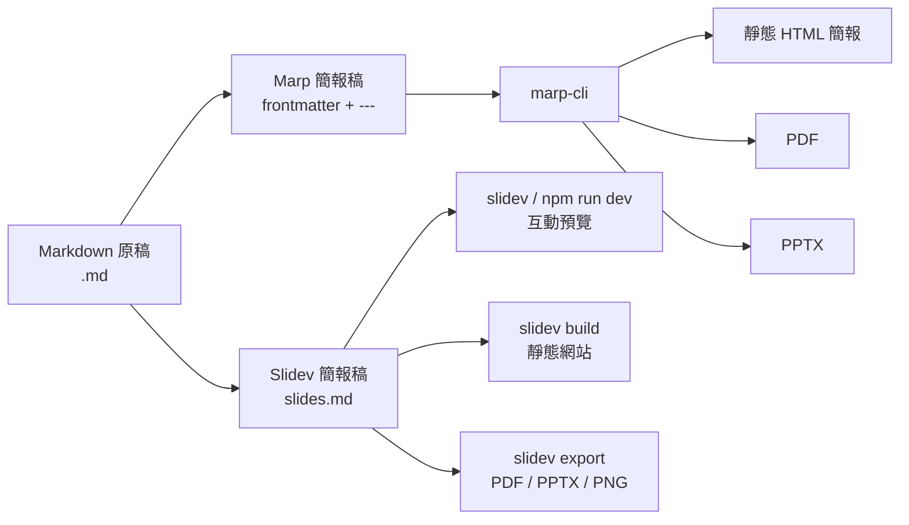
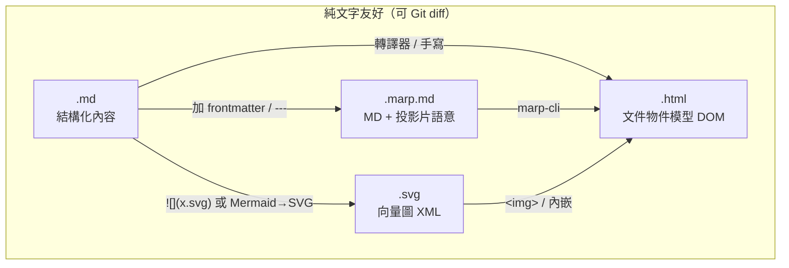
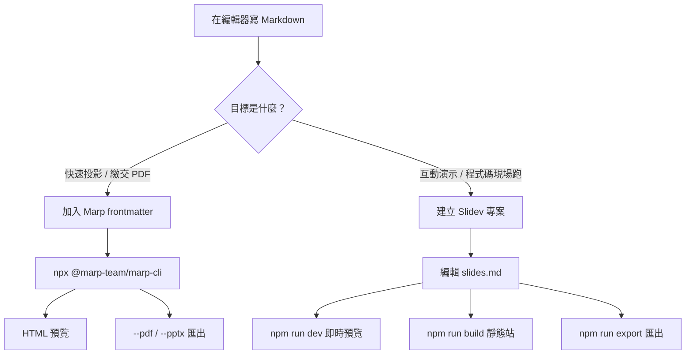

# 📑 Markdown → Marp / Slidev：多格式轉換與互動式簡報網頁實作（1106 課堂）

> **最後更新時間**: 2026-11-06 09:58:00 (UTC+8)
> **使用模型**: Composer
> **執行 Agent**: Auto (Cursor Agent Router)
> **筆記分類**: 生成式 AI / 簡報工程 / Marp / Slidev / Markdown / SVG / 檔案格式

---

## 📖 導言與概覽

今日課堂核心是：**以 Markdown 為單一真相來源（Single Source of Truth）**，再透過不同工具鏈轉換成：

| 格式 | 副檔名 | 角色 | 典型用途 |
| :--- | :--- | :--- | :--- |
| Markdown | `.md` | 純文字內容稿 | 版本控管、AI 協作、筆記原稿 |
| Marp | `.md` / `.marp.md` | 簡報語意 Markdown | 投影片分隔、主題、marp-cli 轉檔 |
| HTML | `.html` / `.htm` | 瀏覽器可渲染文件 | 筆記頁、靜態／互動簡報網頁 |
| SVG | `.svg` | 向量圖形（XML 文字） | 流程圖、架構圖、可縮放插圖 |
| PDF / PPTX | `.pdf` / `.pptx` | 交付產物 | 繳交、離線播放 |

兩條主要工具鏈：

1. **Marp CLI（`@marp-team/marp-cli`）**：把 Marpit Markdown 轉成靜態 HTML／PDF／PPTX，適合「寫完就能交、能開、能投影」。
2. **Slidev**：把 Markdown 變成 **Vite + Vue** 驅動的**互動式簡報網頁**（熱重載、元件、程式碼即時編輯、靜態站建置）。



---

## 🧠 一、核心概念剖析 (Core Concepts)

### 1. 為什麼要「先寫 MD，再轉格式」？

* **內容與版面分離**：Markdown 管「說什麼」，主題／CSS／Vue 元件管「怎麼呈現」。
* **可重現（Reproducible）**：同一份 `.md` 可再產出 HTML、PDF、PPTX，避免「只剩一個 pptx、原始稿遺失」。
* **適合 AI／Git**：純文字 diff 清楚，Agent 也好改標題與要點。

### 2. Marp / Marpit 的底層模型

* **Marpit**：以 Markdown 為基礎的投影片框架；`---` 分隔頁面，YAML frontmatter 設定主題與尺寸。
* **Marp Core**：在 Marpit 上加上預設主題、數學式、emoji 等。
* **Marp CLI**：命令列轉檔器；預設輸出 HTML；`--pdf`／`--pptx` 會透過本機 Chrome／Edge／Firefox 渲染。

關鍵公式（概念上）：

\[
\text{簡報產物} = \text{Markdown 內容} + \text{主題 CSS} + \text{渲染引擎（瀏覽器／Vite）}
\]

### 3. Slidev 的底層模型

* **Markdown + Vue**：頁面仍用 `---` 分隔，但可直接嵌入 Vue 元件與互動邏輯。
* **Vite 開發伺服器**：儲存即熱更新，適合邊寫邊演練。
* **互動式網頁**：不是「一張張靜態圖」，而是可執行程式碼、切換元件、錄影、畫筆註記的 Web App。
* **建置輸出**：`slidev build` 產生可部署的靜態站（例如 GitHub Pages）。

### 4. 格式對照：筆記 HTML vs 簡報 HTML

| 類型 | 例子 | 導覽方式 |
| :--- | :--- | :--- |
| 課堂筆記 HTML | 本工作區筆記頁 | 長頁捲動、複製程式碼、列印 PDF |
| Marp 靜態簡報 HTML | `marp slides.md -o out.html` | 全螢幕頁面切換（鍵盤／點擊） |
| Slidev 互動簡報 | `npm run dev` / `dist/` | SPA 路由、Presenter Mode、元件互動 |

### 5. 檔案格式詳解：MD、Marp、HTML、SVG

這四種都常以**純文字**儲存，可用記事本／VS Code 開啟，也適合放進 Git；差異在「語意層級」與「誰來負責呈現」。



#### 5.1 Markdown（`.md`）

| 面向 | 說明 |
| :--- | :--- |
| **是什麼** | 輕量標記語言：用 `#`、`-`、`` ` `` 等符號描述標題、清單、程式碼，**本身不是版面**。 |
| **本質** | UTF-8 純文字；需經轉譯器（Markdown → HTML／PDF／簡報）才有最終外觀。 |
| **優點** | 好寫、好 diff、AI 友善、與工具鏈解耦。 |
| **限制** | 原生幾乎沒有版面控制；複雜互動要靠下游（HTML／Slidev）。 |

常用語法速記：`# 標題`、`**粗體**`、`` `行內碼` ``、` ``` 程式碼區塊 ``` `、``、`[連結](url)`。

#### 5.2 Marp（仍是 Markdown，但帶簡報契約）

| 面向 | 說明 |
| :--- | :--- |
| **是什麼** | 在 Markdown 上加上 **Marpit 契約**：YAML frontmatter（`marp: true`、`theme`…）與 `---` **分頁**。 |
| **副檔名** | 常見 `.md`；本工作區也用 `.marp.md` 標示「這份是簡報稿」。 |
| **本質** | 仍是文字檔；真正「投影片感」來自 Marp Core／CLI 套用主題 CSS 後輸出。 |
| **優點** | 一份稿可轉 HTML／PDF／PPTX；語法接近一般 MD。 |
| **限制** | 互動弱於 Slidev；版型主要靠主題與指令註解，不是自由排版軟體。 |

可把 Marp 想成：

\[
\text{Marp 檔} = \text{Markdown} + \text{投影片 frontmatter} + \text{頁分隔（---）}
\]

#### 5.3 HTML（`.html`）

| 面向 | 說明 |
| :--- | :--- |
| **是什麼** | HyperText Markup Language：用標籤描述文件結構（`html`／`head`／`body`、`h1`、`p`、`div`…）。 |
| **本質** | 瀏覽器直接解析的 **DOM 文件**；可掛 CSS（樣式）與 JS（行為）。 |
| **在本課的角色** | (1) 長頁**筆記網頁**；(2) Marp／Slidev 產出的**簡報網頁**。 |
| **優點** | 跨平台開啟、可互動、可列印成 PDF、可部署 GitHub Pages。 |
| **限制** | 手寫成本高；複雜邏輯需 JS；原始碼比 MD 難閱讀／難 diff。 |

對照：`.md` 是「作者友善的中介格式」；`.html` 是「瀏覽器友善的交付格式」。

#### 5.4 SVG（`.svg`）

| 面向 | 說明 |
| :--- | :--- |
| **是什麼** | Scalable Vector Graphics：用 **XML** 描述點、線、路徑、文字的**向量圖**。 |
| **本質** | 圖形也是文字（可開檔編輯）；縮放不像素化，適合流程圖、示意圖、圖示。 |
| **與點陣圖差** | PNG／JPG 是像素網格；SVG 是幾何指令，改顏色／路徑較容易。 |
| **優點** | 無限縮放清晰、檔案常較小（簡單圖）、可內嵌在 HTML、可被 CSS／JS 操控。 |
| **限制** | 照片不適合；過度複雜的 SVG 會變大、難維護；部分 Office 匯入支援不一。 |

在課堂／本 repo 的典型用法：Mermaid 或繪圖工具匯出 SVG → 用 `` 嵌進 MD，或 ``／直接內嵌進 HTML。

#### 5.5 四種格式怎麼分工？

| 你想做的事 | 優先格式 |
| :--- | :--- |
| 寫內容、改稿、給 AI | `.md` |
| 做投影片、交 PDF | Marp（`.md`／`.marp.md`）→ CLI |
| 給人用瀏覽器讀筆記／簡報 | `.html` |
| 畫可縮放示意圖、架構圖 | `.svg`（或 MD 內 Mermaid 再匯出 SVG） |

---

## 🛠️ 二、實作與應用範例 (Practical Examples)

### 流程圖：課堂常用轉換路徑



### 範例 A：最小 Marp Markdown

程式邏輯：宣告 Marp 文件 → 設定主題 → 用 `---` 切頁 → CLI 轉成可開啟的 HTML。

```markdown
---
marp: true
theme: default
paginate: true
---

# 1106 課堂簡報
## Markdown → 互動網頁

---

## 今天學什麼？

- Markdown 當單一來源
- marp-cli 轉 HTML / PDF / PPTX
- Slidev 做互動簡報站

---

## 下一步

把內容寫進 Git，再用 CLI 重複匯出
```

### 範例 B：使用 marp-cli 轉換（含註解）

```bash
# 一次性轉換（不永久安裝）：輸出與輸入同目錄的 .html
npx @marp-team/marp-cli@latest slides.md

# 指定輸出 HTML 檔名
npx @marp-team/marp-cli@latest slides.md -o slides.html

# 匯出 PDF（需本機有 Chrome / Edge / Firefox）
npx @marp-team/marp-cli@latest slides.md --pdf -o slides.pdf

# 匯出 PowerPoint
npx @marp-team/marp-cli@latest slides.md --pptx -o slides.pptx

# 監視檔案變更，存檔即重新轉檔（邊寫邊預覽）
npx @marp-team/marp-cli@latest -w slides.md

# 伺服器模式：把整個資料夾當簡報站
npx @marp-team/marp-cli@latest -s ./slides

# 專案內安裝後可直接用 marp（建議進 package.json scripts）
npm install --save-dev @marp-team/marp-cli
npx marp slides.md -o dist/slides.html
```

### 範例 C：建立 Slidev 互動簡報專案

```bash
# 建議：Node.js >= 22.12
# 用官方 scaffold 建立專案（會產生 slides.md 與 scripts）
pnpm create slidev
# 或：npm init slidev@latest

cd my-slidev-project
npm run dev      # 開本地互動預覽（Vite）
npm run build    # 建置靜態網站到 dist/
npm run export   # 匯出 PDF / PPTX / PNG（依版本與套件設定）
```

### 範例 D：Slidev `slides.md` 最小互動示例

程式邏輯：frontmatter 設定標題 → `---` 分頁 → 嵌入 Vue 計數元件示範「互動」。

```markdown
---
theme: default
title: 1106 Slidev 互動簡報
---

# Markdown 也能互動

用 Slidev 把投影片變成網頁 App

---

# 內嵌 Vue 元件

點一下數字會變：

```vue
<script setup>
import { ref } from 'vue'
const n = ref(0)
</script>

<button @click="n++">點了 {{ n }} 次</button>
```

---

# 開發者友善功能

- 程式碼高亮 / Monaco 即時編輯
- Presenter Mode
- Mermaid 圖、LaTeX 公式
- `slidev build` 部署成靜態站
```

> 實際專案中，Vue 區塊與 `{monaco}` 等標記請依 [Slidev 官方語法](https://sli.dev/guide/) 調整；上例強調「Markdown 頁面可承載互動元件」。

### 範例 E：課堂「多格式交付」檢查清單

1. 先有一份內容正確的 `.md`（或 `.marp.md` / `slides.md`）。
2. 用 **Marp CLI** 產出 `HTML`（預覽）+ `PDF`（繳交）。
3. 若需要現場 demo／程式碼互動，另建 **Slidev** 專案並 `build`。
4. 筆記說明頁（本工作區習慣）另存 **MD + HTML**，HTML 含「匯出 PDF」與程式碼複製按鈕。
5. 示意圖優先用 **SVG**（或 Mermaid），再嵌回 MD／HTML，避免投影時糊掉。

### 範例 F：四種格式的最小可讀樣本

程式邏輯：同一主題分別用 MD 寫內容 → Marp 分頁 → HTML 承載 → SVG 當插圖。

**F1. Markdown（`.md`）**

```markdown
# 電路概念

- **電壓**：推動電荷的「壓力」
- 詳見示意圖：
```

**F2. Marp（同一語法家族，多了契約）**

```markdown
---
marp: true
theme: default
---

# 電路概念


- 電壓像水壓
```

**F3. HTML（瀏覽器直接開）**

```html
<!DOCTYPE html>
<html lang="zh-TW">
<head>
  <meta charset="UTF-8">
  <title>電路概念</title>
</head>
<body>
  <h1>電路概念</h1>
  <!-- 嵌入向量圖：可無限縮放 -->
  
  <ul>
    <li><strong>電壓</strong>：推動電荷的「壓力」</li>
  </ul>
</body>
</html>
```

**F4. SVG（向量圖本體）**

```xml
<svg xmlns="http://www.w3.org/2000/svg" width="320" height="120" viewBox="0 0 320 120">
  <!-- 背景 -->
  <rect width="320" height="120" fill="#f8fafc"/>
  <!-- 簡單關係：V = I R -->
  <text x="24" y="48" font-size="22" font-family="Segoe UI, sans-serif" fill="#1e3a8a">
    V = I × R
  </text>
  <text x="24" y="88" font-size="14" font-family="Segoe UI, sans-serif" fill="#64748b">
    電壓 = 電流 × 電阻（示意）
  </text>
</svg>
```

> 本工作區實例：`ec/assets/` 下多份 U8g2 教學圖即為 `.svg`，同時被 `.md` 與 `.html` 引用。

---

## 🚀 三、延伸思考與進階主題 (Extensions & Advanced Topics)

### 1. Marp vs Slidev：怎麼選？

| 維度 | Marp CLI | Slidev |
| :--- | :--- | :--- |
| 學習曲線 | 低，接近純 Markdown | 中，需懂一點前端／Node |
| 互動性 | 低（靜態頁切換） | 高（Vue 元件、即時碼） |
| 輸出穩定度 | HTML／PDF／PPTX 成熟 | 網頁優先，匯出能力也強 |
| 適合場景 | 課堂報告、文件型簡報 | Demo、技術分享、工作坊 |
| 部署 | 單檔 HTML 即可 | `build` 後的靜態站 |

**實務建議**：內容定稿與繳交用 Marp；要「講給工程師看、現場跑碼」用 Slidev。兩者可共用同一份大綱 Markdown，再分別加上各自 frontmatter。

### 2. 常見坑與邊界條件

* **PDF／PPTX 失敗**：Marp CLI 找不到瀏覽器引擎；先確認 Chrome／Edge／Firefox 已安裝。
* **本機圖片路徑**：轉 PDF 時可能需 `--allow-local-files`（注意安全風險，只用於可信本機檔）。
* **PPTX 不可編輯**：預設 PPTX 多為「預渲染頁面圖」；若要在 PowerPoint 內改字，需實驗性 `--pptx-editable`（額外依賴較多）。
* **Slidev Node 版本**：官方要求較新的 Node；版本過舊會 scaffold／dev 失敗。
* **主題 CSS 衝突**：自訂 theme 時，頁面過密會在投影機解析度下溢出；先用 16:9 實際全螢幕測過。

### 3. 性能與工作流權衡

* **單一巨型 MD**：方便，但合併衝突多；可拆「大綱 md → 產生 marp／slidev」。
* **Watch / Dev server**：開發快，但課堂演示前應先 `build` 或預先開好預覽，避免現場裝套件。
* **Git LFS／產物**：通常只提交來源 `.md` 與必要主題 CSS；大型 PDF／node_modules 不進版控。

### 4. 未來延伸

* CI（GitHub Actions）在 push 時自動 `marp --pdf` 或 `slidev build` 發佈 Pages。
* 與本工作區既有筆記流程串接：MD 筆記 → AI 產 10 頁大綱 → Marp／Slidev 落地。
* 自訂 Marp theme CSS（本 repo 已有 `ec/marp-theme-tech.css` 可參考）。

### 5. MD／Marp／HTML／SVG 的進階比較與坑

| 議題 | MD | Marp | HTML | SVG |
| :--- | :--- | :--- | :--- | :--- |
| 人類可讀性 | 最高 | 高 | 中 | 中（路徑多時難讀） |
| 瀏覽器直接開 | 通常否（需預覽外掛） | 否（需轉檔） | 是 | 是（當圖或整頁） |
| 適合照片 | 否（只引用） | 引用點陣圖 | 可嵌點陣／向量 | 不適合照片 |
| 互動 | 無 | 弱 | 強（+JS） | 可（+CSS／JS） |
| Git 友好 | 極佳 | 極佳 | 佳（檔較長） | 佳（簡單圖） |

**邊界條件補充：**

* **Marp ≠ 另一種二進位格式**：它不是像 `.pptx` 的專有容器，而是「約定好的 Markdown」。
* **HTML 可能很大**：Marp／Slidev 產出常內嵌 CSS／JS；筆記手寫 HTML 則應保持結構清楚。
* **SVG 安全性**：來自不明來源的 SVG 可能含 script；公開站宜消毒或只當靜態圖引用。
* **同源路徑**：MD／HTML 引用 `./assets/x.svg` 時，相對路徑要以「開啟檔所在目錄」為準，轉 PDF 時尤其容易斷圖。

**性能權衡：** 示意圖用 SVG；照片用壓縮 JPG／WebP；簡報背景若全改 SVG 動畫可能拖慢低階筆電——靜態投影優先簡單 SVG 或預渲染。

---

## ✅ 今日課堂重點速記

1. **MD 是源頭**；HTML／PDF／PPTX／互動站都是衍生結果。
2. **Marp**＝Markdown＋投影片契約（frontmatter、`---`）；不是另一種神秘二進位格式。
3. **HTML**＝瀏覽器可直接渲染的文件；筆記長頁與簡報網頁都屬此類。
4. **SVG**＝可縮放的向量圖（XML 文字），適合流程／架構示意，可嵌進 MD／HTML。
5. **marp-cli**：`npx @marp-team/marp-cli@latest file.md [-o out.html|--pdf|--pptx]`。
6. **Slidev**：`create slidev` → 編 `slides.md` → `dev` → `build`；交件穩選 Marp，互動選 Slidev。

---

## 📝 提示詞歷史與變更記錄 (Prompt Archive)

### 🔹 [2026-11-06 09:50:00] [Composer / Auto] 變更紀錄
- **模型/Agent**: Composer / Auto (Cursor Agent Router)
- **Prompt 原文**:
```text
今天上課使用了md marp html等不同格式的轉換 並利用marp-cli , slidev 將檔案轉換成互動式簡報網頁
```
- **變更摘要**: 新建 1106 課堂筆記，涵蓋 Markdown／Marp／HTML 多格式轉換概念、marp-cli 與 Slidev 實作指令、流程圖、比較表與進階坑點；同步產出 MD 與 HTML，並更新 index 索引。

### 🔹 [2026-11-06 09:58:00] [Composer / Auto] 變更紀錄
- **模型/Agent**: Composer / Auto (Cursor Agent Router)
- **Prompt 原文**:
```text
補充說明  md, marp, html  以及 svg檔的格式
```
- **變更摘要**: 增補 MD／Marp／HTML／SVG 格式本質、比較表、關係流程圖、最小樣本（範例 F）與進階坑點；同步更新 HTML 與索引時間戳。
