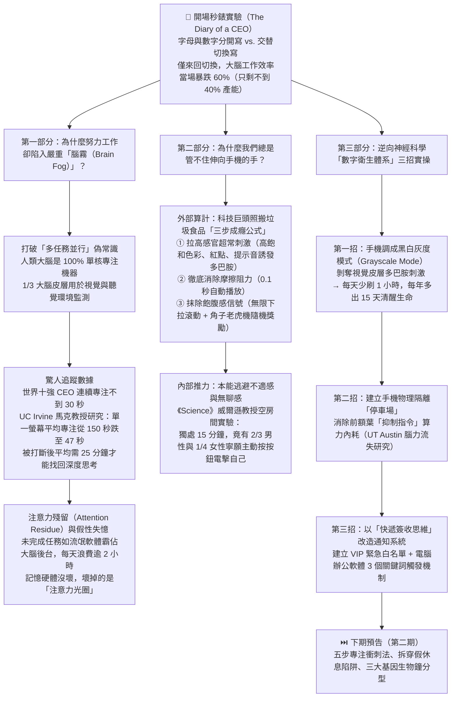

# 🧠 把手機調成黑白模式每年竟憑空多出 15 天清醒生命：柏克萊腦科學家治好腦霧的逆向神經術｜薩哈爾·尤瑟夫｜第一期（逐字稿整理與勘誤還原）

> **最後更新時間**: 2026-11-18 08:52:00 (UTC+8)
> **使用模型**: Gemini 4 Argon (Medium)
> **執行 Agent**: Antigravity
> **原始檔案**: `把手機調成黑白模式每年竟憑空多出15天清醒生命伯克利腦科學家治好腦霧的逆向神經術丨薩哈爾尤瑟夫丨第一期.txt`（共 542 行）
> **語音轉文字工具**: [Whisper_WebUI](https://github.com/joelhoty/Whisper_WebUI)

---

## 🧭 文章邏輯結構圖

以下流程圖根據逐字稿原文結構繪製，完整呈現薩哈爾·尤瑟夫博士（Dr. Sahar Yousef）訪談第一期的三大核心脈絡：



---

## 📖 一、逐字稿整理文章（保留原文結構與語意勘誤還原）

> [!NOTE]
> **整理說明**：本篇文字檔由 [Whisper_WebUI](https://github.com/joelhoty/Whisper_WebUI) 語音轉錄生成。以下嚴格依照原稿順序與語意分段整理成文章，**不添加任何外部資訊**，僅根據上下文語意修正同音錯別字與英文專有名詞音譯誤差（如 `Bring Folk` → `Brain Fog`、`描表` → `秒錶`、`順利` → `算力`、`電機` → `奠基／惦記／電擊` 等）。

### 【引言】開場秒錶測試：當場暴跌 60% 的大腦產能與「腦霧」危機

在知名深度訪談節目《The Diary of a CEO》的一期重磅專場中，主持人邀請到了加州大學柏克萊分校（UC Berkeley）的認知神經科學家、哈斯商學院（Haas）王牌課程主講教授，同時也是超人類生產力實驗室創始人的**薩哈爾·尤瑟夫博士（Dr. Sahar Yousef）**。

節目剛一開場，尤瑟夫博士沒有講任何枯燥的理論，而是直接拿出**秒錶**，讓見多識廣的主持人現場做了一個極其簡單的腦力測試。規則非常簡單：
* **第一輪**：讓主持人按順序把英文字母和阿拉伯數字分開寫出來。主持人幾乎**不費吹灰之力**就迅速完成了。
* **第二輪**：尤瑟夫博士要求他**每**寫一個字母，就立刻切換去寫一個數字，如此交替進行。

結果短短十幾秒鐘後，主持人在鏡頭前當場卡殼、額頭冒汗，連最基本的字母表順序都想不起來了，嘴裡忍不住驚呼：「這簡直是一場災難！」

尤瑟夫博士看著秒錶宣布了測試結果：僅僅是在字母和數字這兩個最簡單的任務之間來回切換，主持人的大腦工作效率就當場暴跌了 **60%**，只剩下了不到 **40%** 的產能。

這個看似不起眼的開場實驗，卻像一面**鏡子**，**照**出了無數現代人每天都在經歷的隱形痛苦。你有沒有過這樣的感覺：明明今天從早到晚一直坐在電腦前忙個不停，沒有去工地搬磚，也沒有做劇烈運動，但一到下午四、五點鐘，你的腦袋就像灌了**鉛**一樣沉重，思維變得遲鈍、注意力無法集中，剛打開一個網頁就忘了自己要查什麼，甚至感覺記憶力一年比一年差？

在訪談中，尤瑟夫博士指出，當她（原稿作「他」）在全球各地為企業高管和普通職場人做大腦評估時，大家用來形容自己這種狀態最多的一個詞，叫做**「腦霧」**，也就是 **Brain Fog**（原稿誤聽為 `Bring Folk`）。

* 為什麼我們明明每天都在努力工作，身體沒有透支，大腦卻早早陷入了嚴重的 **Brain Fog**？
* 為什麼我們總覺得時間不夠用，每天像陀螺一樣連軸轉，到了晚上躺在床上，卻只剩下深深的空虛和疲憊？

今天這期節目，我們就開啟尤瑟夫博士這場**殿堂級**腦科學訪談三部曲的第一期，結合加州大學**爾灣分校**（UC Irvine）、明尼蘇達大學、弗吉尼亞大學以及北達科他大學發表在《科學》（*Science*）等國際權威期刊上的多項腦科學實驗，為你揭開現代人每天憑空蒸發兩小時的注意力騙局，看看科技巨頭是如何利用「垃圾食品劇本」**劫持**你大腦的，並教你用逆向神經科學的「黑白開關」，從明天開始，每天穩穩奪回一個小時的清醒人生。

---

### 第一部分：打破「多任務並行」神話——為什麼你的大腦每天憑空蒸發兩小時？

#### 1. 人類大腦是 100% 的「單核專注機器」
想要治好大腦的 **Brain Fog**，我們首先必須打破一個在現代職場和生活裡流傳最廣、毒害最深的**偽常識**——那就是以為自己能夠同時處理多項任務，甚至把**多線程辦公**當成一種值得炫耀的能力。

在日常生活中，我們幾乎每個人都在進行所謂的「同步多任務操作」：一邊開著視頻會議，一邊在手機上回覆客戶的微信；一邊寫著工作方案，眼睛還隨時瞄著電腦右下角彈出來的郵件提醒；就連晚上回家看電視休息，手裡還得同時刷著購物軟件或短視頻。我們習慣性地以為，人類的大腦就像一台 8 核處理器，可以同時流暢運行好幾個程序。

但作為深耕認知神經可塑性的腦科學家，尤瑟夫博士在訪談中斬釘截鐵地告訴我們：**從生物演化的底層結構來看，多任務並行完完全全是一個神話。人類的大腦在生理結構上，是一台 100% 的單核專注機器。**

為什麼我們的大腦不能同時幹兩件需要思考的事？尤瑟夫博士從大腦皮層的生理構造給出了解釋：在人類漫長的演化過程中，為了在充滿猛獸的自然界活下來，我們整整有**三分之一的大腦皮層空間**被專門劃分出來，用於「看」和「聽」——也就是隨時隨地監測**周圍**環境裡的風吹草動。在遠古時代，這種高度敏感的警覺系統能幫我們及時發現草叢裡的老虎；但在今天這個被電子屏幕、彈窗提示音和開放式辦公室包圍的現代社會裡，這套古老的生存警覺系統，卻成了我們最大的災難。

#### 2. 世界十強 CEO 的 30 秒與現代人的「47 秒魔咒」
尤瑟夫博士在節目裡講了一個讓她哭笑不得的真實案例：她曾受邀去貼身觀察一位世界十強頂級企業的首席執行官（CEO），看看這位日理萬機的高管每天是如何工作的。結果她走進辦公室一看，這位高管面前擺著好幾塊巨大的電腦屏幕，手腕上戴著隨時震動的智能手錶，**辦公桌**上正面朝上放著兩部手機——一部私人手機、一部工作手機；門外還不時有幕僚和下屬推門進來匯報說：「老闆，別忘了那件事！」

尤瑟夫博士拿著計時器在旁邊默默統計，結果發現：這位掌握著巨額財富和無數人命運的頂級高管，坐在**辦公桌**前連續專注思考的時間，竟然連短短的 **30 秒**都不到！

你可能會覺得，那是大老闆事務繁忙才這樣，我們普通人肯定能專注更久吧？恰恰相反！尤瑟夫博士在訪談中引用了一項讓所有人倒吸一口涼氣的權威追蹤數據：**現代腦力工作者在電腦或手機的一個屏幕上保持專注的平均時間，僅僅只有 47 秒。**

為了**印證**尤瑟夫博士提到的這個「47 秒魔咒」，我們可以查閱美國加州大學爾灣分校信息學權威**格洛麗亞·馬克教授（Gloria Mark）**長達 20 年的注意力追蹤研究。馬克教授團隊從 2004 年開始，使用精密傳感器和觀測設備，記錄人們在電子屏幕前的真實專注時長：
* 在 **2004 年**的時候，人們在一個屏幕窗口上平均還能連續專注兩分半鐘，也就是 **150 秒**；
* 幾年之後，這個數字縮水到了 **75 秒**；
* 而在最近的連續五、六年統計中，人類在單一屏幕上的平均專注時間，已經斷崖式跌到了僅僅 **47 秒**！

更可怕的是，馬克教授的研究證實：當你正在做一個有深度的工作項目時，一旦被一條消息或切換動作打斷，你的大腦平均需要花費整整 **25 分鐘**，才能重新找回被打斷前的深度思考狀態。

#### 3. 注意力殘留（Attention Residue）與「假性記憶衰退」
為什麼哪怕只是花 3 秒鐘切出去看一眼手機消息，大腦卻要付出如此慘重的代價？這就觸及到了尤瑟夫博士在訪談中重點科普的核心腦科學機制——**注意力殘留**，也就是 **Attention Residue**（原稿作 `Attentional Residue`）。

在我們的直覺裡：「如果我從早上 9 點到 10 點**在**寫一份報告，中間切出去回了 5 次微信、看了 3 次郵件，每次只花了半分鐘，那我這一個小時裡至少有 50 分鐘都在專心寫報告吧？」尤瑟夫博士明確告訴你：**你的大腦根本不是這樣運作的。**

這個著名的 **Attention Residue** 概念，最初由明尼蘇達大學與華盛頓大學商學院的**索菲·勒魯瓦教授（Sophie Leroy）**在《組織行為與人類決策過程》期刊發表的**奠基性**實驗中正式提出。勒魯瓦教授與尤瑟夫博士的研究共同證明：當你的大腦從**任務甲**切換到**任務乙**時，只要任務甲還沒有徹底畫上句號，你的注意力就絕對不可能 100% **瞬移**到**任務乙**上。

我們可以用一個普通人一聽就懂的比喻來理解：你的大腦運行內存（RAM）就像一部手機的後台。當你正在寫方案，突然彈出來一條工作群消息或一條新聞推送，你切過去看了一眼；雖然幾秒鐘後你的眼睛又回到了電腦文檔上，但剛才那條消息引發的思考、情緒和未完成的**惦記**，就像一個沒有徹底關閉的流氓軟件一樣，依然死死霸佔著你的大腦後台內存——這就叫做 **Attention Residue**。

當你一天之內在不同屏幕、不同聊天窗口和工作任務之間，像打乒乓球一樣來回橫跳上百次時，你的大腦後台早就堆滿了成百上千個沒關掉的殘留進程。尤瑟夫博士指出，根據實驗室測算，現代人僅僅是因為在不同屏幕和任務之間來回切換、清理這些 **Attention Residue**，**每天就白白浪費掉了超過兩個小時的有效生命**。到了下午，你的大腦內存被這些殘留碎片徹底塞滿，芯片嚴重過熱，表現出來的臨床症狀，就是頭昏腦脹的 **Brain Fog**。

不僅如此，尤瑟夫博士還順帶解開了無數年輕人擔心自己「早發性失智」的焦慮。很多 30 歲、40 歲的人找到她說：「博士，我現在的記性差得嚇人，剛看過的文件轉頭就忘，剛別人告訴我的名字一秒鐘就記不起來，是不是我的大腦海馬體提前退化了？」

尤瑟夫博士給出了一句**振聾發聵**的神經科學定律：

> **「你永遠不可能記住任何你沒有真正投入注意力的東西。你的記憶硬件根本沒有壞，壞掉的是你的注意力光圈。」**

記憶的本質是大腦**神經元突觸**的深度編碼與連接，而開啟深度編碼的唯一前提，就是毫無分心的高度專注。當你一邊聽別人說話，一邊在腦子裡殘留著上一封**郵件**的內容；或者一邊看書，一邊每隔 47 秒摸一下手機——信息連你大腦的大門都沒**邁**進去，又怎麼可能被**存進長期記憶庫裡**呢？

---

### 第二部分：這不是意志力薄弱，而是一場不對稱的「神經戰爭」

聽到這裡，相信你已經深刻意識到了注意力被切碎的可怕後果。但緊接著第二個更扎心的問題來了：既然我們明明知道老看手機、老切換屏幕會毀掉專注力和記憶力，為什麼我們就是管不住自己那雙總是伸向手機的手呢？難道真的是因為我們這一代人意志力太薄弱、太**懶惰**了嗎？

在訪談的第二部分，尤瑟夫博士以一位**深諳**行業內幕的神經科學家身份，溫柔而又犀利地卸下了所有普通人身上的道德愧疚感。她明確告訴我們：**不要再責怪自己的意志力了，因為你每天面對的是一場根本不對稱的神經戰爭。**

#### 1. 外部算計：科技巨頭照搬垃圾食品工業的「三步成癮公式」
尤瑟夫博士坦言，手機裡所有的社交媒體、短視頻軟件，甚至包括我們成年人每天上班必須用的電子郵箱和企業辦公聊天軟件，它們的**出廠**默認設置，全都是由像她一樣精通人類大腦弱點的神經科學家和行為心理學家精心設計的。這些科技公司**向**華爾街投資人和企業客戶匯報**業績**時，核心指標從來不是幫用戶提高了多少工作效率，更不是讓用戶變得多健康，而是兩個字——**「黏性」**，也就是你在這個軟件上停留了多長時間、每天點開了多少次。

為了把你的眼球死死焊在屏幕上，科技巨頭直接從垃圾食品工業那裡，**照搬**了一整套經過幾十年驗證的**「三步成癮公式」**：

* **第一步：拉高感官「超常刺激」**
  就像薯片和糖果生產商往食物裡狂加人工香精、高果糖漿和**脆度**添加劑一樣，手機軟件的設計師刻意把圖標和畫面的色彩飽和度調到自然界罕見的極致，用鮮紅刺眼的未讀角標、清脆的提示音和震動反饋，直接轟炸你大腦的視覺和聽覺**皮層**，瞬間**誘發多巴胺**的脈衝式分泌。
* **第二步：徹底消除摩擦阻力**
  過去你想看個新聞，還得去買份報紙、翻開書頁；現在手指只需要輕輕一滑，0.1 秒內下一個視頻就已經自動播放，讓你連思考要不要停下來的半秒鐘空隙都沒有。
* **第三步（也是最致命的一步）：抹除「飽腹感信號」**
  尤瑟夫博士在訪談中打了一個極其傳神的比喻：當你去餐廳吃飯，哪怕菜再好吃，吃完一盤之後盤子空了，你的胃和大腦就會收到一個清晰的停止信號，告訴你該停筷子了。但是手機上的**無限**下拉滾動設計，就像是你走進了一家自助餐廳，有人直接把一條高速運轉的工廠**傳送帶**塞進了你的嘴裡，無窮無盡的糖果和零食順著**傳送帶**直接往你喉嚨裡灌，永遠沒有見底的那一刻。再加上算法精心設計的「隨機間歇性獎勵」，就像賭場的**角子老虎機**一樣，你永遠不知道下一次**滑動**屏幕會刷出一條無聊的內容，還是一條讓你哈哈大笑的爆款——這種不確定性會讓大腦的多巴胺期待迴路陷入徹底的癲狂。

#### 2. 內部推力：人類大腦對「不適感與無聊感」的本能逃避
更深刻的是，尤瑟夫博士指出，除了科技公司的外部算計，把我們推向手機的還有一股強大的內部心理推力——那就是**人類大腦對不適感與無聊感的本能逃避**。

在日常生活中，每當我們寫方案**卡殼**、面對一項困難的任務感到**一絲絲**焦慮，或者在排隊等電梯時出現了哪怕 10 秒鐘的無聊空白，我們的大腦就會本能地覺得不舒服。而此時此刻，口袋裡那部零摩擦、高刺激的手機，就成了逃避現實不適感最廉價的止痛藥。

為了讓你看清人類的大腦到底有多害怕獨處和無聊，我們可以引證弗吉尼亞大學心理學家**蒂莫西·威爾遜教授（Timothy Wilson）**聯合哈佛大學團隊，在國際頂尖學術期刊《科學》（*Science*）雜誌上發表過的一項**震驚**世界的經典實驗：

研究人員把受試者請進一間沒有任何裝飾的空房間裡，收走他們的手機、書本和紙筆，**僅僅**要求他們在椅子上安靜地**坐** 6 到 15 分鐘，陪自己的大腦待一會兒。結果發現，將近一半的人覺得這短短十幾分鐘的安靜獨處痛苦難耐。

更讓人不可思議的是，在隨後的實驗裡，研究人員在桌子上放了一個可以給自己施加疼痛**電擊**的按鈕。儘管所有受試者在實驗前都明確表示這種**電擊**非常疼，自己哪怕花錢也絕不願意再被電一次；但當他們被單獨留在房間裡無所事事僅僅 15 分鐘時，竟然有高達**三分之二（2/3）的男性**和**四分之一（1/4）的女性**受試者，因為受不了哪怕片刻的無聊和大腦空白，主動按下按鈕**電擊**了自己！

你看，連疼痛的**電擊**人們都寧願去按，更何況是掏出手機刷一下色彩斑斕的屏幕呢？

---

### 第三部分：逆向神經科學「數字衛生體系」三招實操

既然科技巨頭用神經科學給我們佈下了天羅地網，而我們的大腦天生又如此容易逃避不適，那我們普通人到底該怎麼突圍？

尤瑟夫博士在節目中亮出了她的核心武器：既然對方用神經科學讓我們上癮，那我們就用**「逆向神經科學」**——也就是她所說的**「數字衛生體系」**，把被偷走的大腦主權奪回來。接下來這三招經過柏克萊實驗室嚴格驗證的**數字衛生實操法**，不需要消耗你半點意志力，只要今天照著設置一次，明天就能立刻**見效**。

#### 第一招：把手機屏幕調成黑白的「灰度模式」（Grayscale Mode）
這也是整場訪談標題裡最核心的一招。尤瑟夫博士在節目裡第一條建議就是：**現在就打開你手機的設置，在「輔助功能」或「顯示設置」裡找到「顏色濾鏡」，把手機屏幕從五顏六色一鍵切換成純黑白的 Grayscale Mode。**

為什麼這麼一個簡單的動作，被稱為逆向神經科學的神器？因為前面我們說過，短視頻、社交軟件和購物平台之所以能像毒品一樣勾住你的眼球，很大程度上靠的是超高飽和度的鮮豔色彩對大腦視覺**皮層**的強烈多巴胺刺激。當你把屏幕調成黑白灰之後，原本看起來讓人流口水的**美食**圖片、花里胡哨的短視頻封面和刺眼的紅色通知角標，瞬間變得像幾十年前的舊報紙一樣枯燥乏味。你並沒有刪除任何軟件，手機所有的功能都還在，但你的視覺**皮層**瞬間失去了神經興奮感。

尤瑟夫博士實驗室的實測數據顯示：受試者僅僅是把手機調成了 **Grayscale Mode**，在其他生活習慣完全不變的情況下，**每個人每天花在手機上的時間平均直接減少了整整一個小時**！一周下來就是 7 個小時，**一年下來相當於憑空多出了整整 15 天屬於你自己的自由生命！**

不僅如此，北達科他大學霍爾特教授（Holte）團隊發表在《人類行為中的計算機》（*Computers in Human Behavior*）期刊上的隨機對照實驗也獨立證實：開啟 **Grayscale Mode** 的受試者，不僅每日屏幕使用時間**顯著**下降，連社交焦慮感和盲目刷手機的衝動也隨之大幅減輕。

#### 第二招：給手機建立物理隔離的「停車場」，徹底消除視覺皮層的算力內耗
很多人在工作學習時會說：「博士，我已經把手機調成靜音、反扣在辦公桌上了，**這總**不會打擾我了吧？」

尤瑟夫博士在節目現場直接拿出了一個**物理定時鎖盒**，把主持人的手機鎖了進去，並明確告訴他：**哪怕手機關了靜音放在你眼皮子底下，它依然在悄悄吸乾你的智商。**

為什麼看不見通知的手機還會消耗**算力**？因為前面我們講過，人類有三分之一的大腦**皮層**專門負責視覺和聽覺掃描。只要你的餘光還能**瞥見**桌子上那部手機，你的大腦**前額葉**就必須分出一部分寶貴的認知**算力**，去不斷下達一道**抑制指令**，告訴自己：「不要去摸它、不要去看它。」

德克薩斯大學奧斯汀**分校**（UT Austin）沃德教授（Adrian Ward）團隊著名的「腦力流失（Brain Drain）」研究，以及近期發表在國際期刊上的 22 項實驗**薈萃分析**（Meta-analysis）確鑿地證實：當一部手機僅僅是安靜地擺在你的視線範圍內時，受試者的工作記憶容量和**流體智力**測試得分就會出現顯著下滑；只有當手機被放到另一個房間、徹底離開視線和觸手可及的範圍時，大腦的注意力**基線**才能恢復到最高水平。

所以從明天開始，當你需要專注工作或陪伴家人時，請把手機扔進包裡、鎖進抽屜，或者乾脆放在客廳充電，讓它徹底從你的視野裡消失。

#### 第三招：用「快遞簽收思維」改造通知系統，建立專屬 VIP 白名單與關鍵詞觸發機制
在訪談中，很多人向尤瑟夫博士訴苦說：「我也想把手機放遠點，可萬一家裡父母、孩子有急事找我，或者老闆、大客戶有十萬火急的事找我怎麼辦？」正是這種害怕錯過重要信息的焦慮，逼著我們每隔幾分鐘就要去解鎖一次手機。

尤瑟夫博士用一個現實生活中的「郵局快遞」比喻，完美解決了這個死結。她說：在現實中，（只有需要簽收重要包裹時，）快遞員才會用力敲響你家的房門；可是看看我們現在的手機和電腦，哪怕是工作群裡兩個同事在互相閒聊，或者某軟件發來一條促銷推送，都在用最高級別的「敲門聲」打斷你的深度思考。

因此，尤瑟夫博士教你花 10 分鐘設置一套**「貴賓（VIP）白名單系統」**：
1. **手機端**：把手機上所有軟件的默認通知全部關掉，只把你的伴侶、父母、**直屬**上司或最核心的 **VIP 客戶**（或 Slack 核心客戶群，原稿作 `slog客戶`）放進緊急白名單裡。只有這些人打電話或發消息時，手機才會響起聲音穿透防線。
2. **電腦端**：在電腦工作郵箱和辦公軟件裡，設置三個**關鍵詞觸發提醒**——比如只有當別人直接提到你的名字，或者標註了「緊急」字樣時，才**彈出**提示。至於那些把你**抄送**（CC）在裡面、七八個人來回討論的普通郵件，讓它們安安靜靜躺在收件箱裡，等你固定時間再去批量處理。

---

### 【結語與下期預告】

當你把手機調成黑白的 **Grayscale Mode**、在專注時把手機請出視線，並用貴賓白名單過濾掉 90% 的無效噪音，你會驚訝地發現：困擾你多年的 **Brain Fog（腦霧）**開始消散，每天屬於你的時間憑空多出了一個多小時。

但是，把外部的干擾清理乾淨，僅僅是奪回大腦控制權的第一步。在訪談進入下半場時，尤瑟夫博士向我們拋出了幾個更深層、也更反常識的腦科學謎題：
* 既然我們已經騰出了寶貴的時間和注意力，那在工作的時候，究竟怎樣做才能讓大腦的產出效率直接翻倍？
* 為什麼很多人在工作**間隙**，**癱**在椅子上刷 10 分鐘手機，不僅沒有讓大腦得到休息，反而越歇越累？
* 為什麼每天**戴著**降噪耳機聽歌辦公超過 4 個小時，反而會傷害你的大腦聽覺系統？
* 更關鍵的是，為什麼社會上鼓吹的「早上 5 點起床奮鬥」，對四分之三的人來說，其實是一場違背基因的災難？

在下一期，也就是本系列的第二期節目中，我們將繼續跟隨加州大學柏克萊分校的尤瑟夫博士，為你揭秘柏克萊實驗室讓效率翻倍的「五步專注衝刺法」、拆穿假休息的陷阱，並帶你**測出**刻在你基因裡的「三大**生物鐘**分型」。如果你覺得今天的內容幫你看清楚注意力流失的真相，別忘了點讚、收藏並訂閱頻道，我們下期接著聊！

---

## 🔧 二、Whisper_WebUI 語音辨識同音錯字與專有名詞修正對照表

本篇中文逐字稿透過 [Whisper_WebUI](https://github.com/joelhoty/Whisper_WebUI) 轉錄產生，主要誤差來自「中文同音字／近音字混淆」與「中英夾雜詞彙音譯錯誤」。以下為根據上下文語意處理之完整修正對照表：

| 行號 | 原文錯字／誤聽片段 | 根據上下文語意修正後 | 錯誤原因解析 |
| :--- | :--- | :--- | :--- |
| L3 | `哈士商學院` | **哈斯商學院（Haas School of Business）** | 柏克萊商學院專有名詞同音誤聽 |
| L4 等多處 | `遊社夫` / `劉瑟夫` / `由色副` / `優色副` / `由社夫` | **尤瑟夫博士（Dr. Sahar Yousef）** | 同一人名在全文不同段落被 Whisper 轉寫為多種同音字 |
| L6, L21 | `描表` | **秒錶** | 「秒錶（miǎobiǎo）」聲調相近誤聽為「描表」 |
| L10 | `不費摧灰之力` | **不費吹灰之力** | 成語同音字誤植 |
| L12 | `沒寫一個字母` | **每寫一個字母** | 「每（měi）」與「沒（méi）」近音誤聽 |
| L25-26 | `像一面禁止 / 造出了` | **像一面鏡子，照出了** | 前後鼻音與翹舌音混淆（鏡子→禁止、照→造） |
| L32 | `灌了千一樣` | **灌了鉛一樣** | 「鉛（qiān）」與「千（qiān）」同音字 |
| L40-41, L44, L64, L220, L507 | `腦誤` / `Bring Folk` / `bringfolk` | **腦霧（Brain Fog）** | 「霧」誤寫為同音字「誤」；英文 `Brain Fog` 被聽成近音詞 `Bring Folk` |
| L51 | `電堂級` | **殿堂級** | 「殿（diàn）」與「電（diàn）」同音字 |
| L52, L148 | `耳彎分校` / `爾灣分校` | **加州大學爾灣分校（UC Irvine）** | 地名 Irvine 同音字統一為「爾灣」 |
| L60 | `揭迟你大腦的` | **劫持你大腦的** | 「劫持（jiéchí）」被近音誤聽為「揭迟」 |
| L67 | `偽藏史` | **偽常識** | 「常識（chángshí）」被近音誤聽為「藏史」 |
| L69 | `多現成辦公` | **多線程（Multithreading）辦公** | 「線程（xiànchéng）」與「現成」同音字 |
| L99, L289, L398, L405, L421, L435 | `視覺和聽覺疲乘` / `大腦疲乘` | **視覺和聽覺皮層（大腦皮層 Cortex）** | 「皮層（pícéng）」被同音誤聽為「疲乘」 |
| L101 | `監測這位環境` | **監測周圍環境** | 「周圍（zhōuwéi）」與「這位」近音誤聽 |
| L120, L130 | `辦工作上` / `坐在辦工作前` | **辦公桌上** / **坐在辦公桌前** | 「桌（zhuō）」與「作（zuò）」近音誤聽 |
| L149 | `閣洛利亞馬克教授` | **格洛麗亞·馬克教授（Gloria Mark）** | 專有名詞人名同音字修正 |
| L176, L186, L205, L214 | `Attentional Residue` | **Attention Residue（注意力殘留）** | 學術專有名詞標準寫法為 `Attention Residue` |
| L190, L202, L356, L367 | `電機性實驗` / `未完成的電機` / `疼痛電機` | **奠基性實驗** / **未完成的惦記** / **疼痛電擊** | `diànjī` 四組同音詞（奠基、惦記、電擊、電機）全部被寫成「電機」 |
| L192, L194 | `切換到任務椅` / `順移到任務以上` | **切換到任務乙** / **瞬移到任務乙上** | 「甲乙」的「乙（yǐ）」被誤寫為同音字「椅／以」；「瞬移」誤寫為「順移」 |
| L232 | `陣容發愧` | **振聾發聵** | 成語同音／近音誤聽 |
| L236 | `大腦神經緣突出` | **大腦神經元突觸（Synapse）** | 「神經元突觸」被同音誤聽為「神經緣突出」 |
| L240, L243-244 | `有件` / `沒賣進去` / `純淨長期記憶酷領` | **郵件** / **沒邁進去** / **存進長期記憶庫裡** | 連續同音與近音字誤聽 |
| L256 | `深安行業內幕` | **深諳行業內幕** | 「諳（ān）」與「安」同音字 |
| L269-270 | `像...匯報業計時` | **向...匯報業績時** | 「向／像」、「業績時／業計時」同音字 |
| L278-299 | `照辦...三部成癮公司` / `超長刺激` / `翠毒添加劑` / `多疤案` / `保護感信號` | **照搬...三步成癮公式** / **超常刺激** / **脆度添加劑** / **多巴胺** / **飽腹感信號** | 食品工業與神經科學術語同音／近音誤聽 |
| L307, L310, L315-316 | `無線下拉` / `傳送袋` / `餃子老虎雞` / `花洞` | **無限下拉** / **傳送帶** / **角子老虎機** / **滑動** | 常見詞彙同音字誤聽 |
| L327-330 | `不是感` / `卡科` / `意識是焦慮` | **不適感** / **卡殼** / **一絲絲焦慮** | 同音與平翹舌近音誤聽 |
| L363-364 | `高達2-3的男性和1-4的女性` | **高達三分之二（2/3）的男性和四分之一（1/4）的女性** | Whisper 將口語「三分之二」、「四分之一」格式化誤轉為 `2-3`、`1-4` |
| L382, L385 | `數字衛生史超法` / `立刻揭曉` | **數字衛生實操法** / **立刻見效** | 「實操（shícāo）」誤聽為「史超」；「見效」誤聽為「揭曉」 |
| L400 | `美式圖片` | **美食圖片** | 「美食（měishí）」與「美式（měishì）」聲調誤聽 |
| L421, L433, L439 | `順利內耗` / `消耗順利` / `認知順利` | **算力內耗** / **消耗算力** / **認知算力** | 「算力（suànlì）」被近音誤聽為「順利（shùnlì）」 |
| L428 | `物理定時鎖合` | **物理定時鎖盒** | 「盒」與「合」同音字 |
| L438, L440 | `前額頁` / `下達一道意志指令` | **前額葉** / **下達一道抑制指令** | 「葉／頁」、「抑制（yìzhì）／意志」同音字混淆 |
| L443, L446, L451, L455 | `奧斯汀芬孝` / `匯萃分析` / `流體致力` / `注意力機線` | **奧斯汀分校** / **薈萃分析** / **流體智力** / **注意力基線** | 學術與校名同音字誤植 |
| L491-492, L498-499 | `只屬上司` / `slog客戶` / `談出提示` / `操送` | **直屬上司** / **VIP（或 Slack）核心客戶** / **彈出提示** / **抄送（CC）** | 職場辦公術語同音誤聽 |
| L518-522, L537-538 | `工作建系` / `攤在椅子` / `帶著降噪` / `撤出...生物中分型` | **工作間隙** / **癱在椅子** / **戴著降噪** / **測出...生物鐘分型** | 同音字與平翹舌混淆 |

---

## 📜 三、原始逐字稿完整保留與行間勘誤對照（Lines 1–542）

以下 100% 完整保留 `把手機調成黑白模式每年竟憑空多出15天清醒生命伯克利腦科學家治好腦霧的逆向神經術丨薩哈爾尤瑟夫丨第一期.txt` 的全部 542 行原文，僅將斷行依自然語句合併並加上 `[更正: ...]` 標註，方便直接核對原文：

```text
[001-007] 在知名深度訪談節目The Diary of a CEO的一期重磅專場中，主持人邀請到了加州大學伯克利分校的認知神經科學家、哈士商學院 [更正: 哈斯商學院 Haas] 王牌課程主講教授，同時也是超人類生產力實驗室創始人的薩哈爾遊社夫博士 [更正: 薩哈爾·尤瑟夫博士 Dr. Sahar Yousef]。節目剛一開場遊社夫博士沒有講任何枯燥的理論，而是直接拿出描表 [更正: 秒錶]，讓見多識廣的主持人現場做了一個極其簡單的腦力測試。
[008-020] 規則非常簡單：第一輪讓主持人按順序把英文字母和阿拉伯數字分開寫出來，主持人幾乎不費摧灰之力 [更正: 不費吹灰之力] 就迅速完成了。接著第二輪，遊社夫博士要求他沒寫 [更正: 每寫] 一個字母，就立刻切換去寫一個數字，如此交替進行。結果短短十幾秒鐘後，主持人在鏡頭前當場卡殼、額頭冒汗，連最基本的字母表順序都想不起來了，嘴裡忍不住驚呼：這簡直是一場災難！
[021-036] 遊社夫博士看著描表 [更正: 秒錶] 宣布了測試結果：僅僅是在字母和數字這兩個最簡單的任務之間來回切換，主持人的大腦工作效率就當場暴跌了60%，只剩下了不到40%的產能。這個看似不起眼的開場實驗卻像一面禁止 [更正: 鏡子]，造出了 [更正: 照出了] 無數現代人每天都在經歷的隱形痛苦。你有沒有過這樣的感覺：明明今天從早到晚一直坐在電腦前忙個不停，沒有去工地搬磚，也沒有做劇烈運動，但一到下午四五點鐘，你的腦袋就像灌了千 [更正: 鉛] 一樣沉重，思維變得遲鈍，注意力無法集中，剛打開一個網頁就忘了自己要查什麼，甚至感覺記憶力一年比一年差。
[037-048] 在訪談中遊社夫博士指出，當他 [更正: 她] 在全球各地為企業高管和普通職場人做大腦評估時，大家用來形容自己這種狀態最多的一個詞，叫做腦誤 [更正: 腦霧]，也就是Bring Folk [更正: Brain Fog]。為什麼我們明明每天都在努力工作，身體沒有透支，大腦卻早早陷入了嚴重的Bring Folk [更正: Brain Fog]？為什麼我們總覺得時間不夠用，每天像陀螺一樣連軸轉，到了晚上躺在床上，卻只剩下深深的空虛和疲憊？
[049-063] 今天這期節目，我們就開啟遊社夫博士這場電堂級 [更正: 殿堂級] 腦科學訪談三部曲的第一期，結合加州大學耳彎分校 [更正: 爾灣分校 UC Irvine]、明尼蘇達大學、弗吉尼亞大學以及北達科他大學發表在《科學》等國際權威期刊上的多項腦科學實驗，為你揭開現代人每天憑空蒸發兩小時的注意力騙局，看看科技巨頭是如何利用垃圾食品劇本揭迟 [更正: 劫持] 你大腦的，並教你用逆向神經科學的黑白開關，從明天開始，每天穩穩奪回一個小時的清醒人生。

[064-083] 想要治好大腦的Bring Folk [更正: Brain Fog]，我們首先必須打破一個在現代職場和生活裡流傳最廣、毒害最深的偽藏史 [更正: 偽常識]，那就是以為自己能夠同時處理多項任務，甚至把多現成辦公 [更正: 多線程辦公] 當成一種值得炫耀的能力。在日常生活中，我們幾乎每個人都在進行所謂的同步多任務操作：一邊開著視頻會議，一邊在手機上回覆客戶的微信；一邊寫著工作方案，眼睛還隨時瞄著電腦右下角彈出來的郵件提醒；就連晚上回家看電視休息，手裡還得同時刷著購物軟件或短視頻。我們習慣性地以為，人類的大腦就像一台8核處理器，可以同時流暢運行好幾個程序。
[084-109] 但作為深耕認知神經可塑性的腦科學家，劉瑟夫博士 [更正: 尤瑟夫博士] 在訪談中斬釘截鐵地告訴我們：從生物演化的底層結構來看，多任務並行完完全全是一個神話。人類的大腦在生理結構上，是一台100%的單核專注機器。為什麼我們的大腦不能同時幹兩件需要思考的事？劉瑟夫博士從大腦皮層的生理構造給出了解釋：在人類漫長的演化過程中，為了在充滿猛獸的自然界活下來，我們整整有三分之一的大腦皮層空間被專門劃分出來，用於看和聽，也就是隨時隨地監測這位 [更正: 周圍] 環境裡的風吹草動。在遠古時代，這種高度敏感的警覺系統能幫我們及時發現草叢裡的老虎；但在今天這個被電子屏幕、彈窗提示音和開放式辦公室包圍的現代社會裡，這套古老的生存警覺系統卻成了我們最大的災難。
[110-132] 劉瑟夫博士在節目裡講了一個讓他 [更正: 她] 哭笑不得的真實案例：他 [更正: 她] 曾受邀去貼身觀察一位世界十強頂級企業的首席執行官，看看這位日理萬機的高管每天是如何工作的。結果他 [更正: 她] 走進辦公室一看，這位高管面前擺著好幾塊巨大的電腦屏幕，手腕上戴著隨時震動的智能手錶，辦工作上 [更正: 辦公桌上] 正面朝上放著兩部手機，一部私人手機，一部工作手機，門外還不時有幕僚和下屬推門進來匯報說：老闆別忘了那件事。劉瑟夫博士拿著計時器在旁邊默默統計，結果發現，這位掌握著巨額財富和無數人命運的頂級高管，坐在辦工作前 [更正: 辦公桌前] 連續專注思考的時間，竟然連短短的30秒都不到。
[133-169] 你可能會覺得，那是大老闆事務繁忙才這樣，我們普通人肯定能專注更久吧？恰恰相反，劉瑟夫博士在訪談中引用了一項讓所有人倒吸一口涼氣的權威追蹤數據：現代腦力工作者在電腦或手機的一個屏幕上保持專注的平均時間，僅僅只有47秒。為了應證 [更正: 印證] 劉瑟夫博士提到的這個47秒魔咒，我們可以查閱美國加州大學爾灣分校信息學權威閣洛利亞馬克教授 [更正: 格洛麗亞·馬克教授 Gloria Mark] 長達20年的注意力追蹤研究。馬克教授團隊從2004年開始，使用精密傳感器和觀測設備，記錄人們在電子屏幕前的真實專注時長。在2004年的時候，人們在一個屏幕窗口上平均還能連續專注兩分半鐘，也就是150秒；幾年之後，這個數字縮水到了75秒；而在最近的連續五六年統計中，人類在單一屏幕上的平均專注時間已經斷崖式跌到了僅僅47秒。更可怕的是馬克教授的研究證實，當你正在做一個有深度的工作項目時，一旦被一條消息或切換動作打斷，你的大腦平均需要花費整整25分鐘，才能重新找回被打斷前的深度思考狀態。
[170-194] 為什麼哪怕只是花3秒鐘切出去看一眼手機消息，大腦卻要付出如此慘重的代價？這就觸及到了遊社夫博士在訪談中重點科普的核心腦科學機制：注意力殘留，也就是Attentional Residue [更正: Attention Residue]。在我們的直覺裡，如果我從早上9點到10點再 [更正: 在] 寫一份報告，中間切出去回了5次微信、看了3次郵件，每次只花了半分鐘，那我這一個小時裡至少有50分鐘都在專心寫報告吧？遊社夫博士明確告訴你，你的大腦根本不是這樣運作的。這個著名的Attentional Residue [更正: Attention Residue] 概念，最初由明尼蘇達大學與華盛頓大學商學院的索菲勒魯瓦教授 [更正: 索菲·勒魯瓦教授 Sophie Leroy] 在《組織行為與人類決策過程》期刊發表的電機性 [更正: 奠基性] 實驗中正式提出。勒魯瓦教授與遊社夫博士的研究共同證明，當你的大腦從任務甲切換到任務椅 [更正: 任務乙] 時，只要任務甲還沒有徹底畫上句號，你的注意力就絕對不可能100%順移 [更正: 瞬移] 到任務以上 [更正: 任務乙上]。
[195-220] 我們可以用一個普通人一聽就懂的比喻來理解：你的大腦運行內存就像一部手機的後台。當你正在寫方案，突然彈出來一條工作群消息或一條新聞推送，你切過去看了一眼，雖然幾秒鐘後你的眼睛又回到了電腦文檔上，但剛才那條消息引發的思考、情緒和未完成的電機 [更正: 惦記]，就像一個沒有徹底關閉的流氓軟件一樣，依然死死霸佔著你的大腦後台內存，這就叫做Attentional Residue [更正: Attention Residue]。當你一天之內在不同屏幕、不同聊天窗口和工作任務之間，像打乒乓球一樣來回橫跳上百次時，你的大腦後台早就堆滿了成百上千個沒關掉的殘留進程。尤瑟夫博士指出，根據實驗室測算，現代人僅僅是因為在不同屏幕和任務之間來回切換、清理這些Attentional Residue [更正: Attention Residue]，每天就白白浪費掉了超過兩個小時的有效生命。到了下午，你的大腦內存被這些殘留碎片徹底塞滿，芯片嚴重過熱，表現出來的臨床症狀，就是頭昏腦脹的Bring Folk [更正: Brain Fog]。
[221-244] 不僅如此，尤瑟夫博士還順帶解開了無數年輕人擔心自己早發性失智的焦慮。很多30歲、40歲的人找到他 [更正: 她] 說：博士，我現在的記性差的嚇人，剛看過的文件轉頭就忘，剛別人告訴我的名字一秒鐘就記不起來，是不是我的大腦海馬體提前退化了？尤瑟夫博士給出了一句陣容發愧 [更正: 振聾發聵] 的神經科學定律：你永遠不可能記住任何你沒有真正投入注意力的東西。你的記憶硬件根本沒有壞，壞掉的是你的注意力光圈。記憶的本質是大腦神經緣突出 [更正: 神經元突觸] 的深度編碼與連接，而開啟深度編碼的唯一前提，就是毫無分心的高度專注。當你一邊聽別人說話，一邊在腦子裡殘留著上一封有件 [更正: 郵件] 的內容，或者一邊看書，一邊每隔47秒摸一下手機，信息連你大腦的大門都沒賣進去 [更正: 邁進去]，又怎麼可能被純淨長期記憶酷領呢 [更正: 存進長期記憶庫裡呢]？

[245-260] 聽到這裡，相信你已經深刻意識到了注意力被切碎的可怕後果。但緊接著第二個更扎心的問題來了：既然我們明明知道老看手機、老切換屏幕會毀掉專注力和記憶力，為什麼我們就是管不住自己那雙總是伸向手機的手呢？難道真的是因為我們這一代人意志力太薄弱、太懶多了嗎 [更正: 太懶惰了嗎]？在訪談的第二部分，尤瑟夫博士［以］一位深安 [更正: 深諳] 行業內幕的神經科學家身份，溫柔而又犀利地卸下了所有普通人身上的道德愧疚感。她明確告訴我們：不要再責怪自己的意志力了，因為你每天面對的是一場根本不對稱的神經戰爭。
[261-278] 尤瑟夫博士坦言，手機裡所有的社交媒體、短視頻軟件，甚至包括我們成年人每天上班必須用的電子郵箱和企業辦公聊天軟件，他們的出場 [更正: 出廠] 默認設置，全都是由像她一樣精通人類大腦弱點的神經科學家和行為心理學家精心設計的。這些科技公司像 [更正: 向] 華爾街投資人和企業客戶匯報業計時 [更正: 業績時]，核心指標從來不是幫用戶提高了多少工作效率，更不是讓用戶變得多健康，而是兩個字：黏性，也就是你在這個軟件上停留了多長時間、每天點開了多少次。為了把你的眼球死死焊在屏幕上，科技巨頭直接從垃圾食品工業那裡，照辦 [更正: 照搬] 了一整套經過幾十年驗證的三部成癮公司 [更正: 三步成癮公式]。
[279-297] 第一部 [更正: 第一步] 叫做拉高感官超長刺激 [更正: 超常刺激]。就像薯片和糖果生產商往食物裡狂加人工香精、高果糖漿和翠毒添加劑 [更正: 脆度添加劑] 一樣，手機軟件的設計師刻意把圖標和畫面的色彩飽和度調到自然界罕見的極致，用鮮紅刺眼的未讀腳標 [更正: 角標]、清脆的提示音和震動反饋，直接轟炸你大腦的視覺和聽覺疲乘 [更正: 皮層]，瞬間又發多疤案 [更正: 誘發多巴胺] 的脈衝式分泌。第二部 [更正: 第二步] 叫做徹底消除摩擦阻力。過去你想看個新聞還得去買份報紙、翻開書頁，現在手指只需要輕輕一滑，0.1秒內下一個視頻就已經自動播放，讓你連思考要不要停下來的半秒鐘空隙都沒有。
[298-320] 第三部也是最致命的一部 [更正: 第三步也是最致命的一步]，叫做《抹除保護感信號》 [更正: 抹除飽腹感信號]。游社夫博士在訪談中打了一個極其傳神的比喻：當你去餐廳吃飯，哪怕菜再好吃，吃完一盤之後盤子空了，你的胃和大腦就會收到一個清晰的停止信號，告訴你該停筷子了。但是手機上的無線下拉滾動設計 [更正: 無限下拉滾動設計]，就像是你走進了一家自助餐廳，有人直接把一條高速運轉的工廠傳送袋 [更正: 傳送帶] 塞進了你的嘴裡，無窮無盡的糖果和零食順著傳送袋 [更正: 傳送帶] 直接往你喉嚨裡灌，永遠沒有見底的那一刻。再加上算法精心設計的隨機間歇性獎勵，就像賭場的餃子老虎雞 [更正: 角子老虎機] 一樣，你永遠不知道下一次花洞 [更正: 滑動] 屏幕會刷出一條無聊的內容，還是一條讓你哈哈大笑的爆款，這種不確定性會讓大腦的多巴胺期待迴路陷入徹底的癲狂。
[321-336] 更深刻的是，由色副博士 [更正: 尤瑟夫博士] 指出，除了科技公司的外部算計，把我們推向手機的還有一股強大的內部心理推力，那就是人類大腦對不是感 [更正: 不適感] 與無聊感的本能逃避。在日常生活中每當我們寫方案卡科 [更正: 卡殼]、面對一項困難的任務感到意識是焦慮 [更正: 一絲絲焦慮]，或者在排隊等電梯時出現了哪怕10秒鐘的無聊空白，我們的大腦就會本能的覺得不舒服。而此時此刻，口袋裡那部零摩擦高刺激的手機，就成了逃避現實不適感最廉價的止痛藥。
[337-371] 為了讓你看清人類的大腦到底有多害怕獨處和無聊，我們可以引證弗吉尼亞大學心理學家蒂摩西威爾遜教授 [更正: 蒂莫西·威爾遜教授 Timothy Wilson] 聯合哈佛大學團隊，在國際頂尖學術期刊《科學》雜誌上發表過的一項政經世界 [更正: 震驚世界] 的經典實驗。研究人員把受試者請進一間沒有任何裝飾的空房間裡，收走他們的手機、書本和紙筆，緊緊 [更正: 僅僅] 要求他們在椅子上安靜的做 [更正: 地坐] 6-15分鐘，陪自己的大腦待一會兒。結果發現，將近一半的人覺得這短短10幾分鐘的安靜獨處痛苦難耐。更讓人不可思議的是，在隨後的實驗裡，研究人員在桌子上放了一個可以給自己施加疼痛電機 [更正: 電擊] 的按鈕。儘管所有受試者在實驗前都明確表示這種電機 [更正: 電擊] 非常疼，自己哪怕花錢也絕不願意再被電一次，但當他們被單獨留在房間裡無所事事僅僅15分鐘時，竟然有高達2-3 [更正: 三分之二 2/3] 的男性和1-4 [更正: 四分之一 1/4] 的女性受試者，因為受不了哪怕片刻的無聊和大腦空白，主動按下按鈕電機 [更正: 電擊] 了自己。你看，連疼痛的電機 [更正: 電擊] 人們都寧願去按，更何況是掏出手機刷一下色彩斑斕的屏幕呢？

[372-385] 既然科技巨頭用神經科學給我們佈下了天羅地網，而我們的大腦天生又如此容易逃避不適，那我們普通人到底該怎麼突圍？優色副博士 [更正: 尤瑟夫博士] 在節目中亮出了他 [更正: 她] 的核心武器：既然對方用神經科學讓我們上癮，那我們就用逆向神經科學，也就是他 [更正: 她] 所說的數字衛生體系，把被偷走的大腦主權奪回來。接下來這三招經過伯克利實驗室嚴格驗證的數字衛生史超法 [更正: 數字衛生實操法]，不需要消耗你半點意志力，只要今天照著設置一次，明天就能立刻揭曉 [更正: 見效]。
[386-419] 第一招也是整場訪談標題裡最核心的一招：把你的手機屏幕調成黑白的灰度模式，也就是greyscale mode [更正: Grayscale Mode]。優色副博士在節目裡第一條建議就是：現在就打開你手機的設置，在輔助功能或顯示設置裡找到顏色濾鏡，把手機屏幕從五顏六色一鍵切換成純黑白的greyscale mode。為什麼這麼一個簡單的動作被稱為逆向神經科學的神器？因為前面我們說過，短視頻、社交軟件和購物平台之所以能像毒品一樣勾住你的眼球，很大程度上靠的是超高飽和度的鮮豔色彩對大腦視覺疲乘 [更正: 皮層] 的強烈多巴胺刺激。當你把屏幕調成黑白灰之後，原本看起來讓人流口水的美式圖片 [更正: 美食圖片]、花里胡哨的短視頻封面和刺眼的紅色通知腳標 [更正: 角標]，瞬間變得像幾十年前的舊報紙一樣枯燥乏味。你並沒有刪除任何軟件，手機所有的功能都還在，但你的視覺疲乘 [更正: 皮層] 瞬間失去了神經興奮感。由社夫博士實驗室的實測數據顯示，受試者僅僅是把手機調成了greyscale mode，在其他生活習慣完全不變的情況下，每個人每天花在手機上的時間平均直接減少了整整一個小時，一周下來就是七個小時，一年下來相當於憑空多出了整整15天屬於你自己的自由生命。不僅如此，北達科他大學霍爾特教授團隊發表在《人類行為中的計算機》期刊上的隨機對照實驗也獨立證實，開啟greyscale mode的受試者不僅每日屏幕使用時間顯入下降 [更正: 顯著下降]，連社交焦慮感和盲目刷手機的衝動也隨之大幅減輕。
[420-460] 第二招：給手機建立物理隔離的停車場，徹底消除視覺疲乘 [更正: 皮層] 的順利內耗 [更正: 算力內耗]。很多人在工作學習時會說：博士，我已經把手機調成靜音、反扣在辦公桌上了，這種 [更正: 這總] 不會打擾我了吧？遊社副博士在節目現場直接拿出了一個物理定時鎖合 [更正: 物理定時鎖盒]，把主持人的手機鎖了進去，並明確告訴他：哪怕手機關了靜音放在你眼皮之底下 [更正: 眼皮子底下]，他 [更正: 它] 依然在悄悄吸乾你的智商。為什麼看不見通知的手機還會消耗順利 [更正: 算力]？因為前面我們講過，人類有三分之一的大腦疲乘 [更正: 皮層] 專門負責視覺和聽覺掃描，只要你的餘光還能撇見 [更正: 瞥見] 桌子上那部手機，你的大腦前額頁 [更正: 前額葉] 就必須分出一部分寶貴的認知順利 [更正: 認知算力]，去不斷下達一道意志指令 [更正: 抑制指令]，告訴自己不要去摸他 [更正: 它]、不要去看他 [更正: 它]。德克薩斯大學奧斯汀芬孝 [更正: 奧斯汀分校] 沃德教授團隊著名的腦力流失研究，以及近期發表在國際期刊上的22項實驗匯萃分析 [更正: 薈萃分析]，確鑿的證實：當一部手機僅僅是安靜的擺在你的視線範圍內時，受試者的工作記憶容量和流體致力 [更正: 流體智力] 測試得分就會出現顯著下滑；只有當手機被放到另一個房間、徹底離開視線和觸手可及的範圍時，大腦的注意力機線 [更正: 注意力基線] 才能恢復到最高水平。所以從明天開始，當你需要專注工作或陪伴家人時，請把手機扔進包裡、鎖進抽屜，或者乾脆放在客廳充電，讓它徹底從你的視野裡消失。
[461-502] 第三招：用快遞簽收思維改造你的通知系統，建立專屬的貴賓白名單與關鍵詞觸發機制。在訪談中，很多人向遊社夫博士訴苦說：我也想把手機放遠點，可萬一家裡父母孩子有急事找我，或者老闆、大客戶有10萬火急的事找我怎麼辦？正是這種害怕錯過重要信息的焦慮，逼著我們每隔幾分鐘就要去解鎖一次手機。遊社夫博士用一個現實生活中的郵局快遞比喻，完美解決了這個死結。他 [更正: 她] 說：［在現實中，只有當你有需要本人簽收的重要包裹時，］快遞員才會用力敲響你家的房門；可是看看我們現在的手機和電腦，哪怕是工作群裡兩個同事在互相閒聊，或者某軟件發來一條促銷推送，都在用最高級別的敲門聲打斷你的深度思考。因此，遊社夫博士教你花10分鐘設置一套貴賓白名單系統：把你手機上所有軟件的默認通知全部關掉，只把你的伴侶、父母、只屬上司 [更正: 直屬上司] 或最核心的slog客戶 [更正: VIP/核心客戶] 放進緊急白名單裡，只有這些人打電話或發消息時，手機才會響起聲音穿透防線。而在電腦工作郵箱和辦公軟件裡，設置三個關鍵詞觸發提醒，比如只有當別人直接提到你的名字，或者標注了緊急字樣時才談出 [更正: 彈出] 提示；至於那些把你操送 [更正: 抄送] 在裡面、七八個人來回討論的普通郵件，讓他們安安靜靜躺在收件箱裡，等你固定時間再去批量處理。

[503-542] 當你把手機調成黑白的greyscale mode，在專注時把手機請出視線，並用貴賓白名單過濾掉90%的無效噪音，你會驚訝的發現，困擾你多年的bringfolk [更正: Brain Fog 腦霧] 開始消散，每天屬於你的時間憑空多出了一個多小時。但是把外部的干擾清理乾淨，僅僅是奪回大腦控制權的第一步。在訪談進入下半場時，由社夫博士向我們拋出了幾個更深層、也更反常識的腦科學謎題：既然我們已經騰出了寶貴的時間和注意力，那在工作的時候，究竟怎樣做才能讓大腦的產出效率直接翻倍？為什麼很多人在工作建系 [更正: 工作間隙] 攤在 [更正: 癱在] 椅子上刷10分鐘手機，不僅沒有讓大腦得到休息，反而越歇越累？為什麼每天帶著 [更正: 戴著] 降噪耳機聽歌辦公超過4個小時，反而會傷害你的大腦聽覺系統？更關鍵的是，為什麼社會上鼓吹的早上5點起床奮鬥，對四分之三的人來說，其實是一場違背基因的災難？在下一期，也就是本系列的第二期節目中，我們將繼續跟隨加州大學伯克利分校的由社夫博士，為你揭秘伯克利實驗室讓效率翻倍的五步專注衝刺法、拆穿假休息的陷阱，並帶你撤出 [更正: 測出] 刻在你基因裡的三大生物中分型 [更正: 生物鐘分型]。如果你覺得今天的內容幫你看清楚注意力流失的真相，別忘了點贊收藏並訂閱頻道，我們下期接著聊。
```

---

## 📝 提示詞歷史與變更記錄 (Prompt Archive)

### 🔹 [2026-11-18 08:52:00] [Gemini 4 Argon (Medium) / Antigravity] 變更紀錄
- **模型/Agent**: Gemini 4 Argon (Medium) / Antigravity
- **Prompt 原文**:
  ```text
  C:\Users\User\Downloads\把手機調成黑白模式每年竟憑空多出15天清醒生命伯克利腦科學家治好腦霧的逆向神經術丨薩哈爾尤瑟夫丨第一期.txt  以同樣的方式整理這一篇

  繼續 以上兩篇文字是透過 https://github.com/joelhoty/Whisper_WebUI
  ```
- **變更摘要**: 讀取 `把手機調成黑白模式每年竟憑空多出15天清醒生命伯克利腦科學家治好腦霧的逆向神經術丨薩哈爾尤瑟夫丨第一期.txt`（共 542 行，由 `https://github.com/joelhoty/Whisper_WebUI` 語音轉錄生成），在不添加任何外部無關資訊的前提下，依原文結構整理為通順文章（引言開場秒錶測試、第一部分單核大腦與注意力殘留 Attention Residue、第二部分科技巨頭三步成癮公式與電擊獨處實驗、第三部分逆向神經科學數字衛生三招：黑白灰度模式 Grayscale Mode、手機物理隔離停車場、快遞簽收思維 VIP 白名單），整理 35 組語音辨識同音錯別字與專有名詞修正對照表，並於文末 100% 完整保留 542 行原文與行間勘誤標註，同步輸出 `.md` 與 `.html` 並更新全站索引。
