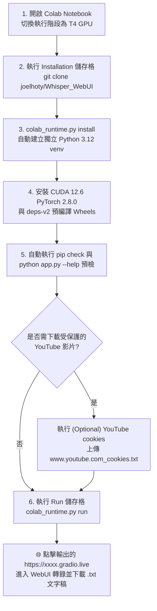
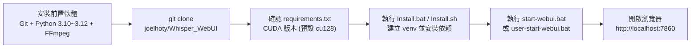
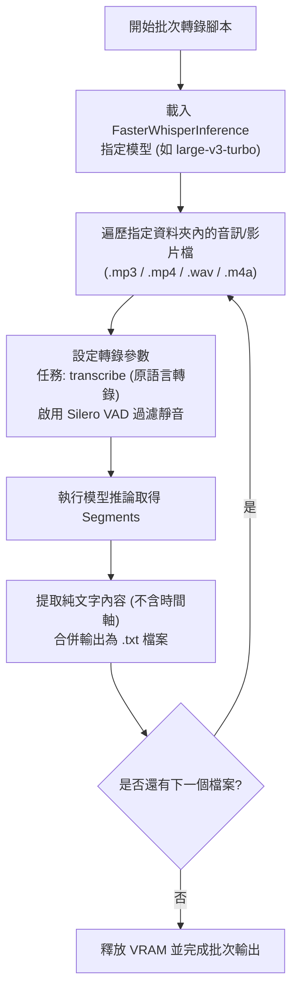
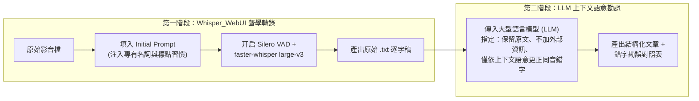

# 🎙️ 使用 `joelhoty/Whisper_WebUI` 進行語音轉錄成文字稿：架構剖析、部署實戰與 AI 勘誤工作流指南

> **最後更新時間**: 2026-11-18 09:02:00 (UTC+8)
> **使用模型**: Gemini 4 Argon (Medium)
> **執行 Agent**: Antigravity
> **目標專案**: [https://github.com/joelhoty/Whisper_WebUI](https://github.com/joelhoty/Whisper_WebUI)

---

## 1. 🔬 核心概念剖析 (Core Concepts)

### 1.1 `joelhoty/Whisper_WebUI` 專案定位與工程改良

[**joelhoty/Whisper_WebUI**](https://github.com/joelhoty/Whisper_WebUI) 是基於 OpenAI Whisper 語音辨識模型與 Gradio 網頁介面所建構的多功能**語音轉文字（Speech-to-Text, STT）與字幕生成系統**。本專案衍生自開源專案 [`jhj0517/Whisper-WebUI`](https://github.com/jhj0517/Whisper-WebUI)（以提交 `c3bb3b1` 為基礎，採用 Apache-2.0 授權），並針對現代雲端環境（特別是 **Google Colab Python 3.13 核心與新版套件相容性斷裂問題**）進行了關鍵的工程重構：

1. **獨立虛擬環境隔離（Isolated `venv` Provisioning）**：
   當 Google Colab 將預設核心升級至 Python 3.13 時，許多音訊與深度學習底層套件尚未支援。本專案透過 `notebook/colab_runtime.py` 自動偵測環境：若系統 Python 超出 `3.10 ~ 3.12` 範圍，會自動透過 `uv` 建立獨立的 **Python 3.12 `venv`**，使安裝過程不污染 Colab 原生核心，且**無須重啟執行階段（No Kernel Restart Required）**。
2. **預編譯 Wheel 與 SHA-256 完整性驗證（`deps-v2` Release）**：
   原專案從 GitHub 原始碼即時建置 `openai-whisper`、`uvr` 與 `pyrubberband`，常因新版 `setuptools>=82` 移除 `pkg_resources` 而建置失敗（如原專案 Issue #628）。`joelhoty/Whisper_WebUI` 將這三個核心依賴固定 Commit 並預先打包為 Wheel 發佈於 [`deps-v2` Release](https://github.com/joelhoty/Whisper_WebUI/releases/tag/deps-v2)，在 `requirements-common.txt` 中直接以 `#sha256=...` 驗證下載，免除編譯步驟並大幅縮短安裝時間。
3. **CUDA 與多媒體解碼器版本鎖定**：
   * **PyAV 版本限制（`av<19`）**：解決 PyAV 19 移除 `av.open()` 的 `metadata_errors` 參數導致 `faster-whisper==1.1.1` 解碼音訊崩潰的問題。
   * **PyTorch / TorchAudio 對齊（`2.8.0` + CUDA 12.6/12.8）**：修正 TorchAudio 2.9 API 棄用問題（Issue #606），並強制將 `venv` 內的 NVIDIA cuDNN 動態函式庫路徑置於 `LD_LIBRARY_PATH` 最前端，避免與系統舊版 cuDNN 衝突。

---

### 1.2 語音轉錄流水線架構 (`BaseTranscriptionPipeline`)

在 `Whisper_WebUI` 中，將一段影片或音訊轉錄為純文字稿（`.txt`）或時間軸字幕（`.srt` / `.vtt`）並非單純呼叫模型，而是經過一套模組化的五階段處理流水線：

```mermaid
flowchart LR
    A["📥 輸入來源<br/>本地檔案 / YouTube 網址 / 麥克風"] --> B["🔍 音訊解碼檢查<br/>modules/utils/audio_manager.py"]
    B --> C{"🎵 背景音樂分離?<br/>(選用 UVR)"}
    C -- "開啟" --> D["分離人聲與伴奏<br/>MDX-Net / Demucs / VR"]
    C -- "關閉" --> E{"🔇 語音活動偵測?<br/>(選用 Silero VAD)"}
    D --> E
    E -- "開啟" --> F["切除靜音片段<br/>減少幻覺並加速推論"]
    E -- "關閉" --> G["🧠 Whisper 語音轉錄<br/>faster-whisper (預設)<br/>openai-whisper / insanely-fast"]
    F --> G
    G --> H["⏱️ 時間軸映射還原<br/>(若啟用 VAD)"]
    H --> I{"👥 說話者分離?<br/>(選用 pyannote)"}
    I -- "開啟" --> J["標記不同講者<br/>Speaker_00 / Speaker_01"]
    I -- "關閉" --> K["📄 字幕與文字稿格式化<br/>subtitle_manager.py"]
    J --> K
    K --> L[("💾 outputs/<br/>.txt / .srt / .vtt / .lrc")]
```



---

### 1.3 三大 Whisper 推論後端與效能數學模型

專案透過工廠模式（`modules/whisper/whisper_factory.py`）支援三種推論引擎。預設採用的 **`SYSTRAN/faster-whisper`** 基於 **CTranslate2** 推論引擎，透過權重量化（FP16 / INT8）、層融合（Layer Fusion）與批次重新排序，在相同準確率（Beam Size = 5）下大幅降低記憶體佔用與推論時間：

| 推論實作 (`--whisper_type`) | 底層推論框架 | 運算精度 | Beam Size | 轉錄耗時基準 | 最大 GPU 記憶體 (VRAM) | 最大系統記憶體 (RAM) | 適用場景 |
| :--- | :--- | :--- | :--- | :--- | :--- | :--- | :--- |
| **`faster-whisper`（預設）** | CTranslate2 | `fp16` | 5 | **54 秒** | **4,755 MB** | **3,244 MB** | 絕大多數環境首選，速度快、省顯存（Colab T4 即可跑 `large-v2` / `large-v3`） |
| **`openai/whisper`** | PyTorch 原生 | `fp16` | 5 | 4 分 30 秒 | 11,325 MB | 9,439 MB | 需要與 OpenAI 原始論文行為完全一致之基準測試 |
| **`insanely-fast-whisper`** | HF Transformers + Flash Attention | `fp16` | 1 (Batch) | 極快（批次並行） | 視 Batch Size 而定 | 中等 | 支援 Flash Attention 2 的高階 GPU 進行長音訊極速批次轉錄 |

---

## 2. 🛠️ 實作與應用範例 (Practical Examples)

### 2.1 方式一：在 Google Colab 雲端免費 GPU 啟動並轉錄文字稿（最推薦）

若本機沒有 NVIDIA 獨顯，可直接透過專案內建的 `notebook/whisper-webui.ipynb` 在 Google Colab（免費 T4 GPU）上執行。

#### Colab 自動化隔離環境啟動流程圖



#### Colab 終端機／自訂 Notebook 呼叫範例

以下為在 Google Colab 儲存格中直接呼叫 `colab_runtime.py` 進行安裝與啟動的完整指令與說明：

```bash
# ==============================================================================
# 步驟 1：複製 joelhoty/Whisper_WebUI 儲存庫至 Colab 工作目錄
# ==============================================================================
!git clone https://github.com/joelhoty/Whisper_WebUI.git /content/Whisper-WebUI
%cd /content/Whisper-WebUI

# ==============================================================================
# 步驟 2：執行隔離環境安裝（建立 Python 3.12 venv、安裝依賴並執行啟動前檢查）
# 不會污染 Colab 原生 Python 3.13 核心，因此安裝完畢後「不需要」重啟 Runtime
# ==============================================================================
!python notebook/colab_runtime.py install

# ==============================================================================
# 步驟 3：（選用）若轉錄 YouTube 遇到 "Sign in to confirm you're not a bot"
# 可設定無痕模式匯出的 Netscape 格式 cookies.txt 路徑
# ==============================================================================
import os
os.environ["YOUTUBE_COOKIES_FILE"] = "/content/www.youtube.com_cookies.txt"

# ==============================================================================
# 步驟 4：啟動 Gradio WebUI 並產生公開分享網址 (*.gradio.live)
# 預設使用 faster-whisper，輸出檔案會儲存於 /content/Whisper-WebUI/outputs/
# ==============================================================================
!python notebook/colab_runtime.py run
```

---

### 2.2 方式二：Windows / Linux 本機安裝與自訂啟動腳本

若本機配備 NVIDIA GPU（建議 6GB VRAM 以上），可安裝於本機長期使用。

#### 本機安裝與啟動流程圖



#### 本機部署與自訂參數啟動指令

```powershell
# 1. 下載專案原始碼（請確保系統 PATH 已包含 FFmpeg/bin）
git clone https://github.com/joelhoty/Whisper_WebUI.git
cd Whisper_WebUI

# 2. 執行自動安裝腳本（Windows 使用 Install.bat，Linux/macOS 使用 ./Install.sh）
# 腳本會自動建立 venv 資料夾並安裝 requirements.txt 與 requirements-common.txt
.\Install.bat

# 3. 啟動預設 WebUI（預設連線位址：http://localhost:7860）
.\start-webui.bat

# 4. 進階用法：直接透過虛擬環境傳遞命令列參數（例如指定模型目錄、開啟跨網域分享）
.\venv\Scripts\python.exe app.py `
  --whisper_type faster-whisper `
  --server_port 7860 `
  --share `
  --api_open
```

---

### 2.3 方式三：使用 Python 腳本直接呼叫核心轉錄管線（批次轉文字稿）

除了透過瀏覽器點選 Gradio 介面外，若需要將大量演講音訊或影片自動轉成**純文字稿（`.txt`）**，可以直接在專案的 `venv` 環境中呼叫 `modules/` 下的實作類別，或是呼叫 `backend/` 的 FastAPI 服務。

#### 批次語音轉純文字稿程式邏輯流程圖



#### 批次轉錄純文字稿 Python 範例程式碼

```python
"""
在 Whisper_WebUI 專案根目錄下，使用虛擬環境批次將音訊/影片轉錄為純文字稿 (.txt)
執行方式：.\venv\Scripts\python.exe batch_transcribe_txt.py
"""

from pathlib import Path
from faster_whisper import WhisperModel

def batch_transcribe_to_txt(
    input_dir: str,
    output_dir: str = "outputs",
    model_size: str = "deepdml/faster-whisper-large-v3-turbo-ct2",
    language: str = "zh",
    task: str = "transcribe",  # 注意："transcribe" 保留原語言；"translate" 會全部翻譯成英文！
    initial_prompt: str = "以下是繁體中文與英文專有名詞夾雜的科技訪談逐字稿。"
):
    """
    使用 Whisper_WebUI 內建的 faster-whisper 引擎將音訊轉為純文字檔 (.txt)
    """
    in_path = Path(input_dir)
    out_path = Path(output_dir)
    out_path.mkdir(parents=True, exist_ok=True)

    # 1. 初始化 CTranslate2 faster-whisper 模型（GPU 使用 float16）
    print(f"[*] 正在載入模型: {model_size} ...")
    model = WhisperModel(model_size, device="cuda", compute_type="float16")

    # 2. 掃描支援的影音格式
    audio_exts = {".mp3", ".wav", ".m4a", ".mp4", ".mkv", ".flac"}
    files = [f for f in in_path.iterdir() if f.suffix.lower() in audio_exts]

    for audio_file in files:
        print(f"[*] 正在轉錄: {audio_file.name} (language={language}, task={task}) ...")

        # 3. 執行語音轉錄，開啟 vad_filter (Silero VAD) 自動切除無聲段落、防止幻覺重複
        segments, info = model.transcribe(
            str(audio_file),
            language=language,
            task=task,
            beam_size=5,
            vad_filter=True,
            vad_parameters=dict(min_silence_duration_ms=500),
            initial_prompt=initial_prompt
        )

        # 4. 逐句收集文字（對應 WebUI 中 File Format 選擇 "txt" 的無時間軸輸出）
        lines = [seg.text.strip() for seg in segments if seg.text.strip()]

        # 5. 寫入 .txt 純文字檔
        txt_output_path = out_path / f"{audio_file.stem}.txt"
        txt_output_path.write_text("\n".join(lines), encoding="utf-8")
        print(f"[+] 已儲存純文字稿: {txt_output_path} (共 {len(lines)} 行)")

if __name__ == "__main__":
    # 將 downloads 資料夾內的影音檔批次轉為純文字逐字稿
    batch_transcribe_to_txt(
        input_dir="./inputs",
        output_dir="./outputs",
        language="zh",
        task="transcribe"
    )
```

---

### 2.4 WebUI 介面轉出 `.txt` 純文字稿之標準操作步驟与實戰案例覆盤

在 `Whisper_WebUI` 網頁介面中，共有四個主要輸入分頁：**`File`（本地檔案）**、**`Youtube`（YouTube 連結）**、**`Mic`（麥克風）** 與 **`T2T Translation`（字幕翻譯）**。若要產出如前兩篇筆記所使用的 `.txt` 逐字稿，標準步驟如下：

1. **選擇輸入來源**：
   * 若為下載好的音訊／影片，切換至 **`File`** 分頁並拖曳上傳檔案。
   * 若為線上影片，切換至 **`Youtube`** 分頁並貼上影片網址（會自動呼叫 `yt-dlp` 提取最佳音軌）。
2. **設定模型與語言參數**：
   * **Model**：建議選擇 `large-v2`、`large-v3` 或在下拉選單直接輸入 Hugging Face 模型代號 `deepdml/faster-whisper-large-v3-turbo-ct2`（速度極快且準確率高）。
   * **Language**：明確指定主要語言（如 `Chinese`），避免自動偵測在前 30 秒英文片頭時誤判。
   * **File Format**：選擇 **`txt`**（僅輸出純文字，不含時間軸與序號，最適合後續交由 AI 整理成文章）。
3. **進階前處理設定**：
   * **钩選 `Silero VAD`**：強烈建議開啟！可過濾長段靜音與過場音樂，避免 Whisper 在無聲處陷入無限重複句子的「幻覺（Hallucination）」。
   * **钩選 `Background Music Separation (UVR)`**：僅在背景音樂極大、蓋過人聲時開啟。

> [!IMPORTANT]
> **實戰案例覆盤：為什麼前兩篇逐字稿會出現截然不同的錯誤型態？**
> * **案例 A（[《黃叔精讀李飛飛》](file:///D:/CLASS_NOTE/AI/feifei_li_socrates_prompter_transcript_1118.md)）**：該影片片頭前 13 行全為李飛飛與胡伯曼的英文原聲對談，隨後才是黃叔的中文講解。轉錄時若將 **Language 設為 `Automatic Detection`（自動偵測）** 或誤勾選了 **`Translate to English`（語音轉譯為英文）**，Whisper 就會把後面黃叔講的中文全部硬翻成英文，甚至把中文專有名詞直接音譯（如「賽車迷」變成 `Saichemi`、「蘇格拉底」變成 `Sugarati`、「帶著卡點」變成 `took a card`）。
> * **案例 B（[《薩哈爾·尤瑟夫治好腦霧》](file:///D:/CLASS_NOTE/AI/sahar_yousef_grayscale_brain_fog_transcript_1118.md)）**：該影片全片為中文旁白配音，正確使用了 `Chinese` + `Transcribe` 模式，因此產出全中文逐字稿；但因為語音模型僅依賴聲學特徵與局部機率解碼，遇到跨領域專有名詞或英文術語時，容易產生同音字替換（如 `Brain Fog` 被聽成 `Bring Folk`、「奠基／惦記／電擊」全部被寫成 `電機`、「算力」被寫成 `順利`）。

---

## 3. 🚀 延伸思考與進階主題 (Extensions & Advanced Topics)

### 3.1 進階技巧：利用 `Initial Prompt` 與「Whisper_WebUI + LLM 兩階段工作流」消除同音錯字

為了徹底解決語音轉錄的同音字與中英夾雜誤聽問題，實務上最佳的工程作法是採用 **「前端 Initial Prompt 引導 + 後端 LLM 上下文語意校對」** 的雙階段工作流：



1. **善用進階參數中的 `Initial Prompt`（初始提示詞）**：
   在 `Whisper_WebUI` 的 **Advanced Parameters** 展開區塊中，有一個 `Initial Prompt` 欄位。Whisper 會將這段文字視為「前文語境（Context Tokens）」：
   * 若希望輸出**繁體中文**並正確辨識專有名詞，可在 `Initial Prompt` 填入：
     `以下是關於腦科學與人工智慧的繁體中文訪談逐字稿，包含專有名詞：李飛飛、蘇格拉底、尤瑟夫、Brain Fog、腦霧、Attention Residue、Grayscale Mode。`
2. **結合 LLM 進行無損語意校對**：
   如同我們在前兩篇筆記中實作的流程，將 `Whisper_WebUI` 輸出的 `.txt` 交由 LLM，並明確限制 Prompt：**「把逐字稿整理成文章，不添加其他資訊，保留原文，但是如果有需要更正錯字，可以根據上下文語意處理」**，即可同時保有逐字稿 100% 的真實細節，又徹底消除語音辨識的同音錯字。

---

### 3.2 四種部署與使用方式之應用場景與限制比較表

| 部署與使用方式 | 硬體需求 | 安裝複雜度 | 優點 | 限制與注意事項 | 最適合場景 |
| :--- | :--- | :--- | :--- | :--- | :--- |
| **1. Google Colab 雲端版**<br/>(`notebook/whisper-webui.ipynb`) | **本機零硬體需求**<br/>（使用雲端免費 T4 GPU） | ⭐ 極低（點擊即用） | 免購買昂貴顯卡；`joelhoty/Whisper_WebUI` 已修復 Python 3.13 與 `deps-v2` Wheel，不需重啟核心即可拿到 `gradio.live` 網址 | 免費版 Colab 有連線時間限制；下載 YouTube 影片常遇機器人驗證，需搭配匯出 `cookies.txt` | 偶爾至中度轉錄需求、跨裝置使用、本機無 NVIDIA 獨顯之使用者 |
| **2. Windows / Linux 本機版**<br/>(`Install.bat` + `start-webui.bat`) | NVIDIA GPU（建議 VRAM $\ge$ 6GB）或 Intel XPU | ⭐⭐ 中等（需安裝 Git、Python 3.10~3.12、FFmpeg） | 檔案讀寫最快、無連線中斷限制、支援麥克風即時錄音、YouTube 下載不易被擋 IP | 首次下載模型權重（約 3GB）需時較長；若 CUDA 版本非 12.8 需修改 `requirements.txt` | 頻繁轉錄大量影音、重視資料隱私不出本機之個人工作站 |
| **3. Docker 容器版**<br/>(`docker compose up`) | 支援 NVIDIA Container Toolkit 之主機 | ⭐⭐⭐ 中高（需建置約 7GB 映像檔） | 環境完全封裝隔離，不會與主機既有 Python 套件衝突，易於部署在伺服器供多人共用 | Docker 映像檔體積較大（~7GB），Windows 下需正確設定 WSL2 GPU 穿透 | 實驗室伺服器、多人共享語音轉錄服務 |
| **4. FastAPI REST API / Python 腳本**<br/>(`backend/main.py` 或直接呼叫 `modules/`) | 同本機或伺服器環境 | ⭐⭐⭐⭐ 進階（需撰寫呼叫腳本） | 可整合進自動化工作流（如自動下載 Podcast ➔ 轉出 `.txt` ➔ 串接 LLM 自動整理筆記） | 不經由圖形介面，需自行透過 SQLite 任務狀態或腳本管理輸出檔案 | 大規模批次影音轉文字、與 AI Agent 自動化管線串接 |

---

## 4. 📚 參考資料與專案連結 (References)

1. **joelhoty/Whisper_WebUI GitHub 儲存庫（Colab Python 3.13 相容性強化與 `deps-v2` Wheel 衍生版）**
   - 網址：[https://github.com/joelhoty/Whisper_WebUI](https://github.com/joelhoty/Whisper_WebUI)（取得日期：2026-11-18）
2. **joelhoty/Whisper_WebUI Google Colab 線上執行筆記本**
   - 網址：[https://colab.research.google.com/github/joelhoty/Whisper_WebUI/blob/main/notebook/whisper-webui.ipynb](https://colab.research.google.com/github/joelhoty/Whisper_WebUI/blob/main/notebook/whisper-webui.ipynb)（取得日期：2026-11-18）
3. **joelhoty/Whisper_WebUI `deps-v2` 預編譯依賴套件 Release**
   - 網址：[https://github.com/joelhoty/Whisper_WebUI/releases/tag/deps-v2](https://github.com/joelhoty/Whisper_WebUI/releases/tag/deps-v2)（取得日期：2026-11-18）
4. **jhj0517/Whisper-WebUI 原始上游專案與命令列參數 Wiki**
   - 網址：[https://github.com/jhj0517/Whisper-WebUI](https://github.com/jhj0517/Whisper-WebUI) ／ [Command-Line Arguments Wiki](https://github.com/jhj0517/Whisper-WebUI/wiki/Command-Line-Arguments)（取得日期：2026-11-18）
5. **本工作區使用 `Whisper_WebUI` 產出之逐字稿整理實例**：
   - [黃叔精讀李飛飛：人類最強的提示詞工程師死了 2400 年（逐字稿整理與勘誤還原）](file:///D:/CLASS_NOTE/AI/feifei_li_socrates_prompter_transcript_1118.md)
   - [把手機調成黑白模式每年竟憑空多出 15 天清醒生命：柏克萊腦科學家治好腦霧的逆向神經術｜薩哈爾·尤瑟夫｜第一期](file:///D:/CLASS_NOTE/AI/sahar_yousef_grayscale_brain_fog_transcript_1118.md)

---

## 📝 提示詞歷史與變更記錄 (Prompt Archive)

### 🔹 [2026-11-18 09:02:00] [Gemini 4 Argon (Medium) / Antigravity] 變更紀錄
- **模型/Agent**: Gemini 4 Argon (Medium) / Antigravity
- **Prompt 原文**:
  ```text
  進行語音轉錄成文字稿
  增加一篇使用這個repo的說明筆記
  ```
- **變更摘要**: 檢索並深入剖析 `https://github.com/joelhoty/Whisper_WebUI` 儲存庫架構與 `README.md`、`notebook/colab_runtime.py`、`requirements-common.txt` 等核心檔案，建立完整使用說明與技術筆記（`AI/whisper_webui_speech_to_text_guide_1118.md` 與 `.html`），涵蓋專案針對 Colab Python 3.13 獨立 `venv` 與 `deps-v2` Wheel 的工程改良、五階段語音轉錄流水線、三大 Whisper 引擎效能對比、Colab／本機／Python 批次腳本實作範例、前兩篇逐字稿錯誤成因覆盤與 `Initial Prompt` + LLM 兩階段勘誤工作流，同步更新全站索引。
