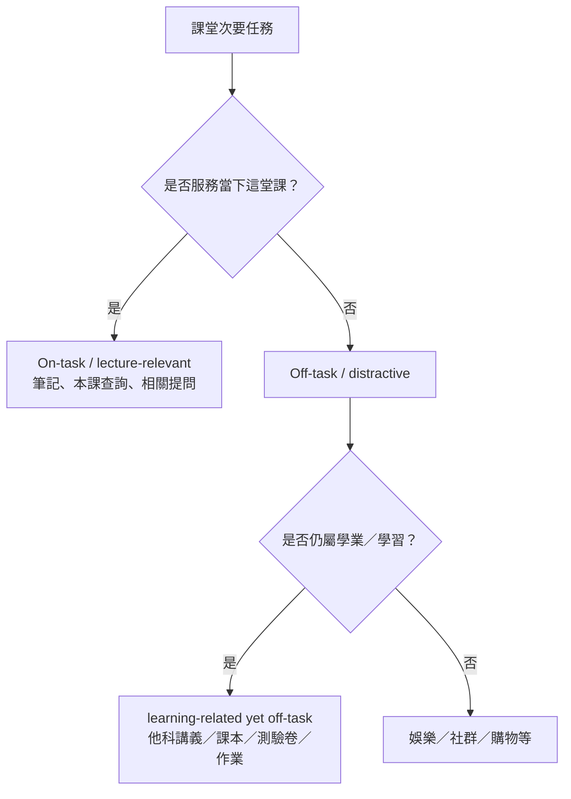
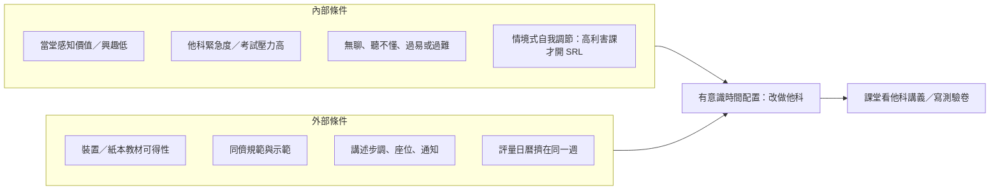
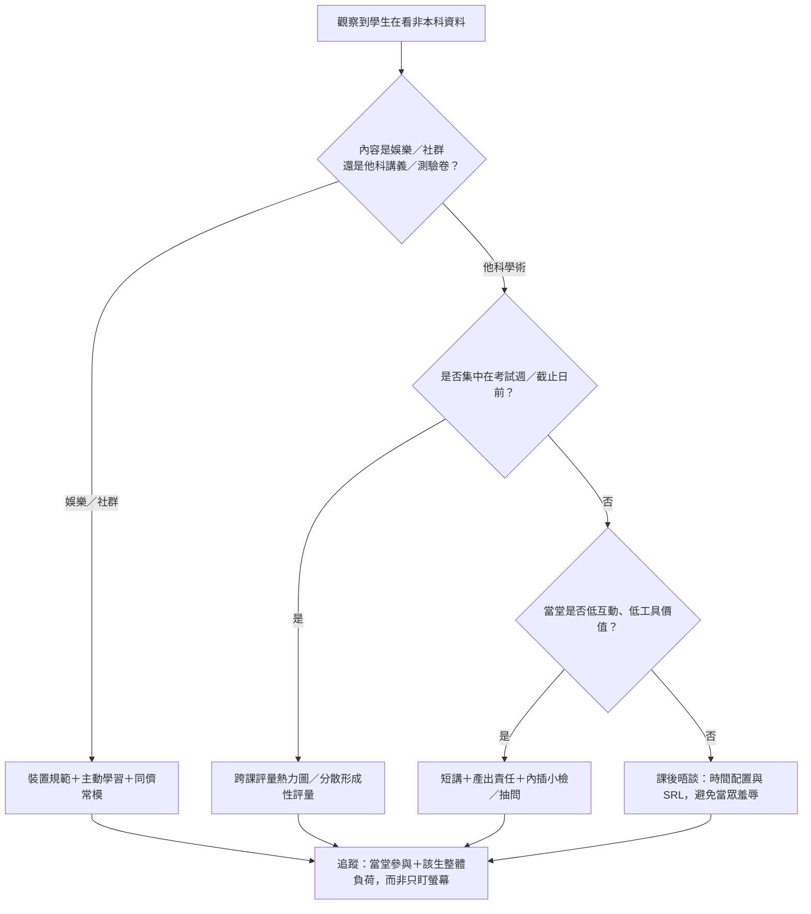
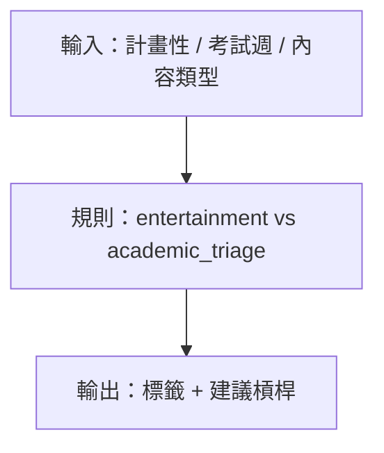

# 課堂「學習相關但離題」多工：他科講義／課本／測驗卷行為的實證研究綜述

> **最後更新時間**: 2026-11-11 11:00:43 (UTC+8)
> **使用模型**: Composer
> **執行 Agent**: Auto (Cursor)
> **主題分類**: inquiry-1 教育議題探究／課堂多工／自我調節學習／高等教育實證

> [!NOTE]
> **與既有檔案的區分（請勿混用）**
> - 本檔為**獨立新建**的實證文獻綜述，檔名：`learning_related_offtask_multitasking_empirical_review.*`
> - **不編輯、不覆蓋**既有的 `classroom_cross_subject_study_research_and_solutions.md/.html`（理論框架＋班級經營方案指南）與 `pbl2/classroom_smartphone_management_solutions.*`（手機分心方案）
> - 本檔聚焦 Deng 團隊等提出的 **learning-related yet off-task**（學習相關但離題）概念、盛行率數據、對**當堂課**注意力／保留的實驗與追蹤證據，以及介入方法比較
> - 敘事體完整研究報告另見：`reports/課堂看他科資料原因研究.md`（由研究筆記綜合而成；與本檔互補，非同一檔）

---

## 🎯 摘要 (Summary)

「學生在 A 課堂看 B 科講義、課本、測驗卷或趕他科作業」在研究上最貼切的標籤是 **learning-related yet off-task multitasking**（學習相關但偏離當堂課的多工）。它不是單純「滑社群偷懶」，也不是「本課相關的筆記／查資料」；文獻幾乎一律以「是否服務**當下這堂課**」劃分，因此他科學術工作在分類上屬於 **lecture-irrelevant／distractive**。

關鍵實證結論：
1. **很常見**：中國大學樣本中，超過八成報告曾在課堂做學習相關的次要任務（含他科作業）；印尼大型問卷約三分之一曾瀏覽他科網站或通訊討論他科作業；美國筆電調查近半數曾在課堂做他課課業。
2. **多半是策略性分流，不是單純自制失敗**：當堂課感知價值／興趣低、他科 deadline／考試緊急時，學生會**事先計畫**帶哪份作業進教室，並合理化為「不浪費時間」。
3. **對當堂課有代價**：以「模擬他科長答作業」為無關次任務的實驗顯示，注意力與事實／概念保留皆明顯下降；筆電追蹤亦顯示非本課活動比率與成績負相關。
4. **禁手機治不好這題**：紙本講義、下載教材、他科 Word／PDF 都繞得過裝置禁令；較對症的是提高當堂課工具價值與課中 accountability，並在機構層協調評量時程。

---

## 💡 1. 核心概念剖析 (Core Concepts)

### 1.1 術語地圖：這行為在文獻裡叫什麼？

| 標籤 | 含義 | 是否直接對應「看他科資料」 |
|------|------|---------------------------|
| **learning-related yet off-task**／**off-task yet learning-related** | 次任務仍屬學習，但與當堂課無關 | **是（最精準）** |
| distractive multitasking／off-task multitasking | 偏離當堂目標的任何次任務 | 上位概念（含社群與他科） |
| productive／course-related multitasking | 服務**本課**的筆記、投影片、查本課資料 | **否**（他科不算 productive） |
| academic cyberslacking／cyberloafing | 課堂非當堂用途的上網 | 部分題項會納入「他科網站／他科作業通訊」 |
| intentional mind wandering (TUT) | 刻意想與本講無關之事 | 機制相近（刻意離題），但未必外化成他科作業 |



### 1.2 為什麼會發生？實證指出的內外成因



**最一致的機制**（Deng, Zhou, & Broadbent, 2024；Qian, 2017）：學生會比較當堂課與替代任務的重要性、緊急性與報酬。任務價值越高，off-task 時間越少；低價值課上，改做他科常是**刻意選擇**，作者甚至提醒不宜一律視為「自我調節失敗」。

質性合理化常見句型：
- 「不要浪費時間」
- 「教室有學習氛圍，適合趕學習任務」
- 「這堂不重要，整堂做自己的事」
- 「留一隻耳朵聽課，講到重點再回來」
- 理論上可對應中立化技術的 *appealing to higher loyalties*（他科更重要）與 *condemning the condemners*（怪老師無聊／不公）（Han et al., 2025）

### 1.3 對學習的影響：分類與效應

文獻幾乎不把「學術但非本課」算成有益的 productive multitasking。

| 次任務 | 對**本講**注意力／保留 | 證據類型 |
|--------|------------------------|----------|
| 本課筆記／相關提問 | 中性至正向 | 實驗（如 Mahama 的 lecture-relevant） |
| **他科作業／模擬他科長答** | **負向** | 實驗（Mahama Exp.1 明確模擬 other-course assignment） |
| 社群／簡訊／娛樂 | 負向 | 實驗＋追蹤＋相關 |
| 刻意心智漫遊 | 負向（短期 quiz 尤明顯） | 現場 thought-probe |

Mahama（2025）實驗摘要（影音講課、大學部 *N*=100）：lecture-irrelevant（填寫與講課無關、需長答的校園經驗問卷＝模擬他科作業）組注意力、事實保留、概念保留皆最低；lecture-relevant（筆記）組最高。

---

## 🛠️ 2. 實作與應用範例 (Practical Examples)

### 2.1 盛行率速覽（不可直接互比，題幹不同）

| 研究 | 樣本 | 與「他科」直接相關的發現 |
|------|------|--------------------------|
| Deng et al., 2024 | 中國三校問卷 *n*=385；訪談 15 | >80% 曾從事 learning-related 次任務（含完成他科作業）；45 分鐘課平均約 12.8 分鐘從事與當堂無關活動 |
| Zhou & Deng, 2024 | 問卷 *n*=543 等 | 「最常做」的 course-unrelated yet learning-related 約 16%；多數曾用手機做他科作業／搜他科資料 |
| Simanjuntak et al., 2022 | 印尼大學生 *n*=1485 | 瀏覽他科網站 34.61%；通訊討論他科作業 32.18% |
| Borbone, 2009 | UNC 筆電使用者子集 *n*=81 | 49.4% 在課堂做 coursework for other classes |
| JAOA／骨科醫學生調查, 2014 | 醫學教育脈絡 | 50 分鐘講課中 74% 會讀他科，平均約 23 分鐘；主因含考試時程、講者、興趣 |

### 2.2 現場區辨：娛樂分心 vs 他科學術分流

教師若一律用「沉迷手機」解讀，容易誤判課業過載或教學設計問題。

| 線索 | 較像娛樂／社群 | 較像他科學術分流 |
|------|----------------|------------------|
| 時機 | 整學期零星、無聊段落 | 考試週、作業截止前、低利害選修 |
| 計畫性 | 通知觸發、習慣性解鎖 | 課前已夾他科講義／預開文件 |
| 學生說法 | FOMO、解悶 | 「這堂用處不大／不浪費時間」 |
| 介入含意 | 裝置規範＋習慣／同儕常模 | 課程價值、節奏、評量對齊、跨課負荷 |

### 2.3 決策流程（診斷 → 選工具）



### 2.4 輕量診斷腳本（獨立於既有 `classroom_cross_subject_analyzer.py`）

下列小工具只做「行為類型標籤＋建議介入方向」的文字輸出，**不取代**既有認知損益模擬器。



```python
# classroom_offtask_triage_labeler.py
# 獨立小工具：依線索粗分「娛樂分心」與「他科學術分流」
# 不依賴、不修改 classroom_cross_subject_analyzer.py

from dataclasses import dataclass


@dataclass
class Clue:
    planned: bool          # 課前就帶好他科講義／檔案？
    exam_week: bool        # 是否考試週或大截止日前？
    content: str           # "other_course" | "social" | "game" | "mixed"
    low_course_value: bool # 學生自述／觀察：當堂低興趣低利害？


def label(clue: Clue) -> dict:
    """回傳粗分類與建議；僅供討論，非心理診斷。"""
    if clue.content in {"social", "game"} and not clue.planned:
        kind = "entertainment_distraction"
        levers = ["裝置結構化使用", "短講+活動循環", "同儕常模與延遲通知"]
    elif clue.content == "other_course" and (clue.planned or clue.exam_week or clue.low_course_value):
        kind = "academic_triage_other_course"
        levers = ["提高當堂工具價值與產出責任", "內插／抽問提高切走成本", "跨課評量時程協調"]
    else:
        kind = "mixed_or_unclear"
        levers = ["先低干擾近距離提示", "課後短談釐清動機", "避免一開始就道德化"]
    return {"label": kind, "suggested_levers": levers}


if __name__ == "__main__":
    demo = Clue(
        planned=True,
        exam_week=True,
        content="other_course",
        low_course_value=True,
    )
    print(label(demo))
```

### 2.5 介入方法比較（應用與限制）

| 方法 | 應用 | 限制 | 對「他科課業」適配 |
|------|------|------|-------------------|
| 提升感知課程／活動價值 | 直接對準 Deng／任務價值機制 | 單堂教師能動性受主修、評量權重限制 | **高** |
| 主動學習＋短講循環 | 降被動空檔、提高切走成本 | 備課成本；低品質活動仍可能被分流 | 中高 |
| 內插／concurrent testing | 降 TUT／神遊、錨定注意力 | 複製效果量常偏小；多在影片／實驗情境 | 中高 |
| 學生 SRL／環境結構化 | 高利害課有效（藏手機、選座、延遲通知） | 低價值課學生會「關閉」SRL，甚至用 SRL 更有效趕他科 | 中 |
| 裝置全面禁止 | 降低可見娛樂手機使用 | 難禁紙本／下載他科；高教可能傷出勤與無障礙 | **低–中** |
| 引導式裝置使用 | 增加本課筆記／學術用途 | 難偵測「他科 Word／PDF」 | 中 |
| 嚴懲／當眾羞辱 | 短期嚇阻 | 傷關係；對「自覺理性趕工」說服力弱 | 低 |

---

## 🚀 3. 延伸思考與進階主題 (Extensions & Advanced Topics)

1. **雙結果缺口**：現有實驗多量測「本講損失」，幾乎不同時量測「他科作業完成品質／GPA 淨效益」。學生 triage 的「好處」目前停在質性自我報告。
2. **與手機方案的關係**：`pbl2` 手機管理對娛樂分心較對症；本現象常混紙本與檔案，需要評量節奏與教學設計，而非只靠收手機。
3. **與既有理論指南的互補**：`classroom_cross_subject_study_research_and_solutions` 強在期望—價值、動機干擾、自我價值等理論敘事與班級經營 SOP；本檔強在 Deng／Simanjuntak／Mahama／追蹤研究的操作性定義與數據。
4. **K–12 vs 高教**：多數精準「他科 multitasking」證據來自大學；國高中現場常被升學時程放大，但同題幹的大型量化仍不足。
5. **倫理**：把「看起來沒在聽」一律罰，可能誤傷學生主導活動中的有效投入（課堂 EEG 研究顯示行為觀察與神經注意力指標可能不一致）。

---

## 📚 4. 參考資料列表 (References)

取得日期皆為 **2026-11-11**。

1. Deng, L., Zhou, Y., & Broadbent, J. (2024). Distraction, multitasking and self-regulation inside university classroom. *Education and Information Technologies*. https://doi.org/10.1007/s10639-024-12786-w
2. Deng, L., Liu, Y., Ku, K. Y. L., & Lin, L. (2022). In-class multitasking with smartphones and laptops. *College Teaching*. https://doi.org/10.1080/87567555.2021.1973947
3. Zhou, Y., & Deng, L. (2024). Lost in multitasking… *Australasian Journal of Educational Technology*. https://doi.org/10.14742/ajet.8941
4. Deng, L., et al. (2022). Off-task social media multitasking during class. *International Journal of Educational Technology in Higher Education*. https://doi.org/10.1186/s41239-022-00321-1
5. Simanjuntak, E., Nawangsari, N. A. F., & Ardi, R. (2022). Academic cyberslacking… *Psychology Research and Behavior Management*. https://pmc.ncbi.nlm.nih.gov/articles/PMC9642801/
6. Mahama, S. (2025). When engagement meets distraction…（WashU thesis；模擬他科作業）. https://openscholarship.wustl.edu/art_sci_etds/3633
7. Kraushaar, J. M., & Novak, D. C. (2010). Examining the affects of student multitasking with laptops during the lecture. *JISE*. https://jise.org/Volume21/n2/JISEv21n2p241.pdf
8. Sana, F., Weston, T., & Cepeda, N. J. (2013). Laptop multitasking hinders classroom learning… *Computers & Education*. https://www.sciencedirect.com/science/article/pii/S0360131512002254
9. Borbone, M. (2009). From doodle to Google…（UNC master’s paper）. https://ils.unc.edu/MSpapers/3470.pdf
10. Qian, Y. (2017). Multitasking and distracted learning…（Ohio State thesis）. OhioLINK
11. Han, Z., Yang, Z., & Huang, Z. (2025). Classroom injustice and university students’ cyberloafing… *Frontiers in Psychology*. https://pmc.ncbi.nlm.nih.gov/articles/PMC12426119/
12. Wammes, J. D., et al. (2016). Mind wandering during lectures I & II.（intentional TUT 與 quiz／exam）
13. May, K. E., & Elder, A. D. (2018). Efficient, helpful, or distracting? A literature review of media multitasking… https://link.springer.com/article/10.1186/s41239-018-0096-z
14. Szpunar, K. K., Khan, N. Y., & Schacter, D. L. (2013). Interpolated memory tests… https://pmc.ncbi.nlm.nih.gov/articles/PMC3631699/
15. Ko, L.-W., et al. (2021). Effects of context on the neural correlates of attention in a college classroom. *npj Science of Learning*. https://www.nature.com/articles/s41539-021-00094-8

研究過程筆記另存於：`inquiry-1/research_notes/課堂看他科資料原因研究/`（causes_motivation.md、effects_outcomes.md、interventions_comparison.md）。

敘事體完整報告：`inquiry-1/reports/課堂看他科資料原因研究.md`（及同名 `.html`）。

---

## 📝 提示詞歷史與變更記錄 (Prompt Archive)

### 🔹 [2026-11-11 10:53:00] [Composer / Auto] 變更紀錄
- **模型/Agent**: Composer / Auto (Cursor)
- **Prompt 原文**:
  ```text
  為什麼很多學生會在課堂上看其他課程的資料 包含講義 課本 測驗卷，有沒有什麼相關研究
  ```
- **變更摘要**: 依 `inquiry-1/AGENTS.md` 以關鍵字檢索（learning-related yet off-task、academic cyberslacking、classroom multitasking、他科作業等），蒐集 Deng／Zhou、Simanjuntak、Mahama、Kraushaar & Novak 等實證來源，並寫入 `research_notes/課堂看他科資料原因研究/`。

### 🔹 [2026-11-11 11:00:43] [Composer / Auto] 變更紀錄
- **模型/Agent**: Composer / Auto (Cursor)
- **Prompt 原文**:
  ```text
  跟現有檔案區分 不要編輯同一份檔案
  ```
- **變更摘要**: **不編輯**既有 `classroom_cross_subject_study_research_and_solutions.*` 與 `pbl2/classroom_smartphone_management_solutions.*`；另建本獨立檔 `learning_related_offtask_multitasking_empirical_review.md/.html` 與輕量腳本 `classroom_offtask_triage_labeler.py`，專做實證術語、盛行率、效應與介入比較，並標明與既有理論／手機方案文件的分工。

### 🔹 [2026-11-11 11:25:00] [Composer / Auto] 變更紀錄
- **模型/Agent**: Composer / Auto (Cursor)
- **Prompt 原文**:
  ```text
  Perform any necessary follow-up actions in response to the subagent completion above.
  ```
- **變更摘要**: 報告寫手已將完整敘事報告寫入 `reports/課堂看他科資料原因研究.md/.html`；本檔僅補上對該報告的交叉連結與檔案分工說明，並整理索引歸屬（報告 md／html 併為同一篇筆記）。
