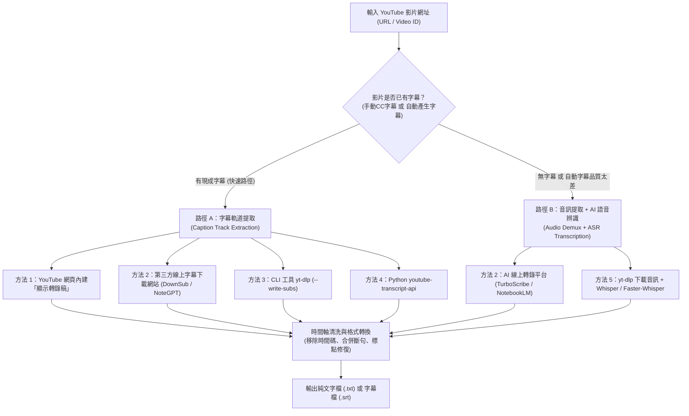
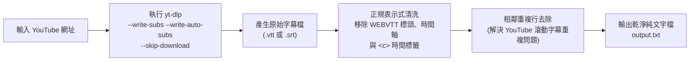
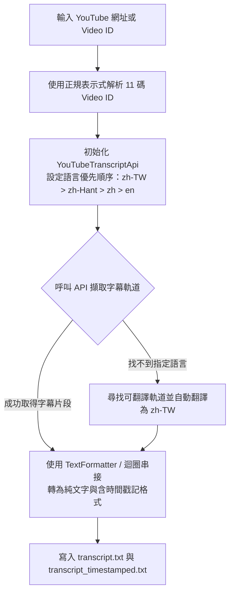
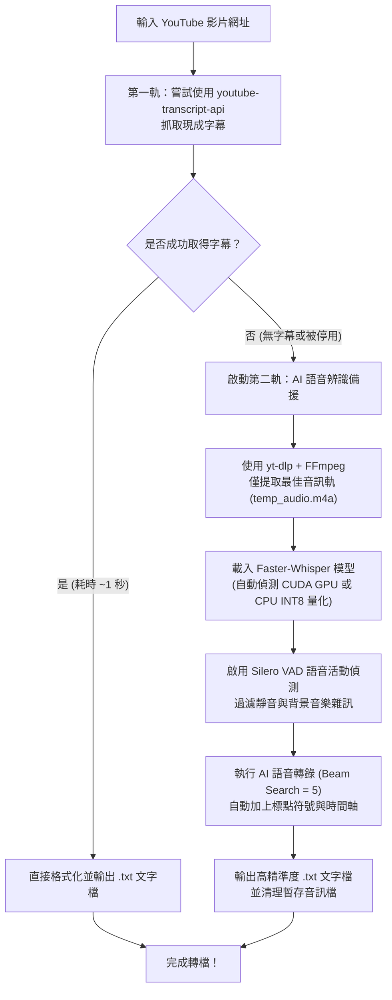
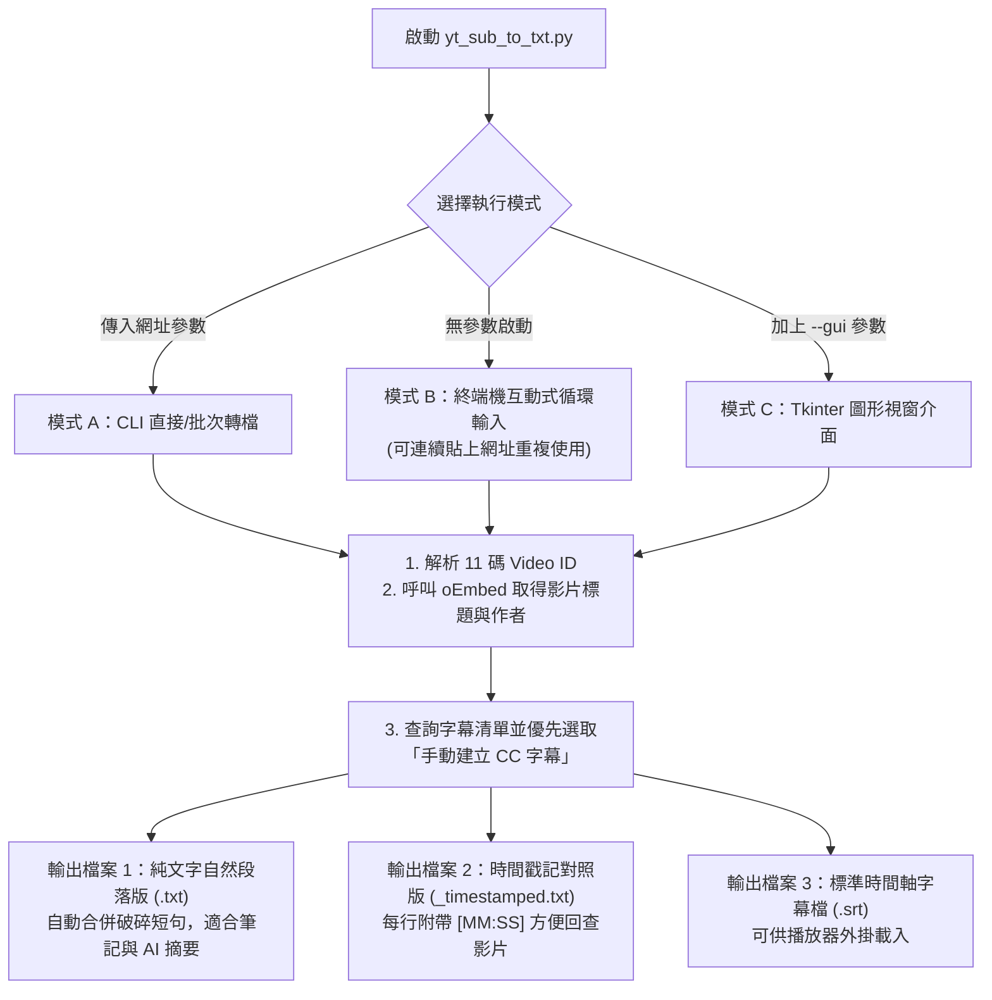
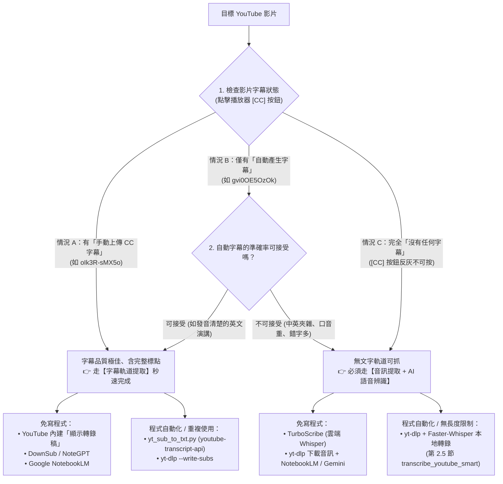

# 🎬 YouTube 影片取得字幕並轉換成文字檔（.txt / .srt）完整解決方案指南

> **最後更新時間**: 2026-11-11 08:50:00 (UTC+8)
> **使用模型**: Gemini 4 Argon (Medium)
> **執行 Agent**: Antigravity
> **主題分類**: PBL 專題研究 / 多媒體資訊檢索 / 自動語音辨識 (ASR) / Python 自動化

---

## 🎯 摘要 (Summary)

將 YouTube 影片中的語音或字幕提取並轉換為純文字檔（`.txt` 逐字稿）或時間軸字幕檔（`.srt` / `.vtt`），在課堂筆記整理、PBL 專題文獻蒐集、AI 知識庫建置（RAG）與語料分析中是極為常見的需求。

本文件根據關鍵字搜尋與實務技術驗證，系統化整理 **五大主流解決方案**（從零程式碼的內建功能與線上工具，到工程師與研究人員常用的 `yt-dlp`、`youtube-transcript-api` 與 `Whisper` 本地 AI 語音辨識），剖析其底層運作原理、提供含流程圖與完整註解的 Python 實作範例，並針對各種方法的**應用場景與限制**進行全方位比較。

---

## 💡 1. 核心概念剖析 (Core Concepts)

### 1.1 YouTube 字幕轉文字的兩大技術路徑

要從 YouTube 影片取得文字，底層技術可分為**「直接提取現有字幕軌道」**與**「下載音訊重新進行 AI 語音辨識」**兩條截然不同的路徑：



1. **路徑 A — 字幕軌道提取（Caption Track Extraction）**：
   * **原理**：YouTube 影片若包含創作者上傳的字幕（Manual Captions）或 YouTube 伺服器預先算好的自動字幕（Auto-generated Captions），這些文字實際上以 XML / JSON3 / WebVTT 格式儲存在 YouTube 的 TimedText 伺服器上。工具只需透過 YouTube 的 Innertube API 請求該文字軌道，**完全不必下載龐大的影音串流**，因此可在 **1～3 秒內**完成提取。
   * **核心限制**：若影片創作者關閉自動字幕、影片語言冷門、音訊含大量背景音樂導致 YouTube 未生成自動字幕，或屬於私人／限制嵌入影片，路徑 A 就會無法取得資料。

2. **路徑 B — 音訊串流提取 + 自動語音辨識（Audio Stream + ASR）**：
   * **原理**：當影片完全沒有字幕時，必須先透過影音下載工具（如 `yt-dlp` 搭配 `FFmpeg`）從 YouTube 的 DASH / HLS 串流中分離出純音訊軌（如 `.mp3`、`.m4a` 或 `16kHz WAV`），再送入自動語音辨識（Automatic Speech Recognition, ASR）模型（如 OpenAI 開源的 **Whisper** 架構）。
   * **Whisper 聲學模型底層機制**：將輸入音訊重新取樣至 $16,000\text{ Hz}$，計算 $80$ 頻道的對數梅爾頻譜圖（Log-Mel Spectrogram）特徵，再透過 **Encoder-Decoder Transformer** 序列到序列（Seq2Seq）模型直接預測多語言文字 Token 與時間戳記（Timestamps）。

---

### 1.2 字幕格式結構與語音辨識評估公式

在將字幕轉為純文字（`.txt`）的過程中，常會接觸到以下檔案格式：

| 格式名稱 | 副檔名 | 內容結構特徵 | 轉換為純文字 (`.txt`) 的處理重點 |
| :--- | :--- | :--- | :--- |
| **SubRip** | `.srt` | 由「序號」、「時間軸 (`00:00:01,000 --> 00:00:04,000`)」與「字幕文字」三行一組構成。 | 需以正規表示式（Regex）濾除純數字序號行、時間軸行與多餘空行。 |
| **WebVTT** | `.vtt` | YouTube 預設串流字幕格式，開頭有 `WEBVTT` 標頭，自動字幕常包含逐字時間標籤（如 `<00:00:01.200><c>`）與滾動重複行。 | 除了移除時間軸與 HTML/VTT 標籤外，**必須進行相鄰重複行去重（Deduplication）**。 |
| **JSON3** | `.json3` | YouTube 內部結構化字幕，包含 `events` 陣列與每個詞彙的毫秒級偏移量。 | 直接解析 JSON 結構提取 `segs[].utf8` 欄位即可無損串接。 |
| **Plain Text** | `.txt` | 純文字內容，不含時間軸與標籤。 | 可直接供 Word、Notion、Obsidian 或 LLM（ChatGPT / Gemini）讀取摘要。 |

#### 語音辨識準確率指標：字錯率（Word Error Rate, WER / Character Error Rate, CER）
衡量 YouTube 自動字幕與 Whisper AI 轉錄品質的標準數學指標為 **WER（英文以詞為單位）** 或 **CER（中文以字元為單位）**：

$$\text{CER} = \frac{S + D + I}{N} \times 100\%$$

* $S$（Substitutions）：被替換錯的字數（例如同音異字：「專題」辨識成「專題」以外的同音字）。
* $D$（Deletions）：漏掉未辨識出的字數（語速過快或吞音）。
* $I$（Insertions）：多餘插入的字數（背景雜訊或模型幻覺重複）。
* $N$：人工標準逐字稿（Ground Truth）的總字數。指標數值越低代表轉錄越精準。

---

## 🛠️ 2. 實作與應用範例 (Practical Examples)

以下依技術門檻由淺入深，詳列五種將 YouTube 字幕轉換為文字檔的實作方法。

---

### 2.1 方法一：YouTube 官方網頁內建「顯示轉錄稿」（免安裝、最快）

如果只需要偶爾複製一兩部影片的字幕，YouTube 網頁版其實已內建逐字稿檢視器：

1. 在電腦瀏覽器打開目標 YouTube 影片。
2. 點擊影片下方資訊欄的 **「...更多」** 展開完整說明。
3. 向下捲動找到 **「轉錄稿」** 區塊，點擊 **「顯示轉錄稿」（Show transcript）** 按鈕。
4. 影片右側（或下方）會出現完整字幕列表，點擊該面板右上角的 **「⋮」（三個點）** 選單，點擊 **「切換時間戳記」（Toggle timestamps）** 將時間隱藏。
5. 直接用滑鼠反白全選文字，複製貼上到記事本（`.txt`）或 Word 即可。

---

### 2.2 方法二：第三方線上工具與 AI 知識庫平台（免寫程式、支援直接匯出檔案）

當需要直接下載 `.txt` 或 `.srt` 檔案，或希望同時讓 AI 整理重點時，可使用以下經過驗證的線上工具：

1. **純字幕提取下載站（速度最快，依賴影片原有字幕）**：
   * **[DownSub](https://downsub.com/)**：貼上 YouTube 網址即可直接選擇下載 `[TXT]`（純文字檔）或 `[SRT]`（含時間軸字幕），並支援自動翻譯成繁體中文。
   * **[YouTube Transcript AI](https://youtube-transcript.ai/)**：貼上網址秒級提取字幕，提供一鍵複製純文字與下載檔案。
2. **AI 筆記與摘要整合平台（兼具字幕提取與 AI 結構化整理）**：
   * **[Google NotebookLM](https://notebooklm.google.com/)**：免費建立筆記本後，點擊「新增來源」→ 選擇「YouTube 連結」，Google 會自動抓取整部影片的轉錄文字稿作為知識庫來源，可在來源檢視器中複製完整文字稿，還能直接針對影片內容提問或生成學習指南。
   * **[NoteGPT](https://notegpt.io/youtube-transcript-generator)**：提供雙語對照逐字稿、時間戳記跳轉與一鍵下載 `.txt` 功能。
3. **雲端 AI 語音轉錄平台（適合「完全沒有字幕」的影片）**：
   * **[TurboScribe](https://turboscribe.ai/)**：底層採用 Whisper 大型模型，免費版每日可轉錄 3 部（每部最長 30 分鐘）無字幕影片，並可匯出 `.txt`、`.docx`、`.srt` 與 `.pdf`。

---

### 2.3 方法三：命令列工具 `yt-dlp` 下載字幕並自動清洗為 `.txt`

若需要批次處理多部影片或整個播放清單，開源專案 **[yt-dlp](https://github.com/yt-dlp/yt-dlp)** 是功能最強大的命令列工具。由於 `yt-dlp` 原生下載的自動字幕（`.vtt` 或 `.srt`）會包含時間軸與滾動重複行，我們可透過下方流程將其轉為乾淨的 `.txt` 文字檔。

#### 📊 程式邏輯流程圖 (`yt-dlp` 字幕提取與去重清洗)



#### 💻 步驟 1：終端機 CLI 指令（僅下載字幕、不下載影片）

```bash
# 1. 安裝 yt-dlp
pip install -U yt-dlp

# 2. 下載繁體中文/中文/英文字幕（優先手動字幕，若無則抓自動字幕），跳過影片下載並轉成 srt 格式
yt-dlp --write-subs --write-auto-subs --sub-langs "zh-TW,zh-Hant,zh,en" --convert-subs srt --skip-download -o "subtitle_%(id)s" "https://www.youtube.com/watch?v=VIDEO_ID"
```

#### 💻 步驟 2：Python 清洗 `.srt` / `.vtt` 為乾淨 `.txt` 腳本

```python
import re
from pathlib import Path

def clean_subtitle_to_txt(sub_file_path: str, output_txt_path: str) -> None:
    """
    將 yt-dlp 下載的 .srt 或 .vtt 字幕檔清洗為無時間軸、無重複行的純文字檔 (.txt)
    """
    raw_text = Path(sub_file_path).read_text(encoding="utf-8", errors="ignore")
    lines = raw_text.splitlines()

    cleaned_lines = []
    for line in lines:
        line = line.strip()
        # 1. 略過空行、WEBVTT 標頭、語系設定標頭與純數字序號行
        if not line or line.startswith(("WEBVTT", "Kind:", "Language:", "NOTE")):
            continue
        if line.isdigit():
            continue
        # 2. 略過 SRT / VTT 時間軸行 (例如 00:00:01,000 --> 00:00:04,000)
        if "-->" in line:
            continue

        # 3. 移除 VTT 內嵌的時間標籤與 HTML 標籤 (如 <00:00:01.200><c>文字</c>)
        clean_line = re.sub(r"<[^>]+>", "", line).strip()
        if not clean_line:
            continue

        # 4. 去除相鄰重複行 (YouTube 自動產生的 VTT 常因雙行滾動而重複上一句)
        if not cleaned_lines or cleaned_lines[-1] != clean_line:
            cleaned_lines.append(clean_line)

    # 5. 將清洗後的句子寫入 .txt 文字檔
    Path(output_txt_path).write_text("\n".join(cleaned_lines), encoding="utf-8")
    print(f"✅ 轉換完成！共輸出 {len(cleaned_lines)} 行文字至：{output_txt_path}")

if __name__ == "__main__":
    # 替換為實際下載的字幕檔路徑
    clean_subtitle_to_txt("subtitle_VIDEO_ID.zh-TW.srt", "clean_transcript.txt")
```

---

### 2.4 方法四：Python `youtube-transcript-api` 直接抓取字幕轉文字檔

如果你使用 Python 開發自動化腳本，**[`youtube-transcript-api`](https://github.com/jdepoix/youtube-transcript-api)** 是最輕量、最快速的專用套件。它不需要申請 Google Cloud API Key，也不必安裝 Chrome WebDriver，即可直接提取字幕並透過內建的 `TextFormatter` 輸出成純文字檔。

#### 📊 程式邏輯流程圖 (`youtube-transcript-api` 提取流程)



#### 💻 完整 Python 實作程式碼（相容 `youtube-transcript-api` v1.0+ 與舊版 v0.6.x）

```python
"""
安裝套件：
pip install youtube-transcript-api
"""
import re
from youtube_transcript_api import YouTubeTranscriptApi
from youtube_transcript_api.formatters import TextFormatter, SRTFormatter

def extract_video_id(url_or_id: str) -> str:
    """從各種 YouTube 網址格式 (watch?v=, youtu.be/, shorts/) 提取 11 碼 Video ID"""
    pattern = r"(?:v=|\/videos\/|embed\/|youtu\.be\/|\/v\/|\/e\/|watch\?v=|&v=|\/shorts\/)([a-zA-Z0-9_-]{11})"
    match = re.search(pattern, url_or_id)
    return match.group(1) if match else url_or_id.strip()

def save_youtube_transcript(video_url: str, output_prefix: str = "output") -> None:
    """
    擷取 YouTube 字幕並同時儲存為：
    1. 純文字檔 (.txt)
    2. 含時間戳記對照的文字檔 (_timestamped.txt)
    3. 標準字幕檔 (.srt)
    """
    video_id = extract_video_id(video_url)
    # 設定語言優先順序：繁體中文 -> 中文 -> 簡體中文 -> 英文
    preferred_langs = ["zh-TW", "zh-Hant", "zh", "zh-Hans", "en"]

    print(f"🔍 正在擷取影片 ID [{video_id}] 的字幕...")

    # 相容性處理：支援 youtube-transcript-api v1.0+ 物件語法與 v0.6.x 靜態方法
    ytt_api = YouTubeTranscriptApi()
    if hasattr(ytt_api, "fetch"):
        # v1.0.0+ 新版語法
        fetched_transcript = ytt_api.fetch(video_id, languages=preferred_langs)
        raw_entries = fetched_transcript.to_raw_data()
    else:
        # v0.6.x 舊版語法
        fetched_transcript = YouTubeTranscriptApi.get_transcript(video_id, languages=preferred_langs)
        raw_entries = fetched_transcript

    # 1. 使用內建 TextFormatter 轉為純文字檔 (.txt)
    txt_formatter = TextFormatter()
    plain_text = txt_formatter.format_transcript(fetched_transcript)
    txt_filename = f"{output_prefix}.txt"
    with open(txt_filename, "w", encoding="utf-8") as f:
        f.write(plain_text)

    # 2. 儲存包含 [分:秒] 時間戳記的閱讀版文字檔 (方便回頭查考影片段落)
    ts_filename = f"{output_prefix}_timestamped.txt"
    with open(ts_filename, "w", encoding="utf-8") as f:
        for item in raw_entries:
            minutes = int(item["start"] // 60)
            seconds = int(item["start"] % 60)
            text_line = item["text"].replace("\n", " ")
            f.write(f"[{minutes:02d}:{seconds:02d}] {text_line}\n")

    # 3. 使用內建 SRTFormatter 儲存標準 .srt 字幕檔
    srt_formatter = SRTFormatter()
    srt_text = srt_formatter.format_transcript(fetched_transcript)
    srt_filename = f"{output_prefix}.srt"
    with open(srt_filename, "w", encoding="utf-8") as f:
        f.write(srt_text)

    print(f"✅ 字幕轉換成功！")
    print(f"   📄 純文字檔：{txt_filename}")
    print(f"   ⏱️ 時間戳記版：{ts_filename}")
    print(f"   🎬 SRT 字幕檔：{srt_filename}")

if __name__ == "__main__":
    # 輸入任意含有字幕的 YouTube 影片網址
    sample_url = "https://www.youtube.com/watch?v=dQw4w9WgXcQ"
    save_youtube_transcript(sample_url, output_prefix="youtube_note")
```

---

### 2.5 方法五：終極雙軌方案 — `yt-dlp` + `faster-whisper` 本地 AI 語音辨識（支援無字幕影片）

當遇到**完全沒有CC字幕也沒有自動字幕**的影片（例如學校演講錄影、無字幕 Vlog、專業技術研討會），或是 YouTube 內建自動字幕錯字太多時，最佳工程實踐是建立**「智慧雙軌 Fallback 管線」**：
1. **第一軌（極速軌道）**：先嘗試用 `youtube-transcript-api` 秒抓現成字幕。
2. **第二軌（AI 語音辨識備援）**：若影片無字幕，自動呼叫 `yt-dlp` 下載音訊，並交由 **[`faster-whisper`](https://github.com/SYSTRAN/faster-whisper)**（基於 CTranslate2 優化的 Whisper 引擎，速度比原版 `openai-whisper` 快 **4 倍**、記憶體佔用減半）進行本地 AI 語音轉文字。

#### 📊 程式邏輯流程圖 (智慧雙軌 Fallback：API 優先 + Whisper AI 備援)



#### 💻 完整 Python 實作程式碼（智慧雙軌整合腳本）

```python
"""
事前準備：
1. 系統需安裝 FFmpeg (Windows 可執行: winget install Gyan.FFmpeg)
2. 安裝 Python 套件：
   pip install youtube-transcript-api yt-dlp faster-whisper
"""
import os
import re
import yt_dlp
from faster_whisper import WhisperModel
from youtube_transcript_api import YouTubeTranscriptApi

def get_video_id(url: str) -> str:
    """從網址解析 11 碼 YouTube Video ID"""
    match = re.search(r"(?:v=|youtu\.be\/|shorts\/)([a-zA-Z0-9_-]{11})", url)
    return match.group(1) if match else url.strip()

def transcribe_youtube_smart(
    youtube_url: str,
    output_txt: str = "final_transcript.txt",
    force_whisper: bool = False,
    whisper_model_size: str = "base"
) -> None:
    """
    智慧雙軌 YouTube 轉文字工具：
    - 若 force_whisper=False，優先使用 youtube-transcript-api 秒抓現成字幕。
    - 若影片無字幕或設定 force_whisper=True，則自動下載音訊並用 faster-whisper 轉錄。
    """
    video_id = get_video_id(youtube_url)

    # ==================== 第一軌：嘗試抓取現有 YouTube 字幕 ====================
    if not force_whisper:
        try:
            print(f"⚡ [第一軌] 嘗試直接抓取影片 [{video_id}] 的現成字幕...")
            ytt_api = YouTubeTranscriptApi()
            langs = ["zh-TW", "zh-Hant", "zh", "en"]
            if hasattr(ytt_api, "fetch"):
                fetched = ytt_api.fetch(video_id, languages=langs)
                entries = fetched.to_raw_data()
            else:
                entries = YouTubeTranscriptApi.get_transcript(video_id, languages=langs)

            with open(output_txt, "w", encoding="utf-8") as f:
                for entry in entries:
                    f.write(entry["text"].strip() + "\n")
            print(f"✅ [第一軌成功] 已快速匯出文字檔至：{output_txt}")
            return
        except Exception as e:
            print(f"⚠️ 無法直接取得現成字幕 ({e})，自動切換至 [第二軌：Whisper AI 語音辨識]...")

    # ==================== 第二軌：yt-dlp 下載音訊 + Faster-Whisper 轉錄 ====================
    temp_audio = f"temp_{video_id}.m4a"
    ydl_opts = {
        "format": "bestaudio[ext=m4a]/bestaudio/best",
        "outtmpl": temp_audio,
        "quiet": False,
        "overwrites": True,
    }

    print(f"📥 [第二軌 1/2] 正在透過 yt-dlp 下載純音訊串流...")
    with yt_dlp.YoutubeDL(ydl_opts) as ydl:
        ydl.download([youtube_url])

    print(f"🧠 [第二軌 2/2] 正在載入 Faster-Whisper ({whisper_model_size}) 模型進行 AI 語音辨識...")
    # 在 CPU 環境使用 int8 量化可大幅提升速度並降低記憶體消耗；若有 NVIDIA GPU 可改為 device="cuda", compute_type="float16"
    model = WhisperModel(whisper_model_size, device="cpu", compute_type="int8")

    # 啟用 vad_filter=True 過濾靜音區段，避免 Whisper 在無聲處產生重複字詞幻覺
    segments, info = model.transcribe(
        temp_audio,
        beam_size=5,
        vad_filter=True,
        initial_prompt="以下是繁體中文的逐字稿，包含正確的標點符號。"
    )

    print(f"🌐 偵測語言：{info.language} (信心度：{info.language_probability:.2%})")

    with open(output_txt, "w", encoding="utf-8") as f:
        for segment in segments:
            line = segment.text.strip()
            print(f"[{segment.start:6.2f}s -> {segment.end:6.2f}s] {line}")
            f.write(line + "\n")

    # 清理暫存音訊檔
    if os.path.exists(temp_audio):
        os.remove(temp_audio)

    print(f"✅ [第二軌成功] AI 語音轉錄完成！文字檔已儲存至：{output_txt}")

if __name__ == "__main__":
    target_url = "https://www.youtube.com/watch?v=dQw4w9WgXcQ"
    # 預設先抓現成字幕，無字幕才跑 Whisper；若想強制使用 Whisper 高精度辨識可設 force_whisper=True
    transcribe_youtube_smart(target_url, output_txt="lecture_note.txt", force_whisper=False, whisper_model_size="small")
```

---

### 2.6 實戰工具封裝：可重複使用的 YouTube CC 字幕轉文字檔工具 (`yt_sub_to_txt.py`)

針對擁有 CC 字幕的影片（如實測範例 `https://youtu.be/oIk3R-sMX5o` — *Chip design from the bottom up – Reiner Pope*），我們將上述技術封裝成一支可無限次重複使用的獨立工具 [`yt_sub_to_txt.py`](./yt_sub_to_txt.py)，具備以下四大工程設計：

1. **自動影片中繼資料解析（oEmbed API）**：免 API Key 自動取得影片標題與頻道作者，並過濾非法字元自動命名輸出檔案。
2. **智慧字幕軌道選擇（手動 CC 優先）**：優先挑選創作者上傳的 `Manually Created` 高品質 CC 字幕，若無才退回自動產生字幕。
3. **智慧自然段落合併（Paragraph Merging）**：解決原始字幕每 3 秒強制換行造成的閱讀破碎感，根據句尾標點（`.`、`?`、`!`、`。`）與停頓秒數自動重組為流暢段落。
4. **三種重複使用模式**：
   * **模式 A（CLI 單次/批次轉檔）**：`python yt_sub_to_txt.py https://youtu.be/oIk3R-sMX5o`
   * **模式 B（互動式循環輸入）**：直接執行 `python yt_sub_to_txt.py`，可連續貼上多部影片網址重複轉檔。
   * **模式 C（Tkinter 圖形化視窗 GUI）**：執行 `python yt_sub_to_txt.py --gui`，開啟視窗介面一鍵貼上網址轉檔。

#### 📊 程式邏輯流程圖 (`yt_sub_to_txt.py` 可重複使用工具架構)



#### 💻 實際執行成果（以 `oIk3R-sMX5o` 與 `gvi0OE5OzOk` 兩部影片實測）

在終端機執行以下指令即可隨時重複轉換任意 YouTube 影片：

```bash
# 方式 1：直接傳入一個或多個 YouTube 網址立即轉檔
python yt_sub_to_txt.py https://youtu.be/oIk3R-sMX5o https://youtu.be/gvi0OE5OzOk

# 方式 2：啟動互動式循環模式（可連續貼上網址重複轉檔）
python yt_sub_to_txt.py

# 方式 3：啟動圖形化視窗介面 (GUI)
python yt_sub_to_txt.py --gui
```

1. **實測影片一：`https://youtu.be/oIk3R-sMX5o`（*Chip design from the bottom up – Reiner Pope*，手動建立 CC 字幕）**
   * 📄 **純文字自然段落檔（351 行完整文章段落）**：[`oIk3R-sMX5o_Chip design from the bottom up – Reiner Pope.txt`](./oIk3R-sMX5o_Chip%20design%20from%20the%20bottom%20up%20%E2%80%93%20Reiner%20Pope.txt)
   * ⏱️ **時間戳記逐句對照檔（761 行含 `[MM:SS]` 時間碼）**：[`oIk3R-sMX5o_Chip design from the bottom up – Reiner Pope_timestamped.txt`](./oIk3R-sMX5o_Chip%20design%20from%20the%20bottom%20up%20%E2%80%93%20Reiner%20Pope_timestamped.txt)
   * 🎬 **標準 SubRip 字幕檔**：[`oIk3R-sMX5o_Chip design from the bottom up – Reiner Pope.srt`](./oIk3R-sMX5o_Chip%20design%20from%20the%20bottom%20up%20%E2%80%93%20Reiner%20Pope.srt)

2. **實測影片二：`https://youtu.be/gvi0OE5OzOk`（*14 GPU Architecture 1* by `Yifan&GPU`，自動產生英文字幕）**
   * 📄 **純文字自然段落檔（由 1,740 句自動字幕重組為 299 行自然段落）**：[`gvi0OE5OzOk_14 GPU Architecture 1.txt`](./gvi0OE5OzOk_14%20GPU%20Architecture%201.txt)
   * ⏱️ **時間戳記逐句對照檔（1,740 行含 `[MM:SS]` 時間碼）**：[`gvi0OE5OzOk_14 GPU Architecture 1_timestamped.txt`](./gvi0OE5OzOk_14%20GPU%20Architecture%201_timestamped.txt)
   * 🎬 **標準 SubRip 字幕檔**：[`gvi0OE5OzOk_14 GPU Architecture 1.srt`](./gvi0OE5OzOk_14%20GPU%20Architecture%201.srt)

#### 💻 `yt_sub_to_txt.py` 核心程式碼（含完整註解）

```python
#!/usr/bin/env python3
# -*- coding: utf-8 -*-
"""
YouTube CC 字幕提取與文字檔轉換工具 (yt_sub_to_txt.py)
支援：單次/批次 CLI、互動式循環輸入、以及 --gui 圖形化視窗模式
"""
import argparse
import re
import sys
from pathlib import Path
from typing import Dict, List, Optional
import requests
from youtube_transcript_api import YouTubeTranscriptApi
from youtube_transcript_api.formatters import SRTFormatter


def extract_video_id(url_or_id: str) -> str:
    """從各種 YouTube 網址格式 (youtu.be/, watch?v=, shorts/) 提取 11 碼 Video ID"""
    text = url_or_id.strip()
    pattern = r"(?:v=|\/videos\/|embed\/|youtu\.be\/|\/v\/|\/e\/|watch\?v=|&v=|\/shorts\/)([a-zA-Z0-9_-]{11})"
    match = re.search(pattern, text)
    if match:
        return match.group(1)
    if re.fullmatch(r"[a-zA-Z0-9_-]{11}", text):
        return text
    raise ValueError(f"無法從輸入字串解析出有效的 YouTube Video ID: {url_or_id}")


def fetch_video_metadata(video_id: str) -> Dict[str, str]:
    """透過 YouTube 官方 oEmbed API 取得影片標題與作者名稱（免 API Key）"""
    watch_url = f"https://www.youtube.com/watch?v={video_id}"
    try:
        resp = requests.get(
            "https://www.youtube.com/oembed",
            params={"url": watch_url, "format": "json"},
            timeout=10,
        )
        if resp.status_code == 200:
            data = resp.json()
            return {
                "title": data.get("title", video_id),
                "author": data.get("author_name", "Unknown"),
                "url": watch_url,
            }
    except Exception:
        pass
    return {"title": video_id, "author": "Unknown", "url": watch_url}


def merge_snippets_to_paragraphs(entries: List[Dict], pause_threshold: float = 2.0) -> str:
    """將破碎的 CC 字幕片段依標點符號與停頓秒數合併為自然閱讀段落"""
    paragraphs, current_chunk, current_len, prev_end = [], [], 0, None
    for item in entries:
        text = re.sub(r"\s+", " ", item["text"]).strip()
        if not text:
            continue
        start = float(item.get("start", 0.0))
        duration = float(item.get("duration", 0.0))
        long_pause = (prev_end is not None) and ((start - prev_end) > pause_threshold)
        prev_end = start + duration

        if long_pause and current_chunk:
            paragraphs.append(" ".join(current_chunk))
            current_chunk, current_len = [], 0

        current_chunk.append(text)
        current_len += len(text)
        if text.endswith((".", "?", "!", "。", "？", "！")) and current_len >= 280:
            paragraphs.append(" ".join(current_chunk))
            current_chunk, current_len = [], 0

    if current_chunk:
        paragraphs.append(" ".join(current_chunk))
    return "\n\n".join(paragraphs)
```

---

## 🚀 3. 延伸思考與進階主題 (Extensions & Advanced Topics)

### 3.1 五大解決方案之應用與限制完整比較表

為了協助在不同專題規模與硬體條件下做出最佳選擇，下表綜合比較五種方法的**適用場景、速度、準確率與核心限制**：

| 方法名稱 | 是否需原影片有字幕？ | 轉換速度 | 標點符號與準確率 | 技術門檻 | 最適合的應用場景 | 主要限制與缺點 |
| :--- | :---: | :---: | :---: | :---: | :--- | :--- |
| **1. YouTube 內建「顯示轉錄稿」** | **是**（需有手動或自動字幕） | ⭐⭐⭐⭐⭐<br/>（即時） | 依賴原字幕<br/>（自動字幕無標點） | 零門檻 | 臨時查閱單部影片、快速複製幾段重點引述。 | 無法直接匯出 `.txt` / `.srt` 檔；長影片手動反白複製較繁瑣；無字幕影片無法使用。 |
| **2. 第三方線上工具 / NotebookLM** | 視工具而定<br/>（DownSub 需有字幕；TurboScribe 免字幕） | ⭐⭐⭐⭐<br/>（數秒～數分） | 高（AI 平台會自動斷句與加標點） | 極低 | 學生整理課堂筆記、需要 AI 順便產生摘要與心智圖。 | 免費版通常有每日次數或影片長度（如 30 分鐘）限制；不適合上百部影片的自動化批次處理。 |
| **3. CLI 工具 `yt-dlp`** | **是**（僅抓字幕時） | ⭐⭐⭐⭐⭐<br/>（1～3 秒/部） | 依賴原字幕 | 中（需熟悉命令列） | **整個播放清單或頻道**的上百部影片批次抓字幕、Shell 自動化腳本。 | 原生輸出為 `.vtt` / `.srt`，自動字幕含有時間標籤與滾動重複行，需額外跑清洗腳本才能變成乾淨 `.txt`。 |
| **4. Python `youtube-transcript-api`** | **是**（需有手動或自動字幕） | ⭐⭐⭐⭐⭐<br/>（1～2 秒/部） | 依賴原字幕 | 中（需基礎 Python） | 整合至 Python 資料爬蟲、RAG 知識庫管線、Discord / Line 摘要機器人。 | 只要影片無字幕或創作者關閉字幕即拋出 `TranscriptsDisabled` 例外；高頻率大量請求可能觸發 IP 限制。 |
| **5. `yt-dlp` + `faster-whisper` (本地 AI)** | **否**（只要有聲音就能轉！） | ⭐⭐<br/>（視硬體與影片長度） | ⭐⭐⭐⭐⭐<br/>（極高，支援 `initial_prompt` 繁體標點） | 中高（需 Python + FFmpeg） | **完全沒有字幕的演講/訪談影片**、中英夾雜專業術語課程、高隱私需求。 | 需要下載音訊並消耗本地 CPU / GPU 算力；在無獨立顯卡的輕薄筆電上跑 `large` 模型較慢。 |

---

### 3.2 「有字幕影片」vs.「無字幕影片」工具選型對照指南

在實務應用中，決定該用哪種工具的最關鍵分水嶺就是**「目標 YouTube 影片本身有沒有字幕軌道」**。以下提供完整的決策流程圖與對照表：

#### 📊 工具選型決策流程圖



#### 📋 一、依影片字幕狀態分類：各情境最適合的工具

| 影片字幕狀態 | 字幕特徵與痛點 | ✅ 最適合使用的工具（推薦首選） | ❌ 不適合／會失效的工具 |
| :--- | :--- | :--- | :--- |
| **情況 A：有「手動上傳 CC 字幕」**<br/>*(如實測一：`oIk3R-sMX5o`)* | • 創作者人工校對上傳，專有名詞最準確。<br/>• 已包含正確標點符號，僅每 3 秒斷行一次。 | 1. **重複/批次轉檔首選**：[`yt_sub_to_txt.py`](./yt_sub_to_txt.py)（`youtube-transcript-api`），1 秒抓取並自動合併成自然段落。<br/>2. **單次免安裝首選**：YouTube 內建「顯示轉錄稿」、**DownSub**。<br/>3. **AI 互動問答首選**：**Google NotebookLM**（直接貼上網址）。 | • **Whisper 重新語音辨識**：雖可使用，但耗時數分鐘且浪費算力，人工校對過的 CC 字幕通常比 AI 聽寫更準。 |
| **情況 B：僅有「YouTube 自動產生字幕」**<br/>*(如實測二：`gvi0OE5OzOk`)* | • 可透過 API 秒抓，不需下載音訊。<br/>• **痛點**：斷句非常零碎（如 1,740 句短詞），中文自動字幕常無標點符號，中英夾雜易有同音錯字。 | 1. **英文課程快速轉檔**：[`yt_sub_to_txt.py`](./yt_sub_to_txt.py)（利用內建段落合併功能將破碎短句重組為完整段落）。<br/>2. **自動補標點與除錯**：抓出 `.txt` 後餵給 **Gemini / ChatGPT** 補上標點並修正專有名詞。<br/>3. **若自動字幕錯字太多**：改用 **`yt-dlp` + `faster-whisper`** 重新轉錄。 | • **直接下載原始 `.vtt` 未清洗**：YouTube 自動字幕的 `.vtt` 檔含大量 `<c>` 時間標籤與滾動重複行，未經腳本清洗無法直接閱讀。 |
| **情況 C：完全「沒有任何字幕」的影片**<br/>*(如課堂側錄、中文訪談、關閉字幕影片)* | • 播放器上的 `[CC]` 按鈕反灰無法點擊。<br/>• YouTube 伺服器上沒有任何文字檔，所有「純字幕提取器」都會報錯。 | 1. **本地無限轉錄首選**：**`yt-dlp`（下載純音訊）+ `faster-whisper`（AI 語音辨識）**（即第 2.5 節智慧雙軌腳本）。<br/>2. **免寫程式雲端首選（30 分鐘內）**：**TurboScribe**（貼網址或上傳音訊由雲端 Whisper 轉文字）。<br/>3. **長音訊 AI 摘要**：先用 `yt-dlp -x` 抓出 `.m4a` 音訊，再將音訊檔上傳至 **NotebookLM** 或 **Gemini API**。 | • ❌ **YouTube 內建「顯示轉錄稿」**（無按鈕）<br/>• ❌ **DownSub / YouTube Transcript AI**（顯示無字幕）<br/>• ❌ **純 `youtube-transcript-api`**（拋出 `TranscriptsDisabled` 或 `NoTranscriptFound`） |

#### 📋 二、各工具在「有字幕」與「無字幕」影片之支援度矩陣

| 工具名稱 | 有手動 CC 字幕 | 僅有自動產生字幕 | 完全無字幕影片 | 輸出 `.txt` 品質與操作建議 |
| :--- | :---: | :---: | :---: | :--- |
| **YouTube 內建「顯示轉錄稿」** | ⭐⭐⭐⭐⭐ 支援 | ⭐⭐⭐⭐ 支援 | ❌ **不支援** | 需手動隱藏時間戳記並反白複製，適合單片臨時查閱。 |
| **DownSub / NoteGPT** | ⭐⭐⭐⭐⭐ 支援 | ⭐⭐⭐⭐ 支援 | ❌ **不支援** | 貼網址即可下載 `.txt` / `.srt`，免裝軟體最方便。 |
| **Google NotebookLM** | ⭐⭐⭐⭐⭐ 支援 | ⭐⭐⭐⭐ 支援 | ⚠️ 貼網址不支援<br/>*(改上傳音訊檔則支援)* | 若影片無字幕，直接貼 YouTube 網址會匯入失敗；但先下載成 `.mp3`/`.m4a` 上傳，NotebookLM 會自動語音轉文字！ |
| **`yt_sub_to_txt.py` (`youtube-transcript-api`)** | ⭐⭐⭐⭐⭐ **最佳首選** | ⭐⭐⭐⭐⭐ **最佳首選** | ❌ **不支援** | **有字幕影片的自動化首選**：1～2 秒完成，且能將破碎短句合併為自然段落。 |
| **`yt-dlp --write-subs --write-auto-subs`** | ⭐⭐⭐⭐⭐ 支援 | ⭐⭐⭐⭐ 支援 | ❌ **不支援** | 適合整個播放清單批次抓 `.srt`，需搭配正規表示式清洗腳本轉 `.txt`。 |
| **TurboScribe (雲端 AI)** | ⭐⭐⭐ 支援 | ⭐⭐⭐⭐ 支援 | ⭐⭐⭐⭐⭐ **免寫程式首選** | 不管有無字幕皆是下載音訊跑 Whisper AI，準確率極高，惟免費版每日限 3 次（每次 30 分鐘）。 |
| **`yt-dlp` + `faster-whisper` (雙軌腳本)** | ⭐⭐⭐⭐⭐ 支援<br/>*(第一軌秒抓)* | ⭐⭐⭐⭐⭐ 支援<br/>*(可選重轉提高精度)* | ⭐⭐⭐⭐⭐ **無字幕終極首選** | **全能方案**：有字幕時走第一軌 1 秒抓完；無字幕時自動切換第二軌下載音訊跑本地 AI 語音辨識，無次數與片長限制。 |

---

### 3.3 邊界條件與常見坑點 (Edge Cases & Pitfalls)

1. **坑點一：YouTube 自動字幕「沒有標點符號」且「斷句破碎」**
   * **問題現象**：透過 `youtube-transcript-api` 或 `yt-dlp` 抓下來的自動生成字幕（Auto-generated captions），每一行只有短短幾個字且完全沒有逗號、句號，直接閱讀或餵給傳統搜尋引擎效果不佳。
   * **解決對策**：將抓下來的純文字檔交由大型語言模型（如 Gemini API）進行後處理（Post-processing），使用提示詞：*「請在不改變原意與不刪減內容的前提下，為以下逐字稿補上正確的繁體中文標點符號與段落分段」*。

2. **坑點二：大量抓取時遭遇 `HTTP Error 429: Too Many Requests` 或雲端 IP 封鎖**
   * **問題現象**：在 Google Colab、AWS EC2 或校園共用 IP 短時間內連續抓取數十部 YouTube 字幕時，YouTube 會判定為機器人流量而阻擋請求。
   * **解決對策**：
     * 在批次迴圈中加入隨機延遲（`time.sleep(random.uniform(2, 5))`）。
     * 在 `yt-dlp` 中使用 `--cookies-from-browser chrome` 參數帶入已登入的瀏覽器 Cookie，即可大幅降低被阻擋機率。

3. **坑點三：Whisper 在背景音樂或靜音片段產生「幻覺重複（Hallucination）」**
   * **問題現象**：影片片頭、片尾若只有背景音樂而無人聲，原版 Whisper 常會陷入無窮迴圈，重複輸出*「請訂閱按讚」、「字幕由 Amara.org 社群提供」*或同一句話數十次。
   * **解決對策**：改用 `faster-whisper` 並務必開啟 **`vad_filter=True`**（內建 Silero VAD 語音活動偵測器），先將無人聲的靜音與純音樂片段切除再送入模型，即可根除幻覺問題。

4. **坑點四：Whisper 模型大小與硬體記憶體（VRAM / RAM）的性能權衡**
   * Whisper 提供多種參數量級的模型，實務選型建議如下：

| 模型尺寸 (`model_size`) | 參數量 | 硬體記憶體需求 (FP16 / INT8) | 相對速度 | 適用情境建議 |
| :--- | :---: | :---: | :---: | :--- |
| `tiny` / `base` | 39M / 74M | ~1 GB | 極快 | 快速測試管線、發音標準的純英文短片。 |
| `small` | 244M | ~2 GB | 快 | **一般無獨顯筆電（CPU + INT8）的最佳平衡點**，中文辨識已有不錯水準。 |
| `medium` | 769M | ~5 GB | 中等 | 含中英夾雜、專有名詞的課堂錄影。 |
| `large-v3` / `large-v3-turbo` | 1550M / 809M | ~6–10 GB | 較慢（`turbo` 快 3 倍） | **配備 NVIDIA GPU 時的首選**，對台灣口音、中英混雜與吵雜環境準確率最高。 |

---

### 3.4 未來延伸：結合 LLM 打造全自動「YouTube 影片 → 結構化筆記」工作流

取得 `.txt` 逐字稿往往只是知識管理的第一步。未來可將本筆記中的 **方法四／方法五 Python 腳本** 與 **Google `google-genai` SDK (Gemini API)** 串接，建立端到端（End-to-End）自動化學習管線：
1. 輸入課堂或演講 YouTube 網址。
2. Python 自動以雙軌機制提取 `.txt` 逐字稿與時間戳記。
3. 自動呼叫 Gemini 模型，輸出包含**「核心觀念摘要」、「關鍵術語解釋」、「時間軸章節導覽」**與**「課後自我測驗題」**的 Markdown / HTML 筆記。

---

## 📚 4. 參考資料列表 (References)

以下列出本文件撰寫過程中所檢索並引用之技術文獻、開源專案與線上工具（依 `pbl/AGENTS.md` 規範標註取得日期）：

1. **jdepoix / youtube-transcript-api (GitHub & PyPI 官方文件)** — Python 擷取 YouTube 手動與自動字幕及 `TextFormatter` 格式化器說明。
   * 網址：<https://github.com/jdepoix/youtube-transcript-api> ／ <https://pypi.org/project/youtube-transcript-api/>
   * 取得日期：2026-11-11
2. **yt-dlp / yt-dlp (GitHub 官方開源儲存庫)** — 命令列影音與字幕下載工具（`--write-subs`、`--write-auto-subs`、`--convert-subs`、`--skip-download` 參數規範）。
   * 網址：<https://github.com/yt-dlp/yt-dlp>
   * 取得日期：2026-11-11
3. **openai / whisper (GitHub 官方開源儲存庫)** — Robust Speech Recognition via Large-Scale Weak Supervision（OpenAI 多語言自動語音辨識模型架構與用法）。
   * 網址：<https://github.com/openai/whisper>
   * 取得日期：2026-11-11
4. **SYSTRAN / faster-whisper (GitHub 官方開源儲存庫)** — 基於 CTranslate2 推論引擎優化之 Whisper 實作（支援 INT8 量化與 Silero VAD 語音活動偵測）。
   * 網址：<https://github.com/SYSTRAN/faster-whisper>
   * 取得日期：2026-11-11
5. **iThome 技術專欄与開發實戰** — Python 結合 `youtube-transcript-api`、`yt-dlp` 與 `Whisper` 擷取 YouTube 逐字稿之架構設計。
   * 網址：<https://ithelp.ithome.com.tw/>
   * 取得日期：2026-11-11
6. **DownSub — Download subtitles from YouTube** — 線上提取 YouTube `.srt` 與 `.txt` 字幕工具。
   * 網址：<https://downsub.com/>
   * 取得日期：2026-11-11
7. **NoteGPT — YouTube Transcript Generator** — 線上 YouTube 字幕提取與 AI 摘要工具。
   * 網址：<https://notegpt.io/youtube-transcript-generator>
   * 取得日期：2026-11-11
8. **TurboScribe AI** — 基於 Whisper 之線上音訊與 YouTube 影片轉文字服務。
   * 網址：<https://turboscribe.ai/>
   * 取得日期：2026-11-11
9. **YouTube Transcript AI** — 線上快速提取 YouTube 影片逐字稿工具。
   * 網址：<https://youtube-transcript.ai/>
   * 取得日期：2026-11-11

---

## 📝 提示詞歷史與變更記錄 (Prompt Archive)

### 🔹 [2026-11-11 08:30:00] [Gemini 4 Argon (Medium) / Antigravity] 變更紀錄
- **模型/Agent**: Gemini 4 Argon (Medium) / Antigravity
- **Prompt 原文**:
  ```text
  如果我要將youtube的影片取得字幕轉換成文字檔 有哪些方法
  ```
- **變更摘要**: 依 `pbl/AGENTS.md` 與工作區核心規範，檢索並整理將 YouTube 影片字幕轉換為文字檔（`.txt` / `.srt`）的五大方法（YouTube 內建轉錄稿、線上工具 DownSub/NoteGPT/TurboScribe/NotebookLM、命令列 `yt-dlp` + Regex 清洗、Python `youtube-transcript-api`、以及 `yt-dlp` + `faster-whisper` 智慧雙軌 AI 語音辨識）；包含底層原理剖析、Mermaid 程式邏輯流程圖、含完整註解與一鍵複製按鈕的程式碼、五大方案應用與限制比較表、常見坑點與解決對策，並附上標註取得日期（2026-11-11）之參考資料列表，同步產出 `.md` 與 `.html` 雙格式檔案。

### 🔹 [2026-11-11 08:42:00] [Gemini 4 Argon (Medium) / Antigravity] 變更紀錄
- **模型/Agent**: Gemini 4 Argon (Medium) / Antigravity
- **Prompt 原文**:
  ```text
  https://youtu.be/oIk3R-sMX5o 這個影片有CC字幕 寫一個工具讓我可以重複使用取得字幕轉換成文字檔
  ```
- **變更摘要**: 開發可重複使用的獨立工具 [`pbl/yt_sub_to_txt.py`](./yt_sub_to_txt.py)（支援 CLI 單次與批次參數、終端機互動式循環輸入、以及 `--gui` Tkinter 圖形化視窗介面；具備 oEmbed 自動取得影片標題、優先選取手動 CC 字幕、自然段落重組等功能），並實際轉換目標影片 `https://youtu.be/oIk3R-sMX5o`（*Chip design from the bottom up – Reiner Pope*），產出純文字段落檔（`.txt`）、時間戳記對照檔（`_timestamped.txt`）與標準字幕檔（`.srt`）；同步更新 `.md` 與 `.html` 筆記第 2.6 節與提示詞紀錄。

### 🔹 [2026-11-11 08:46:00] [Gemini 4 Argon (Medium) / Antigravity] 變更紀錄
- **模型/Agent**: Gemini 4 Argon (Medium) / Antigravity
- **Prompt 原文**:
  ```text
  https://youtu.be/gvi0OE5OzOk 用同樣的工具 取得這個影片的字幕
  ```
- **變更摘要**: 使用 [`pbl/yt_sub_to_txt.py`](./yt_sub_to_txt.py) 轉換 `https://youtu.be/gvi0OE5OzOk`（*14 GPU Architecture 1* by `Yifan&GPU`），自動偵測並提取其 `English (auto-generated)` 字幕，將 1,740 句破碎時間軸字幕合併重組為 299 行純文字自然段落檔（`gvi0OE5OzOk_14 GPU Architecture 1.txt`）、時間戳記對照檔（`gvi0OE5OzOk_14 GPU Architecture 1_timestamped.txt`）與標準字幕檔（`gvi0OE5OzOk_14 GPU Architecture 1.srt`）；同步更新 `.md` 與 `.html` 實測紀錄與提示詞歷史。

### 🔹 [2026-11-11 08:50:00] [Gemini 4 Argon (Medium) / Antigravity] 變更紀錄
- **模型/Agent**: Gemini 4 Argon (Medium) / Antigravity
- **Prompt 原文**:
  ```text
  在文件增加一個工具比較 有字幕的影片與沒有字幕的影片 個適合適用什麼工具
  ```
- **變更摘要**: 於 `.md` 與 `.html` 筆記新增第 3.2 節「『有字幕影片』vs.『無字幕影片』工具選型對照指南」，包含工具選型決策流程圖（Mermaid）、依三種字幕狀態（手動 CC 字幕、僅自動產生字幕、完全無字幕）之推薦與不適用工具比較表、以及七大工具在有／無字幕情境下的支援度評級矩陣。
