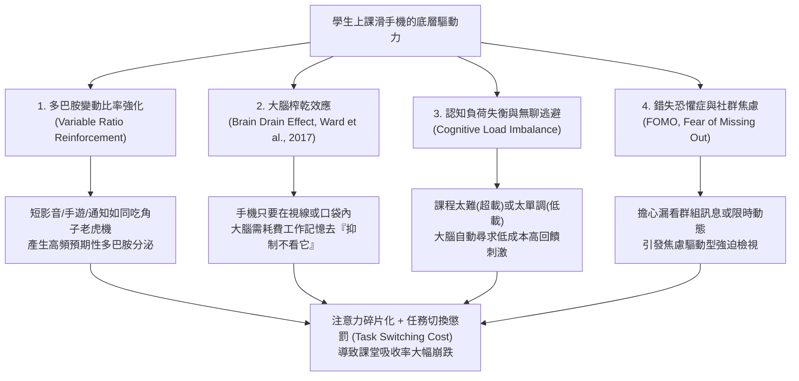
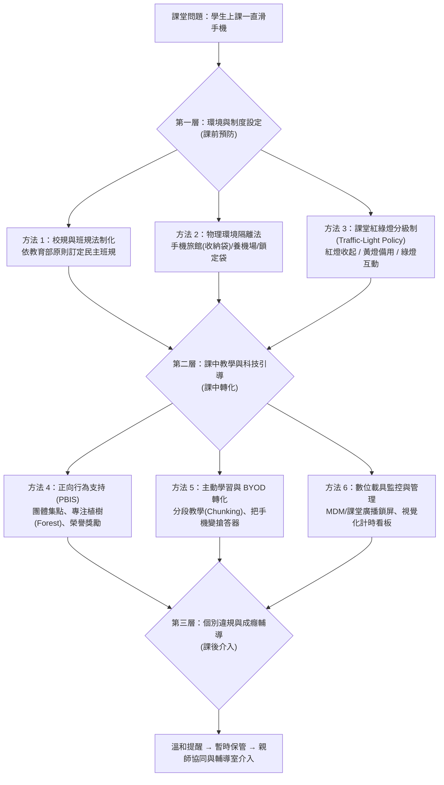
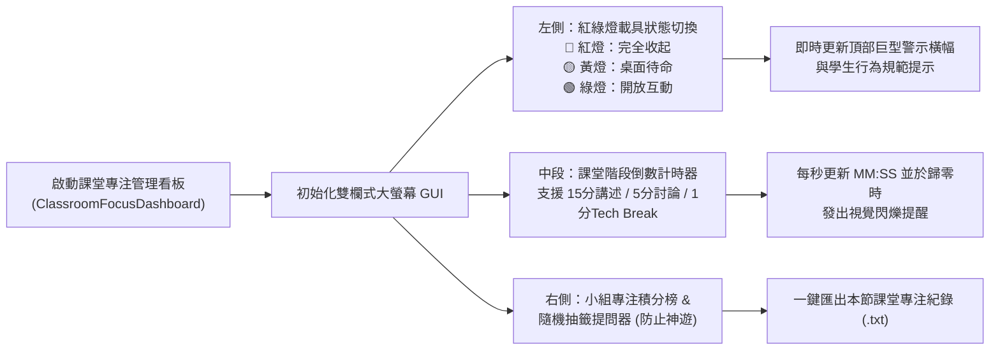
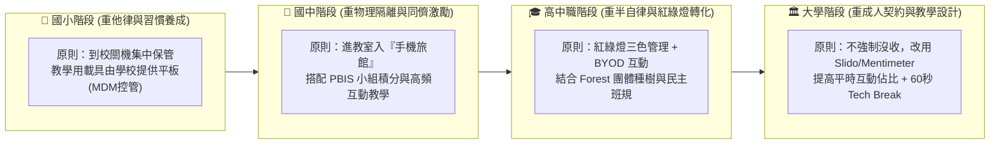

# 📱 解決學生上課滑手機問題：從腦科學機制、班級經營到數位教學轉化的完整解決方案指南

> **最後更新時間**: 2026-11-11 09:58:00 (UTC+8)
> **使用模型**: Gemini 4 Argon (Medium)
> **執行 Agent**: Antigravity
> **主題分類**: PBL 專題研究 / 班級經營 / 數位素養 / 教育心理學 / 創新教學策略

---

## 🎯 摘要 (Summary)

面對「數位原住民（Digital Natives）」世代，學生上課滑手機已成為國小高年級、國中、高中職乃至大學課堂最普遍的教學挑戰。單憑威權式的責罵或強行沒收，往往只能短暫壓制，卻容易引發師生對立、親師衝突，甚至衍生財物保管的法律責任爭議。

本文件根據關鍵字檢索國內外教育政策（教育部《高級中等以下學校校園行動載具使用原則》、聯合國教科文組織 UNESCO 2023 報告）、認知心理學研究與第一線教師班級經營實務，系統化整理 **六大維度解決方案**：
1. **政策與法規制度法（民主程序與三級輔導管教）**
2. **物理環境隔離法（「手機旅館 Phone Hotel」與訊號/視線阻斷）**
3. **行為契約與「紅綠燈（Traffic-Light）」分級管理法**
4. **正向行為支持（PBIS）與遊戲化同儕激勵法**
5. **主動式教學設計與 BYOD（自攜載具）課堂轉化法**
6. **數位監控、互動回饋平台與專注力科技工具法**

文中深入剖析學生滑手機成癮的認知神經科學機制，提供課堂決策流程圖、可直接用於課堂投影的 **Python 課堂載具紅綠燈與專注計時/互動抽籤工具**（附完整註解與邏輯流程圖），並針對六大方案的**適用對象、應用場景與實務限制**進行完整比較。

---

## 💡 1. 核心概念剖析 (Core Concepts)

要有效解決學生上課滑手機的問題，必須先從**認知心理學（Cognitive Psychology）**與**行為神經科學（Behavioral Neuroscience）**理解：「為什麼學生明知上課滑手機會影響成績，卻仍然控制不住手指？」

### 1.1 學生上課滑手機的四大底層心理與腦科學機制



1. **多巴胺變動比率強化機制（Variable Ratio Reinforcement Schedule）**：
   * **原理**：行為主義心理學家 B.F. Skinner 的操作制約實驗指出，「不可預測的間歇性獎勵」最難戒除。社群媒體的下拉重新整理（Pull-to-refresh）、Reels / TikTok 短影音演算法、手遊抽卡與隨機推播通知，皆採用變動比率強化設計。相比之下，傳統課堂講述屬於「高認知努力、延遲且低頻回饋」，在神經迴路競爭上天然處於劣勢。
2. **「大腦榨乾效應」（Brain Drain Effect, Ward et al., 2017）**：
   * **原理**：德州大學奧斯汀分校學者 Adrian F. Ward 團隊於 2017 年發表於《Journal of the Association for Consumer Research》的經典實驗證實：**即使手機處於靜音、螢幕朝下且學生完全沒有去碰它，只要手機放在書桌上或口袋裡（視線與觸手可及範圍內），學生的工作記憶容量（Working Memory Capacity）與流動智力表現就會顯著下降**。
   * **原因**：大腦的前額葉皮質（Prefrontal Cortex）必須持續消耗有限的執行控制資源（Executive Control）去「抑制想拿手機的衝動」，導致真正用於聽課與思考的認知資源被「暗中抽乾」。
3. **認知負荷失衡（Cognitive Load Theory, Sweller, 1988）**：
   * **原理**：當課堂教學內容超出學生的先備知識（內在與外在認知負荷過高，學生「聽不懂」），或是單向講述時間過長、缺乏互動（認知負荷過低，學生「覺得無聊」），大腦便會啟動逃避機制，轉向手機尋求即時的掌控感與感官刺激。
4. **錯失恐懼症（FOMO, Fear of Missing Out）與同儕連結需求**：
   * **原理**：青少年時期極度重視同儕認同，深怕未即時回覆 IG 限時動態、LINE 群組或遊戲組隊邀請而被排擠。許多學生滑手機並非為了娛樂，而是為了緩解「漏接訊息」的焦慮感。

---

### 1.2 課堂分心與任務切換成本（Task Switching Cost）數學模型

許多學生認為自己可以「邊聽課、邊回訊息（Multitasking 多工處理）」，但認知神經科學早已證實人類大腦無法同時處理兩項需要語義理解的任務，所謂「多工」其實是高頻率的**任務切換（Task Switching）**。

根據加州大學爾灣分校（UC Irvine）Gloria Mark 教授的注意力研究與認知負荷模型，學生在課堂時間 $T_{\text{total}}$ 內的有效學習認知產出 $E_{\text{learning}}$ 可表示為：

$$E_{\text{learning}} = \eta \cdot \left[ T_{\text{total}} - \sum_{i=1}^{N} \left( t_{\text{phone}, i} + \tau_{\text{resumption}, i} \right) \right] \cdot \left( 1 - \alpha_{\text{presence}} \right)$$

其中各項參數定義如下：
* $N$：單節課（例如 $50$ 分鐘）內低頭查看手機的次數。
* $t_{\text{phone}, i}$：第 $i$ 次滑手機實際花費的時間（即使只看一眼通知，平均為 $15 \sim 45$ 秒）。
* $\tau_{\text{resumption}, i}$：**注意力重聚焦延遲（Attention Resumption Lag / Attention Residue）**。當視線從高刺激的手機螢幕移回黑板時，大腦殘留剛才的社群資訊（注意力殘留），重新接上老師講課邏輯所需的恢復時間（平均需 $2 \sim 5$ 分鐘，複雜數理推導甚至超過 $10$ 分鐘）。
* $\alpha_{\text{presence}} \in [0, 0.25]$：**手機在場懲罰係數（Brain Drain Factor）**。手機放桌上時 $\alpha_{\text{presence}} \approx 0.15 \sim 0.20$；手機放入教室前方收納袋或書包底層時 $\alpha_{\text{presence}} \to 0$。
* $\eta$：教學設計互動係數（主動式學習 $\eta$ 高，單向照本宣科 $\eta$ 低）。

> [!IMPORTANT]
> **公式啟示**：一名學生在一堂 50 分鐘的課只要偷看手機 **5 次**（每次 30 秒，每次花 3 分鐘重新接回課堂思緒），加上手機放桌上的分心效應，其整堂課的**實質有效學習時間將從 50 分鐘暴跌至不足 26 分鐘（損失近 50% 學習成效）**！因此，解決方案必須同時降低干擾頻率 $N$、消除在場係數 $\alpha_{\text{presence}}$，並提升教學互動度 $\eta$。

---

## 🛠️ 2. 實作與應用範例 (Practical Examples)

根據教育政策、班級經營與教學科技實務，以下整理 **六大系統化解決方法**，並提供具體操作步驟與課堂輔助工具實作。

### 2.1 六大解決方案全景決策架構



---

### 2.2 方法一：政策與法規制度法（建立具正當性的管教底線）

教師在處理手機問題時，最忌諱「臨時起意、標準不一」或「直接搶奪手機」。必須依據官方規範建立透明且具民主正當性的程序：

1. **法規依據**：
   * 依據教育部 **《高級中等以下學校校園行動載具使用原則》**（臺教資(四)字第1080060697號函）：明定行動載具**「除教師引導學習或緊急必要聯繫時使用外，其餘時間應以關機（或靜音收妥）為原則」**。
   * 依據教育部 **《學校訂定教師輔導與管教學生辦法注意事項》**：教師得對妨礙教學秩序之物品進行「暫時保管」，惟應明確規範保管期限（通常為當節下課或當日放學領回）與保管責任。
2. **開學第一週「民主班規契約」四步驟**：
   * **步驟 1（共同討論）**：在學期第一堂課或班會課，不直接由老師宣布禁令，而是先拋出問題：「大家覺得上課滑手機對自己和旁邊同學有什麼影響？什麼情況下可以用手機？」
   * **步驟 2（明定界線與後果）**：全班表決通過處理階梯，例如：
     * **第一次違規**：老師口頭或手勢溫和提醒（給予台階下，立即收入書包免罰）。
     * **第二次違規**：學生須自行將手機關機並放到講台「手機休息盒」，該節下課領回。
     * **第三次（累犯）**：交由導師或學務處依校規保管至放學，並通知家長協同輔導。
   * **步驟 3（親師共識）**：於學校日（班親會）及家長群組明確告知班級手機規範，並**懇請家長「切勿在上課時段傳 LINE 或打電話給孩子」**（若有急事請撥打學校辦公室或導師電話），堵住學生「我是回媽媽訊息」的常見藉口。

---

### 2.3 方法二：物理環境隔離法（消除「大腦榨乾效應」）

根據前述 Ward et al. (2017) 的研究，解決滑手機最有效的方式是**「物理上眼不見為淨（Out of Sight, Out of Mind）」**。

1. **「手機旅館（Phone Hotel / 教室養機場）」掛袋或收納箱**：
   * **作法**：在教室前方或後方牆面懸掛 30～40 格透明編號布袋（或帶泡棉隔板的木盒），對應學生座號。
   * **升級技巧（結合點名與充電誘因）**：部分高中與大學教師將收納袋設為**「點名依據」**（進教室把手機放入自己座號袋中即算出席）；或在「手機旅館」旁提供多孔 USB 充電座，讓學生覺得「把手機交出去還能免費充電」，將阻力轉化為福利。
2. **桌角「手機停車格（Phone Parking Lot）」**：
   * **作法**：若課程偶爾需要查資料、不便完全鎖入櫃中，可在每位學生書桌左上角貼一張色紙或膠帶框，規定上課鐘響後手機必須**「靜音、螢幕朝下停在停車格內（或放入書包底層）」**，雙手離開停車格。教師巡堂時一眼即可確認全班狀態。
3. **磁扣鎖定袋（如歐美校園廣泛採用的 Yondr Pouch 模式）**：
   * **作法**：學生進教室時將手機放入個人專屬的磁扣布袋中鎖上，手機仍由學生自己放在座位或書包裡（減輕學生對手機遺失的分離焦慮，也免除老師保管賠償風險），下課走出教室時在門口磁鐵感應座「逼」一聲即可解鎖。

---

### 2.4 方法三：「紅綠燈（Traffic-Light）」課堂載具分級管理法

在推動 BYOD（自攜載具）或「生生用平板」的現代教室中，全面禁止與數位教學會產生矛盾。國際教育科技協會（ISTE）與 TCEA 推薦採用**「紅綠燈視覺化管理（Traffic-Light Classroom Policy）」**：

| 燈號狀態 | 代表意義 | 載具擺放位置與學生行為規範 | 適用課堂階段 |
| :---: | :--- | :--- | :--- |
| 🔴 **紅燈區**<br/>**(Red Light)** | **完全無載具**<br/>(Device-Free Zone) | 手機必須置於書包內或「手機旅館」，桌面淨空。任何滑手機行為直接視為違規。 | 核心觀念講解、紙筆測驗、深度閱讀、同儕敏感議題討論。 |
| 🟡 **黃燈區**<br/>**(Yellow Light)** | **待命／條件式使用**<br/>(Conditional / Standby) | 手機螢幕朝下置於桌角「停車格」。僅可在老師指定任務（如查單字、拍黑板筆記、計算機）時拿起，用畢立即蓋回。 | 小組專題討論、自主練習、實驗數據紀錄。 |
| 🟢 **綠燈區**<br/>**(Green Light)** | **主動學習互動**<br/>(Active BYOD Mode) | 開放拿起手機掃描 QR Code 參與即時搶答、投票、共筆或資料檢索。 | 課堂破冰、Kahoot! 搶答、Slido 提問、Padlet 腦力激盪。 |

> [!TIP]
> **關鍵心法：給予「60 秒合法科技喘息（Tech Break）」**
> 面對連堂課（如 90～100 分鐘）或高年級學生，教師可在課堂中段完成一個段落後，故意宣布：「現在開啟 60 秒綠燈休息時間，大家可以看一下訊息或伸展，倒數歸零後我們切回紅燈繼續！」這能大幅消除學生的 FOMO 焦慮，減少私下偷滑的衝動。

---

### 2.5 方法四：正向行為支持（PBIS）與遊戲化同儕激勵法

與其把焦點放在「抓違規學生」，不如獎勵「專注投入的學生」：

1. **全班集體專注種樹（Forest 專注森林 App 團體模式）**：
   * **作法**：由老師或班長在智慧型手機開啟 **Forest App「多人一起種」** 房間，邀請想戒除手機分心的學生加入。在 45 分鐘課堂內，只要房間裡有任何一人跳出 App 去滑 IG、LINE 或玩遊戲，全班共同培育的樹就會枯死！
   * **成效**：完美運用青少年重視同儕壓力的心理（「不要當害全班樹死掉的豬隊友」），將手機本身變成鎖住手機的工具。
2. **小組榮譽積分與特權兌換（ClassDojo / 班級集點卡）**：
   * **作法**：以「小組」為單位，只要該組整節課全組皆遵守紅綠燈規範且積極發言，全組獲得 1 點專注積分。累積滿一定點數可兌換「作業免寫一題券」、「段考後選座位優先權」或「期末神秘獎勵」。

---

### 2.6 方法五：主動式教學設計與 BYOD 課堂轉化法（化敵為友）

學生上課滑手機最核心的根源往往是**「課堂上無事可做」或「單向講述超過注意力極限」**。當學生的雙手與大腦被課堂任務佔滿時，自然沒有空閒滑手機：

1. **「10-20-10」分段教學法（Instructional Chunking）**：
   * 青少年對單向講述的專注力極限約為 **10～15 分鐘**。將一堂 50 分鐘的課切分為：
     * **前 5 分鐘**：以生活情境問題或短片破冰（Hook）。
     * **中段 15 分鐘**：核心概念精講（紅燈區，手機收起）。
     * **中段 15 分鐘**：小組實作、Think-Pair-Share（思考-配對-分享）或白板解題（讓學生動手、動口）。
     * **後段 10 分鐘**：利用互動平台即時小測驗（綠燈區，手機變身學習工具）與總結。
2. **將手機從「玩具」轉化為「課堂搶答器與生產力工具」**：
   * **即時測驗與遊戲化搶答**：使用 **[Kahoot!](https://kahoot.com/)**、**[Quizizz](https://quizizz.com/)** 或 **[Blooket](https://www.blooket.com/)**，讓學生用手機參與限時搶答，螢幕排行榜會瞬間點燃學生的勝負欲。
   * **匿名即時提問與投票（照顧害羞學生）**：使用 **[Slido](https://www.sli.do/)** 或 **[Mentimeter](https://www.mentimeter.com/)**，讓不敢舉手的學生用手機匿名送出問題或參與即時文字雲投票，大螢幕即時顯示結果。
   * **視覺化數位黑板共筆**：使用 **[Padlet](https://padlet.com/)**，請各組用手機拍下小組手寫心智圖或實驗現象上傳至班級牆面，全班即時互評。

---

### 2.7 方法六：數位工具輔助管理與「課堂紅綠燈＆專注互動看板」程式實作

若學校使用平板或電腦教室，可搭配 **Apple 課堂（Apple Classroom）**、**Google Classroom** 或 MDM（行動裝置管理系統）遠端鎖定螢幕。而在一般普通教室中，教師最缺乏的是一個能投放在教室大螢幕上、同時具備 **「紅綠燈載具狀態指示」、「倒數計時器（含 60 秒 Tech Break）」、「小組專注積分榜」與「隨機抽籤問答（防分心）」** 的整合式控場工具。

以下我們使用 Python 標準內建的 `tkinter` 開發一套免安裝第三方套件、開箱即用的 **「課堂載具紅綠燈與專注力管理看板（Classroom Focus & Traffic-Light Dashboard）」**。

#### 📊 程式邏輯流程圖 (Mermaid)



#### 💻 Python 實作程式碼：`classroom_focus_dashboard.py`

```python
#!/usr/bin/env python3
# -*- coding: utf-8 -*-
"""
課堂載具紅綠燈與專注力管理看板 (Classroom Smartphone Traffic-Light & Focus Dashboard)
功能：
1. 視覺化切換「紅燈(禁用) / 黃燈(待命) / 綠燈(互動)」三種載具使用狀態，投影於教室大螢幕。
2. 內建分段教學計時器（15分鐘講述、5分鐘小組任務、60秒合法看手機喘息 Tech Break）。
3. 內建隨機座號抽籤器（保持學生適度警覺，減少低頭滑手機機率）。
4. 內建小組專注榮譽加分板，並支援匯出課堂紀錄檔 (.txt)。
"""

import ctypes
import random
import datetime
import tkinter as tk
from tkinter import messagebox, filedialog


class ClassroomFocusDashboard:
    """課堂手機管理與專注力互動看板主類別"""

    # 定義紅綠燈三種狀態的視覺與行為規範設定
    MODES = {
        "RED": {
            "title": "🔴 紅燈模式：無載具專注區 (Device-Free Zone)",
            "desc": "【行為規範】手機請關機或靜音放入「手機旅館／書包底層」，桌面保持淨空，專注聽講與思考！",
            "bg": "#dc2626",
            "panel_bg": "#fef2f2",
            "text_color": "#991b1b"
        },
        "YELLOW": {
            "title": "🟡 黃燈模式：條件式待命區 (Standby / Conditional Use)",
            "desc": "【行為規範】手機請螢幕朝下置於桌角「停車格」，僅在老師指定查資料或紀錄時拿起，用畢立即蓋回。",
            "bg": "#d97706",
            "panel_bg": "#fffbeb",
            "text_color": "#92400e"
        },
        "GREEN": {
            "title": "🟢 綠燈模式：數位互動學習區 (Active BYOD Mode)",
            "desc": "【行為規範】請拿起手機參與課堂即時互動（Kahoot! / Slido / 查資料），嚴禁切換至無關遊戲或社群軟體！",
            "bg": "#059669",
            "panel_bg": "#ecfdf5",
            "text_color": "#065f46"
        }
    }

    def __init__(self, root: tk.Tk):
        self.root = root
        self.root.title("📱 課堂載具紅綠燈與專注力管理看板 (Classroom Focus Dashboard)")
        self.root.geometry("1080x720")
        self.root.configure(bg="#f8fafc")

        # 狀態變數初始化
        self.current_mode = "RED"
        self.remaining_seconds = 15 * 60  # 預設 15 分鐘分段講述
        self.timer_running = False
        self.timer_job = None
        self.group_scores = {f"第 {i} 組": 0 for i in range(1, 7)}
        self.action_logs = []

        self._build_ui()
        self.set_mode("RED")
        self._log_event("系統啟動：預設進入【紅燈模式（無載具專注區）】")
        self.root.after(100, self._force_foreground_window)

    def _force_foreground_window(self):
        """
        強制將 Tkinter 視窗顯示於最上層（解決由背景無視窗終端機啟動時，
        Windows STARTUPINFO 預設繼承 SW_HIDE 導致視窗隱藏或在背景的問題）
        """
        self.root.update_idletasks()
        self.root.deiconify()
        self.root.state("normal")
        self.root.lift()
        self.root.attributes("-topmost", True)
        self.root.focus_force()
        try:
            hwnd = ctypes.windll.user32.GetParent(self.root.winfo_id()) or self.root.winfo_id()
            ctypes.windll.user32.ShowWindow(hwnd, 1)  # SW_SHOWNORMAL
            ctypes.windll.user32.ShowWindow(hwnd, 9)  # SW_RESTORE
            ctypes.windll.user32.SetForegroundWindow(hwnd)
        except Exception:
            pass
        self.root.after(1500, lambda: self.root.attributes("-topmost", False))

    def _build_ui(self):
        """建立大螢幕投影最佳化的圖形介面"""
        # 1. 頂部巨型狀態橫幅 (Banner)
        self.banner_frame = tk.Frame(self.root, bg="#dc2626", pady=18, padx=20)
        self.banner_frame.pack(fill=tk.X)

        self.lbl_mode_title = tk.Label(
            self.banner_frame,
            text="",
            font=("Microsoft JhengHei", 24, "bold"),
            fg="white",
            bg="#dc2626"
        )
        self.lbl_mode_title.pack()

        self.lbl_mode_desc = tk.Label(
            self.banner_frame,
            text="",
            font=("Microsoft JhengHei", 13),
            fg="#fef2f2",
            bg="#dc2626",
            pady=6
        )
        self.lbl_mode_desc.pack()

        # 2. 主內容區（左：紅綠燈與計時器；右：抽籤與小組專注積分）
        main_frame = tk.Frame(self.root, bg="#f8fafc", padx=20, pady=15)
        main_frame.pack(fill=tk.BOTH, expand=True)

        left_col = tk.Frame(main_frame, bg="#ffffff", bd=1, relief=tk.SOLID, padx=20, pady=15)
        left_col.pack(side=tk.LEFT, fill=tk.BOTH, expand=True, padx=(0, 10))

        right_col = tk.Frame(main_frame, bg="#ffffff", bd=1, relief=tk.SOLID, padx=20, pady=15)
        right_col.pack(side=tk.RIGHT, fill=tk.BOTH, expand=True, padx=(10, 0))

        # --- 左欄：紅綠燈切換按鈕區 ---
        tk.Label(
            left_col, text="🚦 1. 切換課堂載具紅綠燈狀態",
            font=("Microsoft JhengHei", 15, "bold"), bg="white", fg="#1e293b"
        ).pack(anchor="w", pady=(0, 10))

        btn_frame = tk.Frame(left_col, bg="white")
        btn_frame.pack(fill=tk.X, pady=5)

        tk.Button(
            btn_frame, text="🔴 紅燈：完全收起", font=("Microsoft JhengHei", 12, "bold"),
            bg="#ef4444", fg="white", activebackground="#dc2626", activeforeground="white",
            padx=12, pady=8, cursor="hand2", command=lambda: self.set_mode("RED")
        ).pack(side=tk.LEFT, expand=True, fill=tk.X, padx=4)

        tk.Button(
            btn_frame, text="🟡 黃燈：桌角待命", font=("Microsoft JhengHei", 12, "bold"),
            bg="#f59e0b", fg="white", activebackground="#d97706", activeforeground="white",
            padx=12, pady=8, cursor="hand2", command=lambda: self.set_mode("YELLOW")
        ).pack(side=tk.LEFT, expand=True, fill=tk.X, padx=4)

        tk.Button(
            btn_frame, text="🟢 綠燈：開放互動", font=("Microsoft JhengHei", 12, "bold"),
            bg="#10b981", fg="white", activebackground="#059669", activeforeground="white",
            padx=12, pady=8, cursor="hand2", command=lambda: self.set_mode("GREEN")
        ).pack(side=tk.LEFT, expand=True, fill=tk.X, padx=4)

        # --- 左欄：課堂節奏與專注倒數計時器 ---
        tk.Label(
            left_col, text="⏱️ 2. 分段教學與科技喘息計時器 (Chunking Timer)",
            font=("Microsoft JhengHei", 15, "bold"), bg="white", fg="#1e293b"
        ).pack(anchor="w", pady=(25, 5))

        self.lbl_timer = tk.Label(
            left_col, text="15:00",
            font=("Consolas", 56, "bold"), bg="#f1f5f9", fg="#0f172a",
            pady=10, relief=tk.FLAT
        )
        self.lbl_timer.pack(fill=tk.X, pady=8)

        preset_frame = tk.Frame(left_col, bg="white")
        preset_frame.pack(fill=tk.X, pady=4)

        tk.Button(
            preset_frame, text="📖 15分 精講(紅燈)", font=("Microsoft JhengHei", 10),
            command=lambda: self.set_preset_timer(15 * 60, "RED")
        ).pack(side=tk.LEFT, expand=True, fill=tk.X, padx=2)

        tk.Button(
            preset_frame, text="💬 5分 討論(黃燈)", font=("Microsoft JhengHei", 10),
            command=lambda: self.set_preset_timer(5 * 60, "YELLOW")
        ).pack(side=tk.LEFT, expand=True, fill=tk.X, padx=2)

        tk.Button(
            preset_frame, text="🎮 3分 搶答(綠燈)", font=("Microsoft JhengHei", 10),
            command=lambda: self.set_preset_timer(3 * 60, "GREEN")
        ).pack(side=tk.LEFT, expand=True, fill=tk.X, padx=2)

        tk.Button(
            preset_frame, text="☕ 60秒 Tech Break", font=("Microsoft JhengHei", 10, "bold"),
            fg="#0369a1", command=lambda: self.set_preset_timer(60, "GREEN")
        ).pack(side=tk.LEFT, expand=True, fill=tk.X, padx=2)

        ctrl_frame = tk.Frame(left_col, bg="white")
        ctrl_frame.pack(fill=tk.X, pady=10)

        self.btn_start_pause = tk.Button(
            ctrl_frame, text="▶ 開始計時", font=("Microsoft JhengHei", 12, "bold"),
            bg="#2563eb", fg="white", pady=6, command=self.toggle_timer
        )
        self.btn_start_pause.pack(side=tk.LEFT, expand=True, fill=tk.X, padx=4)

        tk.Button(
            ctrl_frame, text="↺ 重設為 10:00", font=("Microsoft JhengHei", 12),
            bg="#e2e8f0", fg="#334155", pady=6, command=lambda: self.set_preset_timer(600, self.current_mode)
        ).pack(side=tk.LEFT, expand=True, fill=tk.X, padx=4)

        # --- 右欄：防分心隨機座號抽籤器 ---
        tk.Label(
            right_col, text="🎲 3. 課堂隨機互動抽籤（保持專注警覺）",
            font=("Microsoft JhengHei", 15, "bold"), bg="white", fg="#1e293b"
        ).pack(anchor="w", pady=(0, 8))

        picker_frame = tk.Frame(right_col, bg="#eff6ff", padx=12, pady=10)
        picker_frame.pack(fill=tk.X, pady=5)

        tk.Label(picker_frame, text="班級總人數：", font=("Microsoft JhengHei", 11), bg="#eff6ff").pack(side=tk.LEFT)
        self.spin_students = tk.Spinbox(picker_frame, from_=1, to=60, width=5, font=("Consolas", 12))
        self.spin_students.delete(0, tk.END)
        self.spin_students.insert(0, "35")
        self.spin_students.pack(side=tk.LEFT, padx=6)

        tk.Button(
            picker_frame, text="🎯 隨機抽一位同學回答", font=("Microsoft JhengHei", 11, "bold"),
            bg="#4f46e5", fg="white", padx=10, pady=4, command=self.pick_random_student
        ).pack(side=tk.LEFT, padx=10)

        self.lbl_picked = tk.Label(
            right_col, text="等待抽籤...",
            font=("Microsoft JhengHei", 18, "bold"), bg="#eef2ff", fg="#312e81", pady=10
        )
        self.lbl_picked.pack(fill=tk.X, pady=6)

        # --- 右欄：PBIS 小組專注榮譽加分板 ---
        tk.Label(
            right_col, text="🏆 4. PBIS 小組專注與零違規榮譽積分",
            font=("Microsoft JhengHei", 15, "bold"), bg="white", fg="#1e293b"
        ).pack(anchor="w", pady=(18, 8))

        self.score_labels = {}
        score_grid = tk.Frame(right_col, bg="white")
        score_grid.pack(fill=tk.X)

        for idx, group_name in enumerate(self.group_scores.keys()):
            row, col = divmod(idx, 2)
            cell = tk.Frame(score_grid, bg="#f8fafc", bd=1, relief=tk.RIDGE, padx=10, pady=8)
            cell.grid(row=row, column=col, sticky="ew", padx=4, pady=4)
            score_grid.grid_columnconfigure(col, weight=1)

            tk.Label(cell, text=group_name, font=("Microsoft JhengHei", 12, "bold"), bg="#f8fafc").pack(side=tk.LEFT)
            lbl_pts = tk.Label(cell, text="0 分", font=("Consolas", 14, "bold"), fg="#0d9488", bg="#f8fafc", padx=8)
            lbl_pts.pack(side=tk.LEFT)
            self.score_labels[group_name] = lbl_pts

            tk.Button(
                cell, text="+1 專注", font=("Microsoft JhengHei", 10, "bold"),
                bg="#14b8a6", fg="white", command=lambda g=group_name: self.add_score(g, 1)
            ).pack(side=tk.RIGHT, padx=2)

        # 匯出課堂紀錄按鈕
        tk.Button(
            right_col, text="💾 匯出本節課堂專注與加分紀錄 (.txt)",
            font=("Microsoft JhengHei", 11, "bold"), bg="#334155", fg="white", pady=8,
            command=self.export_log
        ).pack(fill=tk.X, pady=(18, 0))

    def set_mode(self, mode_key: str):
        """切換紅綠燈模式並更新頂部巨型橫幅顏色與說明文字"""
        self.current_mode = mode_key
        cfg = self.MODES[mode_key]
        self.banner_frame.configure(bg=cfg["bg"])
        self.lbl_mode_title.configure(text=cfg["title"], bg=cfg["bg"])
        self.lbl_mode_desc.configure(text=cfg["desc"], bg=cfg["bg"])
        self._log_event(f"切換載具狀態為：{cfg['title']}")

    def set_preset_timer(self, seconds: int, auto_mode: str):
        """設定快速教學階段計時並自動切換對應紅綠燈"""
        if self.timer_running and self.timer_job:
            self.root.after_cancel(self.timer_job)
            self.timer_running = False
            self.btn_start_pause.configure(text="▶ 開始計時", bg="#2563eb")

        self.remaining_seconds = seconds
        self._update_timer_display()
        self.set_mode(auto_mode)

    def toggle_timer(self):
        """啟動或暫停倒數計時器"""
        if self.timer_running:
            self.timer_running = False
            if self.timer_job:
                self.root.after_cancel(self.timer_job)
            self.btn_start_pause.configure(text="▶ 繼續計時", bg="#2563eb")
        else:
            self.timer_running = True
            self.btn_start_pause.configure(text="⏸ 暫停計時", bg="#dc2626")
            self._tick()

    def _tick(self):
        """每秒遞減計時器"""
        if not self.timer_running:
            return
        if self.remaining_seconds > 0:
            self.remaining_seconds -= 1
            self._update_timer_display()
            self.timer_job = self.root.after(1000, self._tick)
        else:
            self.timer_running = False
            self.btn_start_pause.configure(text="▶ 開始計時", bg="#2563eb")
            self._log_event("計時結束！提醒學生切換課堂階段。")
            messagebox.showinfo("時間到！", "本階段時間結束！請依老師指示切換載具狀態。")

    def _update_timer_display(self):
        """將剩餘秒數格式化為 MM:SS 顯示"""
        mins, secs = divmod(self.remaining_seconds, 60)
        self.lbl_timer.configure(text=f"{mins:02d}:{secs:02d}")

    def pick_random_student(self):
        """隨機抽取座號，提升課堂正向緊張感"""
        try:
            total = int(self.spin_students.get())
        except ValueError:
            total = 35
        picked = random.randint(1, max(1, total))
        self.lbl_picked.configure(text=f"🎉 抽中座號：【 {picked:02d} 號 】同學！")
        self._log_event(f"課堂隨機抽籤：抽中 {picked:02d} 號同學")

    def add_score(self, group_name: str, delta: int):
        """為專注表現良好的小組加分"""
        self.group_scores[group_name] += delta
        new_score = self.group_scores[group_name]
        self.score_labels[group_name].configure(text=f"{new_score} 分")
        self._log_event(f"PBIS 正向獎勵：{group_name} 獲得 +{delta} 分（目前 {new_score} 分）")

    def _log_event(self, message: str):
        """記錄課堂事件與時間戳記"""
        now_str = datetime.datetime.now().strftime("%Y-%m-%d %H:%M:%S")
        self.action_logs.append(f"[{now_str}] {message}")

    def export_log(self):
        """匯出本節課堂專注紀錄與各組得分至文字檔"""
        file_path = filedialog.asksaveasfilename(
            defaultextension=".txt",
            initialfile=f"classroom_focus_log_{datetime.datetime.now().strftime('%Y%m%d_%H%M')}.txt",
            filetypes=[("Text Files", "*.txt")]
        )
        if not file_path:
            return
        with open(file_path, "w", encoding="utf-8") as f:
            f.write("=== 課堂載具管理與小組專注積分紀錄 ===\n\n")
            f.write("【各組最終榮譽積分】\n")
            for g, s in self.group_scores.items():
                f.write(f"  - {g}: {s} 分\n")
            f.write("\n【課堂歷程紀錄】\n")
            for entry in self.action_logs:
                f.write(f"  {entry}\n")
        messagebox.showinfo("匯出成功", f"課堂紀錄已儲存至：\n{file_path}")


if __name__ == "__main__":
    root = tk.Tk()
    app = ClassroomFocusDashboard(root)
    root.mainloop()
```

---

## ⚖️ 3. 延伸思考與進階主題 (Extensions & Advanced Topics)

### 3.1 六大解決方案之應用場景與限制全方位比較表

每一種解決方法都有其最佳適用情境與潛在副作用，單一方法無法解決所有問題，教師應根據班級屬性進行組合搭配：

| 解決方案名稱 | 核心機制 | 最佳適用場景與對象 | 主要優勢 (Pros) | 應用限制與潛在風險 (Limitations & Risks) |
| :--- | :--- | :--- | :--- | :--- |
| **1. 政策與法規制度法**<br/>(民主班規 + 輔導管教) | 透過校務會議與班會建立明確賞罰階梯與親師共識 | 各教育階段開學第一週建制、處理屢勸不聽之累犯 | 具法規正當性、減少教師情緒性管教爭議、爭取家長支持 | 僅提供「底線」，若缺乏教學吸引與環境配合，教師仍需耗費心力抓違規 |
| **2. 物理環境隔離法**<br/>(手機旅館 / 收納盒 / 鎖袋) | 將手機抽離視線與觸及範圍，徹底消除「大腦榨乾效應」 | 國中小、高中職必修課、高強度考前複習與隨堂測驗 | **專注力提升效果最直接顯著**；徹底阻斷通知干擾與桌面偷滑 | 1. 學生可能交「模型機／舊備用機（Dummy Phone）」蒙混<br/>2. 集中保管若遺失或摔壞，易衍生**賠償與法律責任爭議**<br/>3. 進退場收發手機耗費課堂 $2 \sim 3$ 分鐘 |
| **3. 紅綠燈分級管理法**<br/>(Traffic-Light + Tech Break) | 以紅/黃/綠三色視覺化規範何時收起、何時可用，並給予短暫喘息 | 高中職、大學課堂、推動 BYOD 與專題探究（PBL）之課程 | 兼顧「專注聽講」與「數位工具應用」；培養學生自我調節（Self-Regulation）素養 | 黃燈與綠燈切換回紅燈時，需要教師具備良好的課堂控場默契，否則易出現「收不回來」的拖延現象 |
| **4. 正向行為支持 (PBIS)**<br/>(Forest 種樹 / 小組榮譽積分) | 運用同儕正向壓力與遊戲化獎勵取代懲罰 | 國小高年級、國中、班級凝聚力強之高中班級 | 營造正向師生關係、將「老師盯學生」轉化為「同儕互相提醒」 | 若班級中有完全不在乎團體榮譽的極端叛逆學生，可能故意破壞團體種樹，需搭配個別輔導機制 |
| **5. 主動式教學與 BYOD 轉化**<br/>(Kahoot / Slido / 分段教學) | 透過 10-20-10 分段教學與即時互動，讓手機變成搶答器 | 所有年齡層，特別適合下午精神不濟時段或抽象概念檢核 | 從根源解決「上課無聊」問題；大幅提升低成就或內向學生的課堂參與感 | 1. **數位落差（Digital Divide）**：部分學生手機沒電、無網路流量或機型老舊<br/>2. 學生可能在 Kahoot 搶答空檔秒切回 IG/LINE<br/>3. 教師備課成本較高 |
| **6. 數位監控與科技管理法**<br/>(MDM / 課堂廣播鎖屏 / 看板) | 透過系統權限遠端鎖定螢幕、限制可用 App 清單或視覺化控場 | 「生生用平板」數位教室、電腦教室、投影設備完善之教室 | 教師可一鍵掌控全班學校載具畫面，精準阻擋遊戲與無關網頁 | 僅對「學校配發之平板/電腦」具備強制鎖屏權限；**無法強制安裝監控軟體於學生的私人手機**（涉及個人隱私權） |

---

### 3.2 不同教育階段（國小／國中／高中／大學）差異化適配策略

學生心智成熟度（前額葉發育程度）與自主學習能力隨年齡差異極大，不應使用同一套管理手段：



1. **國小階段（他律期）**：
   * 依教育部規範，原則上不建議隨身攜帶智慧型手機上課；若有放學聯繫需求，建議佩戴不具遊戲功能的定位通話手錶，或到校即關機交由導師統一鎖入保險櫃，課堂數位學習統一使用學校 MDM 納管之教學平板。
2. **國中階段（狂飆期與同儕認同期）**：
   * 青少年多巴胺敏感度最高、但衝動控制尚未成熟。最適合採用**「班級手機旅館（全班統一入袋）＋ PBIS 小組榮譽競賽」**，避免讓手機留在口袋或抽屜中考驗學生定力。
3. **高中職階段（半自律過渡期）**：
   * 學生具備較強自主意識，強行收繳容易引發「交模型機（陰陽機）」諜對諜。建議導入**「紅綠燈分級制」**與**「桌角停車格」**，在紅燈核心講解時段嚴格要求桌面淨空，在綠燈時段積極運用手機進行 Kahoot!、Padlet 或查找專題文獻。
4. **大學階段（成人自主期）**：
   * 大學生已成年，教師不宜沒收手機。最佳策略是**「提高課堂即時互動計分比重（如使用 Slido / Zuvio / Kahoot 隨堂小考佔總成績 15%~20%）」**，並將傳統 2 小時單向講授改為案例研討（Case Study）與翻轉教室（Flipped Classroom）。

---

### 3.3 常見邊界條件與棘手情境處理對策 (Edge Cases & Troubleshooting)

在實務執行中，教師常會遇到以下四種棘手情境，建議採取對應的標準作業程序（SOP）：

1. **情境 A：學生交出「模型機／舊廢機（Dummy Phone）」，真機藏在身上繼續滑**
   * **對策**：這代表單純的「強迫收繳」已失去信任基礎。改採**「桌面淨空 + 高頻走動式教學（Management by Walking Around, MBWA）」**。教師減少站在講台後的時間，手持簡報筆在教室走道間穿梭講課，並明確約定：「如果在紅燈時段於座位上被看到滑手機（無論袋子裡有沒有交手機），直接啟動班規第二階處置。」
2. **情境 B：學生拒絕交出手機，情緒激動甚至發生口角**
   * **對策**：**絕對不要動手硬搶學生手中的手機！** 肢體拉扯極易演變成體罰或傷害投訴。
   * **標準話術（冷靜且堅定）**：「老師現在不跟你搶，但你現在的行為已經違反我們全班開學共同訂定的紅燈規範。我給你兩個選擇：第一，現在自己關機放回書包最底層，我們繼續上課；第二，下課後我們去學務處請生教組長與家長一起協助處理。請你自己決定。」把選擇權與責任交還給學生，避免在全班面前陷入權力鬥爭。
3. **情境 C：暫時保管手機期間，手機不慎遺失或螢幕破裂誰負責？**
   * **對策**：
     * **減責設計**：若採集中保管，收納盒應放置於教室前方「全班視線可及且有監視器或上鎖」之處，並由**學生親自放入與取出**，教師不直接經手觸碰高價手機。
     * 若為當節課違規暫時保管，最安全的作法是請學生**「自行將手機放入講台邊緣的透明泡棉盒內，下課鐘響當場領回」**，避免隔夜保管衍生財物糾紛。
4. **情境 D：特殊需求學生（如糖尿病需手機連線連續血糖監測 CGM、或家中確有重大變故需待命）**
   * **對策**：依據個別化教育計畫（IEP）或家長事前書面申請，給予「醫療／緊急白名單通行證」，允許其手機保持靜音置於桌面或口袋，並事先向全班說明「若有醫療或特殊需求經報備者除外」，兼顧公平與人文關懷。

---

### 3.4 專題反思：針對 `pbl2/AGENTS.md` 規範之通用化診斷與修正改善建議

在執行 PBL 專題（包含 `pbl` 的技術開發與 `pbl2` 的教育議題探究）過程中，檢視原始 [`pbl2/AGENTS.bak`](./AGENTS.bak) 的四條精簡原則，若規範寫得過於簡略，執行品質容易不一；但若寫入過多單一領域詞彙或多餘說明，又會失去跨領域通用性並佔用 AI Context。因此，我們將完整說明版另存為範本 [`pbl2/AGENTS_template.md`](./AGENTS_template.md)，而將實際生效的 [`pbl2/AGENTS.md`](./AGENTS.md) 保持**「只列精簡規則、不加多餘說明」**的實用設計：

| 原始 `AGENTS.bak` 條文 | 實務執行發現之痛點與不足 | 跨領域通用版 `AGENTS.md` 修正設計（同時適用議題探究與技術開發） |
| :--- | :--- | :--- |
| **第 1 條**：根據關鍵字進行搜尋，尋找各種可能解決的方法 | 僅要求「搜尋」，未規範**關鍵字拆解深度与解決方案光譜**，易流於表面單一解法。 | **多維度關鍵字拆解**：要求同時檢索中英文關鍵字，並涵蓋三個通用層次：① 底層原理／成因機制、② 低門檻／現成方案（內建功能、現成工具或制度 SOP）、③ 進階技術／自動化與客製化方案。 |
| **第 2 條**：搜尋到的網站資訊如果有使用，需紀錄並列在參考資料列表，並加入取得日期 | 搜尋引擎 API 常回傳重導向暫時網址（Redirect URL），且未統一引用格式。 | **真實網址与可追溯性**：要求記錄目標網站之真實原始網址（Canonical URL），並統一包含「來源名稱／作者、標題、網址、取得日期 (YYYY-MM-DD)」。 |
| **第 3 條**：根據搜尋結果的內容整理成文件，並比較各種方法的應用與限制 | 未定義比較表的**通用評估欄位**與**情境選型工具**，且未區分「技術問題」與「議題問題」的實作呈現方式。 | **結構化比較與雙軌實作**：<br/>1. 必含 Mermaid **方案選型決策流程圖**。<br/>2. 比較表固定五欄：**方案名稱、核心原理／作法、最佳適用場景、主要優勢、應用限制與風險**。<br/>3. 技術類問題提供含註解之程式碼；議題類問題提供具體執行步驟或輕量輔助工具。 |
| **第 4 條**：每次更新文件都需要把 prompt 依序附加在檔案最後並標記時間 | 未定義時間格式，且容易漏記「延伸追問、執行驗證或修正」回合的 Prompt。 | **全探究歷程紀錄**：所有對話回合（新建、補充、工具執行與修正）之 Prompt 原文皆以 `Append` 方式記錄於文末，標註 `YYYY-MM-DD HH:mm:ss (UTC+8)`，並繼承根目錄雙格式（`.md` + `.html`）與索引自動更新規範。 |

---

## 📚 4. 參考資料列表 (References)

以下為本文件撰寫過程中檢索並引用之官方政策、學術研究與教育科技資源（均標註取得日期）：

1. **中華民國教育部 —《高級中等以下學校校園行動載具使用原則》**（臺教資(四)字第1080060697號函）與校園行動載具管理規範相關公告。
   * 網址：<https://www.edu.tw/>
   * 取得日期：2026-11-11
2. **中華民國教育部 —《學校訂定教師輔導與管教學生辦法注意事項》**（校園物品暫時保管與民主班規程序依據）。
   * 網址：<https://edu.law.moe.gov.tw/>
   * 取得日期：2026-11-11
3. **UNESCO (2023) — *Global Education Monitoring Report 2023: Technology in education: A tool on whose terms?***（聯合國教科文組織全球教育監測報告：針對校園智慧型手機分心問題與以人為本之科技應用建議）。
   * 網址：<https://www.unesco.org/gem-report/en/technology>
   * 取得日期：2026-11-11
4. **Ward, A. F., Duke, K., Gneezy, A., & Bos, M. W. (2017) — *Brain Drain: The Mere Presence of One's Own Smartphone Reduces Available Cognitive Capacity***, *Journal of the Association for Consumer Research*, 2(2), 140–154.（「大腦榨乾效應」經典實證研究）。
   * 網址：<https://www.journals.uchicago.edu/doi/10.1086/691462>
   * 取得日期：2026-11-11
5. **TCEA (Texas Computer Education Association) — *Cell Phone Policies and BYOD Classroom Management Strategies***（課堂紅綠燈分級管理與 BYOD 主動學習策略）。
   * 網址：<https://blog.tcea.org/>
   * 取得日期：2026-11-11
6. **親子天下／翻轉教育 — 班級經營與解決學生上課滑手機實務策略專題**（親師溝通、手機旅館與數位工具應用）。
   * 網址：<https://flipedu.parenting.com.tw/>
   * 取得日期：2026-11-11
7. **Kahoot! Official Website** — 遊戲化即時課堂搶答與評量平台（將手機轉化為課堂互動回饋器）。
   * 網址：<https://kahoot.com/>
   * 取得日期：2026-11-11
8. **Slido & Mentimeter Official Websites** — 即時課堂匿名提問、投票與文字雲互動工具。
   * 網址：<https://www.sli.do/> / <https://www.mentimeter.com/>
   * 取得日期：2026-11-11
9. **Classroomscreen Official Website** — 視覺化教室秩序管理面板（內建紅綠燈、計時器、音量偵測與隨機抽籤）。
   * 網址：<https://classroomscreen.com/>
   * 取得日期：2026-11-11
10. **Forest 專注森林 (Seekrtech)** — 遊戲化番茄鐘與多人共同種樹專注工具。
    * 網址：<https://www.forestapp.cc/>
    * 取得日期：2026-11-11

---

## 📝 提示詞歷史與變更記錄 (Prompt Archive)

### 🔹 [2026-11-11 09:16:00] [Gemini 4 Argon (Medium) / Antigravity] 變更紀錄
- **模型/Agent**: Gemini 4 Argon (Medium) / Antigravity
- **Prompt 原文**:
  ```text
  如何解決學生上課一直滑手機的問題
  ```
- **變更摘要**: 依 `pbl2/AGENTS.md` 與工作區核心規範，透過關鍵字檢索國內外教育政策（教育部《高級中等以下學校校園行動載具使用原則》、UNESCO 2023 報告）、認知心理學研究（Ward et al. 2017「大腦榨乾效應」、Sweller 認知負荷理論、多巴胺變動比率強化與任務切換成本公式）及教學實務，系統化整理六大解決方案（政策法規制度法、物理環境隔離法、紅綠燈分級管理法、PBIS 正向行為支持與遊戲化激勵、主動式教學與 BYOD 轉化、數位監控與控場工具）；包含 Mermaid 流程圖、可實際執行的 Python `classroom_focus_dashboard.py` 課堂紅綠燈與專注力管理看板程式（含完整註解与複製按鈕）、六大方案應用與限制比較表、各教育階段適配策略與棘手情境 SOP，並附上標註取得日期（2026-11-11）之參考資料列表，同步產出 `.md` 與 `.html` 雙格式檔案。

### 🔹 [2026-11-11 09:28:00] [Gemini 4 Argon (Medium) / Antigravity] 變更紀錄
- **模型/Agent**: Gemini 4 Argon (Medium) / Antigravity
- **Prompt 原文**:
  ```text
  執行看板工具
  ```
- **變更摘要**: 實際啟動執行 `pbl2/classroom_focus_dashboard.py`（課堂載具紅綠燈與專注力管理看板 Tkinter 桌面視窗工具），並依規範同步更新 `.md` 與 `.html` 文件之時間戳記與提示詞歷史紀錄。

### 🔹 [2026-11-11 09:30:30] [Gemini 4 Argon (Medium) / Antigravity] 變更紀錄
- **模型/Agent**: Gemini 4 Argon (Medium) / Antigravity
- **Prompt 原文**:
  ```text
  沒有看到彈出的視窗
  ```
- **變更摘要**: 排查發現由背景無頭（Headless）PowerShell 啟動子程序時，Windows `STARTUPINFO.wShowWindow` 預設繼承 `SW_HIDE (0)` 導致 Tkinter 視窗被隱藏。已於 [`classroom_focus_dashboard.py`](./classroom_focus_dashboard.py) 新增 `_force_foreground_window()` 方法（透過 `ctypes.windll.user32.ShowWindow`、`SetForegroundWindow` 與 `-topmost` 強制將視窗喚醒至桌面最上層），並改用 `Start-Process pythonw.exe -WindowStyle Normal` 啟動，確認視窗控制代碼（`MainWindowHandle: 461656`）已正常彈出顯示；同步更新 `.md` 與 `.html` 檔案。

### 🔹 [2026-11-11 09:36:00] [Gemini 4 Argon (Medium) / Antigravity] 變更紀錄
- **模型/Agent**: Gemini 4 Argon (Medium) / Antigravity
- **Prompt 原文**:
  ```text
  根據目前AGNETS.md 提出修正的改善建議
  ```
- **變更摘要**: 檢視 `pbl2/AGENTS.md` 現行四條規範並結合實務執行經驗，於文件新增第 3.4 節「針對 `pbl2/AGENTS.md` 規範之診斷與修正改善建議」（涵蓋多維度關鍵字拆解、參考資料真實網址與分類格式、結構化五欄比較表與決策樹、全對話 Prompt 追蹤、雙格式與網頁互動預覽繼承、以及 Windows GUI 視窗防隱藏喚醒規範），並同步更新 `.md` 與 `.html` 提示詞紀錄。

### 🔹 [2026-11-11 09:47:00] [Gemini 4 Argon (Medium) / Antigravity] 變更紀錄
- **模型/Agent**: Gemini 4 Argon (Medium) / Antigravity
- **Prompt 原文**:
  ```text
  備份原始檔案後更新
  ```
- **變更摘要**: 將原始 `pbl2/AGENTS.md` 備份至 [`pbl2/AGENTS.bak`](./AGENTS.bak)，並將修正改善建議正式更新至 [`pbl2/AGENTS.md`](./AGENTS.md)；同步附加本次 Prompt 紀錄至 `.md` 與 `.html` 並更新全站索引。

### 🔹 [2026-11-11 09:51:30] [Gemini 4 Argon (Medium) / Antigravity] 變更紀錄
- **模型/Agent**: Gemini 4 Argon (Medium) / Antigravity
- **Prompt 原文**:
  ```text
  但是目前這個新版的agnets.md變成不夠通用，原始的目標希望是通用類似PBL探究問題解決，包含各種議題與技術
  ```
- **變更摘要**: 重新調整 [`pbl2/AGENTS.md`](./AGENTS.md) 與本文第 3.4 節，移除偏向單一領域（如特定教育法規或特定作業系統 GUI API）的限制性字眼，收斂為四大跨領域通用的「PBL 問題探究與解決方案通用規範」，使其同時適用於「技術與程式開發類問題」與「社會／教育／科學議題探究類問題」；同步更新 `.md`、`.html` 與全站索引。

### 🔹 [2026-11-11 09:58:00] [Gemini 4 Argon (Medium) / Antigravity] 變更紀錄
- **模型/Agent**: Gemini 4 Argon (Medium) / Antigravity
- **Prompt 原文**:
  ```text
  將修正的agents.md變更為範本,實際版本 基於實用省去多餘的說明 只列規則
  ```
- **變更摘要**: 將含詳細說明與歷史紀錄的修正版另存為範本 [`pbl2/AGENTS_template.md`](./AGENTS_template.md)，並將實際生效的 [`pbl2/AGENTS.md`](./AGENTS.md) 精簡為純規則列表（僅保留 4 條核心通用規則，省去多餘說明文字）；同步更新 `.md`、`.html` 與全站索引。
