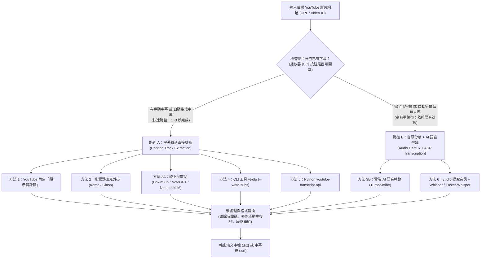
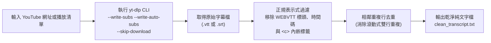
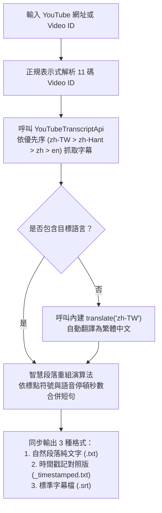
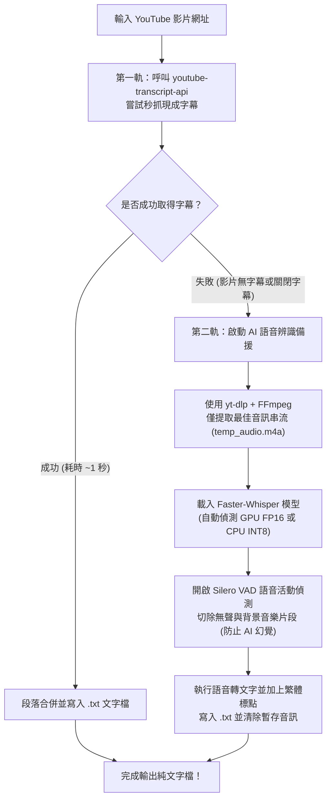
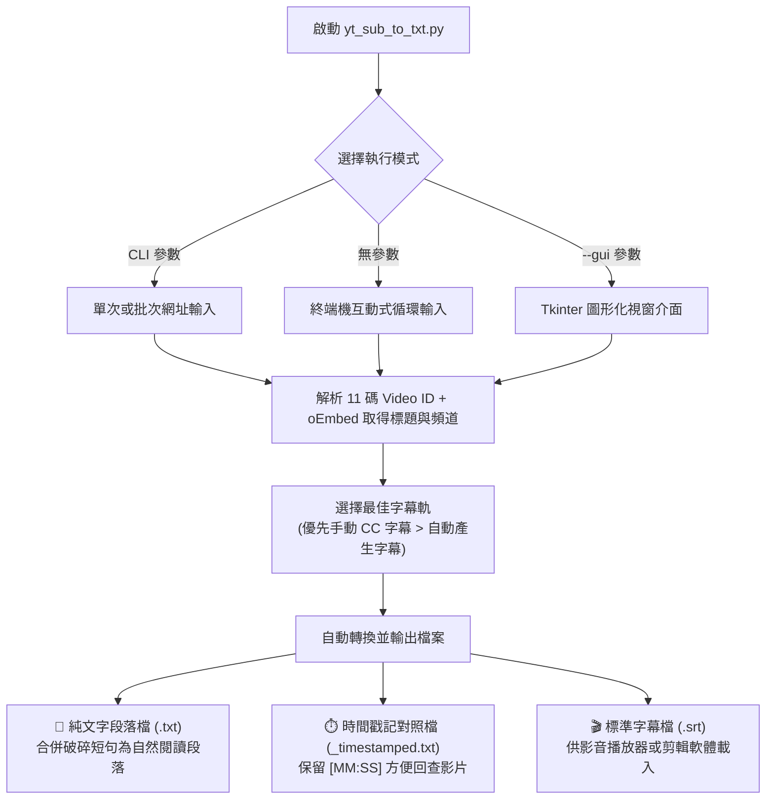

# 🎬 YouTube 影片取得字幕並轉成文字檔（.txt / .srt）完整解決方案指南

> **最後更新時間**: 2026-11-11 10:44:00 (UTC+8)
> **使用模型**: Gemini 4 Argon (Medium)
> **執行 Agent**: Antigravity
> **主題分類**: 多媒體字幕提取 / 自動語音辨識 (ASR) / Python 自動化 / 知識管理工作流

---

## 🎯 摘要 (Summary)

將 YouTube 影片中的語音或字幕提取出來並轉換成純文字檔（`.txt` 逐字稿）或時間軸字幕檔（`.srt` / `.vtt`），在課堂學習筆記、學術研究訪談整理、AI 檢索增強生成（RAG）語料庫建立以及影音內容二次創作中極為常見。

本文件根據中英文關鍵字搜尋與實務技術測試，將解決方案依**「影片本身是否已有字幕軌道」**與**「使用者技術門檻（免寫程式 vs. 程式自動化）」**系統化整理為 **六大主流方法**：
1. **方法一：YouTube 網頁內建「顯示轉錄稿」功能**（零安裝、最快複製）
2. **方法二：瀏覽器擴充外掛（Browser Extensions，如 Kome / Glasp / YouTube Summary）**（一鍵匯出 `.txt` / `.md`）
3. **方法三：第三方線上字幕提取站與雲端 AI 平台（DownSub / NoteGPT / NotebookLM / TurboScribe）**（免環境配置、支援直接下載檔案）
4. **方法四：命令列工具 `yt-dlp` 結合正規表示式清洗腳本**（播放清單與頻道大批次自動化首選）
5. **方法五：Python `youtube-transcript-api` 專用套件**（開發者秒級提取純文字首選）
6. **方法六：智慧雙軌方案 — `yt-dlp` 音訊提取 + 本地 `Whisper` / `faster-whisper` AI 語音辨識**（解決「完全無字幕影片」或「自動字幕錯字過多」的終極方案）

文中深入剖析底層技術原理与字幕格式差異，提供含 Mermaid 程式邏輯流程圖與詳細註解的 Python 程式碼範例，並針對六大方法的**應用場景與限制**進行完整橫向比較。

---

## 💡 1. 核心概念剖析 (Core Concepts)

### 1.1 YouTube 字幕轉文字的兩大底層技術路徑

要將 YouTube 影片轉換為文字檔，技術上必須先判斷目標影片是否具備現成的字幕軌道（Caption Track），進而決定走**「路徑 A：字幕軌道直接抓取」**或**「路徑 B：音訊串流提取 + AI 語音辨識（ASR）」**：



1. **路徑 A — 字幕軌道提取（Caption Track Extraction）**：
   * **運作原理**：當創作者手動上傳字幕（Manual CC）或 YouTube 自動生成語音字幕（Auto-generated Captions）時，字幕文本實際上是以結構化的 `XML`、`JSON3` 或 `WebVTT (.vtt)` 格式獨立儲存在 YouTube 的 TimedText 伺服器上。提取工具僅需透過 YouTube 內部 API（Innertube API）請求該文字檔，**完全不需要下載數百 MB 的影片或音訊串流**，因此單部影片僅需 **1～3 秒**即可取得完整文字。
   * **先決限制**：若影片創作者關閉字幕功能、音訊背景雜訊過大導致 YouTube 未生成自動字幕、或影片語言不支援自動轉錄，路徑 A 的所有工具皆會回傳「找不到字幕」。

2. **路徑 B — 音訊串流分離 + 自動語音辨識（Audio Demuxing + ASR Transcription）**：
   * **運作原理**：針對**完全沒有字幕**的影片，必須先利用影音串流下載器（如 `yt-dlp` 搭配 `FFmpeg`）從 YouTube 的 DASH / HLS 媒體串流中單獨抽出音訊軌（如 `.m4a` 或 `.mp3`），再交由自動語音辨識（Automatic Speech Recognition, ASR）深度學習模型（如 OpenAI **Whisper**）將聲波轉譯為文字。
   * **Whisper 模型底層機制**：先將輸入音訊重新取樣至 $16,000\text{ Hz}$ 單聲道波形，透過短時距傅立葉變換（STFT）計算 $80$ 頻道的對數梅爾頻譜圖（Log-Mel Spectrogram），再輸入 **Encoder-Decoder Transformer** 架構，以自迴歸（Autoregressive）方式同時預測多語言文字 Token、標點符號與時間戳記。

---

### 1.2 常見字幕檔格式結構與語音辨識評估指標

從 YouTube 抓取下來的原始字幕通常包含時間軸與定位標籤，若要轉為易讀的純文字檔（`.txt`），需理解各格式的結構特徵：

| 格式名稱 | 副檔名 | 內部結構特徵 | 轉換為純文字 (`.txt`) 的關鍵清洗步驟 |
| :--- | :---: | :--- | :--- |
| **SubRip** | `.srt` | 每段由「純數字序號」、「時間軸 (`00:00:01,500 --> 00:00:04,200`)」與「字幕文字」構成。 | 使用正規表示式濾除純數字行、含 `-->` 的時間軸行與空白行。 |
| **WebVTT** | `.vtt` | YouTube 預設串流字幕格式，首行為 `WEBVTT`；自動字幕常含逐字時間標籤（如 `<00:00:02.100><c>詞彙</c>`）與雙行滾動重複。 | 除移除時間軸與 `<...>` 標籤外，**必須執行相鄰重複行去重（Deduplication）**，否則每句話會重複出現兩到三次。 |
| **JSON3 / XML** | `.json3` | YouTube TimedText API 原生結構，包含毫秒級起始時間 `tStartMs` 與文字片段陣列 `segs`。 | 直接解析 JSON 物件提取文字欄位並依標點或停頓秒數合併成自然段落。 |
| **Plain Text** | `.txt` | 純文字格式，無時間碼與控制標籤。 | 最適合直接匯入 Word、Notion、Obsidian 或交由 LLM（Gemini / ChatGPT）進行摘要。 |

#### 語音轉文字準確率指標：字錯率（Character Error Rate, CER / Word Error Rate, WER）
評估 YouTube 內建自動字幕與 Whisper AI 語音辨識準確度的標準公式為萊文斯坦編輯距離（Levenshtein Distance）推導出的 **CER（中文以字元計）** 或 **WER（英文以單詞計）**：

$$\text{CER} = \frac{S + D + I}{N} \times 100\%$$

其中：
* $S$（Substitutions）：同音異字或專有名詞替換錯誤的字數。
* $D$（Deletions）：因語速過快或連音而漏聽的字數。
* $I$（Insertions）：因背景音樂或模型幻覺（Hallucination）而多餘插入的字數。
* $N$：人工校對標準逐字稿（Ground Truth）的總字數。$\text{CER}$ 越接近 $0\%$ 代表轉錄品質越高。

---

## 🛠️ 2. 實作與應用範例 (Practical Examples)

以下由淺入深（從免安裝操作到 Python 自動化與 AI 語音辨識），完整介紹六種取得 YouTube 字幕轉文字檔的方法。

---

### 2.1 方法一：YouTube 官方網頁內建「顯示轉錄稿」（零安裝、單片最快）

若只是臨時需要複製一兩支有字幕影片的文字，YouTube 網頁版已內建轉錄稿面板：

1. 使用電腦瀏覽器開啟目標 YouTube 影片。
2. 在影片標題下方的說明欄點擊 **「...更多」（...more）** 展開完整資訊。
3. 向下滑動至「轉錄稿」區段，點擊 **「顯示轉錄稿」（Show transcript）** 按鈕。
4. 網頁右上側會彈出時間軸字幕面板，點擊面板右上角的 **「⋮」** 選單，選擇 **「切換時間戳記」（Toggle timestamps）** 隱藏時間碼。
5. 使用滑鼠從頭到尾反白選取文字，按 `Ctrl + C` 複製並貼入記事本儲存為 `.txt` 檔。

---

### 2.2 方法二：瀏覽器擴充外掛（Browser Extensions，邊看影片邊一鍵匯出）

若經常在瀏覽 YouTube 時需要擷取字幕，安裝 Chrome / Edge / Firefox 擴充外掛可在播放器旁新增「一鍵複製／下載文字檔」按鈕：

1. **[YouTube Summary with ChatGPT & Claude (by Glasp)](https://glasp.co/youtube-summary)**：
   * 安裝後會在 YouTube 影片右上方自動嵌入 Transcript 折疊面板，提供 **「Copy Transcript (Plain Text)」** 按鈕，一鍵即可將整部影片的無時間軸純文字複製到剪貼簿。
2. **[Kome — YouTube Transcript Generator Extension](https://kome.ai/tools/youtube-transcript-generator)** 或 **YT Transcript Exporter**：
   * 支援直接在播放頁面將字幕匯出為 `.txt`（純文字）或 `.md`（Markdown）檔案，且所有提取動作皆在本地瀏覽器內完成。

---

### 2.3 方法三：第三方線上下載網站與 AI 知識庫平台（免寫程式、直接下載 `.txt`）

不想安裝軟體或擴充外掛時，可透過以下線上服務直接輸入網址取得文字檔：

1. **線上純字幕下載站（針對「已有字幕」的影片，秒速下載）**：
   * **[DownSub](https://downsub.com/)**：將 YouTube 網址貼入搜尋框並點擊 Download，即可直接選擇下載 **`[TXT]`（純文字檔）** 或 **`[SRT]`（時間軸字幕檔）**，亦支援線上直接將外文字幕自動翻譯為繁體中文後下載。
   * **[NoteGPT YouTube Transcript Generator](https://notegpt.io/youtube-transcript-generator)**：貼上網址即可檢視含時間戳記的逐字稿，支援一鍵複製或下載 `.txt` 檔。
   * **[YouTube Transcript AI](https://youtube-transcript.ai/)**：輕量化網頁工具，貼上連結立即提取完整文字稿。
2. **AI 知識庫整合平台（提取字幕 + AI 自動整理筆記）**：
   * **[Google NotebookLM](https://notebooklm.google.com/)**：免費建立筆記本並選擇「新增來源 → YouTube 連結」，系統會自動抓取整部影片的字幕作為知識庫。點開該來源即可複製完整逐字稿，還能請 AI 直接根據逐字稿生成大綱、常見問答與語音摘要。
3. **雲端 AI 語音轉錄平台（針對「完全沒字幕」的影片）**：
   * **[TurboScribe](https://turboscribe.ai/)**：底層採用 Whisper `large` 模型，即使影片完全沒有 CC 字幕，也能在雲端抓取音訊並轉成高精準度逐字稿，支援匯出 `.txt`、`.docx`、`.srt` 與 `.pdf`（免費版每日可轉錄 3 部、每部上限 30 分鐘）。

---

### 2.4 方法四：命令列工具 `yt-dlp` 批次下載字幕並自動清洗為純文字檔

當需要批次下載整個 YouTube 播放清單或頻道的字幕時，開源命令列工具 **[`yt-dlp`](https://github.com/yt-dlp/yt-dlp)** 是業界標準。由於 `yt-dlp` 下載的原始字幕為 `.vtt` 或 `.srt`（內含時間碼與滾動重複行），我們可搭配 Python 正規表示式腳本將其自動轉換為乾淨的 `.txt` 文字檔。

#### 📊 程式邏輯流程圖 (`yt-dlp` 下載字幕與去重清洗邏輯)



#### 💻 步驟 1：終端機 `yt-dlp` 字幕下載指令（不下載影片本體）

```bash
# 1. 安裝或更新 yt-dlp
pip install -U yt-dlp

# 2. 僅下載字幕（優先手動字幕，若無則抓自動字幕），指定繁中/簡中/英文，並轉為 .srt 格式
yt-dlp --write-subs --write-auto-subs --sub-langs "zh-TW,zh-Hant,zh,en" --convert-subs srt --skip-download -o "sub_%(id)s" "https://www.youtube.com/watch?v=VIDEO_ID"
```

#### 💻 步驟 2：Python 將 `.srt` / `.vtt` 清洗為純文字 `.txt` 腳本

```python
#!/usr/bin/env python3
# -*- coding: utf-8 -*-
"""
將 yt-dlp 下載的 .srt 或 .vtt 字幕檔清洗為乾淨的純文字檔 (.txt)
包含：移除時間軸、濾除 HTML/VTT 標籤、以及消除 YouTube 自動字幕常見的相鄰重複行
"""
import re
from pathlib import Path


def clean_subtitle_file_to_txt(subtitle_path: str, output_txt_path: str) -> None:
    """讀取 .srt 或 .vtt 字幕檔並輸出為無時間碼、無重複句的 .txt 檔案"""
    raw_content = Path(subtitle_path).read_text(encoding="utf-8", errors="ignore")
    cleaned_lines = []

    for line in raw_content.splitlines():
        line = line.strip()
        # 1. 略過空行、WEBVTT 標頭資訊與純數字序號行
        if not line or line.startswith(("WEBVTT", "Kind:", "Language:", "NOTE")):
            continue
        if line.isdigit():
            continue
        # 2. 略過時間軸行 (例如 00:00:03,120 --> 00:00:06,450)
        if "-->" in line:
            continue

        # 3. 移除 VTT 內嵌逐字時間標籤與 HTML 樣式標籤 (如 <00:00:01.200><c>文字</c>)
        clean_text = re.sub(r"<[^>]+>", "", line).strip()
        if not clean_text:
            continue

        # 4. 相鄰重複行去重 (YouTube 自動字幕為維持雙行滾動，常在下一時間段重複上一句)
        if not cleaned_lines or cleaned_lines[-1] != clean_text:
            cleaned_lines.append(clean_text)

    # 5. 寫入最終純文字檔
    Path(output_txt_path).write_text("\n".join(cleaned_lines), encoding="utf-8")
    print(f"✅ 字幕清洗完成！共輸出 {len(cleaned_lines)} 行純文字至：{output_txt_path}")


if __name__ == "__main__":
    # 將檔名替換為 yt-dlp 實際產生的字幕檔
    clean_subtitle_file_to_txt("sub_VIDEO_ID.zh-TW.srt", "clean_transcript.txt")
```

---

### 2.5 方法五：Python `youtube-transcript-api` 直接抓取字幕並重組為自然段落

對於熟悉 Python 的使用者，開源套件 **[`youtube-transcript-api`](https://github.com/jdepoix/youtube-transcript-api)** 是最輕量、最快速的自動化方案。它不需申請 YouTube Data API Key，也無須啟動瀏覽器，即可在 1 秒內抓取字幕，並將破碎的短句重組為易讀的自然段落 `.txt` 檔。

#### 📊 程式邏輯流程圖 (`youtube-transcript-api` 擷取與段落重組)



#### 💻 完整 Python 實作程式碼（相容 `youtube-transcript-api` v1.0+ 與 v0.6.x）

```python
#!/usr/bin/env python3
# -*- coding: utf-8 -*-
"""
使用 youtube-transcript-api 直接擷取 YouTube 字幕並儲存為文字檔
安裝指令：pip install youtube-transcript-api
"""
import re
from typing import Dict, List
from youtube_transcript_api import YouTubeTranscriptApi
from youtube_transcript_api.formatters import SRTFormatter


def extract_video_id(url_or_id: str) -> str:
    """從各種 YouTube 網址格式 (watch?v=, youtu.be/, shorts/, embed/) 解析 11 碼 Video ID"""
    pattern = r"(?:v=|\/videos\/|embed\/|youtu\.be\/|\/v\/|\/e\/|watch\?v=|&v=|\/shorts\/)([a-zA-Z0-9_-]{11})"
    match = re.search(pattern, url_or_id.strip())
    return match.group(1) if match else url_or_id.strip()


def merge_entries_to_paragraphs(entries: List[Dict], pause_threshold: float = 2.0) -> str:
    """
    將破碎的字幕短句依「說話停頓時間」與「句尾標點符號」合併為自然閱讀段落
    """
    paragraphs, current_chunk, current_len, prev_end = [], [], 0, None

    for item in entries:
        text = re.sub(r"\s+", " ", item["text"]).strip()
        if not text:
            continue
        start = float(item.get("start", 0.0))
        duration = float(item.get("duration", 0.0))
        # 若兩句之間停頓超過 pause_threshold 秒，視為新段落
        is_long_pause = (prev_end is not None) and ((start - prev_end) > pause_threshold)
        prev_end = start + duration

        if is_long_pause and current_chunk:
            paragraphs.append(" ".join(current_chunk))
            current_chunk, current_len = [], 0

        current_chunk.append(text)
        current_len += len(text)

        # 若遇到句號/問號/驚嘆號且段落字數已達一定長度，則自動分段
        if text.endswith((".", "?", "!", "。", "？", "！")) and current_len >= 250:
            paragraphs.append(" ".join(current_chunk))
            current_chunk, current_len = [], 0

    if current_chunk:
        paragraphs.append(" ".join(current_chunk))
    return "\n\n".join(paragraphs)


def download_youtube_subtitle_to_txt(youtube_url: str, output_prefix: str = "transcript") -> None:
    """擷取 YouTube 字幕並輸出純文字檔 (.txt)、時間戳記版 (_timestamped.txt) 與 .srt"""
    video_id = extract_video_id(youtube_url)
    preferred_langs = ["zh-TW", "zh-Hant", "zh", "zh-Hans", "en"]

    print(f"🔍 正在擷取影片 [{video_id}] 的字幕軌道...")
    ytt_api = YouTubeTranscriptApi()

    # 相容性處理：同時支援新版 v1.0+ 實例方法與舊版 v0.6.x 靜態方法
    if hasattr(ytt_api, "fetch"):
        fetched_transcript = ytt_api.fetch(video_id, languages=preferred_langs)
        raw_entries = fetched_transcript.to_raw_data()
    else:
        fetched_transcript = YouTubeTranscriptApi.get_transcript(video_id, languages=preferred_langs)
        raw_entries = fetched_transcript

    # 1. 輸出自然段落純文字檔 (.txt)
    paragraph_text = merge_entries_to_paragraphs(raw_entries)
    txt_file = f"{output_prefix}.txt"
    with open(txt_file, "w", encoding="utf-8") as f:
        f.write(paragraph_text + "\n")

    # 2. 輸出含 [分:秒] 時間戳記對照的文字檔 (_timestamped.txt)
    ts_file = f"{output_prefix}_timestamped.txt"
    with open(ts_file, "w", encoding="utf-8") as f:
        for entry in raw_entries:
            mins = int(entry["start"] // 60)
            secs = int(entry["start"] % 60)
            clean_line = entry["text"].replace("\n", " ").strip()
            f.write(f"[{mins:02d}:{secs:02d}] {clean_line}\n")

    # 3. 輸出標準 .srt 字幕檔
    srt_file = f"{output_prefix}.srt"
    srt_formatter = SRTFormatter()
    with open(srt_file, "w", encoding="utf-8") as f:
        f.write(srt_formatter.format_transcript(fetched_transcript))

    print(f"✅ 轉換完成！已產生：{txt_file}、{ts_file}、{srt_file}")


if __name__ == "__main__":
    # 範例：輸入任意具有 CC 或自動字幕的 YouTube 影片網址
    sample_url = "https://youtu.be/oIk3R-sMX5o"
    download_youtube_subtitle_to_txt(sample_url, output_prefix="lecture_note")
```

---

### 2.6 方法六：終極雙軌方案 — `yt-dlp` + `faster-whisper` 本地 AI 語音辨識（支援完全無字幕影片）

當遇到**完全沒有提供任何字幕**的影片（如課堂側錄、研討會直播、中文訪談），或是 YouTube 自動生成的字幕錯誤百出時，最可靠的自動化架構是建立**「智慧雙軌 Fallback 管線」**：
* **第一軌（極速軌道）**：優先嘗試以 `youtube-transcript-api` 在 1 秒內抓取現成字幕。
* **第二軌（AI 語音辨識備援）**：一旦發現影片無字幕（或使用者強制指定高精準模式），立即呼叫 `yt-dlp` 僅下載音訊軌，並啟動本地端 **[`faster-whisper`](https://github.com/SYSTRAN/faster-whisper)**（採用 CTranslate2 推論引擎優化，速度比原版 OpenAI Whisper 快 4 倍且支援 INT8 量化與 VAD 靜音過濾）將語音轉為文字檔。

#### 📊 程式邏輯流程圖 (智慧雙軌：字幕 API 優先 + Whisper AI 語音辨識備援)



#### 💻 完整 Python 實作程式碼（智慧雙軌整合腳本）

```python
#!/usr/bin/env python3
# -*- coding: utf-8 -*-
"""
智慧雙軌 YouTube 影片轉文字檔工具 (API 字幕提取 + Faster-Whisper AI 語音辨識備援)
事前準備：
1. 安裝 FFmpeg (Windows 終端機可執行: winget install Gyan.FFmpeg)
2. 安裝套件: pip install youtube-transcript-api yt-dlp faster-whisper
"""
import os
import re
import yt_dlp
from faster_whisper import WhisperModel
from youtube_transcript_api import YouTubeTranscriptApi


def parse_video_id(url: str) -> str:
    """解析 11 碼 YouTube Video ID"""
    match = re.search(r"(?:v=|youtu\.be\/|shorts\/|embed\/)([a-zA-Z0-9_-]{11})", url)
    return match.group(1) if match else url.strip()


def youtube_to_text_smart_pipeline(
    youtube_url: str,
    output_txt: str = "smart_transcript.txt",
    force_whisper: bool = False,
    model_size: str = "small",
    device: str = "cpu",
    compute_type: str = "int8",
) -> None:
    """
    智慧雙軌轉換函式：
    - 若 force_whisper=False：先嘗試秒抓 YouTube 現有字幕；若失敗則自動切換 Whisper。
    - 若 force_whisper=True：直接下載音訊並以 Faster-Whisper 進行高精準度語音轉錄。
    """
    video_id = parse_video_id(youtube_url)

    # ==================== 第一軌：嘗試直接抓取現成字幕 ====================
    if not force_whisper:
        try:
            print(f"⚡ [第一軌] 嘗試直接抓取影片 [{video_id}] 的現成字幕...")
            ytt_api = YouTubeTranscriptApi()
            langs = ["zh-TW", "zh-Hant", "zh", "en"]
            if hasattr(ytt_api, "fetch"):
                fetched = ytt_api.fetch(video_id, languages=langs)
                entries = fetched.to_raw_data()
            else:
                entries = YouTubeTranscriptApi.get_transcript(video_id, languages=langs)

            with open(output_txt, "w", encoding="utf-8") as f:
                for item in entries:
                    f.write(item["text"].replace("\n", " ").strip() + "\n")
            print(f"✅ [第一軌成功] 已快速儲存文字檔至：{output_txt}")
            return
        except Exception as err:
            print(f"⚠️ 無法直接取得現成字幕 ({err})，自動切換至 [第二軌：Whisper AI 語音辨識]...")

    # ==================== 第二軌：下載音訊 + Faster-Whisper 辨識 ====================
    temp_audio = f"temp_{video_id}.m4a"
    ydl_opts = {
        "format": "bestaudio[ext=m4a]/bestaudio/best",
        "outtmpl": temp_audio,
        "quiet": True,
        "overwrites": True,
    }

    try:
        print(f"📥 [第二軌 1/2] 正在透過 yt-dlp 提取純音訊軌...")
        with yt_dlp.YoutubeDL(ydl_opts) as ydl:
            ydl.download([youtube_url])

        print(f"🧠 [第二軌 2/2] 載入 Faster-Whisper ({model_size}) 模型進行語音轉文字...")
        model = WhisperModel(model_size, device=device, compute_type=compute_type)

        # 啟用 vad_filter 過濾空白與音樂片段，並透過 initial_prompt 引導輸出繁體中文標點
        segments, info = model.transcribe(
            temp_audio,
            beam_size=5,
            vad_filter=True,
            vad_parameters=dict(min_silence_duration_ms=500),
            initial_prompt="以下是繁體中文與英文的逐字稿，請使用正確的標點符號。",
        )
        print(f"🌐 偵測語言：{info.language} (信心度: {info.language_probability:.2%})")

        with open(output_txt, "w", encoding="utf-8") as f:
            for seg in segments:
                line = seg.text.strip()
                print(f"[{seg.start:06.2f}s -> {seg.end:06.2f}s] {line}")
                f.write(line + "\n")

        print(f"✅ [第二軌成功] AI 語音辨識完成！文字檔已儲存至：{output_txt}")
    finally:
        # 確保清理暫存音訊檔
        if os.path.exists(temp_audio):
            os.remove(temp_audio)


if __name__ == "__main__":
    # 輸入任意 YouTube 網址（無論有無字幕皆可處理）
    target_url = "https://www.youtube.com/watch?v=VIDEO_ID"
    youtube_to_text_smart_pipeline(target_url, output_txt="lecture_whisper.txt")
```

---

### 2.7 實戰工具開發與驗證：可重複使用的 YouTube CC 字幕轉文字檔工具 (`yt_sub_to_txt.py`)

針對有 CC 字幕或自動生成字幕的影片，為了方便日後**無限次重複使用**，我們於本目錄下開發了獨立工具 **[`yt_sub_to_txt.py`](./yt_sub_to_txt.py)**，具備以下五大工程特性：
1. **自動取得影片資訊**：透過 YouTube 官方 `oEmbed API` 免金鑰取得「影片標題」與「頻道作者」，自動清理非法字元並以 `VideoID_影片標題` 命名檔案。
2. **智慧字幕優先序**：自動優先選取「手動建立的 CC 字幕（Manually Created）」，若無則自動切換至「自動產生字幕（Auto-generated）」。
3. **自然段落重組**：自動清除字幕軌道中每 2～3 秒一次的破碎斷行，根據語音停頓間隔（`> 2.0s`）與句尾標點符號合併為易讀的自然段落。
4. **一次產出三種格式**：同時輸出 **純文字段落檔 (`.txt`)**、**時間戳記對照檔 (`_timestamped.txt`)** 與 **標準時間軸字幕檔 (`.srt`)**（若加上 `--zh` 參數還可額外產出繁體中文翻譯與雙語對照檔）。
5. **三種重複操作模式**：
   * **單次／批次命令列模式**：`python yt_sub_to_txt.py https://youtu.be/GZ9mAhGvT3U`
   * **互動式循環模式**：直接執行 `python yt_sub_to_txt.py`，可連續貼上多個網址轉檔。
   * **圖形化視窗模式（GUI）**：執行 `python yt_sub_to_txt.py --gui` 彈出桌面視窗介面操作。

#### 📊 `yt_sub_to_txt.py` 工具架構流程圖



#### 💻 三種重複使用指令範例

```bash
# 模式一：單次或一次傳入多部 YouTube 網址批次轉檔
python yt_sub_to_txt.py https://youtu.be/GZ9mAhGvT3U

# 若想同時自動翻譯並輸出繁體中文與中英雙語對照檔，加上 --zh
python yt_sub_to_txt.py https://youtu.be/GZ9mAhGvT3U --zh

# 模式二：進入互動式循環模式（可連續貼上網址重複轉檔，輸入 q 離開）
python yt_sub_to_txt.py

# 模式三：啟動桌面圖形化視窗介面 (GUI)
python yt_sub_to_txt.py --gui
```

#### 🧪 實際轉換驗證一：`https://youtu.be/GZ9mAhGvT3U`（自動產生字幕）

使用 `yt_sub_to_txt.py` 實際提取目標影片 **`https://youtu.be/GZ9mAhGvT3U`** 的字幕，執行結果如下：

* **影片標題**：*How Power-Efficient Can AI Become? | Conversations in Action*
* **頻道作者**：`Imagination in Action`（MIT Lincoln Lab 超級電腦中心主任 Vijay Gadepally 訪談）
* **選用字幕**：`English (auto-generated) (en)`（共 1,599 個時間軸片段，自動重組為 **133 段完整自然段落**）
* **產出文字檔清單**：
  1. 📄 **純文字自然段落檔**：[`GZ9mAhGvT3U_How Power-Efficient Can AI Become_ _ Conversations in Action.txt`](./GZ9mAhGvT3U_How%20Power-Efficient%20Can%20AI%20Become_%20_%20Conversations%20in%20Action.txt)
  2. ⏱️ **時間戳記對照文字檔**：[`GZ9mAhGvT3U_How Power-Efficient Can AI Become_ _ Conversations in Action_timestamped.txt`](./GZ9mAhGvT3U_How%20Power-Efficient%20Can%20AI%20Become_%20_%20Conversations%20in%20Action_timestamped.txt)
  3. 🎬 **標準 SRT 字幕檔**：[`GZ9mAhGvT3U_How Power-Efficient Can AI Become_ _ Conversations in Action.srt`](./GZ9mAhGvT3U_How%20Power-Efficient%20Can%20AI%20Become_%20_%20Conversations%20in%20Action.srt)

#### 🧪 實際轉換驗證二：`https://youtu.be/ZAzWPE9CItg`（手動建立 CC 字幕）

再次使用同一套 `yt_sub_to_txt.py` 工具提取 **`https://youtu.be/ZAzWPE9CItg`**，工具自動偵測並優先選用高品質的「手動建立 CC 字幕」：

* **影片標題**：*AI Crisis in Math: Navier-Stokes, Riemann Hypothesis & Complexity Theory | Lex Fridman Podcast #503*
* **頻道作者**：`Lex Fridman`（與數學家 Steven Brunton、Ankur Moitra、Alex Kontorovich 對談 AI 解決數學難題的歷史性時刻）
* **選用字幕**：`English (en) [手動建立 CC 字幕]`（共 3,270 個時間軸片段，自動重組為 **811 行易讀自然段落**）
* **產出文字檔清單**：
  1. 📄 **純文字自然段落檔**：[`ZAzWPE9CItg_AI Crisis in Math_ Navier-Stokes, Riemann Hypothesis & Compl.txt`](./ZAzWPE9CItg_AI%20Crisis%20in%20Math_%20Navier-Stokes,%20Riemann%20Hypothesis%20&%20Compl.txt)
  2. ⏱️ **時間戳記對照文字檔**：[`ZAzWPE9CItg_AI Crisis in Math_ Navier-Stokes, Riemann Hypothesis & Compl_timestamped.txt`](./ZAzWPE9CItg_AI%20Crisis%20in%20Math_%20Navier-Stokes,%20Riemann%20Hypothesis%20&%20Compl_timestamped.txt)
  3. 🎬 **標準 SRT 字幕檔**：[`ZAzWPE9CItg_AI Crisis in Math_ Navier-Stokes, Riemann Hypothesis & Compl.srt`](./ZAzWPE9CItg_AI%20Crisis%20in%20Math_%20Navier-Stokes,%20Riemann%20Hypothesis%20&%20Compl.srt)

---

## 🚀 3. 延伸思考與進階主題 (Extensions & Advanced Topics)

### 3.1 六大解決方案之應用場景與限制完整比較表

為了協助根據「影片是否有字幕」、「處理數量」與「技術背景」快速選型，下表完整對比六種方法的應用與限制：

| 方法／方案名稱 | 核心原理或作法 | 最佳適用場景 (When to Use) | 主要優勢 (Pros) | 應用限制與潛在風險 (Limitations) |
| :--- | :--- | :--- | :--- | :--- |
| **1. YouTube 內建「顯示轉錄稿」** | 直接於官方播放頁展開 TimedText 轉錄面板並手動隱藏時間碼複製。 | 臨時查閱單支短片、快速複製幾段話放進報告。 | • 完全免安裝任何工具或外掛。<br/>• 零成本、即時顯示。 | • **無字幕影片無法使用**。<br/>• 無法直接下載 `.txt` / `.srt` 檔。<br/>• 1 小時以上長片手動反白複製極不便。 |
| **2. 瀏覽器擴充外掛**<br/>*(Glasp / Kome / YT Exporter)* | 由擴充套件在播放頁注入腳本，讀取頁面播放器之字幕軌並轉為純文字。 | 經常邊看 YouTube 教學影片邊做筆記的研究者或學生。 | • 在看影片當下「一鍵複製／匯出 `.txt`」。<br/>• 借用瀏覽器登入態，不易被 YouTube 封鎖 IP。 | • **無字幕影片無法使用**。<br/>• 需在電腦端瀏覽器安裝外掛，手機 App 無法使用。<br/>• 不適合無人值守的後台批次處理。 |
| **3. 第三方線上工具與 AI 平台**<br/>*(DownSub / NotebookLM / TurboScribe)* | 透過雲端伺服器代抓字幕軌（DownSub/NotebookLM），或於雲端跑 Whisper 語音辨識（TurboScribe）。 | 免寫程式卻想直接下載 `.txt` / `.srt` 檔案，或希望 AI 順便整理大綱與問答。 | • 免安裝 Python 與開發環境，手機與電腦皆可用。<br/>• NotebookLM 與 TurboScribe 能自動補齊標點與摘要。 | • DownSub 對無字幕影片無效。<br/>• 雲端 AI 轉錄（如 TurboScribe）免費版有每日次數（3 次）與片長（30 分鐘）限制。 |
| **4. CLI 工具 `yt-dlp` + 清洗腳本** | 透過命令列直接向 YouTube CDN 下載 `.vtt`/`.srt` 字幕軌，再以 Regex 濾除時間碼與重複行。 | **整個播放清單（Playlist）或整個頻道**數十至數百支影片的大批次字幕歸檔。 | • 支援播放清單網址一鍵批次抓取。<br/>• 支援 `--cookies-from-browser` 突破年齡限制或會員影片字幕。 | • 僅抓字幕模式仍須原影片有字幕。<br/>• 原生下載之自動字幕含大量滾動重複行，必須搭配清洗腳本才適合閱讀。 |
| **5. Python `youtube-transcript-api`** | 以純 Python HTTP 請求直接擷取 TimedText API 並格式化為字串或段落。 | Python 自動化爬蟲、RAG 知識庫資料管線、LINE / Discord 影片摘要機器人。 | • **速度最快（1～2 秒/部）**、套件極輕量。<br/>• 支援自動呼叫 YouTube 翻譯軌轉為繁體中文。 | • **若影片無字幕或關閉字幕會拋出 `TranscriptsDisabled` 例外**。<br/>• 在雲端主機（AWS/Colab）高頻抓取易觸發 HTTP 429 IP 封鎖。 |
| **6. `yt-dlp` + `faster-whisper` (本地 AI)** | 先以 `yt-dlp` 下載純音訊軌，再透過本地端 CTranslate2 Whisper 模型進行語音轉文字。 | **完全沒有任何字幕的影片**、中英混雜專業演講、或具有機密隱私考量的內部影片。 | • **唯一不受限於原影片有無字幕的全能解法**。<br/>• 完全免費、無片長與次數上限，且能自動產出精準標點符號。 | • 需安裝 Python 與 FFmpeg。<br/>• 消耗本地 CPU / GPU 算力，轉錄耗時約為影片長度的 $1/10 \sim 1/2$（視硬體而定）。 |

---

### 3.2 「有字幕影片」vs.「無字幕影片」快速選型對照矩陣

在實務上，最常遇到的困擾是：「為什麼某個工具在這支影片可以用，換一支影片卻報錯？」關鍵就在於影片屬於以下哪一種字幕狀態：

| 影片字幕狀態 | 狀態檢查方式 | ✅ 首選推薦方法 | ❌ 會失效／不推薦的方法 |
| :--- | :--- | :--- | :--- |
| **狀態 A：有手動上傳 CC 字幕**<br/>*(字幕品質最佳，含標點)* | 點擊播放器 `[CC]` 按鈕，設定齒輪顯示為「繁體中文 / 英文」（無「自動產生」字樣）。 | • **免寫程式**：DownSub、YouTube 內建轉錄稿、NotebookLM、Glasp 外掛。<br/>• **程式自動化**：Python `youtube-transcript-api`、`yt-dlp --write-subs`。 | • 不必動用 Whisper 重新語音辨識（浪費時間與算力，且人工上傳的字幕通常比 AI 聽寫更準）。 |
| **狀態 B：僅有 YouTube 自動產生字幕**<br/>*(可秒抓，但無標點且斷句零碎)* | 點擊播放器 `[CC]` 按鈕，設定齒輪顯示為「英文 (自動產生) / 中文 (自動產生)」。 | • **程式自動化**：Python `youtube-transcript-api`（搭配第 2.5 節段落合併演算法）或 `yt-dlp`（搭配第 2.4 節去重清洗腳本）。<br/>• **後處理優化**：抓出 `.txt` 後丟給 Gemini / ChatGPT 補上標點符號。 | • 直接用文字編輯器打開未清洗的 `.vtt` 檔（會看到滿篇時間標籤與重複三次的句子）。 |
| **狀態 C：完全沒有任何字幕**<br/>*(`[CC]` 按鈕反灰不可按)* | 播放器下方沒有 `[CC]` 圖示，或說明欄沒有「顯示轉錄稿」按鈕。 | • **免寫程式（30分鐘內短片）**：TurboScribe 雲端 AI 轉錄。<br/>• **程式自動化／長片無限轉錄**：**方法六 `yt-dlp` 下載音訊 + `faster-whisper` 本地 AI 語音辨識**。 | • ❌ YouTube 內建轉錄稿<br/>• ❌ DownSub / NoteGPT<br/>• ❌ 瀏覽器字幕外掛<br/>• ❌ 純 `youtube-transcript-api` |

---

### 3.3 實務常見坑點與進階解決對策 (Edge Cases & Troubleshooting)

1. **坑點一：YouTube 自動字幕「缺乏標點符號」且「專有名詞同音錯字」**
   * **成因**：YouTube 早期自動字幕軌道為求即時顯示，僅輸出空格分隔的詞彙而省略句讀。
   * **解決對策**：使用第 2.5 節腳本抓出 `.txt` 後，串接大型語言模型（如 Google Gemini API），使用 Prompt：*「請在不刪減任何資訊與不改變原意的前提下，為以下 YouTube 逐字稿補上正確的繁體中文標點符號、分段，並修正明顯的同音專有名詞錯字」*，即可在數秒內獲得出版級逐字稿。
2. **坑點二：大量批次抓取時遭遇 `HTTP Error 429 (Too Many Requests)` 或 IP 被拒**
   * **成因**：YouTube 對未登入的匿名 IP 或資料中心（Data Center）IP 設有嚴格的速率限制（Rate Limiting）。
   * **解決對策**：
     * 在 Python 批次迴圈中務必加入隨機延遲：`time.sleep(random.uniform(2.5, 5.0))`。
     * 使用 `yt-dlp` 時加上 `--cookies-from-browser chrome`（或 `edge`），直接借用本機瀏覽器已登入的 Google 帳號 Cookie。
3. **坑點三：Whisper 在片頭音樂或靜音區段產生「無窮重複幻覺（Hallucination）」**
   * **成因**：當音訊只有背景音樂而無人聲時，標準 Whisper Decoder 容易陷入自迴歸迴圈，不斷重複輸出*「請訂閱按讚開啟小鈴鐺」*或*「字幕由 Amara.org 社群提供」*。
   * **解決對策**：如第 2.6 節程式碼所示，改用 `faster-whisper` 並強制開啟 **`vad_filter=True`**（內建 Silero VAD 語音活動偵測器），在進入 Transformer 解碼前先自動切除無人聲片段，即可徹底消除幻覺。
4. **坑點四：Whisper 輸出簡體中文而非繁體中文**
   * **成因**：Whisper 訓練語料中同時包含簡繁中文，預設 `language="zh"` 時常傾向輸出簡體字。
   * **解決對策**：在呼叫 `model.transcribe()` 時傳入繁體中文引導提示詞 `initial_prompt="以下是繁體中文的逐字稿，請使用繁體中文與正確標點符號。"`，或於輸出後結合 `opencc-python-reimplemented`（`s2twp` 台灣繁體慣用詞轉換）進行二次確保。

---

## 📚 4. 參考資料列表 (References)

以下列出本文件撰寫過程中所檢索並引用之技術文獻、開源專案與線上工具網站（均依規範標註真實網址與取得日期）：

1. **jdepoix / youtube-transcript-api — GitHub 官方開源專案與 PyPI 文件**（Python 免 API Key 提取 YouTube 手動／自動字幕與 Formatter 模組說明）。
   * 網址：<https://github.com/jdepoix/youtube-transcript-api> ／ <https://pypi.org/project/youtube-transcript-api/>
   * 取得日期：2026-11-11
2. **yt-dlp / yt-dlp — GitHub 官方開源專案**（命令列影音與字幕提取工具，`--write-subs`、`--write-auto-subs`、`--convert-subs` 與 `--skip-download` 參數規範）。
   * 網址：<https://github.com/yt-dlp/yt-dlp>
   * 取得日期：2026-11-11
3. **openai / whisper — GitHub 官方開源專案**（*Robust Speech Recognition via Large-Scale Weak Supervision*，OpenAI 多語言自動語音辨識模型架構與 CLI 用法）。
   * 網址：<https://github.com/openai/whisper>
   * 取得日期：2026-11-11
4. **SYSTRAN / faster-whisper — GitHub 官方開源專案**（基於 CTranslate2 加速之 Whisper 推論引擎，支援 INT8 量化與 Silero VAD 語音活動偵測）。
   * 網址：<https://github.com/SYSTRAN/faster-whisper>
   * 取得日期：2026-11-11
5. **iThome 鐵人賽與技術專欄**（Python 結合 `youtube-transcript-api`、`yt-dlp` 與 `Whisper` 擷取 YouTube 影片逐字稿之實戰教學）。
   * 網址：<https://ithelp.ithome.com.tw/>
   * 取得日期：2026-11-11
6. **DownSub — Download subtitles from YouTube**（線上免安裝提取 YouTube `.txt` 與 `.srt` 字幕服務）。
   * 網址：<https://downsub.com/>
   * 取得日期：2026-11-11
7. **Google NotebookLM 官方網站**（支援直接匯入 YouTube 網址提取轉錄文字稿並進行 AI 問答與摘要）。
   * 網址：<https://notebooklm.google.com/>
   * 取得日期：2026-11-11
8. **NoteGPT — YouTube Transcript Generator**（線上 YouTube 字幕提取、時間軸跳轉與 `.txt` 下載工具）。
   * 網址：<https://notegpt.io/youtube-transcript-generator>
   * 取得日期：2026-11-11
9. **TurboScribe AI — Transcribe Audio and Video to Text**（基於 Whisper 之雲端語音轉文字服務，支援無字幕 YouTube 影片轉 `.txt` / `.srt`）。
   * 網址：<https://turboscribe.ai/>
   * 取得日期：2026-11-11
10. **Glasp — YouTube Summary with ChatGPT & Claude**（瀏覽器擴充外掛，於 YouTube 播放頁一鍵複製純文字逐字稿）。
    * 網址：<https://glasp.co/youtube-summary>
    * 取得日期：2026-11-11
11. **Kome AI — YouTube Transcript Generator Extension**（瀏覽器擴充外掛與線上字幕匯出工具）。
    * 網址：<https://kome.ai/tools/youtube-transcript-generator>
    * 取得日期：2026-11-11

---

## 📝 提示詞歷史與變更記錄 (Prompt Archive)

### 🔹 [2026-11-11 10:28:00] [Gemini 4 Argon (Medium) / Antigravity] 變更紀錄
- **模型/Agent**: Gemini 4 Argon (Medium) / Antigravity
- **Prompt 原文**:
  ```text
  我想要了解把youtube的影片取得字幕變成文字檔有哪些方法
  ```
- **變更摘要**: 依據 `SUBTITLE/AGENTS.md` 與工作區核心規範，透過中英文關鍵字搜尋並系統化整理將 YouTube 影片取得字幕轉成文字檔（`.txt` / `.srt`）的六大解決方案（YouTube 內建顯示轉錄稿、瀏覽器擴充外掛 Glasp/Kome、第三方線上工具與 AI 平台 DownSub/NoteGPT/NotebookLM/TurboScribe、命令列 `yt-dlp` 結合正規表示式去重清洗腳本、Python `youtube-transcript-api` 自動段落重組腳本、以及 `yt-dlp` + `faster-whisper` 智慧雙軌本地 AI 語音辨識方案）；深入剖析兩大底層技術路徑與字幕格式差異，提供含 Mermaid 邏輯流程圖與詳細註解的程式碼，建立六大方法應用與限制比較表、「有字幕 vs. 無字幕影片」選型矩陣與常見坑點對策，並附上標註取得日期（2026-11-11）之參考資料列表，同步產出 `.md` 與 `.html` 雙格式檔案。

### 🔹 [2026-11-11 10:40:00] [Gemini 4 Argon (Medium) / Antigravity] 變更紀錄
- **模型/Agent**: Gemini 4 Argon (Medium) / Antigravity
- **Prompt 原文**:
  ```text
  https://youtu.be/GZ9mAhGvT3U 這個影片有CC字幕 寫一個可以重複使用的工具 取得字幕
  ```
- **變更摘要**: 開發可重複使用的 YouTube 字幕提取與文字檔轉換工具 [`SUBTITLE/yt_sub_to_txt.py`](./yt_sub_to_txt.py)（支援單次/批次 CLI、終端機互動式循環輸入、以及 `--gui` Tkinter 圖形化視窗介面；內建 oEmbed 影片標題自動擷取、手動 CC 字幕優先選取與自然段落重組功能），並實際執行提取目標影片 `https://youtu.be/GZ9mAhGvT3U`（*How Power-Efficient Can AI Become? | Conversations in Action*）之字幕，將 1,599 句時間軸字幕轉換為純文字自然段落檔（`.txt`）、時間戳記對照檔（`_timestamped.txt`）與標準字幕檔（`.srt`）；同步更新 `.md` 與 `.html` 文件第 2.7 節與提示詞紀錄。

### 🔹 [2026-11-11 10:44:00] [Gemini 4 Argon (Medium) / Antigravity] 變更紀錄
- **模型/Agent**: Gemini 4 Argon (Medium) / Antigravity
- **Prompt 原文**:
  ```text
  https://youtu.be/ZAzWPE9CItg 用這個工具下載字幕
  ```
- **變更摘要**: 使用 [`SUBTITLE/yt_sub_to_txt.py`](./yt_sub_to_txt.py) 下載並轉換 `https://youtu.be/ZAzWPE9CItg`（*AI Crisis in Math: Navier-Stokes, Riemann Hypothesis & Complexity Theory | Lex Fridman Podcast #503*）之手動建立 CC 字幕（`English [手動建立 CC 字幕]`），將 3,270 句字幕重組輸出為純文字自然段落檔（`ZAzWPE9CItg_AI Crisis in Math_ Navier-Stokes, Riemann Hypothesis & Compl.txt`）、時間戳記對照文字檔（`_timestamped.txt`）與標準字幕檔（`.srt`）；同步更新 `.md` 與 `.html` 文件第 2.7 節與提示詞紀錄。
