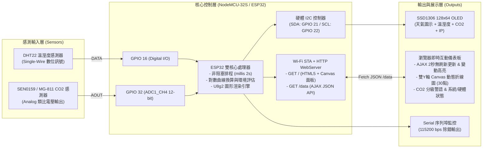

# NodeMCU-32S 智慧環境監測系統 (`1117-1.ino`) 完整技術手冊與程式架構說明

> **最後更新時間**: 2026-11-17 16:11:01 (UTC+8)
> **使用模型**: 正文原作者未標註（使用者手動新增）；Metadata 與 Prompt Archive 由 Claude Opus 5.5 補上
> **執行 Agent**: 正文：未知；Metadata／Prompt Archive：Claude Code

本文件針對 `1117-1.ino` 進行完整的系統架構解析，涵蓋 **系統硬體架構、各元件工作原理、完整程式碼逐段解說、實務注意事項（硬體/韌體排錯）** 以及 **未來改善方向與延伸應用**。

---

## 1. 系統整體架構與功能總覽

本系統以 **NodeMCU-32S (ESP32)** 為核心控制器，整合 **DHT22 數位溫溼度感測器**、**DFRobot SEN0159 (MG-811) 類比二氧化碳感測器** 與 **SSD1306 128x64 I2C OLED 顯示器**，並透過內建 Wi-Fi 模組連線至無線基地台（`SSID: ite-eng`），由 DHCP 取得 IP 後架設 **HTTP WebServer (Port 80)**。

在最新版的 `1117-1.ino` 中，WebServer 全面升級為 **前後端分離式 AJAX 架構**：提供 `/` 主頁面與 `/data` JSON API 端點，支援**每 2 秒無刷新（No-Refresh）即時數據同步、感測數值變化脈衝高亮提示**，以及**零外部 CDN 依賴的原生 HTML5 Canvas 雙 Y 軸動態歷史折線圖**（溫度/溼度雙軸圖、CO2 濃度/電壓雙軸圖）。

### 1.1 系統架構圖 (Mermaid)



### 1.2 硬體腳位配置表 (Pinout Mapping)

| 模組名稱 | 模組腳位 | NodeMCU-32S 腳位 | 訊號類型與介面說明 |
| :--- | :--- | :--- | :--- |
| **DHT22 溫溼度感測器** | `VCC` / `GND` | `3.3V` / `GND` | 建議工作電壓 3.3V ~ 5V |
| | `DATA` | **`GPIO 16`** | 單匯流排 (Single-bus) 數位訊號 |
| **SEN0159 CO2 感測器** | `VCC` / `GND` | `5V (VIN)` / `GND` | 內建加熱器需較大電流，建議接 `5V (VIN)` |
| | `AOUT` | **`GPIO 32`** | 類比電壓輸出，連接 ESP32 **`ADC1_CH4`** |
| **SSD1306 OLED (128x64)** | `VCC` / `GND` | `3.3V` / `GND` | I2C 介面，預設位址通常為 `0x3C` |
| | `SCL` | **`GPIO 22`** | ESP32 預設硬體 I2C 時脈腳位 (`Wire` SCL) |
| | `SDA` | **`GPIO 21`** | ESP32 預設硬體 I2C 資料腳位 (`Wire` SDA) |

---

## 2. 各個元件的工作原理

### 2.1 NodeMCU-32S (ESP32-WROOM-32) 微控制器
* **雙核心架構**：採用 Xtensa® 32-bit LX6 雙核心處理器，時脈高達 240 MHz，內建 520 KB SRAM 與 4 MB Flash，可同時負擔 Wi-Fi TCP/IP 協定堆疊與感測器、OLED 繪圖工作。
* **ADC1 與 ADC2 的硬體差異**：
  * ESP32 內建兩個 12-bit SAR ADC（`ADC1` 與 `ADC2`），解析度為 $2^{12} = 4096$ 階（`0 ~ 4095` 對應 `0V ~ 3.3V`）。
  * **關鍵原理**：當 ESP32 啟用 Wi-Fi 功能時，硬體底層的射頻電路會佔用 `ADC2` 控制器，導致所有屬於 `ADC2` 的腳位（如 GPIO 0, 2, 4, 12~15, 25~27）無法正常執行 `analogRead()`。
  * 因此本程式特別選用 **`GPIO 32` (`ADC1_CH4`)** 連接 SEN0159，確保在開啟 Wi-Fi WebServer 的同時，仍能穩定擷取類比電壓。

### 2.2 DHT22 (AM2302) 溫溼度感測器
* **感測原理**：
  * **溼度**：採用電容式高分子溼敏元件（Capacitive Humidity Sensor），環境水氣吸附於高分子介電層時會改變電容值。
  * **溫度**：採用高精度 NTC 熱敏電阻（Negative Temperature Coefficient Thermistor），電阻值隨溫度升高而呈指數下降。
* **通訊協定 (Single-Wire 單匯流排)**：
  * 內部整合一顆 8-bit 微控制器負責將電容與電阻轉換為數位數值。
  * 每次通訊由 MCU 拉低 DATA 腳位至少 1~18ms 作為起始訊號，DHT22 隨後回傳 **40 bits** 資料：`16-bit 溼度整數與小數` + `16-bit 溫度整數與小數` + `8-bit Checksum 校驗和`。
  * 由於高分子電容充放電與感測響應需要時間，DHT22 的**最小取樣週期為 2 秒（0.5 Hz）**。

### 2.3 DFRobot SEN0159 (MG-811) 二氧化碳感測器深入剖析

DFRobot **SEN0159** 是以 **MG-811 固態電解質（Solid Electrolyte）$\text{CO}_2$ 氣體感測探頭**為核心的類比感測模組（量測範圍 `400 ~ 10000 ppm`）。以下從**電化學結構、電極反應、能斯特熱力學方程式、模組硬體調理電路**到**軟體對數曲線推導**進行完整說明：

#### (1) 固態電化學濃差電池結構 (Solid-State Concentration Cell)
MG-811 內部相當於一顆需要高溫激發的**電化學濃差電池（Potentiometric Gas Sensor）**，其電池結構表示式為：
$$\text{Air, Au (參考電極)} \;\big|\; \text{NASICON (固態電解質)} \;\big|\; \text{Carbonate 碳酸鹽輔助相 (}\text{Li}_2\text{CO}_3\text{-BaCO}_3\text{)} \;\big|\; \text{Au, Air, CO}_2\text{ (感測電極)}$$

* **NASICON 固態電解質層**：全名為 *Natrium Super Ionic Conductor*（鈉超離子導體，化學式主要為 $\text{Na}_3\text{Zr}_2\text{Si}_2\text{PO}_{12}$），在加熱至工作溫度時允許鈉離子（$\text{Na}^+$）在晶格間自由遷移導電。
* **碳酸鹽輔助層（Auxiliary Phase）**：感測電極（金電極 Au）表面塗覆一層碳酸鹽（主要為碳酸鋰 $\text{Li}_2\text{CO}_3$ 與碳酸鋇 $\text{BaCO}_3$），能特異性地與環境空氣中的 $\text{CO}_2$ 及 $\text{O}_2$ 產生可逆化學平衡。

#### (2) 陰極與陽極電化學反應方程式
當感測器處於加熱工作狀態並接觸空氣中的二氧化碳與氧氣時，兩極發生以下電化學反應：
* **陰極反應（Cathode / 感測電極）**：
  $$2\text{Li}^+ + \text{CO}_2 + \frac{1}{2}\text{O}_2 + 2e^- \rightleftharpoons \text{Li}_2\text{CO}_3$$
* **陽極反應（Anode / 參考電極）**：
  $$2\text{Na}^+ + \frac{1}{2}\text{O}_2 + 2e^- \rightleftharpoons \text{Na}_2\text{O}$$
* **電池總反應（Overall Cell Reaction）**：
  $$\text{Li}_2\text{CO}_3 + 2\text{Na}^+ \rightleftharpoons \text{Na}_2\text{O} + 2\text{Li}^+ + \text{CO}_2$$

#### (3) 能斯特方程式 (Nernst Equation) 與電動勢特性
由於兩極之間的離子活度隨環境中二氧化碳分壓 $P_{\text{CO}_2}$ 改變，根據熱力學**能斯特方程式 (Nernst Equation)**，MG-811 兩端產生的電動勢（$\text{EMF}$，即探頭原始輸出電壓）為：
$$\text{EMF} = E_c - \frac{R \cdot T}{2F} \ln\left(P_{\text{CO}_2}\right)$$

* **$\text{EMF}$**：MG-811 探頭輸出的原始電動勢（於 `400 ppm` 潔淨空氣中約為 `220 mV ~ 350 mV`）。
* **$E_c$**：電池標準電位常數。
* **$R$**：理想氣體常數（$8.314\text{ J/(mol}\cdot\text{K)}$）。
* **$T$**：感測器絕對溫度（$\text{K}$）。注意 $T$ 出現在分子中，這解釋了**為什麼感測器必須維持恆溫加熱**，否則環境溫度波動會直接改變斜率！
* **$F$**：法拉第常數（$96485\text{ C/mol}$）；分母的 $2$ 代表每次反應轉移 $2$ 個電子（$2e^-$）。
* **$P_{\text{CO}_2}$**：空氣中二氧化碳的分壓（正比於 $\text{ppm}$ 濃度）。
* **反比特性**：公式中對數項前方為**負號（$-$）**，因此 **$\text{CO}_2$ 濃度越高，感測器輸出的電動勢 $\text{EMF}$ 越低**！當 $\text{CO}_2$ 從 `400 ppm` 升高至 `1000 ppm` 時，探頭原始電壓約下降 `30 mV ~ 50 mV`。

#### (4) SEN0159 模組板載三大硬體電路設計
單獨一顆 MG-811 探頭無法直接接上 Arduino / ESP32 使用，DFRobot SEN0159 底板整合了三個關鍵硬體電路：
1. **5V 升 6V 加熱器升壓電路 (Onboard Step-Up Boost Heater Circuit)**
   * NASICON 固態電解質在室溫下幾乎不導電，必須加熱至約 $200^\circ\text{C} \sim 300^\circ\text{C}$ 才能激發足夠的 $\text{Na}^+$ 離子遷移率。
   * MG-811 原廠規格要求：**加熱電壓 $V_H = 6.0 \pm 0.1\text{ V}$**、加熱電阻 $R_H \approx 30.0\,\Omega$、加熱電流 $I_H \approx 200\text{ mA}$、加熱功率 $P_H \approx 1200\text{ mW}$ (1.2W)。
   * SEN0159 內建 **DC-DC Boost 升壓轉換器**，將外部輸入的 `5V` 自動升壓為精準的 `6.0V` 供給探頭內部的鎳鉻加熱線圈（因此正常運作時感測器金屬網罩會明顯發熱）。
2. **超高輸入阻抗緩衝與 `DC_GAIN = 8.5` 運算放大電路**
   * MG-811 固態電化學電池的內阻極高，原廠規範量測電路的**輸入阻抗必須達 $100 \sim 1000\text{ G}\Omega$**（輸入漏電流須小於 $1\text{ pA}$）。若直接連接一般微控制器 ADC，微小的漏電流就會使電極極化、導致電壓瞬間崩跌。
   * SEN0159 採用超高輸入阻抗運算放大器（如 CA3140 / LMC6001 等級）作為第一級緩衝，並設定 **`DC_GAIN = 8.5` 倍**的直流同相放大，將探頭原本僅 `0.22V` 左右的微弱訊號放大至約 `1.87V`（$0.22\text{ V} \times 8.5 = 1.87\text{ V}$），使 ESP32 的 12-bit ADC 能以高解析度讀取。
3. **板載比較器與門檻微調電位器**
   * 模組上配有一顆藍色精密電位器與比較器電路，可調整硬體警報閾值。

#### (5) 軟體對數線性近似公式 (`CO2Curve`) 完整數學推導
在 `1117-1.ino` 中，為了在微控制器上快速由電壓反推 $\text{CO}_2$ 濃度，將能斯特方程式在半對數座標（X 軸為 $X = \log_{10}(\text{ppm})$，Y 軸為探頭原始電動勢 $Y = \frac{V_{\text{ADC}}}{8.5}$）上近似為一條直線 $Y - Y_0 = m(X - X_0)$：
* **基準點 1（潔淨空氣 400 ppm）**：
  * $X_0 = \log_{10}(400) \approx 2.602$
  * $Y_0 = \text{ZERO\_POINT\_VOLTAGE} = 0.220\text{ V}$
* **參考點 2（高濃度 10000 ppm）**：
  * $X_1 = \log_{10}(10000) = 4.0$
  * 電壓降 $\Delta Y = -\text{REACTION\_VOLTGAE} = -0.030\text{ V}$
* **直線斜率 $m$ (`CO2Curve[2]`)**：
  $$m = \frac{\text{REACTION\_VOLTGAE}}{2.602 - 4.0} = \frac{0.030}{-1.398} \approx -0.02146\text{ V/decade}$$
* **由 ADC 電壓 $V_{\text{ADC}}$ 反推 $\text{ppm}$ (`MGGetPercentage`)**：
  1. 先除以硬體放大倍率還原探頭電動勢：$Y = \frac{V_{\text{ADC}}}{\text{DC\_GAIN}} = \frac{V_{\text{ADC}}}{8.5}$
  2. 代入直線公式求對數濃度：$X = \log_{10}(\text{ppm}) = \frac{Y - Y_0}{m} + X_0$
  3. 取 10 的次方還原為 $\text{ppm}$：
     $$\text{ppm} = 10^{\left( \frac{(V_{\text{ADC}} / 8.5) - 0.220}{-0.02146} + 2.602 \right)}$$

### 2.4 SSD1306 128x64 I2C OLED 顯示器與 U8g2 圖形庫
* **OLED 自發光原理**：有機發光二極體（Organic Light-Emitting Diode）每個像素獨立自發光，無需背光模組，黑色像素完全不耗電，具備高對比度與廣視角特性。
* **SSD1306 GDDRAM 結構**：內建 $128 \times 64$ bits 顯示記憶體（GDDRAM），切分為 **8 個 Page（Page 0 ~ Page 7）**，每個 Page 高度為 8 pixels、寬度為 128 columns。
* **U8g2 Page Buffer (`_1_HW_I2C`) 運作機制**：
  * 宣告 `U8G2_SSD1306_128X64_NONAME_1_HW_I2C` 中的 `_1_` 代表在 MCU RAM 中僅配置 **1 個 Page（128 Bytes）** 的緩衝區。
  * 透過 `u8g2.firstPage()` 與 `do { ... } while (u8g2.nextPage());` 迴圈，U8g2 會將繪圖指令重複執行 8 次，每次僅將對應 Page 的像素寫入緩衝區並透過硬體 I2C 傳送至 SSD1306，大幅節省 RAM 空間。

---

## 3. 程式碼詳細解說 (`1117-1.ino`)

### 3.1 函式庫引入與全域設定 (Lines 14-66)
* **`<WiFi.h>` 與 `<WebServer.h>`**：ESP32 官方 Arduino Core 內建的無線網路與輕量級 HTTP 伺服器函式庫，監聽標準 HTTP `Port 80`。
* **`<U8g2lib.h>` 與 `<Wire.h>`**：驅動 SSD1306 硬體 I2C 顯示器，支援 UTF-8 字元（如 `°C`）與向量字型圖示。
* **`<Adafruit_Sensor.h>`、`<DHT.h>`、`<DHT_U.h>`**：採用 Adafruit Unified Sensor 統一感測器介面（`DHT_Unified`），可使用標準化的 `sensors_event_t` 結構讀取感測資料與硬體規格。

### 3.2 SEN0159 CO2 讀取與警語分級函式 (Lines 68-124)
1. **`MGRead(int mg_pin)` (Lines 70-79)**：
   ```cpp
   float MGRead(int mg_pin) {
     float v = 0.0;
     for (int i = 0; i < READ_SAMPLE_TIMES; i++) {
       v += analogRead(mg_pin);
       delay(READ_SAMPLE_INTERVAL);
     }
     v = (v / READ_SAMPLE_TIMES) * 3.3 / 4095.0;
     return v;
   }
   ```
   * 連續取樣 `5` 次（每次間隔 `10 ms`）進行**移動平均濾波 (Moving Average)**，抑制加熱器電源雜訊與 ESP32 ADC 的非線性抖動。
   * 將 12-bit 平均值乘以 `3.3 / 4095.0` 轉換為實際伏特（V）。
2. **`MGGetPercentage(float volts, float *pcurve)` (Lines 82-93)**：
   * 若 `(volts / DC_GAIN) >= ZERO_POINT_VOLTAGE`，代表電壓高於 400 ppm 基準點（即目前空氣 $\text{CO}_2$ 濃度低於 400 ppm，或感測器尚未預熱完畢），回傳 `-1`。
   * 否則套用對數反函數 `pow(10, ...)` 計算實際 `ppm`，並設定上限保護（`10000 ppm`），避免腳位浮接（0V）時發生浮點數溢位。
3. **`getCO2Warning(...)` (Lines 96-124)**：
   * 依據室內空氣品質標準（IAQ），將 $\text{CO}_2$ 濃度分為 5 個等級（`<400`、`400~800`、`801~1000`、`1001~2000`、`>2000 ppm`），動態回傳對應的標題 (`levelTitle`)、警語字串 (`warningMsg`) 與網頁 CSS 色碼（`badgeColor` 與 `bgColor`，對應綠、藍、黃、橘、紅五色）。

### 3.3 OLED 畫面規劃與動態圖示選擇 (Lines 126-271)
1. **`drawWeatherSymbol()` (Lines 128-153)**：
   * 使用 U8g2 內建的 `u8g2_font_open_iconic_weather_6x_t` 與 `u8g2_font_open_iconic_embedded_6x_t` 字型，在左側 `(0, 48)` 繪製 `48x48` 像素的高解析度圖示（太陽 `69`、晴時多雲 `65`、雲朵 `64`、雨滴 `67`、閃電 `67`）。
2. **`selectWeatherSymbol()` (Lines 156-192) & `getSymbolEmoji()` (Lines 288-298)**：
   * 優先檢查 `isnan(temp) || isnan(hum)`，若感測器異常則顯示 `CLOUD` 與錯誤提示。
   * 根據溫溼度複合條件決定 OLED 圖示與網頁對應 Emoji：
     * `T >= 28°C && H >= 75%` $\rightarrow$ `THUNDER` (`⛈️` 悶熱潮濕)
     * `H >= 75%` $\rightarrow$ `RAIN` (`🌧️` 環境潮濕)
     * `T >= 28°C` $\rightarrow$ `SUN` (`☀️` 炎熱晴朗)
     * `20°C <= T < 28°C && 40% <= H < 75%` $\rightarrow$ `SUN_CLOUD` (`⛅` 舒適宜人)
     * 其他（`< 20°C` 或 `< 40%`） $\rightarrow$ `CLOUD` (`☁️` 微涼或乾燥)
3. **`drawEnvDashboard()` 128x64 畫面版面配置 (Lines 214-271)**：
   * **左半部 (`x: 0~47, y: 0~48`)**：48x48 環境狀態圖示。
   * **右半部 (`x: 52~127, y: 0~48`)**：
     * 第 1 行 (`y=15`, `helvB12`)：溫度 `T: 26.5°C`
     * 第 2 行 (`y=33`, `helvB12`)：溼度 `H: 62.0%`
     * 第 3 行 (`y=46`, `6x10`)：二氧化碳 `CO2:<400ppm` 或 `CO2:850ppm`
   * **分隔線 (`y=50`)**：`u8g2.drawHLine(0, 50, 128)` 將感測區與網路狀態區隔開。
   * **底部狀態列 (`x: 0~127, y: 62`, `6x12`)**：固定顯示 DHCP 取得的 IP（例如 `IP:192.168.1.105`），方便使用者隨時查看並輸入至瀏覽器。

### 3.4 AJAX JSON 資料端點 (`handleData()`, Lines 300-341)
為了實現網頁**無刷新（No-Refresh）即時更新**，程式在 `setup()` 中註冊了 `server.on("/data", handleData);`：
* 當前端 JavaScript 每 2 秒發送 `fetch('/data')` 請求時，`handleData()` 會將最新的感測與系統資訊封裝為標準 JSON 格式回傳：
  ```json
  {
    "tempValid": true, "temp": 26.5, "tempStr": "26.5",
    "humValid": true, "hum": 62.0, "humStr": "62.0",
    "iconEmoji": "⛅", "webStatus": "舒適宜人 (溫溼度適中)",
    "co2ppm": -1, "co2ChartVal": 400, "co2Display": "< 400",
    "co2Volts": 2.154, "co2VoltsStr": "2.154",
    "co2LevelTitle": "空氣清新 (< 400 ppm)",
    "co2WarningMsg": "✅ 空氣品質極佳...",
    "co2BadgeColor": "#16a34a", "co2BgColor": "#f0fdf4",
    "uptime": "0 天 00 小時 12 分 34 秒",
    "rssi": "-58 dBm",
    "freeHeap": "215.4 KB / 320.0 KB", "minFreeHeap": "198.2 KB"
  }
  ```
* 同時加上 HTTP Header `Cache-Control: no-cache, no-store, must-revalidate`，確保瀏覽器不會快取舊的感測數值。

### 3.5 WebServer 即時互動儀表板與 HTML5 Canvas 折線圖 (`handleRoot()`, Lines 343-621)
主頁面 `handleRoot()` 不再使用傳統會造成畫面閃爍的 `<meta http-equiv='refresh'>`，而是結合 **DOM 局部更新、CSS 動畫與原生 HTML5 Canvas 雙軸繪圖引擎**：

1. **AJAX 即時連線狀態與數值變化高亮提示 (`fetchSensorData()`, Lines 554-613)**：
   * 前端透過 `setInterval(fetchSensorData, 2000)` 每 2 秒向 `/data` 拉取最新 JSON。
   * **數值變化偵測 (`prevData` 比對)**：當偵測到 `溫度`、`溼度`、`CO2濃度` 或 `CO2電壓` 與前一次數值不同時：
     * 立即對該數值方塊呼叫 `pulseBox()`，觸發 `@keyframes valPulse` 黃色脈衝放大動畫（0.7 秒），讓使用者一眼看出哪一項感測數值剛發生變動。
     * 頂部狀態列 `#changeNotice` 會同步顯示：`⚡ 感應數值變化 (溫度、CO2電壓) @ 15:38:20`。
   * **斷線自動偵測**：若 ESP32 暫時失去連線，`catch (err)` 會將頂部綠色連線燈號切換為紅色 `連線中斷，重試中...`，待連線恢復後自動轉回綠色。

2. **零外部 CDN 依賴之原生 HTML5 Canvas 雙 Y 軸動態折線圖 (`drawDualChart()`, Lines 474-553)**：
   * **設計考量（支援封閉內網）**：若使用外部 Chart.js CDN，當無線基地台（如教室實驗網路）無對外連網時圖表將無法顯示。因此本程式直接以原生 HTML5 `<canvas>` 2D API 實作雙 Y 軸折線圖引擎，**100% 離線可用**。
   * **雙軸獨立自動縮放 (Dual-Axis Auto-Scaling)**：
     * **圖表 1 (`#tempHumChart`)**：左 Y 軸為**溫度 (`°C`，紅色 `#ef4444`)**，右 Y 軸為**溼度 (`%`，藍色 `#0284c7`)**。
     * **圖表 2 (`#co2Chart`)**：左 Y 軸為 **CO2 濃度 (`ppm`，綠色 `#16a34a`)**，右 Y 軸為 **GPIO 32 輸出電壓 (`V`，紫色 `#9333ea`)**。
   * **高解析度與滑動視窗**：支援 `window.devicePixelRatio` 高 DPI 螢幕清晰渲染，保留最近 `MAX_POINTS = 30` 筆時間序列資料（約 1 分鐘即時趨勢），並在最新數據點上方直接標註數值。

### 3.6 非阻塞式感測更新與主迴圈 (`updateSensorData()` & `loop()`, Lines 623-735)
* **為什麼不使用 `delay(2000)` 阻塞 `loop()`？**
  * 若在 `loop()` 中使用 `delay(2000)`，ESP32 在這 2 秒內將無法執行 `server.handleClient()`，導致前端每 2 秒發送的 `/data` AJAX 請求嚴重卡頓甚至逾時。
  * 本程式採用 **`millis()` 時間差檢查**：`loop()` 每毫秒高速呼叫 `server.handleClient()` 確保 `/` 與 `/data` 請求在數毫秒內即時回應；只有當 `millis() - lastReadTime >= delayMS`（2000ms）成立時，才讀取一次感測器並更新 OLED。

---

## 4. 實務注意事項 (Troubleshooting & Precautions)

1. **SEN0159 (MG-811) 預熱與校準特性（最重要！）**
   * MG-811 為加熱型電化學感測器，剛上電時內部加熱線圈尚未達到工作溫度，輸出電壓會偏高或劇烈漂移，此時 `(volts / DC_GAIN) >= ZERO_POINT_VOLTAGE` 為正常現象，程式會安全顯示 `< 400 ppm`（圖表則以基準值 `400 ppm` 繪製，同時可觀察紫色電壓曲線的預熱穩定過程）。
   * **校準方式**：首次使用建議在通風良好的室外或潔淨空氣（約 400 ppm）下連續通電預熱至少 2 小時（官方建議完整老化為 48 小時），查看網頁上顯示的 **「感測器輸出電壓 (GPIO 32)」**，將該穩定電壓值除以 `8.5` 後填入 `#define ZERO_POINT_VOLTAGE` 即可完成精準校準。
2. **電源供應注意事項**
   * SEN0159 內部加熱器工作電流約需 `150~200 mA`，建議將 SEN0159 的 `VCC` 接在 NodeMCU-32S 的 **`5V (VIN)`** 腳位（由 USB 直接供電），避免接在 `3.3V` 腳位造成 LDO 穩壓器壓降過大或影響 ESP32 Wi-Fi 發射時的供電穩定度。
3. **ESP32 ADC 電壓範圍與分壓保護**
   * ESP32 GPIO 腳位最高耐壓為 `3.3V`（ADC 量測上限亦為 `3.3V`）。SEN0159 在正常空氣下的輸出電壓約在 `1.5V ~ 2.8V` 之間，可直接接入 `GPIO 32`；若感測器模組在極端情況下輸出超過 `3.3V`，可於輸出端串聯分壓電阻以保護腳位。
4. **DHT22 接線與上拉電阻**
   * 若使用裸裝 4 腳位 DHT22，請在 `VCC` 與 `DATA (GPIO 16)` 之間加上一顆 `4.7kΩ ~ 10kΩ` 的上拉電阻；若使用 3 腳位模組版則板上已內建上拉電阻。

---

## 5. 系統改善方向與延伸應用

### 5.1 軟體與韌體進階改善建議
1. **歷史數據本地持久化儲存 (`LittleFS` / `SPIFFS` Ring Buffer)**
   * 目前網頁的 30 筆歷史折線圖儲存在瀏覽器記憶體中（重新整理網頁後從頭累積）。可在 ESP32 端建立環狀緩衝區（Ring Buffer）或寫入 Flash 檔案系統（`LittleFS`），讓 `/data` 或 `/history` 端點直接回傳過去 1 小時的歷史資料，即使重新打開網頁也能立即看到完整歷史曲線。
2. **Wi-Fi 自動重連與 mDNS 網域名稱 (`ESPmDNS`)**
   * 加入 `MDNS.begin("env-monitor")`，使用者無需查看 OLED 上的 IP，直接在瀏覽器輸入 `http://env-monitor.local` 即可連線。
   * 加入 `WiFi.setAutoReconnect(true)`，當基地台重啟時自動恢復連線。
3. **引入溫溼度補償與 NDIR 數位感測器升級**
   * MG-811 電化學感測器易受環境溫溼度影響，可利用 DHT22 測得的溫溼度對 `ZERO_POINT_VOLTAGE` 進行軟體溫度補償；若需免預熱、高精度的商業應用，可將感測器升級為 **NDIR 非分散式紅外線 $\text{CO}_2$ 感測器**（如 MH-Z19B 或 Sensirion SCD30/SCD40）。

### 5.2 實務延伸應用場景
1. **智慧教室與會議室通風控制系統**
   * 當 $\text{CO}_2 > 1000\text{ ppm}$ 或溫溼度達到 `THUNDER`（悶熱潮濕）時，透過 GPIO 觸發繼電器（Relay）自動開啟新風機、全熱交換器或排風扇，並搭配蜂鳴器與 RGB LED 燈條發出視覺/聽覺提醒。
2. **智慧農業溫室與菇類栽培監控**
   * 溫室作物與蕈菇類對溫溼度及二氧化碳濃度極為敏感，可透過 MQTT 協定將資料上傳至 **Node-RED / Home Assistant / ThingSpeak / InfluxDB**，進行全天候雲端紀錄與自動化環控。
3. **LINE Messaging API / Telegram / Discord 即時推播警報**
   * 當 $\text{CO}_2$ 超過 `1500 ppm` 或溫度異常升高時，由 ESP32 透過 HTTPS API 主動發送手機推播通知管理人員。

---

## 📝 提示詞歷史與變更記錄 (Prompt Archive)

### 🔹 [2026-11-17 15:42] [未知 / 使用者手動新增] 建立筆記
- **模型/Agent**: 未知（檔案由使用者手動放入 `ec/1117-1/`，未標註撰寫模型）
- **Prompt 原文**:
  ```text
  （原始提示詞未提供）
  ```
- **變更摘要**: 建立 `note-1117.md`／`note-1117.html`，解說 `1117-1.ino`（NodeMCU-32S + DHT22 + SEN0159 CO2 + SSD1306 OLED + Wi-Fi AJAX WebServer）的系統架構、元件原理、程式碼、排錯與延伸應用。時間取自檔案修改時間。

### 🔹 [2026-11-17 16:11:01] [Claude Opus 5.5 / Claude Code] 補上 Metadata 與 Prompt Archive
- **模型/Agent**: Claude Opus 5.5 / Claude Code
- **Prompt 原文**:
  ```text
  好，幫筆記補上 metadata 和 Prompt Archive
  ```
- **變更摘要**: 在 MD 與 HTML 標題下方加入 Metadata，並於文末建立 Prompt Archive 區塊；正文內容未修改。
