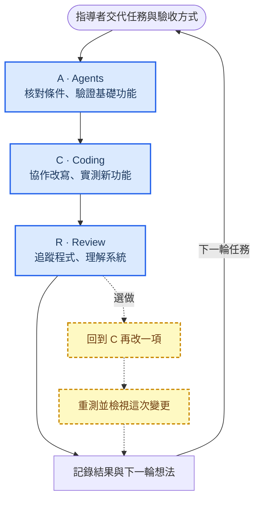
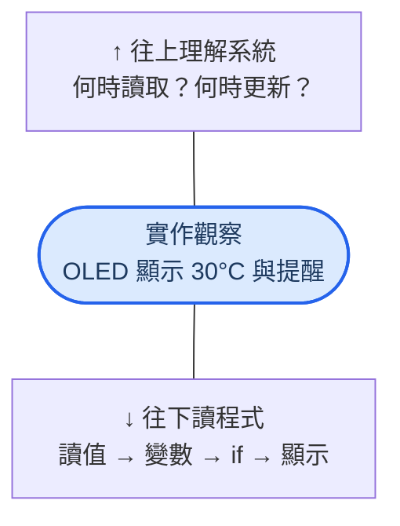

<!-- Path: 教材庫/NodeMcu32s/Agents_Code_Review | Timestamp: 2026-11-18 22:52:40 | Version: b02 | Model: GPT-6.2-sol -->
# NodeMCU-32S × Agent：從實作出發的 ACR 學習模式

_給已看過 Agent 改寫程式示範的初學者，以及帶領實作的指導者。_

---

## 🎯 1. 先跑一次 OLED 溫度顯示

先執行指導者提供的基礎程式，觀察 OLED 上的溫度與序列監控視窗的讀值。這一輪要在既有的溫度顯示上加入提醒，讓 OLED 在溫度**大於或等於 30°C** 時顯示提醒文字。30°C 是這次練習自訂的門檻。

做出結果後，從同一個畫面往兩個方向追問。**往下**看資料如何經過變數、函式與判斷式。**往上**看感測器、程式庫、控制板和 OLED 如何配合，以及這樣的顯示在使用上有什麼限制。指導者提供可運作的起點與任務，學生用實測和讀程式回答問題。

## 📋 2. 每輪怎麼走 ACR

指導者在每輪開始前交代本輪任務，並在 A、C、R 各示範一次首問。圖中的**實線**是每輪的 A → C → R 主線。完成 R 並留下學習紀錄，就完成本輪。**虛線**是有明確改善目標、有時間時才做的改寫，做完後重測與檢視本次變更。下一項任務仍從 A 開始，先確認可沿用的條件。



### 指導者先說清楚 Agent 要做哪一件事

請指導者在學生開啟 Agent 前，提供一份可直接操作的任務。學生需要知道手上有哪些資料、**交給 Agent 做什麼**、Agent 應交回什麼，以及要用什麼證據確認。第一輪可提供完整首問，讓學生照著填入自己的接線、程式版本與實測結果。下一輪可讓學生先擬問題，再由指導者檢查範圍與驗收方式。

| 階段 | 指導者如何引導 | 學生要拿出的證據 |
| --- | --- | --- |
| **A｜建立可用的基礎** | 提供板型、接線、範例與已知輸出。示範請 Agent 對照資料，回傳待核對項目與單一元件測試方法。 | 接線與程式版本、序列或 OLED 的基本測試結果。 |
| **C｜協作完成一項功能** | 給一項可驗收的需求，指明可改範圍與原功能。示範請 Agent 以基礎程式改寫，交回程式、變更摘要與測試方式。 | 修改前版本、修改後版本、一筆預期與實測的對照。 |
| **R｜從結果理解程式與系統** | 各給一個往下、往上的問題。示範請 Agent 指出實際程式位置與待查證事項，先給提示，等學生解釋後再補充。 | 指認一段程式，說明一筆資料怎麼到畫面，提出一個可驗證的問題或改善想法。 |

## 🛠️ 3. 跟著一個功能做完本輪

### A｜Agents：先驗證起點

指導者先示範核對板型、接線和程式版本，再請學生重現基礎輸出。首次接線或更換元件時，先用型號查晶片與規格，核對供電、介面與腳位，斷電接線。在 Arduino IDE 確認板卡支援、程式庫、相依套件與對應範例。先讓感測器在序列監控視窗輸出讀值，再用 OLED 範例顯示固定文字，兩項測試各自通過後再整合。若沿用同一個配置，重現已知輸出並核對條件即可。

**指導者提供的首問範例**

```transcript
這是老師提供的板型、接線、已安裝的程式庫版本與兩個基本範例：[附上資料]。
請對照範例與這份接線，列出我需要核對的設定和資料中缺少的資訊。
請分別告訴我感測器和 OLED 要怎麼各自測試，以及通過時應該看到什麼。
我會核對實體接線並回報測試結果。
```

**完成標準**　學生能重現起點，指出目前哪些條件已驗證，並保存基礎程式與輸出。

### C｜Coding：請 Agent 協助做出第一版

先把需求寫成操作時看得見的結果。這次請 Agent 加入 OLED 溫度提醒，保留原本的溫度顯示與序列輸出。指導者指定基礎版本與修改範圍，學生把目前設定和已知正常的輸出交給 Agent。

**指導者提供的首問範例**

```transcript
以這份已在 NodeMCU-32S 運作的程式為起點：[附程式與硬體資料]。
這次只加入 OLED 提醒。有效溫度大於或等於 30°C 時顯示提醒，低於 30°C 時不顯示。
保留原本的溫度和序列輸出，以及現有接線和程式庫設定。
請交回可編譯的程式、修改的函式或程式位置，以及一種可還原的固定輸入測試方式。
請標記尚未確認的假設。我會先檢查變更，再上傳和實測。
```

學生先對 29、30、31°C 寫下預測，再用固定輸入測試，並把實際結果記在旁邊。下表可由指導者在測試後提供，供學生核對判斷。固定輸入檢查的是判斷與顯示。測完後要恢復感測器讀值，確認實際讀取和原有輸出仍正常。

| 固定輸入 | 初版提醒的預期結果 |
| --- | --- |
| 29°C | 關閉 |
| 30°C | 開啟 |
| 31°C | 開啟 |

**完成標準**　學生核對程式差異、編譯與上傳，並在實機上驗證新舊功能。若結果不符，先記下操作、預期、實際結果和錯誤訊息，再請 Agent 依證據修正。每次保存可回復的上一版。

### R｜Review：從畫面追問程式與系統

先重看一個測試結果，例如輸入 30°C 時 OLED 顯示了什麼。學生先指出可能相關的程式位置，和同學說一次自己的解釋，再請 Agent 給定位提示。將 Agent 的說明對照回程式與觀察紀錄。指導者可依時間，從下列兩個方向各挑一題。



| 探索方向 | 指導者可選的問題 | 學生如何查證 |
| --- | --- | --- |
| **往下｜結構、資料流與語法** | 30°C 是哪裡取得的，由哪個變數傳到判斷與顯示？`if` 裡的 `>=` 怎麼處理剛好等於門檻的情況？ | 對照初始化與持續更新的位置，指出本輪實際用到的函式與變數，拿一筆測試結果說明。 |
| **往上｜軟硬體、限制與應用** | 程式庫處理了哪部分？若下一次讀取失敗，OLED 上的 30°C 代表什麼？放在教室時，使用者如何知道資料是不是最新的？ | 先看程式有沒有處理讀取失敗，提出一種可還原的測試，再依程式和測試證據區分已知與待查證的行為。 |

**指導者提供的首問範例**

```transcript
我在 30°C 時看到 OLED 顯示提醒。我的解釋是：[先寫一句自己的解釋]。
往下，請先指出我應該查的函式和條件，等我追蹤完再補充。
往上，請幫我找是否有處理感測器讀取失敗的程式。請標出哪些行為還需要測試。
如果你發現值得改善的地方，請先給我一項建議和驗收方式，等我選定後再討論改寫。
```

**完成標準**　學生能用自己的話解釋一筆資料、一個關鍵判斷與一項軟硬體行為，並記下一個疑問或改善想法。讀到看不懂的地方，先把疑問說清楚，例如「哪個函式把這個數字送到 OLED？」

## 🔁 4. 選做｜把一項 Review 發現帶回 Coding

主線做完後，指導者視時間與學習目標開放這一段。學生也可以直接記下發現，帶到下一輪。若選做，由學生挑出一個想改的行為，指導者核對範圍和驗收方式，再由學生請 Agent 協作。

1. **用 Review 的發現界定改動。**例如學生在 Review 發現 `>=` 把剛好等於門檻的情況也納入提醒。如果使用者希望把 30°C 視為可接受的上限，就可以把需求定為「只有超過 30°C 才提醒」，並聚焦這一個判斷。
2. **先預測，再委託改寫。**學生先寫下 29、30、31°C 哪一筆預期會改變。請 Agent 從上一個成功版本做最小修改，列出前後差異，保留原有的讀取和顯示方式。
3. **用同一組資料重測。**沿用相同測試輸入，核對改動那一筆和其餘兩筆，再檢查原功能。學生用自己的話解釋為何這個結果符合新需求，留下新版本和證據。若同時涉及新元件或接線，帶到下一輪 A，先重新驗證起點。

**學生選定目標後，可使用這個提示詞**

```transcript
Review 後我確認目前的提醒條件包含剛好 30°C。
新需求是只有大於 30°C 時才提醒。我的預測是：[先填預測]。
請以我附上的成功版本為基礎，只改提醒條件，指出前後差異。
保留原本的讀取、顯示與接線設定。請告訴我如何用同一組測試值重測。
```

## 🔍 5. 卡住時回到有證據的地方

| 遇到的情況 | 下一步 |
| --- | --- |
| 元件沒有反應 | 回到 A，核對規格、接線與環境，重跑單一元件的基本範例。 |
| 新功能未通過，或原功能失效 | 留在 C，重跑上一個成功版本，縮小差異，再回報實際輸出。 |
| 能運作，但讀不懂 Review | 從一筆看得見的輸出開始，請 Agent 只給下一個程式位置。 |
| Agent 的解釋和觀察不同 | 核對程式版本、硬體條件與假設，拿同一筆輸出和對應程式再比對。 |
| 想同時增加多項功能 | 和指導者選一件有明確成功條件的工作，其餘記入下一輪想法。 |

## 📝 6. 每輪留下學習證據

指導者可用下面三項紀錄快速確認本輪學習，學生可以用短句、程式指認或測試畫面回答。

| 紀錄什麼 | 交出的內容 |
| --- | --- |
| **一筆實作證據** | 程式版本、預測、實際輸出。 |
| **一段自己的解釋** | 往下指認一段程式與關鍵語法，往上說出它和哪個元件或使用行為有關。 |
| **一個下一步** | 一個待查證的問題或改善想法，以及打算如何驗證。若已選做改寫，加上前後差異與重測結果。 |

**學到的知識**包括資料怎麼走到 OLED、條件如何改變結果，以及程式與硬體如何配合。**練到的技能**包括核對基礎版本、界定 Agent 任務、用實測回饋，以及以程式和觀察證據解釋行為。

## 🧭 7. 延伸問題與應用

- **反思性問題**　這次哪個預測和實測不同？你會如何調整向 Agent 提問的方式？
- **真實應用情境**　若把溫度顯示器放在教室，誰會看？提醒文字、放置位置與更新頻率要怎麼決定？
- **跨領域連結**　當數據會影響他人的判斷，畫面要如何讓使用者辨識資料過期或讀取失敗？
- **進階探索**　挑一項新的感測器、遠端顯示或歷史紀錄功能，列出新增條件，並規劃下一輪 A 的第一個測試。

本版延續 [ACR 原始筆記](ACR.md)與 [b01 教材](ACR_b01.md)。搭配實作可參考 [OLED／DHT11 教材](../NodeMcu32s_00_OLED_DHT11_b04.md)及 [Wi-Fi 與功能擴充教材](../NodeMcu32s_01_b07.md)。
