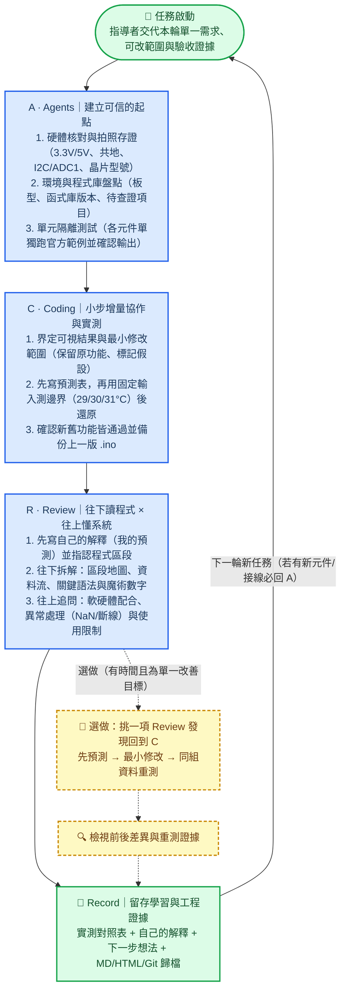
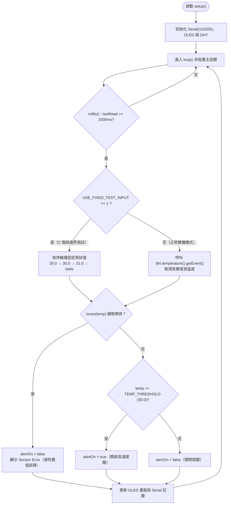

# 🔄 NodeMCU-32S × Agent 建議 ACR 實作與學習流程（整合實戰版）

> **最後更新時間**: 2026-11-19 14:00:00 (UTC+8)
> **使用模型**: Gemini 4 Neon
> **執行 Agent**: Antigravity
> **架構依據**: [`ACR_b02.md`](./ACR_b02.md)
> **參考歷次筆記**: [`arduino_development_workflow_methodology.md`](./arduino_development_workflow_methodology.md) • [`nodemcu32s_dht_ssd1306_weather_1110.md`](./nodemcu32s_dht_ssd1306_weather_1110.md) • [`nodemcu32s_dht_ssd1306_layout_1112.md`](./nodemcu32s_dht_ssd1306_layout_1112.md) • [`CODE_REVIEW.md`](./AI_CodeReview/reviews/1112-1/CODE_REVIEW.md) • [`note-1117.md`](./1117-1/note-1117.md)
> **互動 HTML 筆記**: [`ACR_recommended_workflow.html`](./ACR_recommended_workflow.html)

---

## 📑 目錄

1. [核心概念剖析：為什麼需要「實戰整合版」ACR 流程？](#1-核心概念剖析為什麼需要實戰整合版-acr-流程)
2. [總覽流程圖：A → C → R 實戰閉環與多輪演進](#2-總覽流程圖a--c--r-實戰閉環與多輪演進)
3. [三階段標準作業流程（SOP）與歷次筆記對照](#3-三階段標準作業流程sop與歷次筆記對照)
   - [階段 A｜Agents：硬體先行、環境核對與單元隔離驗證](#階段-aagents硬體先行環境核對與單元隔離驗證)
   - [階段 C｜Coding：小步增量、先預測再實測與版控留底](#階段-ccoding小步增量先預測再實測與版控留底)
   - [階段 R｜Review：從實作觀察「往下讀程式、往上懂系統」](#階段-rreview從實作觀察往下讀程式往上懂系統)
4. [選做改寫與卡住時的證據回退機制](#4-選做改寫與卡住時的證據回退機制)
5. [實作與應用範例：四輪真實專案演進路徑與可測試程式碼](#5-實作與應用範例四輪真實專案演進路徑與可測試程式碼)
6. [每輪必留的學習與工程證據（交付物清單）](#6-每輪必留的學習與工程證據交付物清單)
7. [延伸思考與進階主題：防禦性檢核表、AI 協作反模式與教學權衡](#7-延伸思考與進階主題防禦性檢核表ai-協作反模式與教學權衡)
8. [提示詞歷史與變更記錄 (Prompt Archive)](#-提示詞歷史與變更記錄-prompt-archive)

---

## 1. 核心概念剖析：為什麼需要「實戰整合版」ACR 流程？

在 [`ACR_b02.md`](./ACR_b02.md) 中，定義了以實作出發的 **ACR（Agents → Coding → Review）** 學習循環：由指導者建立可運作的起點與明確任務，學生透過 Agent 核對條件（**A**）、協作完成單一可驗收功能（**C**），最後從實機畫面出發「往下讀程式、往上懂系統」（**R**）並留下學習證據。

回顧我們在 `ec/` 工作區累積的實務開發經驗，可以發現早期純硬體實作的「**六階段漸進式開發 SOP**」（[`arduino_development_workflow_methodology.md`](./arduino_development_workflow_methodology.md)）與近期的 **NodeMCU-32S 實作演進**（`1110-1` → `1112-1` → `CODE_REVIEW` → `1117-1`），正好能無縫映射到 ACR 的每一個環節，補足「硬體查核、非阻塞架構、系統化 Code Review 與多模態歸檔」的實務細節：

| ACR 階段 | [`ACR_b02.md`](./ACR_b02.md) 核心定位 | 整合自歷次筆記的實戰做法 | 對應參考筆記 |
| :--- | :--- | :--- | :--- |
| **A｜Agents** | 核對條件、驗證基礎功能、單一元件先測再整合 | **硬體先行與俯拍存證**（電源 3.3V/5V、共地、腳位絲印）、**官方範例單元隔離測試**（「不同時測兩件未知事物」）、**I2C Scanner / 晶片型號核對**（SSD1306 vs SH1106、ADC1 vs ADC2） | [`arduino_development_workflow_methodology.md`](./arduino_development_workflow_methodology.md)、[`nodemcu32s_dht_ssd1306_layout_1112.md`](./nodemcu32s_dht_ssd1306_layout_1112.md)、[`note-1117.md`](./1117-1/note-1117.md) |
| **C｜Coding** | 協作改寫單一可驗收功能、先預測再實測、留存上一版 | **最小增量整併**（標頭檔、物件、時序）、**固定輸入邊界測試**（29/30/31°C）、**非阻塞排程**（`millis()` 取代 `delay()`）、**UI 幾何驗證與防閃爍/防呆**（`isnan()`、緩衝區選型） | [`nodemcu32s_dht_ssd1306_weather_1110.md`](./nodemcu32s_dht_ssd1306_weather_1110.md)、[`nodemcu32s_dht_ssd1306_layout_1112.md`](./nodemcu32s_dht_ssd1306_layout_1112.md)、[`note-1117.md`](./1117-1/note-1117.md) |
| **R｜Review** | 從實機結果「往下追程式、往上懂系統」，提出改善想法 | **13 節結構化程式碼導讀**（先寫「我的預測」→ 區段地圖 → 函式庫/魔術數字拆解 → 資料流追蹤 → 區分「靜態推演」與「實機查證」→ 僅提改進建議不直接亂改） | [`CODE_REVIEW.md`](./AI_CodeReview/reviews/1112-1/CODE_REVIEW.md) |
| **Record｜歸檔** | 留下實作證據、自己的解釋與下一步想法 | **多模態文檔歸檔**（Markdown + HTML + 實拍圖 + 程式快照 `.ino` + Prompt Archive + 索引更新與 Git 版本控制） | [`arduino_development_workflow_methodology.md`](./arduino_development_workflow_methodology.md)、[`AGENTS.md`](../AGENTS.md) |

### 雙向學習模型（往下 × 往上）
ACR 最大的特色在於**不先背誦抽象語法，而是從「看得見的實機輸出」往兩個維度展開**：
- **↓ 往下（Code & Data Flow）**：追蹤單一數據的生命週期（感測器讀值 → 濾波/防呆 → 變數 → 條件判斷 `if` → 顯示/API 輸出），並拆解「看不出意義的名稱與魔術數字」（例如 U8g2 建構子 `_1_HW_I2C`、Glyph 編碼 `67`、自訂門檻 `30°C`）。
- **↑ 往上（Hardware & System Limits）**：追問底層電氣與系統邊界（ESP32 開 Wi-Fi 時為何不能用 ADC2？加熱型 CO2 感測器為何要接 5V VIN 且需預熱？教室內網無對外連線時為何不能用外部 Chart.js CDN？感測器讀取失敗時畫面如何避免誤導使用者？）。

---

## 2. 總覽流程圖：A → C → R 實戰閉環與多輪演進

以下流程圖延續 [`ACR_b02.md`](./ACR_b02.md) 的實線主循環與虛線選做改寫，並融入硬體單元測試、結構化 Review 與多模態歸檔節點：



---

## 3. 三階段標準作業流程（SOP）與歷次筆記對照

### 階段 A｜Agents：硬體先行、環境核對與單元隔離驗證

**核心原則**：「**不要同時測試兩件未知的事物**」，且軟體必須建立在已驗證的電氣與環境起點上。

1. **硬體先行與實體拍照存證**（源自 [`arduino_development_workflow_methodology.md`](./arduino_development_workflow_methodology.md)）：
   - 斷電接線，先查晶片型號與工作電壓（如 ESP32 GPIO 僅耐壓 `3.3V`；SEN0159 加熱器需接 `5V VIN` 並與開發板共地）。
   - 核對硬體腳位衝突（如 ESP32 啟用 Wi-Fi 時 `ADC2` 不可用，類比感測器必接 `ADC1` 如 `GPIO 32`；I2C 預設 `SDA=21, SCL=22`）。
   - 手機俯拍接線存證（記錄線色、排針絲印、模組背面型號，例如辨識 `0.96" SSD1306` 或 `1.3" SH1106`）。
2. **環境與程式庫盤點**（源自 [`ACR_b02.md`](./ACR_b02.md) & [`CODE_REVIEW.md`](./AI_CodeReview/reviews/1112-1/CODE_REVIEW.md)）：
   - 記錄板型（NodeMCU-32S）、Arduino-ESP32 核心版本、已安裝函式庫版本（`U8g2`、`DHT_Unified`、`Adafruit_Sensor`）與 Serial 鮑率（`115200`）。
   - 請 Agent 對照硬體與範例，列出**已確認條件**與**待查證清單**。
3. **單一元件隔離測試**：
   - 先用官方範例單獨跑感測器（Serial Monitor 觀察讀值變化，例如捏住 DHT22 看溫濕度上升），再單獨跑 OLED（顯示固定文字或基本圖示）。
   - 若本輪沿用既有硬體配置，直接燒錄上一輪成功版本，重現已知輸出即可。

**建議 A 階段首問模板**：
```text
這是我目前的開發板、硬體接線、俯拍重點與已安裝程式庫資訊：[附上板型/腳位/程式庫/基礎範例]。
1. 請對照範例與接線，列出我上電前必須核對的電氣與設定項目（包含電壓準位、腳位衝突如 ADC1/ADC2、驅動 IC 差異如 SSD1306/SH1106），並標出資料中缺少的待查證資訊。
2. 請分別給我感測器與顯示器的「單一元件隔離測試」步驟，以及通過時在 Serial Monitor / OLED 上應該看到的明確輸出。
我會先核對實體接線並回報實測結果，全部通過後再進行整合。
```

- **A 階段完成標準**：能重現基礎輸出、保存接線紀錄與基礎程式快照，並明確列出哪些硬體/環境條件已驗證通過。

---

### 階段 C｜Coding：小步增量、先預測再實測與版控留底

**核心原則**：「**一次只加一項可驗收的功能**」，先寫預測再實測，任何改動都保留可回復的上一版。

1. **將需求轉為可視化驗收條件與最小修改範圍**：
   - 明確指定「**新增什麼**」與「**必須保留什麼**」（例如：加入 `>= 30°C` 提醒，保留原本溫度/濕度/序列輸出與既有腳位）。
   - 若涉及多任務（如 Wi-Fi WebServer 或跑馬燈動畫 + DHT 2 秒取樣），明確要求採用 **`millis()` 非阻塞排程**而非 `delay()`（源自 [`1110-1`](./nodemcu32s_dht_ssd1306_weather_1110.md)、[`1112-1`](./nodemcu32s_dht_ssd1306_layout_1112.md)）。
   - 若涉及 OLED 排版，要求 Agent 先給出像素座標規劃（避免字元重疊或右側截斷）。
2. **要求 Agent 交回「四件套」**：
   - 可編譯的完整程式碼（附繁體中文註解）
   - 修改的函式與前後差異摘要
   - **尚未確認的假設清單**（避免 AI 偷偷改動腳位或驅動建構子）
   - **可還原的固定輸入測試方式**（例如測試開關巨集，方便快速驗證邊界值）
3. **先寫預測表，再實機驗證**：
   - 測試前先寫下邊界輸入的預期結果（如 `29°C / 30°C / 31°C` 或 `NAN` 異常值），再以固定輸入實測並記錄實際畫面。
   - **必做動作**：固定輸入測完後，**務必恢復真實感測器讀取**，確認實機取樣與原有功能完全正常。
   - 若結果不符，記錄「操作步驟 + 預期 + 實際輸出 + 錯誤訊息」，回到上一個成功版本縮小差異後再回報 Agent。

**建議 C 階段首問模板**：
```text
請以我附上這份已在 NodeMCU-32S 實測通過的程式為起點：[附上基礎 .ino 與硬體摘要]。
本輪只新增一項功能：[描述看得見的結果，例如：有效溫度 >= 30°C 時在 OLED 顯示提醒，低於 30°C 關閉]。
限制條件：
1. 保留現有接線、程式庫、原本的溫濕度/序列輸出與非阻塞排程架構。
2. 請交回：(a) 可編譯完整程式與註解、(b) 修改位置與前後差異、(c) 尚未確認的假設、(d) 一種可透過單一旗標切換、方便還原的固定輸入測試方式（用來測 29/30/31°C 與異常值）。
我會先檢查差異並寫下預測，再編譯上傳與實測。
```

- **C 階段完成標準**：完成「預測 vs 實測」對照表、恢復感測器實測正常、備份修改前/後兩個可編譯版本（如 `v1_base.ino` 與 `v2_alert.ino`）。

---

### 階段 R｜Review：從實作觀察「往下讀程式、往上懂系統」

**核心原則**：「**先有自己的解釋，再請 Agent 給定位提示；區分靜態推演與實機證據**」（整合 [`ACR_b02.md`](./ACR_b02.md) 與 [`CODE_REVIEW.md`](./AI_CodeReview/reviews/1112-1/CODE_REVIEW.md)）。

1. **步驟 0：先寫「我的預測 / 我的解釋」**：
   - 挑選一筆剛剛看到的實機畫面（例如 `30°C` 顯示提醒，或 CO2 剛通電顯示 `< 400 ppm`）。
   - 學生先不看 AI 解答，自己找出可能相關的函式/行號，寫一句自己的解釋並與同學口頭核對。
2. **往下拆解（Code & Data Flow）**：
   - **區段地圖**：辨識這份程式的設定、共用狀態、邏輯判斷、顯示繪圖、I/O、`setup()` 與 `loop()` 邊界。
   - **單筆資料流追蹤**：追蹤一筆數值如何流過「讀取 → `isnan()` 檢查 → 變數儲存 → `if` 門檻判斷 → OLED/Web 輸出」。
   - **破解魔術數字與專有名稱**：核對不直覺的參數（例如 `U8G2_..._1_HW_I2C` 的緩衝區大小、Glyph `67` 在不同字型代表不同圖示、人為自訂門檻 `30°C` 或 `85%/28°C` 並非氣象標準）。
3. **往上追問（Hardware & System Limits）**：
   - **軟硬體邊界**：程式庫幫我們做了什麼？硬體有哪些物理限制（DHT 2 秒取樣下限、MG-811 預熱漂移、Wi-Fi 與 ADC2 衝突）？
   - **異常與真實情境**：如果下一次讀取失敗（回傳 `NAN`）或 Wi-Fi 斷線，畫面會顯示舊值還是錯誤提示？教室內網若無網際網路，前端圖表是否會失效？
4. **提出單一可驗證的改善建議**：
   - 請 Agent 在 Review 階段**只提出改善建議與驗收方式，不直接改寫整份程式**，讓學生決定是否進入「選做改寫」或留待下一輪。

**建議 R 階段首問模板**：
```text
我剛剛實測 [輸入條件，例如 30°C] 時，在 OLED/網頁上觀察到 [實際現象]。
我自己的解釋是：[先寫一兩句自己的推論與懷疑的程式位置]。
請依以下規則協助我做 Review（不要直接改寫整份程式）：
1. 【往下】先只指出我應該檢查的區段、函式與關鍵條件（含不直覺的常數或 API），等我追蹤完再補充細節。
2. 【往上】幫我檢查程式是否有處理感測器讀取失敗(NaN)、逾時或硬體限制，並明確區分「從程式碼可確認的行為」與「必須靠實機測試才能查證的行為」。
3. 若發現值得改善的地方，請只提供 1 項最優先建議與其驗收方式，等我決定後再討論改寫。
```

- **R 階段完成標準**：學生能用自己的話解釋「一筆資料流 + 一個關鍵判斷 + 一項軟硬體限制」，並記下 1 個待查證問題或改善想法。

---

## 4. 選做改寫與卡住時的證據回退機制

### 4.1 選做改寫（Review → C 的微循環）
當主線完成且時間充裕時，可從 Review 發現中挑選**一個最小行為改動**（例如把門檻從 `>= 30.0` 改為嚴格大於 `> 30.0`，或補上 `NAN` 斷線提示）：
1. **用 Review 證據定義新需求**：說明為何原行為不符合使用情境。
2. **先預測哪一筆測試值會改變**：例如在 `29 / 30 / 31°C` 中，只有 `30°C` 應從「開啟」變為「關閉」。
3. **最小修改 + 同組資料重測**：保留其餘邏輯不變，用同一組測試值驗證「該變的有變、不該變的沒壞」。
4. **邊界規則**：若新想法需要**新增元件或改動接線**，不可走選做微循環，必須進入**下一輪的階段 A** 重新驗證硬體起點。

### 4.2 卡住時回到有證據的地方（整合排錯矩陣）

結合 [`ACR_b02.md`](./ACR_b02.md) 與歷次硬體除錯經驗，遇到異常時依下表回退：

| 遇到的異常現象 | 回退階段 | 立即執行的證據排查動作 |
| :--- | :---: | :--- |
| OLED 不亮、全黑、畫面左移 2px 或右側有雜訊線 | **回到 A** | 斷電查供電/共地與 SDA(21)/SCL(22)；跑 I2C Scanner 查位址（`0x3C`/`0x27`）；檢查 1.3" 面板是否需把 `SSD1306` 改為 `SH1106` 建構子。 |
| DHT 頻繁回傳 `NaN` 或數值不更新 | **回到 A / C** | 查 DATA 腳位與上拉電阻；確認取樣間隔 $\ge 2000\text{ ms}$（DHT22）或 $\ge 1500\text{ ms}$（DHT11）。 |
| 開啟 Wi-Fi 後類比感測器讀值異常或卡死 | **回到 A** | 檢查是否誤接 ESP32 `ADC2` 腳位；改接 `ADC1`（如 `GPIO 32`）並確認感測器供電（如加熱器改接 `5V VIN`）。 |
| 新功能未通過，或原本正常的功能壞掉 | **留在 C** | 立即切回上一版可運作 `.ino` 確認硬體沒壞，縮小程式碼差異，帶著「操作 + 預期 + 實測 + 錯誤訊息」回報 Agent。 |
| 網頁打不開或跑馬燈每 2 秒卡頓一次 | **留在 C** | 檢查 `loop()` 是否殘留阻塞式 `delay(2000)`，改用 `millis()` 非阻塞排程確保 `server.handleClient()` 高頻輪詢。 |
| 程式能跑，但 Review 看不懂或 Agent 解釋與實測不符 | **留在 R** | 核對雙方看的是否為同一份 `.ino` 版本與硬體條件；從一筆看得見的輸出出發，要求 Agent 一次只給下一個函式位置。 |
| 想一次加三個功能（如換面板 + 加 CO2 + 畫網頁折線圖） | **回到指導者** | 拆分為多輪 ACR，本輪只選一項有明確驗收條件的目標，其餘記入「下一輪想法」。 |

---

## 5. 實作與應用範例：四輪真實專案演進路徑與可測試程式碼

### 5.1 歷次筆記對應的四輪 ACR 演進路線
從我們在 `ec/` 的實作歷程，可以清楚看到專案如何透過多輪 ACR 穩定長大，而不是一次寫出幾百行難以除錯的程式：

| 輪次 | 專案里程碑（對應筆記） | 本輪 A（驗證起點） | 本輪 C（單一增量與實測） | 本輪 R（往下 × 往上收穫） |
| :---: | :--- | :--- | :--- | :--- |
| **Round 1** | **基礎感測與顯示**<br/>[`arduino_development_workflow_methodology.md`](./arduino_development_workflow_methodology.md) | 俯拍接線、官方範例單測 LCD/OLED 與 DHT | 整併兩模組、加 `isnan()` 防呆、空格覆寫防閃爍 | 理解單匯流排取樣週期與 `lcd.clear()` 閃爍成因 |
| **Round 2** | **NodeMCU-32S 介面重構與條件提醒**<br/>[`ACR_b02.md`](./ACR_b02.md) / [`1112-1`](./nodemcu32s_dht_ssd1306_layout_1112.md) | 核對 ESP32 3.3V、I2C(21/22)、DHT(GPIO 16) 與 OLED 驅動 IC | 規劃 128×64 三區版面、加入門檻提醒/跑馬燈與固定輸入測試 | 學會用 [`CODE_REVIEW.md`](./AI_CodeReview/reviews/1112-1/CODE_REVIEW.md) 拆解座標、Glyph 編碼與 `>=` 邊界 |
| **Round 3** | **Wi-Fi DHCP 與 WebServer 聯網**<br/>[`1110-1`](./nodemcu32s_dht_ssd1306_weather_1110.md) | 沿用 Round 2 硬體，單測 Wi-Fi 連上 `ite-eng` 取得 DHCP IP | 以 `millis()` 取代 `delay()`，新增 `/` 網頁與 `/api/weather` JSON | 理解 TCP 輪詢為何怕 `delay()` 阻塞，以及雙端狀態同步 |
| **Round 4** | **多感測器擴充與離線儀表板**<br/>[`1117-1`](./1117-1/note-1117.md) | **新增 SEN0159 必回 A**：接 `5V VIN` + `GPIO 32 (ADC1)`，單測電壓 | 加入 5 次移動平均、對數換算與零 CDN 原生 Canvas 雙軸折線圖 | 理解 Wi-Fi 與 ADC2 硬體衝突、MG-811 預熱特性與內網離線設計 |

---

### 5.2 ACR 標準實作範本：可切換「固定輸入測試」的非阻塞溫度提醒骨架

為了落實 [`ACR_b02.md`](./ACR_b02.md) 中「**先用固定輸入驗證 29/30/31°C，再一鍵還原真實感測器讀取**」的 C 階段要求，同時符合 `1110-1` / `1112-1` 的 `millis()` 非阻塞設計，以下提供標準範本的程式邏輯流程圖與程式碼。

#### 程式邏輯流程圖



#### 範例程式碼（NodeMCU-32S / ESP32 + DHT22 + U8g2 OLED）

```cpp
// ============================================================================
// acr_temp_alert_template.ino — ACR 階段 C 標準示範骨架
// 功能：非阻塞讀取溫度，當有效溫度 >= 30.0°C 時於 OLED 顯示高溫提醒
// 特色：內建 USE_FIXED_TEST_INPUT 測試開關，方便驗證 29 / 30 / 31°C 與 NAN 邊界
// 硬體：NodeMCU-32S | DHT22 -> GPIO 16 | OLED I2C -> SDA(21), SCL(22)
// ============================================================================

#include <Arduino.h>
#include <Wire.h>
#include <U8g2lib.h>
#include <Adafruit_Sensor.h>
#include <DHT.h>
#include <DHT_U.h>

// ---------- 1. 硬體腳位與門檻常數 ----------
#define DHTPIN                16          // DHT22 單匯流排接於 GPIO 16
#define DHTTYPE               DHT22       // 感測器型號（若為 DHT11 請改此處）
const float TEMP_THRESHOLD  = 30.0f;      // 本輪自訂提醒門檻（°C）
const unsigned long READ_MS = 2000UL;     // DHT22 最小安全取樣週期（2 秒）

// ---------- 2. C 階段「可還原固定輸入測試」開關 ----------
// 1 = 啟用固定輸入輪播（依序測試 29.0, 30.0, 31.0, NAN）
// 0 = 恢復真實 DHT 感測器讀取（交付前務必改回 0 並實機複測！）
#define USE_FIXED_TEST_INPUT  1

// ---------- 3. 驅動物件初始化 ----------
// 注意：若使用 1.3 吋 SH1106 面板且出現右邊雜訊線，請改用 U8G2_SH1106_...
U8G2_SSD1306_128X64_NONAME_1_HW_I2C u8g2(U8G2_R0, /* reset=*/ U8X8_PIN_NONE);
DHT_Unified dht(DHTPIN, DHTTYPE);

// ---------- 4. 共享狀態變數 ----------
unsigned long lastReadTime = 0;
float currentTemp          = NAN;
bool  isTempAlert          = false;

#if USE_FIXED_TEST_INPUT
const float TEST_CASES[]   = {29.0f, 30.0f, 31.0f, NAN};
const int   TEST_COUNT     = sizeof(TEST_CASES) / sizeof(TEST_CASES[0]);
int         testIndex      = 0;
#endif

// 判斷是否觸發提醒（Review 選做改寫時，只需聚焦修改此函式的 >= 條件）
bool evaluateTempAlert(float tempC) {
  if (isnan(tempC)) {
    return false; // 讀取失敗時不可誤觸高溫提醒
  }
  return (tempC >= TEMP_THRESHOLD);
}

// 繪製 OLED 畫面（採 U8g2 Page Buffer 分頁繪圖，節省 RAM）
void renderOLED(float tempC, bool alertOn) {
  u8g2.firstPage();
  do {
    u8g2.setFont(u8g2_font_helvB12_tf);
    u8g2.setCursor(0, 18);
    if (isnan(tempC)) {
      u8g2.print("T: Sensor ERR");
    } else {
      u8g2.print("T: ");
      u8g2.print(tempC, 1);
      u8g2.print(" C");
    }

    // 繪製分隔線與提醒狀態列
    u8g2.drawHLine(0, 28, 128);
    u8g2.setFont(u8g2_font_8x13_mf);
    u8g2.setCursor(0, 46);
    if (isnan(tempC)) {
      u8g2.print("STATUS: CHECK DHT");
    } else if (alertOn) {
      u8g2.print("ALERT: >= 30.0 C!");
    } else {
      u8g2.print("STATUS: NORMAL");
    }

    // 底部提示目前是否為測試模式，避免忘記還原
    u8g2.setFont(u8g2_font_6x10_tf);
    u8g2.setCursor(0, 62);
    u8g2.print(USE_FIXED_TEST_INPUT ? "MODE: FIXED TEST" : "MODE: LIVE SENSOR");
  } while (u8g2.nextPage());
}

// 取得溫度（依編譯旗標切換固定測試值或真實感測器）
float acquireTemperature() {
#if USE_FIXED_TEST_INPUT
  float val = TEST_CASES[testIndex];
  testIndex = (testIndex + 1) % TEST_COUNT;
  return val;
#else
  sensors_event_t event;
  dht.temperature().getEvent(&event);
  return event.temperature; // 若讀取失敗，Adafruit 庫會回傳 NAN
#endif
}

void setup() {
  Serial.begin(115200);
  delay(200);
  u8g2.begin();
  u8g2.enableUTF8Print();
  dht.begin();
  Serial.println(F("[ACR] System ready."));
}

void loop() {
  unsigned long now = millis();
  // 非阻塞排程：每 2 秒更新一次，未來可直接插入 server.handleClient() 不卡頓
  if (now - lastReadTime >= READ_MS) {
    lastReadTime = now;
    currentTemp  = acquireTemperature();
    isTempAlert  = evaluateTempAlert(currentTemp);

    // 輸出序列監控證據，方便填寫「預測 vs 實測」對照表
    Serial.print(F("Temp="));
    if (isnan(currentTemp)) Serial.print(F("NAN"));
    else Serial.print(currentTemp, 1);
    Serial.print(F(" | Alert="));
    Serial.println(isTempAlert ? F("ON") : F("OFF"));

    renderOLED(currentTemp, isTempAlert);
  }
}
```

#### 對應之 C 階段「預測 vs 實測」核對表範例

| 測試項目 | 輸入值 | 初版（`>= 30.0`）預期 | 選做改寫（`> 30.0`）預期 | 實機觀察與備註 |
| :---: | :---: | :---: | :---: | :--- |
| 邊界下方 | `29.0°C` | 關閉 (`NORMAL`) | 關閉 (`NORMAL`) | 確認低於門檻不誤報 |
| 剛好等於門檻 | `30.0°C` | **開啟 (`ALERT`)** | **關閉 (`NORMAL`)** | 驗證 `>=` 與 `>` 差異的核心證據 |
| 邊界上方 | `31.0°C` | 開啟 (`ALERT`) | 開啟 (`ALERT`) | 確認超過門檻正確提醒 |
| 感測異常 | `NAN` | 關閉 (`CHECK DHT`) | 關閉 (`CHECK DHT`) | 確認不顯示過期舊值、不誤報高溫 |

---

## 6. 每輪必留的學習與工程證據（交付物清單）

整合 [`ACR_b02.md`](./ACR_b02.md) 第 6 節與本工作區 [`AGENTS.md`](../AGENTS.md) 歸檔規範，每輪 ACR 結束時應產出以下精簡而完整的證據：

| 證據類別 | 學生 / 開發者須交付的具體內容 | 儲存形式 |
| :--- | :--- | :--- |
| **1. 硬體與起點證據（來自 A）** | 接線俯拍照、腳位對照表、板型與程式庫版本、單一元件測試通過畫面。 | 圖片 `.jpg` + 筆記表格 |
| **2. 實作與驗證證據（來自 C）** | 修改前／後可編譯 `.ino`、預測 vs 實測對照表、恢復真實感測器的運作畫面。 | `.ino` 快照 + 測試紀錄表 |
| **3. 雙向解釋證據（來自 R）** | **往下**：指認一段關鍵程式與資料流；**往上**：說出它與哪個元件限制或使用情境有關，並標明「已實測」與「待查證」。 | 短句筆記 / 程式碼導讀 |
| **4. 下一步與提示詞軌跡（來自 Record）** | 1 個待查證問題或下一輪改善想法（含驗收方式）；若已做選做改寫，附上前後差異與重測結果；文末增補 **Prompt Archive** 並同步更新 `.md` / `.html` 與全站索引。 | `.md` + `.html` + Git Commit |

---

## 7. 延伸思考與進階主題：防禦性檢核表、AI 協作反模式與教學權衡

### 7.1 跨專案防禦性工程檢核表（彙整自歷次 `ec/` 實戰地雷）

| 面向 | 常見地雷現象 | 防禦做法（建議直接寫入階段 A/C 檢核） |
| :--- | :--- | :--- |
| **ESP32 ADC 與 Wi-Fi** | 開啟 Wi-Fi 後類比讀值失效 | 類比感測器一律使用 **`ADC1`**（GPIO 32~39），避開被 Wi-Fi 射頻佔用的 `ADC2`。 |
| **電源與耐壓** | 加熱型感測器拉垮 ESP32 造成不斷重啟，或高壓燒毀腳位 | 高耗電模組（如 SEN0159）接 `5V (VIN)` 並共地；確認回傳至 ESP32 GPIO 的訊號不超過 `3.3V`。 |
| **OLED 驅動 IC** | 1.3" 面板畫面左移 2px、最右側出現亮線 | 檢查背面絲印與驅動 IC，將 `U8G2_SSD1306_...` 切換為 `U8G2_SH1106_...`。 |
| **多任務時序** | 網頁連線逾時或 OLED 動畫卡頓 | `loop()` 嚴禁長 `delay()`，全面改用 `millis()` 非阻塞排程，同時遵守 DHT 2 秒最小取樣間隔。 |
| **封閉內網相依** | 教室內網無對外連線，網頁圖表整片空白 | 內嵌 WebServer 儀表板優先採用零外部 CDN 依賴的原生 HTML5 Canvas / SVG（參考 [`1117-1`](./1117-1/note-1117.md)）。 |
| **AI 假設飄移** | Agent 順手改掉原本腳位或刪掉既有功能 | 每次 Prompt 明確宣告「**保留清單**」與「**標記未確認假設**」，上傳前必做差異比對（Diff）。 |

### 7.2 AI 協作常見反模式（Anti-Patterns）與修正對策

1. **反模式一：「一次貼上全部需求，讓 Agent 直接吐出 500 行」**
   - **後果**：出錯時無法判斷是硬體接線、程式庫版本還是邏輯 Bug，學生也無法在 Review 階段追蹤。
   - **對策**：強制遵守「A 單元隔離 → C 單一增量」，超過一項新功能就拆到下一輪。
2. **反模式二：「把靜態讀碼當成實機驗證」**
   - **後果**：如同 [`CODE_REVIEW.md`](./AI_CodeReview/reviews/1112-1/CODE_REVIEW.md) 所提醒，程式碼中的註解、門檻值與感測器型號若未經實測，皆屬於「待查證假設」。
   - **對策**：永遠用實機輸出或固定輸入對照表作為唯一驗收標準，並區分「程式推演」與「實機證據」。
3. **反模式三：「跳過『我的預測』直接叫 Agent 解釋整支程式」**
   - **後果**：產生「看懂了的錯覺（Illusion of Competence）」，離開 AI 後仍無法定位程式問題。
   - **對策**：在 C 階段先填預測表、在 R 階段先寫一句自己的解釋，再請 Agent 給「定位提示」而非直接給全部答案。

### 7.3 教學導入權衡（初學者 vs 進階專題）
- **初學者（第一、二輪）**：指導者提供完整可運作的起點程式、標準首問模板與測試表，重點放在「學會對照差異、做固定輸入測試、說出一筆資料怎麼走到畫面」。
- **進階專題（第三、四輪以上）**：由學生自行擬定本輪任務與 Prompt，指導者改為把關「範圍是否過大、驗收條件是否具體、新增硬體是否先回 A 驗證」，逐步過渡到自主工程開發。

---

## 📝 提示詞歷史與變更記錄 (Prompt Archive)

### 🔹 [2026-11-19 13:33:00] [Gemini 4 Neon / Antigravity] 依據 ACR_b02 架構並整合歷次筆記彙整建議 ACR 流程
- **模型/Agent**: Gemini 4 Neon / Antigravity
- **Prompt 原文**:
  ```text
  @[ec/ACR_b02.md] 根據這個架構 參考之前的筆記 彙整建議的ACR流程
  ```
- **變更摘要**: 以 `ec/ACR_b02.md` 的 A → C → R（含選做改寫與證據留存）為核心骨架，整合 `ec/arduino_development_workflow_methodology.md`（六階段硬體開發 SOP）、`ec/nodemcu32s_dht_ssd1306_weather_1110.md`（Wi-Fi WebServer 與 `millis()` 非阻塞排程）、`ec/nodemcu32s_dht_ssd1306_layout_1112.md`（128×64 版面幾何與 U8g2 SSD1306/SH1106 建構子）、`ec/AI_CodeReview/reviews/1112-1/CODE_REVIEW.md`（13 節結構化程式碼導讀與靜態/實測區分）及 `ec/1117-1/note-1117.md`（SEN0159 CO2 感測器、ESP32 ADC1/ADC2 衝突與離線 Canvas 圖表），建立完整建議 ACR 實作與學習流程筆記（含 Mermaid 流程圖、各階段 Prompt 模板、可切換固定輸入測試之非阻塞範例程式、四輪演進路線、排錯回退矩陣與防禦性檢核表），並同步產出支援 PDF 匯出與一鍵複製的 HTML 互動版本。

### 🔹 [2026-11-19 14:00:00] [Gemini 4 Neon / Antigravity] 修正總覽流程圖 Mermaid 排版方向（避免從 R 開始）
- **模型/Agent**: Gemini 4 Neon / Antigravity
- **Prompt 原文**:
  ```text
  總覽流程圖：A → C → R 實戰閉環與多輪演進 的流程演進，圖形設計方向 a->c->r 大致不變，但目前看起來會以R開始
  ```
- **變更摘要**: 修正第 2 節總覽流程圖因 Mermaid Dagre 引擎對「`subgraph` 搭配循環回邊 (`record --> guide`)」產生排序反轉而使 R 區塊跑到最上方的問題；改採無 `subgraph` 之單層階段節點結構（延續 `ACR_b02.md` 拓撲），確保圖形嚴格由上而下呈現「任務啟動 → A · Agents → C · Coding → R · Review → Record（含選做改寫與下一輪循環）」，並同步更新 Markdown、HTML 與全站索引。
