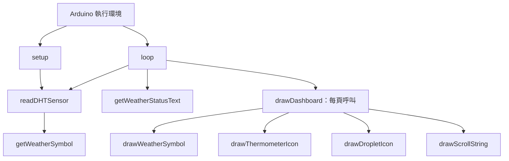

# 程式碼導讀：1112-1.ino

> 產生時間：2026-11-17 09:52 (UTC+08:00)｜模型：未知（Codex）｜原始檔：1112-1.ino（325 行）
> **最後更新時間**: 2026-11-17 09:52:48 (UTC+8)
> **使用模型**: 未知（Codex；本次環境未提供可確認的模型 ID）
> **執行 Agent**: /root

本講義以指定桌面檔案的 **325 行原始程式**做靜態閱讀；未在 ESP32 上編譯、燒錄或量測。程式快照見 [1112-1.ino](1112-1.ino)，與指定檔案逐位元組相同。下文的數值追蹤是依程式推演，不是感測器實測；函式庫線上文件查核日期為 2026-11-17，不代表使用者已安裝相同版本。原始程式及其註解保持原樣；第 10 節提出修改方向，並未套用修改。

HTML 操作：左欄讀講義，點行號對照右欄；點右欄有標記的程式行可回到說明。上方可匯出 PDF、複製原始碼與切換明暗；一般程式碼區塊附複製按鈕。PDF 使用瀏覽器的「另存為 PDF」。

## 0. 我的預測

（學生填寫）先只看檔名、 第 1–26 行 的開頭註解與 第 28–33 行 的引入，寫兩三句話，暫時不要往下找答案。

- 我預測它會做什麼：＿＿＿＿＿＿＿＿＿＿＿＿
- 我預測輸入與輸出是：＿＿＿＿＿＿＿＿＿＿＿＿
- 我想先查的一個問題：＿＿＿＿＿＿＿＿＿＿＿＿

## 1. 全覽

一句話摘要：程式定時讀取 DHT 溫濕度，以人為門檻挑選五種圖示，並在 128×64 OLED 顯示數值與跑馬燈；這是環境儀表板，程式沒有取得實際降雨或雷電資料（ 第 67–96 行 、 第 222–252 行 、 第 301–325 行 ）。

### 執行環境與接線

| 項目 | 程式提供的線索 | 上課前確認 |
|---|---|---|
| 平台 | NodeMCU-32S／ESP32； 第 2 行 、 第 49 行 | Arduino IDE 與 Arduino-ESP32 核心版本未記錄，待查證；先確認所選板型 |
| DHT | DATA=GPIO16，預設 DHT22； 第 13–15 行 、 第 36–43 行 | 實際型號、模組電壓與 DATA 上拉電阻待查證，不能只靠外殼顏色判型 |
| OLED | SSD1306 128×64、硬體 I2C； 第 16–20 行 、 第 51 行 | 接線註解要求 3.3V、SDA21、SCL22；模組型號、位址及電壓相容性待查證 |
| 函式庫 | Adafruit DHT、Unified Sensor、U8g2； 第 23–25 行 、 第 28–33 行 | 安裝版本與原始範例版本待查證 |
| 序列監控 | `Serial.begin(115200)`； 第 256 行 | 監控器鮑率設 115200，觀察錯誤訊息 |

I2C 是讓多個裝置共用 SDA／SCL 兩條訊號線的通訊方式。官方文件列出 Generic ESP32 預設 SDA21／SCL22，並提醒板型可能不同、訊號線需要上拉；本程式 第 51 行 沒有明確指定兩腳，故仍須核對板型。[Espressif I2C 文件](https://docs.espressif.com/projects/arduino-esp32/en/latest/api/i2c.html#setpins)

### 區段地圖

| 區段 | 行號 | 類別 | 作用 |
|---|---|---|---|
| 說明、接線與引入 | 第 1–33 行 | 設定 | 說明硬體與相依檔案 |
| DHT、OLED、共享狀態 | 第 35–64 行 | 設定／資料 | 建立物件、配置初值 |
| 分類與狀態文字 | 第 67–96 行 | 邏輯 | 輸入數值，回傳代碼與文字 |
| 大圖示與小圖示 | 第 99–141 行 | 顯示 | 用字型與幾何形狀作畫 |
| 跑馬燈 | 第 144–173 行 | 邏輯／顯示 | 裁出可見的文字片段 |
| 整合版面 | 第 175–219 行 | 顯示 | 組合圖示、數值與狀態 |
| 感測與序列輸出 | 第 222–252 行 | 輸入輸出 | 更新溫度、濕度與分類 |
| 初始化 | 第 255–298 行 | 主流程 | 啟動周邊、讀規格、首次取樣 |
| 持續更新 | 第 301–325 行 | 主流程 | 到期取樣、分頁繪圖、移動文字 |

練習：從 第 222–252 行 找出「輸入」和「狀態更新」的分界。答案：＿＿＿＿。

## 2. 函式庫

先用流程圖看引入與呼叫的關係，再對照原碼。


```cpp
28 | #include <Arduino.h>
29 | #include <Wire.h>
30 | #include <U8g2lib.h>
31 | #include <Adafruit_Sensor.h>
32 | #include <DHT.h>
33 | #include <DHT_U.h>
```

`#include` 是把標頭檔宣告納入編譯，並不等於已啟動感測器（ 第 28–33 行 與 第 260–264 行 ）。

| 引入 | 來源 | 在本程式的用途 |
|---|---|---|
| `Arduino.h`； 第 28 行 | Arduino 核心 | 時間、序列輸出、基礎型別與巨集 |
| `Wire.h`； 第 29 行 | Arduino-ESP32 核心 | 提供硬體 I2C；原碼沒有直接呼叫 `Wire` 方法 |
| `U8g2lib.h`； 第 30 行 | olikraus／U8g2 | OLED 驅動、字型及繪圖 |
| `Adafruit_Sensor.h`； 第 31 行 | Adafruit Unified Sensor | `sensor_t`、`sensors_event_t` 等統一資料結構 |
| `DHT.h`； 第 32 行 | Adafruit DHT sensor library | DHT 型號常數及底層驅動；本程式透過 Unified 包裝使用 |
| `DHT_U.h`； 第 33 行 | 同一套 DHT 函式庫 | `DHT_Unified` 與溫度／濕度介面 |

### 實際使用的外部函式與方法

下表依呼叫位置說明用途；具體回傳型別與底層等待行為須對照安裝版本。`F()` 是巨集，不是一般函式；建構式另見第 3 節。

| 函式／方法／巨集 | 所屬 | 從本程式可看出的用途與行號 |
|---|---|---|
| `isnan()` | C/C++ 數學介面 | 判斷無效浮點數； 第 68、199、210、227、239、310 行 |
| `strlen()` | C 字串介面 | 計算結束字元前的位元組數； 第 146、322 行 |
| `strncpy()` | C 字串介面 | 複製指定數量字元到緩衝區； 第 158、169 行 |
| `millis()` | Arduino | 取得毫秒時間供排程； 第 297、303 行 |
| `delay()` | Arduino | 在呼叫處等待； 第 257、320 行 |
| `F()` | Arduino | 包裝輸出字串； 第 228、232、234、240、244、246、251 行 及 第 265–287 行；儲存方式依核心實作 |
| `Serial.begin()` | Arduino 序列介面 | 設定鮑率； 第 256 行 |
| `Serial.print()` | Arduino 序列介面 | 輸出文字或一位小數； 第 232–245 行 、 第 271–286 行 |
| `Serial.println()` | Arduino 序列介面 | 輸出並換行； 第 228–251 行 、 第 265–287 行 |
| `dht.begin()` | DHT Unified | 初始化 DHT； 第 264 行 |
| `dht.temperature()` | DHT Unified | 取得溫度子介面； 第 226、268 行 |
| `dht.humidity()` | DHT Unified | 取得濕度子介面； 第 238、279 行 |
| `getEvent()` | DHT Unified 子介面 | 把此次讀值寫到 `event`； 第 226、238 行 |
| `getSensor()` | DHT Unified 子介面 | 把規格寫到 `sensor`； 第 268、279 行 |
| `u8g2.begin()` | U8g2 | 初始化顯示； 第 260 行 |
| `enableUTF8Print()` | U8g2 | 啟用 `print` 的 UTF-8 解碼； 第 261 行 |
| `setFont()` | U8g2 | 選擇後續文字／字形的字型； 第 103、107、111、115、119、151、197、208 行 |
| `drawGlyph()` | U8g2 | 依字形編碼畫圖； 第 104、108、112、116、120 行 |
| `drawRFrame()` | U8g2 | 畫溫度計圓角外框； 第 128 行 |
| `drawDisc()` | U8g2 | 畫填滿圓形； 第 129、139 行 |
| `drawVLine()` | U8g2 | 畫直線； 第 130、191 行 |
| `drawHLine()` | U8g2 | 畫橫線； 第 131–133 行 、 第 192–193 行 |
| `drawTriangle()` | U8g2 | 畫水滴尖端三角形； 第 138 行 |
| `drawPixel()` | U8g2 | 補一個像素； 第 140 行 |
| `getDisplayWidth()` | U8g2 | 取得寬度以算可見字數與復位位置； 第 155–167 行 、 第 323 行 |
| `drawStr()` | U8g2 | 在基線座標畫跑馬燈片段； 第 160、171 行 |
| `setCursor()` | U8g2／Print | 指定數字輸出的游標； 第 198、209 行 |
| `u8g2.print()` | U8g2／Arduino Print | 印數字、單位或無效占位文字； 第 200–214 行 |
| `firstPage()` | U8g2 | 開始一幀的分頁繪圖； 第 314 行 |
| `nextPage()` | U8g2 | 處理目前頁並判斷是否繼續； 第 317 行 |

官方說明 `enableUTF8Print()` 對 `print` 生效；能否畫出某個字還取決於字型。分頁繪圖要求各頁使用一致內容。本程式的啟用位置與分頁位置見 第 261 行 、 第 314–317 行 。[U8g2 API 文件](https://github.com/olikraus/u8g2/wiki/u8g2reference#enableutf8print)

### 看不出意義的名稱與數字

| 名稱／數字 | 本程式的意義 | 如何查證 |
|---|---|---|
| `_1_HW_I2C`； 第 51 行 | 單頁緩衝、硬體 I2C 的驅動類別選擇 | 查 U8g2 建構式清單及所裝標頭檔；一頁實際位元組數待查證 |
| `U8G2_R0`／`U8X8_PIN_NONE`； 第 51 行 | 不旋轉／未指定獨立 reset 腳 | 查建構式；是否需要實體 reset 線依模組而定 |
| `open_iconic_weather_6x_t`、`embedded_6x_t`； 第 103–120 行 | 大圖示字型；相同 67 在不同字型是不同字形 | 比對 [Weather 原始範例](https://github.com/olikraus/u8g2/blob/master/sys/arduino/u8g2_page_buffer/Weather/Weather.ino) 與字型圖表 |
| `69 / 65 / 64 / 67`； 第 104–120 行 | 傳給所選字型的 glyph 編碼，不是天氣代碼 0–4 | 切換字型再畫相同編碼觀察 |
| `helvB12_tf`； 第 197、208 行 | 溫濕度數字字型 | 查字型涵蓋字元與寬度，不能由名稱假定每字 12 像素寬 |
| `8x13_mf` 與 `8`； 第 151–171 行 | 跑馬燈按每字 8 像素分割 | ASCII 固定寬度前提；替換字型後須重新量測 |
| `48 / 50 / 66 / 63`； 第 188–218 行 | 大圖示基線、分隔線、數字起點、底列文字基線 | 用格線圖逐項對照；座標不全都是左上角 |
| `85 / 28 / 80 / 70 / 55`； 第 71–77 行 | 作者自訂分級門檻 | 沒有附氣象或舒適度模型來源，不可當成已驗證預測 |

練習： 第 116 行 與 第 120 行 都用 67，為什麼不能只看 67 判定畫什麼？＿＿＿＿。

## 3. 類別與物件


```cpp
43 | DHT_Unified dht(DHTPIN, DHTTYPE);
```


```cpp
49 | // 使用 ESP32 硬體 I2C (預設腳位：SCL = GPIO 22, SDA = GPIO 21)
50 | // 採用 _1_ (Page Buffer 模式) 兼顧記憶體效率與相容性
51 | U8G2_SSD1306_128X64_NONAME_1_HW_I2C u8g2(U8G2_R0, /* reset=*/ U8X8_PIN_NONE);
```

**類別**像功能與資料的設計圖；**物件**是依設計圖建立的實例；**建構式**是在建立時接收初始設定的程式（ 第 43、51 行 ）。

| 物件／介面 | 類別或型別 | 位置 | 建構參數及意義 |
|---|---|---|---|
| `dht` | `DHT_Unified` | 第 43 行 | `DHTPIN=16`、`DHTTYPE=DHT22`，代表這顆 DHT |
| `u8g2` | `U8G2_SSD1306_128X64_NONAME_1_HW_I2C` | 第 51 行 | `U8G2_R0`、`U8X8_PIN_NONE`；代表 OLED 驅動 |
| `Serial` | 核心提供的序列物件／巨集映射；實際類別待查證 | 首次使用 第 228 行 ，初始化 第 256 行 | 本檔未建立；ESP32 核心與 USB 設定可能影響其實際對應 |
| `Wire` | 核心提供的 `TwoWire` 介面，實際實例待查證 | 引入 第 29 行 ，透過 第 51 行 的硬體 I2C 使用 | 本檔未直接呼叫或自行建構 |
| `dht.temperature()`／`dht.humidity()` 的子介面 | DHT Unified 的溫度／濕度介面 | 第 226、238、268、279 行 | 由 `dht` 提供，沒有自己宣告具名全域物件 |

建立 `dht`（ 第 43 行 ）不等於開始讀值；`dht.begin()`（ 第 264 行 ）才進行初始化，`getEvent(&event)`（ 第 226 行 ）才要求資料。`u8g2` 也在 第 51 行 建立、 第 260 行 啟動。`物件.方法()` 表示請特定物件做事，例如 `u8g2.setFont(...)`（ 第 197 行 ）。

只有資料的結構另外看：`sensors_event_t event`（ 第 223 行 ）裝一次事件；`sensor_t sensor`（ 第 267 行 ）裝規格。`&event` 是傳地址，讓函式可以寫入原來那份資料（ 第 226、238 行 ）。本程式沒有自訂 `class` 或 `struct` 定義（ 第 1–325 行 ）。

練習：把 第 43 行 留著、拿掉 第 264 行 ，能否保證讀值正常？需要查哪個實作？＿＿＿＿。

## 4. 常數與全域變數


```cpp
35 | // -------------------- 1. DHT 溫濕度感測器設定 --------------------
36 | #define DHTPIN 16          // Digital pin connected to the DHT sensor (NodeMCU-32S GPIO 16)
37 | 
38 | // 請依實際使用的感測器型號取消註解對應行：
39 | //#define DHTTYPE    DHT11   // DHT 11 (藍色外殼)
40 | #define DHTTYPE    DHT22   // DHT 22 (AM2302，白色外殼，1112-1.txt 預設)
41 | //#define DHTTYPE    DHT21   // DHT 21 (AM2301)
```


```cpp
45 | uint32_t delayMS = 2000;        // 感測器取樣間隔 (ms)
46 | uint32_t lastSensorRead = 0;    // 上次讀取感測器的時間戳記
```


```cpp
53 | // -------------------- 3. 天氣符號常數定義 (取自 Weather.ino) --------------------
54 | #define SUN        0   // 晴天 (Glyph 69)
55 | #define SUN_CLOUD  1   // 晴時多雲 (Glyph 65)
56 | #define CLOUD      2   // 多雲 / 陰天 (Glyph 64)
57 | #define RAIN       3   // 下雨 / 潮濕 (Glyph 67)
58 | #define THUNDER    4   // 雷雨 / 悶熱高濕 (Embedded Glyph 67)
59 | 
60 | // 儲存最新溫濕度與天氣狀態
61 | float   currentTemp   = NAN;
62 | float   currentHum    = NAN;
63 | uint8_t currentSymbol = CLOUD;
64 | int16_t scrollOffset  = -128;   // 底部狀態列跑馬燈位移量
```

### 常數

| 名稱 | 值 | 行號 | 意義 |
|---|---|---|---|
| `DHTPIN` | 16 | 第 36 行 | DATA 腳；錯誤訊息另寫死 16 |
| `DHTTYPE` | `DHT22` | 第 40 行 | 啟用的型號； 第 39、41 行 的 DHT11／DHT21 已註解，不生效 |
| `SUN` | 0 | 第 54 行 | 乾燥區間對應圖示 |
| `SUN_CLOUD` | 1 | 第 55 行 | 次一級濕度圖示 |
| `CLOUD` | 2 | 第 56 行 | 中高濕度／失敗預設圖示 |
| `RAIN` | 3 | 第 57 行 | 高濕度圖示 |
| `THUNDER` | 4 | 第 58 行 | 高溫高濕圖示 |

以上是 `#define` 巨集，編譯前替換，不是有儲存空間的 `const` 變數。`DHT22`、`NAN`、旋轉與 reset 常數來自函式庫或核心；其具體定義不在本檔（ 第 28–33 行 、 第 40 行 、 第 51 行 、 第 61–62 行 ）。

### 全域變數與共享物件

| 名稱 | 型別／宣告初值 | 寫入處 | 讀取處 | 意義與全域理由 |
|---|---|---|---|---|
| `dht` | `DHT_Unified`； 第 43 行 建構 | 內部狀態由 第 264 行 與讀取方法維護 | 第 226、238、268、279 行 | `setup` 與感測函式共用硬體介面 |
| `delayMS` | `uint32_t`；2000， 第 45 行 | 第 290、292 行 | 第 291、304 行 | 初始化後供主迴圈使用的取樣間隔 |
| `lastSensorRead` | `uint32_t`；0， 第 46 行 | 第 297、305 行 | 第 304 行 | 跨圈保存讀取時間，區域自動變數會失去歷史 |
| `u8g2` | OLED 類別； 第 51 行 建構 | 初始化、字型／游標／繪圖呼叫 | 第 99–219 行 、 第 260–261 行 、 第 314–323 行 | 所有繪圖函式共用畫布與裝置 |
| `currentTemp` | `float`；`NAN`， 第 61 行 | 第 229、231 行 | 第 199、202、250、310 行 | 未取得數值前先顯示無效，取樣後供分類與畫面讀取 |
| `currentHum` | `float`；`NAN`， 第 62 行 | 第 241、243 行 | 第 210、213、250、310 行 | 與溫度同樣跨函式共享 |
| `currentSymbol` | `uint8_t`；`CLOUD=2`， 第 63 行 | 第 250 行 | 第 188、311 行 | 保存最新分類，畫面不必各自重算 |
| `scrollOffset` | `int16_t`；−128， 第 64 行 | 第 321、323 行 | 第 218、321–322 行 | 動畫需跨圈保留位移，允許負值 |

`NAN` 是「不是有效數值」的浮點標記；以 `isnan()` 判斷，不要用 `x == NAN`。初始 `CLOUD` 不代表真的多雲；有效性由兩個浮點數共同決定（ 第 61–63 行 、 第 68–69 行 、 第 310 行 ）。全域是目前設計的共享方法，並非唯一方法；進階可把它們集中成狀態結構傳參數。

### 區域變數


```cpp
144 | void drawScrollString(int16_t offset, const char *s) {
145 |   static char buf[36];
146 |   size_t len = strlen(s);
147 |   size_t char_offset = 0;
148 |   u8g2_uint_t dx = 0;
149 |   size_t visible = 0;
```

| 名稱與作用域 | 型別／生命週期 | 容易誤會之處 |
|---|---|---|
| `temp, hum`； 第 67 行 | `float` 參數副本 | 分類函式不會寫回全域值 |
| `symbol, sensorOk`； 第 84 行 | `uint8_t, bool` 參數 | 無效時先回錯誤文字，不看分類 |
| `x, y, symbol`； 第 99 行 ，`x, y`； 第 127、137 行 | 座標與代碼參數 | y 的意義依繪圖 API，不都代表上緣 |
| `offset, s`； 第 144 行 | 位移副本、唯讀字元指標 | `s` 不複製整段文字；本程式傳入結束於 `\0` 的字串 |
| `buf[36]`； 第 145 行 | `static char`，跨次呼叫保留 | 作用域仍在函式內；36 bytes 包含終止字元，不是 36 個中文字 |
| `len, char_offset, visible`； 第 146–149 行 | `size_t`，每次呼叫重建 | 字串長度與索引為無號整數；未到賦值前的初值分別為字串長度、0、0 |
| `dx`； 第 148 行 | `u8g2_uint_t`，每次重建 | 無號像素型別；負座標轉換見第 8、9 節 |
| `statusMsg`； 第 186 行 | `const char*` 參數 | 只讀文字內容，指標本身沒有被宣告 `const` |
| `event`； 第 223 行 | `sensors_event_t`，每次取樣重建 | 第 238 行 會重寫它；溫度已在 第 231 行 保存 |
| `sensor`； 第 267 行 | `sensor_t`，只活在 `setup` | 第 279 行 之後是濕度規格； 第 290 行 使用最後寫入的 `min_delay` |
| `now, sensorOk, statusMsg`； 第 303、310–311 行 | 每圈重新計算 | `now` 不會在繪圖後自動更新；文字指標直接指向常值字串 |

練習：`static buf` 與全域 `scrollOffset` 都能保留值，它們能被哪些函式直接使用？＿＿＿＿。

## 5. 主程式結構

### setup：只做一次的初始化


```cpp
255 | void setup(void) {
256 |   Serial.begin(115200); // ESP32 建議使用 115200 baud (亦可改回 9600)
257 |   delay(100);
258 | 
259 |   // 1. 初始化 SSD1306 OLED
260 |   u8g2.begin();
261 |   u8g2.enableUTF8Print(); // 啟用 UTF-8 支援以正常顯示 "°C"
262 | 
263 |   // 2. 初始化 DHT 溫濕度感測器並印出感測器硬體資訊
264 |   dht.begin();
265 |   Serial.println(F("DHTxx Unified Sensor + U8g2 OLED Weather Station (1112-1)"));
266 | 
267 |   sensor_t sensor;
268 |   dht.temperature().getSensor(&sensor);
269 |   Serial.println(F("------------------------------------"));
270 |   Serial.println(F("Temperature Sensor"));
271 |   Serial.print  (F("Sensor Type: ")); Serial.println(sensor.name);
272 |   Serial.print  (F("Driver Ver:  ")); Serial.println(sensor.version);
273 |   Serial.print  (F("Unique ID:   ")); Serial.println(sensor.sensor_id);
274 |   Serial.print  (F("Max Value:   ")); Serial.print(sensor.max_value); Serial.println(F("°C"));
275 |   Serial.print  (F("Min Value:   ")); Serial.print(sensor.min_value); Serial.println(F("°C"));
276 |   Serial.print  (F("Resolution:  ")); Serial.print(sensor.resolution); Serial.println(F("°C"));
277 |   Serial.println(F("------------------------------------"));
278 | 
279 |   dht.humidity().getSensor(&sensor);
280 |   Serial.println(F("Humidity Sensor"));
281 |   Serial.print  (F("Sensor Type: ")); Serial.println(sensor.name);
282 |   Serial.print  (F("Driver Ver:  ")); Serial.println(sensor.version);
283 |   Serial.print  (F("Unique ID:   ")); Serial.println(sensor.sensor_id);
284 |   Serial.print  (F("Max Value:   ")); Serial.print(sensor.max_value); Serial.println(F("%"));
285 |   Serial.print  (F("Min Value:   ")); Serial.print(sensor.min_value); Serial.println(F("%"));
286 |   Serial.print  (F("Resolution:  ")); Serial.print(sensor.resolution); Serial.println(F("%"));
287 |   Serial.println(F("------------------------------------"));
288 | 
289 |   // 設定感測器最小讀取間隔 (至少 2000ms 以確保穩定)
290 |   delayMS = sensor.min_delay / 1000;
291 |   if (delayMS < 2000) {
292 |     delayMS = 2000;
293 |   }
294 | 
295 |   // 啟動時立即讀取一次溫濕度
296 |   readDHTSensor();
297 |   lastSensorRead = millis();
298 | }
```

Arduino 執行環境會先呼叫 `setup()`，再重複呼叫 `loop()`；使用者原碼沒有自己寫 `main()`（ 第 255–325 行 ）。

1. 序列埠設 115200，等待 100ms（ 第 256–257 行 ）。
2. 初始化 OLED，再啟用 UTF-8 `print`（ 第 260–261 行 ）。
3. 啟動 DHT，依序印溫度、濕度規格；第二次 `getSensor` 覆用同一個 `sensor`（ 第 264–287 行 ）。
4. 把 `sensor.min_delay` 從微秒除以 1000 轉成毫秒，再把下限設為 2000ms（ 第 289–293 行 ）。例如 2,000,000µs → 2000ms。此單位可對照 [Adafruit DHT Unified 實作](https://github.com/adafruit/DHT-sensor-library/blob/master/DHT_U.cpp)。
5. 首次讀溫濕度，完成後記時間（ 第 296–297 行 ）。這和 `loop` 先記時間再讀取的順序不同（ 第 305–306 行 ）。

### loop：每一圈都執行


```cpp
301 | void loop(void) {
302 |   // 1. 非阻塞定時讀取 DHT 溫濕度 (每 delayMS 毫秒更新一次數值)
303 |   uint32_t now = millis();
304 |   if (now - lastSensorRead >= delayMS) {
305 |     lastSensorRead = now;
306 |     readDHTSensor();
307 |   }
308 | 
309 |   // 2. 取得目前天氣狀態字串
310 |   bool sensorOk = (!isnan(currentTemp) && !isnan(currentHum));
311 |   const char *statusMsg = getWeatherStatusText(currentSymbol, sensorOk);
312 | 
313 |   // 3. U8g2 Page Buffer 繪圖迴圈
314 |   u8g2.firstPage();
315 |   do {
316 |     drawDashboard(statusMsg);
317 |   } while (u8g2.nextPage());
318 | 
319 |   // 4. 更新底部狀態列跑馬燈位移量
320 |   delay(25);
321 |   scrollOffset += 2;
322 |   if (scrollOffset > (int16_t)strlen(statusMsg) * 8 + 4) {
323 |     scrollOffset = -(int16_t)u8g2.getDisplayWidth();
324 |   }
325 | }
```

一圈先判斷取樣時間，再取得狀態文字，最後畫完整幀並更新跑馬燈。不是每一圈都讀 DHT，也不是每畫一頁就移動文字（ 第 304–306 行 、 第 314–323 行 ）。

| 動作 | 何時執行 | 會等待嗎／限制 |
|---|---|---|
| 開機延遲 | 一次 100ms； 第 257 行 | 這段 `setup` 等待 |
| DHT 取樣 | 開機一次；之後到期的第一圈； 第 296 行 、 第 304–306 行 | 到期判斷不忙等，但真正讀取是同步呼叫；耗時待量測 |
| OLED 整幀 | 每圈一幀； 第 314–317 行 | 所有頁完成後才往下；不能由 25ms 推定幀率 |
| 動畫延遲 | 每圈 25ms； 第 320 行 | 當前 `loop` 不再往下執行；ESP32 其他排程工作是否運作依核心而定 |
| 位移 | 每圈加 2 像素； 第 321 行 | 約 `2 / 一圈秒數` 像素／秒；不能直接宣稱固定 80px/s |
| 序列輸出 | 開機與每次取樣； 第 228–287 行 | 輸出量與緩衝區可能影響耗時，待量測 |

公式：`T圈 = T判斷與字串 + T感測（若到期） + T分頁繪圖與傳輸 + 25ms + 其他開銷`；所以 40fps 只能是忽略所有額外開銷的上限估計（ 第 303–324 行 ）。[Adafruit 底層 DHT 實作](https://github.com/adafruit/DHT-sensor-library/blob/master/DHT.cpp) 也包含等待與脈衝讀取，不能把排程非阻塞推廣為整段讀取非阻塞。

練習：如果某圈繪圖耗時 30ms、其餘處理 5ms，且沒有感測讀取，那圈約多久？＿＿＿＿。

## 6. 流程控制

### 種類與出現次數

計數規則：以**完整結構**計數；`else if` 同時另列其節點數，但不重算成獨立 `if`。循序用函式本體為單位，非逐語句計數。第 317 行 的 `while` 是 `do…while` 尾端，不算另一個獨立 `while`。

| 種類 | 次數 | 位置 |
|---|---:|---|
| 循序 | 10 個函式本體 | 第 67、84、99、127、137、144、186、222、255、301 行 |
| 單獨 `if`（無 else） | 9 | 第 68、85、155、157、163、166、291、304、322 行 |
| 單純 `if / else` | 5 | 第 152、199、210、227、239 行 |
| `if / else if / else` 鏈 | 1 | 第 71–81 行 |
| `else if` 節點 | 3 | 第 73、75、77 行 |
| `switch` | 2 | 第 88、101 行 |
| `for` | 0 | 本程式沒有用到 |
| 獨立 `while` | 0 | 本程式沒有用到 |
| `do … while` | 1 | 第 315–317 行 |
| Arduino 主迴圈 `loop` | 1 | 第 301–325 行 ，由執行環境重複呼叫 |
| 提早離開 `return` | 15 | 第 69、72、74、76、78、80、86、89–94、155、163 行 |
| `break` | 5 | 第 105、109、113、117、121 行 |
| `continue` | 0 | 本程式沒有用到 |

### 循序與主迴圈：先後順序就是規則

循序是上一句完成後才進入下一句；主迴圈則讓同一套流程反覆執行。 第 305 行 在 第 306 行 之前，因此記下的是開始讀取前的 `now`。

| 結構／具體情境 | 條件真假 | 結果 | 常見誤會 |
|---|---|---|---|
| 循序：`now=2300,last=200,delayMS=2000`； 第 304–306 行 | `2100>=2000` 真 | 先 `last=2300`，再取樣 | 以為記的是完成取樣時間 |
| 主迴圈：位移初值 −128，無復位； 第 314–321 行 | 每圈都繪圖；不需額外條件 | 兩圈畫面使用 −128、−126；圈尾狀態為 −124 | 把 `loop` 與分頁迴圈混成同一層 |

### 單獨 if 與 if / else

單獨 `if` 條件不成立時跳過本段；`if / else` 則兩支只選一支（ 第 291–293 行 、 第 227–235 行 ）。

| 例子 | 判斷 | 真／假 | 執行結果 |
|---|---|---|---|
| `delayMS=1000`； 第 291 行 | `<2000` | 真 | 設成 2000 |
| `delayMS=2000`； 第 291 行 | `<2000` | 假 | 保持 2000 |
| `event.temperature=26.5`； 第 227 行 | `isnan(26.5)` | 假 | 第 231 行 寫入 26.5 |
| `event.temperature=NAN`； 第 227 行 | `isnan(NAN)` | 真 | 第 229 行 寫入 `NAN`，印錯誤訊息 |

常見錯誤：把 `>=` 寫成 `>` 會改變邊界；忘了 `else` 的互斥性，可能誤以為兩段都執行（ 第 304 行 、 第 227–235 行 ）。

### else if 鏈與邏輯運算

鏈式判斷從上往下找第一個成立的條件；`&&` 是兩邊都要成立，`||` 是至少一邊成立。它們會短路求值，必要結果已確定時不再計算右側（ 第 68、71 行 ）。完整分類原碼與流程圖見第 7 節。

| `temp,hum` | 無效？ 第 68 行 | `hum>=85 && temp>=28`； 第 71 行 | `hum>=80`； 第 73 行 | `hum>=70`； 第 75 行 | `hum>=55`； 第 77 行 | 結果 |
|---|---|---|---|---|---|---|
| 28.0,85.0 | 假 | 真 | 未執行 | 未執行 | 未執行 | `THUNDER=4` |
| 27.9,85.0 | 假 | 假 | 真 | 未執行 | 未執行 | `RAIN=3` |
| 26.5,54.9 | 假 | 假（右側短路） | 假 | 假 | 假 | `SUN=0` |

常見錯誤：先判斷 `hum>=55` 就會攔下所有高濕資料；表內「未執行」不等於條件為假（ 第 71–80 行 ）。

### switch、return 與 break

`switch` 按代碼選分支；`return` 離開整個函式；`break` 只離開 `switch`。 第 89–94 行 已 `return`，不用再寫 `break`； 第 103–105 行 畫完後仍需 `break` 防止接著畫下一個圖。

| 具體輸入 | 判斷與去向 | 最後結果 |
|---|---|---|
| `sensorOk=false,symbol=4`； 第 85–86 行 | `!sensorOk` 真，直接 `return`，不進 switch | 錯誤字串 |
| `sensorOk=true,symbol=3`； 第 88–94 行 | `case RAIN` 匹配，其他不走 | 回傳 `RAINY - High Humidity` |
| `sensorOk=true,symbol=9`； 第 88–94 行 | 五個 case 都不匹配 | `default` 回傳 `Monitoring...` |
| `symbol=3`； 第 101–121 行 | 進 `RAIN`，到 第 117 行 `break` | 選 weather 字型、畫 67，不會續畫 THUNDER |
| `symbol=9`； 第 101–122 行 | 無匹配且無 `default` | 此函式不畫任何圖示 |
| `offset=-128,width=128`； 第 153–155 行 | `char_offset=16`，`16>=16` 真 | `return`，本次跑馬燈不畫字，儀表板其餘部分仍可完成 |

常見錯誤：把 `break` 誤認成跳出整個 `loop`；把函式的 `return` 誤認成讓 Arduino 停機（ 第 105 行 、 第 155 行 ）。

### do … while：先做一次，再問還有沒有下一頁

這種結構保證本體至少執行一次；本程式用來讓所有頁畫同一份儀表板（ 第 314–317 行 ）。

| 示意 `nextPage()` 回傳序列 | 條件真假 | `drawDashboard` 執行次數 | 意義 |
|---|---|---:|---|
| `false` | 第一次就假 | 1 | 仍已畫過一次；不是略過繪圖 |
| `true,true,false` | 真、真、假 | 3 | 三頁示意；不是宣稱本硬體只有三頁 |

常見錯誤：把 第 321 行 的位移更新搬進分頁本體，會使同一幀各頁使用不同位移。實際頁數須依驅動與緩衝配置查證，不能把上表當作量測（ 第 51 行 、 第 314–321 行 ）。

慣用寫法：`now-last>=interval` 是定時檢查（ 第 304 行 ）；先驗證再 `return` 是守門條件（ 第 68–69 行 、 第 85–86 行 ）；`sensorOk` 是每圈重算的有效性旗標，不是保存上次成功的記憶（ 第 310 行 ）。

練習：`now-last` 剛好等於 2000 時會取樣嗎？`symbol=9` 時兩個 `switch` 行為相同嗎？＿＿＿＿。

## 7. 自訂函式

### 呼叫關係圖



呼叫依據： 第 188、196、207、218、250、296、306、311、316 行 。以下卡片涵蓋全部 10 個函式；卡片練習均保留給學生。

### getWeatherSymbol：數值轉代碼


```cpp
67 | uint8_t getWeatherSymbol(float temp, float hum) {
68 |   if (isnan(temp) || isnan(hum)) {
69 |     return CLOUD;                 // 感測器讀取失敗時預設顯示雲朵
70 |   }
71 |   if (hum >= 85.0 && temp >= 28.0) {
72 |     return THUNDER;               // 高溫且高濕：雷雨符號
73 |   } else if (hum >= 80.0) {
74 |     return RAIN;                  // 濕度 >= 80%：下雨符號
75 |   } else if (hum >= 70.0) {
76 |     return CLOUD;                 // 濕度 70% ~ 79.9%：多雲符號
77 |   } else if (hum >= 55.0) {
78 |     return SUN_CLOUD;             // 濕度 55% ~ 69.9%：晴時多雲
79 |   } else {
80 |     return SUN;                   // 濕度 < 55%：晴天太陽符號
81 |   }
82 | }
```

- 作用：依門檻回傳一個 `uint8_t` 圖示代碼（ 第 67–82 行 ）。
- 輸入：參數 `temp,hum`，沒有讀取感測器，也不讀溫濕度全域值（ 第 67–77 行 ）。
- 輸出：回傳 0–4 中一個值；不改寫全域值（ 第 69–80 行 ）。
- 關鍵行： 第 68、71、77 行 。
- 練習：`temp=28,hum=84.9` 會選哪支？＿＿＿＿。

### getWeatherStatusText：代碼與有效性轉文字


```cpp
84 | const char* getWeatherStatusText(uint8_t symbol, bool sensorOk) {
85 |   if (!sensorOk) {
86 |     return "Sensor Error! Check GPIO 16";
87 |   }
88 |   switch (symbol) {
89 |     case SUN:       return "SUNNY - Dry & Clear";
90 |     case SUN_CLOUD: return "PARTLY CLOUDY - Comfort";
91 |     case CLOUD:     return "CLOUDY - Mild Humid";
92 |     case RAIN:      return "RAINY - High Humidity";
93 |     case THUNDER:   return "THUNDER - Hot & Humid";
94 |     default:        return "Monitoring...";
95 |   }
96 | }
```

- 作用：給定代碼與有效性，選一段狀態文字（ 第 84–96 行 ）。
- 輸入：`symbol,sensorOk`（ 第 84 行 ）。
- 輸出：指向常值字串的 `const char*`；沒有配置或複製新字串，沒有改全域值（ 第 86–94 行 ）。
- 關鍵行： 第 85、88、94 行 。
- 練習：`symbol=SUN,sensorOk=false` 時，哪個條件先決定結果？＿＿＿＿。

### drawWeatherSymbol：代碼轉大圖示


```cpp
98 | // -------------------- 5. 繪製左側 48x48 天氣圖示 (取自 Weather.ino) --------------------
99 | void drawWeatherSymbol(u8g2_uint_t x, u8g2_uint_t y, uint8_t symbol) {
100 |   // 使用 U8g2 內建 Open Iconic 6x (48x48) 向量圖示字型
101 |   switch (symbol) {
102 |     case SUN:
103 |       u8g2.setFont(u8g2_font_open_iconic_weather_6x_t);
104 |       u8g2.drawGlyph(x, y, 69);
105 |       break;
106 |     case SUN_CLOUD:
107 |       u8g2.setFont(u8g2_font_open_iconic_weather_6x_t);
108 |       u8g2.drawGlyph(x, y, 65);
109 |       break;
110 |     case CLOUD:
111 |       u8g2.setFont(u8g2_font_open_iconic_weather_6x_t);
112 |       u8g2.drawGlyph(x, y, 64);
113 |       break;
114 |     case RAIN:
115 |       u8g2.setFont(u8g2_font_open_iconic_weather_6x_t);
116 |       u8g2.drawGlyph(x, y, 67);
117 |       break;
118 |     case THUNDER:
119 |       u8g2.setFont(u8g2_font_open_iconic_embedded_6x_t);
120 |       u8g2.drawGlyph(x, y, 67);
121 |       break;
122 |   }
123 | }
```

- 作用：在指定座標畫分類圖示（ 第 99–123 行 ）。
- 輸入：`x,y,symbol`；使用全域 `u8g2`（ 第 99–120 行 ）。
- 輸出：改變繪圖緩衝與目前字型，無回傳值；分頁傳輸由外層負責（ 第 103–120 行 、 第 314–317 行 ）。
- 關鍵行： 第 101、119、120 行 。
- 練習：刪掉 第 117 行 後，雨天會多執行哪個分支？＿＿＿＿。

### drawThermometerIcon：幾何圖形組合溫度計


```cpp
125 | // -------------------- 6. 繪製右側小圖示：溫度計與水滴符號 --------------------
126 | // 繪製 7x16 px 迷你溫度計符號 (左上座標 x, y)
127 | void drawThermometerIcon(u8g2_uint_t x, u8g2_uint_t y) {
128 |   u8g2.drawRFrame(x + 1, y, 5, 11, 1); // 溫度計玻璃管外框
129 |   u8g2.drawDisc(x + 3, y + 12, 3);     // 底部感溫球
130 |   u8g2.drawVLine(x + 3, y + 4, 6);     // 內部水銀柱
131 |   u8g2.drawHLine(x + 6, y + 2, 2);     // 右側刻度線 1
132 |   u8g2.drawHLine(x + 6, y + 5, 2);     // 右側刻度線 2
133 |   u8g2.drawHLine(x + 6, y + 8, 2);     // 右側刻度線 3
134 | }
```

- 作用：把框、圓、直線與刻度組成小溫度計（ 第 127–134 行 ）。
- 輸入：`x,y` 與全域 `u8g2`（ 第 127–133 行 ）。
- 輸出：畫布像素，無回傳值；沒有使用實際溫度去改柱高（ 第 128–133 行 ）。
- 關鍵行： 第 128、129、130 行 。
- 練習：呼叫 `(54,4)` 時，感溫球圓心在哪裡？＿＿＿＿。

### drawDropletIcon：組合水滴


```cpp
136 | // 繪製 7x15 px 迷你水滴濕度符號 (左上座標 x, y)
137 | void drawDropletIcon(u8g2_uint_t x, u8g2_uint_t y) {
138 |   u8g2.drawTriangle(x + 3, y, x, y + 9, x + 6, y + 9); // 水滴上方尖錐
139 |   u8g2.drawDisc(x + 3, y + 10, 3);                     // 水滴下方圓弧
140 |   u8g2.drawPixel(x + 2, y + 9);                        // 修補交界像素
141 | }
```

- 作用：用三角形、圓與像素畫固定水滴（ 第 137–141 行 ）。
- 輸入：`x,y`、全域 `u8g2`（ 第 137–140 行 ）。
- 輸出：畫布像素，無回傳值；圖示大小不隨濕度變化（ 第 138–140 行 ）。
- 關鍵行： 第 138、139、140 行 。
- 練習：呼叫 `(54,30)` 時，三角形最上方頂點座標是多少？＿＿＿＿。

### drawScrollString：分割文字與計算位置


```cpp
143 | // -------------------- 7. 繪製底部跑馬燈文字 (改良自 Weather.ino) --------------------
144 | void drawScrollString(int16_t offset, const char *s) {
145 |   static char buf[36];
146 |   size_t len = strlen(s);
147 |   size_t char_offset = 0;
148 |   u8g2_uint_t dx = 0;
149 |   size_t visible = 0;
150 | 
151 |   u8g2.setFont(u8g2_font_8x13_mf);
152 |   if (offset < 0) {
153 |     char_offset = (-offset) / 8;
154 |     dx = offset + char_offset * 8;
155 |     if (char_offset >= u8g2.getDisplayWidth() / 8) return;
156 |     visible = u8g2.getDisplayWidth() / 8 - char_offset + 1;
157 |     if (visible > len) visible = len;
158 |     strncpy(buf, s, visible);
159 |     buf[visible] = '\0';
160 |     u8g2.drawStr(char_offset * 8 - dx, 63, buf);
161 |   } else {
162 |     char_offset = offset / 8;
163 |     if (char_offset >= len) return;
164 |     dx = offset - char_offset * 8;
165 |     visible = len - char_offset;
166 |     if (visible > u8g2.getDisplayWidth() / 8 + 1) {
167 |       visible = u8g2.getDisplayWidth() / 8 + 1;
168 |     }
169 |     strncpy(buf, s + char_offset, visible);
170 |     buf[visible] = '\0';
171 |     u8g2.drawStr(-dx, 63, buf);
172 |   }
173 | }
```

- 作用：取出一段可能看得見的 ASCII 文字並繪製（ 第 144–173 行 ）。
- 輸入：`offset,s`、顯示寬度與全域 `u8g2`（ 第 144–171 行 ）。
- 輸出：重寫靜態 `buf`、更改字型與畫布；不改全域 `scrollOffset`，也不改 `s` 指向的字元（ 第 145–171 行 ）。
- 關鍵行： 第 153、162、170 行 。
- 練習：`offset=10` 時跳過幾個字？第一個保留字左移幾像素？＿＿＿＿。

### drawDashboard：把各區組成一幀內容


```cpp
186 | void drawDashboard(const char *statusMsg) {
187 |   // 1. 左區 (x: 0~47, y: 0~48)：繪製 48x48 天氣大圖示
188 |   drawWeatherSymbol(0, 48, currentSymbol);
189 | 
190 |   // 2. 垂直與水平分隔線，建構儀表板網格感
191 |   u8g2.drawVLine(50, 0, 50);   // 左圖示區與右數值區垂直分隔線 (x=50)
192 |   u8g2.drawHLine(50, 25, 78);  // 溫度與濕度水平分隔線 (y=25)
193 |   u8g2.drawHLine(0, 50, 128);  // 主顯示區與底部狀態列水平分隔線 (y=50)
194 | 
195 |   // 3. 右上區 (x: 54~127, y: 0~24)：溫度計符號 + 即時溫度
196 |   drawThermometerIcon(54, 4);
197 |   u8g2.setFont(u8g2_font_helvB12_tf);
198 |   u8g2.setCursor(66, 19);
199 |   if (isnan(currentTemp)) {
200 |     u8g2.print("--.-°C");
201 |   } else {
202 |     u8g2.print(currentTemp, 1);
203 |     u8g2.print("°C");
204 |   }
205 | 
206 |   // 4. 右下區 (x: 54~127, y: 26~49)：水滴符號 + 即時相對濕度
207 |   drawDropletIcon(54, 30);
208 |   u8g2.setFont(u8g2_font_helvB12_tf);
209 |   u8g2.setCursor(66, 45);
210 |   if (isnan(currentHum)) {
211 |     u8g2.print("--.- %");
212 |   } else {
213 |     u8g2.print(currentHum, 1);
214 |     u8g2.print(" %");
215 |   }
216 | 
217 |   // 5. 底部狀態列 (x: 0~127, y: 51~63)：跑馬燈顯示天氣與舒適度描述
218 |   drawScrollString(scrollOffset, statusMsg);
219 | }
```

- 作用：畫儀表板內容；自己不啟動或結束分頁迴圈（ 第 186–219 行 ）。
- 輸入：`statusMsg`，讀取 `currentSymbol,currentTemp,currentHum,scrollOffset` 與 `u8g2`（ 第 188–218 行 ）。
- 輸出：緩衝內容、字型與游標；不更新感測狀態（ 第 188–218 行 ）。
- 關鍵行： 第 188、199、218 行 。
- 練習：只有濕度無效時，溫度那一區會顯示什麼？＿＿＿＿。

### readDHTSensor：輸入轉共享狀態


```cpp
221 | // -------------------- 9. 讀取 DHT 感測器並輸出至序列埠 --------------------
222 | void readDHTSensor() {
223 |   sensors_event_t event;
224 | 
225 |   // 讀取溫度事件
226 |   dht.temperature().getEvent(&event);
227 |   if (isnan(event.temperature)) {
228 |     Serial.println(F("Error reading temperature!"));
229 |     currentTemp = NAN;
230 |   } else {
231 |     currentTemp = event.temperature;
232 |     Serial.print(F("Temperature: "));
233 |     Serial.print(currentTemp, 1);
234 |     Serial.println(F("°C"));
235 |   }
236 | 
237 |   // 讀取濕度事件
238 |   dht.humidity().getEvent(&event);
239 |   if (isnan(event.relative_humidity)) {
240 |     Serial.println(F("Error reading humidity!"));
241 |     currentHum = NAN;
242 |   } else {
243 |     currentHum = event.relative_humidity;
244 |     Serial.print(F("Humidity:    "));
245 |     Serial.print(currentHum, 1);
246 |     Serial.println(F("%"));
247 |   }
248 | 
249 |   // 更新對應的天氣圖示代碼
250 |   currentSymbol = getWeatherSymbol(currentTemp, currentHum);
251 |   Serial.println(F("------------------------------------"));
252 | }
```

- 作用：讀取兩種量測、處理無效值，最後重算分類（ 第 222–252 行 ）。
- 輸入：DHT 硬體與 `dht`，沒有參數（ 第 222、226、238 行 ）。
- 輸出：改寫 `currentTemp,currentHum,currentSymbol`，輸出 `Serial`；無回傳值（ 第 229–251 行 ）。
- 關鍵行： 第 226、238、250 行 。
- 練習：為什麼 第 238 行 可以重用 `event`，不會丟失已保存的溫度？＿＿＿＿。

### setup：初始化導讀卡


```cpp
289 |   // 設定感測器最小讀取間隔 (至少 2000ms 以確保穩定)
290 |   delayMS = sensor.min_delay / 1000;
291 |   if (delayMS < 2000) {
292 |     delayMS = 2000;
293 |   }
294 | 
295 |   // 啟動時立即讀取一次溫濕度
296 |   readDHTSensor();
297 |   lastSensorRead = millis();
298 | }
```

完整函式原碼在第 5 節；本段聚焦最後三項動作（ 第 255–298 行 ）。

- 作用：啟動周邊並準備首筆資料（ 第 255–298 行 ）。
- 輸入：全域物件及 `getSensor` 規格（ 第 260–290 行 ）。
- 輸出：初始化裝置，改寫 `delayMS,lastSensorRead`，並透過取樣改寫三個顯示狀態（ 第 290–297 行 ）。
- 關鍵行： 第 290、296、297 行 。
- 練習：`min_delay=1000000` 時，最後 `delayMS` 是多少？＿＿＿＿。

### loop：持續運轉導讀卡


```cpp
313 |   // 3. U8g2 Page Buffer 繪圖迴圈
314 |   u8g2.firstPage();
315 |   do {
316 |     drawDashboard(statusMsg);
317 |   } while (u8g2.nextPage());
318 | 
319 |   // 4. 更新底部狀態列跑馬燈位移量
320 |   delay(25);
321 |   scrollOffset += 2;
322 |   if (scrollOffset > (int16_t)strlen(statusMsg) * 8 + 4) {
323 |     scrollOffset = -(int16_t)u8g2.getDisplayWidth();
324 |   }
```

完整函式原碼在第 5 節；本段聚焦繪圖與動畫順序（ 第 301–325 行 ）。

- 作用：調度到期取樣、繪圖與跑馬燈（ 第 303–324 行 ）。
- 輸入：時間與全域狀態；`getWeatherStatusText` 的回傳指標（ 第 303–311 行 ）。
- 輸出：可能更新讀值與時間戳，每圈輸出畫面並改位移（ 第 305–323 行 ）。
- 關鍵行： 第 304、316、321 行 。
- 練習：為什麼文字位移更新安排在 `nextPage()` 迴圈完成之後？＿＿＿＿。

## 8. 資料流與變數追蹤

### 資料流向圖

```mermaid
flowchart LR
  HW[DHT 硬體] --> EV[event：先溫度後濕度]
  EV --> RD[readDHTSensor]
  RD --> TH[currentTemp 與 currentHum]
  TH --> GS[getWeatherSymbol]
  GS --> CS[currentSymbol]
  TH --> OK[sensorOk]
  CS --> GT[getWeatherStatusText]
  OK --> GT
  GT --> MSG[statusMsg]
  TH --> DB[drawDashboard]
  CS --> DB
  MSG --> DB
  OFF[scrollOffset] --> DB
  DB --> BUF[U8g2 頁緩衝]
  BUF --> OLED[OLED]
  CLK[millis] --> T[now 與 lastSensorRead]
  T --> DUE[到期判斷]
  DUE --> RD
```

圖示依據： 第 226–250 行 、 第 303–323 行 。序列輸出是另一條旁路，不是 OLED 顯示必經的輸入（ 第 228–251 行 ）。

### 資料旅程表

假設此次事件回傳 26.5°C、62.0%RH，原狀態為 25.0、50.0、`SUN=0`。

| 步驟 | 從哪裡到哪裡 | 行號 | 發生什麼 |
|---|---|---|---|
| 1 | DHT → `event.temperature` | 第 226 行 | 取得 26.5 |
| 2 | event → `currentTemp` | 第 227–234 行 | 非 NaN，保存並印出 |
| 3 | DHT → 同一 `event.relative_humidity` | 第 238 行 | 事件容器被重用，取得 62.0 |
| 4 | event → `currentHum` | 第 239–246 行 | 保存 62.0 |
| 5 | 兩個全域值 → 分類 → `currentSymbol` | 第 250 行 | 第一個成功門檻是 `hum>=55`，代碼 1 |
| 6 | 讀值 → `sensorOk` → `statusMsg` | 第 310–311 行 | `true`，選 `PARTLY CLOUDY - Comfort` |
| 7 | 狀態 → `drawDashboard` → OLED | 第 314–317 行 | 同一份數值畫完所有頁 |
| 8 | `scrollOffset` → 下一圈 | 第 320–323 行 | 本圈畫完才加 2 或復位 |

### 追蹤一：一次輸入如何改變全域值

| 已執行到 | `event` 本次有效欄位 | `currentTemp` | `currentHum` | `currentSymbol` | 說明 |
|---|---|---:|---:|---:|---|
| 呼叫前 | 尚未填入 | 25.0 | 50.0 | 0 | 前一筆完整狀態 |
| 第 226 行 | temperature=26.5 | 25.0 | 50.0 | 0 | 先只有事件更新 |
| 第 231 行 | temperature=26.5 | 26.5 | 50.0 | 0 | 新溫度配舊濕度，暫時不一致 |
| 第 238 行 | relative_humidity=62.0 | 26.5 | 50.0 | 0 | 不再依賴 event 的舊溫度欄位 |
| 第 243 行 | relative_humidity=62.0 | 26.5 | 62.0 | 0 | 兩數值更新，分類仍舊 |
| 第 250 行 | relative_humidity=62.0 | 26.5 | 62.0 | 1 | 完整狀態更新完成 |

這段暫時不一致在目前單一順序流程下，不會直接被 OLED 看到，因為讀取完成才進入繪圖；若以後加入另一個並行讀取狀態的工作，就要考慮成組發布資料（ 第 306–316 行 ）。

### 追蹤二：跨圈定時與位移

以下是刻意選定的 `now`，不是假設每圈固定相差 25ms。初始 `lastSensorRead=1000,delayMS=2000`，文字固定長 19，復位門檻 `19×8+4=156`。

| 圈 | `now`； 第 303 行 | 進圈 last | 差值≥2000？ 第 304 行 | 出圈 last | 本圈繪圖位移 | `+=2` 後 | 最後位移； 第 322–323 行 |
|---|---:|---:|---|---:|---:|---:|---:|
| A | 2999 | 1000 | 1999，假 | 1000 | −128 | −126 | −126 |
| B | 3000 | 1000 | 2000，真，讀取 | 3000 | −126 | −124 | −124 |
| C | 3060 | 3000 | 60，假 | 3000 | −124 | −122 | −122 |
| 後續 X | 4900 | 3000 | 1900，假 | 3000 | 154 | 156 | 156，`156>156` 假 |
| 後續 Y | 4960 | 3000 | 1960，假 | 3000 | 156 | 158 | −128，`158>156` 真 |

第 321 行 加 2 後的值不會回頭改變已畫好的本圈畫面。復位邊界為嚴格大於，不是大於等於（ 第 314–323 行 ）。

### 追蹤三：drawScrollString 內部逐行追蹤

固定 `s="SUNNY - Dry & Clear"`、`len=19`、`width=128`；先追 `offset=10` 的正向分支。

| 行號 | 執行後的具體值／內容 |
|---|---|
| 第 146–149 行 | `len=19,char_offset=0,dx=0,visible=0` |
| 第 152 行 | `10<0` 假，走 else |
| 第 162 行 | `char_offset=10/8=1`，整數除法捨去餘數 |
| 第 163 行 | `1>=19` 假，繼續 |
| 第 164 行 | `dx=10-1×8=2` |
| 第 165 行 | `visible=19-1=18` |
| 第 166–167 行 | `18>128/8+1=17` 真，改為 17 |
| 第 169 行 | 從 `s+1` 複製 17 bytes：`UNNY - Dry & Clea`；此刻不保證已有終止字元 |
| 第 170 行 | `buf[17]='\0'`，得到可安全當字串的 17 字元片段 |
| 第 171 行 | 邏輯繪圖起點 x=−2、基線 y=63；傳入無號座標時的表示見下表 |

再看進場分支；邏輯座標使用數學上的帶正負位置，不能直接當作 `dx` 的儲存值。以 16-bit `u8g2_uint_t`、32-bit `size_t` 的情境示範：

| offset | `char_offset`； 第 153 行 | 邏輯餘量 | `dx` 儲存值； 第 154 行 | `visible`（len=19） | 第 160 行 最終座標值／邏輯位置 |
|---:|---:|---:|---:|---:|---|
| −128 | 16 | 0 | 0 | 未計算， 第 155 行 先 return | 不畫字 |
| −126 | 15 | −6 | 65530 | 2 | 轉為座標型別後 126／右邊緣進場 |
| −8 | 1 | 0 | 0 | 16 | 8 |
| −2 | 0 | −2 | 65534 | 17 | 2 |
| 0 | 0（else） | 0 | 0 | 17 | 0 |

無號轉換按模數儲存，例如 −6 對 65536 取模為 65530；這不等於本程式必定把文字畫在錯誤位置。相同設計也見於 [U8g2 Weather 範例](https://github.com/olikraus/u8g2/blob/master/sys/arduino/u8g2_page_buffer/Weather/Weather.ino)；型別定義可核對 [u8g2.h](https://github.com/olikraus/u8g2/blob/master/csrc/u8g2.h)。本機所裝版本的負座標裁切仍待查證，需用 −126、−2、2 等位移實測（ 第 148–171 行 ）。

`buf` 每次會被覆寫，但本程式在每次繪字前補終止字元，且在固定 128 寬下最多複製 17 bytes，`17+1<=36`；不能僅因為有 `strncpy` 就斷言溢位（ 第 145–170 行 ）。

練習一：原值 26.5、62.0、1；下一次溫度 `NAN`、濕度 90.0，填出 第 229、243、250、310–311 行 之後的狀態。＿＿＿＿。

練習二：`offset=184,len=23,width=128`， 第 163 行 是否提早返回？若文字剛換成長 19，動畫還要經過哪些判斷才復位？＿＿＿＿。

## 9. 查證與問題

### 查核範圍與判斷標準

未在原碼中發現能單靠閱讀就確定「必然當機」的路徑；尚未編譯，不能據此宣稱程式可在使用者環境成功編譯。以下把已確認的說明問題、條件式風險與硬體待查證分開列出。所有問題都附小實驗，數值案例依原碼推演。

| 編號／優先序 | 面向與行號 | 現象、原因與影響 | 驗證方法 |
|---|---|---|---|
| Q1／高 | 不一致； 第 7 行 、 第 67–94 行 | 「天氣」實際只有溫濕度門檻；沒有雨量、雷電或天氣服務輸入。把結果當實際天氣會誤解量測能力；`Comfort` 同樣未附模型 | 用同一組 28°C、85%RH 在不同天氣情境推演，輸出始終相同；檢查資料流是否存在降雨輸入 |
| Q2／高 | 硬體與初始化錯誤處理； 第 13–20 行 、 第 36–51 行 、 第 260–264 行 | 未顯式設定 I2C 位址及腳位，也沒有 OLED 連線失敗的使用者提示；實際型號、上拉與模組電壓待查證 | 先核對模組規格與板型，再用 I2C 掃描找位址；斷開 OLED，觀察序列是否仍繼續。`u8g2.begin()` 回傳值不能直接當成有螢幕回應的證據 |
| Q3／中 | 資源與時間／註解； 第 9 行 、 第 303–320 行 | `millis` 只避免等兩秒的取樣忙等；分頁傳輸、DHT 呼叫及每圈 `delay(25)` 仍花時間。動畫速度因此隨一圈耗時變化 | 在桌面副本於繪圖前後記錄 `micros()`，比較正常、取樣與斷線時的一圈耗時；不要逐頁大量列印以免改變結果 |
| Q4／中 | 顯示邊界； 第 197–214 行 | 數字從 x=66 起算，右側只剩 62 像素；100.0%、負溫或較寬單位可能超出版面。是否截斷待查證，不能只看字元數下結論 | 固定輸入 −40.0、80.0、100.0% 等值，量測完整文字的實際字型寬度並拍照；檢查是否超過 x=127 |
| Q5／中 | 有號／無號與移植； 第 148–171 行 | `dx` 是無號，進場分支會保存模數值；現行範例也用這個模式，不能直接判成錯誤。改平台、型別或裁切實作時需重新確認 | 記錄 `sizeof(u8g2_uint_t)`、`sizeof(size_t)`，對照 offset=−126、−2、0、2；確認每兩像素連續移動 |
| Q6／中 | 動畫狀態； 第 311 行 、 第 321–323 行 | 換狀態文字時沿用舊位移。長 27 的錯誤字串若在 offset=180 換成長 19 的文字，本圈 `char_offset=22>=19` 會不畫字，圈尾才復位；若字串變長則可從中途開始 | 固定 offset=180，切換長 27→19、19→27 的文字；記錄首幀內容與位移，不誇大成永久不顯示 |
| Q7／中 | 風險與資料品質； 第 68 行 、 第 227–243 行 、 第 310 行 | 只驗 NaN，沒有有限值與合理範圍檢查；合成輸入 `hum=101` 或無限大仍可被視為有效。不是斷言正常 DHT 一定會產生這些值 | 在獨立測試副本餵入 101、−1、正無限大與 NaN，觀察有效性與分類；再定義允許範圍 |
| Q8／低 | 重複設定／可讀性； 第 36 行 、 第 86 行 、 第 71–77 行 、 第 151–171 行 | GPIO16 錯誤文字、門檻、每字 8px 與畫面尺寸散在多處；改腳位時訊息可能仍指向舊腳 | 只改 `DHTPIN` 為另一個已確認可用腳，模擬錯誤，檢查文字；搜尋所有 8、128 與門檻值 |
| Q9／低 | 相依性與來源； 第 3 行 、 第 23–33 行 | 有標明整合來源名稱及作者，但沒記板核心／函式庫版本，也沒附確切來源連結或原檔；難以重現 | 記錄 IDE、核心、函式庫版本並保留編譯輸出；比對本機 `Weather.ino` 與 `DHT_U.cpp` 的實際版本 |
| Q10／低 | 註解、圖形尺寸； 第 100 行 、 第 126–140 行 | U8g2 在此使用字型 glyph，不能僅據「向量圖示」註解就認為可任意縮放；溫度計刻度到 x+7，含端點的寬度至少 8px，非註解的 7px；水滴幾何涵蓋 y 到 y+13，與 15px 標示需說明是否含留白 | 在方格紙列出幾何端點，或框住像素實測邊界；查字型格式，區分來源圖示與實際繪製方式 |

關於 Q2：U8g2 文件描述 `begin()` 固定回傳成功值，故不宜只加 `if (!u8g2.begin())` 就宣稱完成硬體探測；需另設 I2C 偵測。 第 260 行 目前沒有實體回應檢查。[U8g2 begin 文件](https://github.com/olikraus/u8g2/wiki/u8g2reference#begin)

### 已有的錯誤處理與看起來可疑、其實合理

| 現象 | 為什麼合理／限制 | 如何驗證 |
|---|---|---|
| 沒使用 `getEvent()` 的布林回傳值； 第 226–239 行 | 線上 Adafruit 實作的 `getEvent()` 即使讀值無效仍回 `true`；以事件欄位 `isnan` 判斷有理由。本機版本仍待查證 | 查看本機 `DHT_U.cpp`，再模擬或斷開 DHT，觀察 NaN 分支。[官方實作](https://github.com/adafruit/DHT-sensor-library/blob/master/DHT_U.cpp) |
| 失敗就覆寫為 `NAN`； 第 229、241 行 | 不把舊讀值假裝成新值；OLED 顯示占位，錯誤文字優先於分類（ 第 85–86 行 、 第 199–214 行 ） | 分別模擬只有一欄無效與兩欄都無效；對照序列與畫面 |
| 兩次 `getEvent` 共用一個 event； 第 223–243 行 | 溫度已先存到 `currentTemp` 才重用容器，不必維持兩份事件 | 按第 8 節追蹤表逐步檢查；重用後勿再讀舊事件的溫度欄位 |
| 連著讀溫度與濕度； 第 226、238 行 | 不等於一定做兩次完整實體交易；官方底層有間隔內快取。本機實際版本與時序仍待查證 | 查本機 `DHT::read()`，或以邏輯分析儀看 DATA；不要擅加兩秒 delay。[DHT 底層來源](https://github.com/adafruit/DHT-sensor-library/blob/master/DHT.cpp) |
| `switch` 中有的沒有 break； 第 89–94 行 | 這些分支已用 `return` 離開函式；畫圖的另一個 switch 則都有 `break`（ 第 105–121 行 ） | 用代碼 3 追蹤兩個函式，檢查實際執行路徑 |
| `buf[36]` 搭配 `strncpy`； 第 145–170 行 | 固定 128 寬下最多取 17 bytes，再補 `\0`，目前容量足夠；不是任意寬度都安全。若改寬度到 280，理論上可取 36，再寫 `buf[36]` 越界 | 保持目前尺寸先算上界；未來一般化時用 `sizeof(buf)-1` 限制，不在本講義改原碼 |
| `now-last` 可能跨越溢位； 第 303–305 行 | 兩者皆 32-bit 無號，減法取模可跨一次回捲：`now=100,last=4294966296` 時差為 1100ms。前提是沒有相隔整個約 49.7 天的計數週期而完全不檢查 | 使用合成數值測試 1100ms 與到期邊界；不要換成直接比較 `now>=last+delayMS` |
| `sensor` 被覆寫後才算間隔； 第 268、279、290 行 | 目前用的是濕度規格。線上 DHT Unified 對同型感測器的兩種介面採同一套最小間隔，因此不能直接判為錯誤；泛化其他感測器需比較兩者 | 查本機兩次 `getSensor` 結果；若未來不同則取較保守的間隔 |

記憶體方面，原碼可確定 `buf` 為 36 bytes，六個一般全域數值變數的名義寬度總計 19 bytes（兩個 uint32、兩個 float 在 32-bit float 前提下、uint8、int16）；實際含物件、對齊、堆疊與字型的總用量不能由此直接相加。OLED 單色完整像素資料為 `128×64/8=1024 bytes`； `_1_` 的實際頁緩衝及物件開銷應查編譯配置，不把 1024 誤稱目前頁緩衝用量（ 第 45–64 行 、 第 145 行 、 第 223 行 、 第 267 行 ）。

### 測試案例表

下列為**待執行案例及預期**，不是硬體測試通過清單。輸入格式為 `(溫度,濕度)`；分類代碼只代表作者規則。

| 輸入／操作 | 預期結果 | 依據 |
|---|---|---|
| (26.5,54.9)／(26.5,55.0) | 0／1 | 第 77–80 行 |
| (26.5,69.9)／(26.5,70.0) | 1／2 | 第 75–78 行 |
| (26.5,79.9)／(26.5,80.0) | 2／3 | 第 73–76 行 |
| (28.0,84.9)／(28.0,85.0) | 3／4 | 第 71–74 行 |
| (27.9,85.0)／(28.0,85.0) | 3／4，證明溫度門檻也重要 | 第 71–74 行 |
| (NaN,62)／(26.5,NaN) | 圖示代碼 2；錯誤狀態文字；只有無效數值顯示占位 | 第 68–69 行 、 第 85–86 行 、 第 199–214 行 、 第 310–311 行 |
| `sensorOk=true,symbol=9` | `Monitoring...`；大圖示不畫 | 第 88–94 行 、 第 101–122 行 |
| `last=1000,delayMS=2000,now=2999/3000` | 前者不讀，後者讀並把 last 設 3000 | 第 303–306 行 |
| `last=4294966296,now=100,delayMS=2000` | 無號差 1100，未到期 | 第 304 行 |
| `offset=-128,-126,0,10,152`，len=19 | 首項不畫；其餘邊界與片段見第 8 節；152/8=19 直接返回 | 第 152–171 行 |
| len=19、入圈 offset=154／156 | 圈尾分別 156／−128 | 第 321–323 行 |
| `hum=100.0`、`temp=-40.0` | 邏輯輸出一位小數；顯示能否完整容納待查證 | 第 197–214 行 |
| `hum=101` 或正無限大 | 只做 NaN 檢查，不會自動當成錯誤；列為 Q7 風險 | 第 68–80 行 、 第 310 行 |
| DHT 斷線／型號選錯 | 若函式庫回 NaN，錯誤訊息及占位應出現；實際行為待硬體驗證 | 第 40 行 、 第 227–250 行 |
| OLED 斷線／I2C 位址不符 | 程式沒有專門的 OLED 錯誤提示；序列仍可能正常 | 第 260–265 行 、 第 314–317 行 |

審查結論：這支程式適合教「感測→共享狀態→分類→分頁繪圖」，函式分工清楚，也已有 NaN 防護與取樣間隔下限。先釐清 Q1 的量測意義及 Q2 的實體環境，再處理 Q3–Q7 的時間、版面與狀態邊界，最後集中設定與補足版本紀錄（Q8–Q10）。目前沒有足夠證據把無號座標模式或共用 event 直接判為錯誤。

## 10. 改進

本節是建議，沒有改寫原始 `.ino`。先讓學生說出想保留的行為，再做單一修改與比較。

### 工程角度：好讀、好改

| 對應問題 | 改什麼 | 為什麼 | 怎麼驗證 |
|---|---|---|---|
| Q1 | 將天氣文字改為「乾燥／潮濕／高溫高濕」等可由量測支持的名稱，或明確標示示意分類 | 避免把環境狀態當成天氣預測 | 原始分類邊界測試保持一致；畫面名稱正確描述資料來源（ 第 67–94 行 ） |
| Q8 | 集中腳位、門檻、字寬、動畫間隔及步進；錯誤文字由 `DHTPIN` 產生 | 同一設定只維護一處 | 改腳位後訊息同步；用第 9 節邊界表驗證（ 第 36 行 、 第 86 行 、 第 71–77 行 、 第 320–323 行 ） |
| Q9 | 記錄板型、核心／函式庫版本、來源連結與編譯步驟 | 讓下一位老師能重現 | 在另一套相同版本環境編譯，再比較輸出與警告（ 第 3 行 、 第 23–33 行 ） |
| Q5、Q10 | 為負座標模數表示與每種座標原點補上精確註解，修正圖示尺寸文字 | 保留可用模式時也能讀懂限制 | 以第 8 節數值表與格線圖核對（ 第 126–171 行 ） |
| Q7 | 未來把溫度、濕度、有效性與分類集中成一個狀態結構 | 成組發布新樣本，降低擴充並行工作時的不一致 | 刻意加入讀取者，確認一次只看見完整新樣本；目前沒有並行問題就不急著加鎖（ 第 229–250 行 ） |

### 實際運作角度：時間、資源與失敗行為

| 對應問題 | 改什麼 | 為什麼 | 怎麼驗證 |
|---|---|---|---|
| Q2 | 明確設定並記錄 I2C 腳位與位址，增加獨立連線偵測及錯誤提示 | `begin` 不能保證硬體回應；接錯線時有診斷線索 | 正常、缺 OLED、位址不符分別試驗；斷線仍應能從序列看到原因（ 第 51 行 、 第 260 行 ） |
| Q3 | 用獨立時間戳控制動畫更新，移除固定 `delay(25)`，評估需不需要降低重畫頻率 | 讓動畫及新增輸入較不受工作量影響；同步 I/O 仍需計時 | 量測圈耗時與文字速度；比較加入按鈕後回應延遲（ 第 303–323 行 ） |
| Q4 | 量測完整單位字串寬度；必要時縮字型或調整數值起點 | 支援負數、100% 與占位文字 | 用極端值與錯誤占位拍照確認所有字在 x=0–127（ 第 198–214 行 ） |
| Q6 | 偵測狀態文字改變時將位移重設為負顯示寬度 | 新訊息從完整起點開始 | 以 27→19、19→27 字元切換，檢查第一幀與後續連續性（ 第 311 行 、 第 321–323 行 ） |
| Q7 | 在取得完整樣本後驗有限值與合理範圍，定義錯誤策略 | NaN 檢查不能排除所有不合理資料 | 餵入 −1%、101%、無限大、NaN、合法邊界；不要默默截值掩蓋故障（ 第 227–250 行 、 第 310 行 ） |
| Q5／緩衝區限制 | 將複製上限再限制為 `sizeof(buf)-1`；更改螢幕／字型時重算字寬 | 保留目前行為，也能安全一般化 | 測固定 128 寬、空字串、長字串與較寬畫布；先保留終止字元空間（ 第 145–170 行 ） |

建議順序：確認硬體與版本（Q2、Q9）→修正量測名稱（Q1）→先量測時間與邊界（Q3–Q7）→逐一修改並重跑相關案例→整理設定與註解（Q8、Q10）。分頁繪圖內維持狀態不變（ 第 314–317 行 ）是修改時應保留的條件。

## 11. 應用與延伸

### 動手實驗：先預測，再改一兩行，最後觀察

只在複製的實驗草稿上修改；每次還原後再進下一題。預測與觀察都由學生填寫，不附答案。

| 實驗 | 修改位置與操作 | 我的預測 | 我的觀察 |
|---|---|---|---|
| A：門檻 | 第 77 行 的 55.0 改 60.0；用濕度 58、溫度 26.5 比較 | ＿＿＿＿ | ＿＿＿＿ |
| B：動畫步幅 | 第 321 行 的 2 改 4；其餘不變，拍固定長度影片 | ＿＿＿＿ | ＿＿＿＿ |
| C：等待時間 | 第 320 行 的 25 改 50；比較一圈耗時與跑馬燈速度 | ＿＿＿＿ | ＿＿＿＿ |
| D：無效讀值 | 第 231 行 右側改為 `NAN`；觀察溫度、圖示、濕度與錯誤列 | ＿＿＿＿ | ＿＿＿＿ |
| E：版面邊界 | 第 213 行 的數值改固定 `100.0`；檢查百分比是否完整顯示 | ＿＿＿＿ | ＿＿＿＿ |

### 延伸應用

1. **教室環境提示器**：沿用 第 67–96 行 的分類入口，改成有明確依據的室內環境提示。新概念：遲滯（進入與離開門檻不同，避免讀值在邊界附近來回切換）、狀態機、感測器校正；先保留一般資訊用途，不把它作為健康或氣象判定。
2. **溫濕度趨勢記錄**：沿用 第 222–252 行 的取樣，把帶時間戳的樣本放進固定大小環形緩衝。新概念：索引回捲、固定記憶體預算、缺值標記、移動平均；比較平滑程度與延遲的取捨。
3. **真正的天氣與室內量測對照**：保留 第 186–219 行 的儀表板分區，另外取得具來源與更新時間的外部天氣資料。新概念：網路請求、JSON、逾時、資料過期及同步／非同步 I/O；室內量測與外部資訊各保留自己的來源與時間。

## 12. 自我檢核與反思

### 五題自我檢核（不附答案）

1. 結構：`setup` 與 `loop` 的工作如何不同？指出哪段只執行一次、哪段每頁執行。提示： 第 255–298 行 、 第 314–317 行 。回答：＿＿＿＿。
2. 流程：`temp=27.9,hum=85.0` 與 `temp=28.0,hum=85.0` 為什麼可能不同？請逐個標真假與未執行。提示： 第 68–80 行 。回答：＿＿＿＿。
3. 變數： 第 238 行 重寫 `event` 時，先前溫度存在哪裡？哪個時刻分類才同步更新？提示： 第 231、238、243、250 行 。回答：＿＿＿＿。
4. 函式庫：`enableUTF8Print()` 能否保證 `drawStr()` 畫出任何中文字？還要核對哪些 API 與字型限制？提示： 第 151、160、171、261 行 。回答：＿＿＿＿。
5. 時間與型別：32-bit 無號毫秒計數回捲時，為什麼不能直接判定 第 304 行 出錯？列出這種寫法成立的使用前提。提示： 第 45–46 行 、 第 303–305 行 。回答：＿＿＿＿。

### 我的反思（學生填寫）

- 原先預測對了多少：＿＿＿＿＿＿＿＿＿＿＿＿
- 最難懂的一段與原因：＿＿＿＿＿＿＿＿＿＿＿＿
- 我還不確定的事情：＿＿＿＿＿＿＿＿＿＿＿＿
- 我實際驗證過的一項與證據：＿＿＿＿＿＿＿＿＿＿＿＿
- 下次我會先觀察哪個變數：＿＿＿＿＿＿＿＿＿＿＿＿

---

## 📝 提示詞歷史與變更記錄 (Prompt Archive)

### 🔹 [2026-11-17 09:52:48] [Codex / 未知模型 ID] 變更紀錄

- **模型/Agent**: 未知（Codex） / /root
- **Prompt 原文**：

```text
$code-review-for-learning 'C:\Users\User\Desktop\onclass\1112-1\1112-1.ino'

繼續
```

- **套用技能原文**：使用者提供 `D:\code_reviewr\skills\code-review-for-learning\SKILL.md`；以下保留該技能完整內容作為本次附帶指令。

`````text
---
name: code-review-for-learning
description: 教學用分層程式碼導讀：老師或學生想讀懂、review 一支程式（尤其是 AI 協作產生的程式），要產出 CODE_REVIEW.md 與左右對照的 HTML 講義時使用。不用於一般合併前的工程審查。
---

# 教學用分層程式碼導讀（Code Review for Learning）

> 版本：2026-11-16 21:51 (UTC+08:00)｜模型：claude-fable-5-2

目的不是寫更多程式，而是幫學習者**讀懂已經有的程式**，並把導讀結果整理成可當學習資源的講義：`CODE_REVIEW.md` 與左右對照的 `CODE_REVIEW.html`。程式多半由學生與 AI 協作產生，所以也要檢查 AI 的註解與說法是否和程式實際行為一致。

## 先決定模式

- **講義模式（預設，對象是老師）**：針對指定的程式碼一次產出完整的 `CODE_REVIEW.md`，再轉成 `CODE_REVIEW.html`，由老師帶學生看結果。「我的預測」「我的反思」留白，各節提問保留為練習題，不附答案。
- **導讀模式（對象是學生，使用者說「帶我讀」「一步一步」時）**：一節一節互動，先問後講。

沒有特別說明時，用講義模式，不必先詢問。

## 基本原則

1. **每個說法都附行號**：例如「`delayMS` 在第 45 行宣告、第 280 行被改寫」。先實際讀檔取得行號，不要憑印象。
2. **不確定就標示「待查證」**：函式庫行為、硬體特性若不能從程式碼本身確認，寫「待查證」並說明去哪裡查或怎麼實驗，不要猜。沒有實際執行過程式時，在講義開頭說明這是靜態閱讀的結果。
3. **註解不等於事實**：註解與 AI 先前的說明都要對照實際程式碼，不一致就列入第 9 節。
4. **第 10 節之前不改程式**：前面各節只讀不改。
5. **留白給學生**：標示「學生填寫」的欄位不可代寫。
6. **語言**：依使用者的語言（預設繁體中文）；識別字、函式名、函式庫名保留原文。以初學者能懂為準，術語第一次出現時用一句話解釋。
7. **檔案標頭**：每個產生的檔案開頭都要寫上產生日期、時間（含時區）與模型代號。時間用工具或系統時鐘取得，不要猜；模型代號寫自己實際的模型 ID，無法確定時寫「未知」。
8. **導讀模式另外遵守**：每節先請學生預測或回答，學生回答後才說明；一次只做一節，做完就停，等學生說「下一節」；改進建議先給方向，學生嘗試後才給程式碼。

## 講義的十三節

章節順序跟著程式檔由上往下的順序，讓學生可以邊看程式邊對照。以 Arduino `.ino` 為基準；其他語言照對應關係調整（`#include` 對應 import，`setup()` / `loop()` 對應程式進入點與主迴圈或事件處理）。某一節在這支程式中沒有內容時，保留標題並寫「本程式沒有用到」。

| 節 | 名稱 | 要回答的問題 |
|---|---|---|
| 0 | 我的預測 | 還沒細讀前，你覺得這支程式在做什麼？ |
| 1 | 全覽 | 這支程式做什麼？需要什麼環境？分成哪幾段？ |
| 2 | 函式庫 | 用了哪些函式庫？各提供什麼功能？ |
| 3 | 類別與物件 | 建立了哪些物件？建構參數代表什麼？ |
| 4 | 常數與全域變數 | 資料放在哪裡？誰寫入、誰讀取？ |
| 5 | 主程式結構 | 程式從哪裡開始？每一圈做什麼？ |
| 6 | 流程控制 | 程式怎麼決定下一步？哪裡會重複？ |
| 7 | 自訂函式 | 每個函式負責什麼？誰呼叫誰？ |
| 8 | 資料流與變數追蹤 | 資料從哪裡來、到哪裡去？變數的值怎麼一步步改變？ |
| 9 | 查證與問題 | 註解說的和程式做的一樣嗎？哪裡可能出錯？ |
| 10 | 改進 | 要改的話先改哪一個？為什麼？ |
| 11 | 應用與延伸 | 改一行會怎樣？還能拿來做什麼？ |
| 12 | 自我檢核與反思 | 我真的懂了嗎？ |

### 0. 我的預測
（學生填寫）請學生只看檔名、開頭註解與 import／`#include`，用兩三句話寫下預測。

### 1. 全覽
- 一句話摘要。
- 執行環境：平台或開發板、接線或相依套件、需要安裝的函式庫，各附行號。
- 區段地圖：區段名稱、行號範圍、類別（設定／資料／邏輯／顯示／輸入輸出／主流程）、一句話作用。

### 2. 函式庫
- 每個 import／`#include` 一列：函式庫、來源、在本程式的用途。
- 每個實際呼叫到的函式一列：函式、所屬函式庫、做什麼、行號。
- 「看不出意義的名稱與數字」（字型名稱、編號、座標、門檻值）：代表什麼、去哪裡查。

### 3. 類別與物件
- 用一兩句話解釋類別、物件、建構式。
- 物件表：物件名稱、類別、建立位置（行號）、建構參數與意義、代表什麼。包含不用自己建立的內建物件。
- 說明「建立物件」與「啟動」的差別（例如建構式與 `begin()`），以及 `物件.方法()` 的呼叫方式，各舉本程式的例子。
- 只有資料的型別（結構）另外列出。

### 4. 常數與全域變數
- 常數表：名稱、值、行號、意義。
- 全域變數表：名稱、型別、宣告位置與初值、在哪裡寫入、在哪裡讀取、意義。
- 說明這些變數為什麼需要是全域的，以及初值的用意。
- 值得注意的區域變數（`static`、緩衝區、容易誤會的型別）。

### 5. 主程式結構
- 進入點與初始化（`setup()`）依序做了什麼。
- 主迴圈（`loop()`）每一圈依序做的事，附行號。
- 時間行為表：每個動作多久做一次、會不會卡住程式（如 `delay()`、`sleep`、同步 I/O）。

### 6. 流程控制
獨立一節，專門講「程式怎麼決定下一步做什麼」。
- 總覽表：種類、出現次數、行號。種類包含循序、`if`、`if / else`、`else if` 鏈、`switch`、`for`、`while`、`do … while`、主迴圈、提早離開（`return`、`break`、`continue`）。沒用到的種類也列出並註明。
- 每一種結構：一句話解釋；本程式中最具代表性的一處（行號）；判斷條件；用一到三組具體數值做追蹤表，寫出每個判斷的真假與最後結果；這種結構常見的錯誤（判斷順序、漏掉 `break`、邊界值、無窮迴圈）。
- 慣用寫法：由基本結構組成的常見模式，例如定時檢查、提早返回、用旗標記住狀態。

### 7. 自訂函式
- 呼叫關係圖（Mermaid `flowchart`）。
- 每個函式一張導讀卡：作用（一句話）、輸入（參數、讀取的全域變數、硬體訊號）、輸出（回傳值、改寫的全域變數、畫面或其他輸出）、關鍵行（最多三行）、練習一題。

### 8. 資料流與變數追蹤
獨立一節，專門講「資料怎麼流動、變數的值怎麼改變」。追蹤表一律用具體數值。
- 資料流向圖（Mermaid `flowchart`）：從輸入到輸出，資料依序經過哪些變數與函式。圖中的文字不要寫行號。
- 資料旅程表：步驟、資料從哪裡到哪裡、行號、發生什麼事。
- 變數追蹤表，至少三種：一次輸入造成的變化（關鍵變數在各行執行後的值）；跨圈或跨次呼叫的變化（計數、計時、狀態）；一個函式內部的區域變數逐行追蹤（選最難懂的函式）。
- 指出變數之間暫時不一致、或可能被意外改寫的時間點。
- 練習：至少兩題追蹤題。

### 9. 查證與問題
依下列面向逐項檢查。每個問題寫：行號、現象、為什麼是問題、怎麼驗證（最好是學生能動手做的小實驗）。
- **錯誤**：會產生錯誤結果或當機。沒有就明說沒有發現。
- **風險**：特定條件下才出問題（邊界值、型別與有號無號、緩衝區大小、輸入失敗、平台差異）。
- **錯誤處理**：初始化或讀取失敗時程式怎麼反應；有處理的也列出來當示範。
- **資源與時間**：記憶體與緩衝區、每圈耗時、哪裡會卡住。
- **硬體介面**（有硬體時）：腳位、電壓、通訊位址、上拉電阻，是否與說明一致。
- **相依性**：函式庫與平台的版本是否有記錄、程式出處是否有標明。
- **不一致**：註解、命名、AI 的說法與實際行為不符；寫死的值和常數定義重複；從別的平台沿用過來的寫法。
- **可讀性**：魔術數字、重複程式碼、過長的函式。
- **安全性**（有連網或處理敏感資料時才列）：密碼或金鑰是否寫死。
- **看起來可疑、其實正確**：列出並說明原因，這和找錯同樣重要。
- **測試案例表**：輸入或操作、預期結果、依據的行號，要包含邊界值與失敗情況。
- **審查結論**：一段總評，加上問題的優先序。

### 10. 改進
分成兩個角度，每項寫「改什麼、為什麼、怎麼驗證」，並對應到第 9 節的問題編號：
- **工程角度**（好讀、好改）：命名、魔術數字、重複程式碼、設定是否集中、文件與版本記錄。
- **實際運作角度**（跑起來的表現）：時間與阻塞、記憶體、失敗時的行為、硬體限制。
最後給建議的執行順序。

### 11. 應用與延伸
- 動手實驗：三到五個「預測 → 修改 → 觀察」的小實驗，每個只改一兩行。
- 延伸應用：兩到三個由淺入深的延伸題，說明會用到哪些新概念。

### 12. 自我檢核與反思
- 自我檢核題：五題，結構、流程、變數、函式庫各至少一題，附行號提示但不附答案。
- 我的反思（學生填寫）：預測對了多少？哪一段最難懂？還不確定的是什麼？哪一項自己動手驗證過？

## 輸出：`CODE_REVIEW.md`

第一行是 `# 程式碼導讀：<檔名>`，接著空一行寫標頭 `> 產生時間：YYYY-MM-DD HH:MM (UTC±HH:MM)｜模型：<模型代號>｜原始檔：<檔名>（<行數> 行）`（轉成 HTML 時腳本會自動帶入）。之後依序是 `## 0. 我的預測` 到 `## 12. 自我檢核與反思` 十三個二級標題，名稱與上表相同。

程式與導讀要並列：凡是針對一段程式做說明的地方（函式庫引入、物件建立、變數宣告、`setup`、`loop`、每個自訂函式），先放那一段程式碼再說明。程式碼放在程式碼區塊中，每行開頭加原始行號，格式是 `行號 | 程式內容`，內容與原始檔完全相同。

為了讓 HTML 轉換正確：
- 行號一律寫成「第 12 行」「第 3–9 行」「第 1、5、8 行」（「第」與「行」前後各一個空格）。
- 呼叫關係圖放在 mermaid 程式碼區塊。
- 不確定的事項使用「待查證」三個字。

## 輸出：`CODE_REVIEW.html`

講義模式下，`CODE_REVIEW.md` 寫完後一定要再產生 `CODE_REVIEW.html`：單一檔案、左右兩欄對照，上課投影用。產生方式，依序嘗試：

1. 找得到 `build_review_html.py` 時（依序找：與這份檔案同一個資料夾下的 `scripts/`；目前的工作資料夾與已連接的資料夾，例如教材庫的 `skills/code-review-for-learning/scripts/`；使用者提供的檔案），直接執行 `python3 build_review_html.py CODE_REVIEW.md <程式碼檔> CODE_REVIEW.html`（需要 `pip install markdown`）。如果 `python3` 不存在、沒有輸出或執行失敗（例如 Windows 上的 Microsoft Store 別名），改用 `python` 執行同一行指令。不要改寫腳本，這樣每份講義的樣子才會一致。
2. 找不到時，自行產生符合下列規格的單一 HTML 檔，並告訴使用者這次沒有用到腳本：
   - 左右兩欄：左欄是導讀，右欄是含行號的原始程式碼，兩欄各自捲動；窄螢幕時程式碼固定在上方。
   - 導讀中每個「第 N 行」都是連結，點了以後右欄捲到那一行並標示；行號範圍則標示整段。
   - 左欄捲動時，右欄自動跟著捲到目前這一段對應的程式碼並標示；md 中帶行號的程式碼片段在 HTML 中改成「對照程式」連結，不重複顯示。
   - 右欄在每一段程式的開頭標出該段的名稱，點名稱回到左欄那一段；右欄中有被說明到的程式行要有標記，點了以後左欄跳到提到那一行的說明，重複點則輪流跳到下一處。
   - 上方有章節導覽；表格可橫向捲動；「待查證」用醒目樣式標示；Mermaid 圖要能顯示；支援深色與淺色。

每支程式的講義放在自己的資料夾（程式碼、`CODE_REVIEW.md`、`CODE_REVIEW.html` 三個檔案），教材庫中是 `AI_CodeReview/reviews/<名稱>/`。完成後把 md 與 html 都交給使用者。

## 完成前自我檢查

- 檔案標頭是否有產生日期、時間與模型代號？
- 十三節是否齊全，順序與名稱是否正確？
- 說明一段程式的地方，是否都先附上帶行號的程式碼片段，且內容與原始檔相同？
- 資料流與變數追蹤一節是否有資料流向圖與至少三種追蹤表，且都用具體數值？
- 每個說法是否都有行號，且與目前檔案一致？
- 變數表與物件表是否涵蓋所有全域變數、常數與物件？
- 流程控制一節是否每種結構都有行號與追蹤表，沒用到的種類是否註明？
- 第 9 節的每個問題是否都附了驗證方法？測試案例表是否包含邊界值與失敗情況？
- 是否有任何「待查證」被寫成了肯定句？
- 學生填寫的欄位是否保持空白？
- 講義模式：`CODE_REVIEW.html` 是否已產生，點行號能否對照到程式碼？
`````

- **變更摘要**：以未更動的 325 行原始碼建立十三節繁體中文教師講義，含函式卡、完整外部呼叫清單、流程控制計數、三類具體追蹤、查核問題與待執行測試。沿用技能轉換腳本產生左右對照 HTML，增補 PDF 匯出、複製與明暗切換；未燒錄、未編譯原始韌體。
