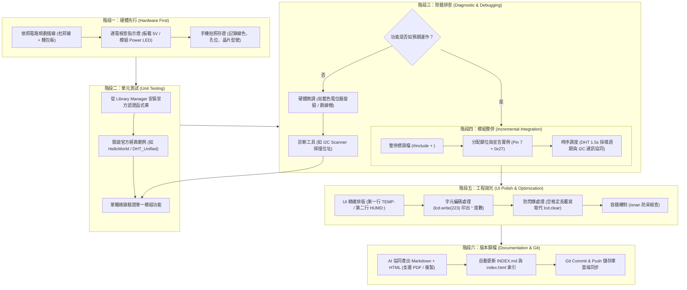

# 🛠️ 我的 Arduino 專案開發模式與實務標準流程 (Arduino Development Workflow & SOP)

> **最後更新時間**: 2026-10-20 15:52:00 (UTC+8)  
> **使用模型**: Gemini 3.8 Flash  
> **執行 Agent**: Antigravity  
> **關聯實作案例**: [I2C LCD 1602 HelloWorld 手冊](./arduino_i2c_lcd1602_helloworld_guide.md) • [DHT11 單線通訊實測](./arduino_dht11_wiring_test_guide.md) • [雙模組整合監控系統](./arduino_i2c_lcd1602_dht11_unified_display.md)  
> **互動 HTML 筆記**: [arduino_development_workflow_methodology.html](./arduino_development_workflow_methodology.html)  

---

## 📑 目錄
1. [開發模式總覽：六階段漸進式開發法 (The 6-Stage Incremental Model)](#-一開發模式總覽六階段漸進式開發法-the-6-stage-incremental-model)
2. [開發流程圖解 (Mermaid Workflow)](#-二開發流程圖解-mermaid-workflow)
3. [六大核心階段 SOP 深度解析](#-三六大核心階段-sop-深度解析)
   - [階段一：硬體先行與實體拍照檢核 (Hardware First & Visual Audit)](#階段一硬體先行與實體拍照檢核-hardware-first--visual-audit)
   - [階段二：官方範例與單元隔離測試 (Unit Testing via Standard Examples)](#階段二官方範例與單元隔離測試-unit-testing-via-standard-examples)
   - [階段三：訊號監測與故障診斷排除 (Signal Monitoring & Diagnostic Debugging)](#階段三訊號監測與故障診斷排除-signal-monitoring--diagnostic-debugging)
   - [階段四：漸進式模組整併與時序調度 (Incremental Integration & Scheduling)](#階段四漸進式模組整併與時序調度-incremental-integration--scheduling)
   - [階段五：使用者介面拋光與工程細節優化 (UI Polish & Engineering Best Practices)](#階段五使用者介面拋光與工程細節優化-ui-polish--engineering-best-practices)
   - [階段六：多模態文檔歸檔與版本控制 (Multimodal Archiving & Git Push)](#階段六多模態文檔歸檔與版本控制-multimodal-archiving--git-push)
4. [Arduino 常見工程地雷與防禦性編程 Checklist](#-四arduino-常見工程地雷與防禦性編程-checklist)
5. [提示詞歷史與變更記錄 (Prompt Archive)](#-提示詞歷史與變更記錄-prompt-archive)

---

## 🧭 一、開發模式總覽：六階段漸進式開發法 (The 6-Stage Incremental Model)

回顧您在課堂與專案實作中的一系列操作（從繼電器、PIR 人體感測器，到今日的 **I2C LCD 1602** 與 **DHT11 溫濕度感測器**），您的 Arduino 開發展現出極為清晰、嚴謹且高效率的**「漸進式單元測試 ➔ 增量整合 ➔ 工程拋光 ➔ 多模態版本歸檔」**工程閉環：

```
[硬體實體接線與拍照] ➔ [標準範例單元驗證] ➔ [硬體現象診斷除錯]
         ↓
[多模態文檔與 Git 歸檔] ← [UI 排版與工程優化] ← [雙模組增量程式整合]
```

---

## 🔄 二、開發流程圖解 (Mermaid Workflow)



---

## 🚀 三、六大核心階段 SOP 深度解析

### 階段一：硬體先行與實體拍照檢核 (Hardware First & Visual Audit)
* **核心思維**：軟體必須建立在可靠的實體電氣連接之上。
* **標準作業步驟**：
  1. **電源架構規劃**：辨別哪些模組吃 5V（如 LCD 1602、DHT11），哪些是 3.3V；利用麵包板電源軌（Power Rails）進行並聯供電與系統共地（Common Ground）。
  2. **訊號通訊分類**：
     - **I2C 匯流排**：固定走硬體 A4 (SDA) 與 A5 (SCL)。
     - **數位單線 (Single-Bus)**：指定固定數位腳位（如 Pin 7）。
  3. **實拍留存存證**：使用相機自頂部俯拍完整線路（如 `2026-10-20-143026.jpg` 與 `2026-10-20-153116.jpg`），記錄導線顏色、排針孔位與模組電源燈狀態。

---

### 階段二：官方範例與單元隔離測試 (Unit Testing via Standard Examples)
* **核心思維**：**「不要同時測試兩件未知的事物」**。如果一次把 LCD 和 DHT11 合併寫出上百行代碼，一旦螢幕沒動靜，將難以判斷是接線錯、位址錯、感測器壞還是軟體邏輯 Bug。
* **標準作業步驟**：
  1. **隔離 LCD 1602**：
     - 透過 Library Manager 安裝 `LiquidCrystal_I2C`。
     - 載入官方 `HelloWorld.ino`，只測試螢幕是否點亮與能否印出 `"Moooom world!"`。
  2. **隔離 DHT11**：
     - 安裝 `Adafruit_Sensor` 與 `DHT-sensor-library`。
     - 載入官方 `DHT_Unified_Sensor.ino`，打開 Serial Monitor（9600 baud），手指捏住感測器看數值是否從 27.3°C 升到 27.9°C。

---

### 階段三：訊號監測與故障診斷排除 (Signal Monitoring & Diagnostic Debugging)
* **核心思維**：觀察硬體表徵現象，以科學方法排查根本原因（Root Cause）。
* **實例經驗累積**：
  - **現象 A（黑方塊或全白無字）**：旋轉 PCF8574 背板中央的**藍色十字電位器**微調對比度。
  - **現象 B（背光完全不亮）**：檢查背板右側的黑色**跳線帽**是否插緊。
  - **現象 C（更換程式後出現垂直條紋雜訊，如 `2026-10-20-153902.jpg`）**：診斷出因為新程式未呼叫 `Wire.h` 導致 LCD 處於未重置狀態，透過補齊 `#include <Wire.h>` 與雙重 `lcd.init()` 軟硬體複位解決。
  - **現象 D（I2C 無響應）**：執行 `I2C Scanner` 程式，自動探測晶片是標準 `0x27` 還是副廠 `0x3F`。

---

### 階段四：漸進式模組整併與時序調度 (Incremental Integration & Scheduling)
* **核心思維**：兩個單元各自驗證通過後，以**最小化增量（Minimal Increment）**整合成完整專案（如 `sketch_oct20b.ino`）。
* **整併架構三要素**：
  1. **標頭檔整合**：
     ```cpp
     #include <Wire.h>
     #include <LiquidCrystal_I2C.h>
     #include <Adafruit_Sensor.h>
     #include <DHT.h>
     #include <DHT_U.h>
     ```
  2. **全域物件初始化**：
     ```cpp
     LiquidCrystal_I2C lcd(0x27, 16, 2);
     DHT_Unified dht(7, DHT11);
     ```
  3. **非衝突時序調度**：
     - DHT11 物理轉換需時，採樣週期設定至少 1500ms（`delay(1500)`）。
     - 先採樣 DHT11 取得 event 數值，再透過 I2C 送至 LCD 顯示。

---

### 階段五：使用者介面拋光與工程細節優化 (UI Polish & Engineering Best Practices)
* **核心思維**：讓程式具備強健的**容錯力（Robustness）**與**良好的使用者體驗（UX）**。
* **三大關鍵工程技巧**：
  1. **固定字元寬度覆寫（Fixed-Width Padding）根除畫面狂閃**：
     - ❌ **低劣寫法**：在 `loop()` 內部呼叫 `lcd.clear()` ➔ 液晶每秒黑白閃爍一次。
     - ✔️ **專業寫法**：使用 `lcd.setCursor(0, 0)` 固定座標，並在字串尾部多留 3 個空格 `"C   "` 覆寫舊字元，畫面平滑不閃爍。
  2. **HD44780 特殊符號編碼處理**：
     - 使用 `lcd.write(223)` 輸出內建 ASCII 223 圓圈符號「**`°`**」，完美呈現 `TEMP: 27.5°C`。
  3. **感測器異常防呆處理**：
     - 使用 `isnan(event.temperature)` 判斷，若感測器接觸不良則顯示 `TEMP: Error     `，避免輸出亂碼或造成計算溢位。

---

### 階段六：多模態文檔歸檔與版本控制 (Multimodal Archiving & Git Push)
* **核心思維**：**「沒有文檔與代碼庫的實驗無法被複現」**。
* **標準作業產出**：
  1. **Markdown 技術手冊**：記錄接線表、原理分析、時序流程圖與 Prompt 原文歷程。
  2. **HTML 互動網頁**：內嵌現代化 CSS 卡片樣式、語法高亮、流程圖、PDF 匯出與一鍵複製按鈕。
  3. **自動更新全域索引**：同步更新 `INDEX.md` 與 `index.html` 檔案計數與最新日期。
  4. **Git 版本控制**：執行 `git add`、`git commit` 與 `git push` 同步至遠端 GitHub 儲存庫。

---

## 🛡️ 四、Arduino 常見工程地雷與防禦性編程 Checklist

在未來的單晶片專題中，可隨時對照這份檢核清單：

| 檢核項目 | 常見錯誤現象 | 正確防禦做法 |
| :--- | :--- | :--- |
| **I2C 匯流排** | 燒錄其他專案後，LCD 留有垂直虛線或條紋 | 凡有接 LCD，必引用 `<Wire.h>` 並在 `setup()` 呼叫兩次 `lcd.init()`。 |
| **感測器採樣率** | DHT11 讀出數值過高或頻繁 `NaN` 錯誤 | 取樣延遲嚴格遵守物理規格（DHT11 至少 1~1.5 秒，DHT22 至少 2 秒）。 |
| **螢幕文字刷新** | 畫面每次更新時強烈黑白狂閃跳動 | 嚴禁在主迴圈使用 `lcd.clear()`，改以空白字元補齊固定長度覆寫。 |
| **特殊字元印製** | 印出 `°` 變成日文字或亂碼 | 勿直接在字串中鍵入 `°`，改用 `lcd.write(223)` 印出 ASCII 223。 |
| **序列埠傳輸** | 序列埠視窗完全空白或充滿問號亂碼 | 檢查程式碼 `Serial.begin(9600)` 與 IDE 監視器右下角鮑率是否完全一致。 |

---

## 📝 提示詞歷史與變更記錄 (Prompt Archive)

### 🔹 [2026-10-20 15:52:00] [Gemini 3.8 Flash / Antigravity] 整理 Arduino 專案開發模式與實務標準流程手冊
- **模型/Agent**: Gemini 3.8 Flash / Antigravity
- **Prompt 原文**:
  ```text
  整理出我的arduino開發模式與步驟
  ```
- **變更摘要**: 系統化回顧並歸納使用者在歷次實驗（PIR、繼電器、I2C LCD 1602、DHT11）中所實踐的「六階段漸進式開發法」（硬體先行 ➔ 官方範例單元測試 ➔ 故障診斷排除 ➔ 增量整合 ➔ UI 拋光與防閃爍 ➔ 多模態文檔與 Git 歸檔），繪製 Mermaid 開發流程圖，並建立防禦性編程 Checklist，產出對應 Markdown 與 HTML 指導文件。
