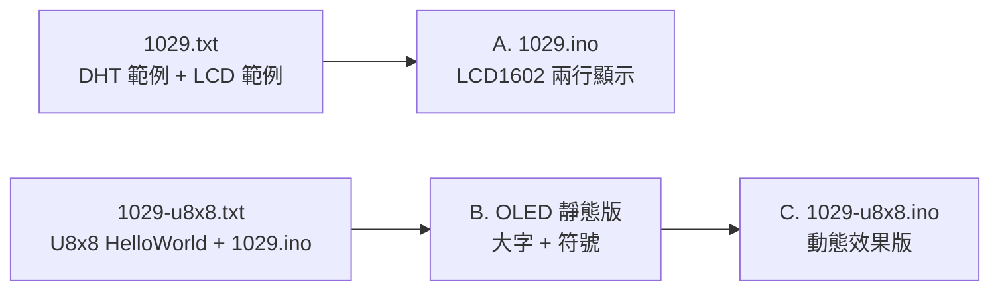
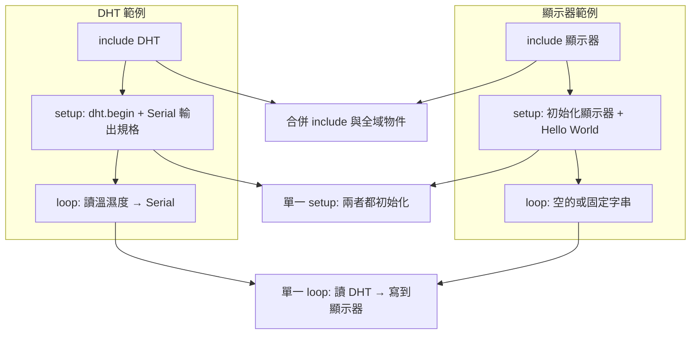
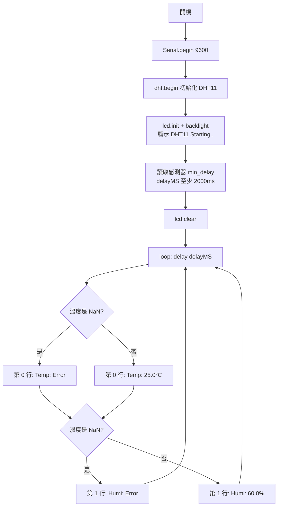
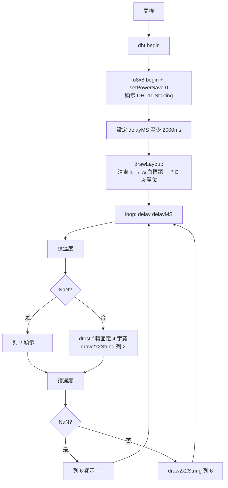
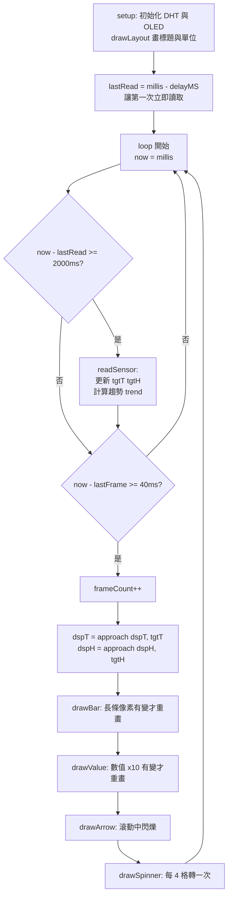
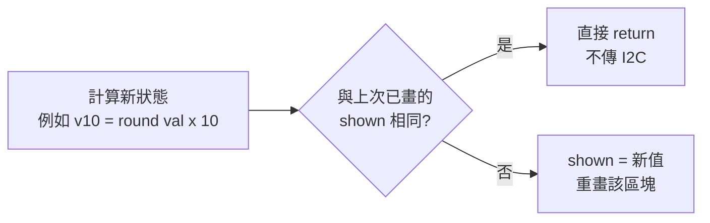

# 🌡️ Arduino Uno + DHT11：從 LCD1602 到 SSD1306 OLED (U8x8) 溫濕度顯示與動態效果實作 (1029)

> **最後更新時間**: 2026-10-29 15:20:00 (UTC+8)
> **使用模型**: Claude Opus 5.5 (Medium)
> **執行 Agent**: Antigravity

---

## 📌 0. 本篇重點總覽

本篇整理 2026-10-29 課堂的三個實作階段，全部以 **Arduino Uno + DHT11（D8）** 為基礎：

| 階段 | 程式檔 | 顯示器 | 重點 |
|------|--------|--------|------|
| A | [`1029.ino`](./1029.ino) | I2C LCD1602 (0x27) | 兩支範例程式合併；第一行溫度、第二行濕度 |
| B | （本筆記第 4 章程式碼） | SSD1306 128x64 OLED (U8x8) | 版面規劃、2x2 放大字、自訂「°」圖塊 |
| C | [`1029-u8x8.ino`](./1029-u8x8.ino) | SSD1306 128x64 OLED (U8x8) | 數字滾動、長條圖、趨勢箭頭、旋轉指示器、`millis()` 非阻塞 |



### 硬體接線

| 元件 | 腳位 | Arduino Uno |
|------|------|-------------|
| DHT11 | DATA | D8 |
| DHT11 | VCC / GND | 5V / GND |
| LCD1602 I2C 或 SSD1306 OLED | SDA | A4 |
| LCD1602 I2C 或 SSD1306 OLED | SCL | A5 |
| LCD1602 I2C 或 SSD1306 OLED | VCC / GND | 5V / GND |

### 需要的函式庫

| 函式庫 | 用途 | 使用階段 |
|--------|------|----------|
| DHT sensor library (Adafruit) | 讀取 DHT11 | A / B / C |
| Adafruit Unified Sensor | DHT_Unified 介面 | A / B / C |
| LiquidCrystal_I2C | LCD1602 I2C | A |
| U8g2（內含 U8x8） | SSD1306 OLED | B / C |

---

## 🧠 1. 核心概念剖析 (Core Concepts)

### 1.1 為什麼兩支範例程式不能直接「貼在一起」？

Arduino 草稿碼（sketch）在編譯時是**一個 C++ 程式**，每個函式只能定義一次：

- `setup()` 與 `loop()` 各只能有**一個** → 貼兩份會出現 `redefinition of 'void setup()'` 錯誤。
- `#include` 統一放最上方；全域物件（`dht`、`lcd`、`u8x8`）各宣告一次。
- **整合原則**：把兩份 `setup()` 的初始化合併成一個，把兩份 `loop()` 的工作合併成一個（讀感測器 → 輸出到顯示器）。



### 1.2 DHT11 感測器特性

| 項目 | DHT11 規格 |
|------|-----------|
| 溫度範圍 / 精度 | 0 ~ 50 °C / ±2 °C |
| 濕度範圍 / 精度 | 20 ~ 90 %RH / ±5 %RH |
| 解析度 | 1 °C、1 %RH |
| 取樣間隔 | 至少 1 秒（建議 2 秒） |

> 因為取樣間隔限制，程式中 `delayMS` 最少設為 **2000 ms**；讀取太快會得到 `NaN`（程式中以 `isnan()` 判斷）。

### 1.3 LCD1602 的度數符號

HD44780 控制器的字元 ROM 中，**編號 223 (0xDF)** 是「°」。原始碼中直接寫 `"°C"` 是 UTF-8 的兩個位元組，LCD 會顯示成亂碼，所以要寫：

```cpp
lcd.print((char)223);   // HD44780 字元 ROM 的 °
lcd.print("C");
```

### 1.4 U8x8 的「圖塊（tile）」座標系

U8x8 是 U8g2 函式庫中**不需要畫面緩衝區**的文字模式，RAM 用量最省，適合 Uno（2 KB RAM）。

- 128x64 螢幕切成 **16 欄 x 8 列**，每格 **8x8 像素**。
- 座標 `(x, y)` 的單位是**格子**，不是像素：`drawString(0, 0, ...)` 表示左上角那一格。
- `draw2x2String()`：每個字放大成 2x2 格（16x16 像素），一行最多 8 個字。
- `drawTile(x, y, cnt, ptr)`：直接寫入自訂圖案；**每個 byte 代表一個直行（8 個像素），LSB 在最上方**。

```text
byte 值 0x0E = 0000 1110 (bit7..bit0)
         bit0 (最上) = 0
         bit1        = 1  ■
         bit2        = 1  ■
         bit3        = 1  ■
         bit4~7      = 0
```

以「°」圖塊 `{0x00, 0x0E, 0x11, 0x11, 0x11, 0x0E, 0x00, 0x00}` 為例（每個直行轉成橫向觀看）：

```text
  byte:      00   0E   11   11   11   0E   00   00
  col:        0    1    2    3    4    5    6    7
  row0 (bit0) .    .    ■    ■    ■    .    .    .    ← 0x11 的 bit0
  row1 (bit1) .    ■    .    .    .    ■    .    .    ← 0x0E 的 bit1
  row2 (bit2) .    ■    .    .    .    ■    .    .    ← 0x0E 的 bit2
  row3 (bit3) .    ■    .    .    .    ■    .    .    ← 0x0E 的 bit3
  row4 (bit4) .    .    ■    ■    ■    .    .    .    ← 0x11 的 bit4
  row5~7      .    .    .    .    .    .    .    .
```

0x0E（bit1~3）構成左右兩側、0x11（bit0、bit4）構成上下兩邊，組合起來就是位於格子上半部的小圓圈「°」。

### 1.5 非阻塞排程：`delay()` vs `millis()`

| 方式 | 原理 | 缺點 / 優點 |
|------|------|-------------|
| `delay(2000)` | CPU 原地等待 2 秒 | 等待期間**什麼都不能做**，無法跑動畫 |
| `millis()` | 每次 loop 檢查「距離上次是否已超過 N 毫秒」 | 可以同時跑多個不同週期的工作 |

```cpp
if (now - lastRead >= delayMS) { lastRead = now; readSensor(); }  // 每 2 秒
if (now - lastFrame >= FRAME_MS) { lastFrame = now; /* 畫動畫 */ } // 每 40 毫秒
```

> `now - last >= interval` 的寫法在 `millis()` 約 49.7 天溢位歸零時依然正確（無號整數減法特性）。

### 1.6 緩動（Easing）：讓數字「跑」到目標值

每一格動畫讓顯示值往目標值前進「剩餘差距的 1/6」，並設定最小步伐 0.1：

```text
step = (目標值 - 顯示值) / 6        // 剩餘差距的 1/6
若 |step| < 0.1，則 step = ±0.1     // 最小步伐，方向跟著差距正負
顯示值 = 顯示值 + step
```

- 差距大 → 步伐大，跑得快；差距小 → 接近時減速，視覺上很滑順（ease-out）。
- 差距 < 0.05 時直接等於目標值，避免永遠到不了。

---

## 🅰️ 2. 階段 A：LCD1602 第一行溫度、第二行濕度（1029.ino）

### 2.1 題目

> `1029.txt` 中包含 Adafruit DHT Unified 範例與 YWROBOT LiquidCrystal_I2C HelloWorld 範例，整合成 Arduino Uno 程式：**第一行顯示溫度、第二行顯示濕度**。

### 2.2 程式邏輯流程圖



### 2.3 完整程式碼

```cpp
// DHT11 溫濕度感測器 + I2C LCD1602 顯示
// 第一行顯示溫度，第二行顯示濕度
//
// 需要的函式庫:
// - DHT Sensor Library: https://github.com/adafruit/DHT-sensor-library
// - Adafruit Unified Sensor Lib: https://github.com/adafruit/Adafruit_Sensor
// - LiquidCrystal_I2C

#include <Adafruit_Sensor.h>
#include <DHT.h>
#include <DHT_U.h>
#include <Wire.h>
#include <LiquidCrystal_I2C.h>

#define DHTPIN 8          // DHT 感測器資料腳接 D8
#define DHTTYPE DHT11     // 感測器型號 DHT11
//#define DHTTYPE DHT22   // DHT 22 (AM2302)

DHT_Unified dht(DHTPIN, DHTTYPE);
LiquidCrystal_I2C lcd(0x27, 16, 2);  // LCD 位址 0x27，16 字 x 2 行

uint32_t delayMS;

void setup() {
  Serial.begin(9600);

  // 初始化 DHT 感測器
  dht.begin();

  // 初始化 LCD
  lcd.init();
  lcd.backlight();
  lcd.setCursor(0, 0);
  lcd.print("DHT11 Starting..");

  // 依感測器規格設定讀取間隔
  sensor_t sensor;
  dht.humidity().getSensor(&sensor);
  delayMS = sensor.min_delay / 1000;
  if (delayMS < 2000) delayMS = 2000;   // DHT11 建議至少間隔 1~2 秒

  delay(1000);
  lcd.clear();
}

void loop() {
  delay(delayMS);

  sensors_event_t event;

  // ---- 第一行：溫度 ----
  dht.temperature().getEvent(&event);
  lcd.setCursor(0, 0);
  if (isnan(event.temperature)) {
    lcd.print("Temp: Error     ");
    Serial.println(F("Error reading temperature!"));
  } else {
    lcd.print("Temp: ");
    lcd.print(event.temperature, 1);
    lcd.print((char)223);              // LCD 的度數符號 °
    lcd.print("C    ");                // 補空白清除殘留字元
    Serial.print(F("Temperature: "));
    Serial.print(event.temperature);
    Serial.println(F(" C"));
  }

  // ---- 第二行：濕度 ----
  dht.humidity().getEvent(&event);
  lcd.setCursor(0, 1);
  if (isnan(event.relative_humidity)) {
    lcd.print("Humi: Error     ");
    Serial.println(F("Error reading humidity!"));
  } else {
    lcd.print("Humi: ");
    lcd.print(event.relative_humidity, 1);
    lcd.print("%     ");               // 補空白清除殘留字元
    Serial.print(F("Humidity: "));
    Serial.print(event.relative_humidity);
    Serial.println(F("%"));
  }
}
```

### 2.4 重點說明

- **補空白清除殘留**：LCD 不會自動清掉舊字元。例如由 `Error` 變成 `25.0°C`，若不補空白，尾端會殘留舊字。每次 `lcd.clear()` 雖然也行，但會造成閃爍。
- **原範例 `lcd.init()` 呼叫兩次**：屬於範例的冗餘寫法，整合後保留一次即可。
- **`F("...")` 巨集**：把字串存在 Flash 而不是 RAM，Uno 只有 2 KB RAM，Serial 訊息多時很有幫助。

---

## 🅱️ 3. 階段 B 前置：U8x8 HelloWorld 範例解讀

`1029-u8x8.txt` 的前半段是 U8g2 官方 `HelloWorld.ino`（U8x8 版），有約 280 行的**建構子清單**，只需取消註解符合自己螢幕的那一行：

```cpp
U8X8_SSD1306_128X64_NONAME_SW_I2C u8x8(/* clock=*/ SCL, /* data=*/ SDA, /* reset=*/ U8X8_PIN_NONE);
```

建構子名稱拆解：

| 片段 | 意義 |
|------|------|
| `U8X8_` | 使用 U8x8 文字模式（無緩衝區） |
| `SSD1306` | 控制晶片 |
| `128X64_NONAME` | 解析度 / 一般副廠模組 |
| `SW_I2C` / `HW_I2C` | 軟體模擬 I2C / 硬體 I2C（較快） |

> 整合時改用 **`HW_I2C`**：Uno 的硬體 I2C 就在 A4/A5，傳輸速度比軟體模擬快很多，對動畫版尤其重要。若畫面異常再改回 `SW_I2C`。

---

## 🅱️ 4. 階段 B：OLED 靜態版——安排適當大小、顯示溫濕度與符號

### 4.1 版面規劃（16 欄 x 8 列）

```text
     欄 0123456789012345
列 0   [  TEMPERATURE   ]   ← 反白小字標題 (1x1)
列 1                         
列 2     25.0 °C             ← 2x2 大字 (占列 2~3)，° 為自訂小圖塊
列 3     ~~~~ ~~             
列 4   [    HUMIDITY    ]   ← 反白小字標題
列 5                         
列 6     60.0 %              ← 2x2 大字 (占列 6~7)
列 7     ~~~~ ~             
```

| 元素 | 欄位範圍 | 說明 |
|------|----------|------|
| 數值 `25.0` | 欄 2~9 | 4 字 x 2 格寬 |
| `°` | 欄 11，列 2 | 自訂 1x1 圖塊，放在大字上半部，看起來像上標 |
| `C` / `%` | 欄 12~13 | 2x2 大字 |

### 4.2 程式邏輯流程圖



### 4.3 完整程式碼（靜態版）

```cpp
// DHT11 溫濕度感測器 + SSD1306 128x64 OLED (U8x8 API)
//
// 畫面配置 (U8x8 = 16 欄 x 8 列，每格 8x8 像素)
//   第 0 列    : [ TEMPERATURE ]   反白標題 (小字)
//   第 2~3 列  :   25.0 °C         2x2 放大字
//   第 4 列    : [  HUMIDITY   ]   反白標題 (小字)
//   第 6~7 列  :   60.0 %          2x2 放大字

#include <Arduino.h>
#include <U8x8lib.h>
#include <Wire.h>
#include <Adafruit_Sensor.h>
#include <DHT.h>
#include <DHT_U.h>

#define DHTPIN 8          // DHT 感測器資料腳接 D8
#define DHTTYPE DHT11     // 感測器型號 DHT11

DHT_Unified dht(DHTPIN, DHTTYPE);

// SSD1306 128x64 OLED，硬體 I2C (A4/A5)
U8X8_SSD1306_128X64_NONAME_HW_I2C u8x8(/* reset=*/ U8X8_PIN_NONE);

// 自訂度數符號 "°" (8x8 tile，每個 byte 為一直行，LSB 在上方)
uint8_t degreeTile[8] = {0x00, 0x0E, 0x11, 0x11, 0x11, 0x0E, 0x00, 0x00};

uint32_t delayMS;

// 畫出固定的標題與單位符號 (只畫一次)
void drawLayout() {
  u8x8.clear();
  u8x8.setFont(u8x8_font_chroma48medium8_r);

  u8x8.setInverseFont(1);                        // 反白標題
  u8x8.drawString(0, 0, "  TEMPERATURE   ");
  u8x8.drawString(0, 4, "    HUMIDITY    ");
  u8x8.setInverseFont(0);

  u8x8.drawTile(11, 2, 1, degreeTile);           // °
  u8x8.draw2x2String(12, 2, "C");                // C
  u8x8.draw2x2String(12, 6, "%");                // %
}

void setup() {
  Serial.begin(9600);
  dht.begin();

  u8x8.begin();
  u8x8.setPowerSave(0);
  u8x8.setFont(u8x8_font_chroma48medium8_r);
  u8x8.drawString(0, 3, " DHT11 Starting ");

  sensor_t sensor;
  dht.humidity().getSensor(&sensor);
  delayMS = sensor.min_delay / 1000;
  if (delayMS < 2000) delayMS = 2000;   // DHT11 建議至少間隔 1~2 秒

  delay(1000);
  drawLayout();
}

void loop() {
  delay(delayMS);

  sensors_event_t event;
  char buf[8];

  u8x8.setFont(u8x8_font_chroma48medium8_r);

  // ---- 溫度 (列 2~3，2x2 大字) ----
  dht.temperature().getEvent(&event);
  if (isnan(event.temperature)) {
    u8x8.draw2x2String(2, 2, "----");
  } else {
    dtostrf(event.temperature, 4, 1, buf);   // 固定 4 字寬，例如 "25.0"
    u8x8.draw2x2String(2, 2, buf);
  }

  // ---- 濕度 (列 6~7，2x2 大字) ----
  dht.humidity().getEvent(&event);
  if (isnan(event.relative_humidity)) {
    u8x8.draw2x2String(2, 6, "----");
  } else {
    dtostrf(event.relative_humidity, 4, 1, buf);
    u8x8.draw2x2String(2, 6, buf);
  }
}
```

### 4.4 重點說明

- **為何要自訂「°」**：`u8x8_font_chroma48medium8_r` 的 `_r` 代表只含 ASCII 32~127，沒有 `°`（Unicode U+00B0）。用 `drawTile()` 畫一個 8x8 小圓圈最省資源。
- **`dtostrf(val, 4, 1, buf)`**：AVR 的 `sprintf` 預設**不支援 `%f`**，所以浮點數轉字串要用 `dtostrf`。寬度固定 4，數值變短時前面自動補空白，舊字會被覆蓋。
- **標題與單位只畫一次**：`loop()` 只更新數字，減少 I2C 傳輸量，畫面不閃爍。

---

## 🅲 5. 階段 C：數值動態效果版（1029-u8x8.ino）

### 5.1 動態效果設計

```text
┌────────────────┐
│  TEMPERATURE  /│ ← ④ 旋轉指示器 | / - \
│████████░░░░░░░░│ ← ② 長條圖 (0~50°C)
│  25.0 °C      ↑│ ← ① 數字滾動 + ③ 趨勢箭頭
│                │
│    HUMIDITY   /│
│███████████░░░░░│ ← ② 長條圖 (0~100%)
│  60.0 %       ↓│
│                │
└────────────────┘
```

| # | 效果 | 實作方式 |
|---|------|----------|
| ① | 數字滾動 | `approach()` 緩動函式，顯示值 `dspT` 每格向目標值 `tgtT` 靠近 |
| ② | 長條圖伸縮 | 組一個 128 bytes 的圖塊陣列，`drawTile(0, row, 16, buf)` 一次畫滿整列 |
| ③ | 趨勢箭頭 | 新讀數與上次比較 → ↑ / ↓；滾動期間每 5 格閃爍一次 |
| ④ | 旋轉指示器 | 每 4 格依序切換「直線、斜線、橫線、反斜線」四個字元，表示程式仍在執行 |

### 5.2 程式邏輯流程圖



### 5.3 「只在有變化時才重畫」的機制



> 每秒 25 格動畫，如果每格都重畫整個螢幕，I2C 頻寬會吃緊。以「快取上次狀態」比較，靜止時幾乎沒有傳輸。

### 5.4 完整程式碼（動態效果版）

```cpp
// DHT11 溫濕度感測器 + SSD1306 128x64 OLED (U8x8 API) — 動態效果版
//
// 畫面配置 (U8x8 = 16 欄 x 8 列，每格 8x8 像素)
//   第 0 列    : [ TEMPERATURE  ⟳]  反白標題 + 右上角旋轉指示器
//   第 1 列    : ██████░░░░░░░░░░   溫度長條圖 (0~50°C)
//   第 2~3 列  :   25.0 °C      ↑   2x2 放大字 + 趨勢箭頭
//   第 4 列    : [   HUMIDITY   ⟳]  反白標題 + 旋轉指示器
//   第 5 列    : ████████░░░░░░░░   濕度長條圖 (0~100%)
//   第 6~7 列  :   60.0 %       ↓   2x2 放大字 + 趨勢箭頭
//
// 動態效果:
//   1. 數字滾動：數值從舊值逐步「跑」到新值 (開機時從 0 往上數)
//   2. 長條圖：跟著數字一起平滑伸縮
//   3. 趨勢箭頭：上升 ↑ / 下降 ↓，數字滾動期間會閃爍
//   4. 旋轉指示器：標題右側 | / - \ 持續轉動，表示程式運作中
//
// 接線 (Arduino UNO):
//   OLED SDA -> A4, SCL -> A5, VCC -> 5V, GND -> GND
//   DHT11 DATA -> D8

#include <Arduino.h>
#include <U8x8lib.h>
#include <Wire.h>
#include <Adafruit_Sensor.h>
#include <DHT.h>
#include <DHT_U.h>

#define DHTPIN 8          // DHT 感測器資料腳接 D8
#define DHTTYPE DHT11     // 感測器型號 DHT11
//#define DHTTYPE DHT22   // DHT 22 (AM2302)

#define FRAME_MS   40     // 動畫每格間隔 (毫秒)，約 25 FPS
#define TEMP_MAX   50.0   // 溫度長條圖滿格值 (DHT11 量測上限 50°C)
#define HUMI_MAX   100.0  // 濕度長條圖滿格值

DHT_Unified dht(DHTPIN, DHTTYPE);

// SSD1306 128x64 OLED，硬體 I2C (A4/A5)
U8X8_SSD1306_128X64_NONAME_HW_I2C u8x8(/* reset=*/ U8X8_PIN_NONE);
// 若畫面異常可改用軟體 I2C:
//U8X8_SSD1306_128X64_NONAME_SW_I2C u8x8(/* clock=*/ SCL, /* data=*/ SDA, /* reset=*/ U8X8_PIN_NONE);

// ---- 自訂圖塊 (8x8，每個 byte 為一直行，LSB 在上方) ----
uint8_t degreeTile[8] = {0x00, 0x0E, 0x11, 0x11, 0x11, 0x0E, 0x00, 0x00}; // °
uint8_t upTile[8]     = {0x00, 0x08, 0x0C, 0xFE, 0x0C, 0x08, 0x00, 0x00}; // ↑
uint8_t downTile[8]   = {0x00, 0x10, 0x30, 0x7F, 0x30, 0x10, 0x00, 0x00}; // ↓
uint8_t blankTile[8]  = {0, 0, 0, 0, 0, 0, 0, 0};

// ---- 狀態變數 ----
uint32_t delayMS;                 // 感測器讀取間隔
unsigned long lastRead = 0;       // 上次讀取時間
unsigned long lastFrame = 0;      // 上次動畫更新時間
uint16_t frameCount = 0;          // 動畫格數計數

float tgtT = 0, tgtH = 0;         // 目標值 (感測器最新讀數)
float dspT = 0, dspH = 0;         // 目前畫面顯示值 (動畫中逐步接近目標)
bool  okT = false, okH = false;   // 讀數是否有效
bool  firstRead = true;
int8_t trendT = 0, trendH = 0;    // 趨勢：1 上升 / -1 下降 / 0 持平

// 用來避免重複繪製 (減少 I2C 傳輸、畫面不閃)
int  shownT = -32768, shownH = -32768;  // 已顯示數值 (x10 整數)
int  barPxT = -1, barPxH = -1;          // 已顯示長條像素
int8_t arrowStT = -2, arrowStH = -2;    // 已顯示箭頭狀態

// 讓 cur 平滑接近 tgt：差距大時走快，差距小時至少走 0.1
float approach(float cur, float tgt) {
  float d = tgt - cur;
  if (fabs(d) < 0.05) return tgt;
  float step = d / 6.0;
  if (fabs(step) < 0.1) step = (d > 0) ? 0.1 : -0.1;
  return cur + step;
}

// 繪製 2x2 大數字 (只有數值改變時才重畫)
void drawValue(uint8_t row, float val, bool ok, int &shown) {
  int v10 = ok ? (int)round(val * 10) : -32767;  // -32767 代表錯誤
  if (v10 == shown) return;
  shown = v10;
  if (!ok) {
    u8x8.draw2x2String(2, row, "----");
  } else {
    char buf[8];
    dtostrf(val, 4, 1, buf);   // 固定 4 字寬，例如 "25.0"
    u8x8.draw2x2String(2, row, buf);
  }
}

// 繪製長條圖 (整列 16 格 = 128 像素)
void drawBar(uint8_t row, float val, float maxV, bool ok, int &lastPx) {
  int px = ok ? (int)(constrain(val / maxV, 0.0, 1.0) * 128) : 0;
  if (px == lastPx) return;
  lastPx = px;

  uint8_t buf[128];
  for (int i = 0; i < 128; i++) {
    if (i == 0 || i == 127)  buf[i] = 0x7E;  // 左右邊框
    else if (i < px)         buf[i] = 0x7E;  // 已填滿：實心
    else                     buf[i] = 0x42;  // 未填滿：只有上下框線
  }
  u8x8.drawTile(0, row, 16, buf);
}

// 繪製趨勢箭頭；動畫進行中 (dsp != tgt) 會閃爍
void drawArrow(uint8_t row, int8_t trend, bool animating, int8_t &lastSt) {
  int8_t st = trend;
  if (animating && ((frameCount / 5) % 2)) st = 0;   // 閃爍：每 5 格切換
  if (st == lastSt) return;
  lastSt = st;
  if (st > 0)      u8x8.drawTile(15, row, 1, upTile);
  else if (st < 0) u8x8.drawTile(15, row, 1, downTile);
  else             u8x8.drawTile(15, row, 1, blankTile);
}

// 標題右側旋轉指示器 | / - \ .
void drawSpinner() {
  static const char spin[] = "|/-\\";
  if (frameCount % 4) return;                 // 每 4 格轉一次
  char c[2] = { spin[(frameCount / 4) % 4], 0 };
  u8x8.setInverseFont(1);
  u8x8.drawString(15, 0, c);
  u8x8.drawString(15, 4, c);
  u8x8.setInverseFont(0);
}

// 畫出固定的標題與單位符號
void drawLayout() {
  u8x8.clear();
  u8x8.setFont(u8x8_font_chroma48medium8_r);

  u8x8.setInverseFont(1);
  u8x8.drawString(0, 0, "  TEMPERATURE   ");
  u8x8.drawString(0, 4, "    HUMIDITY    ");
  u8x8.setInverseFont(0);

  u8x8.drawTile(11, 2, 1, degreeTile);   // °
  u8x8.draw2x2String(12, 2, "C");
  u8x8.draw2x2String(12, 6, "%");
}

// 讀取 DHT11，更新目標值與趨勢
void readSensor() {
  sensors_event_t event;

  dht.temperature().getEvent(&event);
  okT = !isnan(event.temperature);
  if (okT) {
    float t = event.temperature;
    if (!firstRead) trendT = (t > tgtT + 0.05) ? 1 : (t < tgtT - 0.05) ? -1 : 0;
    tgtT = t;
    Serial.print(F("Temperature: "));
    Serial.print(t);
    Serial.println(F(" C"));
  } else {
    Serial.println(F("Error reading temperature!"));
  }

  dht.humidity().getEvent(&event);
  okH = !isnan(event.relative_humidity);
  if (okH) {
    float h = event.relative_humidity;
    if (!firstRead) trendH = (h > tgtH + 0.05) ? 1 : (h < tgtH - 0.05) ? -1 : 0;
    tgtH = h;
    Serial.print(F("Humidity: "));
    Serial.print(h);
    Serial.println(F("%"));
  } else {
    Serial.println(F("Error reading humidity!"));
  }

  if (okT && okH) firstRead = false;
}

void setup() {
  Serial.begin(9600);
  dht.begin();

  u8x8.begin();
  u8x8.setPowerSave(0);
  u8x8.setFont(u8x8_font_chroma48medium8_r);
  u8x8.drawString(0, 3, " DHT11 Starting ");

  // 依感測器規格設定讀取間隔
  sensor_t sensor;
  dht.humidity().getSensor(&sensor);
  delayMS = sensor.min_delay / 1000;
  if (delayMS < 2000) delayMS = 2000;   // DHT11 建議至少間隔 1~2 秒

  delay(1000);
  drawLayout();
  lastRead = millis() - delayMS;        // 讓 loop 一開始就立即讀取
}

void loop() {
  unsigned long now = millis();

  // ---- 1. 定時讀取感測器 (非阻塞) ----
  if (now - lastRead >= delayMS) {
    lastRead = now;
    readSensor();
  }

  // ---- 2. 動畫更新 ----
  if (now - lastFrame >= FRAME_MS) {
    lastFrame = now;
    frameCount++;

    // 顯示值逐步接近目標值
    if (okT) dspT = approach(dspT, tgtT);
    if (okH) dspH = approach(dspH, tgtH);

    u8x8.setFont(u8x8_font_chroma48medium8_r);

    // 溫度區
    drawBar(1, dspT, TEMP_MAX, okT, barPxT);
    drawValue(2, dspT, okT, shownT);
    drawArrow(2, trendT, dspT != tgtT, arrowStT);

    // 濕度區
    drawBar(5, dspH, HUMI_MAX, okH, barPxH);
    drawValue(6, dspH, okH, shownH);
    drawArrow(6, trendH, dspH != tgtH, arrowStH);

    drawSpinner();
  }
}
```

### 5.5 數值範例：數字滾動軌跡

假設開機時 `dspT = 0`，讀到 `tgtT = 26.0`，每格 40 ms：

| 格數 | 差距 d | 步伐 d/6 | 新顯示值 |
|------|--------|----------|----------|
| 1 | 26.00 | 4.33 | 4.3 |
| 2 | 21.67 | 3.61 | 7.9 |
| 3 | 18.06 | 3.01 | 10.9 |
| 5 | 12.54 | 2.09 | 15.5 |
| 10 | 5.04 | 0.84 | 21.8 |
| 20 | 0.81 | 0.135 | 25.3 |
| 25 | 0.27 | 0.045 → 最小 0.1 | 25.8 |
| 28 | -0.03 | 差距 < 0.05，直接到位 | 26.0 |

約 28 格 ≈ **1.1 秒**完成開機動畫；之後 DHT11 每次變化通常只有 ±1，約 10 格（0.4 秒）就到位。

### 5.6 長條圖圖塊編碼

| 狀態 | byte 值 | 點亮的 bit（像素列） | 外觀 |
|------|---------|---------------------|------|
| 實心 / 邊框 | `0x7E` | bit1 ~ bit6 | ■ 一條 6 像素高的直線 |
| 空白 | `0x42` | bit1、bit6 | 只剩上下兩點 → 連成空心外框 |

---

## 🚀 6. 延伸思考與進階主題 (Extensions & Advanced Topics)

### 6.1 LCD1602 vs SSD1306 (U8x8) 比較

| 項目 | LCD1602 I2C | SSD1306 OLED + U8x8 |
|------|-------------|---------------------|
| 解析度 | 16 字 x 2 行（5x8 點陣字） | 128x64 像素 = 16x8 格 |
| 放大字 | 不支援 | `draw2x2String`、`draw1x2String` |
| 自訂圖案 | 最多 8 個 CGRAM 字元 | `drawTile` 無數量限制 |
| 背光 / 對比 | 需背光，可調電位器 | 自發光、高對比、可視角大 |
| RAM 使用 | 極少 | U8x8 極少（無緩衝區） |
| 常見 I2C 位址 | 0x27 / 0x3F | 0x3C / 0x3D |
| 缺點 | 字型固定、無圖形 | 長時間靜態畫面可能燒屏 |

### 6.2 U8x8 vs U8g2 (Page / Full Buffer) 做動畫的取捨

| 模式 | RAM | 動畫能力 | 本專題適用性 |
|------|-----|----------|--------------|
| U8x8 | ~0 B 緩衝 | 只能以 8x8 格為單位更新 | ✅ 文字 + 長條圖剛好以格為單位 |
| U8g2 Page `_1` | 128 B | 像素級，但每幀需重畫整頁 | 可做平滑曲線圖，速度較慢 |
| U8g2 Full `_F` | 1024 B | 像素級，最流暢 | Uno 只剩約 1 KB，DHT + Serial 後吃緊 |

> 延伸閱讀：同資料夾的 [U8g2 顯示模式比較](./u8g2_display_modes_comparison.md)、[U8g2 Page／Full 圖解](./u8g2_display_modes_memory_guide.md)。

### 6.3 邊界條件與注意事項

- **負溫度 / DHT22**：DHT22 可量 -40 °C，`dtostrf(-10.5, 4, 1)` 會變成 5 字 `-10.5`，超出欄 2~9，會壓到單位。改 DHT22 時應把寬度改為 5、數字起始欄改為 0。
- **長條圖滿格值**：`TEMP_MAX` 若量測環境多在 20~35 °C，可改成顯示 `(val - 15) / 25` 的區間，長條變化更明顯。
- **堆疊用量**：`drawBar()` 內的 `uint8_t buf[128]` 位於堆疊，Uno 2 KB RAM 仍足夠；若再加其他大型陣列，可改成 `static` 或分 16 次畫單格。
- **DHT 讀取的阻塞**：Adafruit DHT 讀取時會關閉中斷約 4~5 ms 並等待，動畫可能偶爾頓一下，屬正常現象。
- **OLED 燒屏**：標題列固定不動，長時間運作可定時 `setPowerSave(1)`，或每隔數分鐘把版面上下移一列。
- **I2C 位址**：LCD 背光亮但無字 → 試 `0x3F`；OLED 不亮 → 用 I2C Scanner 確認 `0x3C` / `0x3D`。

### 6.4 進階發展方向

1. **歷史曲線**：改用 U8g2 Page Buffer，記錄最近 60 筆資料畫成折線圖。
2. **警示效果**：溫度超過門檻時用 `setInverseFont(1)` 讓數字反白閃爍，或加蜂鳴器。
3. **體感溫度 / 露點**：Adafruit DHT 函式庫提供 `computeHeatIndex()`，可加第三個畫面輪播。
4. **按鈕切換頁面**：配合 `millis()` 架構可輕鬆加入按鍵掃描，不會卡住動畫。
5. **升級感測器**：SHT31 / BME280（I2C，可與 OLED 共用 A4/A5），精度與速度皆優於 DHT11。

---

## 🛠️ 7. 疑難排解

| 現象 | 可能原因 | 處理 |
|------|----------|------|
| 編譯錯誤 `redefinition of 'void setup()'` | 兩段範例直接貼上 | 依第 1.1 節合併成一組 setup / loop |
| LCD 顯示 `25.0°C` 亂碼 | 用了 UTF-8 的 `°` | 改 `lcd.print((char)223)` |
| OLED 全黑 | 建構子不符 / 位址錯 / 接線 | 確認 SSD1306 vs SH1106，試 `SW_I2C` |
| OLED 每隔一行缺漏 | 模組變種 | 改用 `U8X8_SSD1306_128X64_ALT0_HW_I2C` |
| 一直顯示 `----` / Error | DHT 腳位錯、讀取太快 | 確認 D8、間隔 ≥ 2 秒、模組是否需上拉電阻 |
| 動畫卡頓 | 用 `SW_I2C` | 改 `HW_I2C`，或把 `FRAME_MS` 調大 |

---

## 📝 提示詞歷史與變更記錄 (Prompt Archive)

### 🔹 [2026-10-29 15:20:00] [Claude Opus 5.5 (Medium) / Antigravity] 建立 1029 DHT11 + LCD1602 / OLED U8x8 動態顯示筆記

- **模型/Agent**: Claude Opus 5.5 (Medium) / Antigravity
- **Prompt 原文**:

```text
C:\Users\User\Desktop\onclass\1029.txt 整合這個arduino uno的程式 第一行顯示溫度 第二行顯示濕度 將程式存為1029.ino
```

```text
C:\Users\User\Desktop\onclass\1029-u8x8.txt 將這個arduino程式整合 安排適當的大小 顯示溫度跟濕度還有符號 另存為 1029-u8x8.ino
```

```text
將溫溼度顯示的數值 加上一點動態效果
```

```text
有把以上的討論與程式整理成筆記嗎
```

- **變更摘要**: 新增本筆記（MD / HTML），整理三階段實作：A. DHT 範例 + LiquidCrystal_I2C 範例合併為 `1029.ino`（LCD1602 兩行顯示、`(char)223` 度數符號）；B. U8x8 HelloWorld 整合為 OLED 靜態版（16x8 格版面規劃、2x2 大字、自訂 `°` 圖塊、`dtostrf`）；C. 動態效果版 `1029-u8x8.ino`（緩動數字滾動、長條圖、趨勢箭頭、旋轉指示器、`millis()` 非阻塞排程、變化才重畫）。附核心概念、流程圖、完整註解程式碼、數值範例、LCD/OLED 與 U8x8/U8g2 比較、邊界條件與疑難排解；並將 `1029.ino`、`1029-u8x8.ino` 複製至 `ec/`。
