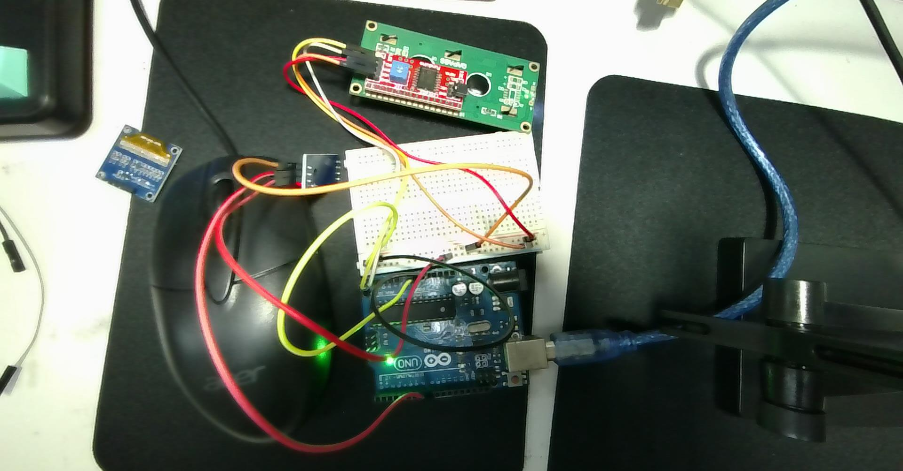
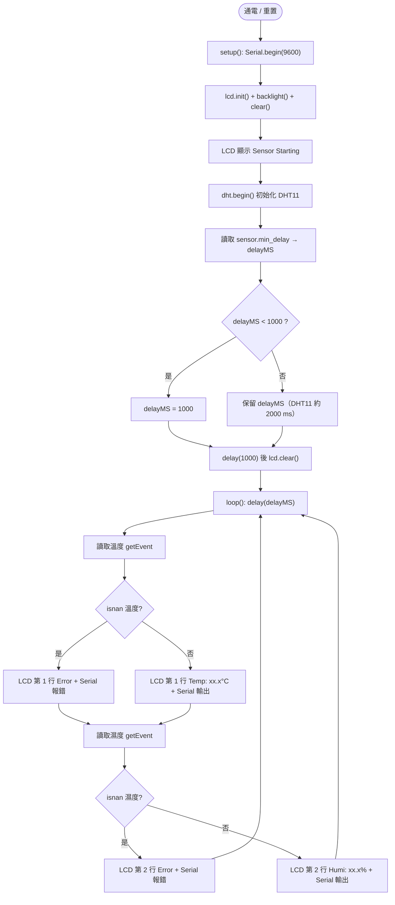

# 🔌 Arduino Uno + DHT11（Pin 8）+ I2C LCD 1602 接線指引與程式庫下載手冊（example_1029）

> **最後更新時間**: 2026-10-22 14:01:08 (UTC+8)  
> **使用模型**: Claude Sonnet 5.5  
> **執行 Agent**: Claude Code  
> **對應程式碼**: [arduino_dht11_pin8_lcd1602_i2c_example_1029.ino](./arduino_dht11_pin8_lcd1602_i2c_example_1029.ino)  
> **互動 HTML 筆記**: [arduino_dht11_pin8_lcd1602_i2c_wiring_library_guide.html](./arduino_dht11_pin8_lcd1602_i2c_wiring_library_guide.html)

> ✍️ **撰寫：Claude Sonnet 5.5 / Claude Code**（全文皆由 Claude 撰寫；與先前 Gemini 撰寫之 Pin 7 版本筆記分開標註）

---

## 📑 目錄
1. [程式碼重點解析（與 Pin 7 版本的差異）](#-一程式碼重點解析)
2. [材料清單](#-二材料清單)
3. [接線指引（含接線圖與逐步步驟）](#-三接線指引)
4. [程式庫下載與安裝](#-四程式庫下載與安裝)
5. [程式邏輯流程圖](#-五程式邏輯流程圖)
6. [完整程式碼](#-六完整程式碼)
7. [上傳與驗證步驟](#-七上傳與驗證步驟)
8. [疑難排解 FAQ](#-八疑難排解-faq)
9. [延伸思考與進階主題](#-九延伸思考與進階主題)
10. [提示詞歷史與變更記錄](#-提示詞歷史與變更記錄-prompt-archive)

---

## 🔍 一、程式碼重點解析

| 項目 | 本程式設定 | 說明 |
| :--- | :--- | :--- |
| 開發板 | Arduino Uno（或相容板） | I2C 硬體腳位固定為 **A4 (SDA)**、**A5 (SCL)** |
| DHT 資料腳 | `#define DHTPIN 8` | **接 D8**（注意：先前筆記為 D7，本程式為 D8） |
| 感測器型號 | `DHT11` | 溫度 0–50 °C（±2 °C）、濕度 20–90 %RH（±5 %） |
| LCD 位址 | `0x27`，16×2 | 若無顯示改試 `0x3F` |
| 取樣間隔 | `sensor.min_delay / 1000`，最少 1000 ms | DHT11 庫回報 min_delay 為 2,000,000 µs → 實際 **2000 ms** |
| 度數符號 | `lcd.print((char)223)` | HD44780 字型表中 223 (0xDF) 即 `°` |
| 序列埠 | 9600 baud | 同步輸出溫濕度到 Serial Monitor |

> [!NOTE]
> 本程式使用 `DHT_Unified`，所以**必須同時安裝 Adafruit Unified Sensor**（`Adafruit_Sensor.h`），少裝會直接編譯失敗。

---

## 🧰 二、材料清單

| 數量 | 元件 | 備註 |
| :---: | :--- | :--- |
| 1 | Arduino Uno + USB 線（A–B） | 同時負責供電與上傳程式 |
| 1 | I2C LCD 1602 模組（背面有 PCF8574 小板，4 針腳） | 針腳：GND / VCC / SDA / SCL |
| 1 | DHT11 溫濕度感測器 | **3 針模組版**（附小電路板）或 **4 針裸感測器**，見下方說明 |
| 1 | 麵包板 | 提供 5V / GND 共用軌 |
| 若干 | 公對公杜邦線；若 LCD 為排針則用公對母 | 建議紅=5V、黑/棕=GND |
| 1 | 10 kΩ 電阻 | **僅 4 針裸 DHT11 需要**（上拉電阻） |

---

## 🔌 三、接線指引

> ⚠️ **接線前先拔掉 USB 線**，全部接好、檢查無誤後再通電，避免短路。

### 3.0 實際接線照片與核對重點



從照片可確認：

- LCD 為**綠色 1602 + 紅色 I2C 背板**（含藍色對比度電位器），背板 4 針排針接出 4 條線（紅、橘、黃、白）。
- DHT11 為**藍色小板的 3 針模組**（照片左中），**不需**外接上拉電阻。
- 電源經麵包板紅/藍軌分配，Uno 已通電（綠色 ON 燈亮）。
- 照片中導線顏色與本文建議色不同，**顏色不是重點，請依針腳逐條核對**：

| 核對項目 | 應該是 |
| :--- | :--- |
| LCD 背板 SDA / SCL 排針 | 各自通到 Uno **A4 / A5**（不可對調） |
| LCD VCC / GND | 5V / GND（不可對調） |
| DHT11 DATA（絲印 `S` 或 `OUT`） | Uno **D8**（程式為 `DHTPIN 8`） |
| DHT11 VCC / GND | 5V / GND，依板上絲印確認 |

> ⚠️ 受限於照片解析度與導線交疊，我無法逐條追蹤每條線的兩端，上表請以實物逐項勾選確認；若 LCD 顯示 `Error`，優先檢查 DHT11 的 DATA 是否在 D8。

### 3.1 總接線對照表

| 元件 | 元件針腳 | → | Arduino Uno | 建議線色 |
| :--- | :--- | :---: | :--- | :--- |
| **I2C LCD 1602** | GND | → | GND | 黑 |
| | VCC | → | 5V | 紅 |
| | SDA | → | **A4** | 黃 |
| | SCL | → | **A5** | 綠 |
| **DHT11（3 針模組）** | `-` / GND | → | GND | 黑 |
| | 中間 `+` / VCC | → | 5V | 紅 |
| | `S` / DATA / OUT | → | **D8** | 白 |

### 3.2 接線示意圖（文字版）

```text
                 ┌─────────────────────────┐
                 │       Arduino Uno       │
                 │                         │
   DHT11 DATA ───┤ D8                  5V  ├─── LCD VCC ／ DHT11 VCC
                 │                    GND  ├─── LCD GND ／ DHT11 GND
      LCD SDA ───┤ A4 (SDA)                │
      LCD SCL ───┤ A5 (SCL)                │
                 └─────────────────────────┘

   Uno 只有一組 5V 與 GND ──> 先接到麵包板紅(+)、藍(−)電源軌，再由軌分給兩個模組
```

### 3.3 逐步接線步驟

1. **建立電源軌**：Uno `5V` → 麵包板紅色(+)軌；Uno `GND` → 麵包板藍色(−)軌。
2. **接 LCD 電源**：LCD `VCC` → (+)軌；LCD `GND` → (−)軌。
3. **接 LCD 通訊線**：LCD `SDA` → Uno `A4`；LCD `SCL` → Uno `A5`。
   （Uno R3 板上靠近 AREF 的 SDA/SCL 排針與 A4/A5 內部相通，擇一即可。）
4. **接 DHT11 電源**：`+`/VCC → (+)軌；`-`/GND → (−)軌。
5. **接 DHT11 資料線**：`S`/DATA → Uno `D8`。
6. **檢查**：紅線都在 5V 側、黑線都在 GND 側、SDA/SCL 沒有接反，再插上 USB。

### 3.4 DHT11 兩種版本的差異（務必先確認手上是哪一種）

| 版本 | 針腳數 | 接法 | 需要外接電阻？ |
| :--- | :---: | :--- | :--- |
| **3 針模組**（藍/黑色小板） | 3 | 依 3.1 表直接接 | ❌ 板上已有 10 kΩ 上拉 |
| **4 針裸感測器**（藍色格柵外殼） | 4（第 3 腳空接） | 面對格柵、由左到右：**1=VCC、2=DATA、3=NC（空接）、4=GND** | ✅ DATA(腳 2) 與 VCC(腳 1) 之間接 **10 kΩ** |

> [!WARNING]
> 3 針模組的針腳順序因廠商而異（有的是 `S + -`，有的是 `- + S`），**以板上絲印為準，不要憑位置猜**。VCC 與 GND 接反會讓感測器發燙、損壞。

### 3.5 LCD 對比度與 I2C 位址

- LCD 背面藍色小方塊是**對比度電位器**：若亮了背光但看不到字，用小起子慢慢轉動。
- 預設位址 `0x27`；副廠 PCF8574A 板可能是 `0x3F`。不確定時可燒錄 I2C Scanner（見第八章）。

---

## 📦 四、程式庫下載與安裝

本程式 `#include` 了 5 個標頭檔，對應 **3 個需要安裝的程式庫**（`Wire.h` 為 Arduino 內建，免安裝）：

| `#include` | 所屬程式庫 | 作者 | 是否需安裝 |
| :--- | :--- | :--- | :---: |
| `Wire.h` | Wire | Arduino 內建 | ❌ |
| `LiquidCrystal_I2C.h` | **LiquidCrystal I2C** | Frank de Brabander | ✅ |
| `Adafruit_Sensor.h` | **Adafruit Unified Sensor** | Adafruit | ✅ |
| `DHT.h` / `DHT_U.h` | **DHT sensor library** | Adafruit | ✅ |

### 4.1 方法 A：Arduino IDE 程式庫管理員（推薦）

1. 開啟 Arduino IDE → 左側欄點 **程式庫管理員**（圖示像書本），或選單 **工具 → 管理程式庫…**（快捷鍵 `Ctrl+Shift+I`）。
2. 搜尋並依序安裝：

   | 搜尋關鍵字 | 要選的項目 | 備註 |
   | :--- | :--- | :--- |
   | `DHT sensor library` | **DHT sensor library by Adafruit** | 安裝時若跳出「安裝相依程式庫」，選 **Install all** |
   | `Adafruit Unified Sensor` | **Adafruit Unified Sensor by Adafruit** | 若上一步選了 Install all 已自動裝好 |
   | `LiquidCrystal I2C` | **LiquidCrystal I2C by Frank de Brabander** | 搜尋結果有多個同名套件，認明作者 |

3. 每個項目看到 `INSTALLED` 字樣即完成。

### 4.2 方法 B：手動下載 ZIP（離線或搜尋不到時）

1. 開啟下列 GitHub 頁面，點 **Code → Download ZIP**：
   - DHT sensor library：<https://github.com/adafruit/DHT-sensor-library>
   - Adafruit Unified Sensor：<https://github.com/adafruit/Adafruit_Sensor>
   - LiquidCrystal I2C：<https://github.com/johnrickman/LiquidCrystal_I2C>（亦有 Frank de Brabander 版本鏡像）
2. Arduino IDE → **草稿碼 → 匯入程式庫 → 加入 .ZIP 程式庫…** → 選剛下載的 ZIP。
3. 三個 ZIP 各做一次。

### 4.3 驗證是否安裝成功

- 選單 **檔案 → 範例**，往下應能看到 `DHT sensor library`、`LiquidCrystal I2C`、`Adafruit Unified Sensor`。
- 或直接按 **驗證 ✔**：沒有 `fatal error: xxx.h: No such file or directory` 即成功。

### 4.4 常見安裝錯誤對照

| 編譯錯誤訊息 | 缺少的程式庫 |
| :--- | :--- |
| `fatal error: LiquidCrystal_I2C.h: No such file` | LiquidCrystal I2C |
| `fatal error: Adafruit_Sensor.h: No such file` | Adafruit Unified Sensor |
| `fatal error: DHT.h` / `DHT_U.h: No such file` | DHT sensor library |

---

## 🚀 五、程式邏輯流程圖



---

## 💻 六、完整程式碼

> 完整程式亦存於 [`arduino_dht11_pin8_lcd1602_i2c_example_1029.ino`](./arduino_dht11_pin8_lcd1602_i2c_example_1029.ino)（內容與課堂檔 `example_1029.txt` 相同）。

```cpp
#include <Wire.h>                  // I2C 通訊（內建）
#include <LiquidCrystal_I2C.h>     // I2C LCD 驅動
#include <Adafruit_Sensor.h>       // Adafruit 統一感測器介面
#include <DHT.h>                   // DHT 基礎庫
#include <DHT_U.h>                 // DHT Unified 版本

// --- 設定 DHT 感測器 ---
#define DHTPIN 8          // DHT 感測器腳位接在數位腳位 8
#define DHTTYPE DHT11     // 感測器型號 DHT 11
DHT_Unified dht(DHTPIN, DHTTYPE);

// --- 設定 LCD 螢幕 ---
// I2C 位址為 0x27，尺寸為 16x2
LiquidCrystal_I2C lcd(0x27, 16, 2);

uint32_t delayMS;

void setup() {
  Serial.begin(9600);

  // 初始化 LCD
  lcd.init();
  lcd.backlight();
  lcd.clear();
  lcd.setCursor(0, 0);
  lcd.print("Sensor Starting");

  // 初始化 DHT 感測器
  dht.begin();

  // 取得感測器最低讀取間隔時間
  sensor_t sensor;
  dht.temperature().getSensor(&sensor);
  delayMS = sensor.min_delay / 1000;
  if (delayMS < 1000) {
    delayMS = 1000; // 確保讀取間隔至少 1 秒
  }

  delay(1000);
  lcd.clear();
}

void loop() {
  // 等待感測器間隔時間
  delay(delayMS);

  // --- 讀取並顯示溫度 ---
  sensors_event_t event;
  dht.temperature().getEvent(&event);

  lcd.setCursor(0, 0); // 第一行
  lcd.print("Temp: ");
  if (isnan(event.temperature)) {
    lcd.print("Error   ");
    Serial.println(F("Error reading temperature!"));
  } else {
    lcd.print(event.temperature, 1); // 顯示小數點後 1 位
    lcd.print((char)223);            // 顯示度數符號 '°'
    lcd.print("C   ");
    Serial.print(F("Temperature: "));
    Serial.print(event.temperature);
    Serial.println(F("°C"));
  }

  // --- 讀取並顯示濕度 ---
  dht.humidity().getEvent(&event);

  lcd.setCursor(0, 1); // 第二行
  lcd.print("Humi: ");
  if (isnan(event.relative_humidity)) {
    lcd.print("Error   ");
    Serial.println(F("Error reading humidity!"));
  } else {
    lcd.print(event.relative_humidity, 1); // 顯示小數點後 1 位
    lcd.print("%   ");
    Serial.print(F("Humidity: "));
    Serial.print(event.relative_humidity);
    Serial.println(F("%"));
  }
}
```

---

## ✅ 七、上傳與驗證步驟

1. 確認接線（第三章）與三個程式庫（第四章）皆完成。
2. USB 連接 Uno → Arduino IDE **工具 → 開發板 → Arduino Uno**；**工具 → 連接埠** 選 `COMx (Arduino Uno)`。
3. 貼上程式 → 按 **驗證 ✔**（編譯）→ 按 **上傳 →**。看到 `Done uploading` 即成功。
4. 預期結果：
   - LCD 先顯示 `Sensor Starting` 約 1 秒，隨後約每 2 秒更新：
     ```text
     Temp: 27.5°C
     Humi: 61.0%
     ```
   - **工具 → 序列埠監控視窗**（鮑率選 **9600**）同步印出 `Temperature: 27.50°C` 等。
5. 驗證感測器真的在工作：用手握住或對 DHT11 呵氣，溫濕度數值應在數秒內上升。

---

## ❓ 八、疑難排解 FAQ

| 現象 | 可能原因 | 處理方式 |
| :--- | :--- | :--- |
| 背光亮、只有方塊或無字 | 對比度太低/太高 | 轉動 LCD 背面藍色電位器 |
| 完全沒反應、背光也不亮 | VCC/GND 沒接好，或 I2C 位址錯誤 | 檢查 5V/GND；位址改 `0x3F` 或執行 I2C Scanner |
| 顯示 `Temp: Error` / `Humi: Error` | DATA 沒接 **D8**、針腳順序接錯、4 針版缺上拉電阻 | 對照 3.1 與 3.4；DHT 剛通電請等 2 秒 |
| 數值固定不變 | 程式沒更新或感測器接觸不良 | 重新上傳；重插 DHT11 |
| 螢幕出現亂碼 `°C` | 序列埠或 LCD 直接印 UTF-8 的 `°` | LCD 已用 `(char)223` 避免；Serial Monitor 若亂碼屬正常顯示編碼問題，不影響 LCD |
| 上傳失敗 `avrdude: stk500_getsync()` | 連接埠/開發板選錯，或 D0/D1 有接線 | 重選埠；本專案未使用 D0/D1 |
| 編譯 `No such file` | 缺程式庫 | 見 4.4 對照表 |

**I2C Scanner（找 LCD 位址）**：

```cpp
#include <Wire.h>                       // I2C 函式庫

void setup() {
  Wire.begin();                         // 啟動 I2C 主機
  Serial.begin(9600);
  Serial.println("I2C Scanner...");
  for (byte addr = 1; addr < 127; addr++) {   // 逐一探測 1~126 位址
    Wire.beginTransmission(addr);
    if (Wire.endTransmission() == 0) {        // 回應 0 代表有裝置
      Serial.print("Found device at 0x");
      Serial.println(addr, HEX);
    }
  }
}

void loop() {}
```

---

## 🧭 九、延伸思考與進階主題

1. **為何 DHT11 要等 ≥ 2 秒？** DHT11 內部 ADC 取樣週期約 1–2 秒，過快讀取會得到 `NaN` 或舊值；程式透過 `min_delay` 自動取得安全間隔。
2. **單線協定**：DATA 線以脈衝寬度編碼 40 bit（濕度整數/小數、溫度整數/小數、checksum），因此對時序敏感，長導線（> 20 m）或缺上拉電阻容易失敗。
3. **I2C 的優勢**：LCD 原本需 6+ 條資料線，透過 PCF8574 擴展後僅需 SDA/SCL 兩條，且可與其他 I2C 裝置共用匯流排（位址不可衝突）。
4. **升級方向**：換用 DHT22 / SHT31 / BME280 提高精度（只需改 `DHTTYPE` 或換庫）；加入蜂鳴器/繼電器做溫度警報；以 ESP8266/ESP32 上傳雲端。
5. **與 Pin 7 版本比較**：本版僅 DHT 腳位（D8）、顯示字串（`Temp:`/`Humi:`）與初始化流程略有不同，詳見 [arduino_i2c_lcd1602_dht11_unified_display.md](./arduino_i2c_lcd1602_dht11_unified_display.md)。

---

## 📝 提示詞歷史與變更記錄 (Prompt Archive)

### 🔹 [2026-10-22 14:01:08] [Claude Sonnet 5.5 / Claude Code] 建立 Pin 8 版接線指引與程式庫下載手冊
- **模型/Agent**: Claude Sonnet 5.5 / Claude Code
- **Prompt 原文**:
  ```text
  C:\Users\User\Desktop\onclass\example_1029.txt 這是一個完整的程式碼，幫我撰寫詳細的接線指引以及程式庫下載方式
  ```
- **變更摘要**: 依 `example_1029.txt`（DHT11 接 D8、I2C LCD 0x27）新增詳細接線表、3 針/4 針 DHT11 差異、程式庫（LiquidCrystal I2C、DHT sensor library、Adafruit Unified Sensor）的 IDE 與 ZIP 安裝流程、流程圖、驗證步驟與疑難排解；並將程式存為 `.ino`。
