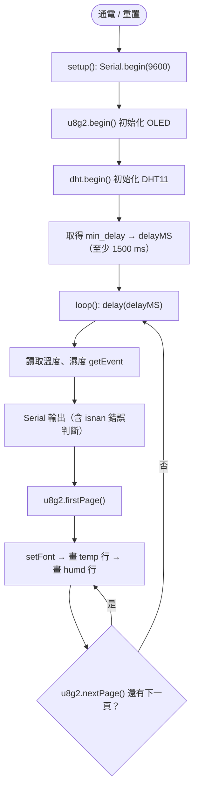
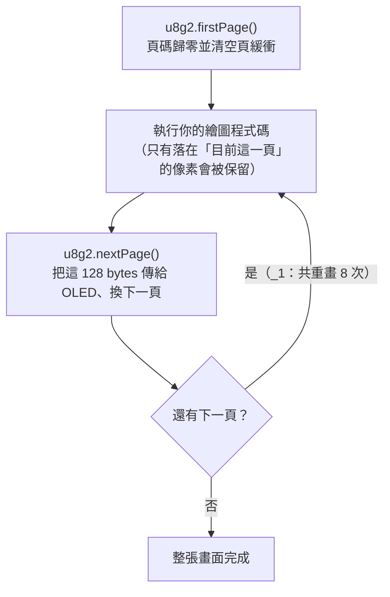
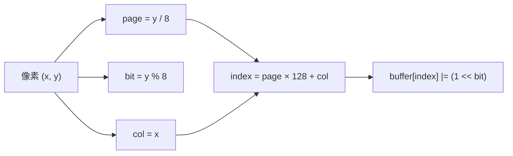
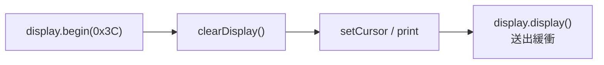
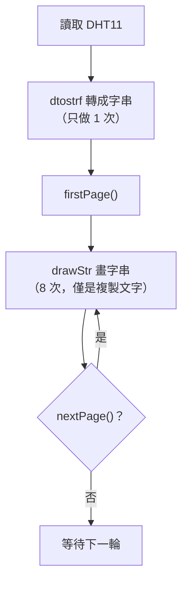

# 🖥️ Arduino Uno + DHT11 + SSD1306 OLED（U8g2 / I2C）：從 LCD 1602 換成 OLED 的作法、程式庫比較與 Page Buffer 優缺點

> **最後更新時間**: 2026-10-22 15:01:30 (UTC+8)  
> **使用模型**: Claude Sonnet 5.5  
> **執行 Agent**: Claude Code  
> **對應程式碼**: [1022-ssd1306.ino](./1022-ssd1306.ino)  
> **互動 HTML 筆記**: [arduino_dht11_ssd1306_u8g2_guide.html](./arduino_dht11_ssd1306_u8g2_guide.html)

> ✍️ **撰寫：Claude Sonnet 5.5 / Claude Code**（全文皆由 Claude 撰寫；與先前 Gemini 撰寫之 LCD 1602 系列筆記分開標註）

---

## 📑 目錄
1. [程式碼解析：從 LCD 1602 換成 SSD1306 改了什麼](#-一程式碼解析從-lcd-1602-換成-ssd1306-改了什麼)
2. [接線與位址](#-二接線與位址)
3. [程式邏輯流程圖與完整程式碼](#-三程式邏輯流程圖與完整程式碼)
4. [逐段說明作法](#-四逐段說明作法)
5. [SSD1306 I2C 可用的程式庫有哪些？](#-五ssd1306-i2c-可用的程式庫有哪些)
6. [使用 U8g2 的優缺點](#-六使用-u8g2-的優缺點)
7. [Page Buffer 的優缺點](#-七page-buffer-的優缺點)
8. [實作範例：Full Buffer、U8x8、Adafruit 三種寫法對照](#-八實作範例三種替代寫法)
9. [疑難排解 FAQ](#-九疑難排解-faq)
10. [延伸思考與進階主題](#-十延伸思考與進階主題)
11. [提示詞歷史與變更記錄](#-提示詞歷史與變更記錄-prompt-archive)

---

## 🔍 一、程式碼解析：從 LCD 1602 換成 SSD1306 改了什麼

> 先講結論：**DHT11 的讀取邏輯完全沒變**，只有「顯示層」被換掉。這也是把感測與顯示分開寫的好處。

| 項目 | LCD 1602 版（先前筆記） | SSD1306 + U8g2 版（本程式） |
| :--- | :--- | :--- |
| 顯示器類型 | 字元型 LCD（16 字 × 2 行，HD44780 + PCF8574） | **點陣 OLED**（128 × 64 像素，SSD1306 控制器，自發光） |
| 程式庫 | `LiquidCrystal_I2C` | **`U8g2`**（`U8g2lib.h`） |
| 物件宣告 | `LiquidCrystal_I2C lcd(0x27, 16, 2);` | `U8G2_SSD1306_128X64_NONAME_1_SW_I2C u8g2(U8G2_R0, SCL, SDA, U8X8_PIN_NONE);` |
| I2C 位址 | `0x27`（或 `0x3F`） | 通常 `0x3C`（少數 `0x3D`）；U8g2 內部已預設，多數情況不用寫 |
| 初始化 | `lcd.init(); lcd.backlight();` | `u8g2.begin();`（OLED 自發光，無背光） |
| 定位方式 | `lcd.setCursor(col, row)`：**格子**座標 | `u8g2.setCursor(x, y)`：**像素**座標，且 `y` 是文字**基線（baseline）** |
| 清除畫面 | `lcd.clear()` | Page Buffer 模式下**不需要**：每次 `firstPage()` 都是新的一頁 |
| 更新畫面 | 直接 `print`，立即生效 | 必須包在 `firstPage()` / `nextPage()` 迴圈內重複繪製 |
| 字型 | 內建固定字型 | 需用 `setFont()` 選擇字型（數百種） |
| 度數符號 | `lcd.print((char)223)` | 本程式用 `" C"`；要顯示 `°` 需改用 `_tf` 字型並印 `\xb0`（見第十章） |

### 1.1 關鍵宣告拆解：`U8G2_SSD1306_128X64_NONAME_1_SW_I2C`

U8g2 的建構子名稱是由多個欄位組成，**每一段都有意義**：

```text
U8G2_ SSD1306 _ 128X64 _ NONAME _ 1 _ SW_I2C
  │      │         │        │      │     └─ 通訊方式：SW_I2C=軟體模擬 I2C；HW_I2C=硬體 I2C（走 Wire）
  │      │         │        │      └─────── 緩衝模式：1=Page Buffer（128 bytes）；2=Page Buffer（256 bytes）；F=Full Buffer（1024 bytes）
  │      │         │        └────────────── 模組變體：NONAME=通用（絕大多數便宜模組）；VCOMH0 / ADAFRUIT 等為特殊變體
  │      │         └─────────────────────── 解析度：128 × 64 像素（另有 128X32、96X16 等）
  │      └───────────────────────────────── 控制晶片：SSD1306（1.3 吋常見的是 SH1106，要換）
  └──────────────────────────────────────── 程式庫前綴
```

建構子參數：`(旋轉, SCL 腳, SDA 腳, RESET 腳)`

- `U8G2_R0`：不旋轉；`R1/R2/R3` 分別旋轉 90°/180°/270°。
- `SCL, SDA`：在 Uno 上這兩個巨集就是 `A5`、`A4`。
- `U8X8_PIN_NONE`：I2C 模組多半沒引出 RESET 腳，填「不使用」。

### 1.2 本程式其他重點

| 項目 | 說明 |
| :--- | :--- |
| `DHTPIN 8` | DHT11 資料線仍接 **D8**，與 LCD 版相同 |
| `delayMS` | `sensor.min_delay / 1000` 並至少 1500 ms，確保 DHT11 不會被讀太快 |
| `u8g2_font_ncenB10_tr` | New Century Schoolbook **B**old、高約 10 px；後綴 `_tr` = **t**ransparent 背景 + **r**estricted（僅 ASCII 32–127），字型最省空間 |
| `u8g2.print(value, 1)` | U8g2 繼承 Arduino `Print`，所以可以直接 `print(float, 小數位數)` |
| `y=24`、`y=52` | 兩行文字的**基線**位置；64 px 高的螢幕恰好分成上下兩半 |
| `isnan()` 判斷 | 感測器讀取失敗時畫面顯示 `Error`，避免顯示 `nan` |
| 讀感測器在 `firstPage()` **之前** | ✅ 正確：繪圖迴圈內只放「純繪圖」，詳見第七章 |

> [!NOTE]
> 程式第 18–19 行保留了硬體 I2C 的替代宣告。**想要更快的更新、或同一條 I2C 還要接其他裝置時，改用 `HW_I2C` 版本即可**；硬體 I2C 腳位在 Uno 上固定為 A4/A5。

---

## 🔌 二、接線與位址

> ⚠️ 接線前先拔掉 USB。SSD1306 I2C 模組只有 **4 支針腳**，但**不同廠商的排列順序不同**，務必看板子絲印。

| OLED 模組針腳 | → | Arduino Uno | 說明 |
| :--- | :---: | :--- | :--- |
| `GND` | → | GND | 共地 |
| `VCC`（有的標 `VDD`） | → | 5V（或 3.3V） | 常見 4 針模組板上有穩壓，5V 可用；若模組標示僅支援 3.3V 則接 3.3V |
| `SCL`（有的標 `SCK`） | → | **A5** | I2C 時脈 |
| `SDA` | → | **A4** | I2C 資料 |

DHT11 接法與先前相同：`S/DATA → D8`、`VCC → 5V`、`GND → GND`。OLED 與 DHT11 共用 5V、GND 軌即可。

```text
常見排列有兩種，請以實物絲印為準：
   GND - VCC - SCL - SDA        ← 最常見
   VCC - GND - SCL - SDA        ← 也有（接反 VCC/GND 會燒模組）
```

**I2C 位址**：SSD1306 模組位址多為 `0x3C`，背面有電阻焊點可切換成 `0x3D`。U8g2 預設使用 `0x3C`（以 8 位元寫法表示為 `0x78`）；若畫面全黑，可先跑上一份筆記的 I2C Scanner 確認位址，必要時加上：

```cpp
u8g2.setI2CAddress(0x3D * 2); // U8g2 使用「7 位元位址 × 2」的 8 位元格式，0x3D → 0x7A
```

---

## 🚀 三、程式邏輯流程圖與完整程式碼



> 完整程式亦存於 [`1022-ssd1306.ino`](./1022-ssd1306.ino)。

```cpp
#include <Arduino.h>
#include <Wire.h>              // I2C（硬體 I2C 版本需要）
#include <U8g2lib.h>           // U8g2 圖形程式庫
#include <Adafruit_Sensor.h>   // Adafruit 統一感測器介面
#include <DHT.h>               // DHT 基礎庫
#include <DHT_U.h>             // DHT Unified 版本

// --- 感測器設定 ---
#define DHTPIN 8          // DHT11 訊號腳位接在數位腳位 8
#define DHTTYPE DHT11     // 感測器型號 DHT11

DHT_Unified dht(DHTPIN, DHTTYPE);

// --- OLED SSD1306 (128x64) 設定 ---
// 軟體 I2C：SCL 接 Arduino SCL (A5)，SDA 接 Arduino SDA (A4)
// "_1" 代表 Page Buffer（只佔 128 bytes RAM）
U8G2_SSD1306_128X64_NONAME_1_SW_I2C u8g2(U8G2_R0, /* clock=*/ SCL, /* data=*/ SDA, /* reset=*/ U8X8_PIN_NONE);

// 若要改用硬體 I2C (速度更快)，可註解上一行並取消註解下一行：
// U8G2_SSD1306_128X64_NONAME_1_HW_I2C u8g2(U8G2_R0, /* reset=*/ U8X8_PIN_NONE);

uint32_t delayMS;

void setup() {
  Serial.begin(9600);

  // 初始化 U8g2 OLED 螢幕
  u8g2.begin();

  // 初始化 DHT 感測器
  dht.begin();

  // 取得感測器規格並設定延遲時間 (DHT11 建議間隔至少 1.5 秒)
  sensor_t sensor;
  dht.temperature().getSensor(&sensor);
  dht.humidity().getSensor(&sensor);
  delayMS = sensor.min_delay / 1000;
  if (delayMS < 1500) {
    delayMS = 1500;
  }
}

void loop() {
  // 感測器讀取間隔延遲
  delay(delayMS);

  // 讀取溫度與濕度數值（必須在繪圖迴圈「之前」完成）
  sensors_event_t temp_event, hum_event;
  dht.temperature().getEvent(&temp_event);
  dht.humidity().getEvent(&hum_event);

  // 序列埠監控輸出 (偵錯用)
  if (isnan(temp_event.temperature)) {
    Serial.println(F("Error reading temperature!"));
  } else {
    Serial.print(F("Temperature: "));
    Serial.print(temp_event.temperature);
    Serial.println(F(" *C"));
  }

  if (isnan(hum_event.relative_humidity)) {
    Serial.println(F("Error reading humidity!"));
  } else {
    Serial.print(F("Humidity: "));
    Serial.print(hum_event.relative_humidity);
    Serial.println(F(" %"));
  }

  // --- U8g2 繪圖畫面迴圈 (Page Buffer) ---
  u8g2.firstPage();                       // 開始第一頁
  do {
    // 設定字型
    u8g2.setFont(u8g2_font_ncenB10_tr);

    // 第一行：顯示 temp: 溫度 (基線 y=24)
    u8g2.setCursor(0, 24);
    u8g2.print("temp: ");
    if (isnan(temp_event.temperature)) {
      u8g2.print("Error");
    } else {
      u8g2.print(temp_event.temperature, 1); // 顯示小數點後 1 位
      u8g2.print(" C");
    }

    // 第二行：顯示 humd: 濕度 (基線 y=52)
    u8g2.setCursor(0, 52);
    u8g2.print("humd: ");
    if (isnan(hum_event.relative_humidity)) {
      u8g2.print("Error");
    } else {
      u8g2.print(hum_event.relative_humidity, 1); // 顯示小數點後 1 位
      u8g2.print(" %");
    }
  } while (u8g2.nextPage());              // 還有下一頁就重畫，直到整個畫面送完
}
```

---

## 🧩 四、逐段說明作法

### 步驟 1：安裝程式庫
Arduino IDE → **程式庫管理員**（`Ctrl+Shift+I`）搜尋 **`U8g2`**（作者 **oliver**，即 olikraus）→ 安裝。DHT 相關兩個程式庫（`DHT sensor library`、`Adafruit Unified Sensor`）沿用先前安裝，**不再需要 `LiquidCrystal_I2C`**。

### 步驟 2：選對建構子
依「晶片 × 解析度 × 緩衝模式 × 通訊方式」挑一個。查表方式：U8g2 範例 `File → Examples → U8g2 → full_buffer / page_buffer` 內附有所有建構子清單（本程式的註解提到的「u8g2.txt」即是這份清單的摘錄）。

### 步驟 3：`u8g2.begin()`
一次完成：I2C 初始化、傳送 SSD1306 初始化指令、開啟面板。**不需要**像 LCD 一樣另外開背光。

### 步驟 4：把「繪圖」包進 `firstPage()` / `nextPage()` 迴圈
Page Buffer 的運作原理見第七章。口訣：**迴圈內只畫圖，不讀感測器、不改變數**。

### 步驟 5：座標用「基線」思考
`setCursor(0, 24)` 的 `y=24` 是文字**底線位置**，文字會往上長出約 10 px（本字型）。因此：

- 第一行文字占約 `y = 14 ~ 24`（含下伸字母會稍低）
- 第二行文字占約 `y = 42 ~ 52`
- 螢幕 64 px 高，兩行之間留有空隙，版面均衡。

### 步驟 6：驗證
上傳後 OLED 約每 1.5～2 秒更新一次：

```text
temp: 27.5 C
humd: 61.0 %
```

用手握住 DHT11，數字應逐漸上升；Serial Monitor（9600）同步輸出。

---

## 📚 五、SSD1306 I2C 可用的程式庫有哪些？

> 「SSD1306 能用什麼庫」其實是在問：**要不要緩衝、緩衝放哪、要不要畫圖、要不要中文**。以下依常用程度整理（128×64 為例）：

| 程式庫 | 作者 / 來源 | 緩衝方式 | 128×64 RAM 需求 | 特色 | 適合情境 |
| :--- | :--- | :--- | :--- | :--- | :--- |
| **U8g2** | olikraus | Page（128/256 B）或 Full（1024 B）可選 | 128 B ～ 1 KB | 支援 100+ 種顯示器、數百種字型、**UTF-8／中日韓字型**、旋轉、繪圖基本圖形 | **跨平台、跨顯示器通用首選**；記憶體吃緊的 Uno/Nano |
| **U8x8**（U8g2 內建） | olikraus | **無緩衝**（直接寫入顯示器） | ≈ 0 | 只能顯示 8×8 字元格文字；速度快、最省 RAM | 只需要純文字的小專案，像 LCD 一樣用 |
| **Adafruit SSD1306 + Adafruit GFX** | Adafruit | **Full Buffer 固定** | **1024 B（動態配置）** | API 簡單直覺、`Adafruit_GFX` 繪圖函式豐富、教學資源最多 | ESP32／ESP8266／Mega 等 RAM 充裕的板子；Uno 上要小心 |
| **SSD1306Ascii** | Bill Greiman | **無緩衝**（純文字） | 極小 | 為 AVR 優化、可搭 `AvrI2c` 極速傳輸、Flash 佔用小 | Uno/Nano/ATtiny 純文字顯示、追求速度與省空間 |
| **ss_oled / OneBitDisplay** | Larry Bank (bitbank2) | 可選（可不緩衝） | 極小 ～ 1 KB | 為小型 MCU 設計、檔案小、支援 SSD1306/SH1106 等 | 資源很少的 MCU（ATtiny、Nano） |
| **lexus2k/ssd1306** | Alexey Dynda | 可選（Canvas 方式） | 可調 | 支援多種顯示器與 AVR/ESP/STM32、可設定記憶體用法、內建簡易 UI | 想要輕量但功能多的 AVR 專案 |
| **ESP8266 and ESP32 OLED driver for SSD1306 displays** | ThingPulse | Full Buffer | 1 KB | 內建 `OLEDDisplayUi`（頁面切換動畫）、專為 ESP 設計 | ESP8266／ESP32 做儀表板、動畫 |

> [!WARNING]
> **1.3 吋的「SSD1306」模組很可能其實是 SH1106**（兩者畫面寬 128，但 SH1106 的 RAM 寬 132、控制指令略異）。症狀：畫面左右偏移、右側有雜訊。處理：U8g2 改用 `U8G2_SH1106_128X64_NONAME_1_HW_I2C`；Adafruit 系列改用 `Adafruit SH110X` 程式庫。

### 5.1 選用決策表

| 你的狀況 | 建議程式庫 | 原因 |
| :--- | :--- | :--- |
| Uno / Nano（2 KB RAM）要畫圖形 + 文字 | **U8g2 Page Buffer（`_1` / `_2`）** | RAM 只用 128～256 B |
| Uno / Nano，只要顯示數字文字，要最省 | **U8x8** 或 **SSD1306Ascii** | 完全不需畫面緩衝 |
| ESP32 / ESP8266 / RP2040 / STM32，RAM 充裕 | **U8g2 Full Buffer（`_F`）** 或 **Adafruit SSD1306** | 1 KB 緩衝不是問題，寫法最自由 |
| 需要中文、日文等多語系顯示 | **U8g2**（`u8g2_font_wqy12_t_gb2312` 等） | 其他庫幾乎沒有 CJK 字型支援 |
| 想看現成的教學範例最多 | **Adafruit SSD1306** | 資源量最大，但要留意 RAM |
| 日後可能換成別種螢幕（ST7920、ILI9341、SH1106…） | **U8g2** | 只改建構子，其餘繪圖程式不用動 |

---

## ⚖️ 六、使用 U8g2 的優缺點

### ✅ 優點

| # | 優點 | 說明 |
| :---: | :--- | :--- |
| 1 | **支援顯示器極多** | SSD1306、SH1106、SSD1327、ST7920、ST7565、UC1701…同一套 API；換螢幕只需改**一行建構子** |
| 2 | **三種緩衝模式可選** | Page Buffer（省 RAM）／Full Buffer（好寫）／U8x8（無緩衝）；依板子資源調整 |
| 3 | **字型非常豐富** | 數百款字型，且有**中文（文泉驛 wqy）、日文、unifont** 等 CJK 字型；字型存在 Flash（PROGMEM），不佔 RAM |
| 4 | **UTF-8 支援** | 啟用 `u8g2.enableUTF8Print()` 後可直接 `print("溫度 °C")` |
| 5 | **跨平台** | AVR、ESP8266/ESP32、STM32、RP2040、SAMD 皆可用，程式幾乎免修改 |
| 6 | **通訊方式彈性** | HW_I2C、SW_I2C（任意腳位）、HW_SPI、SW_SPI、並列介面 |
| 7 | **內建繪圖原語** | 線、框、圓、橢圓、三角形、位元圖（XBM）、`drawGlyph` 等 |
| 8 | **`Print` 相容** | `print()`／`println()` 與 Serial 用法一致，從 LCD 搬過來上手快 |
| 9 | **文件完整、持續維護** | 官方 Wiki 有全部 API、字型預覽圖（Font Reference） |

### ❌ 缺點

| # | 缺點 | 說明／對策 |
| :---: | :--- | :--- |
| 1 | **Flash 佔用較大** | 含程式庫＋字型常占 Uno 32 KB Flash 的相當比例（請看編譯結果的「程式儲存空間」）；Uno 上同時裝 DHT 庫仍可行，但不宜再塞很多字型 |
| 2 | **建構子名稱冗長、易選錯** | 需理解 `_1`／`_2`／`_F`、`SW`／`HW`、`NONAME`／`VCOMH0` 等；選錯常見症狀是畫面全黑或偏移 |
| 3 | **Page Buffer 寫法不直覺** | 必須把繪圖包進 `do { } while (nextPage())`，且迴圈內不能有副作用（見第七章） |
| 4 | **SW_I2C 預設較慢** | 軟體模擬 I2C 會佔用 CPU；對策：改用 `HW_I2C`，必要時 `u8g2.setBusClock(400000)` |
| 5 | **字型命名規則需學習** | `_tr`／`_tf`／`_tn`／`_te`、`_m`（等寬）等後綴決定可用字元範圍，選錯會出現缺字 |
| 6 | **字型授權不一** | 程式庫本體為 BSD 授權，但**部分字型各有授權**（商業產品需自行確認） |
| 7 | **繪圖 API 不如 Adafruit_GFX 通用** | 若要沿用大量 Adafruit_GFX 教學程式（例如特定的圖形函式），需要改寫 |
| 8 | **編譯時間與體積** | 含大量字型標頭，首次編譯較久 |

---

## 📄 七、Page Buffer 的優缺點

### 7.1 什麼是 Page Buffer？

SSD1306 的顯示記憶體以「頁（page）」為單位：**128×64 共 8 頁，每頁 8 個像素列 × 128 欄 = 128 bytes**。

- **Full Buffer（`_F`）**：在 Arduino RAM 開 1024 bytes，整個畫面畫好再一次送出。
- **Page Buffer（`_1`）**：只開 **1 頁 = 128 bytes**。程式把「同一份繪圖指令」**重複執行 8 次**，每次只有落在目前那一頁的像素會被寫進緩衝並送出。`_2` 則一次 2 頁（256 bytes），只需重畫 4 次。



### 7.1.1 詳解：「128×64 共 8 頁，每頁 8 列 × 128 欄 = 128 bytes」是怎麼算出來的？

這句話其實是在描述 **SSD1306 內部顯示記憶體（GDDRAM）的排列方式**，可以拆成 4 個層次理解。

**① 先看總量：每個像素 1 bit**

SSD1306 是單色 OLED，一個像素只有「亮／滅」，剛好是 **1 bit**。

```text
總像素   = 128 欄 × 64 列 = 8192 個像素 = 8192 bits
總位元組 = 8192 ÷ 8      = 1024 bytes（= Full Buffer 的大小）
```

**② 為什麼要分成「頁」？因為 1 個 byte 只有 8 bits**

SSD1306 把 64 列**每 8 列綁成一組**，這一組就叫 **1 頁（page）**：

```text
64 列 ÷ 8 列/頁 = 8 頁（PAGE0 ～ PAGE7）

   欄→  0   1   2  ...  127
 列0  ┐
 列1  │
 列2  │  PAGE0  ← 8 列 × 128 欄 = 1024 bits = 128 bytes
 ...  │
 列7  ┘
 列8  ┐
 ...  │  PAGE1  ← 同樣 128 bytes
 列15 ┘
 ...
 列56 ┐
 ...  │  PAGE7
 列63 ┘
```

**③ 一頁裡的「1 個 byte」代表什麼？一欄、垂直 8 個像素**

這是最容易搞錯的地方：SSD1306 的 byte **不是橫著排，而是直著排**。

```text
PAGE0 的第 N 個 byte ＝ 第 N 欄、列 0～7 這 8 個像素
  bit0（最低位）= 最上面的像素（列 0）
  bit7（最高位）= 最下面的像素（列 7）

例：第 0 欄寫入 0x01（0b00000001）→ 只點亮 (x=0, y=0)
    第 0 欄寫入 0xFF（0b11111111）→ 點亮 x=0 的 y=0～7，一條 8 px 垂直線
    第 0 欄寫入 0x80（0b10000000）→ 只點亮 (x=0, y=7)，頁的最下面一點
```

一頁有 128 欄，每欄 1 byte，所以 **1 頁 = 128 bytes**；8 頁 × 128 = **1024 bytes**，與 ① 算出的總量吻合。

**④ 座標換算公式：像素 (x, y) 落在哪個 byte 的哪個 bit？**

```text
頁碼     page  = y ÷ 8        （整數除法）
欄位     col   = x
位元     bit   = y mod 8      （0 = 該頁最上面一列）
緩衝索引 index = page × 128 + x

範例：像素 (10, 19)
  page  = 19 ÷ 8   = 2
  bit   = 19 mod 8 = 3
  index = 2×128+10 = 266
  → 要把緩衝第 266 個 byte 的 bit3 設為 1
```



```cpp
// 示範：不靠任何程式庫，手動把一個像素寫進 128×64 的緩衝（說明用，非實際驅動）
uint8_t fb[1024];                         // 模擬 SSD1306 的 1024 bytes 顯示記憶體

void setPixel(uint8_t x, uint8_t y) {
  uint8_t  page  = y / 8;                 // 第幾頁（0～7）
  uint8_t  bit   = y % 8;                 // 該頁內由上往下的第幾列（0～7）
  uint16_t index = page * 128 + x;        // 該頁第 x 欄的位元組位置
  fb[index] |= (1 << bit);                // 把對應的 bit 設為 1（點亮）
}
```

**⑤ 這和「U8g2 Page Buffer」有什麼關係？**

- U8g2 把「8 列 × 8 欄」稱為一個 **tile（圖塊）**；一頁就是一排 16 個 tile（128 ÷ 8），每個 tile 8 bytes，所以 16 × 8 = 128 bytes。
- 後綴 `_1` ＝ 緩衝只放 **1 排 tile（1 頁）**＝128 bytes；`_2` ＝ 2 頁＝256 bytes；`_F` ＝ 8 頁＝1024 bytes。
- 傳送時，`nextPage()` 會先送「設定頁碼」指令（`0xB0 + 頁碼`），再送這一頁的 128 bytes 資料。**整張畫面最終送出的總資料量不變（1024 bytes）**，Page Buffer 省的是 Arduino 端的 RAM，不是傳輸量。
- 因為緩衝只涵蓋「y 在目前這 8 列」的範圍，所以同一份繪圖指令要重複執行 8 次，每次只留下落在該頁的像素。

> [!NOTE]
> 若是 SH1106（1.3 吋常見），顯示記憶體每頁是 **132 欄**而非 128 欄，畫面只取中間 128 欄，這就是前面提到「偏移 2 px」的原因；頁數與每頁 8 列的結構相同。

### 7.2 緩衝模式的 RAM 對照（128×64 SSD1306）

| 後綴 | 模式 | 緩衝大小 | 重畫次數 | Uno（2048 B）佔用比例 |
| :---: | :--- | :--- | :---: | :---: |
| `_1` | Page Buffer（1 頁） | 128 B | 8 次 | ≈ 6 % |
| `_2` | Page Buffer（2 頁） | 256 B | 4 次 | ≈ 12.5 % |
| `_F` | Full Buffer | 1024 B | 1 次 | **≈ 50 %** |

### ✅ Page Buffer 的優點

| # | 優點 | 說明 |
| :---: | :--- | :--- |
| 1 | **RAM 極省** | 只要 128 B（vs. 1024 B）；Uno/Nano 上才有餘裕放感測器庫、字串、其他變數 |
| 2 | **記憶體靜態配置** | 緩衝是物件的一部分，編譯時就算進去，**不會在執行時 malloc 失敗**（Adafruit 版常見 `SSD1306 allocation failed`） |
| 3 | **讓小板子也能用大螢幕** | 128×64 圖形顯示在 2 KB RAM 的 MCU 上才可行 |
| 4 | **可調整 RAM／速度平衡** | 在 `_1`、`_2` 之間選擇，RAM 夠就用 `_2`（重畫次數減半） |
| 5 | **所有繪圖函式皆可用** | 與 Full Buffer 的繪圖 API 相同，只是外層多一個迴圈 |

### ❌ Page Buffer 的缺點

| # | 缺點 | 說明／對策 |
| :---: | :--- | :--- |
| 1 | **繪圖程式碼會執行 8 次** | 運算量 ×8；迴圈內若有 `float` 轉字串、複雜計算，會被重複算。**對策**：先在迴圈外把字串算好（見 8.4） |
| 2 | **迴圈內不可有副作用** | 讀感測器、`counter++`、`millis()` 判斷、`Serial.print`、`delay` 都不該放進去，否則 8 次結果不一致，畫面可能閃爍或撕裂。**本程式把讀取放在 `firstPage()` 之前，是正確做法** |
| 3 | **無法「增量繪圖」** | 不能在上一幀畫面上只補畫一小塊；每一幀都必須**完整重畫**所有內容 |
| 4 | **不能用 `clearBuffer()` / `sendBuffer()` 流程** | 那是 Full Buffer 的 API；Page Buffer 改用 `firstPage()` / `nextPage()` |
| 5 | **動畫可能有撕裂感** | 畫面由上而下逐頁更新，高速移動物件在慢速 I2C（尤其 SW_I2C）上可能看到撕裂 |
| 6 | **無法讀回像素／局部更新較麻煩** | 無完整畫面副本，難以做「讀取現有像素再運算」的特效 |
| 7 | **寫法對初學者較不直覺** | 容易誤把初始化、`delay` 寫進 `do…while` 中 |

### 7.3 Page Buffer 使用守則（背起來）

```text
✅ 迴圈「之前」：讀感測器、做計算、把數值轉成要顯示的字串
✅ 迴圈「之內」：只做 setFont / setCursor / print / drawXXX（純函式式繪圖）
❌ 迴圈之內：不要 delay()、Serial.print()、變數遞增、millis() 分支、讀感測器
```

---

## 🛠️ 八、實作範例：三種替代寫法

### 8.1 Full Buffer 版（RAM 夠的板子，如 ESP32）


```cpp
// 只示範顯示部分；感測器讀取程式與前述完全相同
// "_F" = Full Buffer（1024 bytes）；ESP32 / ESP8266 / RP2040 等 RAM 充裕時使用
U8G2_SSD1306_128X64_NONAME_F_HW_I2C u8g2(U8G2_R0, /* reset=*/ U8X8_PIN_NONE);

void drawScreen(float t, float h) {
  u8g2.clearBuffer();                    // 1) 清空記憶體中的畫面
  u8g2.setFont(u8g2_font_ncenB10_tr);    // 2) 選字型
  u8g2.setCursor(0, 24);
  u8g2.print("temp: ");
  u8g2.print(t, 1);
  u8g2.print(" C");
  u8g2.setCursor(0, 52);
  u8g2.print("humd: ");
  u8g2.print(h, 1);
  u8g2.print(" %");
  u8g2.sendBuffer();                     // 3) 一次把 1024 bytes 送到 OLED
}
```

> 與 Page Buffer 的差別：**繪圖只做一次，不需 `do…while`**；可以在 `drawScreen()` 內自由放置計算與判斷。代價是 RAM 吃掉 1 KB。

### 8.2 U8x8 版（純文字、零緩衝，最像 LCD）


```cpp
#include <U8x8lib.h>

// U8x8：沒有 RAM 緩衝，直接把字元寫到 OLED 的「字元格」（16 欄 × 8 列）
U8X8_SSD1306_128X64_NONAME_HW_I2C u8x8(/* reset=*/ U8X8_PIN_NONE);

void setup() {
  u8x8.begin();                          // 初始化 OLED
  u8x8.setFont(u8x8_font_chroma48medium8_r); // 8x8 字型
}

void showTemp(float t) {
  char buf[10];
  dtostrf(t, 4, 1, buf);                 // AVR 的 sprintf 不支援 %f，用 dtostrf 轉字串
  u8x8.drawString(0, 1, "temp:");        // (欄, 列, 字串)：像 LCD 的 setCursor(col,row)
  u8x8.drawString(6, 1, buf);
}
```

### 8.3 Adafruit_SSD1306 版（教學資源最多）



```cpp
#include <Adafruit_GFX.h>
#include <Adafruit_SSD1306.h>

// 寬、高、Wire、reset 腳（-1 = 不使用）；內部會 malloc 1024 bytes 緩衝
Adafruit_SSD1306 display(128, 64, &Wire, -1);

void setup() {
  // 注意：Adafruit 使用「7 位元」位址 0x3C，與 U8g2 的 8 位元 0x78 寫法不同
  if (!display.begin(SSD1306_SWITCHCAPVCC, 0x3C)) {
    for (;;);                            // RAM 不足或位址錯誤 → 停在這裡（Uno 上常見）
  }
}

void showTemp(float t) {
  display.clearDisplay();                // 清空緩衝
  display.setTextSize(2);                // 放大 2 倍字
  display.setTextColor(SSD1306_WHITE);
  display.setCursor(0, 0);               // 注意：Adafruit 的 y 是文字「左上角」，不是基線
  display.print("temp: ");
  display.print(t, 1);
  display.display();                     // 把緩衝送到 OLED
}
```

### 8.4 改良本程式：在迴圈外先轉好字串（降低 Page Buffer 的 ×8 成本）



```cpp
// 取代 loop() 中的繪圖部分
char tBuf[8], hBuf[8];                   // 暫存數值字串
char line1[20], line2[20];               // 最終要顯示的整行字串

// ---- 迴圈「之前」：只做一次的字串準備 ----
if (isnan(temp_event.temperature)) {
  strcpy(line1, "temp: Error");
} else {
  dtostrf(temp_event.temperature, 4, 1, tBuf);  // float → "27.5"
  snprintf(line1, sizeof(line1), "temp: %s C", tBuf);
}
if (isnan(hum_event.relative_humidity)) {
  strcpy(line2, "humd: Error");
} else {
  dtostrf(hum_event.relative_humidity, 4, 1, hBuf);
  snprintf(line2, sizeof(line2), "humd: %s %%", hBuf); // %% 才會印出一個 %
}

// ---- 繪圖迴圈：只剩單純的繪字，重畫 8 次也很便宜 ----
u8g2.firstPage();
do {
  u8g2.setFont(u8g2_font_ncenB10_tr);
  u8g2.drawStr(0, 24, line1);            // drawStr(x, y 基線, 字串)
  u8g2.drawStr(0, 52, line2);
} while (u8g2.nextPage());
```

> 好處：`float` 轉換與 `isnan` 判斷只做 1 次；Page Buffer 的 8 次重畫只剩下「畫字」。同時也讓 `loop()` 中「資料準備」與「畫面繪製」明確分離。

---

## ❓ 九、疑難排解 FAQ

| 現象 | 可能原因 | 處理方式 |
| :--- | :--- | :--- |
| 螢幕全黑 | 接線錯誤／VCC-GND 接反／位址不符 | 重新核對針腳順序；跑 I2C Scanner；試 `u8g2.setI2CAddress(0x7A)` |
| 畫面偏移 2 px、右側有雜點 | 1.3 吋模組其實是 **SH1106** | 建構子改 `U8G2_SH1106_128X64_NONAME_1_HW_I2C` |
| 畫面上下顛倒 | 模組安裝方向 | `U8G2_R0` 改 `U8G2_R2`（旋轉 180°） |
| 文字缺字或顯示方塊 | 字型後綴 `_tr` 僅含 ASCII 32–127 | 改用 `_tf`（含 Latin-1，可印 `°`）；中文用 `wqy` 字型＋`enableUTF8Print()` |
| 數字閃爍、更新很慢 | SW_I2C 速度慢，或繪圖迴圈內有重運算 | 改 `HW_I2C`＋`u8g2.setBusClock(400000)`；採用 8.4 的字串預處理 |
| 顯示 `temp: Error` | DHT11 讀取失敗（`isnan`） | 檢查 DHT11 DATA 是否接 **D8**、3 針/4 針版本與上拉電阻 |
| 編譯 `U8g2lib.h: No such file` | 未安裝 U8g2 | 程式庫管理員搜尋 `U8g2`（作者 oliver） |
| 編譯成功但上傳後亂跳／重啟 | RAM 或 Flash 用盡 | 看 IDE 輸出的「全域變數使用 xx%」；改 `_1` Page Buffer、減少字型、精簡 `Serial` 字串 |
| 想用 `delay()` 做動畫，畫面撕裂 | Page Buffer 逐頁更新 | 改用 `_2` 或 Full Buffer；動畫避免快速橫移 |

---

## 🧭 十、延伸思考與進階主題

1. **為何 LCD 只有 `clear()`，OLED 卻要整頁重畫？** LCD（HD44780）內建字元 RAM，改哪個字寫哪裡；SSD1306 是**點陣**顯示器，U8g2 為了「文字＋圖形」通用，採用「畫好整張再送」的模型。若只需要純文字，U8x8 的行為才會像 LCD。
2. **顯示 `°` 符號**：把字型換成 `_tf` 版本，再印 Latin-1 的 `\xb0`：
   ```cpp
   u8g2.setFont(u8g2_font_ncenB10_tf);  // _tf = 含 Latin-1 的完整字元範圍
   u8g2.print(temp_event.temperature, 1);
   u8g2.print("\xb0" "C");              // \xb0 = °；與 "C" 分開寫避免被當成 \xb0C 十六進位
   ```
3. **I2C 速度**：標準模式 100 kHz，快速模式 400 kHz。SSD1306 每幀需傳送 1024 bytes 資料；`HW_I2C` + 400 kHz 可大幅縮短更新時間，也釋放 CPU 給 DHT11 的時序讀取。
4. **OLED 燒屏（burn-in）**：OLED 長時間顯示固定內容會有像素老化。可用 `u8g2.setPowerSave(1)` 定時關閉，或每隔數分鐘稍微移動版面。
5. **同一條 I2C 匯流排並接多個裝置**：LCD（0x27）與 OLED（0x3C）位址不同，可**同時接在 A4/A5**；若兩個 OLED 位址相同，需改一顆為 `0x3D`。
6. **`delay()` 的代價**：本程式用 `delay(delayMS)` 簡單明瞭，但等待期間無法做其他事。進階可改用 `millis()` 非阻塞排程，同時處理按鍵、警報。
7. **RAM 預算思考**（Uno）：Uno 2048 B ＝ 程式全域變數 ＋ 堆疊 ＋ 緩衝。Page Buffer 128 B 讓你有空間加 `Serial` 字串緩衝、`char` 陣列、更多感測器。這是它在小板子上無可取代的原因。
8. **升級方向**：換成彩色 TFT（ST7735／ILI9341）、改 ESP32 加 Wi-Fi 上傳雲端、DHT11 換 DHT22／SHT31／BME280（溫濕度＋氣壓）。

---

## 📝 提示詞歷史與變更記錄 (Prompt Archive)

### 🔹 [2026-10-22 14:43:25] [Claude Sonnet 5.5 / Claude Code] 建立 SSD1306 + U8g2 作法、程式庫比較與 Page Buffer 優缺點筆記
- **模型/Agent**: Claude Sonnet 5.5 / Claude Code
- **Prompt 原文**:
  ```text
  D:\CLASS_NOTE\ec\1022-ssd1306.ino 這是將今天的1602 i2c 更換成 u8g2 i2c ssd1306的程式，除了解釋作法，增加討論ssd 1306 i2c可以使用的程式庫有哪些?使用u8g2的優缺點，以及使用pagebuffer的優缺點
  ```
- **變更摘要**: 依 `1022-ssd1306.ino` 解析 LCD 1602 換成 SSD1306 + U8g2 的差異、建構子命名拆解、接線與位址；新增 SSD1306 I2C 可用程式庫比較表（U8g2、U8x8、Adafruit SSD1306、SSD1306Ascii、ss_oled、lexus2k/ssd1306、ThingPulse）與選用決策表；整理 U8g2 優缺點與 Page Buffer 優缺點及使用守則；附 Full Buffer／U8x8／Adafruit／字串預處理四種範例（含流程圖與註解）及疑難排解。

### 🔹 [2026-10-22 15:01:30] [Claude Sonnet 5.5 / Claude Code] 補充 SSD1306「頁」記憶體結構詳解
- **模型/Agent**: Claude Sonnet 5.5 / Claude Code
- **Prompt 原文**:
  ```text
  SSD1306 的顯示記憶體以「頁（page）」為單位：128×64 共 8 頁，每頁 8 個像素列 × 128 欄 = 128 bytes。
  這一行需要詳細說明
  ```
- **變更摘要**: 於第 7 章新增 7.1.1，拆解 1 bit/像素 → 1024 bytes → 8 頁 × 128 bytes 的算法、byte 為「垂直 8 像素」的排列與 bit 對應、(x,y) → page/bit/index 換算公式與範例、手動 setPixel 程式（含流程圖），並說明與 U8g2 tile、`_1`/`_2`/`_F` 及 SH1106 132 欄的關係。
