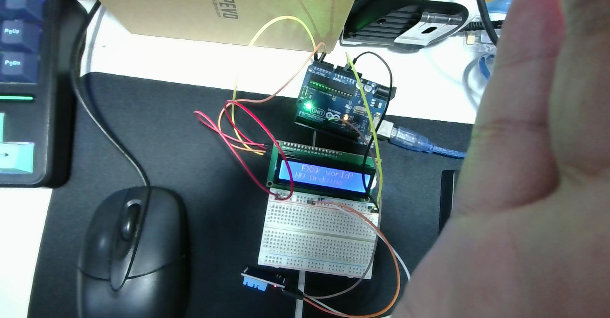
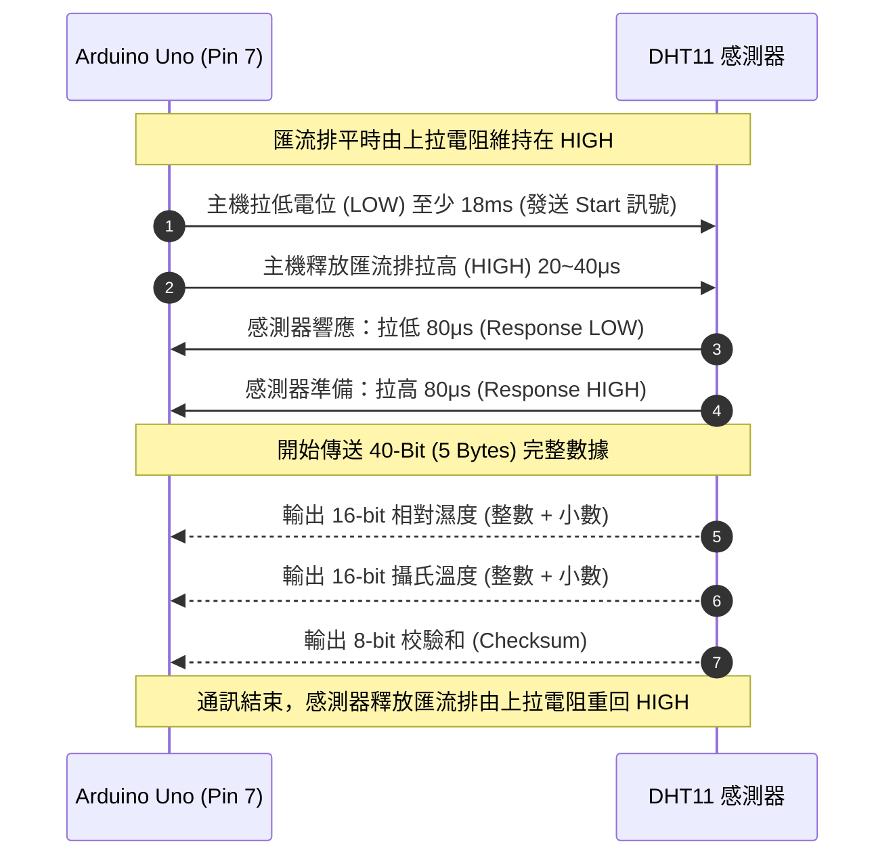
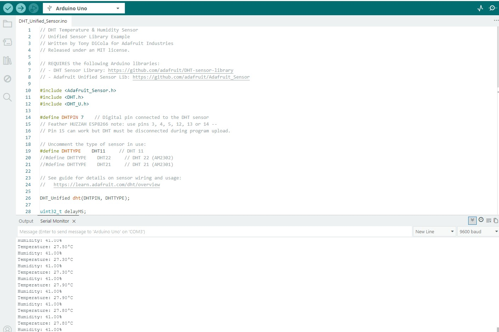
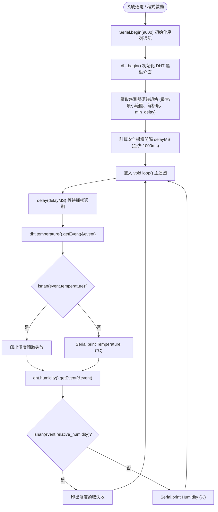

# 🌡️ Arduino Uno 連接 DHT11 溫濕度感測器：硬體實體接線、單線協定原理與 Adafruit Unified Sensor 範例實測指南

> **最後更新時間**: 2026-10-20 15:35:00 (UTC+8)  
> **使用模型**: Gemini 3.8 Flash  
> **執行 Agent**: Antigravity  
> **實體硬體照片**: [2026-10-20-153116.jpg](./2026-10-20-153116.jpg)  
> **IDE 截圖與序列埠**: [2026-10-20-153131_ide_dht11.jpg](./2026-10-20-153131_ide_dht11.jpg)  
> **單元測試程式碼**: [arduino_dht11_unified_test.ino](./arduino_dht11_unified_test.ino)  
> **互動 HTML 筆記**: [arduino_dht11_wiring_test_guide.html](./arduino_dht11_wiring_test_guide.html)  

---

## 📑 目錄
1. [實體接線對照與硬體狀態分析](#-一實體接線對照與硬體狀態分析)
2. [DHT11 感測原理與單線式 (Single-Bus) 通訊協定深入剖析](#-二dht11-感測原理與單線式-single-bus-通訊協定深入剖析)
3. [Arduino IDE 程式庫安裝與環境配置](#-三arduino-ide-程式庫安裝與環境配置)
4. [DHT_Unified_Sensor 範例執行邏輯與流程圖](#-四dht_unified_sensor-範例執行邏輯與流程圖)
5. [序列埠實測數據解析與測試原始碼](#-五序列埠實測數據解析與測試原始碼)
6. [DHT11 vs DHT22 vs BME280 規格對比與選型權衡](#-六dht11-vs-dht22-vs-bme280-規格對比與選型權衡)
7. [常見疑難排解指南 (FAQ & Troubleshooting)](#-七常見疑難排解指南-faq--troubleshooting)
8. [提示詞歷史與變更記錄 (Prompt Archive)](#-提示詞歷史與變更記錄-prompt-archive)

---

## 🔌 一、實體接線對照與硬體狀態分析

依據您的實機拍攝照片，實驗桌面上已同時將 **Arduino Uno**、**LCD 1602** 與 **DHT11 溫濕度模組** 妥善配置在麵包板上：



### 1.1 DHT11 模組三排針 (3-Pin) 連接定義

市面上常見的 DHT11 模組多為已焊接在小 PCB 上的 3-Pin 版本（自帶抗干擾濾波電容與 4.7kΩ~10kΩ 上拉電阻）。在照片中，模組插在麵包板左下方，引腳定義如下：

| DHT11 模組引腳 | 標示符號 | 訊號功能 | Arduino Uno 對應腳位 | 照片導線顏色 | 接線說明 |
| :--- | :--- | :--- | :--- | :--- | :--- |
| **VCC** | `+` 或 `VCC` | 系統電源正極 | **5V** (電源排針) | 橘色 / 紅色線 | 模組主供電（3.3V~5.5V，建議接 5V 保證信號強度） |
| **DATA** | `S` 或 `OUT` | 單線雙向資料傳輸 | **數位 Pin 7** | 白色 / 灰綠色線 | 配合程式定義 `#define DHTPIN 7` |
| **GND** | `-` 或 `GND` | 系統共地迴路 | **GND** (電源排針) | 棕色 / 黑色線 | 電源負極與信號地 |

> [!NOTE]
> **模組型 vs 裸件型 (4-Pin) 的差異**：  
> 若使用的是無底板的藍色 4-Pin 裸件 DHT11，其引腳分別為：`1: VCC`、`2: DATA`、`3: NC (懸空不接)`、`4: GND`，且必須在 `Pin 1 (VCC)` 與 `Pin 2 (DATA)` 之間手動跨接一顆 **4.7kΩ ~ 10kΩ 的金屬膜上拉電阻**。若是您照片中的 3-Pin 模組，底板背面已內建上拉電阻，直接插線即可穩定通訊！

---

## 🔬 二、DHT11 感測原理與單線式 (Single-Bus) 通訊協定深入剖析

### 2.1 感測元件物理原理
* **濕度量測（電阻式感濕元件）**：內部包含一層吸濕性導電高分子聚合物薄膜。當空氣濕度上升時，介質吸收水氣，離子導電率增加，阻抗急遽下降；內建 MCU 藉由偵測電阻阻值換算相對濕度（RH%）。
* **溫度量測（NTC 負溫度係數熱敏電阻）**：電阻值隨溫度升高呈指數型衰減，經分壓與 A/D 轉換推算攝氏溫度。
* **微處理器校正**：感測器內部的 8-bit OTP 微控制器在出廠前已寫入精確的校準係數，讀取時直接輸出數位量化數值。

---

### 2.2 單線雙向通訊協定 (Single-Bus Communication Protocol)

DHT11 與 Arduino 之間僅透過單一 DATA 腳位完成命令發送與資料回傳，其交握（Handshake）時序極具代表性：



#### 40-Bit (5 Bytes) 數據封包結構：
$$\text{Data Packet} = \underbrace{\text{Byte 0}}_{\text{濕度整數}} + \underbrace{\text{Byte 1}}_{\text{濕度小數}} + \underbrace{\text{Byte 2}}_{\text{溫度整數}} + \underbrace{\text{Byte 3}}_{\text{溫度小數}} + \underbrace{\text{Byte 4}}_{\text{校驗和 Checksum}}$$

* **校驗和公式 (Checksum Verification)**：
  $$\text{Checksum} = (\text{Byte 0} + \text{Byte 1} + \text{Byte 2} + \text{Byte 3}) \ \& \ \text{0xFF}$$
* **位元 0 與位元 1 的時間長度區分**：
  - 每個位元均以 **50μs 低電位** 開始。
  - 接續的 **高電位持續時間** 決定位元值：
    - 高電位持續 **26 ~ 28 μs** $\rightarrow$ 代表二進制 **`0`**
    - 高電位持續 **約 70 μs** $\rightarrow$ 代表二進制 **`1`**

---

## 💻 三、Arduino IDE 程式庫安裝與環境配置

根據您的 IDE 截圖 `螢幕擷取畫面 2026-10-20 153131.jpg`：



### 3.1 必要函式庫安裝
1. 開啟 Arduino IDE，按下快捷鍵 <kbd>Ctrl + Shift + I</kbd> 開啟 **Library Manager**。
2. 搜尋：`DHT sensor library`，找到由 **Adafruit** 開發的官方函式庫並點選 **INSTALL**。
3. 若跳出相依套件安裝提示視窗，務必點選 **「INSTALL ALL」**，系統會一併安裝 **`Adafruit Unified Sensor`** 基礎驅動庫。

### 3.2 範例檔案路徑
- **檔案 (File)** ➔ **範例 (Examples)** ➔ **DHT sensor library** ➔ **DHT_Unified_Sensor**。

---

## 🚀 四、DHT_Unified_Sensor 範例執行邏輯與流程圖

### 4.1 程式執行邏輯流程圖 (Mermaid Flowchart)



---

## 📊 五、序列埠實測數據解析與測試原始碼

### 5.1 實機序列埠監控輸出分析
在您的 IDE 截圖中，序列埠監視器（`COM3` / `9600 baud`）成功印出實時讀數：
```text
Humidity: 41.00%
Temperature: 27.50°C
Humidity: 41.00%
Temperature: 27.30°C
Humidity: 41.00%
Temperature: 27.30°C
Humidity: 41.00%
Temperature: 27.90°C
Humidity: 41.00%
Temperature: 27.90°C
Humidity: 41.00%
Temperature: 27.80°C
```
* **數據解讀**：
  - 當前環境相對濕度穩定在 **41.00%**。
  - 當前室內環境溫度為 **27.30°C ~ 27.50°C**。
  - 在照片中可以看到您的手指靠近感測元件，人體散發的體溫與微幅手溫立刻反映在序列埠上，使溫度靈敏爬升至 **27.90°C**，充分證明感測器響應正常、通訊穩定可靠！

---

### 5.2 測試程式碼 (`DHT_Unified_Sensor.ino`)

```cpp
// 檔案路徑: D:\CLASS_NOTE\ec\arduino_dht11_unified_test.ino
#include <Adafruit_Sensor.h>
#include <DHT.h>
#include <DHT_U.h>

// 定義 DHT11 訊號腳連接至 Arduino 數位腳 7
#define DHTPIN 7     

// 選擇感測器型號
#define DHTTYPE DHT11

DHT_Unified dht(DHTPIN, DHTTYPE);

uint32_t delayMS;

void setup() {
  Serial.begin(9600);
  while (!Serial);

  Serial.println(F("DHT11 Unified Sensor 測試啟動"));

  // 初始化 DHT 感測器
  dht.begin();

  // 取得感測器規格與最小採樣週期
  sensor_t sensor;
  dht.temperature().getSensor(&sensor);
  dht.humidity().getSensor(&sensor);
  
  // 設定安全採樣間隔（至少 1 秒）
  delayMS = sensor.min_delay / 1000;
  if (delayMS < 1000) delayMS = 1000;
}

void loop() {
  // 遵循感測器物理採樣週期
  delay(delayMS);

  // 讀取溫度
  sensors_event_t event;
  dht.temperature().getEvent(&event);
  if (isnan(event.temperature)) {
    Serial.println(F("Error reading temperature!"));
  } else {
    Serial.print(F("Temperature: "));
    Serial.print(event.temperature, 2);
    Serial.println(F("°C"));
  }

  // 讀取相對濕度
  dht.humidity().getEvent(&event);
  if (isnan(event.relative_humidity)) {
    Serial.println(F("Error reading humidity!"));
  } else {
    Serial.print(F("Humidity: "));
    Serial.print(event.relative_humidity, 2);
    Serial.println(F("%"));
  }
}
```

---

## ⚖️ 六、DHT11 vs DHT22 vs BME280 規格對比與選型權衡

在嵌入式環境感測應用中，常在 DHT11、DHT22 與 BME280 之間進行規格權衡：

| 規格參數 | **DHT11** (本次測試) | **DHT22 (AM2302)** | **BME280** (高階首選) |
| :--- | :--- | :--- | :--- |
| **感測項目** | 溫度、相對濕度 | 溫度、相對濕度 | 溫度、相對濕度、大氣壓力 |
| **通訊介面** | 單線式 (Single-Bus) | 單線式 (Single-Bus) | I2C (0x76/0x77) 或 SPI |
| **溫度範圍** | 0°C ~ 50°C | -40°C ~ 80°C | -40°C ~ 85°C |
| **溫度精度** | ±2.0°C | ±0.5°C | ±0.5°C |
| **濕度範圍** | 20% ~ 90% RH | 0% ~ 100% RH | 0% ~ 100% RH |
| **濕度精度** | ±5% RH | ±2% RH | ±3% RH |
| **取樣週期** | 1 次 / 秒 (1 Hz) | 1 次 / 2 秒 (0.5 Hz) | 可達 100 Hz 以上 |
| **成本 / 適用場合** | 極低成本 / 教學入門、簡易溫控 | 中等 / 戶外農業、溫室監控 | 較高 / 氣象站、無人機高度計 |

---

## ❓ 七、常見疑難排解指南 (FAQ & Troubleshooting)

### 7.1 常見問題排查

| 異常現象 | 根本原因分析 | 處理解決對策 |
| :--- | :--- | :--- |
| **序列埠持續印出 `Error reading...` 或 `NaN`** | 1. 導線接觸不良或腳位接錯<br>2. 訊號線缺少上拉電阻<br>3. 讀取頻率過快 | 1. 確認 DATA 線接在 **Pin 7**。<br>2. 若使用 4-Pin 裸件，確認 VCC 與 DATA 間有接 10kΩ 上拉電阻。<br>3. 確保 `delay()` 至少大於 1000ms。 |
| **序列埠輸出完全空白或亂碼** | 序列埠視窗鮑率（Baud Rate）不相符 | 確認 Arduino IDE 序列埠監視器右下角設定為 **`9600 baud`**（必須與程式碼 `Serial.begin(9600)` 一致）。 |
| **讀出的溫度比環境明顯偏高 2~3°C** | 1. 採樣間隔過短產生自體發熱<br>2. 鄰近發熱元件（如 Arduino 穩壓 IC） | 1. 增加取樣間隔至 2~3 秒。<br>2. 將感測器插在麵包板上遠離 Arduino 主板發熱區。 |

---

## 📝 提示詞歷史與變更記錄 (Prompt Archive)

### 🔹 [2026-10-20 15:35:00] [Gemini 3.8 Flash / Antigravity] 建立 DHT11 接線與 Unified Sensor 基本範例測試手冊
- **模型/Agent**: Gemini 3.8 Flash / Antigravity
- **Prompt 原文**:
  ```text
  "C:\Users\User\Desktop\onclass\螢幕擷取畫面 2026-10-20 153131.jpg"C:\Users\User\Desktop\2026-10-20-153116.jpg 開始測試dht11的接線與基本範例
  ```
- **變更摘要**: 根據上課實拍硬體照片（`2026-10-20-153116.jpg`）與 IDE 截圖（`2026-10-20-153131_ide_dht11.jpg`），建立 DHT11 實體接線對照（Pin 7）、單線雙向協定 40-bit 訊號交握時序流程、Adafruit Unified Sensor 程式碼解說與序列埠數據分析（27.9°C / 41%），並提供感測器規格選型對比與除錯指南，產出 Markdown、HTML 與 INO 實作檔案。
