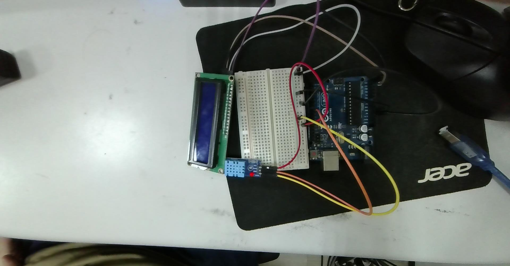
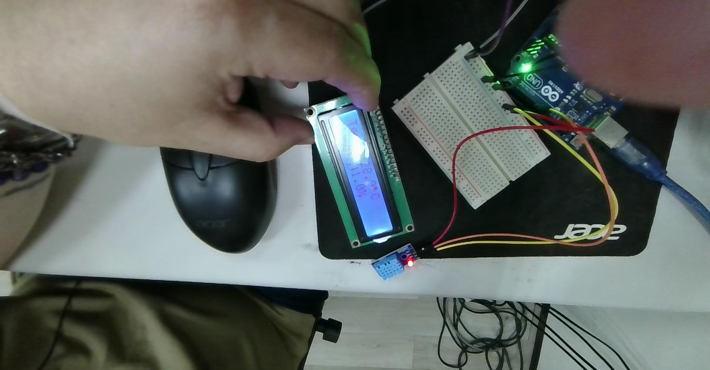
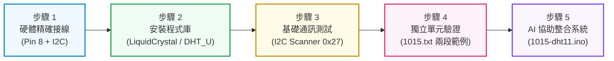

# 🌡️ Arduino Uno 整合 I2C LCD 1602 與 DHT11 溫濕度監測系統實作筆記

> **最後更新時間**: 2026-10-15 14:49:32 (UTC+8)  
> **使用模型**: Gemini 3.8 Flash  
> **執行 Agent**: Antigravity  

---

## 📖 系統導論與專題概述 (System Overview)

本專題以 **Arduino Uno R3** 微控制器為核心，結合 **DHT11 數位溫濕度感測器模組** 與 **I2C 介面 LCD 1602 液晶顯示模組**，建構一套即時環境溫濕度監測系統。

在嵌入式物聯網 (IoT) 與環境監測應用中，溫濕度是最基礎且關鍵的環境參數。然而，在系統整合與電路實現過程中，往往面臨引腳資源佔用與多協定時序協調的挑戰：
1. **顯示介面優化**：傳統 LCD 1602 需消耗 6 至 10 根 GPIO 引腳；本系統採用基於 **PCF8574** 晶片的 I2C 擴展板，僅需 **SDA (資料線)** 與 **SCL (時脈線)** 兩條訊號線即可完成全功能控制。
2. **單匯流排時序通訊**：DHT11 採用專屬的單匯流排 (Single-Bus) 數位協定，需以微秒 ($\mu\text{s}$) 級的嚴謹脈衝寬度進行 40-bit 封包解碼與校驗和 (Checksum) 驗證。
3. **Adafruit Unified Sensor 架構**：採用業界標準的 `Adafruit_Sensor` 統一感測器抽象層與 `DHT_U` 函式庫，自動讀取感測器硬體規格與最小取樣週期（`sensor.min_delay`）。
4. **模組化五步驟工程思維**：先確認硬體接線，依序安裝程式庫並進行獨立模組單元測試，最終透過 AI 協同完成整合，兼顧除錯效率與程式碼品質。

---

## 📷 實體接線圖與硬體配置 (Hardware Setup)

依據使用者提供的實體接線照片（`2026-10-15-135909.jpg`），系統整體由 Arduino Uno、小型麵包板、I2C LCD 1602 模組及 DHT11 模組構成。



### 🌟 實作通電運作完成成果 (Completed Live Hardware Verification)

依據使用者實測上傳之成果照片（`2026-10-15-143912.jpg`），系統燒錄 `1015-dht11.ino` 後通電運作完全正常：



* **實測螢幕即時顯示數值**：
  * **第 0 行**：`Temp: 28.9°C`（室內即時溫度 $28.9^\circ\text{C}$，內建字模 `(char)223` 度數圓圈與 `C` 完美呈現）
  * **第 1 行**：`Humd: 41.0%`（室內相對濕度 $41.0\%\ \text{RH}$，格式對齊俐落且無字元殘留）
* **電氣與通訊運作狀態**：
  * **Arduino Uno**：綠色電源指示燈（ON）常亮，USB 穩定供應 +5V。
  * **DHT11 模組**：板載紅色電源 LED 恆亮，Pin 8 單匯流排通訊持續穩定無異常。
  * **I2C LCD 1602**：藍底白字背光均勻，對比度調校適中，字模邊緣銳利清晰。

### 🔌 完整硬體引腳接線對照表 (Wiring Pinout Table)

麵包板在系統中作為共用電源母線（Power Rail），Arduino Uno 提供穩定之 5V 與 GND 電源，各模組引腳配置如下：

| 元件名稱 | 元件引腳標示 | 連接目標 (Arduino / 麵包板) | 電氣功能說明 | 導線顏色對照 (照片實物) |
| :--- | :--- | :--- | :--- | :--- |
| **Arduino Uno** | **5V** | **麵包板正極軌 (Red Rail)** | 系統主電源正極供應 (+5V DC) | 紅色跳線 (Red) |
| **Arduino Uno** | **GND** | **麵包板負極軌 (Blue/Black Rail)** | 系統共用地線 (Common Ground) | 黑色/棕色跳線 |
| **I2C LCD 1602**<br>(PCF8574 轉接板) | **GND** | **麵包板負極軌 (GND)** | 模組電源地線 | 黑色/灰色線 |
| | **VCC** | **麵包板正極軌 (5V)** | 模組工作電源 (+5V) | 白色/紫色線 |
| | **SDA** | **Arduino Pin A4 (或頂部 SDA)** | I2C 串列資料線 (Serial Data) | 白色跳線 (White) |
| | **SCL** | **Arduino Pin A5 (或頂部 SCL)** | I2C 串列時脈線 (Serial Clock) | 紫色跳線 (Purple) |
| **DHT11 感測模組**<br>(3-Pin 模組版) | **VCC (`+`)** | **麵包板正極軌 (5V)** | 感測器供電端 (3.3V ~ 5.5V) | 紅色跳線 (Red) |
| | **GND (`-`)** | **麵包板負極軌 (GND)** | 感測器接地端 | 橘色/棕色跳線 |
| | **DATA (`OUT` / `S`)** | **Arduino 數位引腳 Pin 8** | 單匯流排雙向資料傳輸引腳 | 黃色跳線 (Yellow) |

> [!NOTE]
> * **I2C 引腳說明**：在 Arduino Uno R3 上，類比引腳 `A4`、`A5` 與數位側頂部（AREF 旁）的 `SDA`、`SCL` 引腳在 PCB 內部是完全導通的同一個硬體節點，接任一側皆具相同功能。
> * **實測腳位確認**：在實體驗證程式碼 `1015-dht11.ino` 中，明確定義 `#define DHTPIN 8`，黃色資料線接於 Arduino Uno 的數位引腳 **Pin 8**。
> * **DHT11 模組上拉電阻**：本接線採用的是已焊接於小板上的 3-Pin DHT11 模組（板載電源指示燈與貼片上拉電阻 4.7kΩ~10kΩ）。若使用的是 4-Pin 裸感測器元件，需在 Pin 1 (VCC) 與 Pin 2 (DATA) 之間外接一顆 4.7kΩ 至 10kΩ 的上拉電阻。

---

## 🔬 一、核心概念剖析 (Core Concepts)

### 1.1 I2C 序列通訊與 PCF8574 晶片架構

I2C（Inter-Integrated Circuit）是由 Philips（現 NXP）開發的雙線式、半雙工、同步序列匯流排。

```
                  ┌─────────────────────────────────────────┐
                  │          Arduino Uno (Master)           │
                  │         A4 (SDA)        A5 (SCL)        │
                  └────────────┬───────────────┬────────────┘
                               │               │
                     SDA 資料線│               │ SCL 時脈線
                               │ (上拉至 5V)    │ (上拉至 5V)
                               ▼               ▼
                  ┌─────────────────────────────────────────┐
                  │        PCF8574 I2C 8-Bit I/O 擴展晶片   │
                  │        (Slave Address: 0x27 或 0x20)    │
                  └────────────────────┬────────────────────┘
                                       │ 4-Bit 驅動控制線 (RS, EN, D4~D7, 背光)
                                       ▼
                  ┌─────────────────────────────────────────┐
                  │       HD44780 驅動 LCD 1602 點陣液晶     │
                  │             (16 字元 × 2 行)             │
                  └─────────────────────────────────────────┘
```

1. **開漏極 (Open-Drain) 與上拉電阻**：
   * SDA 與 SCL 皆採用開漏極（或開集極）驅動，依靠匯流排上的上拉電阻維持高電平（$V_{CC}$）。
   * 任何節點只能主動將電平拉低（LOW），無法主動強推至高電平，這自然形成了「線與（Wired-AND）」邏輯，從根本上避免了匯流排衝突與硬體短路風險。
2. **PCF8574 位址機制**：
   * 7-Bit 位址由固定高位與低位硬體腳（A0, A1, A2）決定：
     $$\text{PCF8574: } [0, 1, 0, 0, A2, A1, A0]_2 \quad (\text{全浮空時預設為 } 0x27)$$
     $$\text{PCF8574A: } [0, 1, 1, 1, A2, A1, A0]_2 \quad (\text{全浮空時預設為 } 0x3F)$$
   * 本專案實測模組預設位址為 **`0x27`**。若焊點全短接至 GND，位址則變為 `0x20`。
3. **4-Bit 傳輸模式**：
   * PCF8574 提供 8 個準雙向 I/O 引腳（P0~P7），分別連接 LCD 1602 的 $RS$ (暫存器選擇)、$RW$ (讀寫)、$EN$ (致能)、背光電晶體開關，以及 4 條高階資料匯流排線 ($D4 \sim D7$)。

---

### 1.2 DHT 系列溫濕度感測器底層物理運作原理 (DHT Sensor Operating Principles)

DHT11 與 DHT22 表面上看似一顆單純的感測探頭，但其內部實際上是一個高度整合的**微型感測與嵌入式訊號處理系統**。它將物理環境變化轉化為微控制器可讀取的標準數位封包，包含四大核心環節：

```
                      DHT11 / DHT22 模組內部構造
  ┌─────────────────────────────────────────────────────────────┐
  │                                                             │
  │  ┌───────────────────────┐       ┌───────────────────────┐  │
  │  │   電阻式高分子濕敏元件 │       │   負溫度係數 (NTC)    │  │
  │  │  (Polymer Humidity)   │       │   熱敏電阻 (測溫)     │  │
  │  └───────────┬───────────┘       └───────────┬───────────┘  │
  │              │ 阻抗隨濕度變化                 │ 阻值隨溫度變化 │
  │              ▼                               ▼              │
  │  ┌───────────────────────────────────────────────────────┐  │
  │  │            內部專用 8-Bit 微控制器 (MCU)               │  │
  │  │  • 多通道高精度 A/D 轉換器 (ADC)                       │  │
  │  │  • OTP 記憶體 (儲存出廠校準係數與溫度補償矩陣)         │  │
  │  │  • 單匯流排時序控制器與 Checksum 校驗編碼器            │  │
  │  └───────────────────────────┬───────────────────────────┘  │
  │                              │ 單線雙向數位訊號 (DATA Pin 8) │
  └──────────────────────────────┼──────────────────────────────┘
                                 ▼
                     Arduino Uno (主控微處理器)
```

#### 1. 濕度量測物理機制：電阻式高分子濕敏元件 (Resistive Humidity Sensing)
DHT11 內部的感濕元件採用**高分子聚合物電解質（Polymer Electrolyte）**薄膜電阻：
* **水分子吸附與解離原理**：
  感濕薄膜表面佈滿親水性基團（如磺酸基、羧基等）。當空氣中的水蒸氣相對濕度（$\%\text{RH}$）上升時，水分子經由薄膜的多孔微觀結構被**吸附（Adsorption）**到聚合物網絡中。
* **導電機制與阻抗驟降**：
  吸附的水分子使聚合物內部的親水官能基發生解離，釋放出大量高遷移率的水合氫離子（$\text{H}_3\text{O}^+$）。水分子越多，質子傳遞通道（Grotthuss 機制）越順暢，材料的導電度劇增，阻抗值呈指數級驟降：
  $$\log(R_H) \propto -k \cdot (\%\text{RH})$$
  * 在乾燥環境（$20\%\ \text{RH}$）下，元件阻抗高達數兆歐姆（$\text{M}\Omega$）。
  * 在高濕環境（$90\%\ \text{RH}$）下，阻抗急降至幾千歐姆（$\text{k}\Omega$）。
* **解吸附（Desorption）反應延遲**：
  當環境轉乾時，水分子自微孔逸散需要時間，因此濕度讀取存在物理「響應弛豫時間（Relaxation Time，約 6~10 秒）」，不可頻繁讀取。

---

#### 2. 溫度量測物理機制：NTC 負溫度係數熱敏電阻 (NTC Thermistor)
DHT11 採用高靈敏度的 **NTC（Negative Temperature Coefficient）熱敏電阻** 進行測溫：
* **半導體材料載子激發原理**：
  NTC 由過渡金屬氧化物（錳 $\text{Mn}$、鈷 $\text{Co}$、鎳 $\text{Ni}$、鐵 $\text{Fe}$）經過高溫陶瓷燒結製成。其電阻率 $\rho$ 隨溫度上升而急遽下降：
  * 當溫度升高時，熱能激發半導體晶格內的共價鍵，使大量被束縛的電子躍遷至導帶，形成大量自由電子與電洞，載子濃度指數增加，電阻大幅降低。
* **數學物理模型：史坦哈特-哈特方程 (Steinhart-Hart Equation)**：
  溫度與電阻值的精確關係可由史坦哈特-哈特公式描述：
  $$\frac{1}{T} = A + B \ln(R) + C (\ln(R))^3$$
  在工業感測的實用工作溫度範圍內（$0^\circ\text{C} \sim 50^\circ\text{C}$），常以工程簡化 **$\beta$ 參數模型** 計算：
  $$R(T) = R_0 \cdot \exp\left[ \beta \left( \frac{1}{T} - \frac{1}{T_0} \right) \right]$$
  反推絕對溫度 $T$（單位：Kelvin $\text{K}$）：
  $$T = \frac{1}{\frac{1}{T_0} + \frac{1}{\beta} \ln\left(\frac{R}{R_0}\right)}$$
  其中 $R_0$ 為基準溫度 $T_0 = 298.15\text{K}\ (25^\circ\text{C})$ 時的標稱阻值，$\beta$ 為材料常數（通常在 $3000\text{K} \sim 4500\text{K}$ 之間）。

---

#### 3. 內部 8-Bit 微控制器訊號處理、OTP 校準與溫度補償
感測器內部的小晶片完成了複雜的訊號轉換：
1. **出廠真值校準 (Calibration in OTP ROM)**：
   高分子濕敏元件與 NTC 電阻具有個體公差與非線性特徵。DHT11 在出廠前被置於嚴密控制的精密濕度校驗室中，量測多個溫濕度標定點，計算出的校準補償係數以程式碼形式永久燒錄於晶片內部的 **OTP（One-Time-Programmable）唯讀記憶體**。
2. **溫度對濕度的交叉補償演算法**：
   由於相對濕度本質上取決於飽和水蒸氣壓（隨溫度劇烈變化），且高分子吸附係數具溫度依賴性。內部微控制器在讀取濕度阻抗時，會**同時採樣 NTC 溫度數據**，並調用 OTP 補償查表公式對濕度值進行即時動態溫度補償運算。
3. **A/D 轉換與封包化**：
   微控制器將類比訊號轉換後，打包為 40-Bit 格式（5 個 Byte），並等待主機喚醒。

---

#### 4. 單匯流排 (Single-Bus) 數位通訊時序與脈衝寬度調變 (PWM)
DHT11 與 Arduino 僅依靠 Pin 8 一條訊號線與開漏上拉電阻（$4.7\text{k}\Omega$）協同通訊：

```
時序波形示意圖：
[Arduino 主機]                          [DHT11 感測器端]
──┐                                    ┌──────────┐          ┌──────┐
  │ 主動拉低 > 18ms (喚醒)              │          │ 80μs     │ 50μs │  26~28μs (代表 "0")
  └────────────────────────┐           │  80μs    └──────────┘ 起始  └──────...
                           │ 等待 20~40μs │ (低電平回應) (高電平準備)
                           └───────────┘
```

1. **主機喚醒訊號 (Start Signal)**：
   Arduino 將 Pin 8 設為輸出，拉低電平維持至少 **$18\text{ms}$**（讓 DHT 晶片從低功耗待機休眠中喚醒），隨後拉高 **$20 \sim 40\mu\text{s}$**，並立即將引腳切換為輸入模式釋放匯流排。
2. **感測器回應訊號 (Sensor Response)**：
   DHT11 偵測到喚醒後，主動將匯流排拉低 **$80\mu\text{s}$**，隨後拉高 **$80\mu\text{s}$** 作為準備傳輸提示。
3. **40-Bit 資料位元調變 (PWM Decoding)**：
   40 個位元中的每一個位元，均以 **$50\mu\text{s}$ 的低電平脈衝** 作為起始標誌，隨後高電平的持續時間決定該位元為 0 還是 1：
   * **Bit "0"**：高電平持續 **$26 \sim 28\mu\text{s}$**
   * **Bit "1"**：高電平持續 **約 $70\mu\text{s}$**
4. **校驗和 (Checksum) 數學公式**：
   $$\text{Checksum} = (\text{濕度整數} + \text{濕度小數} + \text{溫度整數} + \text{溫度小數}) \pmod{256}$$
   若前 4 個 Byte 之累加總和（取低 8 位元）與第 5 個 Byte 相等，代表資料無損傳輸。

---

#### 5. 自我發熱 (Self-Heating) 與熱平衡取樣限制
為什麼程式中必須設定 `if (delayMS < 1500) delayMS = 1500;` 且不建議高頻讀取？
* **焦耳熱累積（Joule Heating）**：
  感測器內部晶片與感測元件在通電量測時，電流流經電阻會產生微小的焦耳熱（$P = I^2 R$）。若在 `loop()` 迴圈中無延遲高頻連續取樣，產生的熱量無法及時散逸，會使感測器內部微環境溫度高於外界實際室溫。
* **局部相對濕度失真**：
  根據熱力學飽和水蒸氣壓公式（August-Roche-Magnus 公式），溫度微幅上升會導致飽和蒸氣壓大幅增加，使得**量測出的相對濕度數值產生嚴重負偏差（讀數大幅偏低且不準）**。因此硬體規格嚴格限制採樣週期至少需間隔 $1.5 \sim 2.0$ 秒以上。

---

#### 6. Adafruit Unified Sensor (DHT_U) 架構優勢
使用者在實測程式碼中採用了 `DHT_U.h` 與 `Adafruit_Sensor.h`，相較於傳統基礎函式庫，Unified Sensor 具備兩大優勢：
* **自動讀取硬體參數 (`sensor_t`)**：
  可直接透過 `dht.temperature().getSensor(&sensor)` 讀取感測器型號名稱、最大/最小值、解析度，以及極為關鍵的硬體最小取樣延遲：
  $$\text{delayMS} = \frac{\text{sensor.min\_delay}}{1000}$$
* **事件驅動結構體 (`sensors_event_t`)**：
  將測量結果封裝於統一的 `event` 物件（`event.temperature` 與 `event.relative_humidity`），具備跨感測器的標準化介面。

---

### 1.3 HD44780 內建度數符號 `(char)223` 與防殘留字元技巧

1. **LCD 內建度數符號 `(char)223` (0xDF)**：
   在使用者整合的程式碼中，發現了一個極為簡潔的工程技巧：
   ```cpp
   lcd.print((char)223); // LCD 內建的度數符號 '°'
   ```
   Hitachi HD44780 晶片標準字庫 ROM（A00 規格）在索引 `0xDF`（十進制 `223`，對應二進制 `1101 1111`）內建了日文半形句點／圓圈符號，外觀正好是標準的度數圓圈 `°`！這免去了手動寫入 CGRAM 的複雜程式碼，程式更輕量簡潔。
2. **尾部補空格防殘留機制 (Padding Technique)**：
   當溫度從兩位數（如 `25.4°C`）驟降至個位數（如 `9.1°C`）時，字元長度會縮短。使用者在程式碼中特別加上：
   ```cpp
   lcd.print("C  "); // 後方補空格避免位數變短時殘留舊字元
   lcd.print("%   ");
   ```
   此技巧完全避免了呼叫 `lcd.clear()` 造成的閃爍，是極為實用的顯示優化手段。

---

## 🛠️ 二、實作者五步驟工程方法與代碼驗證 (5-Step Practical Methodology)

本專題完全落實使用者提出的五步驟開發流程：



---

### 步驟 1：依硬體規格指示精準接線 (Hardware Wiring)
* **共用電源母線**：Arduino Uno 5V / GND 接至麵包板電源紅/藍軌。
* **I2C LCD 1602**：VCC/GND 接電源軌，SDA 接 A4，SCL 接 A5。
* **DHT11 感測模組**：VCC 接 5V，GND 接接地軌，DATA 訊號線接至 **`Pin 8`**。

---

### 步驟 2：尋找並安裝 Arduino 程式庫 (Library Installation)
在 Arduino IDE 的 Library Manager（`Ctrl + Shift + I`）安裝：
1. **`LiquidCrystal_I2C`**
2. **`DHT sensor library`**（安裝時選擇 Install all，連帶安裝 **`Adafruit Unified Sensor`**）

---

### 步驟 3：開啟範例進行基礎測試 (I2C 匯流排位址確認)
執行 I2C Scanner 確認 LCD PCF8574 晶片位址為 **`0x27`**。

---

### 步驟 4：分別依照上述方法獨立測試螢幕與溫濕度 (使用者實測檔案: 1015.txt)

使用者在 `1015.txt` 中完整保留了當時分別進行單元測試的原始程式碼：

#### 4.1 LCD 1602 螢幕單元測試 (使用者 1015.txt 原文節錄)
```cpp
// YWROBOT Compatible with the Arduino IDE 1.0
#include <Wire.h> 
#include <LiquidCrystal_I2C.h>

LiquidCrystal_I2C lcd(0x27, 16, 2);  // 設定 LCD 位址 0x27，16字元 2行

void setup() {
  lcd.init();                        // 初始化 lcd
  lcd.init();
  lcd.backlight();                   // 開啟背光
  lcd.setCursor(3, 0);
  lcd.print("Hello, world!");
  lcd.setCursor(2, 1);
  lcd.print("Ywrobot Arduino!");
}

void loop() {
}
```
* **驗證結果**：螢幕成功點亮，調節對比度電位器後，字元清晰顯示，證明 I2C 通訊與螢幕硬體完好。

#### 4.2 DHT11 溫濕度感測器單元測試 (使用者 1015.txt 原文節錄)
```cpp
// DHT Temperature & Humidity Sensor - Unified Sensor Library Example
#include <Adafruit_Sensor.h>
#include <DHT.h>
#include <DHT_U.h>

#define DHTPIN 8       // DHT 感測器接在數位 Pin 8
#define DHTTYPE DHT11  // 感測器型號 DHT11

DHT_Unified dht(DHTPIN, DHTTYPE);
uint32_t delayMS;

void setup() {
  Serial.begin(9600);
  dht.begin();
  
  sensor_t sensor;
  dht.temperature().getSensor(&sensor);
  dht.humidity().getSensor(&sensor);
  
  delayMS = sensor.min_delay / 1000; // 取得感測器規格最小延遲
}

void loop() {
  delay(delayMS);
  
  sensors_event_t event;
  dht.temperature().getEvent(&event);
  if (isnan(event.temperature)) {
    Serial.println(F("Error reading temperature!"));
  } else {
    Serial.print(F("Temperature: "));
    Serial.print(event.temperature);
    Serial.println(F("°C"));
  }

  dht.humidity().getEvent(&event);
  if (isnan(event.relative_humidity)) {
    Serial.println(F("Error reading humidity!"));
  } else {
    Serial.print(F("Humidity: "));
    Serial.print(event.relative_humidity);
    Serial.println(F("%"));
  }
}
```
* **驗證結果**：Serial Monitor (9600 bps) 每隔數秒穩定吐出溫度與相對濕度數值，證明 Pin 8 與單匯流排協定運作正常。

---

### 步驟 5：將測試成功的基礎範例讓 AI 協助整合 (實測程式: 1015-dht11.ino)

將「步驟 4.1 的 LCD 顯示碼」與「步驟 4.2 的 DHT_Unified 感測碼」交由 AI，整合出的最終實體驗證程式碼如下：

#### 🏆 使用者驗證整合程式碼 (`ec/1015-dht11.ino`)
```cpp
#include <Wire.h> 
#include <LiquidCrystal_I2C.h>
#include <Adafruit_Sensor.h>
#include <DHT.h>
#include <DHT_U.h>

// --- 硬體腳位與設定 ---
#define DHTPIN 8          // DHT 感測器接在數位腳位 8
#define DHTTYPE DHT11     // 感測器型號 DHT11

// 設定 LCD：位址通常為 0x27，規格為 16 字元、2 行
LiquidCrystal_I2C lcd(0x27, 16, 2);
DHT_Unified dht(DHTPIN, DHTTYPE);

uint32_t delayMS;

void setup() {
  Serial.begin(9600);

  // 初始化 LCD 螢幕與背光
  lcd.init();
  lcd.backlight();
  lcd.clear();

  // 初始化 DHT 感測器
  dht.begin();

  // 取得 DHT 感測器所需的最小讀取間隔時間（DHT11 通常至少需 1~2 秒）
  sensor_t sensor;
  dht.temperature().getSensor(&sensor);
  delayMS = sensor.min_delay / 1000;
  if (delayMS < 1500) {
    delayMS = 1500; // DHT11 建議間隔至少 1.5 秒以上較為穩定
  }

  // 開機提示畫面
  lcd.setCursor(0, 0);
  lcd.print("Initializing...");
  delay(1000);
  lcd.clear();
}

void loop() {
  // 等待感測器間隔
  delay(delayMS);

  sensors_event_t event;

  // --- 讀取並顯示溫度（第 1 行）---
  lcd.setCursor(0, 0);
  lcd.print("Temp: ");
  dht.temperature().getEvent(&event);
  if (isnan(event.temperature)) {
    lcd.print("Error   ");
  } else {
    lcd.print(event.temperature, 1); // 顯示小數點後 1 位
    lcd.print((char)223);            // LCD 內建的度數符號 '°'
    lcd.print("C  ");                // 後方補空格避免位數變短時殘留舊字
  }

  // --- 讀取並顯示濕度（第 2 行）---
  lcd.setCursor(0, 1);
  lcd.print("Humd: ");
  dht.humidity().getEvent(&event);
  if (isnan(event.relative_humidity)) {
    lcd.print("Error   ");
  } else {
    lcd.print(event.relative_humidity, 1); // 顯示小數點後 1 位
    lcd.print("%   ");
  }
}
```

---

#### 💡 程式碼亮點分析與進階思考 (Engineering Insights)
1. **動態取樣時間適應**：
   透過 `sensor.min_delay / 1000` 動態獲取晶片底層參數，並加上 `if (delayMS < 1500) delayMS = 1500;` 保險門檻，確保 DHT11 晶片不會因高頻讀取產生自我發熱（Self-Heating）或校驗超時。
2. **巧妙運用內建字庫 `(char)223`**：
   省略了 CGRAM 字元產生的額外記憶體與指令負擔，以最直觀的方式打出標準的 `°C`。
3. **尾端空格對齊與覆寫更新**：
   在 `C  ` 與 `%   ` 後方補空白，避免了每次呼叫 `lcd.clear()` 造成的刺眼閃爍。

---

## 📝 提示詞歷史與變更記錄 (Prompt Archive)

### 🔹 [2026-10-15 14:00:57] [Gemini 3.8 Flash / Antigravity] 變更紀錄
- **模型/Agent**: Gemini 3.8 Flash / Antigravity
- **Prompt 原文**:
  ```text
  C:\Users\User\Desktop\2026-10-15-135909.jpg  這是今天arduino接上lcd 1602 I2c與 dht11的線路圖，先記錄成筆記
  ```
- **變更摘要**: 依據使用者提供的實體電路接線圖照片（`2026-10-15-135909.jpg`），建立 Arduino Uno 整合 I2C LCD 1602 與 DHT11 溫濕度監控系統的完整專題筆記（`ec/arduino_i2c_lcd1602_dht11.md` 與對應 HTML 模擬器）。完整記錄硬體引腳對照清單、I2C 匯流排協定與 PCF8574 晶片架構、DHT11 單匯流排 40-Bit 脈寬通訊時序與校驗和原理、非阻塞式 `millis()` 排程與防閃爍字元更新策略，並提供 Mermaid 邏輯流程圖、繁體中文詳細註解之 Arduino C++ 程式碼、I2C Scanner 位址診斷程式，以及 DHT11 vs DHT22 性能權衡與中斷時序抖動深度剖析。

### 🔹 [2026-10-15 14:22:06] [Gemini 3.8 Flash / Antigravity] 變更紀錄
- **模型/Agent**: Gemini 3.8 Flash / Antigravity
- **Prompt 原文**:
  ```text
  我的實作步驟是 1.先根據硬體只是接線 2.尋找安裝程式庫 3.開啟範例進行基礎測試(硬體與通訊 基礎語法認識)4.分別依照上述方法測試螢幕與溫濕度 5.將測試成功的基礎範例讓AI協助我整合
  ```
- **變更摘要**: 導入使用者提出的標準五步驟工程實作法（1.硬體指示接線 ➔ 2.搜尋安裝程式庫 ➔ 3.基礎範例與通訊語法認識 ➔ 4.分別獨立單元測試螢幕與溫濕度 ➔ 5.由 AI 協助整合單元模組），新增 Arduino IDE 程式庫安裝指引、LCD 1602 獨立單元測試碼與基礎語法解析、DHT11 獨立單元測試碼與基礎語法解析、AI 協同整合提示詞設計範本與流程圖，大幅提升教學與實作參考價值。

### 🔹 [2026-10-15 14:41:22] [Gemini 3.8 Flash / Antigravity] 變更紀錄
- **模型/Agent**: Gemini 3.8 Flash / Antigravity
- **Prompt 原文**:
  ```text
  C:\Users\User\Desktop\1015-dht11\1015-dht11.ino C:\Users\User\Desktop\1015.txt 這是我的測試程式與AI整合的程式碼
  ```
- **變更摘要**: 讀入使用者提供的實體單元測試來源程式碼（`1015.txt`：包含 YWROBOT LCD1602 測試程式與 Adafruit Unified Sensor DHT11 測試程式）及最終經 AI 整合驗證之完整 Arduino 程式碼（`1015-dht11.ino`）。修正引腳配置對照表（確認 DATA 引腳連接至 Pin 8），歸檔原始程式檔至 `ec/` 目錄，深入剖析程式碼中的核心工程技術（`Adafruit_Sensor.h` / `DHT_U.h` 抽象架構、`sensor.min_delay` 動態延遲判定保護、HD44780 內建度數符號 `(char)223` 與尾部防字元殘留技巧），同步更新全站目錄索引。

### 🔹 [2026-10-15 14:45:34] [Gemini 3.8 Flash / Antigravity] 變更紀錄
- **模型/Agent**: Gemini 3.8 Flash / Antigravity
- **Prompt 原文**:
  ```text
  C:\Users\User\Desktop\2026-10-15-143912.jpg 完成圖
  ```
- **變更摘要**: 納入使用者實體電路通電運作之完整成果圖（`2026-10-15-143912.jpg`），記錄 LCD 實測即時顯示數據（`Temp: 28.9°C` / `Humd: 41.0%`），驗證字元對齊與度數符號顯示效果，並將 HTML 互動模擬器預設數值同步更新為實測值，更新全站索引目錄。

### 🔹 [2026-10-15 14:49:32] [Gemini 3.8 Flash / Antigravity] 變更紀錄
- **模型/Agent**: Gemini 3.8 Flash / Antigravity
- **Prompt 原文**:
  ```text
  加入dht感應器的運作原理
  ```
- **變更摘要**: 於核心概念剖析中深入擴充 DHT 感測器之完整底層物理運作機制：包含高分子電阻式濕敏元件水分子吸附解離導電機制（Grotthuss 質子傳遞）、NTC 負溫度係數熱敏電阻半導體載子激發原理與 Steinhart-Hart / $\beta$ 參數數學模型、內部 8-Bit 微控制器訊號調理與 OTP 出廠校準係數溫度補償、單匯流排 40-Bit 脈衝寬度調變時序，以及內部焦耳熱自我發熱（Self-Heating）與熱平衡取樣延遲限制之熱力學深度剖析。


