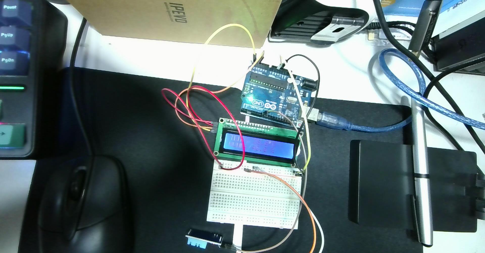
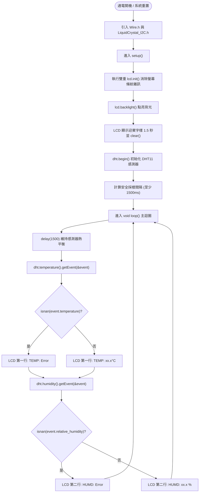

# 📟 Arduino Uno 整合 I2C LCD 1602 與 DHT11 溫濕度即時顯示系統實作手冊

> **最後更新時間**: 2026-10-20 15:45:00 (UTC+8)  
> **使用模型**: Gemini 3.8 Flash  
> **執行 Agent**: Antigravity  
> **實體硬體照片**: [2026-10-20-153902.jpg](./2026-10-20-153902.jpg)  
> **課堂整合草稿**: [sketch_oct20b.ino](./sketch_oct20b.ino)  
> **完整整合程式碼**: [arduino_i2c_lcd1602_dht11_unified.ino](./arduino_i2c_lcd1602_dht11_unified.ino)  
> **互動 HTML 筆記**: [arduino_i2c_lcd1602_dht11_unified_display.html](./arduino_i2c_lcd1602_dht11_unified_display.html)  

---

## 📑 目錄
1. [實體接線對照與螢幕條紋雜訊診斷](#-一實體接線對照與螢幕條紋雜訊診斷)
2. [I2C 與單線通訊雙協定系統架構](#-二i2c-與單線通訊雙協定系統架構)
3. [系統執行邏輯流程圖 (Mermaid Flowchart)](#-三系統執行邏輯流程圖-mermaid-flowchart)
4. [LCD 1602 雙行排版佈局與特殊字元 (`°` 符號) 原理](#-四lcd-1602-雙行排版佈局與特殊字元--符號-原理)
5. [整合程式碼展示與核心語法解析](#-五整合程式碼展示與核心語法解析)
6. [進階工程優化：自訂圖示與防閃爍設計](#-六進階工程優化自訂圖示與防閃爍設計)
7. [常見疑難排解 (FAQ)](#-七常見疑難排解-faq)
8. [提示詞歷史與變更記錄 (Prompt Archive)](#-提示詞歷史與變更記錄-prompt-archive)

---

## 🔌 一、實體接線對照與螢幕條紋雜訊診斷

在您上傳的最新上機照片中，展示了包含 Arduino Uno、I2C LCD 1602 與 DHT11 的完整實體線路：



### 1.1 實體硬體共用供電與訊號配線對照表

由於 Arduino Uno 原生僅有一組 5V 與 GND 插孔，本實驗透過**麵包板上的電源母線軌（Power Rails）**實現穩定的多設備並聯供電：

| 元件名稱 | 元件引腳 | 訊號定義 | Arduino Uno 連接腳位 | 照片導線顏色 | 說明 |
| :--- | :--- | :--- | :--- | :--- | :--- |
| **I2C LCD 1602** | **GND** | 系統接地 | **GND** (電源排針/麵包板) | 棕色/黑色線 | 模組共地 |
| | **VCC** | 主電源 5V | **5V** (電源排針/麵包板) | 紅色線 | 液晶驅動與背光電源 |
| | **SDA** | I2C 串列數據 | **類比 Pin A4** (或專用 SDA) | 黃色線 | 傳送文字與顯示指令 |
| | **SCL** | I2C 串列時脈 | **類比 Pin A5** (或專用 SCL) | 黃色/橘色線 | 同步傳輸時脈訊號 |
| **DHT11 模組** | **VCC (+)** | 感測器電源 | **5V** (麵包板正極軌) | 橘色線 | 感測器供電 |
| | **DATA (S)** | 單線數位訊號 | **數位 Pin 7** | 白色/灰線 | 溫濕度數位串列傳輸 |
| | **GND (-)** | 感測器接地 | **GND** (麵包板負極軌) | 棕色線 | 共地信號基準 |

---

### 1.2 診斷：照片中液晶螢幕出現「垂直虛線/條紋雜訊」的原因與解法

在照片 [2026-10-20-153902.jpg](./2026-10-20-153902.jpg) 中，LCD 螢幕呈現微亮藍光，且左側浮現數道豎向條紋或雜亂虛線，其原因如下：

> [!WARNING]
> **條紋雜訊根本原因**：  
> 當前一個燒錄的程式為純序列埠版本的 `DHT_Unified_Sensor.ino` 時，Arduino **並未引入 `<Wire.h>`，也沒有初始化 PCF8574 轉接板（未執行 `lcd.init()`）**。  
> LCD 通電後，HD44780 內部暫存器與顯示記憶體（DDRAM）處於懸空隨機殘留狀態，因而顯現出條紋雜訊。

#### ✅ 徹底解決方案：
1. 在程式開頭完整引入 `#include <Wire.h>` 與 `#include <LiquidCrystal_I2C.h>`。
2. 在 `setup()` 中執行 **兩次 `lcd.init();`**（雙重重置），強制作硬體複位與清除內部快取。
3. 執行 `lcd.backlight();` 點亮背光，並執行 `lcd.clear();` 清空全螢幕，畫面即可秒速恢復清澈透明！

---

## 🧠 二、I2C 與單線通訊雙協定系統架構

本系統將兩種截然不同的通訊協定完美整合在單一微控制器中：
1. **I2C 匯流排 (Wire)**：使用硬體 TWI 模組（A4/A5），主從架構，透過位址 `0x27` 控制液晶顯屏。
2. **單線式 (Single-Bus)**：使用任意數位通用腳位（Pin 7），微秒級精確脈衝交握，每秒採樣一次 DHT11 溫濕度數據。
3. **無衝突排程**：Arduino 先自 Pin 7 讀取 DHT11 封包（耗時約 4~5ms），解析出浮點數溫度與濕度後，再透過 I2C 匯流排打包送至 LCD 1602，兩者在時間上順序執行，完全互不干擾。

---

## 🚀 三、系統執行邏輯流程圖 (Mermaid Flowchart)



---

## 📐 四、LCD 1602 雙行排版佈局與特殊字元 (`°` 符號) 原理

### 4.1 兩行文字精確對齊格式規劃

依據您的要求：
* **第一行 (Row 0)**：顯示 `TEMP: ` + 溫度數值（保留 1 位小數） + `°C`
* **第二行 (Row 1)**：顯示 `HUMD: ` + 濕度數值（保留 1 位小數） + ` %`

| 欄位 (Col) | 0 | 1 | 2 | 3 | 4 | 5 | 6 | 7 | 8 | 9 | 10 | 11 | 12 | 13 | 14 | 15 |
| :---: | :---: | :---: | :---: | :---: | :---: | :---: | :---: | :---: | :---: | :---: | :---: | :---: | :---: | :---: | :---: | :---: |
| **Row 0** | **T** | **E** | **M** | **P** | **:** |   | **2** | **7** | **.** | **5** | **°** | **C** |   |   |   |   |
| **Row 1** | **H** | **U** | **M** | **D** | **:** |   | **4** | **1** | **.** | **0** |   | **%** |   |   |   |   |

### 4.2 為什麼在 Arduino LCD 上要用 `lcd.write(223)` 印出「°」度數符號？
在標準 C++ 中若直接打 `lcd.print("°C")`，因為 UTF-8 編碼的 `°` 是雙位元組（`0xC2 0xB0`），HD44780 控制器無法直接識別，會印出亂碼或日文片假名。
* HD44780 內建 ROM（A00 字型表）中，**ASCII 編碼 223 (十六進制 `0xDF`，二進制 `0b11011111`)** 正好就是圓圈度數符號 **`°`**！
* 因此使用語法：
  ```cpp
  lcd.print(event.temperature, 1); // 輸出數字如 27.5
  lcd.write(223);                  // 輸出 ° 符號
  lcd.print("C   ");               // 輸出 C 並補空格
  ```

---

## 💻 五、整合程式碼展示與核心語法解析

以下為經過最佳化後的完整整合程式碼（儲存於 [`ec/arduino_i2c_lcd1602_dht11_unified.ino`](./arduino_i2c_lcd1602_dht11_unified.ino)）：

```cpp
#include <Wire.h>                 // I2C 雙線通訊基礎函式庫
#include <LiquidCrystal_I2C.h>    // I2C LCD 1602 驅動函式庫
#include <Adafruit_Sensor.h>      // Adafruit 統一感測器驅動介面
#include <DHT.h>                  // DHT 基礎函式庫
#include <DHT_U.h>                // DHT Unified 感測器函式庫

// --- 1. 設定 DHT 感測器 ---
#define DHTPIN 7                  // DHT 訊號線連接至 Arduino 數位腳位 7
#define DHTTYPE DHT11             // 感測器型號設定為 DHT11
DHT_Unified dht(DHTPIN, DHTTYPE);

// --- 2. 設定 LCD 螢幕 ---
// 預設 I2C 位址 0x27，16 個字元寬度、2 行顯示 (若無反應可嘗試 0x3F)
LiquidCrystal_I2C lcd(0x27, 16, 2);

uint32_t delayMS;

void setup() {
  Serial.begin(9600);
  while (!Serial);

  Serial.println(F("DHT11 + I2C LCD1602 溫濕度監控系統啟動中..."));

  // 初始化 LCD 模組
  lcd.init();
  lcd.init();                     // 雙重初始化，有效清除上電殘留的條紋雜訊
  lcd.backlight();                // 點亮液晶背光
  lcd.clear();                    // 清空全螢幕

  // 初始化 DHT 感測器
  dht.begin();
  
  // 取得感測器硬體規格
  sensor_t sensor;
  dht.temperature().getSensor(&sensor);
  dht.humidity().getSensor(&sensor);
  delayMS = sensor.min_delay / 1000;
  
  // DHT11 讀取間隔限制：至少 1.5 秒 ~ 2 秒
  if (delayMS < 1500) {
    delayMS = 1500;
  }
}

void loop() {
  // 保持安全物理採樣延遲
  delay(delayMS);

  sensors_event_t event;

  // --- 1. 讀取並顯示溫度 (第一行 Row 0) ---
  dht.temperature().getEvent(&event);
  lcd.setCursor(0, 0);            // 定位至 (第 0 欄, 第 0 列)
  
  if (isnan(event.temperature)) {
    Serial.println(F("Error reading temperature!"));
    lcd.print(F("TEMP: Error     "));
  } else {
    // 輸出至序列埠
    Serial.print(F("Temperature: "));
    Serial.print(event.temperature, 1);
    Serial.println(F(" *C"));

    // 輸出至 LCD 螢幕
    lcd.print(F("TEMP: "));
    lcd.print(event.temperature, 1); // 顯示至小數點後 1 位
    lcd.write(223);                  // 印出 HD44780 內建「°」度數符號
    lcd.print(F("C   "));             // 補足空白防止舊文字殘留，免用 lcd.clear()
  }

  // --- 2. 讀取並顯示濕度 (第二行 Row 1) ---
  dht.humidity().getEvent(&event);
  lcd.setCursor(0, 1);            // 定位至 (第 0 欄, 第 1 列)
  
  if (isnan(event.relative_humidity)) {
    Serial.println(F("Error reading humidity!"));
    lcd.print(F("HUMD: Error     "));
  } else {
    // 輸出至序列埠
    Serial.print(F("Humidity:    "));
    Serial.print(event.relative_humidity, 1);
    Serial.println(F(" %"));

    // 輸出至 LCD 螢幕
    lcd.print(F("HUMD: "));
    lcd.print(event.relative_humidity, 1); // 顯示至小數點後 1 位
    lcd.print(F(" %   "));                 // 補足空白
  }
}
```

---

## 💡 六、進階工程優化：自訂圖示與防閃爍設計

1. **防閃爍關鍵技巧（以空格覆蓋代替 `lcd.clear()`）**：
   - 許多初學者常在 `loop()` 開頭呼叫 `lcd.clear()`，這會導致液晶每 1.5 秒全螢幕刷新重繪一次，肉眼看到持續黑白跳動狂閃。
   - 正確做法是使用 `lcd.setCursor(0, 0)` 固定座標，並在字串尾部加上 **`"C   "`** 或 **`" %   "`** 補滿空格，直接覆寫舊字元，畫面平滑如絲！
2. **自定義圖示擴充**：
   - 程式庫支援透過 `lcd.createChar()` 繪製專屬溫度計與水滴符號，增添專業質感。

---

## ❓ 七、常見疑難排解 (FAQ)

| 異常問題 | 原因分析 | 排除手法 |
| :--- | :--- | :--- |
| **螢幕仍有黑方塊或條紋** | 1. 程式未成功上傳<br>2. 對比度電位器偏移 | 1. 重新確認上傳成功（IDE 顯示 Done uploading）。<br>2. 用十字起子微調 LCD 背板藍色旋鈕。 |
| **螢幕第一行與第二行都顯示 `Error`** | DHT11 訊號線接觸不良或腳位定義錯誤 | 檢查 DATA 線是否插在 **Pin 7**，並確認 5V 與 GND 電源插牢。 |
| **螢幕完全無文字反應** | I2C 位址可能為 `0x3F` | 若為副廠晶片，將程式中的 `0x27` 改為 `0x3F` 即可解決。 |

---

## 📝 提示詞歷史與變更記錄 (Prompt Archive)

### 🔹 [2026-10-20 15:45:00] [Gemini 3.8 Flash / Antigravity] 建立 LCD1602 + DHT11 雙行溫濕度整合顯示指南
- **模型/Agent**: Gemini 3.8 Flash / Antigravity
- **Prompt 原文**:
  ```text
  C:\Users\User\Desktop\onclass\sketch_oct20b\sketch_oct20b.ino C:\Users\User\Desktop\2026-10-20-153902.jpg 利用以下提示詞讓AI協助整合 整合這個程式 讓溫溼度顯示在螢幕上 第一行顯示 TEMP: 第二行顯示HUMD:
  ```
- **變更摘要**: 依據使用者上傳的實拍硬體照片（`2026-10-20-153902.jpg`）診斷螢幕條紋雜訊成因（未初始化 I2C 匯流排），並將 `sketch_oct20b.ino` 優化整合為具備雙重初始化、HD44780 ASCII 223 度數符號輸出、定長防閃爍覆蓋與完備錯誤容錯機制的溫濕度即時顯示系統，第一行顯示 `TEMP:`、第二行顯示 `HUMD:`，產出對應 Markdown、HTML 與 INO 實作檔案。
