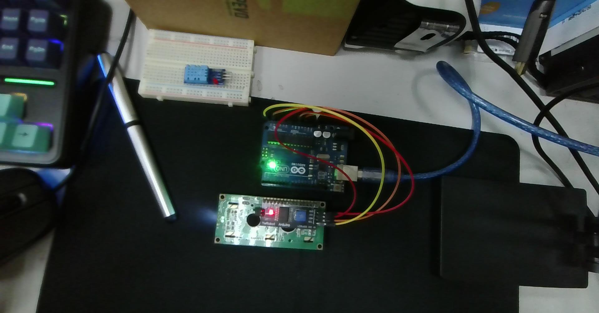
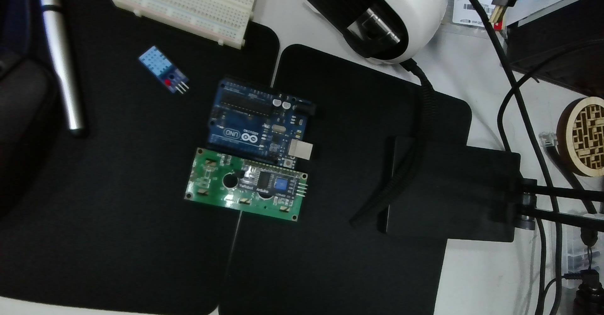
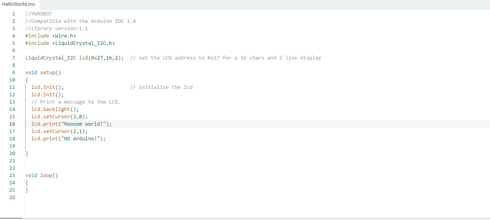
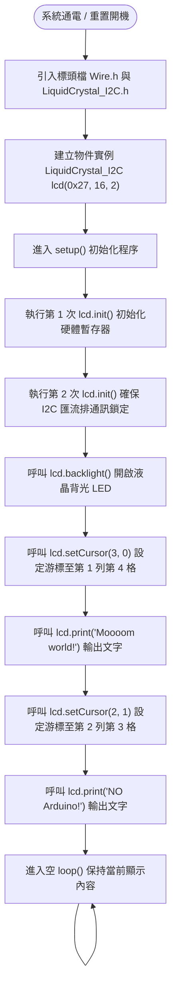

# 📟 Arduino Uno 連接 I2C LCD 1602：硬體接線驗證、HelloWorld 範例測試與 LiquidCrystal_I2C 函式庫物件方法全解析

> **最後更新時間**: 2026-10-20 15:10:00 (UTC+8)  
> **使用模型**: Gemini 3.8 Flash  
> **執行 Agent**: Antigravity  
> **實體硬體照片**: [2026-10-20-143026.jpg](./2026-10-20-143026.jpg) / [2026-10-20-142320.jpg](./2026-10-20-142320.jpg)  
> **IDE 截圖**: [2026-10-20-150654_ide_helloworld.jpg](./2026-10-20-150654_ide_helloworld.jpg)  
> **測試程式碼**: [arduino_i2c_lcd1602_helloworld.ino](./arduino_i2c_lcd1602_helloworld.ino)  
> **互動 HTML 筆記**: [arduino_i2c_lcd1602_helloworld_guide.html](./arduino_i2c_lcd1602_helloworld_guide.html)  

---

## 📑 目錄
1. [硬體實體接線對照與狀態確認](#-一硬體實體接線對照與狀態確認)
2. [I2C 與 LCD 1602 核心運作原理剖析](#-二i2c-與-lcd-1602-核心運作原理剖析)
3. [Arduino IDE 尋找與安裝 LiquidCrystal_I2C 程式庫](#-三arduino-ide-尋找與安裝-liquidcrystal_i2c-程式庫)
4. [HelloWorld 範例程式邏輯流程圖與程式碼解析](#-四helloworld-範例程式邏輯流程圖與程式碼解析)
5. [LiquidCrystal_I2C 物件屬性與常用方法全面指南](#-五liquidcrystal_i2c-物件屬性與常用方法全面指南)
6. [進階應用範例：無閃爍動態計時器與自定義圖示](#-六進階應用範例無閃爍動態計時器與自定義圖示)
7. [常見硬體與軟體疑難排解 (FAQ & I2C Scanner)](#-七常見硬體與軟體疑難排解-faq--i2c-scanner)
8. [提示詞歷史與變更記錄 (Prompt Archive)](#-提示詞歷史與變更記錄-prompt-archive)

---

## 🔌 一、硬體實體接線對照與狀態確認

依據您所拍攝的實體實驗照片，我們能清楚觀察 Arduino Uno 與帶有 PCF8574 背板的 LCD 1602 之實體接線配置：



### 1.1 接線腳位對照表 (4-Pin DuPont Wiring)

LCD 1602 液晶模組背面已焊接一塊 **PCF8574T / AT I2C 轉接背板**。傳統 LCD 1602 需要佔用 Arduino 至少 6 到 10 根數位腳位（RS, EN, D4~D7 等），透過 I2C 背板後僅需 **4 根杜邦線** 即可完成通訊與供電：

| I2C 轉接板腳位 (Backpack Pin) | 訊號功能定義 | Arduino Uno 腳位 | 實體導線建議 / 照片對應 | 功能說明 |
| :--- | :--- | :--- | :--- | :--- |
| **GND** | 系統接地 (Ground) | **GND** (電源排針) | 棕色/黑色導線 | 電源負極共地迴路 |
| **VCC** | 模組主供電 (Power) | **5V** (電源排針) | 紅色/橙色導線 | 提供 5V 電壓，驅動晶片與背光 LED |
| **SDA** | 串列數據線 (Serial Data) | **A4** (類比排針) 或 **SDA** | 黃色導線 | 雙向數據傳輸，傳遞控制指令與字元編碼 |
| **SCL** | 串列時脈線 (Serial Clock) | **A5** (類比排針) 或 **SCL** | 黃色/紅色導線 | 同步時脈訊號，由 Arduino 主機產生驅動脈衝 |

> [!NOTE]
> **Arduino Uno 的 I2C 腳位位置說明**：  
> ATmega328P 微控制器的硬體雙線式介面（TWI/I2C）原生腳位為 **A4 (SDA)** 與 **A5 (SCL)**。在 Arduino Uno R3 板端右上角（靠近 AREF 腳位與重置按鈕旁），亦額外引出兩孔標示為 `SDA` 與 `SCL` 的專用插孔，這兩孔在 PCB 電路板內部與 A4、A5 完全連通，接在 A4/A5 或專用 SDA/SCL 效果完全一致。

---

### 1.2 實體模組硬體元件檢核清單

在通電與上傳程式前，請對照以下照片中的關鍵硬體元件進行快速檢查：



1. **模組電源指示燈（紅色 LED）**：
   - 位於 PCF8574 背板右上方。當 Arduino 插上 USB 通電後，此紅色 LED 會立即恆亮。若不亮，請檢查 5V 與 GND 接線是否鬆脫或接觸不良。
2. **藍色電位器（Contrast Trimpot 十字旋鈕）**：
   - 位於背板中央偏右的藍色可調電阻。用於微調 LCD 1602 液晶單元的偏壓對比度（Contrast）。
   - **常見現象**：若程式上傳成功但螢幕「完全空白」或「只看得到一整排黑色方塊」，請使用十字螺絲起子緩慢旋轉此旋鈕，直到白底黑字或藍底白字清晰浮現為止。
3. **背光跳線帽（Backlight Jumper Pin）**：
   - 位於轉接板最右側的兩針黑色跳線帽。必須插上才能接通背光 LED 陽極電源；若拔掉跳線帽，液晶將失去背光照明（文字仍有顯示，但環境光不足時不易讀取）。

---

## 🧠 二、I2C 與 LCD 1602 核心運作原理剖析

### 2.1 I2C (Inter-Integrated Circuit) 雙線式通訊機制
I2C 是由 Philips（現 NXP）開發的半雙工同步串列匯流排協定：
* **SDA (Serial Data Line)**：在時脈為低電位時允許狀態改變，時脈為高電位時必須保持穩定，傳送 8 位元資料及 1 位元 ACK/NACK 確認訊號。
* **SCL (Serial Clock Line)**：由主控端（Arduino Master）產生同步時鐘訊號，標準速度為 100 kHz，快速模式為 400 kHz。
* **設備定址機制**：每個掛載在 I2C 匯流排上的從屬設備（Slave）都有一個唯一的 7-bit 位址。PCF8574 晶片的出廠預設位址通常為 `0x27`，若使用 PCF8574A 晶片則為 `0x3F`。

```
Arduino (Master)                         PCF8574 I2C Backpack (Slave)
+----------------+                       +-------------------+
|                | ---- SDA (A4) ------> | P0~P7 並列輸出    | ---> LCD 1602 (HD44780)
|  ATmega328P    |                       |                   |      RS, RW, EN, D4-D7
|                | <--- SCL (A5) ------- | 7-bit: 0x27 / 0x3F|
+----------------+                       +-------------------+
```

### 2.2 PCF8574 遠端 8-Bit I/O 擴展架構
LCD 1602 內部核心是經典的 **HD44780** 液晶控制器，其並列介面包含 8 條資料線（D0~D7）與 3 條控制線（RS 暫存器選擇、RW 讀寫選擇、EN 致能）。
PCF8574 晶片扮演了「串列轉並列 (Serial-to-Parallel)」的橋樑：
1. Arduino 透過 I2C 發送 1 個位元組（8-bit）。
2. PCF8574 的 8 個輸出接腳（P0~P7）同時更新，分別驅動 HD44780 的 4-bit 資料匯流排（D4~D7）、RS、RW、EN 以及背光控制電晶體。
3. 藉此將原需佔用 10 根以上的微控制器 I/O 腳位大幅縮減至僅需 2 根（SDA + SCL）。

---

## 💻 三、Arduino IDE 尋找與安裝 LiquidCrystal_I2C 程式庫

根據您所提供的 IDE 截圖 `螢幕擷取畫面 2026-10-20 150654.jpg`：



### 3.1 程式庫搜尋與安裝步驟

1. 打開 **Arduino IDE**。
2. 點擊左側導航列的 **「程式庫管理員 (Library Manager)」** 圖示（快捷鍵：`Ctrl + Shift + I`）。
3. 在上方搜尋欄位輸入：`LiquidCrystal I2C`。
4. 在搜尋結果中，找到標註為 **LiquidCrystal I2C**（由 **Frank de Brabander** 或 **Marco Schwartz** 維護，或 YWROBOT 相容版本）。
5. 點擊 **「安裝 (INSTALL)」**。安裝完成後狀態會顯示為 `INSTALLED`。

### 3.2 開啟內建 HelloWorld 範例

1. 在 Arduino IDE 頂部功能表點選：
   - **檔案 (File)** ➔ **範例 (Examples)** ➔ **LiquidCrystal I2C** ➔ **HelloWorld**。
2. 系統將會開啟一個全新的編輯視窗，即如截圖所示的 `HelloWorld.ino`。

---

## 🚀 四、HelloWorld 範例程式邏輯流程圖與程式碼解析

### 4.1 程式邏輯執行流程圖 (Mermaid Flowchart)



---

### 4.2 截圖原始範例程式碼 (`HelloWorld.ino`)

以下為課堂截圖中所測試的完整範例程式碼，已加入逐行詳盡註解：

```cpp
// YWROBOT
// Compatible with the Arduino IDE 1.0
// Library version: 1.1
#include <Wire.h>                 // 引入 Arduino 官方 I2C 雙線通訊基礎函式庫
#include <LiquidCrystal_I2C.h>    // 引入 PCF8574 轉接板專用 I2C LCD 函式庫

// 建立 LiquidCrystal_I2C 物件實例：
// 參數 1: 0x27 -> LCD 的 I2C 設備位址 (部分晶片為 0x3F)
// 參數 2: 16   -> 每列可容納的字元數 (16 columns)
// 參數 3: 2    -> 螢幕總行數 (2 rows)
LiquidCrystal_I2C lcd(0x27, 16, 2); 

void setup()
{
  lcd.init();                      // 首次初始化 LCD 與設定 4-bit 傳輸模式
  lcd.init();                      // 二次呼叫確保電氣時脈與 I2C 匯流排完全就緒
  
  // 開啟液晶背光
  lcd.backlight();
  
  // 移動游標至第 0 列（最上面一列），從第 3 個字元索引開始（第 4 格）
  lcd.setCursor(3, 0);
  lcd.print("Moooom world!");      // 印出測試字串
  
  // 移動游標至第 1 列（最下面一列），從第 2 個字元索引開始（第 3 格）
  lcd.setCursor(2, 1);
  lcd.print("NO Arduino!");        // 印出測試字串
}

void loop()
{
  // 本範例為靜態畫面顯示，loop() 保持空白即可
}
```

---

### 4.3 16×2 點陣字元座標佈局圖解

LCD 1602 的顯示記憶體映射為 **2 列（Rows: 0~1）**、**16 欄（Cols: 0~15）**：

| 欄位索引 (Col) | 0 | 1 | 2 | 3 | 4 | 5 | 6 | 7 | 8 | 9 | 10 | 11 | 12 | 13 | 14 | 15 |
| :---: | :---: | :---: | :---: | :---: | :---: | :---: | :---: | :---: | :---: | :---: | :---: | :---: | :---: | :---: | :---: | :---: |
| **Row 0** |   |   |   | **M** | **o** | **o** | **o** | **o** | **m** |   | **w** | **o** | **r** | **l** | **d** | **!** |
| **Row 1** |   |   | **N** | **O** |   | **A** | **r** | **d** | **u** | **i** | **n** | **o** | **!** |   |   |   |

* `lcd.setCursor(3, 0)`：X 座標為 3（由 0 數起的第 4 格），Y 座標為 0（第 1 列）。
* `lcd.setCursor(2, 1)`：X 座標為 2（由 0 數起的第 3 格），Y 座標為 1（第 2 列）。

> [!TIP]
> **為什麼截圖中有連續兩次 `lcd.init();`？**  
> 在早期或部分低成本的 PCF8574 模組中，上電初期的電源上升時間（Power-on Rise Time）較長，HD44780 內部復位電路可能尚未完全穩定。官方或社群範例呼叫兩次 `lcd.init()` 是為了確保微控制器重新發送清空與初始化軟體重置指令，避免上電時偶發的初始化失敗。

---

## 📖 五、LiquidCrystal_I2C 物件屬性與常用方法全面指南

`LiquidCrystal_I2C` 類別繼承自 Arduino 的核心 `Print` 類別，因此具備完整的字串格式化能力。以下為工程開發中最常用的物件方法分類對照：

### 5.1 物件建構子 (Constructor)
```cpp
LiquidCrystal_I2C(uint8_t lcd_Addr, uint8_t lcd_cols, uint8_t lcd_rows);
```
* **功能**：宣告 LCD 物件並定義通訊位址與螢幕規格。
* **常用規格**：
  - `LiquidCrystal_I2C lcd(0x27, 16, 2);`（1602 規格：16 字元 × 2 行）
  - `LiquidCrystal_I2C lcd(0x27, 20, 4);`（2004 規格：20 字元 × 4 行）

---

### 5.2 初始化與背光控制 (Power & Backlight)

| 方法名稱 | 語法範例 | 說明 |
| :--- | :--- | :--- |
| **`init()` / `begin()`** | `lcd.init();` | 初始化 I2C 匯流排，設定 HD44780 運作為 4-bit 模式、2 行顯示、5x8 點陣字型。 |
| **`backlight()`** | `lcd.backlight();` | 開啟轉接板背光電晶體，點亮藍色或黃綠色背景光。 |
| **`noBacklight()`** | `lcd.noBacklight();` | 關閉背光，適用於低功耗省電或休眠待機模式。 |

---

### 5.3 游標定位與畫面清除 (Cursor & Clear)

| 方法名稱 | 語法範例 | 說明 |
| :--- | :--- | :--- |
| **`setCursor(col, row)`** | `lcd.setCursor(0, 1);` | 將寫入游標定位至指定欄位（`col`: 0~15）與列（`row`: 0~1）。 |
| **`clear()`** | `lcd.clear();` | 清除全螢幕所有顯示內容，並將游標重置至 `(0, 0)`。**注意：執行需耗時約 1.5ms~2ms**。 |
| **`home()`** | `lcd.home();` | 游標重置至左上角 `(0, 0)`，**保留**原本螢幕上的文字內容不抹除。 |

---

### 5.4 內容輸出方法 (Text & Data Output)

| 方法名稱 | 語法範例 | 說明 |
| :--- | :--- | :--- |
| **`print(data)`** | `lcd.print("Temp: ");` | 印出字串。亦支援整數、浮點數（如 `lcd.print(25.4, 1)` 保留一位小數）。 |
| **`write(val)`** | `lcd.write(0);` | 寫入單一 Byte 資料或 ASCII 字元，主要用於輸出 CGRAM 中的**自定義圖示**。 |

---

### 5.5 游標視覺樣式與顯示切換 (Display & Cursor Effects)

| 方法名稱 | 效果說明 |
| :--- | :--- |
| **`lcd.cursor()` / `lcd.noCursor()`** | 開啟 / 關閉游標底線（Underline Cursor `_`）。 |
| **`lcd.blink()` / `lcd.noBlink()`** | 開啟 / 關閉游標方塊閃爍效果（Blinking Block █）。 |
| **`lcd.display()` / `lcd.noDisplay()`** | 快速開啟 / 隱藏畫面所有內容（文字記憶體 DDRAM 不會遺失，適合製作螢幕暫停）。 |

---

### 5.6 跑馬燈與自動捲動 (Scrolling & Auto-scroll)

| 方法名稱 | 效果說明 |
| :--- | :--- |
| **`lcd.scrollDisplayLeft()`** | 將全螢幕字元向左平移 1 格（可用於長文字跑馬燈廣告效果）。 |
| **`lcd.scrollDisplayRight()`** | 將全螢幕字元向右平移 1 格。 |
| **`lcd.autoscroll()`** | 開啟自動推擠捲動，每印出一個新字元，原有字元自動向左推移 1 格。 |
| **`lcd.noAutoscroll()`** | 關閉自動推擠捲動，恢復標準由左至右遞增寫入。 |

---

### 5.7 自定義字元產生 (Custom Characters, CGRAM)
HD44780 內部提供了 64 位元組的 **CGRAM (Character Generator RAM)**，允許開發者自定義最多 **8 個特殊符號 (ID: 0~7)**，每個字元由 5 欄 × 8 列的點陣（8 個 byte）組成：

```cpp
// 宣告一個心形圖示 (5x8 點陣，1 代表亮，0 代表暗)
byte heart[8] = {
  0b00000,
  0b01010,
  0b11111,
  0b11111,
  0b11111,
  0b01110,
  0b00100,
  0b00000
};

void setup() {
  lcd.init();
  lcd.backlight();
  lcd.createChar(0, heart); // 註冊到 CGRAM 編號 0
  lcd.setCursor(0, 0);
  lcd.write(0);             // 印出自訂圖示
}
```

---

## 🛠️ 六、進階應用範例：無閃爍動態計時器與自定義圖示

本範例綜合應用了上述物件方法：包含自訂愛心/電池圖示、非阻塞式計時器 (`millis()`)，以及**利用「固定長度覆蓋 (Space Padding)」取代 `lcd.clear()` 解決螢幕閃爍問題**的專業實作：

```cpp
// 完整原始碼位於 D:\CLASS_NOTE\ec\arduino_i2c_lcd1602_helloworld.ino
#include <Wire.h>
#include <LiquidCrystal_I2C.h>

LiquidCrystal_I2C lcd(0x27, 16, 2);

// 自定義愛心 (5x8)
byte heartIcon[8] = {
  0b00000, 0b01010, 0b11111, 0b11111, 0b11111, 0b01110, 0b00100, 0b00000
};

// 自定義電池 (5x8)
byte batteryIcon[8] = {
  0b01110, 0b11111, 0b11111, 0b11111, 0b11111, 0b11111, 0b11111, 0b11111
};

unsigned long previousMillis = 0;
const long interval = 1000;
int counter = 0;

void setup() {
  lcd.init();
  lcd.init();
  lcd.backlight();

  // 註冊自定義圖示
  lcd.createChar(0, heartIcon);
  lcd.createChar(1, batteryIcon);

  // 顯示迎賓資訊
  lcd.setCursor(1, 0);
  lcd.print("Hello, LCD1602");
  lcd.write(0); // 愛心
  
  lcd.setCursor(0, 1);
  lcd.print("Status: Active ");
  lcd.write(1); // 電池

  delay(2500);

  // 進入計時監控畫面
  lcd.clear();
  lcd.setCursor(0, 0);
  lcd.print("Timer Count: ");
  lcd.setCursor(0, 1);
  lcd.print("I2C Addr: 0x27");
}

void loop() {
  unsigned long currentMillis = millis();

  // 每 1000ms 刷新計數值（定點覆蓋，毫無閃爍感）
  if (currentMillis - previousMillis >= interval) {
    previousMillis = currentMillis;
    counter++;

    lcd.setCursor(12, 0);
    if (counter < 10) {
      lcd.print("00");
      lcd.print(counter);
    } else if (counter < 100) {
      lcd.print("0");
      lcd.print(counter);
    } else {
      lcd.print(counter);
    }

    // 每 10 秒展示一次游標提示效果
    if (counter % 10 == 0) {
      lcd.setCursor(15, 1);
      lcd.cursor();
      lcd.blink();
      delay(400);
      lcd.noBlink();
      lcd.noCursor();
    }
  }
}
```

---

## ❓ 七、常見硬體與軟體疑難排解 (FAQ & I2C Scanner)

### 7.1 常見問題對照排查表

| 現象描述 | 可能根本原因 | 建議排查與處理解決方法 |
| :--- | :--- | :--- |
| **1. 背光有亮，但完全看不到字，或是只看到整排黑方塊** | 液晶對比度電位器偏壓不正確 | 用十字螺絲起子緩慢旋轉背部**藍色電位器**，直到字體與背景達到最佳對比。 |
| **2. 程式編譯並上傳成功，但螢幕毫無反應** | I2C 位址不正確（非 `0x27`） | 許多副廠晶片（如 PCF8574A）位址為 **`0x3F`** 或 **`0x20`**。請執行下方的 **I2C Scanner** 程式偵測確切位址。 |
| **3. LCD 背光完全不亮** | 背光跳線帽脫落或供電腳位鬆脫 | 檢查背板右側的黑色雙針跳線帽是否確實插上；檢查 VCC 是否接至 **5V**（若接 3.3V 背光極暗甚至不亮）。 |
| **4. 顯示字體頻繁狂閃、跳動** | 程式在 `loop()` 內部無條件呼叫 `lcd.clear()` | 移除 `lcd.clear()`，改在固定座標用 `setCursor()` 搭配空白字元覆寫更新內容。 |
| **5. 編譯報錯：`'class LiquidCrystal_I2C' has no member named 'init'`** | 程式庫版本衝突（例如安裝了舊版 LiquidCrystal） | 舊版函式庫使用 `lcd.begin(16, 2);`，請至 Library Manager 確認安裝的是支援 `init()` 的 Frank de Brabander 版本。 |

---

### 7.2 I2C 位址自動偵測器 (I2C Scanner) 實用工具碼

若不確定模組真實 I2C 位址，可直接燒錄以下工具程式，開啟 Arduino IDE 序列埠監視器（`9600 baud`）即可秒速查出硬體設備位址：

```cpp
#include <Wire.h>

void setup() {
  Wire.begin();
  Serial.begin(9600);
  while (!Serial);
  Serial.println("\nI2C Scanner 掃描器啟動中...");
}

void loop() {
  byte error, address;
  int nDevices = 0;

  Serial.println("開始掃描 I2C 匯流排...");

  for (address = 1; address < 127; address++) {
    Wire.beginTransmission(address);
    error = Wire.endTransmission();

    if (error == 0) {
      Serial.print("✔ 找到 I2C 設備！位址為: 0x");
      if (address < 16) Serial.print("0");
      Serial.print(address, HEX);
      Serial.println(" !");
      nDevices++;
    } else if (error == 4) {
      Serial.print("✖ 位址 0x");
      if (address < 16) Serial.print("0");
      Serial.print(address, HEX);
      Serial.println(" 發生未知錯誤！");
    }
  }

  if (nDevices == 0) {
    Serial.println("未找到任何 I2C 設備，請檢查接線與 5V 供電！\n");
  } else {
    Serial.println("掃描完成。\n");
  }

  delay(5000); // 每 5 秒重新掃描一次
}
```

---

## 📝 提示詞歷史與變更記錄 (Prompt Archive)

### 🔹 [2026-10-20 15:10:00] [Gemini 3.8 Flash / Antigravity] 建立 LCD 1602 I2C HelloWorld 與程式庫物件方法解析指南
- **模型/Agent**: Gemini 3.8 Flash / Antigravity
- **Prompt 原文**:
  ```text
  C:\Users\User\Desktop\2026-10-20-143026.jpgC:\Users\User\Desktop\2026-10-20-143026.jpgC:\Users\User\Desktop\2026-10-20-142320.jpg 這是arduino接lcd 1602 i2c的接線圖，確認好接線後，利用arduino ide尋找liquidstal i2c的程式庫，選擇範例中的helloworld,進行基本的功能測試與程式庫的物件屬性與方法的應用 "C:\Users\User\Desktop\onclass\螢幕擷取畫面 2026-10-20 150654.jpg"
  ```
- **變更摘要**: 依據使用者上傳的 2 張實體接線照片與 1 張 IDE HelloWorld 截圖，建立完整的硬體接線確認對照、I2C 與 PCF8574 底層原理說明、Library 安裝操作、HelloWorld 邏輯流程圖、LiquidCrystal_I2C 常用物件屬性與方法手冊、定點無閃爍更新實務程式與 I2C Scanner 疑難排解指南，產出對應 Markdown、HTML 與 INO 實作檔案。
