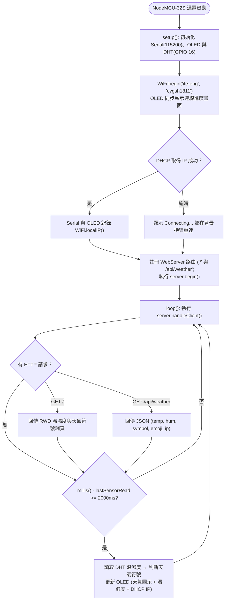

# 🌤️ NodeMCU-32S (ESP32) + Wi-Fi DHCP Web Server + DHT 溫濕度 + SSD1306 128×64 OLED 天氣符號整合實作 (1110-1)

> **最後更新時間**: 2026-11-10 15:31:30 (UTC+8)
> **使用模型**: Gemini 4 Argon
> **執行 Agent**: Antigravity
> **對應程式碼**: [`1110-1.ino`](./1110-1.ino)

---

## 📌 0. 專案概述與整合重點

本筆記整理 `1110-1.txt` 中兩支標準範例程式的整合與聯網升級實作，目標是在 **NodeMCU-32S (ESP32)** 開發板上：
1. **感測端**：讀取 **DHT22 / DHT11（GPIO 16）** 的即時溫度與相對濕度。
2. **Wi-Fi 與 DHCP**：以 Station 模式連接指定基地台（`SSID: ite-eng`、`WPA2: cygsh1811`），由 DHCP 自動取得區網 IP 位址。
3. **SSD1306 128×64 OLED 顯示端**：同時在畫面上呈現 **48×48 天氣符號**、**即時溫度（°C）**、**相對濕度（%RH）** 與 **DHCP 取得的 IP 位址**。
4. **HTTP Web Server 網頁端**：於 Port 80 建立內嵌網頁伺服器，手機或電腦瀏覽器連線至 `http://<ESP32-IP>/` 即可即時監看溫濕度與動態天氣符號（支援每 2 秒 `/api/weather` AJAX 自動無縫更新）。

| 模組區塊 | 核心技術 / API | 功能說明 |
| :--- | :--- | :--- |
| **DHT 溫濕度感測** | `DHT_Unified dht(16, DHT22)` | 透過 `GPIO 16` 讀取溫濕度事件，自動過濾 `isnan()` 異常值 |
| **OLED 128×64 繪圖** | `U8G2_SSD1306_128X64_NONAME_1_HW_I2C` | 左側繪製 48×48 `open_iconic` 天氣圖示，右側顯示溫濕度，底部顯示 `IP:xxx.xxx.xxx.xxx` |
| **Wi-Fi 與 DHCP** | `WiFi.mode(WIFI_STA)` + `WiFi.begin()` | 連線至 `ite-eng`，預設啟用 DHCP 動態取得 IP，由 `WiFi.localIP()` 讀取 |
| **HTTP Web Server** | `WebServer server(80)` | 提供 `/`（RWD 響應式天氣儀表板網頁）與 `/api/weather`（JSON 即時資料介面） |

---

## 🧠 1. 核心概念剖析 (Core Concepts)

### 1.1 NodeMCU-32S (ESP32) 硬體 I2C、GPIO 與內建 Wi-Fi 優勢

從 Arduino Uno (ATmega328P) 升級至 **NodeMCU-32S (ESP32-WROOM-32)** 時，不僅具備雙核心 240 MHz 處理器與 520 KB SRAM，更直接內建 **802.11 b/g/n Wi-Fi 與 TCP/IP 協定堆疊 (LwIP)**：

1. **3.3V 邏輯準位**：ESP32 所有 GPIO 均為 **3.3V** 邏輯。因此 DHT 感測器與 SSD1306 OLED 的 `VCC` 建議統一接在 NodeMCU-32S 的 **`3V3` (3.3V)** 腳位。
2. **ESP32 預設硬體 I2C 腳位**：
   - **`SDA` (資料線)**：**GPIO 21**
   - **`SCL` (時脈線)**：**GPIO 22**
   - 當宣告 `U8G2_SSD1306_128X64_NONAME_1_HW_I2C u8g2(U8G2_R0, U8X8_PIN_NONE);` 時，底層 `Wire` 函式庫會自動綁定 `GPIO 21` 與 `GPIO 22`。
3. **DHCP 動態主機設定協定 (Dynamic Host Configuration Protocol)**：
   - 當呼叫 `WiFi.mode(WIFI_STA)` 與 `WiFi.begin("ite-eng", "cygsh1811")` 且未預先呼叫 `WiFi.config()` 指定靜態 IP 時，ESP32 底層的 DHCP Client 會自動執行 **DORA 四步驟（Discover → Offer → Request → Acknowledge）**，向路由器索取 IPv4 位址、子網路遮罩與預設閘道。
   - 連線狀態變為 `WL_CONNECTED` 後，呼叫 `WiFi.localIP().toString()` 即可取得如 `192.168.x.x` 的字串並顯示在 OLED 上。

---

### 1.2 為什麼加上 Web Server 後，必須把 `delay(2000)` 改為 `millis()` 非阻塞排程？

在純單機版程式中，`loop()` 結尾使用 `delay(2000)` 讓 CPU 暫停 2 秒並無大礙；但加入 `WebServer server(80)` 後：
- `server.handleClient()` 必須在 `loop()` 中**高頻率輪詢（Polling）**，才能即時接收瀏覽器的 TCP 連線與 HTTP `GET /` 請求。
- 若使用 `delay(2000)`，CPU 在這 2 秒內完全無法執行 `server.handleClient()`，會導致使用者打開網頁時卡頓甚至連線逾時。
- **解決方案**：在 `loop()` 中每次無延遲呼叫 `server.handleClient()`，並利用 `millis() - lastSensorRead >= delayMS` 每 2 秒才觸發一次 DHT 感測器讀取與 OLED 刷新，達成「**網頁毫秒級秒開 + 感測器穩定 2 秒取樣**」的雙工效果。

---

### 1.3 U8g2 `open_iconic` 天氣圖示字型與 Web Emoji 雙端對照

程式中透過 `getWeatherSymbol(temp, hum)` 計算出 `0~4` 的天氣代碼後，會同時驅動 **OLED 的 48×48 點陣圖示** 與 **Web Server 網頁上的巨型天氣圖示**：

| 常數名稱 | 代碼值 | OLED 字型 | Glyph 編碼 | 網頁圖示 / 名稱 | 觸發條件 (`getWeatherSymbol`) |
| :--- | :---: | :--- | :---: | :--- | :--- |
| `SUN` | `0` | `u8g2_font_open_iconic_weather_6x_t` | `69` (`'E'`) | ☀️ 晴天 (Sunny) | 濕度 `< 55%`（乾燥晴朗） |
| `SUN_CLOUD` | `1` | `u8g2_font_open_iconic_weather_6x_t` | `65` (`'A'`) | ⛅ 晴時多雲 (Partly Cloudy) | 濕度 `55% ~ 69.9%`（舒適） |
| `CLOUD` | `2` | `u8g2_font_open_iconic_weather_6x_t` | `64` (`'@'`) | ☁️ 多雲 (Cloudy) | 濕度 `70% ~ 79.9%` 或感測器未就緒 |
| `RAIN` | `3` | `u8g2_font_open_iconic_weather_6x_t` | `67` (`'C'`) | 🌧️ 下雨 / 潮濕 (Rainy) | 濕度 `>= 80%`（潮濕） |
| `THUNDER` | `4` | `u8g2_font_open_iconic_embedded_6x_t` | `67` (`'C'`) | ⛈️ 雷雨 / 悶熱 (Thunderstorm) | 濕度 `>= 85%` 且 溫度 `>= 28°C` |

---

### 1.4 128×64 OLED 四資訊版面配置 (天氣符號 + 溫度 + 濕度 + IP)

為了在 128×64 像素的 OLED 上同時清楚顯示**天氣符號**、**溫度**、**濕度**與完整的 **IPv4 位址**，畫面規劃如下：

```text
x=0                 x=48 x=52                                  x=127
┌────────────────────┬────────────────────────────────────────────┐ y=0
│                    │  26.4°C   (u8g2_font_helvB14_tf, y=20)     │
│   48x48 天氣符號    ├────────────────────────────────────────────┤
│  open_iconic_6x_t  │  62.0 %   (u8g2_font_helvB14_tf, y=44)     │
│  drawGlyph(0, 48)  │                                            │
├────────────────────┴────────────────────────────────────────────┤ y=50 (drawHLine 分隔線)
│  IP:192.168.1.108              (u8g2_font_6x12_tf, baseline=62) │
└─────────────────────────────────────────────────────────────────┘ y=63
```

- **左上 (`x: 0~47, y: 0~48`)**：48×48 天氣圖示。
- **右上 (`x: 52~127, y: 0~48`)**：使用 14pt 粗體無襯線字型 `u8g2_font_helvB14_tf`，分上下兩行清楚顯示 `XX.X°C`（`y=20`）與 `XX.X %`（`y=44`）。
- **底部橫列 (`x: 0~127, y: 50~63`)**：先以 `u8g2.drawHLine(0, 50, 128)` 畫出水平分隔線，再以 `u8g2_font_6x12_tf`（每字元寬 6px，128px 可容納 21 個字元）印出完整的 `IP:xxx.xxx.xxx.xxx`，即使是最長的 15 碼 IP 也絕不截斷。

---

## 🛠️ 2. 實作與應用範例 (Practical Examples)

### 2.1 NodeMCU-32S 硬體接線表

| 週邊模組 | 模組腳位 | NodeMCU-32S 腳位 | 接線說明 |
| :--- | :---: | :---: | :--- |
| **DHT22 / DHT11** | `VCC` / `+` | **3V3** (3.3V) | 供應 3.3V 電源（與 ESP32 邏輯準位一致） |
| **DHT22 / DHT11** | `DATA` / `OUT` | **GPIO 16** (`RX2`) | 單匯流排數位訊號腳（對應 `#define DHTPIN 16`） |
| **DHT22 / DHT11** | `GND` / `-` | **GND** | 共地 |
| **SSD1306 OLED** | `GND` | **GND** | 共地（請先確認 OLED 模組絲印順序） |
| **SSD1306 OLED** | `VCC` | **3V3** (3.3V) | 供應 3.3V 電源 |
| **SSD1306 OLED** | `SCL` (`SCK`) | **GPIO 22** | ESP32 預設硬體 I2C 時脈腳位 |
| **SSD1306 OLED** | `SDA` | **GPIO 21** | ESP32 預設硬體 I2C 資料腳位 |

---

### 2.2 程式邏輯流程圖與完整程式碼 (`1110-1.ino`)



#### 完整程式碼（[`1110-1.ino`](./1110-1.ino)）

```cpp
// ============================================================================
// 1110-1.ino — NodeMCU-32S (ESP32) + Wi-Fi DHCP Web Server + DHT 溫濕度 + SSD1306 OLED
// 整合功能：
//   1. 連接 Wi-Fi (SSID: ite-eng, WPA2: cygsh1811) 並透過 DHCP 取得 IP
//   2. 建立 HTTP Web Server (Port 80)，瀏覽器輸入 http://<IP>/ 即時顯示溫濕度與天氣符號
//   3. SSD1306 128x64 OLED 同時顯示：48x48 天氣符號、溫度、濕度、以及 DHCP IP 位址
//
// 【硬體接線 (NodeMCU-32S / ESP32)】
//   1. DHT 溫濕度感測器：
//      - VCC  -> 3V3 (3.3V)
//      - DATA -> GPIO 16 (板子上標示 RX2 / IO16 / 16)
//      - GND  -> GND
//   2. SSD1306 OLED (128x64, I2C 介面)：
//      - GND  -> GND
//      - VCC  -> 3V3 (3.3V)
//      - SCL  -> GPIO 22 (ESP32 預設硬體 I2C SCL)
//      - SDA  -> GPIO 21 (ESP32 預設硬體 I2C SDA)
//
// 【需要的函式庫】
//   - WiFi.h / WebServer.h (Arduino ESP32 核心內建)
//   - DHT sensor library (by Adafruit)
//   - Adafruit Unified Sensor
//   - U8g2 (by olikraus)
// ============================================================================

#include <Arduino.h>
#include <WiFi.h>
#include <WebServer.h>
#include <Wire.h>
#include <U8g2lib.h>
#include <Adafruit_Sensor.h>
#include <DHT.h>
#include <DHT_U.h>

// -------------------- 1. Wi-Fi 與 Web Server 設定 --------------------
const char* WIFI_SSID = "ite-eng";
const char* WIFI_PASS = "cygsh1811";

WebServer server(80); // 建立 HTTP Web Server 於 Port 80

// -------------------- 2. DHT 感測器設定 --------------------
#define DHTPIN 16          // DHT 資料腳位接 NodeMCU-32S 的 GPIO 16

// 請依實際使用的感測器型號取消註解對應行：
//#define DHTTYPE    DHT11   // DHT 11 (藍色外殼)
#define DHTTYPE    DHT22   // DHT 22 / AM2302 (白色外殼，1110-1.txt 預設)
//#define DHTTYPE    DHT21   // DHT 21 / AM2301

DHT_Unified dht(DHTPIN, DHTTYPE);
uint32_t delayMS = 2000;
uint32_t lastSensorRead = 0;

// 儲存最新感測資料供 OLED 與 Web Server 共用
float   currentTemp   = NAN;
float   currentHum    = NAN;
uint8_t currentSymbol = 2; // 預設 CLOUD

// -------------------- 3. OLED SSD1306 (128x64) 設定 --------------------
// 使用硬體 I2C (NodeMCU-32S 預設：SCL = GPIO 22, SDA = GPIO 21)
U8G2_SSD1306_128X64_NONAME_1_HW_I2C u8g2(U8G2_R0, /* reset=*/ U8X8_PIN_NONE);

// -------------------- 4. 天氣符號常數定義 (取自 Weather.ino) --------------------
#define SUN        0   // 晴天 (Glyph 69)
#define SUN_CLOUD  1   // 晴時多雲 (Glyph 65)
#define CLOUD      2   // 多雲 / 陰天 (Glyph 64)
#define RAIN       3   // 下雨 / 高濕 (Glyph 67)
#define THUNDER    4   // 雷雨 / 悶熱高濕 (Embedded Glyph 67)

// -------------------- 5. 依溫濕度決定天氣符號與名稱 --------------------
uint8_t getWeatherSymbol(float temp, float hum) {
  if (isnan(temp) || isnan(hum)) {
    return CLOUD;                 // 讀取失敗時預設顯示雲朵
  }
  if (hum >= 85.0 && temp >= 28.0) {
    return THUNDER;               // 高溫且高濕：雷雨符號
  } else if (hum >= 80.0) {
    return RAIN;                  // 濕度 >= 80%：下雨符號
  } else if (hum >= 70.0) {
    return CLOUD;                 // 濕度 70% ~ 79%：多雲符號
  } else if (hum >= 55.0) {
    return SUN_CLOUD;             // 濕度 55% ~ 69%：晴時多雲
  } else {
    return SUN;                   // 濕度 < 55%：太陽符號
  }
}

const char* getWeatherName(uint8_t symbol) {
  switch (symbol) {
    case SUN:       return "晴天 (Sunny)";
    case SUN_CLOUD: return "晴時多雲 (Partly Cloudy)";
    case CLOUD:     return "多雲 (Cloudy)";
    case RAIN:      return "下雨 / 潮濕 (Rainy)";
    case THUNDER:   return "雷雨 / 悶熱 (Thunderstorm)";
    default:        return "未知 (Unknown)";
  }
}

const char* getWeatherEmoji(uint8_t symbol) {
  switch (symbol) {
    case SUN:       return "☀️";
    case SUN_CLOUD: return "⛅";
    case CLOUD:     return "☁️";
    case RAIN:      return "🌧️";
    case THUNDER:   return "⛈️";
    default:        return "☁️";
  }
}

// -------------------- 6. 繪製 48x48 天氣圖示 (取自 Weather.ino) --------------------
void drawWeatherSymbol(u8g2_uint_t x, u8g2_uint_t y, uint8_t symbol) {
  switch (symbol) {
    case SUN:
      u8g2.setFont(u8g2_font_open_iconic_weather_6x_t);
      u8g2.drawGlyph(x, y, 69);
      break;
    case SUN_CLOUD:
      u8g2.setFont(u8g2_font_open_iconic_weather_6x_t);
      u8g2.drawGlyph(x, y, 65);
      break;
    case CLOUD:
      u8g2.setFont(u8g2_font_open_iconic_weather_6x_t);
      u8g2.drawGlyph(x, y, 64);
      break;
    case RAIN:
      u8g2.setFont(u8g2_font_open_iconic_weather_6x_t);
      u8g2.drawGlyph(x, y, 67);
      break;
    case THUNDER:
      u8g2.setFont(u8g2_font_open_iconic_embedded_6x_t);
      u8g2.drawGlyph(x, y, 67);
      break;
  }
}

// -------------------- 7. 繪製 OLED 畫面：天氣符號 + 溫濕度 + IP 位址 --------------------
void updateOLED() {
  String ipStr = (WiFi.status() == WL_CONNECTED)
                   ? WiFi.localIP().toString()
                   : String("Connecting...");

  u8g2.firstPage();
  do {
    // (A) 左上 (0, 48) 繪製 48x48 天氣圖示
    drawWeatherSymbol(0, 48, currentSymbol);

    // (B) 右上區塊 (x=52) 分兩行顯示溫度與濕度
    u8g2.setFont(u8g2_font_helvB14_tf);

    // 第一行 (y=20)：溫度
    u8g2.setCursor(52, 20);
    if (isnan(currentTemp)) {
      u8g2.print("--.-°C");
    } else {
      u8g2.print(currentTemp, 1);
      u8g2.print("°C");
    }

    // 第二行 (y=44)：濕度
    u8g2.setCursor(52, 44);
    if (isnan(currentHum)) {
      u8g2.print("--.- %");
    } else {
      u8g2.print(currentHum, 1);
      u8g2.print(" %");
    }

    // (C) 底部分隔線與 DHCP IP 位址 (y=62)
    u8g2.drawHLine(0, 50, 128);
    u8g2.setFont(u8g2_font_6x12_tf);
    u8g2.setCursor(0, 62);
    u8g2.print("IP:");
    u8g2.print(ipStr);
  } while (u8g2.nextPage());
}

// -------------------- 8. HTTP Web Server 路由處理 --------------------
// 回傳 JSON 格式資料 (/api/weather)，供網頁每秒自動無縫更新
void handleApiWeather() {
  String json = "{";
  json += "\"valid\":" + String((!isnan(currentTemp) && !isnan(currentHum)) ? "true" : "false") + ",";
  json += "\"temp\":" + (isnan(currentTemp) ? String("null") : String(currentTemp, 1)) + ",";
  json += "\"hum\":" + (isnan(currentHum) ? String("null") : String(currentHum, 1)) + ",";
  json += "\"symbol\":" + String(currentSymbol) + ",";
  json += "\"weatherName\":\"" + String(getWeatherName(currentSymbol)) + "\",";
  json += "\"emoji\":\"" + String(getWeatherEmoji(currentSymbol)) + "\",";
  json += "\"ip\":\"" + WiFi.localIP().toString() + "\",";
  json += "\"ssid\":\"" + String(WIFI_SSID) + "\",";
  json += "\"rssi\":" + String(WiFi.RSSI());
  json += "}";
  server.send(200, "application/json; charset=utf-8", json);
}

// 回傳主網頁 (/)，支援電腦與手機瀏覽器即時檢視溫濕度與天氣符號
void handleRoot() {
  String tempText = isnan(currentTemp) ? "--.-" : String(currentTemp, 1);
  String humText  = isnan(currentHum)  ? "--.-" : String(currentHum, 1);

  String html = R"rawliteral(<!DOCTYPE html>
<html lang="zh-TW">
<head>
  <meta charset="UTF-8">
  <meta name="viewport" content="width=device-width, initial-scale=1.0">
  <title>NodeMCU-32S 溫濕度與天氣觀測站</title>
  <style>
    body {
      margin: 0; padding: 24px 16px;
      font-family: "Segoe UI", "Microsoft JhengHei", sans-serif;
      background: #0f172a; color: #f8fafc;
      display: flex; justify-content: center; align-items: center; min-height: 90vh;
    }
    .card {
      background: #1e293b; border: 1px solid #334155; border-radius: 18px;
      max-width: 420px; width: 100%; padding: 28px 24px;
      box-shadow: 0 12px 32px rgba(0,0,0,0.45); text-align: center;
    }
    .title { font-size: 1.25rem; font-weight: 700; color: #38bdf8; margin-bottom: 6px; }
    .sub { font-size: 0.85rem; color: #94a3b8; margin-bottom: 20px; }
    .weather-icon { font-size: 4.8rem; line-height: 1.1; margin: 10px 0; }
    .weather-name {
      display: inline-block; background: rgba(56, 189, 248, 0.15);
      color: #7dd3fc; border: 1px solid rgba(56, 189, 248, 0.35);
      padding: 4px 14px; border-radius: 999px; font-size: 0.95rem; font-weight: 600;
      margin-bottom: 20px;
    }
    .metrics { display: grid; grid-template-columns: 1fr 1fr; gap: 14px; margin-bottom: 20px; }
    .box {
      background: #0f172a; border: 1px solid #334155; border-radius: 12px; padding: 14px 10px;
    }
    .label { font-size: 0.82rem; color: #94a3b8; margin-bottom: 6px; }
    .val { font-size: 1.75rem; font-weight: 700; color: #f8fafc; }
    .unit { font-size: 0.95rem; color: #38bdf8; }
    .footer {
      font-size: 0.8rem; color: #64748b; border-top: 1px solid #334155; padding-top: 12px;
      display: flex; justify-content: space-between;
    }
  </style>
</head>
<body>
  <div class="card">
    <div class="title">🌤️ NodeMCU-32S 即時天氣站</div>
    <div class="sub">DHT Sensor (GPIO 16) + SSD1306 OLED (I2C)</div>
    <div id="emoji" class="weather-icon">)rawliteral" + String(getWeatherEmoji(currentSymbol)) + R"rawliteral(</div>
    <div id="wname" class="weather-name">)rawliteral" + String(getWeatherName(currentSymbol)) + R"rawliteral(</div>
    <div class="metrics">
      <div class="box">
        <div class="label">🌡️ 溫度 (Temperature)</div>
        <div class="val"><span id="temp">)rawliteral" + tempText + R"rawliteral(</span> <span class="unit">°C</span></div>
      </div>
      <div class="box">
        <div class="label">💧 濕度 (Humidity)</div>
        <div class="val"><span id="hum">)rawliteral" + humText + R"rawliteral(</span> <span class="unit">%</span></div>
      </div>
    </div>
    <div class="footer">
      <span>SSID: <strong id="ssid">)rawliteral" + String(WIFI_SSID) + R"rawliteral(</strong></span>
      <span>IP: <strong id="ip">)rawliteral" + WiFi.localIP().toString() + R"rawliteral(</strong></span>
    </div>
  </div>
  <script>
    setInterval(async () => {
      try {
        const res = await fetch('/api/weather');
        const d = await res.json();
        document.getElementById('emoji').textContent = d.emoji;
        document.getElementById('wname').textContent = d.weatherName;
        document.getElementById('temp').textContent = d.temp !== null ? d.temp.toFixed(1) : '--.-';
        document.getElementById('hum').textContent = d.hum !== null ? d.hum.toFixed(1) : '--.-';
        document.getElementById('ip').textContent = d.ip;
      } catch (e) {}
    }, 2000);
  </script>
</body>
</html>)rawliteral";

  server.send(200, "text/html; charset=utf-8", html);
}

// -------------------- 9. 讀取感測器並更新畫面 --------------------
void readSensorAndUpdate() {
  sensors_event_t temp_event, hum_event;
  dht.temperature().getEvent(&temp_event);
  dht.humidity().getEvent(&hum_event);

  currentTemp = temp_event.temperature;
  currentHum  = hum_event.relative_humidity;

  if (isnan(currentTemp)) {
    Serial.println(F("Error reading temperature!"));
  } else {
    Serial.print(F("Temperature: "));
    Serial.print(currentTemp, 1);
    Serial.println(F(" °C"));
  }

  if (isnan(currentHum)) {
    Serial.println(F("Error reading humidity!"));
  } else {
    Serial.print(F("Humidity:    "));
    Serial.print(currentHum, 1);
    Serial.println(F(" %"));
  }

  currentSymbol = getWeatherSymbol(currentTemp, currentHum);
  updateOLED();
}

// -------------------- 10. 初始化設定 setup() --------------------
void setup(void) {
  Serial.begin(115200);
  delay(100);
  Serial.println();
  Serial.println(F("============================================"));
  Serial.println(F("NodeMCU-32S DHT + OLED + WiFi WebServer 啟動"));
  Serial.println(F("============================================"));

  // 1. 初始化 OLED
  u8g2.begin();
  u8g2.enableUTF8Print();

  // 2. 初始化 DHT 感測器
  dht.begin();
  sensor_t sensor;
  dht.temperature().getSensor(&sensor);
  dht.humidity().getSensor(&sensor);
  delayMS = sensor.min_delay / 1000;
  if (delayMS < 2000) {
    delayMS = 2000;
  }

  // 3. 連接 Wi-Fi (使用 DHCP 自動取得 IP)
  WiFi.mode(WIFI_STA);
  WiFi.begin(WIFI_SSID, WIFI_PASS);
  Serial.print(F("正在連線至 Wi-Fi SSID: "));
  Serial.println(WIFI_SSID);

  int retryCount = 0;
  while (WiFi.status() != WL_CONNECTED && retryCount < 30) {
    delay(500);
    Serial.print(".");
    retryCount++;

    // 在 OLED 顯示連線進度
    u8g2.firstPage();
    do {
      u8g2.setFont(u8g2_font_8x13_mf);
      u8g2.setCursor(0, 18);
      u8g2.print("WiFi Connecting");
      u8g2.setCursor(0, 36);
      u8g2.print("SSID: ");
      u8g2.print(WIFI_SSID);
      u8g2.setCursor(0, 54);
      for (int i = 0; i < (retryCount % 15); i++) {
        u8g2.print(".");
      }
    } while (u8g2.nextPage());
  }
  Serial.println();

  if (WiFi.status() == WL_CONNECTED) {
    Serial.println(F("Wi-Fi 連線成功！"));
    Serial.print(F("DHCP IP 位址: http://"));
    Serial.print(WiFi.localIP());
    Serial.println(F("/"));
  } else {
    Serial.println(F("Wi-Fi 連線逾時，將在背景持續嘗試重連..."));
  }

  // 4. 註冊 Web Server 路由並啟動服務
  server.on("/", handleRoot);
  server.on("/api/weather", handleApiWeather);
  server.begin();
  Serial.println(F("HTTP Web Server 已啟動 (Port 80)"));

  // 5. 立即執行第一次溫濕度讀取與 OLED 畫面更新
  readSensorAndUpdate();
  lastSensorRead = millis();
}

// -------------------- 11. 主迴圈 loop() --------------------
void loop(void) {
  // 1. 處理客戶端 HTTP 網頁請求 (非阻塞，確保網頁秒開)
  server.handleClient();

  // 2. 每隔 delayMS (2000ms) 讀取一次 DHT 溫濕度並刷新 OLED
  uint32_t now = millis();
  if (now - lastSensorRead >= delayMS) {
    lastSensorRead = now;
    readSensorAndUpdate();
  }
}
```

---

## 🚀 3. 延伸思考與進階主題 (Extensions & Advanced Topics)

### 3.1 C++11 Raw String Literal (`R"rawliteral(...)rawliteral"`) 在嵌入式網頁的優勢

在 ESP32 `WebServer` 撰寫內嵌 HTML/CSS/JS 時，若使用傳統 C 字串，必須將每個雙引號 `"` 轉義為 `\"`、每行結尾加上 `\n\`，極難維護。使用 C++11 的 **原始字串字面量 `R"rawliteral(...)rawliteral"`**，可以直接貼上標準 HTML 與 JavaScript 程式碼，大幅提升可讀性與維護效率。

### 3.2 mDNS 區域網路網域名稱 (`ESPmDNS.h`)

若不希望每次 DHCP 租約更新後都要看 OLED 上的 IP，可引入 `<ESPmDNS.h>` 並在連上 Wi-Fi 後呼叫 `MDNS.begin("esp32weather")`，即可在同網段直接透過 `http://esp32weather.local/` 存取網頁。

---

## 📝 提示詞歷史與變更記錄 (Prompt Archive)

### 🔹 [2026-11-10 15:06:30] [Gemini 4 Argon / Antigravity] 變更紀錄
- **模型/Agent**: Gemini 4 Argon / Antigravity
- **Prompt 原文**:
  ```text
  C:\Users\User\Desktop\onclass\1110-1.txt 整合這個程式，在nodemcu32s上讓OLED 1306 128X64顯示溫溼度以及天氣符號 存成1110-1.ino
  ```
- **變更摘要**: 整合 `1110-1.txt` 中的 `DHT_Unified`（GPIO 16）與 U8g2 `Weather.ino`（SSD1306 128×64 硬體 I2C：SDA=GPIO 21, SCL=GPIO 22），建立 `1110-1.ino` 並撰寫完整技術筆記與互動模擬器（`.md` 與 `.html`）。

### 🔹 [2026-11-10 15:31:30] [Gemini 4 Argon / Antigravity] 變更紀錄
- **模型/Agent**: Gemini 4 Argon / Antigravity
- **Prompt 原文**:
  ```text
  加上Wifi連接，SSID: ite-eng, wpa2: cygsh1811,連上後利用DHCP取得ip，並建立web server, 可以使用http 連線後顯示溫溼度及天氣符號，OLED上顯示IP 更新1110-1.ino
  ```
- **變更摘要**: 更新 `1110-1.ino`，新增 Wi-Fi Station 連線（`SSID: ite-eng`, `WPA2: cygsh1811`）、DHCP 自動取得 IP、Port 80 HTTP Web Server（含 `/` 響應式天氣儀表板與 `/api/weather` JSON 即時更新介面），並將 OLED 128×64 版面升級為同時顯示 48×48 天氣圖示、溫度、濕度與底部 `IP:xxx.xxx.xxx.xxx`；同步更新 `.md` 與 `.html` 雙端互動模擬器。
