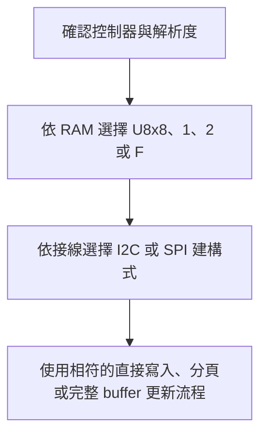
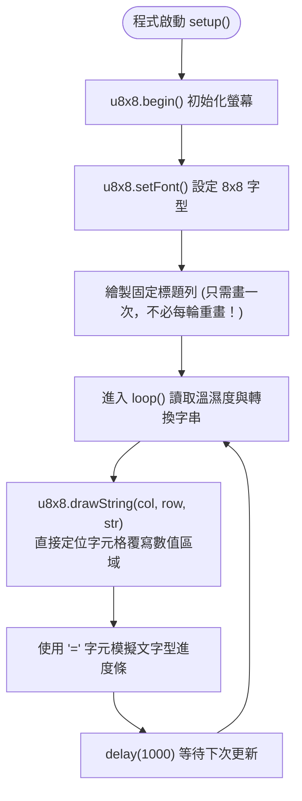
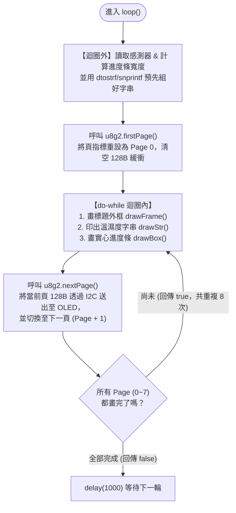
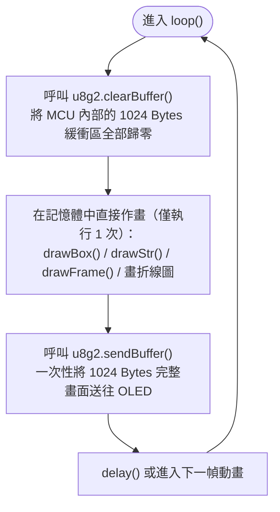
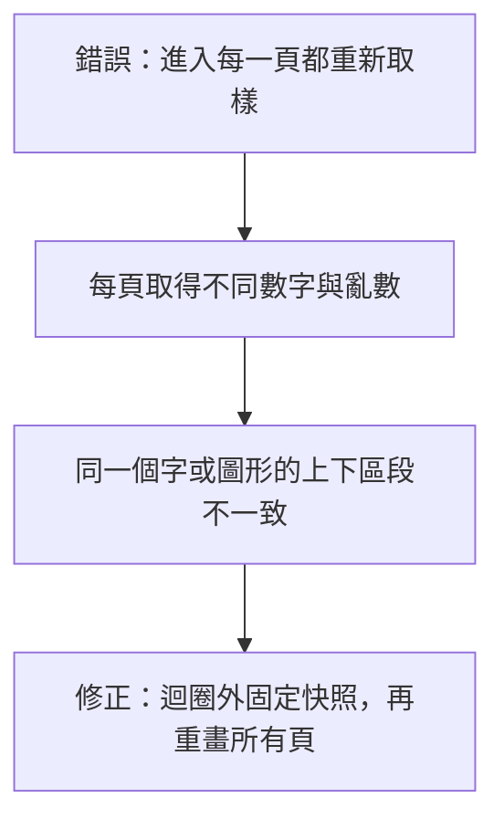
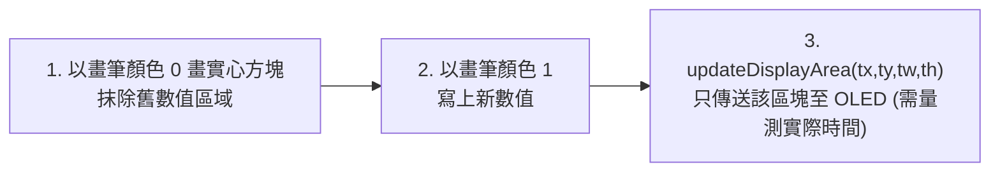
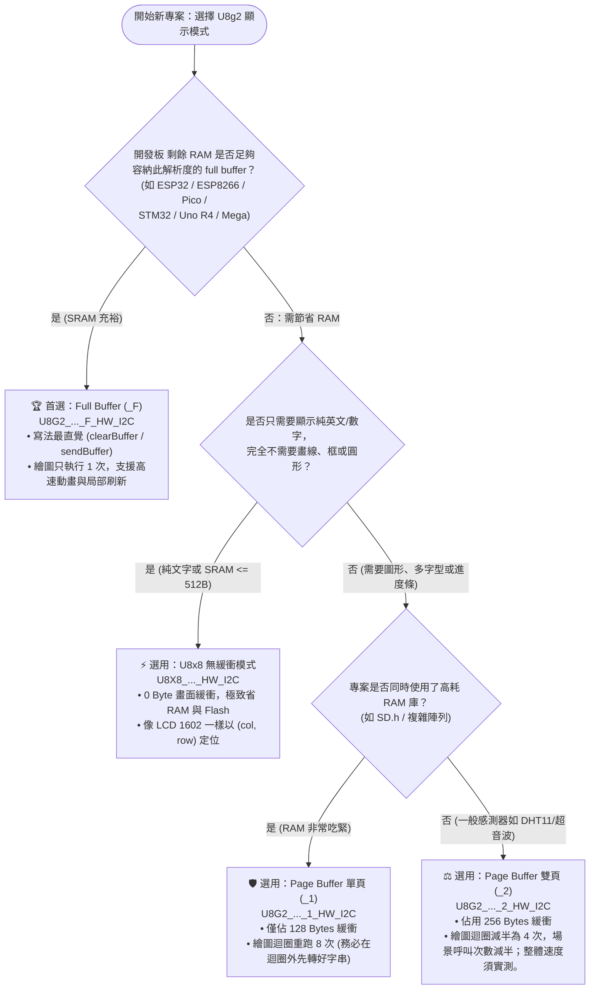
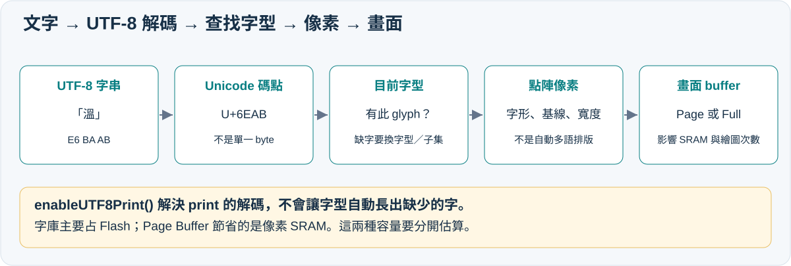
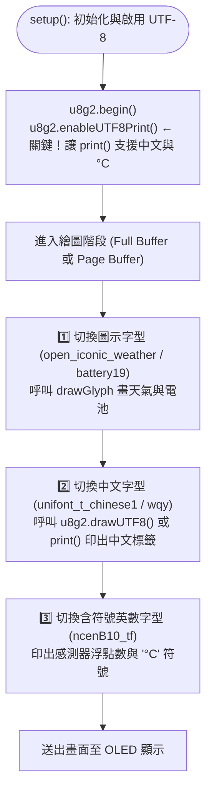
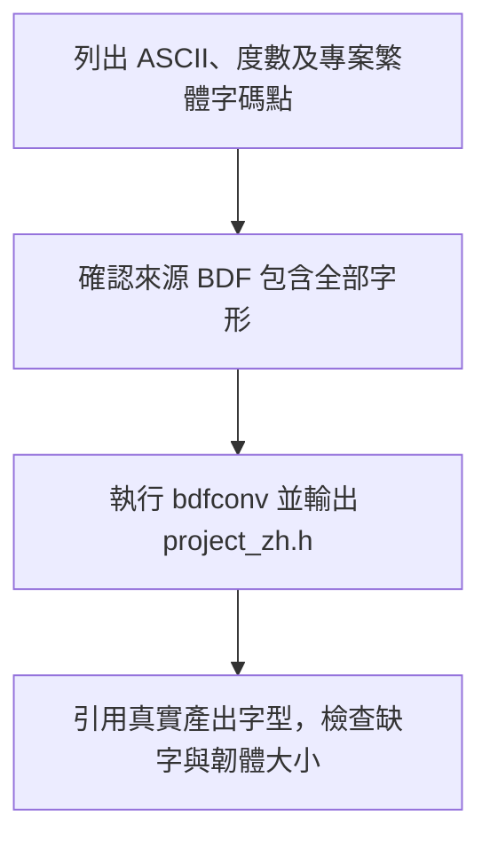

# 🖥️ U8g2 螢幕顯示模式深度解析：U8x8、Page Buffer 與 Full Buffer 比較及開發板記憶體適配指南

> **最後更新時間**: 2026-10-27 18:05:00 (UTC+8)
> **使用模型**: Claude Opus 5.5（前版：Gemini 4 Argon (Medium)、GPT-6）
> **執行 Agent**: Claude Code（前版：Antigravity、Codex /root）
> **相關筆記**: [Arduino Uno + DHT11 + SSD1306 OLED（U8g2 / I2C）指南](./arduino_dht11_ssd1306_u8g2_guide.md) | [互動版 HTML](./u8g2_display_modes_comparison.html)

> **校訂說明**: 本次保留原筆記結構，修正容量、字型與效能敘述。更完整的圖解、NodeMCU-32S、六語切換、容量量測及官方來源請見 [校核後完整教學](./u8g2_display_modes_memory_guide.html)。本機查核版本：U8g2 2.36.19、Arduino-ESP32 3.2.0。

---

## 📑 目錄

1. [核心概念與顯示模式](#ref-core)
2. [開發板與記憶體預算](#ref-boards)
3. [完整範例與流程](#ref-examples)
4. [進階應用與局部更新](#ref-advanced)
5. [字型、符號與多語言](#ref-fonts)
6. [提示詞歷史](#ref-history)

---

<a id="ref-core"></a>

## 🧠 1. 核心概念剖析 (Core Concepts)：U8g2 四種顯示模式底層原理

### 1.1 為什麼需要不同的緩衝模式？（RAM vs. 效能權衡）

以最常見的 **0.96 吋 / 1.3 吋單色 OLED（SSD1306 / SH1106，解析度 $128 \times 64$）** 為例：
螢幕上共有 $128 \times 64 = 8,192$ 個像素點（Pixels）。由於是單色螢幕，每個像素只需 $1\text{ bit}$（亮或暗）即可表示，因此一整張畫面需要的原始影像記憶體（GDDRAM，Graphic Display Data RAM）為：

$$\text{Full Frame Size} = \frac{128 \times 64 \text{ bits}}{8 \text{ bits/byte}} = 1,024 \text{ Bytes} \ (1 \text{ KB})$$

然而，因為 **SSD1306 在 I2C 介面下不支援「讀取」螢幕上的記憶體（Write-Only）**，當我們想在螢幕上畫一個圓或疊加文字時，微控制器（MCU）若不先在自己的 SRAM 中準備好像素點陣，就無法做到「修改其中一個 pixel 而不覆蓋同一個 byte 裡的其他 7 個垂直 pixels」。

這在 **Arduino Uno（ATmega328P，總 SRAM 僅 $2,048\text{ Bytes}$）** 等資源受限的 8 位元單晶片上造成了嚴重衝突：若單單螢幕緩衝區就吃掉 $1,024\text{ Bytes}$（50% 記憶體），加上 `Wire`、感測器庫與堆疊（Stack），程式極易崩潰。因此，U8g2 作者 Oliver Kraus 設計了 **三種核心架構（細分為四種建構設定）**，讓開發者能自由在 **「記憶體（SRAM）空間」** 與 **「CPU 運算 / 通訊時間」** 之間做出最佳權衡：

1. **U8x8（無緩衝字元模式）**：放棄「任意座標畫點/畫線」，直接把 $8 \times 8$ 像素的字元區塊（Tile）透過 I2C/SPI 寫入 OLED 對應的頁與欄。**MCU 端緩衝區 = $0\text{ Bytes}$**。
2. **Page Buffer `_1`（單頁緩衝模式）**：MCU 只配置 **1 頁（$128 \times 8\text{ bits} = 128\text{ Bytes}$）** 緩衝。把同一套繪圖指令重跑 **8 次**，第 $k$ 次只保留落在第 $k$ 頁的像素並送出。
3. **Page Buffer `_2`（兩頁工作區模式）**：MCU 配置 **2 頁（$128 \times 16\text{ bits} = 256\text{ Bytes}$）** 緩衝。繪圖迴圈只需重跑 **4 次**，場景呼叫次數減半；整體速度提升須量測，不保證兩倍。
4. **Full Buffer `_F`（全畫面緩衝模式）**：MCU 直接配置完整的 **$8\text{ 頁} = 1,024\text{ Bytes}$** 緩衝。所有圖形與文字在記憶體中一次畫完，最後呼叫 `sendBuffer()` 透過匯流排逐段傳送至螢幕。

---

### 1.2 建構子命名規則與記憶體計算公式

在 U8g2 中，決定使用哪種顯示模式完全取決於**宣告物件時的類別名稱（Constructor）**：



```text
// 1. U8x8 模式（字元直寫，載入 <U8x8lib.h>）
U8X8_SSD1306_128X64_NONAME_HW_I2C u8x8(U8X8_PIN_NONE);

// 2. U8g2 Page Buffer (1 Page = 128B)，注意中間的 "_1_"
U8G2_SSD1306_128X64_NONAME_1_HW_I2C u8g2(U8G2_R0, U8X8_PIN_NONE);

// 3. U8g2 Page Buffer (2 Pages = 256B)，注意中間的 "_2_"
U8G2_SSD1306_128X64_NONAME_2_HW_I2C u8g2(U8G2_R0, U8X8_PIN_NONE);

// 4. U8g2 Full Buffer (8 Pages = 1024B)，注意中間的 "_F_"
U8G2_SSD1306_128X64_NONAME_F_HW_I2C u8g2(U8G2_R0, U8X8_PIN_NONE);
```

#### 📐 通用緩衝區大小計算公式
假設螢幕寬度為 $W$、高度為 $H$（例如 $128 \times 64$ 或 $128 \times 32$）：
- **單頁大小 ($\text{Page Size}$)** $= \lceil W/8 \rceil \times 8\text{ Bytes}$（寬度先進位到 8 的倍數；$W=128$ 時即 $128\text{ Bytes}$）
- **總頁數 ($N_{\text{pages}}$)** $= \lceil H/8 \rceil$
- **`_1` 模式 RAM 緩衝** $= 1 \times \text{Page Size}$ （迴圈執行 $N_{\text{pages}}$ 次）
- **`_2` 模式 RAM 緩衝** $= 2 \times \text{Page Size}$ （迴圈執行 $\lceil N_{\text{pages}}/2 \rceil$ 次）
- **`_F` 模式 RAM 緩衝** $= N_{\text{pages}} \times \text{Page Size}$ （繪圖僅執行 $1$ 次）

---

### 1.3 四大顯示模式全方位對照表

| 比較項目 | `U8x8` (Text Only) | `Page Buffer (_1)` | `Page Buffer (_2)` | `Full Buffer (_F)` |
| :--- | :--- | :--- | :--- | :--- |
| **建構子代號** | `U8X8_...` | `U8G2_..._1_...` | `U8G2_..._2_...` | `U8G2_..._F_...` |
| **緩衝區 SRAM (128×64)** | **0 Bytes** | **128 Bytes** | **256 Bytes** | **1024 Bytes** |
| **像素以外的 SRAM** | 依架構與版本而變 | 物件、Wire、變數及堆疊另計 | 同左 | 同左 |
| **每幀繪圖程式執行次數** | 依更新字元／tile 數 | **8 次**（每次畫 8 px 高） | **4 次**（每次畫 16 px 高） | **1 次**（畫完整張再送） |
| **繪圖功能（點/線/圓/圖）** | 無 U8g2 任意像素圖形 API；可用 drawTile 等底層操作 | ✅ 完整支援 | ✅ 完整支援 | ✅ 完整支援 |
| **任意比例字型與中文字** | 依 U8x8 字型集與 tile 網格；亦有較大字型 | ✅ 支援所有像素字型與 UTF-8 | ✅ 支援所有像素字型與 UTF-8 | ✅ 支援所有像素字型與 UTF-8 |
| **座標系統** | **字元格** `(col: 0~15, row: 0~7)` | **像素** `(x: 0~127, y: 0~63)` | **像素** `(x: 0~127, y: 0~63)` | **像素** `(x: 0~127, y: 0~63)` |
| **核心刷新結構** | `drawString()` 立即生效 | `firstPage()` + `do...while(nextPage())` | `firstPage()` + `do...while(nextPage())` | `clearBuffer()` ➔ 繪圖 ➔ `sendBuffer()` |
| **局部保留 / 增量繪圖** | ✅ 可單獨覆寫某幾個字元格 | ⚠️ 一般 picture loop 須重畫整張；進階可用 `setBufferCurrTileRow()` 只送特定頁列（官方 UpdatePartly 範例） | ⚠️ 同左 | ✅ 可不呼叫 `clearBuffer()` 直接疊加或局部傳送 |
| **CPU 運算負擔** | ⭐ 極低 | ⭐⭐⭐⭐ 高（重複裁切計算 8 次） | ⭐⭐⭐ 中（重複裁切計算 4 次） | ⭐ 低（僅計算 1 次） |
| **更新一致性** | 直接更新字元／tile | 全部頁面須用相同資料快照 | 同左 | 一張 buffer 不代表面板原子交換；仍受傳輸與掃描影響 |

---

<a id="ref-boards"></a>

## 🎛️ 2. 開發板記憶體限制與適配指南 (MCU Memory Sizing & Selection)

在嵌入式開發中，選擇 U8g2 模式的第一準則就是 **「看開發板的 SRAM 與 Flash 容量」**。以下整理教學與實務最常見的微控制器開發板適配表：

### 2.1 主流微控制器 (MCU) SRAM / Flash 規格與建議模式

| 開發板／晶片 | SRAM | Flash（晶片／常見板型） | 128×64 Full 像素 buffer 占比 | 建議 |
| --- | --- | --- | --- | --- |
| ATtiny85 | 512 B | 8 KiB，bootloader 另計 | 200% | full 不可行；先試 U8x8，page 須以實際精簡程式與核心驗證 |
| Uno R3／經典 Nano／Pro Mini，ATmega328P | 2 KiB | 32 KiB | 50% | 圖形優先 page；簡單 full 專案也可能放得下，不可斷言加感測器必然當機 |
| Leonardo／Micro | 2.5 KiB | 32 KiB | 40% | page 較有餘裕；USB 與物件開銷依版本配置 |
| Mega 2560 | 8 KiB | 256 KiB | 12.5% | 小 OLED 可評估 full；大型字型須留意 AVR 的字型／程式位址支援 |
| Uno R4 Minima／WiFi，RA4M1 | 32 KiB | 256 KiB | 3.125% | 通常優先 full，依整體專案預算調整 |
| STM32F103C8T6 | 20 KiB | 規格 64 KiB | 5% | full 常合適；Flash 可能先成為字型瓶頸 |
| ESP8266 NodeMCU／D1 mini | 可用 heap 隨 SDK／應用而變 | 常見板款 4 MiB，依模組 | 不用未量測 heap 計算固定比例 | 小 OLED 通常可用 full；不能保證總有 40／45 KiB 空閒 |
| **NodeMCU-32S，經典 ESP32** | **520 KiB 片上 SRAM，包含系統用途** | 常見 Arduino 板型 4 MiB | 名目約 0.19% | **優先 full；SDA21／SCL22，I/O 為 3.3 V** |
| ESP32-S3／ESP32-C3 | 分別 512／400 KiB 片上 SRAM | 依模組與板款 | 名目約 0.20%／0.25% | 小 OLED 常選 full；不可套用 NodeMCU-32S 腳位或當作全是可用 heap |
| Pico／Pico W，RP2040 | 264 KiB | 官方板 2 MiB | 約 0.38% | 可選 full，依周邊配置評估 |
| Pico 2／Pico 2 W，RP2350 | 520 KiB | 官方板 4 MiB | 約 0.19% | RP2350 是 Cortex-M33 或 Hazard3 RISC-V 架構，不是 RP2040 的 Cortex-M0+ |

板子與容量來源、Arduino 核心適用性及 NodeMCU-32S 專用完整範例，見 [校核後教學第五、六、十一節](./u8g2_display_modes_memory_guide.html#boards)。以上百分比只計像素 buffer；Flash 不是 SRAM，中文字庫也須另算。

---

### 2.2 記憶體預算示例（Uno R3：2,048 B）

不要把 Wire、Serial、USB、U8g2 物件大小視為跨板固定常數。以下假設像素以外的物件、通訊、變數與執行時安全預留合計 **1,200 B**，只是教學假設，不是量測。

| 模式 | 像素 buffer | 假設合計 | 名目剩餘 |
| --- | --- | --- | --- |
| U8x8 | 無整屏 buffer | 1,200 B | 848 B |
| Page `_1_` | 128 B | 1,328 B | 720 B |
| Page `_2_` | 256 B | 1,456 B | 592 B |
| Full `_F_` | 1,024 B | 2,224 B | 超出 176 B |

> **實測對照（Uno R3 實際連結，`-Os`）：** 3.3 節 Full 範例的靜態 RAM（全域與 static 變數）為 1,586 B，約 77%，可以編譯；Page 範例 680 B、U8x8 範例 434 B。這表示上表 1,200 B 是偏保守的教學假設；但靜態 RAM 不含執行時堆疊，Full 版仍須保留足夠堆疊空間，加入感測器或 SD 程式庫後要重新評估。

編譯器的全域變數 RAM 摘要不包含所有動態堆積與執行時堆疊。`sizeof(u8g2)` 也不一定包含由程式庫另外配置的像素陣列。可參照 [互動 RAM 試算與圖解](./u8g2_display_modes_memory_guide.html#simulator)。

---

<a id="ref-examples"></a>

## 💻 3. 實作與應用範例 (Practical Examples)：三種模式完整程式碼與流程圖

以下我們以**同一個應用場景：「顯示即時溫濕度數值與動態進度條」**，分別展示 `U8x8`、`Page Buffer (_1)` 與 `Full Buffer (_F)` 三種標準寫法的差異。

---

### 3.1 模式一：`U8x8` 字元直寫模式（0 Byte 緩衝，極致省 RAM）

#### 📌 適用情境
- 開發板為 **ATtiny85**，或是 **Arduino Uno 已經接了 SD 卡模組（`SD.h` 等常見實作需 512B sector 快取及其他資料）** 導致記憶體見底。
- 只需要顯示英數字元、感測器讀值與狀態文字，不需要畫圓形、斜線或自訂小像素圖示。
- 喜歡類似 `LiquidCrystal_I2C` 的 `(col, row)` 直覺寫法。

#### 🔄 程式邏輯流程圖


#### 💻 範例程式碼（含詳細註解）
```cpp
#include <Arduino.h>
#include <U8x8lib.h> // 注意：只使用 U8x8 時引入 U8x8lib.h 即可

// 宣告 U8x8 硬體 I2C 物件 (無須指定 R0 旋轉，RAM 緩衝 = 0 Bytes)
U8X8_SSD1306_128X64_NONAME_HW_I2C u8x8(/* reset=*/ U8X8_PIN_NONE);

void setup() {
  u8x8.begin(); // 初始化 OLED
  
  // 選擇 8x8 像素字型 (128x64 螢幕剛好切為 16 欄 x 8 列)
  u8x8.setFont(u8x8_font_chroma48medium8_r);
  
  // ✨ U8x8 特有優勢：因為沒有整頁重刷機制，固定不變的標題可在 setup() 畫一次就好！
  u8x8.inverse();                        // 開啟反白字體效果
  u8x8.drawString(0, 0, "  ENV MONITOR   "); // 第 0 列：16 個字元寬標題
  u8x8.noInverse();                      // 關閉反白
  
  u8x8.drawString(0, 2, "Temp:");        // 第 2 列固定標籤
  u8x8.drawString(0, 4, "Humd:");        // 第 4 列固定標籤
}

void loop() {
  // 模擬感測器讀值 (實務上可替換為 DHT11 讀取)
  float temp = 26.4 + (millis() % 30) * 0.1;
  float humd = 62.0 + (millis() % 50) * 0.2;

  char buf[12];

  // 1. 更新溫度數值 (僅覆寫第 2 列、第 6 欄開始的字元格)
  dtostrf(temp, 4, 1, buf);              // 將 float 轉為字串，如 "26.4"
  u8x8.drawString(6, 2, buf);            // 寫入第 6 欄、第 2 列
  u8x8.drawString(11, 2, "C");

  // 2. 更新濕度數值 (僅覆寫第 4 列、第 6 欄開始的字元格)
  dtostrf(humd, 4, 1, buf);
  u8x8.drawString(6, 4, buf);
  u8x8.drawString(11, 4, "%");

  // 3. 用純文字模擬濕度進度條 (第 6 列，共 16 格)
  int bars = (int)(humd / 100.0 * 14);   // 換算成 0~14 格 '#'
  char barLine[17];
  barLine[0] = '[';
  for (int i = 1; i <= 14; i++) {
    barLine[i] = (i <= bars) ? '#' : '-';
  }
  barLine[15] = ']';
  barLine[16] = '\0';
  u8x8.drawString(0, 6, barLine);        // 印出如 "[########------]"

  delay(1000);
}
```

---

### 3.2 模式二：`Page Buffer` 分頁緩衝模式（`_1` / `_2`，Uno / Nano 首選）

#### 📌 適用情境
- 開發板為 **Arduino Uno / Nano / Pro Mini / Leonardo**（SRAM 僅 $2\text{ KB} \sim 2.5\text{ KB}$）。
- 需要繪製**精美多尺寸字型、外框線條、圖形進度條、小圖示（XBM Bitmap）**，同時又要保留充足記憶體給其他感測器與邏輯。
- 若 RAM 還算充裕，可將建構子的 `_1_` 改為 `_2_`，RAM 僅多花 $128\text{ B}$，但整體刷新速度仍受匯流排限制，不保證兩倍。

#### 🔄 程式邏輯流程圖


#### 💻 範例程式碼（含詳細註解）
```cpp
#include <Arduino.h>
#include <U8g2lib.h>
#include <Wire.h>

// 宣告 Page Buffer 物件：
// "_1_" 代表 128 Bytes 緩衝 (重畫 8 次)；若改為 "_2_" 則為 256 Bytes 緩衝 (重畫 4 次)
U8G2_SSD1306_128X64_NONAME_1_HW_I2C u8g2(U8G2_R0, /* reset=*/ U8X8_PIN_NONE);

void setup() {
  u8g2.setBusClock(400000);     // SSD1306 HW_I2C 在 U8g2 預設即 400 kHz；線路或其他裝置不支援時改成 100000。
  u8g2.begin();                 // 初始化 OLED
}

void loop() {
  // =========================================================================
  // ✅ 第一階段（迴圈外）：所有感測器讀取、浮點數轉字串與邏輯運算「只做 1 次」
  // =========================================================================
  float temp = 26.4 + (millis() % 30) * 0.1;
  float humd = 62.0 + (millis() % 50) * 0.2;

  char tStr[8], hStr[8];
  char lineTemp[22], lineHumd[22];

  dtostrf(temp, 4, 1, tStr);
  dtostrf(humd, 4, 1, hStr);
  snprintf(lineTemp, sizeof(lineTemp), "Temp: %s C", tStr);
  snprintf(lineHumd, sizeof(lineHumd), "Humd: %s %%", hStr);

  // 計算進度條像素寬度 (總寬 100 px)
  int barWidth = (int)(humd / 100.0 * 100);
  if (barWidth > 100) barWidth = 100;

  // =========================================================================
  // ✅ 第二階段（Picture Loop 內）：純繪圖指令（在 _1 模式下會被自動執行 8 次）
  // =========================================================================
  u8g2.firstPage();
  do {
    // 1. 繪製頂部反白標題橫幅
    u8g2.setFont(u8g2_font_6x10_tr);
    u8g2.drawBox(0, 0, 128, 12);         // 畫頂部實心黑底長條 (y: 0~11)
    u8g2.setDrawColor(0);                // 切換畫筆為「擦除/反白模式」
    u8g2.drawStr(22, 10, "ENV MONITOR (P1)");
    u8g2.setDrawColor(1);                // 恢復正常白色畫筆

    // 2. 繪製溫濕度文字 (使用較大字型)
    u8g2.setFont(u8g2_font_ncenB10_tr);
    u8g2.drawStr(4, 28, lineTemp);       // y=28 為文字基線 (Baseline)
    u8g2.drawStr(4, 45, lineHumd);       // y=45 為文字基線

    // 3. 繪製底部圖形化濕度進度條 (y: 52~61)
    u8g2.drawFrame(14, 52, 104, 10);     // 外框 (寬 104, 高 10)
    u8g2.drawBox(16, 54, barWidth, 6);   // 內部實心進度條 (隨濕度變化)
  } while (u8g2.nextPage());             // 送出當前頁，若還有下一頁則繼續迴圈

  delay(1000);
}
```

---

### 3.3 模式三：`Full Buffer` 全螢幕緩衝模式（`_F`，ESP32 / STM32 首選）

#### 📌 適用情境
- 開發板為 **ESP32、ESP8266、Raspberry Pi Pico (RP2040)、STM32、Arduino Uno R4、Mega 2560**。
- 需要**較低重繪 CPU 成本的動畫**、複雜波形圖（如心電圖/溫濕度歷史折線圖）、或是需要混用 `clearBuffer()` / 局部疊加繪圖。
- 程式碼結構最直覺，沒有 `do...while` 迴圈限制，可隨時在函式內進行計算並畫進緩衝區。

#### 🔄 程式邏輯流程圖


#### 💻 範例程式碼（含詳細註解）
```cpp
#include <Arduino.h>
#include <U8g2lib.h>
#include <Wire.h>

// 宣告 Full Buffer 物件：
// 注意中間的 "_F_"，會在 SRAM 中配置完整的 1024 Bytes 畫面緩衝區
U8G2_SSD1306_128X64_NONAME_F_HW_I2C u8g2(U8G2_R0, /* reset=*/ U8X8_PIN_NONE);

void setup() {
  u8g2.setBusClock(400000);     // SSD1306 HW_I2C 在 U8g2 預設即 400 kHz；線路或其他裝置不支援時改成 100000。
  u8g2.begin();                 // 初始化 OLED
}

void loop() {
  float temp = 26.4 + (millis() % 30) * 0.1;
  float humd = 62.0 + (millis() % 50) * 0.2;
  int barWidth = (int)(humd / 100.0 * 100);

  // 1. 清空 MCU 內部的 1024 Bytes 緩衝區
  u8g2.clearBuffer();

  // 2. 在記憶體中作畫（全部只執行 1 次，可直接呼叫 print(float) 不怕重複運算！）
  u8g2.setFont(u8g2_font_6x10_tr);
  u8g2.drawBox(0, 0, 128, 12);
  u8g2.setDrawColor(0);
  u8g2.drawStr(16, 10, "ENV MONITOR (FULL)");
  u8g2.setDrawColor(1);

  u8g2.setFont(u8g2_font_ncenB10_tr);
  u8g2.setCursor(4, 28);
  u8g2.print("Temp: ");
  u8g2.print(temp, 1);          // 在 Full Buffer 中直接 print(float) 完全沒問題
  u8g2.print(" C");

  u8g2.setCursor(4, 45);
  u8g2.print("Humd: ");
  u8g2.print(humd, 1);
  u8g2.print(" %");

  // 畫進度條
  u8g2.drawFrame(14, 52, 104, 10);
  u8g2.drawBox(16, 54, barWidth, 6);

  // 3. 一次性把 1024 Bytes 緩衝送出至 OLED 顯示
  u8g2.sendBuffer();

  delay(1000);
}
```

---

<a id="ref-advanced"></a>

## 🚀 4. 延伸思考與進階主題 (Extensions & Advanced Topics)

### 4.1 Page Buffer 的致命陷阱：迴圈內副作用 (Side Effects) 與最佳化

初學者在使用 `Page Buffer (_1 / _2)` 時，最常犯的錯誤就是把**具有狀態改變（Stateful）或耗時的操作**放進 `do { ... } while (u8g2.nextPage());` 迴圈裡面。

#### ❌ 錯誤示範（千萬不要這樣寫！）



```cpp
int frameCount = 0;

u8g2.firstPage();
do {
  frameCount++;                          // ❌ 錯誤 1：畫一幀畫面，計數器在 _1 下暴增 8、在 _2 下暴增 4！
  float t = dht.readTemperature();       // ❌ 錯誤 2：讀取 8 次感測器（實際是否讀硬體或命中快取依感測器程式庫而定；應將取樣移出迴圈）
  u8g2.setCursor(0, 24);
  u8g2.print(random(0, 100));            // ❌ 錯誤 3：每次重畫亂數都不同，導致一個數字上下半部是不同號碼！
} while (u8g2.nextPage());
```

> [!CAUTION]
> **為什麼會造成畫面上下半部斷裂（Tearing / Glitch）？**  
> 假設一行大字跨越了 Page 1（`y=8~15`）與 Page 2（`y=16~23`）。如果迴圈跑 Page 1 時讀到的數值是 `25.9`，跑到 Page 2 時數值變成 `26.0`，那麼螢幕上半部會畫出 `25.9` 的頭，下半部卻畫出 `26.0` 的腳，字體就會破碎無法辨識！

---

### 4.2 Full Buffer 進階技巧：`updateDisplayArea()` 局部畫面刷新

在 `Full Buffer (_F)` 模式下，每次呼叫 `u8g2.sendBuffer()` 都會透過 I2C 傳送完整的 $1,024\text{ Bytes}$（若以 `setBusClock(100000)` 降到 100 kHz，像素資料約需 $90\sim 100\text{ ms}$；SSD1306 HW_I2C 在 U8g2 的預設是 400 kHz，理論約 $23\sim 25\text{ ms}$，實際仍須量測）。如果畫面上只有一個小區域（例如右下角的秒數）在變動，可以使用 **`updateDisplayArea(tx, ty, tw, th)`** 只傳送變動的 $8\times 8$ 圖塊（Tile）區域！此函式只在 Full Buffer 有效；在 `_1`／`_2` 模式呼叫時，原始碼會直接返回、不傳送任何資料。

- **參數單位**：注意！`tx, ty, tw, th` 的單位不是像素，而是 **Tile（$8\times 8$ 像素區塊）**。
- 例如想要局部更新像素範圍 `x = 64~127`、`y = 16~31`：
  - `tx` $= 64 / 8 = 8$
  - `ty` $= 16 / 8 = 2$
  - `tw` $= (128 - 64) / 8 = 8$
  - `th` $= (32 - 16) / 8 = 2$

#### 🔄 局部刷新流程圖


#### 💻 局部刷新程式碼片段
```cpp
// 用於本文 SSD1306、R0、Full Buffer；更新時間依匯流排與驅動而定。
void updateSecondsOnly(unsigned long sec) {
  sec %= 1000000UL; // 限制最多六位數，避免文字超出 64 pixels 寬的區域。
  // 1. 局部清除緩衝區內 (x:64~127, y:16~31) 的舊像素
  u8g2.setDrawColor(0);
  u8g2.drawBox(64, 16, 64, 16);
  
  // 2. 寫入新的秒數
  u8g2.setDrawColor(1);
  u8g2.setFont(u8g2_font_ncenB10_tr);
  u8g2.setCursor(64, 30);
  u8g2.print(sec);

  // 3. 只把 (tx=8, ty=2, tw=8, th=2) 的區塊透過 I2C 送給 OLED
  u8g2.updateDisplayArea(8, 2, 8, 2);
}
```

---

### 4.3 字型佔用 Flash 問題與 PROGMEM 決策

除了 SRAM（動態記憶體）之外，在 **Arduino Uno（Flash 僅 $32\text{ KB}$）** 上使用 U8g2 也很容易遇到 **「草稿碼太大（Sketch too big）」** 的 Flash 爆滿問題。這是因為 U8g2 的字型檔是儲存在 Flash（`PROGMEM`）中。選用字型時請務必認識字型名稱最後兩個字母的意義：

| 字型後綴 | 涵蓋字元範圍 | Flash 陣列大小（本機 ncenB08／ncenB10 實例） | 適用開發板與情境 |
| :---: | :--- | :---: | :--- |
| **`_tn`** | 數字與部分日期時間符號，具體字集依預覽 | 196 B／238 B | 純數字儀表可優先評估，並非必須使用 |
| **`_tr`** | **Restricted**：標準英文 ASCII `32~127` | **1,166 B／1,559 B** | **Uno / Nano 預設首選**（不含 `°` 度數符號） |
| **`_tf`** | **Full**：完整 ASCII + Latin-1 擴充字元 (`32~255`) | **2,465 B／3,358 B** | 需要直接印出 `\xb0` (`°`) 符號時使用 |
| **`_te`** | **Extended**：包含更多歐洲語系特殊符號 | **6,637 B／9,294 B** | 一般英文/數字專題不建議在 Uno 上使用 |
| **`_t_chinese1/2/3`** | 三種選定字集，均非完整中文 | 本機版本分別 13,796／19,889／36,601 B | chinese3 在 AVR 不提供（見 5.4）；其餘取決於整個 sketch 與 Flash；繁體字須逐字檢查 |

---

### 4.4 選型決策樹 (Decision Flowchart)

當你開始一個新的單晶片螢幕專案時，可以依照以下決策樹快速決定最適合的 U8g2 顯示模式：



---

<a id="ref-fonts"></a>

## 🔤 5. U8g2 字型系統 (Fonts)、圖示符號 (Icons) 與多語言 (UTF-8 / 中文) 顯示專論

U8g2 最強大的核心優勢之一，就是內建了**大量點陣字型與專用圖示字集（Glyphs & Icons）**，並且原生支援 **UTF-8 多國語言編碼**。但若不了解字型的命名規則與編碼機制，極易遇到「印出亂碼」、「缺少度數符號 `°`」或「Flash 記憶體瞬間爆滿」的問題。

---

### 5.1 U8g2 字型命名密碼拆解（Font Naming Convention）

每一個 U8g2 字型名稱都遵循嚴格的五段式結構，只要看懂後綴，就能預判該字型的功能與記憶體消耗：



```text
u8g2 _ font _ ncenB14 _ t _ r
 │       │       │      │   └── ⑤ 字元集範圍 (Char Set)：n=純數字, r=基本英文, f=含符號, chinese1=中文...
 │       │       │      └────── ④ 字形配置類型 (Build Mode)：t=透明(Transparent), h=等高實心, m=等寬實心, 8=8x8網格
 │       │       └───────────── ③ 字體家族與像素高度 (Name & Size)：ncen=New Century, B=粗體(Bold), 14=字型系列尺寸，實際像素高度須查字型預覽
 └───────┴───────────────────── ①② 固定前綴 (Prefix)
```

#### 📌 第四段：字形配置類型 (`t` / `h` / `m` / `8`)
| 代號 | 名稱 | 特性與底層行為 | 典型用途 |
| :---: | :--- | :--- | :--- |
| **`t`** | **Transparent** (透明) | 為透明繪字設計的可變寬配置；執行時使用 setFontMode(1)，不等同自動切換背景模式 | **最常用預設值**，適合在框線內或搭配 `clearBuffer()` 使用 |
| **`h`** | **Common Height** (等高) | 同一字型內所有字元的背景框高度一致，搭配 `setFontMode(0)` 可直接覆蓋舊字 | 適合在 `Full Buffer` 不清全屏、直接覆寫變動文字 |
| **`m`** | **Monospace** (等寬等高) | 每個字元寬度與高度完全固定（如數字 `1` 與 `8` 同寬） | **計時器、電子錶頭、跳動數值**（防止數字改變時版面左右抖動） |
| **`8`** | **8x8 Pixel Grid** | 字元強制對齊 $8 \times 8$ 倍數網格 | U8g2 的固定 8x8 字形配置；不可因此直接當成 U8x8 格式字型使用 |

#### 📌 第五段：字元集範圍 (`n` / `r` / `f` / `e` / 多語言字集)
| 代號 | 涵蓋 Unicode 編碼範圍 | 內容說明 | 典型 Flash 消耗 |
| :---: | :--- | :--- | :---: |
| **`n`** | 數字與部分日期時間符號，依字型預覽確認 | **純數字與小數點、冒號、正負號**（無英文字母） | **極省（約 200–600 B）** |
| **`r`** | ASCII `32 ~ 127` | 標準半形英文大小寫、數字與鍵盤標點符號（**不含 `°` 符號！**） | **省 (~1 KB ~ 2 KB)** |
| **`f`** | Unicode `32 ~ 255` (Latin-1) | 完整 ASCII + 西歐重音字母 + **常用符號（含 `°` 度數、`±`、`µ`、`©`）** | **中 (~2 KB ~ 4 KB)** |
| **`e`** | Unicode `32 ~ 701` 範圍的 extended 選集（實際 glyph 依原字型） | 涵蓋東歐與更多拉丁擴充字母 | 較大（ncenB08_te 6.6 KB、ncenB10_te 9.3 KB） |
| **`u`** | Uppercase 選集 | 大寫字母與數字，不是 Unicode 的縮寫 | 依字型 |
| **`_t_...`** | 特別選集 | 例如 cyrillic、greek、japanese、chinese；須查實際字集 | 依字型，不宜一概估計 |

---

### 5.2 文字繪製函式對決：`drawStr()` vs. `drawUTF8()` vs. `print()`

U8g2 提供四種印出文字與符號的 API，**選錯函式會導致非 ASCII 符號（如 `°` 或中文）變成亂碼**：

| 繪製函式 | 座標設定方式 | 支援編碼範圍 | 支援變數直印 (`float`/`int`) | 最佳使用時機 |
| :--- | :--- | :--- | :---: | :--- |
| **`u8g2.drawStr(x, y, "ABC")`** | 函式內直接帶入 `(x, y)` | 僅單一位元組 ASCII / Latin-1 (`\xb0`) | ❌ 僅收 `const char*` | 純英文/數字字串，速度最快 |
| **`u8g2.drawUTF8(x, y, "溫度°C")`** | 函式內直接帶入 `(x, y)` | **UTF-8 解碼；一般以 Unicode BMP 為主，仍須字型有字** | ❌ 僅收 `const char*` | 直接在原始碼寫 `"°C"` 或 `"溫濕度"` 時必用 |
| **`u8g2.drawGlyph(x, y, code)`** | 函式內直接帶入 `(x, y)` | 任意 **16-bit Unicode 編碼值** | ❌ 僅收 `uint16_t` 編碼 | **畫單一特殊符號或圖示（Icon）**最精準的做法 |
| **`u8g2.print(...)`** | 需先呼叫 `u8g2.setCursor(x, y)` | 預設逐位元組送出（0–255，不解碼 UTF-8）；呼叫 **`enableUTF8Print()`** 後解碼 UTF-8，仍受碼點與字型範圍限制 | ✅ 支援 `print(temp, 1)` | 混合印出中文標籤、浮點數與單位時最方便 |

> [!IMPORTANT]
> **為什麼在 Arduino IDE 直接打 `u8g2.drawStr(0, 20, "25°C");` 會印出亂碼（如 `25°C`）？**  
> 因為 Arduino IDE 的原始碼檔案預設採用 **UTF-8 編碼**，其中 `°`（U+00B0）在 UTF-8 中是由兩個位元組 `0xC2 0xB0` 組成。`drawStr()` 不會解析 UTF-8，而是把 `0xC2`（`Â`）和 `0xB0`（`°`）當成兩個獨立字元印出來！  
> **解決方法有 3 種**（皆須搭配實際含 U+00B0 的字型，不限 `_tf`）：
> 1. 改用 **`u8g2.drawUTF8(0, 20, "25°C");`**（最直覺，自動解析 UTF-8）。
> 2. 使用十六進位跳脫字元：**`u8g2.drawStr(0, 20, "25\xb0" "C");`**。
> 3. 使用 **`u8g2.drawGlyph(x, y, 0x00b0);`** 直接指定 Unicode 碼位。

---

### 5.3 特殊符號（`°C`）與內建點陣圖示字型（Open Iconic / Weather / Battery）

在單色 OLED 上，與其自己用小畫家轉 XBM 點陣圖陣列，不如直接使用 U8g2 內建的 **符號與圖示字型（Icon Fonts）**！只需切換 `setFont()` 並呼叫 `drawGlyph(x, y, code)`，就能畫出極高品質的天氣、電池、Wi-Fi、藍牙與箭頭圖示：

| 字型 | 用途與碼點 | 本機 2.36.19 陣列大小 |
| --- | --- | --- |
| `u8g2_font_open_iconic_weather_2x_t` | 16×16 天氣圖示，碼點 0x40–0x45；按該字型圖表選圖 | 189 B |
| `u8g2_font_battery19_tn` | 8×19 電池狀態，字元碼 '0'–'7'；不是 Unicode 電池 emoji | 185 B |
| `u8g2_font_unifont_t_symbols` | Unicode 符號選集，須逐一確認符號存在 | 9,015 B（531 glyphs） |
| `u8g2_font_open_iconic_embedded_2x_t`／Siji | 內嵌系統與狀態圖示 | 碼點屬該字型圖表，不可套用別的圖示庫 |

以上是點陣字型，並非執行時向量渲染；同一碼點在不同圖示字型可能是不同圖形。[官方圖示預覽](https://github.com/olikraus/u8g2/wiki/fntgrpiconic)

---

### 5.4 多國語言與繁體/簡體中文（CJK UTF-8）顯示方案與記憶體考量

U8g2 支援在螢幕上顯示中文、日文、韓文、俄文、希臘文等多國語言，但 **中文字數龐大（常用字超過 3,000 ~ 7,000 字）**，因此在選擇中文字型時，**開發板的 Flash（程式儲存空間）容量是決定性關鍵**：

#### 📊 U8g2 內建中文字型分級比較表
| 字型 | 本機 2.36.19 陣列大小 | 收錄與限制 |
| --- | --- | --- |
| `u8g2_font_unifont_t_chinese1` | 13,796 B | 412 個總 glyph，包含非漢字；不是完整繁體字庫 |
| `u8g2_font_unifont_t_chinese2` | 19,889 B | 575 個總 glyph；不是約 2,500 字／88 KB |
| `u8g2_font_unifont_t_chinese3` | 36,601 B | 994 個總 glyph；不是約 7,000 字／240 KB |
| `u8g2_font_wqy12_t_gb2312a` | 109,189 B | GB2312 子集；不是任意繁體字全覆蓋 |
| `u8g2_font_wqy16_t_chinese1` | 13,882 B | 精選字集；逐字確認標籤 |
| `u8g2_font_b12_t_japanese1` | 33,370 B | 字型本身超過 Uno R3 整顆 32 KiB Flash |

數字是字型常數陣列大小，不是整個 sketch 或 framebuffer 用量；`chinese3`、`wqy12_t_gb2312a`、`b12_t_japanese1` 等大於 32 KB 的字型只在定義 `U8G2_USE_LARGE_FONTS` 的平台（ARM、ESP8266、ESP32 等）提供；Uno／Mega 等 AVR 編譯可過，但連結時會出現 undefined reference。切換 page buffer 能省 SRAM，不能減少已引用字庫的 Flash。[官方字型原始碼](https://github.com/olikraus/u8g2/blob/master/csrc/u8g2_fonts.c)

> [!TIP]
> **如何在 Arduino Uno (32KB Flash) 上顯示事先挑選的繁體中文（如「溫濕度監測系統」）且不爆 Flash？**  
> 實務上有兩個黃金解法：
> 1. **方法 A（少量固定中文字，推薦！）**：使用線上工具或取模軟體將「溫度：」、「濕度：」轉成 **XBM 點陣圖 (`drawXBMP`)**，每個 16×16 單色字圖的原始像素資料為 32 B；10 個為 320 B，另計程式、索引和宣告開銷。
> 2. **方法 B（使用 U8g2 官方 `bdfconv` 自訂子集字型）**：只挑出專題會用到的 20 個中文字編譯成專屬 `my_custom_chinese_font` 陣列，Flash 大小以產出檔與編譯結果為準（詳見 5.6 節）。

---

### 5.5 實戰範例：多語言（中文/英文）+ 天氣與電池圖示 + `°C` 符號整合儀表板

以下示範如何在 U8g2 中開啟 **`enableUTF8Print()`**，並在同一個畫面上混用：
1. **中文字型**（顯示繁體/簡體中文標題與標籤）
2. **Open Iconic 圖示字型**（顯示 ☀️ 太陽圖示與 🔋 電池電量圖示）
3. **Latin-1 `_tf` 字型**（顯示 `°C` 度數符號；`t` 不保證等寬，等寬字型另選 `_m` 配置）

#### 🔄 多字型與多語言切換繪製流程圖


#### 💻 完整範例程式碼（含詳細註解）
```cpp
#include <Arduino.h>
#include <U8g2lib.h>
#include <Wire.h>

// 本例含 unifont_t_chinese2（19,889 B）等字型，Uno 實測連結約 35 KB，超過 Uno R3 可用的 32,256 B Flash；
// 請在 ESP32／RP2040／Uno R4 等板子執行（RAM 足夠時可改 "_F_"）。Uno 上請改用 XBM 或 bdfconv 子集字型。
U8G2_SSD1306_128X64_NONAME_1_HW_I2C u8g2(U8G2_R0, /* reset=*/ U8X8_PIN_NONE);

void setup() {
  u8g2.setBusClock(400000);  // SSD1306 HW_I2C 在 U8g2 預設即 400 kHz；線路或其他裝置不支援時改成 100000。
  u8g2.begin();
  
  // 🌟 關鍵設定：啟用 print() 的 UTF-8 解析功能（使用 print 輸出 UTF-8 時需要；drawUTF8 不需要這項設定。）
  u8g2.enableUTF8Print();
}

void loop() {
  float temp = 27.8;
  float humd = 65.2;

  u8g2.firstPage();
  do {
    // =====================================================================
    // 1. 繪製右上角「電池圖示」與左上角「天氣太陽圖示」(Icon Fonts)
    // =====================================================================
    // 畫天氣圖示 (16x16 px)：代碼 69，依該字型圖表確認圖形
    u8g2.setFont(u8g2_font_open_iconic_weather_2x_t);
    u8g2.drawGlyph(2, 16, 69);

    // 畫電池圖示 (8x19 px)：字元 '4' 代表 4 格電量
    u8g2.setFont(u8g2_font_battery19_tn);
    u8g2.drawGlyph(116, 19, '4');

    // =====================================================================
    // 2. 繪製「多語言（中文）」標題與欄位名稱
    // =====================================================================
    // 使用 chinese2，已確認包含你好世界；若改標籤須重新檢查缺字與 Flash。
    u8g2.setFont(u8g2_font_unifont_t_chinese2);
    u8g2.drawUTF8(24, 16, "你好世界");     // 使用已確認存在的共通中文問候文字
    u8g2.drawHLine(0, 19, 128);           // 分隔橫線

    // 繪製中文標籤（本例使用 ASCII 欄位，避免未經查核的繁體缺字）
    u8g2.setCursor(2, 39);
    u8g2.print("Temp:");                  // 搭配 enableUTF8Print() 可直接 print 中文

    u8g2.setCursor(2, 59);
    u8g2.print("Humd:");

    // =====================================================================
    // 3. 繪製「數值」與「特殊符號 °C」（使用 _tf 字型以支援 Latin-1 符號）
    // =====================================================================
    u8g2.setFont(u8g2_font_ncenB10_tf);   // 此 _tf 字型包含 '°' (U+00B0) 與 '±' (U+00B1)
    
    // 印出溫度與 °C 符號
    u8g2.setCursor(46, 39);
    u8g2.print(temp, 1);
    u8g2.print(" °C");                    // 因為開了 enableUTF8Print()，直接打 " °C" 即可正常顯示！

    // 印出濕度與 % 符號
    u8g2.setCursor(46, 59);
    u8g2.print(humd, 1);
    u8g2.print(" %");

  } while (u8g2.nextPage());

  delay(2000);
}
```

---

### 5.6 使用 bdfconv 建立專案自己的字庫

先整理真正需要的 Unicode 字元，取得包含那些字的合法 BDF 字型，再使用官方工具產生資料。不能保證特定字數必然少於 600 B 或 1 KiB；需看字形複雜度、字集、壓縮和最後編譯結果。



```powershell
# 命令格式示例：需事先取得 bdfconv.exe 與真實的 font.bdf。
# 24230=度，28331=溫，28629=濕；176=度數符號。
.\bdfconv.exe -v -f 1 -b 0 -m "32-127,176,24230,28331,28629" font.bdf -o project_zh.h -n project_zh
```

將輸出的 project_zh.h 加入專案，再使用該陣列。含有 `...` 的示意壓縮字串不是有效字型資料，不應拿來執行。若只需少量固定標籤，也可製作 XBM；16×16 字圖的原始像素為 32 B，另計索引與程式碼。

參考：[官方 bdfconv](https://github.com/olikraus/u8g2/tree/master/tools/font/bdfconv)、[完整教學的字型章](./u8g2_display_modes_memory_guide.html#fonts)。

### 5.7 校訂重點與驗證邊界

- `_2_` 減少場景呼叫，不保證整屏更新速度兩倍；full 也不是 OLED 原子換幀。
- 區域 64×16 含 128 B 像素：100 kHz 的資料時間下限約 11.52 ms、400 kHz 約 2.88 ms，實際更長，不保證低於 5 ms。
- `_tf` 不等於完整 Unicode；`_u` 是 uppercase；U8g2 的 `_8` 配置不表示字型格式可直接交給 U8x8。
- UTF-8 解碼不等於字型覆蓋、阿拉伯文 shaping 或雙向排版；繁體字須逐字檢查。
- 本機一般配置不可直接呼叫 `getBufferSize()`；使用 tile 寬×高×8 計算標準配置的像素工作區。
- 程式未經實體 OLED 燒錄／幀率量測。各字型大小已對照本機原始碼，完整範例與語法檢查範圍見校核後教學。

---

### 5.8 本機 U8g2 v2.36.19 程式庫原始碼與 GitHub 官方範例核對清單

以下列出作者 Windows 機器安裝之 **`C:/Users/User/Documents/Arduino/libraries/U8g2` (v2.36.19)**（2026-10-27 另以 macOS 的同版 U8g2 2.36.19 複核） 核心原始碼與官方 `olikraus/u8g2` GitHub Wiki 查核對照：

1. **三種緩衝區靜態配置 (`src/clib/u8g2_d_memory.c` L39–L71 & `u8g2_d_setup.c`)**：
   - `u8g2_m_16_8_1()`：配置 `static uint8_t buf[128]; *page_cnt = 1;`（對應 `U8g2lib.h` L1586 `U8G2_SSD1306_128X64_NONAME_1_HW_I2C`）。
   - `u8g2_m_16_8_2()`：配置 `static uint8_t buf[256]; *page_cnt = 2;`（對應 `U8g2lib.h` L1640 `U8G2_SSD1306_128X64_NONAME_2_HW_I2C`）。
   - `u8g2_m_16_8_f()`：配置 `static uint8_t buf[1024]; *page_cnt = 8;`（對應 `U8g2lib.h` L1694 `U8G2_SSD1306_128X64_NONAME_F_HW_I2C`）。
2. **大型字庫 32KB 編譯保護巨集 (`src/clib/u8g2.h` L191–L197 & `u8g2_fonts.c`)**：
   - `u8g2.h` 只對白名單平台（`unix`、`__arm__`、`__arc__`、`ESP8266`、`ESP_PLATFORM`、`__LUATOS__`）自動定義 `#define U8G2_USE_LARGE_FONTS`，不是所有 32 位元架構都會定義。字型的 `extern` 宣告沒有被此條件包住，所以 AVR 上引用這些字型時編譯會過，但在連結階段失敗。
   - 8 位元 AVR（如 Arduino Uno / Mega）因 `PROGMEM` 單一陣列受 32,768 Bytes 索引上限限制，預設**不定義** `U8G2_USE_LARGE_FONTS`；因此 `u8g2_font_unifont_t_chinese3[36601]`、`u8g2_font_wqy12_t_gb2312[202690]`、`u8g2_font_wqy16_t_gb2312[308472]` 皆受 `#ifdef U8G2_USE_LARGE_FONTS` 保護。
   - 若在 AVR 上需較多中文字且不超過 32KB，可評估 `u8g2_font_boutique_bitmap_9x9_t_chinese3[19490]`（收錄 993/12408 glyphs，佔 19,490 B，未受 `U8G2_USE_LARGE_FONTS` 限制）。
3. **字型陣列精確位元組與 Glyph 數量 (`src/clib/u8g2_fonts.c`)**：
   - `u8g2_font_ncenB08_tn[196]`（18/756 glyphs，196 B）、`_tr[1166]`（95/756 glyphs，1,166 B）、`_tf[2465]`（191/756 glyphs，2,465 B）、`_te[6637]`（452/756 glyphs，6,637 B）。
   - `u8g2_font_unifont_t_chinese1[13796]`（412/57084 glyphs）、`chinese2[19889]`（575/57084 glyphs）、`chinese3[36601]`（994/57084 glyphs）。
4. **官方內建範例對照 (`examples/page_buffer/` & `examples/full_buffer/`)**：
   - `examples/page_buffer/Chinese/Chinese.ino`（L416–L434）：官方示範於 `setup()` 呼叫 `u8g2.enableUTF8Print()`，並使用 `u8g2_font_unifont_t_chinese2` 搭配 `u8g2.print("你好世界")` 或 `u8g2_font_b10_t_japanese1` 印出 `"こんにちは世界"`。
   - `examples/page_buffer/Weather/Weather.ino`（L427–L466）：官方示範 `u8g2_font_open_iconic_weather_6x_t` 搭配 `drawGlyph(x, y, 69)`（SUN）、`65`（SUN_CLOUD）、`64`（CLOUD）、`67`（RAIN），以及 `u8g2_font_open_iconic_embedded_6x_t` 代碼 `67`（THUNDER），並以 `u8g2.print("°C")` 輸出度數。
   - `examples/full_buffer/UpdateArea/UpdateArea.ino`（L420–L468）：官方示範 `u8g2.updateDisplayArea(tile_area_x_pos, tile_area_y_pos, tile_area_width, tile_area_height)` 以 $8 \times 8$ Tile 為單位局部刷新跑馬燈區域。

---

<a id="ref-history"></a>

## 📝 提示詞歷史與變更記錄 (Prompt Archive)

### 🔹 [2026-10-27 15:27:18] [Gemini 4 Argon (Medium) / Antigravity] 建立 U8g2 顯示模式比較與開發板記憶體適配指南
- **模型/Agent**: Gemini 4 Argon (Medium) / Antigravity
- **Prompt 原文**:
  ```text
  u8g2有許多種不同的螢幕顯示方式  u8x8, page_buffer,full_buffer等，分別針對這些顯示方法進行詳細比較與範例說明，並配合適用在那些開發版(記憶體限制考量)
  ```
- **變更摘要**: 新建 `ec/u8g2_display_modes_comparison.md` 與 `ec/u8g2_display_modes_comparison.html`，深入剖析 U8g2 四種顯示設定（`U8x8`、`Page Buffer _1`、`Page Buffer _2`、`Full Buffer _F`）之底層記憶體原理與全方位對照表；整理主流開發板（ATtiny85、Uno R3、Leonardo、Mega 2560、Uno R4、STM32、ESP8266、ESP32、RP2040）SRAM/Flash 限制與適配建議；提供三種模式完整程式碼與 Mermaid 邏輯流程圖，並補充 Page Buffer 副作用陷阱、`updateDisplayArea()` 局部刷新及字型 Flash 優化策略。

### 🔹 [2026-10-27 15:43:12] [Gemini 4 Argon (Medium) / Antigravity] 增補 U8g2 字型系統 (Fonts)、圖示符號 (Icons) 與多語言 (UTF-8 / 中文) 顯示專論
- **模型/Agent**: Gemini 4 Argon (Medium) / Antigravity
- **Prompt 原文**:
  ```text
  增加u8g2 font與符號 多語言的顯示說明
  ```
- **變更摘要**: 新增第 5 章「U8g2 字型系統、圖示符號與多語言顯示專論」，詳解字型五段式命名規則（`t`/`h`/`m`/`8` 繪製模式與 `n`/`r`/`f`/`e` 字元範圍）、比較 `drawStr()` / `drawUTF8()` / `drawGlyph()` / `print()` 四種文字繪製 API、解析 `°C` 亂碼原因與三種解法、整理內建向量圖示字型（Open Iconic Weather/Embedded、Battery、Unifont Symbols）、比較各級中文字庫（`chinese1/2/3`、`wqy`）之 Flash 記憶體限制，並提供多語言＋天氣電池圖示整合範例程式碼與 `bdfconv` 自訂子集字庫流程。

### 🔹 [2026-10-27 15:59:19] [GPT-6 / Codex /root] 官方查核與跨筆記整合校訂
- **模型/Agent**: GPT-6 / Codex /root
- **Prompt 原文**:
  ```text
  file:///D:/CLASS_NOTE/ec/u8g2_display_modes_comparison.md 參考這一份檔案，將你沒有考慮到的資訊 增加進來‘‘並確認資訊與敘述正確
  ```
- **變更摘要**: 保留先前歷史；修正字型容量與 glyph 數、API 限制、UTF-8／圖示格式、效能保證及板子規格，刪除無效字型占位資料；將缺少的實務資訊補入完整教學並同步 HTML。

### 🔹 [2026-10-27 16:05:00] [Gemini 4 Argon (Medium) / Antigravity] 增補本機 U8g2 v2.36.19 程式庫原始碼與 GitHub 官方範例核對清單
- **模型/Agent**: Gemini 4 Argon (Medium) / Antigravity
- **Prompt 原文**:
  ```text
  有先查詢過程式庫與github原始說明嗎
  ```
- **變更摘要**: 直接查核本機安裝之 `Arduino/libraries/U8g2` (v2.36.19) 原始碼（`U8g2lib.h`、`src/clib/u8g2.h`、`u8g2_d_memory.c`、`u8g2_d_setup.c`、`u8g2_fonts.c`）與官方內建範例（`Chinese.ino`、`PrintUTF8.ino`、`Weather.ino`、`UpdateArea.ino`）及 `olikraus/u8g2` GitHub Wiki，新增第 5.8 節「本機 U8g2 v2.36.19 程式庫原始碼與 GitHub 官方範例核對清單」，明確標註原始碼行號、`U8G2_USE_LARGE_FONTS` 巨集限制與各字型陣列精確大小。

### 🔹 [2026-10-27 18:05:00] [Claude Opus 5.5 / Claude Code] 依本機 U8g2 原始碼與實際編譯逐項查核修正
- **模型/Agent**: Claude Opus 5.5 / Claude Code（含查核子代理）
- **Prompt 原文**:
  ```text
  另外也檢查 ec/u8g2_display_modes_comparison.md 確認資料與敘述的正確性
  ```
- **變更摘要**: 以本機 U8g2 2.36.19 原始碼、主機編譯 clib 與 AVR 實際連結查核。修正：5.5 多語言範例在 Uno 實測約 35 KB，超過 32,256 B Flash，註解改為不適用 Uno；SSD1306 HW_I2C 預設已是 400 kHz（`setBusClock` 註解與 4.2 傳輸時間）；4.3／5.1 字型大小改用 ncenB08／ncenB10 實測陣列大小（原 `_te` 嚴重低估、「10pt」說法錯誤）；大型字型在 AVR 不提供、連結時才失敗；`$8 \times 8$` 跳脫錯誤；緩衝公式改為寬度進位；page 模式可用 `setBufferCurrTileRow()` 局部更新、`updateDisplayArea()` 只在 full 有效；`print()` 預設逐位元組；補 unifont_t_symbols 大小、Uno 實測 RAM 對照、簡體「与」。HTML 同步修正並重建被壓平的公式清單、5.8 巢狀清單與提示詞程式區塊。
