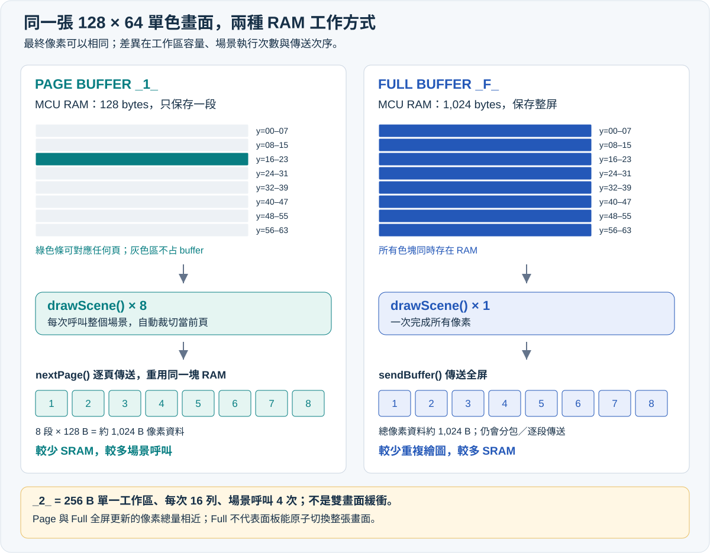
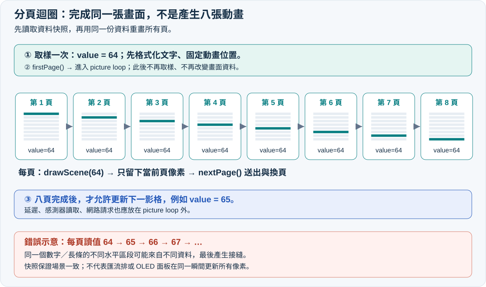
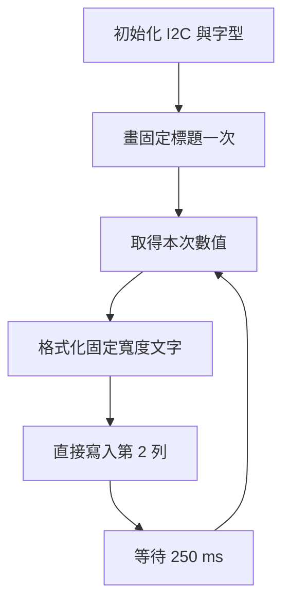
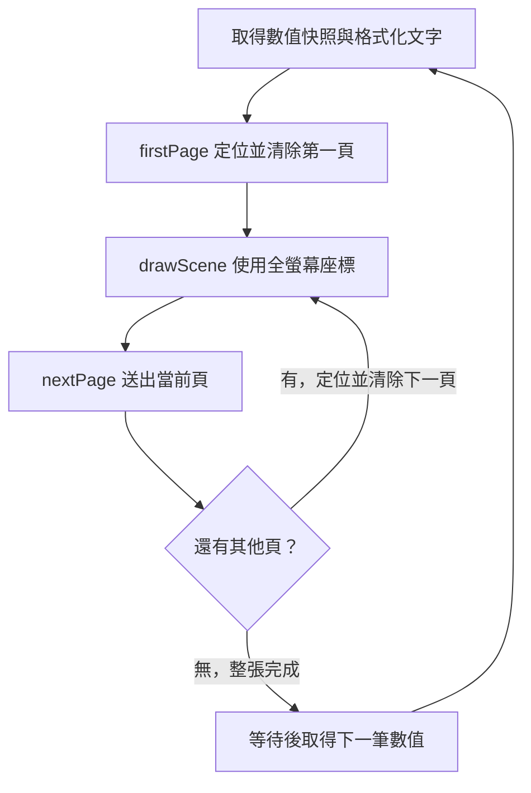
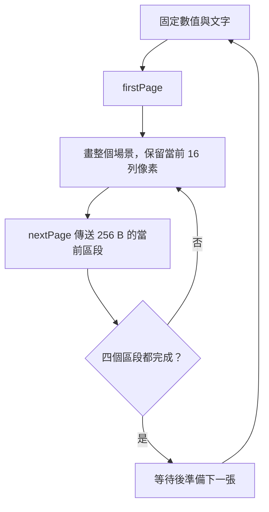
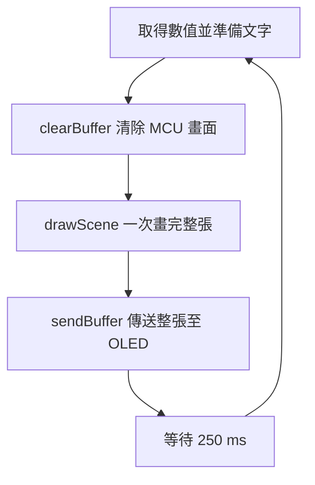
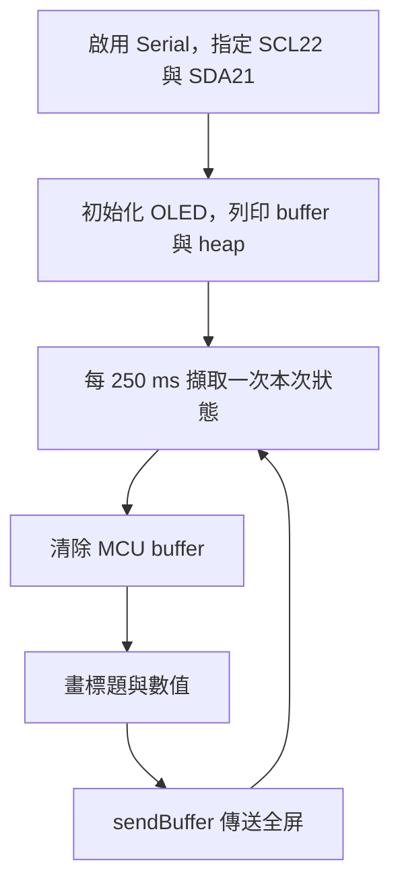
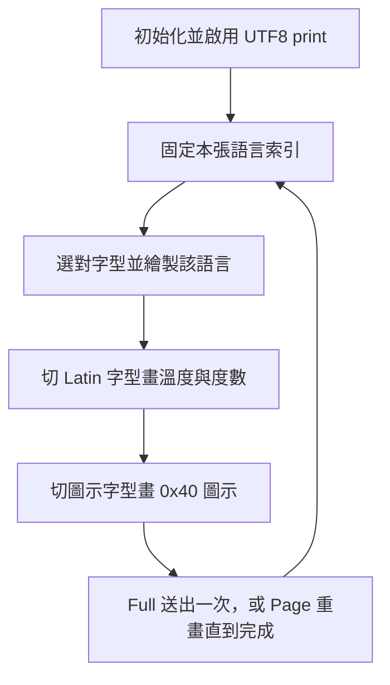
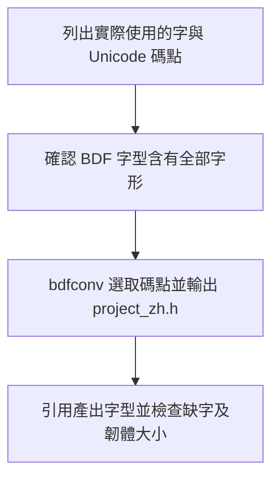
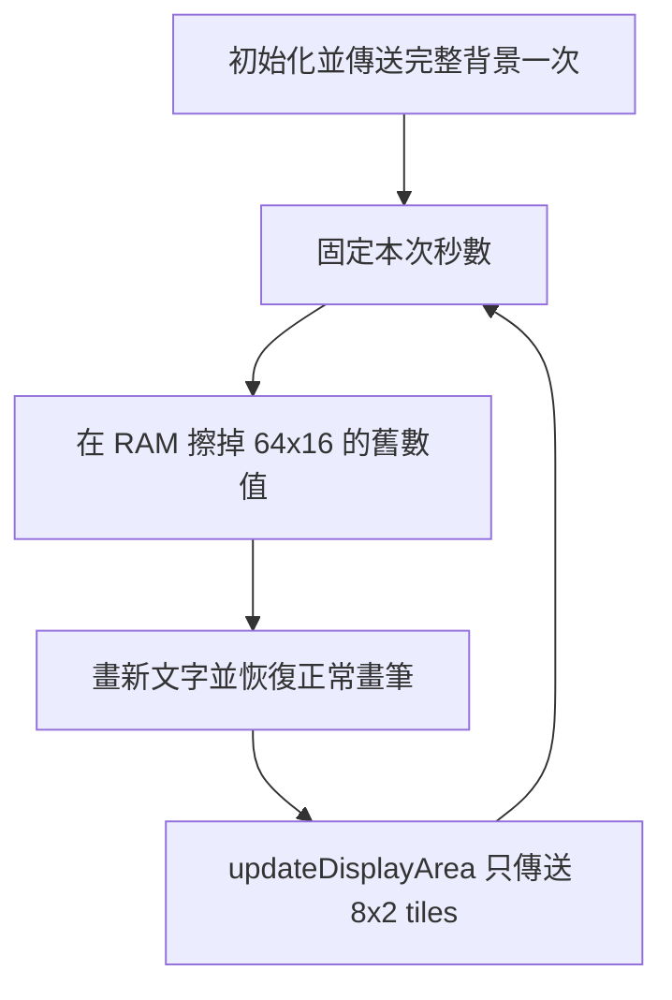

# U8g2 顯示模式完整教學：U8x8、Page Buffer、Full Buffer 與開發板記憶體選擇

> **最後更新時間**: 2026-10-27 16:07:29 (UTC+8)  
> **使用模型**: GPT-6  
> **執行 Agent**: Codex /root  
> **主題分類**: ec／Arduino／OLED／嵌入式記憶體  
> **HTML 筆記**: [開啟互動版：記憶體試算、流程圖、複製程式碼與匯出 PDF](./u8g2_display_modes_memory_guide.html)

**先掌握選擇原則：只顯示文字且 RAM 很少，選 U8x8；需要圖形且 RAM 吃緊，選 Page Buffer；RAM 足夠、希望程式簡單或需要動畫，優先考慮 Full Buffer。** 對 Uno R3 的 2 KiB SRAM，128×64 OLED 的 1 KiB 完整緩衝區負擔很大；對 NodeMCU-32S，同樣的緩衝區通常很小。

本文以 **SSD1306、128×64、單色、I²C、旋轉 U8G2_R0** 為共同條件。容量表、頁數與圖解都以此條件說明；其他控制器以建構式和實際緩衝區大小為準。以下範例為教學原創，不依賴 DHT 感測器，先用時間產生穩定數值，讓螢幕測試能獨立完成。

## 目錄

1. [核心概念：螢幕、程式庫與兩種 RAM](#core)
2. [四種設定總比較](#compare)
3. [圖解 Page Buffer 與 Full Buffer](#diagrams)
4. [記憶體公式與容量預算](#memory)
5. [開發板適用性：Uno 到 NodeMCU-32S](#boards)
6. [安裝、接線與建構式](#setup)
7. [範例 A：U8x8 文字顯示](#example-u8x8)
8. [範例 B：Page Buffer `_1_`](#example-page1)
9. [範例 C：Page Buffer `_2_`](#example-page2)
10. [範例 D：Full Buffer `_F_`](#example-full)
11. [NodeMCU-32S 專用完整範例](#nodemcu)
12. [Font、符號與多語言顯示](#fonts)
13. [資料快照、效能與進階應用](#advanced)
14. [常見問題與實驗](#faq)
15. [官方資料與驗證範圍](#sources)

<a id="core"></a>
## 一、核心概念：U8g2 在做什麼？

### 1.1 同一套程式庫的兩種介面

U8g2 主要服務單色圖形 LCD、OLED 與部分電子紙。它將「文字／圖形繪製」轉成控制器需要的資料，再透過 I²C、SPI 或平行介面送出。**控制器、解析度、通訊方式、緩衝策略是不同的選擇維度**；切換 page/full 並不會改變 OLED 的實體解析度。

- **U8g2 圖形介面**：支援像素座標、字型、線段、方框、圓形、點陣圖等；可搭配 page 或 full buffer。
- **U8x8 文字／tile 介面**：以 8×8 像素 tile 為基本定位單位，直接送到控制器，適合文字儀表板。也有 `drawTile()` 等底層 tile 操作，但沒有 U8g2 那套任意像素圖形 API。

不是所有 U8g2 支援的控制器都能用 U8x8，選用前須確認其建構式存在。[官方模式教學](https://github.com/olikraus/u8g2/wiki/setup_tutorial)、[U8x8 API](https://github.com/olikraus/u8g2/wiki/u8x8reference)

### 1.2 為什麼 OLED 有 RAM，開發板還要 buffer？

以 SSD1306 為例，螢幕控制器有自己的顯示 RAM，會持續依其中內容掃描面板；開發板端 buffer 則是 CPU 在傳送前組合像素的工作區。

**CPU 畫圖 → 開發板 buffer → I²C 傳送 → 控制器顯示 RAM → 面板顯示。**

page buffer 每次只準備一段像素，傳送後重用同一塊 RAM；full buffer 同時保留整張畫面；U8x8 則直接輸出字形／tile。控制器會保留已收到的像素，所以開發板不必同時存下整張畫面。[U8g2 原始碼與說明](https://github.com/olikraus/u8g2)

**補充：為什麼不直接修改 OLED 裡的一個 pixel？** SSD1306 的顯示 RAM 每個 byte 對應同一欄的 8 個垂直像素。要保留其中 7 點、只修改另一點，通常需要先知道該 byte 的舊值；但其 I²C 介面主要提供命令／資料寫入，不能像一般 MCU RAM 隨意讀回 GDDRAM。U8g2 因而在 MCU 端組合一頁或一屏的像素，再送出完整 byte。這個限制說明的是保留未知舊像素的困難，不代表所有 SSD1306 實體介面都沒有讀取功能。[SSD1306 原廠資料表 §8.1、§8.7](https://www.crystalfontz.com/controllers/Solomon%20Systech/SSD1306/339)

### 1.3 Flash、SRAM 與 PSRAM 要分清楚

| 記憶體 | 通常放什麼 | 和本題的關係 |
| --- | --- | --- |
| Flash | 程式、字型、常數圖示 | 字型太大可能導致程式空間不足；不能直接當成可反覆改寫的畫面 RAM |
| SRAM | 畫面 buffer、物件、變數、堆疊與通訊資料 | 決定是否放得下 full buffer，也是本文主要比較對象 |
| 外部 PSRAM | 特定板款的大型動態資料 | 是否存在與如何配置取決於板子和核心；一般 U8g2 建構式不會自動把 buffer 搬到 PSRAM |

因此「板子有 4 MB」必須先問是 Flash 還是 RAM；「ESP32 有 520 KB SRAM」也不代表 sketch 可以取得 520 KB 的連續可用堆積。[Arduino 官方記憶體指南](https://github.com/arduino/docs-content/blob/main/content/learn/03.programming/06.memory-guide/memory-guide.md)、[ESP32 資料表](https://documentation.espressif.com/esp32_datasheet_en.html)

<a id="compare"></a>
## 二、四種設定總比較

下表的 RAM **只計像素緩衝區，不含 U8g2／U8x8 物件、Wire、變數與堆疊**。U8x8 的「0 B」是沒有整頁／整屏像素 buffer，絕不是整個程式不使用 RAM。

| 比較項目 | U8x8 | Page `_1_` | Page `_2_` | Full `_F_` |
| --- | --- | --- | --- | --- |
| 128×64 像素 buffer | 0 B 的畫面 buffer | 128 B | 256 B | 1,024 B |
| 一次保存的畫面範圍 | 字形／tile 直接傳送 | 128×8 像素 | 128×16 像素 | 128×64 像素 |
| 一張畫面的繪圖函式執行次數 | 依更新的字元數 | 8 次 | 4 次 | 1 次 |
| 主要更新 API | `drawString()`／`print()` | `firstPage()`／`nextPage()` | 同 `_1_` | `clearBuffer()`／`sendBuffer()` |
| 座標 | tile 欄、列 | 像素 x、y | 像素 x、y | 像素 x、y |
| 任意像素圖形 | 無 U8g2 圖形 API | 可以 | 可以 | 可以 |
| 任意比例字型／中文 | 受 U8x8 字型集與 tile 格限制 | 視所選 U8g2 字型 | 同左 | 同左 |
| MCU 保留整張舊畫面 | 否 | 否 | 否 | 是 |
| 只更新少數文字 | 很合適 | 標準 picture loop 仍重畫全場景 | 同左 | 可重畫整屏；進階可區域傳送 |
| 典型用途 | 數值、狀態、簡單文字選單 | 小 RAM 儀表與圖形選單 | RAM／繪圖運算折衷 | 動畫、曲線、較複雜 GUI |

`_2_` 的「2」是**兩個 tile rows 的單一工作區**，不是一張顯示、一張繪製的雙畫面緩衝。`_F_` 也只有一張完整 buffer，並非自動 double buffering。[官方建構式與 buffer 定義](https://github.com/olikraus/u8g2/wiki/u8g2setupcpp#buffer-size)

<a id="diagrams"></a>
## 三、圖解：Page Buffer 和 Full Buffer 如何生成同一張畫面？

### 3.1 圖一：RAM 保存的範圍與傳送次序



**Page `_1_` 的八個階段：**

| 階段 | 此次 buffer 對應的全螢幕 y 範圍 | 程式執行 | CPU 最後傳送 |
| --- | --- | --- | --- |
| 1 | 0–7 | 呼叫完整 `drawScene()` | 第 1 個 128 B 區段 |
| 2 | 8–15 | 再呼叫完整 `drawScene()` | 第 2 個 128 B 區段 |
| 3 | 16–23 | 再呼叫完整 `drawScene()` | 第 3 個 128 B 區段 |
| 4 | 24–31 | 再呼叫完整 `drawScene()` | 第 4 個 128 B 區段 |
| 5 | 32–39 | 再呼叫完整 `drawScene()` | 第 5 個 128 B 區段 |
| 6 | 40–47 | 再呼叫完整 `drawScene()` | 第 6 個 128 B 區段 |
| 7 | 48–55 | 再呼叫完整 `drawScene()` | 第 7 個 128 B 區段 |
| 8 | 56–63 | 再呼叫完整 `drawScene()` | 第 8 個 128 B 區段 |

例如 `drawScene()` 中有文字、外框與長條圖，每一頁仍呼叫這三種繪圖命令；U8g2 自動只留下與當前頁交集的像素。**座標始終是全螢幕座標，不必自己把 y 減 8，也不必手動切割字型或圖案。**

`_2_` 則依序處理 y=0–15、16–31、32–47、48–63，總共執行四次場景；buffer 是同一塊 256 B 重複使用。`_F_` 只執行一次場景，整張像素都留在 1,024 B buffer 中，再交給 `sendBuffer()` 傳送。

### 3.2 圖二：分頁迴圈不是動畫迴圈



`firstPage()` 到最後一次 `nextPage()` 是完成**同一張畫面**的多次繪製。每一輪不是新影格。如果把數值加一、讀感測器或 `random()` 放在繪圖函式內，頁與頁之間可能使用不同資料，造成數字上下部不一致、長條接縫或動畫物件斷裂。

正確做法是先取樣、整理文字、固定動畫位置，再開始 picture loop；等全部頁面完成後，才更新下一影格。這是資料快照，和控制器是否一次顯示完整影格是不同議題。[官方 picture loop 限制](https://github.com/olikraus/u8g2/wiki/u8g2reference#firstpage)

### 3.3 兩者最後的畫質是否不同？

相同字型、圖形、資料與控制器設定下，page/full 的最終像素可以完全相同。差異在 MCU RAM 和產生畫面的過程，並不是 page 只能顯示低畫質。

兩者也都會透過匯流排逐段更新控制器。**`sendBuffer()` 不保證 OLED 在某一瞬間原子切換整張畫面**；它通常不是與面板垂直同步的交換動作。不要把 full buffer 等同於「絕不撕裂、絕不閃爍」。

<a id="memory"></a>
## 四、RAM 公式：從解析度算到整個專案

### 4.1 單色、8×8 tile 排列的估算

每個單色像素為 1 bit，8 pixels = 1 byte。令 W、H 為實體寬高，T=ceil(W/8) 為 tile 寬，R=ceil(H/8) 為 tile 高；對本文這類一般 tile 型配置：

- **Full**：`B_full = T × R × 8 bytes`。寬高皆為 8 的倍數時，即 `W × H / 8`。
- **Page `_1_`**：`B_page1 = T × 1 × 8 bytes`。
- **Page `_2_`**：`B_page2 = T × 2 × 8 bytes`。
- **場景執行次數**：`N_page1 = R`、`N_page2 = ceil(R/2)`、`N_full = 1`。

這是常見驅動配置的估算；部分控制器有特殊記憶體排列或 padding，且未必提供所有模式。請用建構式文件及實際 tile 寬高確認，不能把它當作所有螢幕的通則。一般 tile 配置可用 `getBufferTileWidth() × getBufferTileHeight() × 8` 取得目前像素工作區的 bytes；本機 2.36.19 的 `getBufferSize()` 只在特定動態配置條件下提供，不能當作預設 sketch 一定可用的成員。[官方 buffer 配置原始碼](https://github.com/olikraus/u8g2/blob/master/csrc/u8g2_d_memory.c)

| 單色解析度 | `_1_` buffer | `_2_` buffer | `_F_` buffer | `_1_`／`_2_` 場景次數 |
| --- | --- | --- | --- | --- |
| 128×32 | 128 B | 256 B | 512 B | 4／2 |
| 128×64 | 128 B | 256 B | 1,024 B | 8／4 |
| 128×128 | 128 B | 256 B | 2,048 B | 16／8 |
| 256×64 | 256 B | 512 B | 2,048 B | 8／4 |
| 256×128 | 256 B | 512 B | 4,096 B | 16／8 |

上表是**容量模型**，不代表可任意替換本文 SSD1306 的解析度字串。例如 128×128 必須選真正支援該尺寸的控制器與建構式。

### 4.2 Uno R3 的量化比較

Uno R3 有 2,048 B SRAM。128×64 螢幕的 `_1_`、`_2_`、`_F_` 分別吃掉 SRAM 的 **6.25%、12.5%、50%**。改用 `_1_` 可比 `_F_` 省下 896 B，對小型 AVR 是很大的差距。

假設「畫面以外的常駐資料加上預留執行空間」共需 1,200 B，則：

| 模式 | 預算總和 | 2,048 B 中尚餘 | 判讀 |
| --- | --- | --- | --- |
| `_1_` | 1,200 + 128 = 1,328 B | 720 B | 有較大餘裕 |
| `_2_` | 1,200 + 256 = 1,456 B | 592 B | 可以評估 |
| `_F_` | 1,200 + 1,024 = 2,224 B | 超出 176 B | 此假設下不可用 |

**1,200 B 是教學假設，不是 U8g2 的固定消耗。** 實際專案要計入物件、Wire、Serial、感測器、SD 卡、字串、巢狀函式與中斷。編譯器顯示的全域變數用量也不等於執行時最高用量；動態配置和堆疊仍須留空間。[Arduino 官方記憶體指南](https://github.com/arduino/docs-content/blob/main/content/learn/03.programming/06.memory-guide/memory-guide.md)

HTML 版另提供模式、解析度、板子與「其他 RAM 預算」的互動試算；結果為估算，不是硬體記憶體量測。

<a id="boards"></a>
## 五、哪些開發板適合哪一種模式？

以下 SRAM 為名目容量，KiB=1,024 bytes；建議是依容量與常見用途的工程判斷，並非程式庫的硬性限制。只要控制器支援、資源足夠，小板也能使用 full，大板也能使用 page。

| 開發板／晶片 | 名目 SRAM | 128×64 `_F_` 占比 | 建議與考量 |
| --- | --- | --- | --- |
| Uno R3／經典 Nano／Pro Mini，ATmega328P | 2 KiB | 50% | 文字用 U8x8；圖形優先 `_1_`，餘裕夠再試 `_2_`；簡單專案仍可用 `_F_` |
| Leonardo／Micro，ATmega32U4 | 2.5 KiB | 40% | `_1_`／`_2_` 較有餘裕；full 要連 USB 與其他資料一併預算 |
| Nano Every，ATmega4809 | 6 KiB | 16.7% | 一般小 OLED 可評估 full；整合大量周邊時可用 page |
| Mega 2560，ATmega2560 | 8 KiB | 12.5% | 小 OLED 常可用 full；多螢幕、大圖表仍須加總 |
| Uno R4 Minima／WiFi，RA4M1 | 32 KiB | 3.125% | 通常優先 full；WiFi 板的 ESP32 協處理器 RAM 不等同 RA4M1 sketch RAM |
| Zero，SAMD21 | 32 KiB | 3.125% | 通常優先 full |
| Due，SAM3X8E | 96 KiB | 約 1.04% | 小 OLED 通常優先 full |
| Pico／Pico W，RP2040 | 264 KiB | 約 0.38% | 可選 full；Arduino 範例需安裝對應 Arduino core |
| Pico 2／Pico 2 W，RP2350 | 520 KiB | 約 0.19% | 小 OLED 通常選 full |
| **NodeMCU-32S，經典 ESP32** | **520 KiB 片上 SRAM** | **約 0.19% 名目容量** | **128×64 建議先用 full；以實際 heap／系統用量評估整合專案** |
| ESP32-S3 開發板 | 512 KiB 片上 SRAM | 約 0.20% | full 常合適；PSRAM 是否存在取決於板款，不可套用 NodeMCU-32S 腳位 |

Arduino 容量依據：[官方記憶體表](https://github.com/arduino/docs-content/blob/main/content/learn/03.programming/06.memory-guide/memory-guide.md)、[UNO R3／R4 官方比較](https://support.arduino.cc/hc/en-us/articles/9350551575964-What-s-the-difference-between-UNO-R3-and-UNO-R4-boards)、[Nano 官方比較](https://store-usa.arduino.cc/pages/nano-family)。其他容量：[Raspberry Pi Pico 官方表](https://www.raspberrypi.com/documentation/microcontrollers/pico-series.html)、[ESP32 資料表](https://documentation.espressif.com/esp32_datasheet_en.html)、[ESP32-S3 官方規格](https://www.espressif.com/en/products/socs/esp32-s3)。百分比為本文自行計算。

**NodeMCU-32S 不是 ESP8266 的 NodeMCU，也不是 ESP32-S3。** 經典 ESP32 的 520 KiB 包含系統和指令／資料用途；Wi-Fi、藍牙、RTOS、網路封包、TLS 等會占用資源。即使 full buffer 本身僅 1 KiB，也應觀察整個應用程式在最忙情況下的記憶體餘量。

### 5.1 補充開發板與 Flash 限制

| 板子／晶片 | RAM／Flash 重點 | 選型提醒 |
| --- | --- | --- |
| ATtiny85／部分 Digispark 板 | 晶片 512 B SRAM、8 KiB Flash；bootloader 另占程式空間 | 128×64 full buffer 本身已超過 SRAM。優先試 U8x8；page 是否可用還要看精簡程式、字型和實際編譯結果，不能斷言「一律無法使用 U8g2」。I²C 支援依核心及軟體／USI 實作而定 |
| Blue Pill，STM32F103C8T6 | 20 KiB SRAM、規格 64 KiB Flash | full buffer 約占 5% SRAM；大型日文字庫可能先耗盡 Flash。不能以部分仿製板的額外 Flash 當作官方保證 |
| ESP8266 NodeMCU／D1 mini | 系統與 Wi-Fi 使用 RAM；可用 heap 依核心和程式而變 | 小 OLED 通常可用 full；不可保證總有 40／45 KiB 空閒。這不是 NodeMCU-32S，腳位別名也不同 |

依據：[Microchip ATtiny85 資料表](https://ww1.microchip.com/downloads/aemDocuments/documents/OTH/ProductDocuments/DataSheets/Atmel-2586-AVR-8-bit-Microcontroller-ATtiny25-ATtiny45-ATtiny85_Datasheet.pdf)、[ST STM32F103x8 資料表](https://www.st.com/resource/en/datasheet/stm32f103c8.pdf)、[Espressif ESP8266 模組記憶體說明](https://documentation.espressif.com/esp-wroom-02u_esp-wroom-02d_datasheet_en.html)。

選型應先算**目前專案剩餘 RAM、解析度及需要的字型 Flash**，不能只用「SRAM 大於 8 KiB 就一定 full」作固定門檻。SD 卡常見實作需要扇區快取，單一 512 B sector buffer 在 Uno 上已很明顯；但整個 SD 程式庫的 RAM 用量會隨實作改變。USB、Serial、Wire 的固定用量也不可跨核心套用同一數字。

<a id="setup"></a>
## 六、安裝、接線與建構式

### 6.1 最小測試條件

1. Arduino IDE 的 Library Manager 安裝 **U8g2，作者 oliver／olikraus**。
2. 選擇正確開發板；NodeMCU-32S 使用 **esp32 by Espressif Systems** 核心中的 **NodeMCU-32S**。
3. 確認模組是 SSD1306 而非 SH1106，並確認為 128×64、I²C 版本。
4. 先單獨接 OLED，使用以下完整範例之一測試；每個程式區塊是獨立 sketch，不能全部貼到同一個檔案。

| OLED | Uno R3／經典 Nano | Mega 2560 | NodeMCU-32S |
| --- | --- | --- | --- |
| GND | GND | GND | GND |
| VCC | 依模組規格使用 3.3 V 或 5 V | 同左 | 本文使用支援 3.3 V 供電的模組，接 3V3 |
| SDA | A4／SDA | 20／SDA | GPIO21／P21 |
| SCL | A5／SCL | 21／SCL | GPIO22／P22 |

NodeMCU-32S 的 I/O 為 3.3 V 邏輯；I²C 的上拉電阻也必須拉到合適的 3.3 V，避免把匯流排拉到 5 V。排針的「第 21 腳」和 **GPIO21** 不同，請依板上絲印辨認。[Espressif I²C 文件](https://docs.espressif.com/projects/arduino-esp32/en/latest/api/i2c.html)、[NodeMCU-32S 官方 variant 腳位](https://github.com/espressif/arduino-esp32/blob/master/variants/nodemcu-32s/pins_arduino.h)

### 6.2 看懂這個名稱

`U8G2_SSD1306_128X64_NONAME_1_HW_I2C`

| 片段 | 意義 |
| --- | --- |
| U8G2 | 使用圖形 API |
| SSD1306 | 螢幕控制器 |
| 128X64 | 模組解析度 |
| NONAME | 驅動／模組變體名稱，不表示可忽略硬體差異 |
| 1／2／F | 分頁一列／分頁兩列／完整畫面 buffer |
| HW_I2C | 使用硬體 I²C／Arduino Wire |

`SW_I2C` 是軟體 I²C，`4W_HW_SPI` 是硬體四線 SPI；它們不決定 page/full。範例用 `U8X8_PIN_NONE` 表示模組沒有連接可控制的 reset 腳；若實物有 reset 接線，改填對應 GPIO。[官方建構式參考](https://github.com/olikraus/u8g2/wiki/u8g2setupcpp)

I²C 掃描器常報 7-bit 位址 `0x3C`／`0x3D`；U8g2 的 `setI2CAddress()` 則要傳入左移一位的值，例如 `0x3C << 1`，並在 `begin()` 前設定。以下範例明確使用 `0x3C`；若掃描結果不同，須修改。[官方 U8x8 位址 API](https://github.com/olikraus/u8g2/wiki/u8x8reference#seti2caddress)

<a id="example-u8x8"></a>
## 七、範例 A：U8x8，文字狀態板

**用途：** 只顯示溫度、狀態或計數。128×64 使用 8×8 字型時可排 16 欄×8 列，`drawString(0, 2, ...)` 代表第 0 欄、第 2 列，不是像素 y=2。

流程圖：



```cpp
#include <Arduino.h>
#include <Wire.h>
#include <U8x8lib.h>
#include <stdio.h>

// 無 MCU 整屏像素 buffer；使用所選板子的預設 I2C 腳位。
U8X8_SSD1306_128X64_NONAME_HW_I2C u8x8(U8X8_PIN_NONE);

void setup() {
  u8x8.setI2CAddress(0x3C << 1);  // 掃描器的 7-bit 位址轉成此 API 格式。
  u8x8.begin();
  u8x8.setFont(u8x8_font_chroma48medium8_r);
  u8x8.drawString(0, 0, "U8x8 text mode");  // 固定標題只需畫一次。
}

void loop() {
  // 時間模擬 0 到 100 的數值，不需額外感測器。
  const unsigned int value = (millis() / 1000UL) % 101UL;
  char line[17];  // 最多 16 個 ASCII 字元，另加字串結尾。
  snprintf(line, sizeof(line), "Level: %3u %%", value);
  u8x8.drawString(0, 2, line);  // 數值欄寬固定，避免 100 變成 0 時殘字。
  delay(250);  // 簡化教學；整合控制系統時可改為 millis 排程。
}
```

不需呼叫 `sendBuffer()`。更新哪一列，就直接傳送哪一列；若每輪 `clearDisplay()` 再全部重寫，會增加流量，也可能出現短暫空白。字型屬於 U8x8 字型集，不能直接使用 U8g2 的字型名稱。[U8x8 字型與繪字說明](https://github.com/olikraus/u8g2/wiki/u8x8reference)

<a id="example-page1"></a>
## 八、範例 B：Page Buffer `_1_`，128 B 畫出完整圖形

**用途：** Uno R3 等小 RAM 開發板的圖形介面。本例在 y=12、30、43、45 等全螢幕座標畫圖；即使工作區只高 8 pixels，仍能完成跨頁文字和方框。

流程圖：



```cpp
#include <Arduino.h>
#include <Wire.h>
#include <U8g2lib.h>
#include <stdio.h>

// 一次保存 128 x 8 pixels，共 128 B 像素 buffer。
U8G2_SSD1306_128X64_NONAME_1_HW_I2C u8g2(U8G2_R0, U8X8_PIN_NONE);

void drawScene(unsigned int value, const char *label) {
  // 本函式會執行 8 次，只畫圖，不取樣、不修改狀態。
  u8g2.setFont(u8g2_font_6x12_tr);
  u8g2.drawStr(0, 12, "Level monitor");
  u8g2.drawStr(0, 30, label);
  u8g2.drawFrame(0, 43, 128, 18);
  const uint8_t width = (value * 124U) / 100U;
  if (width > 0) {
    u8g2.drawBox(2, 45, width, 14);  // 自動裁切到當前頁。
  }
}

void setup() {
  u8g2.setI2CAddress(0x3C << 1);  // 位址須配合實物。
  u8g2.begin();
}

void loop() {
  // 每張畫面只取一次資料，所有頁共用同一份快照。
  const unsigned int value = (millis() / 1000UL) % 101UL;
  char label[17];
  snprintf(label, sizeof(label), "Level: %3u %%", value);

  u8g2.firstPage();
  do {
    drawScene(value, label);  // 每頁都描述整張畫面，座標不用變。
  } while (u8g2.nextPage());

  delay(250);  // 等所有頁完成後才等待。
}
```

**逐步讀這段程式：** `firstPage()` 從第一頁開始；`drawScene()` 把當前頁需要的像素畫進工作區；`nextPage()` 送出該頁並準備下一頁。如果還沒畫完，傳回 true，繼續重畫相同場景；最後傳回 false，離開迴圈。

標準預設會自動清除頁 buffer，因此不用在 picture loop 裡呼叫 `clearDisplay()`。後者會清掉螢幕端資料，可能把前面已完成的頁清除。[官方分頁範例與限制](https://github.com/olikraus/u8g2/wiki/setup_tutorial#page-buffer-mode-picture-loop)

<a id="example-page2"></a>
## 九、範例 C：Page Buffer `_2_`，256 B、四次完成

**用途：** 希望比 `_1_` 少做幾次繪圖運算，且能多拿出 128 B RAM。可直接把上一例建構式的 `_1_` 改成 `_2_`，其餘程式完全相同。下面另給可獨立執行的版本。

流程圖：



```cpp
#include <Arduino.h>
#include <Wire.h>
#include <U8g2lib.h>
#include <stdio.h>

// 單一 256 B 工作區；不是兩張完整畫面的 double buffer。
U8G2_SSD1306_128X64_NONAME_2_HW_I2C u8g2(U8G2_R0, U8X8_PIN_NONE);

void drawScene(unsigned int value, const char *label) {
  u8g2.setFont(u8g2_font_6x12_tr);
  u8g2.drawStr(0, 12, "Level monitor");
  u8g2.drawStr(0, 30, label);
  u8g2.drawFrame(0, 43, 128, 18);
  const uint8_t width = (value * 124U) / 100U;
  if (width > 0) {
    u8g2.drawBox(2, 45, width, 14);  // 同一套圖形指令，自動跨頁。
  }
}

void setup() {
  u8g2.setI2CAddress(0x3C << 1);  // 仍使用相同的 OLED 位址。
  u8g2.begin();
}

void loop() {
  const unsigned int value = (millis() / 1000UL) % 101UL;
  char label[17];
  snprintf(label, sizeof(label), "Level: %3u %%", value);
  u8g2.firstPage();
  do {
    drawScene(value, label);  // 一張 128x64 畫面共執行 4 次。
  } while (u8g2.nextPage());
  delay(250);  // 所有區段完成後才等待。
}
```

`_2_` 與 `_1_` 都會送出整張畫面約 1,024 B 像素。減少的是場景執行次數和部分控制開銷，**不是把全畫面的像素傳輸量減半**。實際加速幅度會受 CPU、圖形複雜度、匯流排與驅動影響。

<a id="example-full"></a>
## 十、範例 D：Full Buffer `_F_`，1,024 B、一次畫完

**用途：** NodeMCU-32S、Mega 2560、Uno R4 等資源較充裕的板子；或已確認 RAM 預算足夠的 Uno R3。使用與上例完全相同的文字及圖形，方便比較。

流程圖：



```cpp
#include <Arduino.h>
#include <Wire.h>
#include <U8g2lib.h>
#include <stdio.h>

// 完整 128 x 64 / 8 = 1024 B 像素 buffer。
U8G2_SSD1306_128X64_NONAME_F_HW_I2C u8g2(U8G2_R0, U8X8_PIN_NONE);

void drawScene(unsigned int value, const char *label) {
  u8g2.setFont(u8g2_font_6x12_tr);
  u8g2.drawStr(0, 12, "Level monitor");
  u8g2.drawStr(0, 30, label);
  u8g2.drawFrame(0, 43, 128, 18);
  const uint8_t width = (value * 124U) / 100U;
  if (width > 0) {
    u8g2.drawBox(2, 45, width, 14);  // 全部像素同時保存在 MCU RAM。
  }
}

void setup() {
  u8g2.setI2CAddress(0x3C << 1);  // 按掃描結果調整。
  u8g2.begin();
}

void loop() {
  const unsigned int value = (millis() / 1000UL) % 101UL;
  char label[17];
  snprintf(label, sizeof(label), "Level: %3u %%", value);

  u8g2.clearBuffer();          // 只清 MCU RAM，這一步不會清空 OLED。
  drawScene(value, label);     // 每張只執行一次場景。
  u8g2.sendBuffer();           // 把新像素覆寫到控制器顯示 RAM。
  delay(250);                  // 完成後準備下一張。
}
```

### 10.1 兩段主迴圈的對照

| 程式階段 | Page Buffer | Full Buffer |
| --- | --- | --- |
| 開始畫面 | `firstPage()` | `clearBuffer()` |
| 描述場景 | 重複呼叫；每次自動裁切至當前頁 | 一次呼叫，畫進整屏 buffer |
| 傳送 | 每次 `nextPage()` 送出當前頁 | `sendBuffer()` 送出整屏 |
| 場景資料更新 | 所有頁完成後才能更新 | 下一影格前更新 |
| 改模式時要改什麼 | 建構式及更新主迴圈 | 建構式及更新主迴圈 |

**不能只把 `_F_` 改成 `_1_`，卻繼續沿用 `clearBuffer()`／`sendBuffer()`。** 這樣通常只能更新第一段 8 或 16 列，並非完整分頁繪製。[官方模式切換警告](https://github.com/olikraus/u8g2/wiki/u8g2setupcpp#buffer-size)

<a id="nodemcu"></a>
## 十一、NodeMCU-32S：建議先用 Full Buffer

### 11.1 為什麼適合？

128×64 的 full buffer 是 1,024 B，約為經典 ESP32 520 KiB 片上 SRAM 的 0.19%。這只用來表達相對量級；實際可分配 heap 要扣除系統等用途。對一般感測器＋Wi-Fi＋小 OLED，先採 full 通常能簡化程式，之後再依量測調整。

NodeMCU-32S 常見 Arduino 設定為 4 MB Flash；這不是 4 MB SRAM，也不表示有 PSRAM。本文不依賴 PSRAM。[Espressif 官方板型設定](https://github.com/espressif/arduino-esp32/blob/master/boards.txt)、[ESP32 晶片記憶體規格](https://documentation.espressif.com/esp32_datasheet_en.html)

### 11.2 完整範例：指定 GPIO、列印 tile 配置的 buffer 容量與 heap

OLED 接法：**VCC→3V3、GND→GND、SDA→GPIO21、SCL→GPIO22**，使用相容 3.3 V 的 OLED 模組。建構式接腳參數順序是 reset、clock、data，因此傳入 **22、21**；和 `Wire.begin(SDA, SCL)` 的常見參數順序不同。

流程圖：



```cpp
#include <Arduino.h>
#include <Wire.h>
#include <U8g2lib.h>

// 專供經典 ESP32 的 NodeMCU-32S；clock=SCL，data=SDA。
U8G2_SSD1306_128X64_NONAME_F_HW_I2C u8g2(
    U8G2_R0, U8X8_PIN_NONE, /* clock=*/22, /* data=*/21);

void setup() {
  Serial.begin(115200);
  u8g2.setI2CAddress(0x3C << 1);  // 若模組是 0x3D，修改此處。
  u8g2.setBusClock(100000);        // 先用 100 kHz；穩定後再評估 400 kHz。
  u8g2.begin();
  u8g2.setFont(u8g2_font_6x12_tr);

  Serial.print("Pixel buffer bytes: ");
  const uint16_t pixelBufferBytes =
      (uint16_t)u8g2.getBufferTileWidth() * u8g2.getBufferTileHeight() * 8U;
  Serial.println(pixelBufferBytes);     // 此標準 tile 建構式應為 1024。
  Serial.print("Free heap now: ");
  Serial.println(ESP.getFreeHeap());    // 當下 heap，不是整顆晶片 SRAM。
}

void loop() {
  static uint32_t previousMs = 0;
  const uint32_t now = millis();
  if (now - previousMs < 250U) {
    return;  // 使用時間排程，不用 delay 等待下一次更新。
  }
  previousMs = now;

  // 先保存本張使用的狀態；之後繪圖期間不再重新讀取。
  const uint32_t seconds = now / 1000U;
  const uint32_t heapNow = ESP.getFreeHeap();
  u8g2.clearBuffer();
  u8g2.drawStr(0, 12, "NodeMCU-32S / F");
  u8g2.setCursor(0, 30);
  u8g2.print("Uptime: ");
  u8g2.print(seconds);
  u8g2.print(" s");
  u8g2.setCursor(0, 46);
  u8g2.print("Heap: ");
  u8g2.print(heapNow);
  u8g2.sendBuffer();  // 傳輸本身仍是同步阻塞，不等同背景 DMA 更新。
}
```

這裡依 tile 配置算出的數字只計像素 buffer，不能代表整個 U8g2 RAM 用量。`ESP.getFreeHeap()` 是當下讀值，不能保證稍後 TLS／Wi-Fi 尖峰仍有同樣餘量；使用多工時可讓同一個工作執行緒統一操作 OLED。[本機對照與官方 U8g2 API](https://github.com/olikraus/u8g2/wiki/u8g2reference)、[Espressif Arduino 核心](https://github.com/espressif/arduino-esp32)

想在 NodeMCU-32S 測 page 模式，可使用第八／九節範例並指定相同腳位。**切成 `_1_`／`_2_` 後，主迴圈也要改回 `firstPage()`／`nextPage()`**；不能只改類別名。

<a id="fonts"></a>
## 十二、Font、符號與多語言顯示

### 12.1 圖解文字變成像素的流程


以「溫」為例：原始檔中的 UTF-8 bytes 是 `E6 BA AB`；解碼後是 Unicode **U+6EAB**；接著還要在**目前選用的字型**中找到該碼點的 glyph，才能變成像素。缺字不是多加一次 `enableUTF8Print()` 就能補回來。

顯示文字有四個條件：原始碼編碼正確、API 正確解碼、字型包含該字、座標與版面放得下。page/full 只改變最後像素的儲存方式，不決定支援哪些語言。[官方字型編碼格式](https://github.com/olikraus/u8g2/wiki/u8g2fontformat)、[官方 UTF-8 範例](https://github.com/olikraus/U8g2_Arduino/blob/master/examples/full_buffer/PrintUTF8/PrintUTF8.ino)

### 12.2 選字型時，字高和字集都要看

`u8g2_font_6x12_tr` 中的 `6x12` 是字型尺寸系列，尾碼 `t` 是透明型、可變寬 glyph 配置；`r` 是 restricted 字集。這個範例字型實際是 6×12 系列，但不能把所有 `_t` 字型都視為等寬。

| 常見尾碼 | 意義／使用提醒 |
| --- | --- |
| `_tr` | 透明型 glyph、restricted 字集，通常為碼點 32–127；適合英文數字 |
| `_tf` | 透明型 glyph、full 字集，通常為碼點 32–255；**full 不表示整套 Unicode** |
| `_te` | extended 字集；仍不是所有語言 |
| `_mn` | 等寬、數字及部分日期時間符號；適合數字儀表，不保證含英文句子 |
| `_hr`／`_mr` | 共同高度／等寬配置，搭配 restricted 字集 |
| `_t_chinese2`、`_t_japanese1` | 特定子集名稱，依字型預覽與實際 glyph 確認覆蓋範圍 |

`setFontMode(1)` 是執行時的透明背景設定；它與字型名稱裡的 `t` 有關，但不是同一個設定。重畫變動數字時，不論哪種字型，都要處理舊像素；全屏 `clearBuffer()` 後重畫最容易理解。[官方 setFont／setFontMode](https://github.com/olikraus/u8g2/wiki/u8g2reference#setfont)

### 12.3 三種文字 API 的差別

| API | 輸入與用途 | 常見誤解 |
| --- | --- | --- |
| `drawStr(x, y, text)` | 逐 byte 的文字繪製；一般 ASCII 範例使用 | 直接傳 UTF-8 中文不能正常解碼 |
| `drawUTF8(x, y, text)` | 直接解碼 UTF-8 字串 | **不需要**先開啟 `enableUTF8Print()` |
| `setCursor()`＋`print()` | Arduino Print 介面；輸出 UTF-8 前先呼叫 `enableUTF8Print()` | `enableUTF8Print()` 不會替換字型或補字 |
| `drawGlyph(x, y, codepoint)` | 直接指定單一 Unicode／圖示碼點 | 要傳碼點整數，不能把 UTF-8 的第一個 byte 當成碼點 |

### 12.4 基線、字高、置中與換行

U8g2 的預設文字 y 是**基線 baseline**，不是字框頂端；例如 16 pixels 字型可先用 y=16、32、48、64 規畫四行，再依 ascender／descender 留白。`setFontPosTop()` 可改以頂端定位；換了設定後所有文字座標也要一起理解。

字串長度不是像素寬度：UTF-8 的 `strlen("你好")` 是 6 bytes，不是 2 個像素，也不是字串寬度。置中應在 `setFont()` 後呼叫 `getUTF8Width()`，計算 `(螢幕寬 - 文字寬) / 2`；先檢查是否超寬，避免無號數相減下溢。`drawUTF8()` 不會自動替你把段落排成多行。

### 12.5 語言、符號與字型選擇

| 內容 | 選擇方向 | 要確認的限制 |
| --- | --- | --- |
| 英文、數字 | 6x12、等寬系列或數字專用字型 | `_mn` 可能沒有一般文字 |
| 德文、法文、西文重音 | Latin／extended 子集＋UTF-8 API | `ü`、`é` 是否真的存在 |
| 簡體／繁體中文 | Unifont、WenQuanYi、BoutiqueBitmap，或自製子集 | `chinese1/2/3` 不是簡繁切換，也不保證完整包含繁體字 |
| 日文 | 含假名／漢字的 japanese 子集 | 假名、漢字範圍不同；可優先做專案子集 |
| 韓文 | Gulim 等對應韓文字型 | 音節覆蓋與字庫大小 |
| 希臘文／西里爾文 | `unifont_t_greek`／`unifont_t_cyrillic` | 切換正確字型，再畫 Unicode |
| 度數、Ω、μ、箭頭 | 查該字型是否有 U+00B0、U+03A9、U+03BC 等 | `°` U+00B0 和 `℃` U+2103 是不同字 |
| 天氣、電池、Wi-Fi 圖示 | Open Iconic、Siji 等圖示字型 | 圖示碼位按字型圖表，未必等於 Unicode 同名符號 |
| 阿拉伯文、波斯文、印度系文字 | 除字型外，還需檢查 shaping、雙向排版與組合符號 | UTF-8 解碼不等於完整文字排版引擎；不能只反轉 bytes |
| Emoji | 少數可用單色 glyph，或事先做點陣圖 | 不保證支援補充平面、彩色 emoji 或多碼點組合 |

`setFontDirection()` 控制字形繪製方向／旋轉，不能直接當成完整的阿拉伯文 RTL＋shaping 解法。若文字需要複雜排版，可考慮事先整形成 glyph 序列、轉成點陣圖，或採用具備對應排版能力的方案。[官方語言字型群組](https://github.com/olikraus/u8g2/wiki/fntgrp)、[Unifont 子集預覽](https://github.com/olikraus/u8g2/wiki/fntgrpunifont)、[官方 Unicode 支援選項](https://github.com/olikraus/u8g2/wiki/u8g2optimization)

### 12.6 NodeMCU-32S 多語言＋度數＋天氣圖示完整範例

原始檔請存成 UTF-8。每兩秒顯示一種語言，字型隨語言切換；下方混合 `print()`、`drawGlyph()` 與圖示字型。**這個示例同時引用多個字庫，建議在 NodeMCU-32S 執行，不適合直接放進 Uno R3。**

`USE_PAGE_BUFFER=0` 使用 full；改成 1 時，程式同時切換建構式和 picture loop。無論哪個模式，每張畫面都先固定語言索引；字型切換也放在場景函式內，確保每頁的字型狀態一致。

流程圖：



```cpp
#include <Arduino.h>
#include <Wire.h>
#include <U8g2lib.h>

#define USE_PAGE_BUFFER 0  // 0=full；1=page，同時切換建構式與更新方式。
#if USE_PAGE_BUFFER
U8G2_SSD1306_128X64_NONAME_1_HW_I2C u8g2(
    U8G2_R0, U8X8_PIN_NONE, 22, 21);
#else
U8G2_SSD1306_128X64_NONAME_F_HW_I2C u8g2(
    U8G2_R0, U8X8_PIN_NONE, 22, 21);
#endif

struct LanguagePage {
  const uint8_t *font;
  const char *label;
  const char *message;
};

// 各字型是編譯時引用的常數；每種語言使用對應字集。
const LanguagePage pages[] = {
  {u8g2_font_unifont_t_latin, "English", "Hello"},
  {u8g2_font_unifont_t_latin, "German", "Grüße"},
  {u8g2_font_unifont_t_chinese2, "Chinese", "你好世界"},
  {u8g2_font_unifont_t_japanese1, "Japanese", "こんにちは"},
  {u8g2_font_unifont_t_greek, "Greek", "Γεια"},
  {u8g2_font_unifont_t_cyrillic, "Cyrillic", "Привет"}
};

void drawLanguagePage(uint8_t index) {
  // Page 模式每次重畫時，都明確設定字型、透明模式與座標。
  u8g2.setFontMode(1);
  u8g2.setFont(u8g2_font_6x12_tr);
  u8g2.drawStr(0, 11, pages[index].label);
  u8g2.setFont(pages[index].font);
  u8g2.drawUTF8(0, 32, pages[index].message);

  // print 的 UTF-8 支援在 setup 啟用；這裡畫的是度數加 C。
  u8g2.setFont(u8g2_font_unifont_t_latin);
  u8g2.setCursor(0, 56);
  u8g2.print("25 °C");
  u8g2.drawGlyph(65, 56, 0x00B0);  // 直接用 U+00B0 碼點畫單一度數符號。

  // 0x40 在這個圖示字型中是天氣圖示，不是一般文字的 @。
  u8g2.setFont(u8g2_font_open_iconic_weather_2x_t);
  u8g2.drawGlyph(100, 56, 0x40);
}

void setup() {
  Serial.begin(115200);
  u8g2.setI2CAddress(0x3C << 1);  // 按模組實際位址調整。
  u8g2.begin();
  u8g2.enableUTF8Print();  // 只影響 print；drawUTF8 本來就會解碼 UTF-8。

  // 此 C API 檢查目前字型有沒有繁體「溫」，不假設子集一定包含。
  u8g2.setFont(u8g2_font_unifont_t_chinese2);
  Serial.print("Has U+6EAB: ");
  Serial.println(u8g2_IsGlyph(u8g2.getU8g2(), 0x6EAB));
}

void loop() {
  const uint8_t count = sizeof(pages) / sizeof(pages[0]);
  const uint8_t index = (millis() / 2000UL) % count;  // 分頁前固定索引。
#if USE_PAGE_BUFFER
  u8g2.firstPage();
  do {
    drawLanguagePage(index);  // 同一張畫面固定使用相同語言。
  } while (u8g2.nextPage());
#else
  u8g2.clearBuffer();
  drawLanguagePage(index);
  u8g2.sendBuffer();
#endif
  delay(100);  // 控制重畫頻率；語言每兩秒切換。
}
```

`0x40` 的圖形須查 **`open_iconic_weather_2x_t` 專屬圖表**；換成另一個圖示字型，即使碼點相同也可能是不同圖案。畫完圖示後，要顯示一般文字就重新選文字字型。[官方 Open Iconic 圖表](https://github.com/olikraus/u8g2/wiki/fntgrpiconic)

### 12.7 字庫究竟占多少空間？

以下是本機 U8g2 **2.36.19** 的字型陣列宣告大小，主要是 **Flash 常數資料大小**，不是執行時 framebuffer SRAM，也不是整個 sketch 的最終大小；版本更新可能改變數字。

| 字型 | 陣列大小 | 工程含意 |
| --- | --- | --- |
| `u8g2_font_6x12_tr` | 969 B | 精簡英文數字 |
| `u8g2_font_6x12_tf` | 1,989 B | 較廣的 8-bit 字集，但不含完整中文 |
| `u8g2_font_open_iconic_weather_2x_t` | 189 B | 少量圖示可很小 |
| `u8g2_font_unifont_t_latin` | 3,768 B | Latin 子集 |
| `u8g2_font_unifont_t_greek` | 3,801 B | 希臘字集 |
| `u8g2_font_unifont_t_cyrillic` | 6,659 B | 西里爾字集 |
| `u8g2_font_unifont_t_chinese1` | 13,796 B | 選定中文字集，並非完整中文 |
| `u8g2_font_unifont_t_chinese2` | 19,889 B | 與 chinese1 是不同選集，不是整套繁體 |
| `u8g2_font_unifont_t_chinese3` | 36,601 B | 超過 Uno R3 整顆 32 KiB Flash；不是 240 KB |
| `u8g2_font_wqy12_t_gb2312a` | 109,189 B | GB2312 子集，仍不能推論包含所有繁體字 |
| `u8g2_font_wqy16_t_chinese1` | 13,882 B | 需逐字確認專案標籤 |
| `u8g2_font_b12_t_japanese1` | 33,370 B | 字型本身已超過 Uno R3 32 KiB，不應宣稱一定裝得下 |
| `u8g2_font_unifont_t_japanese1` | 44,807 B | 字庫本身就大於 Uno R3 的 32 KiB Flash |
| `u8g2_font_battery19_tn` | 185 B | 8×19 電池圖示系列，按 glyph 圖表選狀態 |

**同時引用多個字型時，需把實際保留的字型成本加總；切換字型不會自動把其他已引用的字型從韌體刪除。** 程式庫套件很大，不代表每次所有字型都被連結；最終使用量以編譯結果為準。官方原始碼可查各字型陣列大小。[字型原始碼](https://github.com/olikraus/u8g2/blob/master/csrc/u8g2_fonts.c)

### 12.8 繁體中文缺字與專案子集的做法

如果需要「溫度、濕度、設定、連線、警告」等固定介面文字，先列出**實際使用的所有 Unicode 字元**，找包含它們的合法 BDF 字型，再用官方 `bdfconv` 產生專用字型。將產出的資料保留在專案自己的字型檔，程式用 `setFont()` 引用；不要依賴修改系統程式庫內建檔案。

這能避免為十幾個介面字帶入整個大字庫。但若文字來自網路、使用者可任意輸入，就要評估完整覆蓋、缺字 fallback、Flash 分割與渲染效能。UTF-8 截字也必須按字元邊界，不能任意切掉 byte。

可用 `u8g2_IsGlyph(u8g2.getU8g2(), codepoint)` 檢查目前字型；應用程式可明確選另一字型或顯示替代符號，U8g2 不會像桌面瀏覽器自動搜尋作業系統字型。轉檔要遵守原字型授權。[官方 bdfconv 工具](https://github.com/olikraus/u8g2/tree/master/tools/font/bdfconv)

### 12.9 度數符號的 byte 陷阱與電池圖示

字型有 U+00B0 時，`drawUTF8(..., "25°C")` 可直接顯示；若用不解碼 UTF-8 的 `drawStr()`，可傳 Latin-1 的單 byte：`"25\xB0" "C"`。兩段字串會由 C++ 合併；不要寫成 `"25\xB0C"`，因為 `C` 也是十六進位數字，會被吃進同一個跳脫碼。`drawUTF8()` 不需要先啟用 `enableUTF8Print()`，後者只控制 `print()`。

圖示字型是**預先點陣化的字形資料，不是執行時向量繪圖**。`u8g2_font_battery19_tn` 可用字元碼 `'0'` 到 `'7'` 查圖表；不能把 `'4'` 當成 Unicode 的電池 emoji。Open Iconic weather 字型的 0x40–0x45 同樣是該字型的圖示索引，不是 U+2600 等一般 Unicode 天氣碼。[官方電池字型預覽](https://github.com/olikraus/u8g2/wiki/fntlistall)、[官方圖示群組](https://github.com/olikraus/u8g2/wiki/fntgrpiconic)

對少量固定繁體標籤，也可先轉成 XBM，再用 `drawXBMP()` 繪製 Flash 中的圖案。16×16 單色圖的未壓縮像素資料是 `ceil(16/8) × 16 = 32 B`；10 個分開的字圖是 320 B 像素資料，**尚未計入變數、索引、對齊和程式碼**。這適合固定標籤，並不提供任意文字輸入與自動排版。

### 12.10 可重現的自訂繁體字庫命令

以下為命令格式示例，需先取得官方 `bdfconv` 及真的包含所需字元的 `font.bdf`。選擇 ASCII 32–127、度數 176，以及「度」24230、「溫」28331、「濕」28629；產出的陣列大小要以檔案及編譯結果確認，不能先保證少於 600 B。若缺少所需 BDF，本例無法直接產出字型。

流程圖：



```powershell
# 使用真實 BDF，輸出可由專案引用的 U8g2 點陣字型陣列。
# -m 是碼點選集；輸出是字型資料，不是只有原始碼字串的占位內容。
.\bdfconv.exe -v -f 1 -b 0 -m "32-127,176,24230,28331,28629" font.bdf -o project_zh.h -n project_zh
```

將產出的標頭放入專案，再選取 `project_zh` 字型即可；不能把帶有 `...` 的示意壓縮字串交給 U8g2 使用，那不是有效字型資料。[官方轉檔工具與說明](https://github.com/olikraus/u8g2/tree/master/tools/font/bdfconv)

<a id="advanced"></a>
## 十三、延伸思考與進階主題

### 13.1 整合 DHT11：取樣和畫圖是兩個時程

沿用既有 [DHT11＋SSD1306 筆記](./arduino_dht11_ssd1306_u8g2_guide.html) 時，應先在 picture loop 外完成感測器取樣、錯誤檢查、數值格式化，再把同一組結果交給每一頁。

例如每 2 秒更新一次 DHT11 資料，OLED 可以每 250 ms 顯示既有快照、時間或連線狀態。畫面更新頻率不代表感測器也要同頻率讀取。對 page 模式，感測器每次只讀一組，不是每頁讀一組；也不要在分頁迴圈中加入每頁延遲。

### 13.2 效能模型：Full 通常少做 CPU 工作，但匯流排仍有成本

用本文場景自行建立簡化模型：

- `T_page ≈ N × C_scene + T_bus + T_page_overhead`
- `T_full ≈ C_scene + T_bus + T_clear`

`C_scene` 是一次場景呼叫的 CPU 成本估計；實際分頁有裁切與交集最佳化，因此不代表每頁都會做一遍完全等量的像素工作。`N` 在本文 `_1_` 為 8、`_2_` 為 4。

對 I²C，每個資料 byte 加 ACK 至少約 9 個 clock。只計 1,024 B 像素資料：

| 匯流排時脈 | 像素資料時間下限估算 | 對應理想上限 |
| --- | --- | --- |
| 100 kHz | 1,024×9／100,000 ≈ 92.16 ms | 約 10.85 fps |
| 400 kHz | 1,024×9／400,000 ≈ 23.04 ms | 約 43.40 fps |

這些是**模型推算，非實測成績**；地址、控制 byte、命令、Wire 分包、驅動、CPU 繪圖都會增加時間。page/full 全屏重畫的像素總量相近，所以從 `_1_` 改成 `_F_` 不必然得到八倍 fps。也不可只因 ESP32 CPU 快，就預期 100 kHz I²C 能達到 60 fps。

### 13.3 Full Buffer 的區域更新與殘影

full 保留整張畫面，適合在 RAM 中保留固定背景，只擦掉舊數值／舊物件後重畫變動區域。仍使用 `sendBuffer()` 時，傳輸量通常是整屏；要減少匯流排流量，需使用支援的區域更新機制。

`updateDisplayArea(tx, ty, tw, th)` 以 **8×8 tiles** 指定傳送區域；和 `drawBox()` 的像素座標不同。以 R0 的 128×64 為例，整屏是 16×8 tiles。必須先修好 RAM 中的區域、確保範圍合法，再傳送；部分控制器不完整支援此 API。裁切繪圖範圍也不會自動縮小 `sendBuffer()` 的傳輸範圍。[官方區域更新與限制](https://github.com/olikraus/u8g2/wiki/u8g2reference#updatedisplayarea)

若每輪畫新文字卻不擦舊文字，就會出現殘影；全畫面重繪使用 `clearBuffer()` 可以簡化這個問題，而且它只清 MCU buffer，不會先讓 OLED 整屏變黑。

**區域更新完整範例：** 只修改 x=64–127、y=16–31 的 64×16 區域，對應 tile `(8, 2, 8, 2)`。此區有 128 B 像素資料；100 kHz 的資料時間下限約 11.52 ms，400 kHz 約 2.88 ms，尚未計命令與程式開銷，因此不能無條件宣稱「不到 5 ms」。適用本文 SSD1306、R0 與 `_F_` 配置。

流程圖：



```cpp
#include <Arduino.h>
#include <Wire.h>
#include <U8g2lib.h>

// 使用所選板的預設 I2C；NodeMCU-32S 預設 SDA21、SCL22。
U8G2_SSD1306_128X64_NONAME_F_HW_I2C u8g2(U8G2_R0, U8X8_PIN_NONE);

void setup() {
  u8g2.setI2CAddress(0x3C << 1);
  u8g2.setBusClock(100000);  // 先確認接線穩定。
  u8g2.begin();
  u8g2.setFont(u8g2_font_6x12_tr);
  u8g2.setFontMode(1);
  u8g2.clearBuffer();
  u8g2.drawStr(0, 12, "Partial update");
  u8g2.drawStr(0, 30, "Sec:");
  u8g2.sendBuffer();  // 首次必須送完整背景，讓 MCU 和 OLED 內容一致。
}

void loop() {
  // 秒數限制在 0..999999，使用 6x12 字型可放入 64 pixels 寬。
  const unsigned long seconds = (millis() / 1000UL) % 1000000UL;
  u8g2.setDrawColor(0);
  u8g2.drawBox(64, 16, 64, 16);  // 只擦除 RAM 中的指定區域。
  u8g2.setDrawColor(1);          // 恢復正常畫筆，避免後續繪圖被擦除。
  u8g2.setCursor(64, 30);        // 文字基線仍是像素座標。
  u8g2.print(seconds);
  u8g2.updateDisplayArea(8, 2, 8, 2);  // 傳送單位是 tile，不是 pixel。
  delay(250);                   // 其他區域不需再次傳送。
}
```

### 13.4 字型、UTF-8 與中文

page/full 都能使用相同 U8g2 字型。要顯示中文，除了 UTF-8 解碼，字型也必須包含該字；可使用 `drawUTF8()`，或開啟 `enableUTF8Print()` 後使用 `print()`。第七至十一節的基本範例刻意使用 ASCII；第十二節另示範正確選取各語言字型。

大型中文字庫主要影響 Flash；換 page buffer 能省畫面 SRAM，卻不能解決字型 Flash 超量。應只保留需要的字集／字型，並查看實際編譯結果。U8x8 與 U8g2 字型不可混用。[官方字型總覽](https://github.com/olikraus/u8g2/wiki/fntlistall)、[字型群組說明](https://github.com/olikraus/u8g2/wiki/fntgrp)

### 13.5 大螢幕、多螢幕與電子紙

- 若兩個 128×64 螢幕**各自有獨立** full buffer，像素 RAM 合計 2,048 B；但本機預設配置函式使用 static buffer，同型物件可能共用工作區，不能只用物件數推算。需要各自保留不同畫面時，應確認配置與 buffer 指標，而非假設每個物件都自帶獨立整屏 RAM。
- 旋轉 90° 不會讓實體像素總數或 full buffer 容量減半；分頁工作區依驅動的實體記憶體配置理解。
- 電子紙還有刷新序列、忙碌等待、殘影和局部更新限制。本文 OLED 的逐頁傳送示意，不代表每送一頁電子紙就會完成一次可見刷新。
- U8g2 是單色渲染模型，不能直接把本表套到 RGB565 彩色 TFT；彩色顯示要依色深和使用的程式庫重新估算。

<a id="faq"></a>
## 十四、常見問題與建議實驗

| 現象／問題 | 可能原因 | 處理方式 |
| --- | --- | --- |
| 只顯示上面 8／16 列 | `_1_`／`_2_` 搭配了 full 的主迴圈 | 改用 picture loop，或整套改 `_F_` |
| 數字上下半不一致 | 各頁讀到不同資料 | 分頁前取樣、格式化並固定快照 |
| Uno 會重啟或畫面亂碼 | RAM 過量、電源或接線問題 | 先換 `_1_`，縮減字串與資料，檢查 RAM 預算及供電 |
| 全黑或無回應 | 控制器、位址、接線或 reset 不符 | 核對 SSD1306／SH1106、SDA/SCL、0x3C／0x3D |
| 以為 `_1_` 只能畫 8 列 | 把工作區高度當成螢幕高度 | 使用完整分頁迴圈，座標仍用全屏 |
| U8x8 文字位置不對 | 把 tile 座標當像素 | 128×64／8×8 字型使用 16 欄×8 列 |
| Full Buffer 還是慢 | I²C 傳輸成為瓶頸 | 量測繪圖／傳輸時間，評估 400 kHz、SPI 或區域更新 |
| NodeMCU-32S 顯示 heap 很少 | 系統、網路或其他物件占用 | 在連線及傳輸尖峰觀察，降低應用層記憶體負擔 |

建議做四個對照實驗：

1. **同一場景切模式**：在同一塊板子使用第八、九、十節程式，確認最終畫面一致，記錄編譯 RAM 差異。差值通常可看出 128→256→1,024 B 的像素 buffer 成本，但總 RAM 不止這些。
2. **分開量測 CPU 和傳輸**：full 將 `drawScene()` 和 `sendBuffer()` 分別計時；page 則量測完整 picture loop。以固定資料重複量測，`Serial.print()` 放在計時區外；不要把範例的等待時間算入更新時間。
3. **觀察分頁快照**：先保持正常寫法，再刻意於繪圖函式改變長條寬度，觀察同一影格接縫，理解資料一致性。
4. **換板重做**：先用 Uno R3 的 `_1_`，再用 NodeMCU-32S 的 `_F_`；比較程式結構、RAM 餘量與 I²C 時間，辨識 CPU 和匯流排各自的限制。

<a id="sources"></a>
## 十五、官方資料與驗證範圍

查核日期：2026-10-27。主要依據 U8g2 官方 Wiki、原始碼、Arduino 與 Espressif／Raspberry Pi 官方資料；範例 API 同時對照本機 **U8g2 2.36.19** 與 **Arduino-ESP32 3.2.0** 標頭。

| 官方來源 | 查核內容 |
| --- | --- |
| [U8g2 模式教學](https://github.com/olikraus/u8g2/wiki/setup_tutorial) | U8x8、page、full 的標準使用流程 |
| [U8g2 建構式](https://github.com/olikraus/u8g2/wiki/u8g2setupcpp) | `_1_`／`_2_`／`_F_`、通訊選項與驅動 |
| [U8g2 API](https://github.com/olikraus/u8g2/wiki/u8g2reference) | 分頁限制、buffer、繪圖、區域更新 |
| [U8x8 API](https://github.com/olikraus/u8g2/wiki/u8x8reference) | tile／欄列座標、位址格式 |
| [buffer 配置原始碼](https://github.com/olikraus/u8g2/blob/master/csrc/u8g2_d_memory.c) | 常見顯示尺寸的實際像素 buffer |
| [記憶體最佳化](https://github.com/olikraus/u8g2/wiki/u8g2optimization) | 字型與功能裁減方向；歷史數據不當作本次實測 |
| [Arduino 記憶體指南](https://github.com/arduino/docs-content/blob/main/content/learn/03.programming/06.memory-guide/memory-guide.md) | 各板記憶體與 Flash／SRAM 概念 |
| [Pico 系列規格](https://www.raspberrypi.com/documentation/microcontrollers/pico-series.html) | RP2040／RP2350 RAM |
| [ESP32 資料表](https://documentation.espressif.com/esp32_datasheet_en.html) | 經典 ESP32 片上 SRAM |
| [NodeMCU-32S variant](https://github.com/espressif/arduino-esp32/blob/master/variants/nodemcu-32s/pins_arduino.h) | SDA21／SCL22 |
| [Arduino-ESP32 I²C](https://docs.espressif.com/projects/arduino-esp32/en/latest/api/i2c.html) | I²C 配置、腳位與上拉 |

容量與 fps 表是依明確條件推算；未完成實體接線、燒錄或 OLED 幀率量測。已使用實際 Uno 核心對前四個基本範例執行 C++ 語法檢查，並以實際 NodeMCU-32S／Arduino-ESP32 3.2.0 標頭檢查七個完整範例與多語言 page 變體；這些是 **syntax-only 檢查，不是完整韌體連結或硬體執行**。六語字串、度數與天氣圖示已逐一對照本機字型資料確認存在。

HTML 已經由實際瀏覽器檢查桌面／手機寬度、圖解載入、四種互動模式及 PDF 列印產出。自訂字庫命令已對照官方工具參數；因未提供來源 BDF，沒有宣稱已產生或量測該自訂字庫。

---

## 📝 提示詞歷史與變更記錄 (Prompt Archive)

### 🔹 [2026-10-27 15:35:00] [GPT-6 / Codex /root] 建立完整說明

- **模型/Agent**: GPT-6 / Codex /root
- **Prompt 原文**:

```text
針對u8g2程式庫完整的說明，包含u8g2有許多種不同的螢幕顯示方式  u8x8, page_buffer,full_buffer等，分別針對這些顯示方法進行詳細比較與範例說明，並配合適用在那些開發版(記憶體限制考量)
```

- **變更摘要**: 建立核心概念、四種設定比較、記憶體公式、開發板選擇、完整程式與官方來源，同步製作 HTML。

### 🔹 [2026-10-27 15:35:00] [GPT-6 / Codex /root] 加入 NodeMCU-32S

- **模型/Agent**: GPT-6 / Codex /root
- **Prompt 原文**:

```text
加入nodemcu32s這個開發版
```

- **變更摘要**: 加入 NodeMCU-32S SRAM 判讀、GPIO21／22 接線、核心板型選擇與專用 full buffer 完整範例。

### 🔹 [2026-10-27 15:35:00] [GPT-6 / Codex /root] 強化 Page／Full 圖解

- **模型/Agent**: GPT-6 / Codex /root
- **Prompt 原文**:

```text
page_buffer, full_buffer的比較與詳細說明範例(圖解釋)
```

- **變更摘要**: 補上 RAM／傳送比較圖、分頁快照流程圖、逐頁表格、相同場景對照範例與 HTML 互動試算。

### 🔹 [2026-10-27 15:48:00] [GPT-6 / Codex /root] 增加 Font、符號與多語言

- **模型/Agent**: GPT-6 / Codex /root
- **Prompt 原文**:

```text
增加u8g2 font與符號 多語言的顯示說明
```

- **變更摘要**: 增加 UTF-8 字型流程圖、字型命名與容量表、Unicode／圖示碼點、繁體缺字處理、六語切換完整範例及 page/full 雙模式比較。

### 🔹 [2026-10-27 16:00:49] [GPT-6 / Codex /root] 比對參考筆記並查核修訂

- **模型/Agent**: GPT-6 / Codex /root
- **Prompt 原文**:

```text
file:///D:/CLASS_NOTE/ec/u8g2_display_modes_comparison.md 參考這一份檔案，將你沒有考慮到的資訊 增加進來‘‘並確認資訊與敘述正確
```

- **變更摘要**: 參照指定筆記，補充 SSD1306 byte 改寫原理、ATtiny85／STM32／ESP8266、局部更新完整例、電池與 XBM 圖示、自訂字庫命令；依官方資料及本機標頭／字型陣列修正容量、API 與效能敘述。
