# 🚗 EV3 跟車程式設計筆記：從四區間 Switch、變數分離到單一公式減速與 ACC

> **最後更新時間**: 2026-10-19 17:55:00 (UTC+8)
> **使用模型**: Claude Sonnet 5.5
> **執行 Agent**: Claude Code

---

## 🗺️ 本筆記整合的討論

本篇整合同一天針對四張程式畫面（`1019-1.jpg` ~ `1019-4.jpg`）的連續討論：

| 章節 | 主題 | 來源 |
|---|---|---|
| 1 | 第一寫法：四區間 Switch 程式解析與問題 | `1019-1.jpg` |
| 2 | 第二寫法：變數與控制分離，變數計算檢討 | `1019-2.jpg` |
| 3 | 第三寫法：把 10 cm 停車加進變數分離版 | `1019-3.jpg` |
| 4 | 第四寫法：用三個 Math 串出斜率 | `1019-4.jpg` |
| 5 | 四階段總整理：畫面對照、優缺點與建議 | 整合 |
| 6 | 問答：`50 − d` 能在安全距離減速嗎 | 討論 |
| 7 | 10~50 cm 慢慢減速：單一公式設計 | 討論 |
| 8 | 第一範例完整積木設計（變數分離版） | 延伸 |
| 9 | 更接近真實跟車的改善方法（ACC） | 延伸 |
| 10 | 延伸思考與實際應用 | 延伸 |


---

## 1️⃣ 第一寫法：四區間 Switch 程式解析（`1019-1.jpg`）

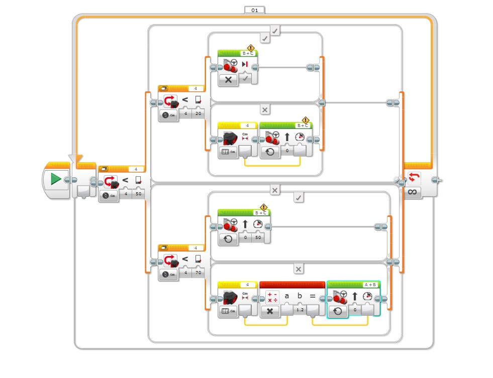

> 對應 EV3 專案檔：`D:\ev3\1019.ev3`。

**📍 看圖指引（由左至右）**

| 畫面位置 | 積木 | 說明 |
|---|---|---|
| 最左 | 綠色三角「開始」 | 程式起點，連到外層橘色迴圈 |
| 左中 | 橘色 Switch `4 < 50` | 外層分流：近（上半）／遠（下半） |
| 上半區 | Switch `4 < 20`；✓ 為停止、✗ 為「測距 → 功率」 | 近距離再分「危險」與「跟隨」 |
| 下半區 | Switch `4 < 70`；✓ 為固定 50、✗ 為「測距 → ×1.2」 | 遠距離再分「保持」與「追趕」 |
| 各分支右端 | 綠色 Move Steering `B+C`（⚠️）；最下方為 `A+B`（青色框） | 每個分支各有一個馬達積木，埠不一致 |
| 最右 | `∞` 迴圈結束 | 橘線回到最左，永遠重複 |

### 1.1 核心概念剖析 (Core Concepts)

**跟車 (Car Following)** 的本質：後車用感測器量測與前車的**車距 (gap)**，再依車距決定自己的速度，使車距維持在安全範圍內。

目前程式是一個**以距離分區 (zone) 決定馬達功率**的「查表式」控制器：

| 結構層級 | 積木 | 說明 |
|---|---|---|
| 最外層 | 無限迴圈 `∞`（標籤 `01`） | 程式永遠重複感測 → 判斷 → 驅動 |
| 第一層 Switch | 超音波 比較距離 `Port 4 < 50 cm` | 先分成「近 (<50)」與「遠 (≥50)」兩大區 |
| 第二層 Switch（近） | 比較距離 `Port 4 < 20 cm` | 再切出「危險 (<20)」與「跟隨 (20~50)」 |
| 第二層 Switch（遠） | 比較距離 `Port 4 < 70 cm` | 再切出「保持 (50~70)」與「追趕 (≥70)」 |
| 動作 | Move Steering（轉向 0 = 直行） | 依區間給不同功率 |

### 1.2 四個區間的行為

設前車距離為 $d$（cm），輸出為馬達功率 $P$（%）：

| 區間 | 條件 | 動作 | 功率 $P$ |
|---|---|---|---|
| 🔴 危險區 | $d < 20$ | Move Steering **停止**（疑似煞車模式） | $0$ |
| 🟠 跟隨區 | $20 \le d < 50$ | 量測距離 → 直接當功率 | $P = d$ |
| 🟢 保持區 | $50 \le d < 70$ | 固定功率直行 | $P = 50$ |
| 🔵 追趕區 | $d \ge 70$ | 量測距離 × 1.2 → 功率 | $P = 1.2\,d$（超過 100 以 100 計） |

用程式實際計算的對照表（`ev3/car_following_sim.py` 輸出）：

| $d$ (cm) | 10 | 19 | 20 | 35 | 49 | 50 | 69 | 70 | 84 | 120 |
|---|---|---|---|---|---|---|---|---|---|---|
| $P$ (%) | 0 | 0 | 20 | 35 | 49 | 50 | 50 | **84** | 100 | 100 |

```text
功率 P(%)
100 |                                  ┌──────── (d ≥ 84 飽和)
 84 |                                 ╱│
 50 |              ┌───────────────┐╱ │   ← d=70 瞬間由 50 跳到 84
 49 |            ╱ │               │
 20 |          ╱   │
  0 |─────────┘    │
    └────┬─────┬───┬───────────┬───┬──────► 距離 d (cm)
        20    50   (50~70 平台)  70
```

### 1.3 程式流程圖

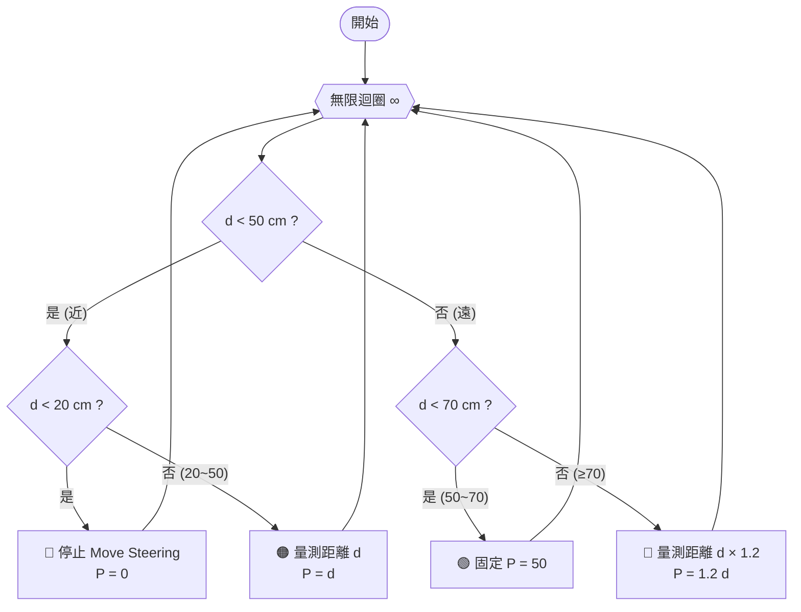

### 1.4 程式的優點與觀察到的問題

**✅ 優點**
- 結構清楚：兩層 Switch 把距離切成四個區間，易於教學。
- 已具「**距離越近越慢、越遠越快**」的基本跟車直覺。
- 20~50 cm 與 ≥70 cm 兩區用**有線連接**（距離 → 功率），已是「比例控制」的雛形。

**⚠️ 問題與疑點**

| # | 問題 | 說明 |
|---|---|---|
| 1 | **輸出不連續** | $d=19\to20$ 功率 $0\to20$；$d=69\to70$ 功率 $50\to84$，會突然加速、抖動 |
| 2 | **邊界抖動 (chattering)** | 距離在 20、50、70 附近來回，無遲滯 (hysteresis)，馬達會忽快忽慢 |
| 3 | **同一圈讀多次感測器** | 「比較」與「量測」是各自讀值，兩次數值可能不同，導致判斷與輸出不一致 |
| 4 | **沒有期望間距** | 目標車距固定，不隨自身速度變化（真實跟車應是「速度越快間距越大」） |
| 5 | **只看距離、不看相對速度** | 不知道前車是在遠離還是急停，無法提前反應 |
| 6 | **單位混用** | 把「公分」直接當「功率 %」，物理上沒有對應關係 |
| 7 | **超出量程風險** | 超音波無目標時回傳最大值（約 255 cm）→ $P=100$，車子會全速衝出去 |
| 8 | **沒有加速度限制** | 功率瞬間跳變，輪子打滑、車身晃動 |
| 9 | **無自身速度回授** | 功率 ≠ 速度（電池電壓、負載會變），屬開迴路 |
| 10 | **疑似埠設定問題** | 圖中前三個動作是 `B+C`（帶黃色警告 ⚠️），最後一個是 `A+B`（青色框）。若馬達實際接在 B、C，則 ≥70 cm 時會驅動錯誤的馬達 —— **建議點開確認** |

---

## 2️⃣ 第二寫法：變數與控制分離（`1019-2.jpg`）

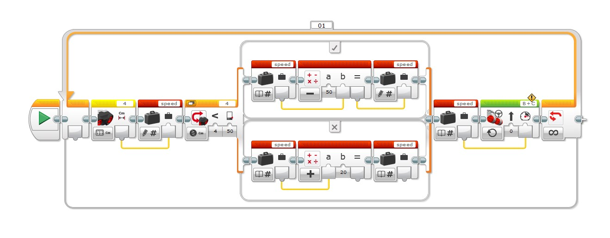

**📍 看圖指引（由左至右）**

| 畫面位置 | 積木 | 說明 |
|---|---|---|
| 最左 | 黃色超音波「測量·公分」→ 紅色「變數·寫入 `speed`」 | ① 感測：先把距離存起來 |
| 左中 | 橘色 Switch `4 < 50` | ② 計算的分流點（又讀一次感測器） |
| 上方 ✓ 分支 | 讀 `speed` → Math `−`（`50`）→ **寫入** `speed` | $50 - d$ |
| 下方 ✗ 分支 | 讀 `speed` → Math `+`（`20`）→ 變數（**讀取**圖示） | $d + 20$，結果疑似沒寫回 |
| 右側 | 讀 `speed` → 綠色 Move Steering `B+C`（⚠️） | ③ 驅動：馬達只在這裡出現一次 |

### 2.1 核心概念剖析：為什麼要「變數與控制分離」

這個寫法把一圈迴圈拆成三段，是機器人學常見的 **Sense → Plan → Act（感測 → 計算 → 驅動）** 結構：

| 階段 | 積木 | 變數的角色 |
|---|---|---|
| ① 感測 Sense | 超音波「測量距離 cm」(Port 4) → 寫入變數 `speed` | 把感測值存起來，整圈只讀一次 |
| ② 計算 Plan | Switch `Port 4 < 50`，兩個分支各做一次 Math，再寫回 `speed` | 只改變數，**不碰馬達** |
| ③ 驅動 Act | 讀 `speed` → Move Steering `B+C`（轉向 0）功率 | 唯一碰馬達的地方 |

**優點**
- 馬達只在迴圈最後出現一次，想換成別種驅動（Tank、加煞車）只改一處。
- 計算邏輯可獨立測試：把 `speed` 顯示在螢幕上，不接馬達也能驗證公式。
- 比第一寫法少了四個重複的 Move Steering 積木。

### 2.2 依截圖還原的運算

> ⚠️ **請先確認**：截圖中 Math 積木的 `50` 與 `20` 位置不同（`50` 在 `a` 下方、`20` 在 `b` 下方），我據此判讀 `a`、`b` 哪一個是手動輸入、哪一個接變數線。請點開兩個 Math 積木確認；若與下表不同，結論會改變（見 2.4）。

| 分支 | 判讀 | 公式（$d$ = 量測距離） |
|---|---|---|
| ✓ ($d < 50$) | `a = 50`（手動輸入）、`b = speed`（接線），運算 `−` | $speed = 50 - d$ |
| ✗ ($d \ge 50$) | `a = speed`（接線）、`b = 20`（手動輸入），運算 `+` | $speed = d + 20$ |

依此公式算出的結果（已用程式驗算）：

| $d$ (cm) | 5 | 10 | 20 | 30 | 49 | 50 | 60 | 70 | 80 | 100 | 255（無目標） |
|---|---|---|---|---|---|---|---|---|---|---|---|
| 判讀 A：$50-d$ / $d+20$ | 45 | 40 | 30 | 20 | **1** | **70** | 80 | 90 | 100 | 120→100 | 275→100 |
| 判讀 B：$d-50$ / $d+20$ | −45 | −40 | −30 | −20 | −1 | 70 | 80 | 90 | 100 | 120→100 | 275→100 |

> 🔎 **補充（看過第三張圖後重新檢查）**：✗ 分支（$d \ge 50$）最後一個變數積木顯示的是**讀取**圖示（書本 `📖#`），不是寫入圖示（鉛筆 `✎#`）。若確實是讀取模式，`d + 20` 的結果**沒有被寫回 `speed`**，此分支實際輸出仍是 $speed = d$。上表 ✗ 分支數值以「有寫回」計算；請點開該積木確認是否應改成「寫入」。

### 2.3 問題清單

| # | 問題 | 說明 | 嚴重度 |
|---|---|---|---|
| 1 | **方向相反** | 判讀 A：$d<50$ 時越近功率越大（距離 5 cm 時功率 45），車子會**衝向**前車。判讀 B：近距離功率為負（倒車），較合理但數字仍不對 | 🔴 高 |
| 2 | **50 cm 處斷崖** | $d=49\to 50$：功率 $1 \to 70$，一格距離差 69% 的跳變 | 🔴 高 |
| 3 | **變數名稱 `speed` 混用** | 一開始存的是「距離」，後來被改寫成「速度」，同名異義，讀程式與除錯都容易搞混 | 🟠 中 |
| 4 | **Switch 重讀感測器** | `Port 4 < 50` 是「比較距離」積木，**再次讀取超音波**，與前面存進變數的值可能不同（超音波雜訊約 ±1 cm） | 🟠 中 |
| 5 | **遠距離一律滿速** | $d \ge 80$ 一律 100%；無目標時超音波回傳約 255 → 全速衝出 | 🟠 中 |
| 6 | **公式缺乏物理意義** | 常數 50、20 是什麼？沒有「期望間距」「最小功率」等命名參數 | 🟠 中 |
| 7 | **功率未限幅** | 算出 120、275 等超過 100 的值，依賴 EV3 內部截斷 | 🟡 低 |
| 8 | **無初始化** | 迴圈前沒有寫入變數，第一圈依賴預設值 0 | 🟡 低 |
| 9 | **沒有取樣週期** | 無 Wait，迴圈快慢取決於積木執行時間，之後要算相對速度會不準 | 🟡 低 |
| 10 | **✗ 分支疑似沒寫回** | 最後一個變數積木是讀取圖示，`d + 20` 的結果可能被丟棄（見 2.2 補充） | 🔴 高 |
| 11 | **功率 0 不等於煞車** | 若功率算出 0，Move Steering 只是給 0 功率，車會滑行 | 🟡 低 |

### 2.4 改善建議（第一版：分段線性）

**(1) 變數重新命名並分工**

| 變數 | 型別 | 單位 | 寫入者 | 讀取者 | 用途 |
|---|---|---|---|---|---|
| `dist` | 數值 | cm | 感測段 | 計算段 | 本圈量測距離（只量一次） |
| `dist_f` | 數值 | cm | 計算段 | 計算段 | 低通濾波後距離 |
| `speed_t` | 數值 | % | 計算段 | 計算段 | 目標功率（依距離算出） |
| `speed` | 數值 | % | 計算段 | 驅動段 | 實際輸出功率（經限幅、斜率限制） |
| `D_STOP` | 數值 | cm | 初始化 | 計算段 | 停車距離（預設 20） |
| `K_GAIN` | 數值 | %/cm | 初始化 | 計算段 | 距離每多 1 cm 增加的功率（預設 1.2） |
| `P_MIN` | 數值 | % | 初始化 | 計算段 | 起動最小功率（預設 15，克服靜摩擦） |
| `P_MAX` | 數值 | % | 初始化 | 計算段 | 功率上限（預設 100） |
| `D_FAR` | 數值 | cm | 初始化 | 計算段 | 超過視為沒有前車（預設 200） |
| `P_CRUISE` | 數值 | % | 初始化 | 計算段 | 沒有前車時的巡航功率（預設 30） |

> 💡 常數集中在迴圈**之前**一次寫入，調參只動這一區，這才是「變數與控制分離」的完整做法。

**(2) 公式改為「連續」單一線性映射**

$$speed_t = \operatorname{clamp}\bigl(P_{min} + K\,(d - D_{stop}),\; P_{min},\; P_{max}\bigr), \quad d \ge D_{stop}$$

$$speed_t = 0, \quad d < D_{stop}$$

預設參數 $D_{stop}=20,\ K=1.2,\ P_{min}=15,\ P_{max}=100$ 的結果（已驗算）：

| $d$ (cm) | 10 | 20 | 30 | 49 | 50 | 60 | 70 | 80 | 100 | 255（無目標） |
|---|---|---|---|---|---|---|---|---|---|---|
| 原第二寫法（判讀 A） | 40 | 30 | 20 | 1 | 70 | 80 | 90 | 100 | 100 | 100 |
| 改良 | 0 | 15 | 27 | 50 | 51 | 63 | 75 | 87 | 100 | 30 |

改良後：距離越近越慢、**沒有斷崖**、無目標時用巡航功率而非全速。

**(3) 其他建議**

- **Switch 改比較變數**：用「資料運算 → 比較 (Compare)」積木比較 `dist`，把邏輯線接到 Switch（Logic 模式），不要再讀一次感測器。
- **低通濾波**：$dist_f = 0.5\,dist_f + 0.5\,dist$，用兩個 Math 積木即可。
- **加 Wait 0.05 秒**：固定取樣週期；之後要算相對速度時，也可改用 Timer 積木量實際 $\Delta t$。
- **遲滯**：停車後要 $d > D_{stop} + 5$ 才再起步（需 1 個邏輯變數 `stopped`）。
- **速度為 0 時用煞車**：驅動段加一個 Switch：`speed = 0` → Move Steering「停止（煞車）」。

---

## 3️⃣ 第三寫法：把 10 cm 停車加進變數分離版（`1019-3.jpg`）

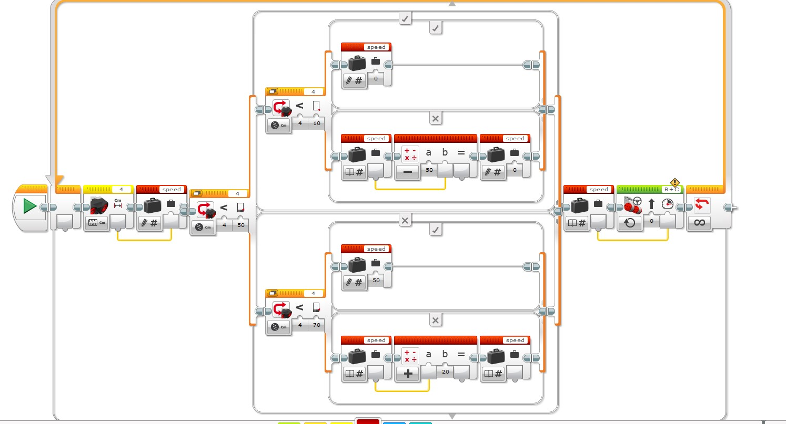

**📍 看圖指引（由左至右）**

| 畫面位置 | 積木 | 說明 |
|---|---|---|
| 最左 | 超音波 → 寫入 `speed` | ① 感測 |
| 左中 | Switch `4 < 50`（外層） | 分近／遠 |
| 上半 ✓ → 內層 | Switch `4 < 10`：✓ 寫入 0；✗ 讀 `speed` → Math `−`（`50`）→ 寫入 | 10 cm 停車；10~50 cm 為 $50-d$ |
| 下半 ✗ → 內層 | Switch `4 < 70`：✓ 寫入 50；✗ 讀 `speed` → Math `+`（`20`）→ 變數（讀取圖示） | 50~70 固定 50；≥70 為 $d+20$（疑似沒寫回） |
| 右側 | 讀 `speed` → Move Steering `B+C`（⚠️） | ③ 驅動 |

### 3.1 結構與流程

第三寫法沿用第二寫法「感測 → 計算 → 驅動」的骨架，把計算段擴成**兩層巢狀 Switch、四個區間**，門檻改為 10、50、70 cm：

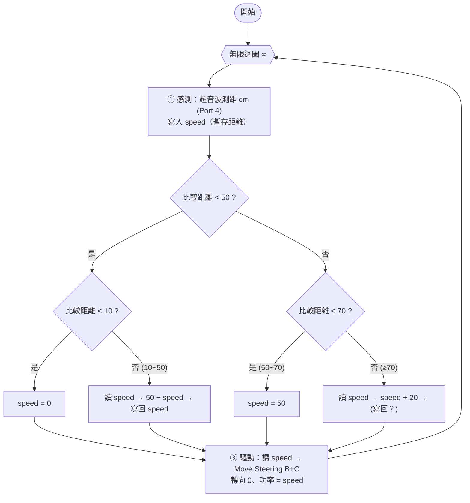

### 3.2 依截圖還原的輸出

> ⚠️ 判讀方式同 2.2：`50` 在 `a` 下方、`20` 在 `b` 下方；最後一個 `+20` 積木旁的變數積木為讀取圖示（疑似沒寫回）。請上機點開確認。

| 區間 | 判讀 | 功率 |
|---|---|---|
| $d < 10$ | 寫入常數 0 | 0 |
| $10 \le d < 50$ | $50 - speed$（`a`=50 手動、`b`=接線） | $50 - d$ |
| $50 \le d < 70$ | 寫入常數 50 | 50 |
| $d \ge 70$ | $speed + 20$，結果是否寫回待確認 | 有寫回：$d+20$；沒寫回：$d$ |

| $d$ (cm) | 5 | 10 | 20 | 30 | 40 | 49 | 50 | 60 | 70 | 100 |
|---|---|---|---|---|---|---|---|---|---|---|
| 第三寫法功率（有寫回） | 0 | 40 | 30 | 20 | 10 | 1 | 50 | 50 | 90 | 100 |
| 第三寫法功率（沒寫回） | 0 | 40 | 30 | 20 | 10 | 1 | 50 | 50 | 70 | 100 |

### 3.3 問題分析

| # | 問題 | 說明 | 嚴重度 |
|---|---|---|---|
| 1 | **10~50 cm 方向反了** | 想要「靠近就減速」，但 $50-d$ 在 49 cm 時是 1、10 cm 時是 40，**越近越快** | 🔴 高 |
| 2 | **10 cm 處急停** | 10 cm 功率 40，9 cm 瞬間變 0，等於從 40% 直接撞牆式煞停 | 🔴 高 |
| 3 | **50 cm 處斷崖** | 49→50 cm 功率 $1 \to 50$ | 🔴 高 |
| 4 | **70 cm 處斷崖** | 69→70 cm 功率 $50 \to 90$（沒寫回則 $50 \to 70$） | 🟠 中 |
| 5 | **`+20` 結果疑似沒寫回** | 見 2.2 補充；變數積木為讀取圖示 | 🔴 高 |
| 6 | **每圈重讀 3 次感測器** | 三個「比較距離」各自讀超音波（外加開頭一次），同一圈的判斷可能互相矛盾 | 🟠 中 |
| 7 | **`speed` 同時當距離與功率** | 命名混用（同 2.3 #3） | 🟠 中 |
| 8 | **馬達積木有 ⚠️ 警告** | 與前兩張圖相同，請確認埠與連線 | 🟡 低 |

### 3.4 最小改動修正：把 `50 − d` 換成 `d − 10`

第三寫法的方向性問題只需要改 10~50 cm 那個 Math 積木：

| 項目 | 現況 | 修正 |
|---|---|---|
| 10~50 cm 公式 | $50 - d$（越近越快） | $1.5\,(d-10)$（越近越慢，10 cm 處為 0） |
| 50 cm 以外 | 50（50~70）／$d+20$（≥70） | 固定 60（巡航功率） |
| 比較對象 | 再讀一次感測器 | 比較變數 `dist` |

此時三個區間的輸出已經連續（10 cm→0、50 cm→60）。進一步把整個巢狀 Switch 收成一行公式，見第 7 節。

### 3.5 等效程式（現況與修正對照）

```python
# 第三寫法（依截圖還原，驗算用虛擬碼）與最小改動修正的對照
def third_as_drawn(d, plus20_written=True):
    """依截圖還原的輸出；plus20_written 代表 d>=70 的 +20 是否寫回 speed"""
    speed = d                        # 開頭：speed 暫存距離
    if d < 50:
        if d < 10:
            speed = 0                # 停止
        else:
            speed = 50 - speed       # 越近越快（方向反了）
    else:
        if d < 70:
            speed = 50               # 固定功率
        elif plus20_written:
            speed = speed + 20       # 追趕：d + 20
    return min(speed, 100)           # EV3 功率上限 100

def third_fixed(d):
    """最小改動修正：10~50 cm 改為 1.5 * (d - 10)，其餘固定 60"""
    if d < 10:
        return 0                     # 停止
    return min(1.5 * (d - 10), 60)   # 線性減速，上限 60 巡航

for d in (5, 10, 20, 30, 40, 49, 50, 60, 70, 100):
    print(d, third_as_drawn(d), third_fixed(d))
```

---

## 4️⃣ 第四寫法：用三個 Math 串出斜率（`1019-4.jpg`）

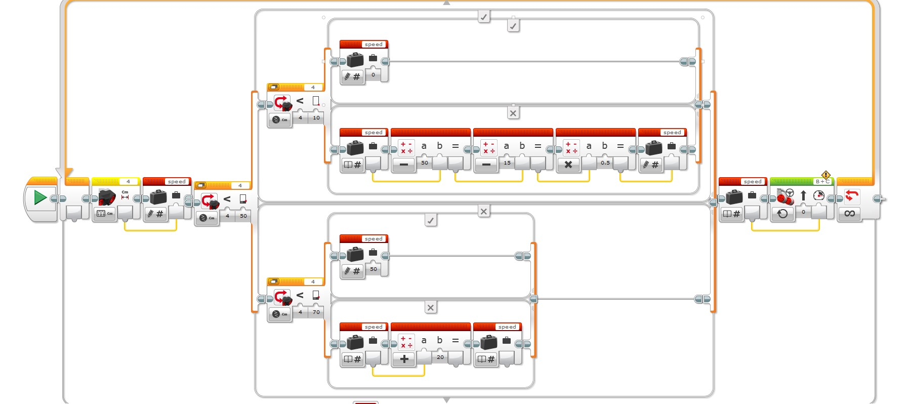

### 4.1 看圖指引與程式解說

**📍 看圖指引（由左至右）**

| 畫面位置 | 積木 | 說明 |
|---|---|---|
| 最左 | 超音波「測量·公分」→ 寫入 `speed` | ① 感測（暫存距離） |
| 左中 | Switch `4 < 50`（外層） | 分近／遠 |
| 上半 ✓ → Switch `4 < 10` | ✓：寫入 `speed = 0` | 10 cm 內停車 |
| 上半 ✗（10~50 cm，圖中上方一長串） | 讀 `speed` → Math `−`（`50`）→ Math `−`（`15`）→ Math `×`（`0.5`）→ **寫入** `speed` | **本版新增：串三個 Math 做出斜率** |
| 下半 ✓ → Switch `4 < 70` | ✓：寫入 `speed = 50` | 50~70 cm 固定功率 |
| 下半 ✗（≥70 cm） | 讀 `speed` → Math `+`（`20`）→ 變數（**讀取**圖示） | 與第 3 章相同，`+20` 疑似沒寫回 |
| 右側 | 讀 `speed` → Move Steering `B+C`（⚠️） | ③ 驅動 |

第四寫法與第三寫法的骨架完全相同，**唯一的改動是 10~50 cm 那一支**：把單一個 `50 − d` 換成三個 Math 串聯，企圖做出「慢慢減速」的斜率。

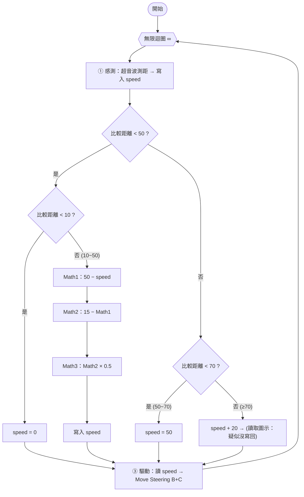

### 4.2 依截圖還原的運算

> ⚠️ 判讀依據：每個 Math 積木中，手動輸入的數字出現在 `a` 或 `b` 的下方；接線的一端則是另一個。三個 Math 的位置為：Math1 的 `50` 在 `a`、Math2 的 `15` 在 `a`、Math3 的 `0.5` 在 `b`。請上機點開確認。

| 步驟 | 運算 | 結果（$d$ = 測距） |
|---|---|---|
| Math1 | $50 - d$ | $50-d$ |
| Math2 | $15 - (50 - d)$ | $d - 35$ |
| Math3 | $(d - 35) \times 0.5$ | $0.5\,(d-35)$ |

所以 10~50 cm 的輸出是 $speed = 0.5\,(d - 35)$：斜率 0.5 %/cm，**在 35 cm 為 0，35 cm 以下變成負值（倒車）**，並非「10 cm 降到 0」。（已用程式驗算）

| $d$ (cm) | 5 | 10 | 20 | 30 | 35 | 40 | 49 | 50 | 60 | 70 | 100 |
|---|---|---|---|---|---|---|---|---|---|---|---|
| 第四寫法功率 (%) | 0 | **−12.5** | −7.5 | −2.5 | 0 | 2.5 | 7 | **50** | 50 | 70 | 100 |

> ≥70 cm 欄位以「`+20` 沒寫回」計（輸出等於 $d$）；若有寫回則 70 cm 為 90。

### 4.3 優缺點分析

| | 內容 |
|---|---|
| ✅ 優點 | ① 已朝「慢慢減速」的目標前進，嘗試把連續斜率放進 10~50 cm 區間；② 10 cm 內明確停車；③ 保留「感測 → 計算 → 驅動」分離結構，馬達仍只出現一次；④ 以三個 Math 逐步串接，每一步都能單獨顯示除錯 |
| ❌ 缺點 | ① **斜率太小且有負值**：最大只有 7%，多半低於馬達起動功率，車會「幾乎不動」；35 cm 以下功率為負，會倒車；② **50 cm 斷崖**：49 cm 功率 7，50 cm 立刻 50；③ **10 cm 邊界**：10 cm 功率 −12.5，9 cm 變 0，由倒車瞬間切成停止；④ 三個 Math 其實只是 $0.5\,d - 17.5$，可濃縮成一個進階 Math；⑤ `+20` 疑似沒寫回；⑥ 每圈仍重讀感測器 3~4 次 |

### 4.4 改善與建議

| # | 建議 | 做法 |
|---|---|---|
| 1 | **先定行為曲線，再湊數字** | 目標：10 cm 為 0、50 cm 為巡航功率（如 60）。兩點決定直線：$speed = 1.5\,(d - 10)$ |
| 2 | **三個 Math 合併成一個** | Math 進階模式輸入 `1.5*(a-10)`，積木數由 3 個變 1 個 |
| 3 | **避免負功率** | 加下限 0（`abs` 技巧或比較 + Switch），除非真的要倒車保護 |
| 4 | **銜接 50 cm** | 50 cm 時公式算出 60，與外側固定功率 60 相等，斷崖消失 |
| 5 | **比較變數，不重讀感測器** | Switch 改用「比較」積木比較變數 `dist` |
| 6 | **確認 `+20` 的存取模式** | 改成「寫入」，或乾脆刪除，≥70 cm 直接用巡航功率 |
| 7 | **變數改名** | `dist`（距離）、`speed`（功率）分開 |

### 4.5 第四寫法與修正版的對照程式

```python
# 第四寫法（依截圖還原）與修正版對照，驗算用虛擬碼
def fourth_as_drawn(d, plus20_written=False):
    """依截圖還原的輸出"""
    speed = d                        # 開頭：speed 暫存距離
    if d < 50:
        if d < 10:
            speed = 0                # 10 cm 內停車
        else:
            m1 = 50 - speed          # Math1：50 − d
            m2 = 15 - m1             # Math2：15 − (50 − d) = d − 35
            speed = m2 * 0.5         # Math3：× 0.5，寫入 speed
    else:
        if d < 70:
            speed = 50               # 50~70 固定
        elif plus20_written:
            speed = speed + 20       # 追趕（疑似沒寫回）
    return min(speed, 100)           # EV3 功率上限 100

def fixed(d):
    """修正版：10 cm → 0，50 cm → 60，線性連續"""
    return max(0, min(1.5 * (d - 10), 60))

for d in (5, 10, 20, 30, 35, 40, 49, 50, 60, 70, 100):
    print(d, fourth_as_drawn(d), fixed(d))
```

---

## 5️⃣ 四階段總整理：畫面對照、優缺點與建議

### 5.1 四階段積木畫面總覽

| 第一階段：四區間 Switch | 第二階段：變數分離 |
|---|---|
|  |  |
| **第三階段：四區間＋變數** | **第四階段：三個 Math 串斜率** |
|  |  |

| 階段 | 畫面特徵 | 馬達積木數量 | Switch 層數 | 資料處理 |
|---|---|---|---|---|
| ① 第一寫法 | 四個分支各接馬達積木 | 4 | 2 | 無變數，距離直接接線 |
| ② 第二寫法 | 一個馬達積木在最右 | 1 | 1 | 變數 `speed` |
| ③ 第三寫法 | 同②，分支變 4 個 | 1 | 2 | 變數 `speed` |
| ④ 第四寫法 | 同③，10~50 cm 多三個 Math | 1 | 2 | 變數 `speed`＋Math 串接 |

### 5.2 各階段 10~50 cm 的公式與表現

| 階段 | 10~50 cm 公式 | 方向 | 連續性 | 評語 |
|---|---|---|---|---|
| ① | $P = d$（20~50 cm） | 對（越近越慢） | 20 cm、50 cm 皆有斷崖 | 方向正確但太陡，20 cm 處 0→20 |
| ② | $50 - d$（<50 cm） | **反** | 50 cm 斷崖 | 近距離反而加速 |
| ③ | $50 - d$（10~50 cm） | **反** | 10、50 cm 斷崖 | 加了 10 cm 停車但方向仍反 |
| ④ | $0.5\,(d-35)$ | 對（越近越慢）但低於 35 cm 為負 | 10、50 cm 斷崖 | 方向對了，數字不對（斜率太小、會倒車） |
| 建議 | $1.5\,(d-10)$ 限幅 0~60 | 對 | 全程連續 | 見 5.6 |

### 5.3 各階段優缺點

| 階段 | ✅ 優點 | ❌ 缺點 |
|---|---|---|
| ① 第一寫法 | 區間行為一眼看懂；方向正確；零變數易教學 | 4 個馬達積木重複；邊界斷崖；每個分支各自讀感測器；有 `A+B` 埠疑點 |
| ② 第二寫法 | **感測、計算、驅動分離**；馬達只出現一次；可單獨顯示變數除錯 | 方向反；50 cm 斷崖；變數同名異義；`+20` 疑似沒寫回 |
| ③ 第三寫法 | 把 10 cm 停車併入；四區間更完整 | 10~50 cm 方向反；10、50、70 cm 斷崖；重讀感測器 3 次 |
| ④ 第四寫法 | 方向修正；逐步串接易除錯；保有分離結構 | 斜率太小、有負值（倒車）；仍有斷崖；Math 可濃縮；`+20` 疑似沒寫回 |

### 5.4 四個階段共通的問題

| # | 問題 | 影響階段 | 改善 |
|---|---|---|---|
| 1 | **重讀感測器**：Switch 的「比較距離」自己再讀一次 | ①②③④ | 用「比較」積木比較變數 `dist`，整圈只讀一次 |
| 2 | **邊界斷崖**：區間交界功率跳變 | ①②③④ | 改為連續公式（單一 clamp） |
| 3 | **變數同名異義**：`speed` 先放距離再放功率 | ②③④ | 拆成 `dist`、`speed` |
| 4 | **變數積木存取模式**：≥50/70 cm 的結果疑似沒寫回 | ②③④ | 點開確認是「寫入」；或刪除該區 |
| 5 | **馬達積木 ⚠️ 警告**：`B+C` 有警告、①還有 `A+B` | ①②③④ | 點開看警告內容，統一埠 |
| 6 | **沒有等待與初始化** | ②③④ | 迴圈前 `speed = 0`；迴圈尾加 Wait 0.05 s |
| 7 | **沒有雜訊濾波、相對速度、緊急機制** | ①②③④ | 見第 9 章 ACC 改良 |

### 5.5 四階段演進的設計教訓

1. **先畫目標曲線，再寫公式**：②③④ 都是先湊積木再看結果；若先決定「10 cm → 0、50 cm → 60」，兩點即決定 $1.5\,(d-10)$。
2. **每次改一件事、立刻驗算**：第四版把方向改對了，卻因為斜率與偏移沒驗算而出現負功率；用表格先算 5 個距離點就能發現。
3. **單位與物理意義**：「距離（cm）」直接當「功率（%）」是巧合式映射，應改成「功率 = 斜率 × (距離 − 停車距離)」。
4. **結構分離是對的**：第二階段開始的「感測 → 計算 → 驅動」值得保留；第三、四階段是在這個骨架上擴充區間。
5. **能合併就合併**：三個 Math 合成一個進階 Math；四分支巢狀 Switch 合成一個公式。

### 5.6 建議的最終設計

**公式**

$$speed = \operatorname{clamp}\bigl(1.5\,(d-10),\ 0,\ 60\bigr)$$

**積木圖形（建議版）**

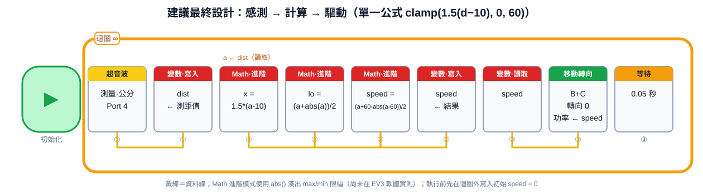

| 項目 | 設定 |
|---|---|
| 初始化（迴圈前） | 寫入 `speed = 0` |
| ① 感測 | 超音波測量公分（Port 4）→ 寫入 `dist` |
| ② 計算 | Math 進階 `1.5*(a-10)` → 下限 `(a+abs(a))/2` → 上限 `(a+60-abs(a-60))/2` → 寫入 `speed`（`abs` 做法尚未實測） |
| ③ 驅動 | 讀 `speed` → Move Steering `B+C`、轉向 0、功率 ← `speed` |
| 週期 | 等待 0.05 秒 |

**驗算（已用程式驗算）**

| $d$ (cm) | ≤10 | 20 | 30 | 40 | 50 | ≥50 |
|---|---|---|---|---|---|---|
| speed (%) | 0 | 15 | 30 | 45 | 60 | 60 |

### 5.7 實機驗證清單

- [ ] 點開每個 Math／變數積木，確認 `a`、`b` 的輸入來源與「讀取／寫入」模式。
- [ ] 不接馬達，在螢幕顯示 `dist`、`speed`，用手前後移動，核對 5.6 的驗算表。
- [ ] 舉起車體確認方向與 ⚠️ 警告。
- [ ] 落地測：從 80 cm 慢慢接近，應看到 50 cm 開始減速、10 cm 停車，且沒有倒車。
- [ ] 若低功率推不動，加最小功率（如 15）。

---

## 6️⃣ 問答：`50 − d` 可以在安全距離減速嗎？

### 6.1 結論：不行，而且近距離反而加速

第二寫法的 `d < 50` 分支算的是 $speed = 50 - d$，這是一個 **V 形**函數：只在 $d=50$ 剛好等於 0，更近則越來越大。

| d (cm) | 80 | 60 | 51 | 50 | 49 | 30 | 10 |
|---|---|---|---|---|---|---|---|
| 現況功率（d≥50 用 d+20，d<50 用 50−d） | 100 | 80 | 71 | **70** | **1** | 20 | 40 |

- 接近 50 cm 的過程（d ≥ 50）：用 `d + 20`，距離 80 → 50 功率只從 100 降到 70，仍然很高。
- 進入 50 cm 以內：切換成 `50 − d`，49 cm 時掉到 1，之後**越近越快**，10 cm 時是 40。
- 若 `50` 與接線的位置與我判讀相反（即 $d - 50$），近距離會變負值（倒車），仍不是「逐漸減速」。

### 6.2 要「到安全距離逐漸減速」該有的形狀

減速曲線的條件：**距離越近功率越小，並在停車距離降到 0**。這需要單調遞增、連續、兩端銜接的函數，而不是 V 形或分段斷崖。下一節給出符合這個條件的單一公式。

---

## 7️⃣ 需求：10~50 cm 之間慢慢減速——單一公式設計

### 7.1 需求與分區

| 區間 | 期望行為 |
|---|---|
| $d \ge 50$ | 維持巡航功率 `P_MAX` |
| $10 \le d < 50$ | 從 `P_MAX` 線性降到 0（**逐漸減速**） |
| $d < 10$ | 停止（功率 0） |

分段寫法：

$$speed = \begin{cases} P_{max} & d \ge 50 \\ P_{max}\cdot\dfrac{d-10}{50-10} & 10 \le d < 50 \\ 0 & d < 10 \end{cases}$$

### 7.2 合併成一個公式

取 $P_{max}=60$，斜率 $K = 60/40 = 1.5$：

$$\boxed{speed = \operatorname{clamp}\bigl(1.5\,(d-10),\ 0,\ 60\bigr)}$$

即 `speed = 1.5 × (d − 10)`，再限制在 0 到 60 之間：
- $d<10$：結果為負 → 限幅成 0（停止）。
- $d>50$：結果超過 60 → 限幅成 60（巡航）。
- 想改巡航功率或減速起點，只要改斜率與兩個限幅值。

（已用程式驗算）

| d (cm) | ≤10 | 15 | 20 | 30 | 40 | 50 | ≥50 |
|---|---|---|---|---|---|---|---|
| speed (%) | 0 | 7.5 | 15 | 30 | 45 | 60 | 60 |

### 7.3 六種寫法在同一距離下的功率對照

| d (cm) | 5 | 10 | 20 | 30 | 40 | 50 | 60 | 70 | 100 |
|---|---|---|---|---|---|---|---|---|---|
| ① 第一寫法（四區間） | 0 | 0 | 20 | 30 | 40 | 50 | 50 | 84 | 100 |
| ② 第二寫法（$50-d$ / $d+20$） | 45 | 40 | 30 | 20 | 10 | 70 | 80 | 90 | 100 |
| ③ 第三寫法（10/50/70 四區間） | 0 | 40 | 30 | 20 | 10 | 50 | 50 | 90 | 100 |
| ④ 第四寫法（$0.5(d-35)$） | 0 | −12.5 | −7.5 | −2.5 | 2.5 | 50 | 50 | 70 | 100 |
| ⑤ 分段線性改良（2.4） | 0 | 0 | 15 | 27 | 39 | 51 | 63 | 75 | 100 |
| ⑥ **單一公式（本節）** | 0 | 0 | 15 | 30 | 45 | 60 | 60 | 60 | 60 |

> ②③ 在 10~40 cm 反而比 50 cm 外更「用力」（越近越快），且 50 cm 處有斷崖；⑥ 則從 50 往 10 單調下降、全程連續。④ 在 10~35 cm 為負值（倒車）。②③ 的 ≥70 cm 數值以「`+20` 有寫回」計，④ 以沒寫回計。

### 7.4 計算流程

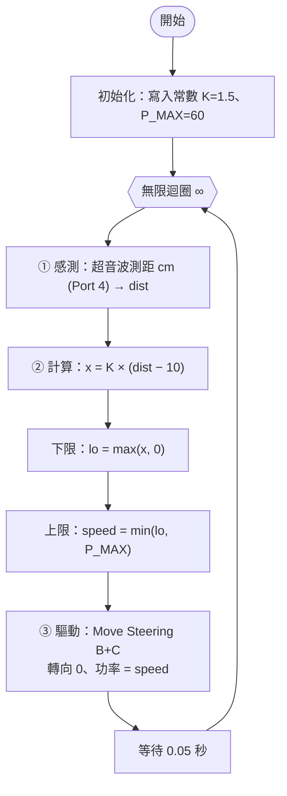

### 7.5 積木做法與等效程式

EV3 的 Math 進階模式我印象中支援 `abs()`，但沒有 min/max，所以限幅可用 `abs` 湊：$\max(x,0)=\dfrac{x+|x|}{2}$、$\min(y,P)=\dfrac{y+P-|y-P|}{2}$。**此做法尚未在 EV3 軟體實測，請上機確認。**

| 步驟 | 積木 | 設定 |
|---|---|---|
| 1 | Math（進階） | `x = 1.5*(a-10)`，`a` ← `dist` |
| 2 | Math（進階） | `lo = (a + abs(a)) / 2`，`a` ← `x` |
| 3 | Math（進階） | `speed = (a + 60 - abs(a - 60)) / 2`，`a` ← `lo`，結果寫入 `speed` |
| 4 | Move Steering B+C | 功率 ← `speed` |

若進階模式不吃 `abs`：上限可省略（Move Steering 功率超過 100 會被截斷，但 `P_MAX=60` 就無法限制），下限用「比較 + Switch」把負值改成 0。

```python
# 單一公式版（驗算用虛擬碼）：10~50 cm 線性減速，感測 → 計算 → 驅動
K = 1.5          # 斜率 = P_MAX / (50 - 10)
P_MAX = 60       # 巡航功率 (%)
D_STOP = 10      # 停車距離 (cm)

def clamp(x, lo, hi):
    """把 x 限制在 [lo, hi]"""
    return max(lo, min(hi, x))

speed = 0                                   # 初始化
while True:
    dist = read_ultrasonic_cm()             # ① 感測：整圈只讀一次
    speed = clamp(K * (dist - D_STOP), 0, P_MAX)   # ② 計算：一個公式
    move_steering(speed, steering=0)        # ③ 驅動
    wait(0.05)                              # 固定取樣週期
```

### 7.6 實際上要注意

- **馬達可能推不動**：功率低於約 15% 時車可能停住，接近 10 cm 前會有一小段停得比預期早；可把下限改為最小功率（例如 15）再接到 0。
- **滑行距離**：`P_MAX` 太大或斜坡太陡會衝過 10 cm；實測先用 `P_MAX = 40~60`，必要時把減速起點從 50 拉到 60~70。
- **邊界抖動**：10 cm 附近來回會一停一動，可加 `stopped` 變數：停車後距離超過 15 cm 才再起步。
- **無目標**：超音波無目標約回傳 255 → 公式輸出 60，維持巡航；若要改為停車需另做判斷。
- **這是開迴路比例映射**：沒有相對速度與速度回授；要更接近真實跟車，見第 9 節。

---

## 8️⃣ 第一範例的完整積木設計（變數分離版）

**目標**：用「第二寫法」重做 第一範例 的四區間行為（$d<20$ 停止、$20\le d<50$ 功率 $=d$、$50\le d<70$ 功率 50、$d \ge 70$ 功率 $=1.2d$）。計算段只改 `speed`，馬達只在最後出現一次。

### 8.1 程式流程圖

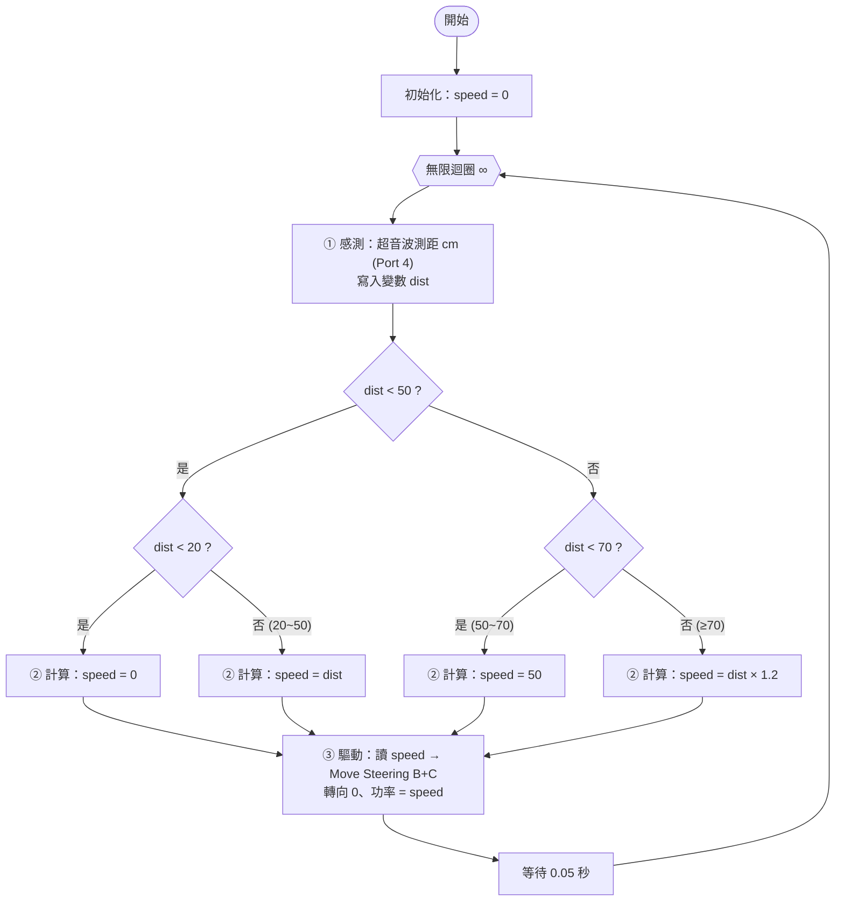

### 8.2 積木排列（由左至右、由上至下）

```text
[開始]
  │
  ├─ (A) 初始化 ───────────────────────────────────────────────
  │    [變數·寫入 數值 speed ← 0]
  │
  └─ [迴圈 ∞  (標籤 01)] ────────────────────────────────────────
       │
       ├─ (B) ① 感測 ────────────────────────────────────────────
       │    [超音波感應器·測量·公分 (Port 4)] ──(線)──► [變數·寫入 數值 dist]
       │
       ├─ (C) ② 計算 ────────────────────────────────────────────
       │    [變數·讀取 dist] ─► [比較 < 50] ─(邏輯線)─► [Switch·邏輯]
       │      │
       │      ├─ ✓ (dist < 50) ──────────────────────────────────
       │      │    [變數·讀取 dist] ─► [比較 < 20] ─► [Switch·邏輯]
       │      │      ├─ ✓ : [變數·寫入 speed ← 0]  (手動輸入 0)
       │      │      └─ ✗ : [變數·讀取 dist] ─► [變數·寫入 speed]
       │      │
       │      └─ ✗ (dist ≥ 50) ─────────────────────────────────
       │           [變數·讀取 dist] ─► [比較 < 70] ─► [Switch·邏輯]
       │             ├─ ✓ : [變數·寫入 speed ← 50]  (手動輸入 50)
       │             └─ ✗ : [變數·讀取 dist] ─► [數學 a × b, b=1.2] ─► [變數·寫入 speed]
       │
       ├─ (D) ③ 驅動 ────────────────────────────────────────────
       │    [變數·讀取 speed] ──(線)──► [移動轉向 B+C：轉向 0、功率 ← speed、開啟]
       │
       └─ (E) [等待 0.05 秒]
```

### 8.3 逐塊設定表

| 編號 | 積木（EV3 調色盤） | 設定 | 接線 |
|---|---|---|---|
| A | 資料運算 ▸ 變數 | 寫入 數值，名稱 `speed` = 0 | — |
| B1 | 感應（黃） ▸ 超音波感應器 | 測量 ▸ 公分，Port 4 | 輸出 → B2 |
| B2 | 資料運算（紅） ▸ 變數 | 寫入 數值，名稱 `dist` | 輸入 ← B1 |
| C1 | 資料運算 ▸ 變數 | 讀取 數值 `dist` | 輸出 → 比較 `a` |
| C2 | 資料運算 ▸ 比較 | `<`，b = 50 | 輸出（邏輯）→ 外層 Switch |
| C3 | 流程控制（橘） ▸ 切換 | 以「邏輯」為條件（取消勾選「平面檢視」以便巢狀） | ← C2 |
| C4 | 內層 Switch（✓ 分支） | 同 C1~C3，比較 `< 20` | — |
| C5 | 內層 Switch（✗ 分支） | 同 C1~C3，比較 `< 70` | — |
| C6 | 變數 · 寫入 `speed` | ① 0 ② 50（手動輸入常數） | — |
| C7 | 變數 · 讀取 `dist` → 變數 · 寫入 `speed` | 用資料線直接傳值 | 讀取輸出 → 寫入輸入 |
| C8 | 資料運算 ▸ 數學 | 乘法，b = 1.2 | 讀取 `dist` → `a`，輸出 → 寫入 `speed` |
| D1 | 資料運算 ▸ 變數 | 讀取 數值 `speed` | 輸出 → D2 功率 |
| D2 | 動作（綠） ▸ 移動轉向 | 埠 **B+C**、轉向 0、功率 ← 線、「開啟」 | 功率 ← D1 |
| E | 流程控制 ▸ 等待 | 時間 0.05 秒 | — |

### 8.4 與原截圖的差異（修正點）

| 項目 | 第二寫法原圖 | 完成設計 |
|---|---|---|
| 變數名稱 | `speed` 同時當距離與速度 | `dist`（距離）、`speed`（功率）分開 |
| Switch 條件 | 「比較距離」再讀感測器 | 比較**變數 `dist`**，整圈只讀一次 |
| 分支數 | 1 層、兩分支 | 巢狀 2 層、四分支（對應 4 個區間） |
| 公式 | $50-d$、$d+20$ | 與第一範例相同：0、$d$、50、$1.2d$ |
| 初始化 | 無 | 迴圈前先寫 `speed = 0` |
| 週期 | 無 | 加 Wait 0.05 s |
| 馬達積木 | 一個（`B+C`，有 ⚠️） | 一個（確認埠與警告） |

### 8.5 等效 Python 虛擬碼（供對照與驗算）

```python
# 等效於 8.2 的積木排列：感測 → 計算 → 驅動
# 注意：這是驗算用虛擬碼，EV3 積木是圖形化，不能直接貼上執行
speed = 0                          # (A) 初始化

while True:                        # 無限迴圈 ∞
    dist = read_ultrasonic_cm()    # (B) 感測：整圈只讀一次

    # (C) 計算：只改變數 speed，不碰馬達
    if dist < 50:
        if dist < 20:
            speed = 0              # 危險區：停止
        else:
            speed = dist           # 跟隨區：功率 = 距離
    else:
        if dist < 70:
            speed = 50             # 保持區：固定功率
        else:
            speed = dist * 1.2     # 追趕區：距離 × 1.2

    speed = min(speed, 100)        # 限幅：EV3 功率上限 100

    move_steering(speed, steering=0)   # (D) 驅動：唯一碰馬達的地方
    wait(0.05)                         # (E) 固定取樣週期
```

### 8.6 完成後的驗證步驟

1. **不接馬達先測計算**：在驅動段旁加「顯示 (Display)」積木顯示 `dist` 與 `speed`，手在超音波前移動，核對與下表是否一致。

   | $d$ (cm) | 10 | 19 | 20 | 35 | 49 | 50 | 69 | 70 | 84 | 120 |
   |---|---|---|---|---|---|---|---|---|---|---|
   | 預期 `speed` (%) | 0 | 0 | 20 | 35 | 49 | 50 | 50 | 84 | 100 | 100 |

2. **舉起車體測馬達**：確認方向、確認 $d<20$ 時真的停。
3. **落地實測**：用書本模擬前車，觀察 20、50、70 cm 邊界的抖動——這些是第一範例固有缺點，改善見第 7、9 節。

---

## 9️⃣ 更接近真實跟車系統的改善方法（ACC）

### 9.1 核心概念剖析：真實 ACC（Adaptive Cruise Control）怎麼做

**(1) 時距策略 (Constant Time Headway)** — 期望間距隨速度增加：

$$d_{des} = d_0 + h \cdot v_{own}$$

- $d_0$：停止時的最小間距（EV3 約 10~15 cm）
- $h$：時距（秒）。市售 ACC 多提供約 1~2 秒檔位
- $v_{own}$：自身速度

**(2) 間距誤差與相對速度**

$$e = d - d_{des}, \qquad v_{rel} = \dot d = v_{lead} - v_{own}$$

**(3) 控制律（速度指令）** — 先推估前車速度，再用間距誤差修正：

$$v_{cmd} = \underbrace{(v_{own} + v_{rel})}_{\text{估計前車速度}} + K_p \cdot e$$

**(4) 碰撞時間 (Time-To-Collision)**

$$TTC = \frac{d}{-v_{rel}} \quad (v_{rel} < 0 \text{ 表示正在接近})$$

TTC 過小 → 觸發**緊急煞車 (AEB)**。

**(5) 煞車距離**

$$d_{stop} = \frac{v^2}{2a}$$

速度加倍，煞車距離變成四倍，所以固定間距在高速一定不夠。

### 9.2 十項改善對照表

| # | 現有問題 | 改善方法 | 對應真實系統 |
|---|---|---|---|
| 1 | 輸出不連續 | 用**連續函數**取代分區跳變（公式 $v_{cmd}$） | 比例/PID 控制 |
| 2 | 邊界抖動 | 加**遲滯**（停下後要間距 > $d_{des}+$ 緩衝才再起步） | 停走 (Stop & Go) 狀態機 |
| 3 | 多次讀值不一致 | 每圈**只讀一次**，並做中位數＋低通濾波 | 感測器前處理 |
| 4 | 固定目標間距 | **時距策略** $d_0 + h v$ | ISO 15622 類 ACC 的時距設定 |
| 5 | 不看相對速度 | 對距離**微分**取 $v_{rel}$（先濾波再微分） | 雷達以多普勒效應直接量測相對速度 |
| 6 | 單位混用 | 全程用物理單位（mm、mm/s），最後才換成馬達命令 | 控制單位一致 |
| 7 | 超出量程 | 距離 ≥ 量程視為「無前車」，回到**設定巡航速度** | ACC 的 Set Speed |
| 8 | 無加速度限制 | **斜率限制**（加速 ≤ $a_{max}$、減速 ≤ $b_{max}$） | 舒適度／jerk 限制 |
| 9 | 開迴路 | 讀 `DriveBase.state()` 的實際速度做**速度回授** | 輪速感測器 |
| 10 | 無緊急機制 | **TTC / 最小距離**觸發立即停車 | AEB 自動緊急煞車 |

### 9.3 改良後的控制流程

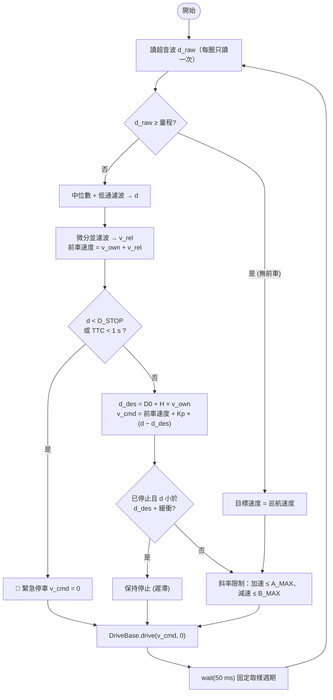

### 9.4 實作範例：Pybricks EV3 MicroPython

> ⚠️ **未經實機驗證**：以下程式依 Pybricks EV3 API 撰寫，參數（輪徑、軸距、增益）為預設估計值，上機前請依實際車體調整。

```python
#!/usr/bin/env pybricks-micropython
# EV3 時距式跟車 (ACC) 範例
# 硬體：左馬達 Port B、右馬達 Port C、超音波感測器 Port S4
from pybricks.hubs import EV3Brick
from pybricks.ev3devices import Motor, UltrasonicSensor
from pybricks.parameters import Port
from pybricks.robotics import DriveBase
from pybricks.tools import wait

# ---------- 硬體初始化 ----------
ev3 = EV3Brick()
left = Motor(Port.B)
right = Motor(Port.C)
sonar = UltrasonicSensor(Port.S4)
drive = DriveBase(left, right, wheel_diameter=56, axle_track=114)  # 單位 mm，請依車體量測

# ---------- 可調參數（單位：mm、秒） ----------
DT = 0.05            # 取樣週期 50 ms
D0 = 150             # 停止時最小間距 (mm)
H = 1.0              # 時距 (秒)：速度每增加 1 mm/s，期望間距增加 H mm
KP = 0.8             # 間距誤差 → 速度修正 (1/秒)
V_CRUISE = 150       # 無前車時的巡航速度 (mm/s)
V_MAX = 400          # 速度上限 (mm/s)
A_MAX = 300          # 最大加速度 (mm/s^2)
B_MAX = 800          # 最大減速度 (mm/s^2)
D_STOP = 100         # 小於此距離一律停車 (mm)
TTC_MIN = 1.0        # 碰撞時間低於此值緊急停車 (秒)
RANGE_MAX = 2500     # 視為「沒有前車」的距離 (mm)
RESTART_GAP = 50     # 停止後需超過期望間距多少才重新起步 (遲滯，mm)

# ---------- 狀態變數 ----------
history = []         # 最近 3 筆原始距離，用於中位數濾波
d_filt = None        # 低通濾波後距離
d_prev = None        # 上一次濾波距離
v_rel = 0.0          # 濾波後的相對速度 (mm/s)
v_prev_cmd = 0.0     # 上一次速度指令，供斜率限制使用
stopped = True       # 是否處於停止狀態（遲滯用）


def clamp(x, lo, hi):
    """把 x 限制在 [lo, hi] 範圍內"""
    return max(lo, min(hi, x))


while True:
    # 1) 每圈只讀一次感測器，避免多次讀值互相矛盾
    d_raw = sonar.distance()

    # 2) 前處理：中位數去突波 + 指數低通濾波
    history.append(d_raw)
    history = history[-3:]
    d_med = sorted(history)[len(history) // 2]
    d_filt = d_med if d_filt is None else 0.5 * d_filt + 0.5 * d_med

    # 3) 相對速度 = 距離變化率（再做一次低通，避免微分放大雜訊）
    if d_prev is not None:
        v_rel = 0.8 * v_rel + 0.2 * (d_filt - d_prev) / DT
    d_prev = d_filt

    v_own = drive.state()[1]                  # 實際速度 (mm/s)，速度回授

    # 4) 決定目標速度
    if d_med >= RANGE_MAX:
        v_cmd = V_CRUISE                      # 沒有前車 → 巡航
    else:
        ttc = d_filt / -v_rel if v_rel < -1 else 9999   # 碰撞時間
        d_des = D0 + H * v_own                # 時距策略的期望間距
        if d_filt < D_STOP or ttc < TTC_MIN:
            v_cmd = 0                         # 緊急停車 (AEB)
        else:
            v_lead = v_own + v_rel            # 估計前車速度
            v_cmd = v_lead + KP * (d_filt - d_des)
            # 遲滯：已停止時，間距要夠大才再起步，避免在邊界抖動
            if stopped and d_filt < d_des + RESTART_GAP:
                v_cmd = 0

    v_cmd = clamp(v_cmd, 0, V_MAX)

    # 5) 斜率限制：加速與減速分別限制，保護輪胎與乘坐舒適
    v_cmd = clamp(v_cmd, v_prev_cmd - B_MAX * DT, v_prev_cmd + A_MAX * DT)
    v_prev_cmd = v_cmd
    stopped = v_cmd < 5

    # 6) 輸出：直行（轉向率 0）
    drive.drive(v_cmd, 0)
    wait(int(DT * 1000))                      # 固定取樣週期
```

### 9.5 模擬驗證結果

用 `ev3/car_following_sim.py`（純 Python）比較「原始四區間」與「時距 ACC」。

- 前車情境：等速 0.30 m/s → 8~11 s 減速煞停 → 靜止 → 20 s 後重新起步
- 假設：超音波雜訊 σ = 1 cm、馬達一階延遲 τ = 0.25 s、100% 功率 ≈ 0.5 m/s（**皆為估計值**）

| 指標 | 原始四區間 | 時距 ACC |
|---|---|---|
| 最小車距 | 16.5 cm | 13.3 cm（無碰撞） |
| 速度變動總量（$\sum \lvert\Delta v\rvert$，越小越平順） | 6.29 m/s | **3.56 m/s**（約減少 43%） |

> 📌 解讀：ACC 版本的最小車距較小是因為設計的靜止間距 $d_0 = 15$ cm（比原始的 20 cm 停止門檻更緊），並非更危險；重點是**速度變動量大幅下降**，代表不再於區間邊界來回抖動。此為簡化模擬，非實機結果。

### 9.6 建議的實機驗證步驟

1. **量測功率與速度對應**：固定功率跑 1 m 計時，建立速度-功率表。
2. **階躍響應求 τ**：從 0 直接給目標速度，記錄到達 63% 的時間，即馬達延遲。
3. **量測超音波雜訊**：靜止對準牆面取 100 筆，算標準差。
4. **前車急停測試**：用手持障礙板模擬前車，檢查是否停在 $D_{STOP}$ 之外。
5. **記錄資料**：每圈寫入距離、速度、指令至檔案，以 Excel 或 Python 畫圖，調 $K_p$、$H$。

---

## 🔟 延伸思考與實際應用 (Extensions & Advanced Topics)

### 10.1 延伸方向（EV3 範圍內）

| 方向 | 做法 | 學到的概念 |
|---|---|---|
| PID 化 | 在 $K_p$ 外加 I、D 項 | 穩態誤差、超調 |
| 有限狀態機 | `CRUISE → FOLLOW → STOP → RESTART` 四狀態 | 狀態轉移與遲滯 |
| 跟彎道 | 加紅外線感測器 + Beacon（或第二個超音波）控制轉向 | 差速轉向，見 [馬達控制筆記](./lego_motor_control.md) |
| 直線保持 | 加陀螺儀，使轉向率維持 0 | 航向回授 |
| 多車編隊 | 兩台以上串接（前車 → 中車 → 後車） | 串列穩定性 (String Stability) |
| 聲音提示 | 把距離轉成嗶聲頻率 | 見 [距離音訊回饋研究提案](./distance_audio_feedback_research.md) |

### 10.2 延伸思考與進階主題 (Extensions & Advanced Topics)

**① 控制律的取捨**

| 方法 | 優點 | 缺點 |
|---|---|---|
| 分區查表（本程式） | 最直觀、易教學 | 不連續、抖動、難調 |
| 比例 (P) + 時距 | 連續、簡單 | 有穩態誤差 |
| PID | 可消除穩態誤差 | 微分放大雜訊、積分飽和 |
| MPC（模型預測控制） | 可同時處理舒適、安全、限幅 | 計算量大，EV3 難以即時執行 |

**② 感測器限制與融合**
- 超音波：波束寬、斜面反射可能失效、軟質物體吸收聲波；速度只能由距離微分得到。
- 真實車輛：77 GHz 毫米波雷達（直接量測相對速度）＋攝影機（辨識目標）＋光達，並以**卡爾曼濾波 (Kalman Filter)** 融合，同時估計距離與速度。

**③ 串列穩定性 (String Stability)**
一列車隊中，前車的速度擾動沿車隊往後傳遞時，若逐車放大就會形成「幽靈塞車」。時距 $h$ 必須夠大（約為系統延遲的數倍；確切條件依控制律而異）才能讓擾動逐車衰減。

**④ 通訊增強：CACC (Cooperative ACC)**
透過 V2V 無線通訊直接取得前車加速度，可縮短時距並提升穩定性（卡車編隊省油的基礎）。

**⑤ 安全分層**
真實系統把「舒適跟車」（ACC）與「緊急防護」（AEB）分成兩層獨立邏輯；本筆記的 TTC 判斷就是 AEB 的雛形。

### 10.3 實際應用場景

| 領域 | 應用 | 與本程式的對應 |
|---|---|---|
| 🚗 汽車 | ACC 主動巡航、Stop & Go、AEB | 時距策略、TTC、遲滯 |
| 🚛 物流 | 卡車編隊 (Platoon)、CACC | 串列穩定性、V2V |
| 🏭 倉儲 | AGV/AMR 跟隨前車或人員、避碰 | 距離分區減速 |
| 🛒 服務機器人 | 跟隨式購物車、行李箱 | 保持與使用者固定距離 |
| 🚁 無人機 | Follow-me 跟拍 | 距離＋相對速度控制 |
| 🚆 軌道 | 移動閉塞 (Moving Block) | 煞車距離 $v^2/2a$ |
| 🅿️ 倒車雷達 | 距離分區提示音 | 與本程式的分區邏輯同源 |

### 10.4 學習路徑建議


### 10.5 積木設計層面的延伸

| 主題 | 內容 |
|---|---|
| **自訂積木 (My Block)** | 把「計算段」包成 My Block（輸入 `dist`，輸出 `speed`），主程式剩下三個積木，更接近「變數與控制分離」的終極形態，也可單獨測試與重複使用 |
| **參數表** | 所有常數集中在初始化區，之後調 $K$、$D_{stop}$ 不必翻整個程式 |
| **狀態機** | 用數值變數 `state`（0=巡航、1=跟隨、2=停止）+ Switch 取代多層巢狀 |
| **資料記錄** | 每圈把 `dist`、`speed` 寫入檔案，匯出後畫圖分析抖動 |
| **權衡** | 變數法積木數多、線多，但邏輯清楚；巢狀 Switch 直覺但難擴充。區間超過 4 個時，建議改用公式或 My Block |
| **下一步** | 把單一公式（第 7 節）做成完整積木，再加入相對速度與 AEB，見第 9.3 節流程圖 |

---

## 📝 提示詞歷史與變更記錄 (Prompt Archive)

### 🔹 [2026-10-19 15:40:00] [Claude Sonnet 5.5 / Claude Code] 變更紀錄
- **模型/Agent**: Claude Sonnet 5.5 / Claude Code
- **Prompt 原文**:
  ```text
  D:\ev3\1019-1.jpg  這是我設計的ev3模擬跟車程式 1. 解釋目前的程式 2.提出如果更接近真實的跟車系統的改善方法 3.這個程式延伸與實際應用 整理成筆記
  ```
- **變更摘要**: 建立第一寫法解析（兩層 Switch 的四區間距離-功率邏輯）、10 項問題（含 `A+B` 埠疑點）、ACC 改良方案（流程圖、Pybricks 範例、`car_following_sim.py` 模擬比較）與延伸應用。

### 🔹 [2026-10-19 16:30:00] [Claude Sonnet 5.5 / Claude Code] 變更紀錄
- **模型/Agent**: Claude Sonnet 5.5 / Claude Code
- **Prompt 原文**:
  ```text
  D:\ev3\1019-2.jpg 這是第二寫法將變數與控制分離 1.修建議這個程式的變數計算 2.完成第一個範例的完成積木設計
  ```
- **變更摘要**: 解析第二寫法（感測→計算→驅動、變數 `speed`），判讀公式為 $50-d$ / $d+20$ 並列 10 項問題，提出變數命名分工與連續線性映射；完成第一範例的變數分離式完整積木設計。

### 🔹 [2026-10-19 16:50:00] [Claude Sonnet 5.5 / Claude Code] 變更紀錄
- **模型/Agent**: Claude Sonnet 5.5 / Claude Code
- **Prompt 原文**:
  ```text
  50-d可以在安全距離減速嗎
  ```
- **變更摘要**: 說明 $50-d$ 為 V 形函數，近距離反而加速，不能在安全距離減速（第 4 節）。

### 🔹 [2026-10-19 16:55:00] [Claude Sonnet 5.5 / Claude Code] 變更紀錄
- **模型/Agent**: Claude Sonnet 5.5 / Claude Code
- **Prompt 原文**:
  ```text
  10~50間的距離要慢慢減速
  ```
- **變更摘要**: 設計 10~50 cm 線性減速的分段公式（第 5.1 節）與積木做法。

### 🔹 [2026-10-19 17:00:00] [Claude Sonnet 5.5 / Claude Code] 變更紀錄
- **模型/Agent**: Claude Sonnet 5.5 / Claude Code
- **Prompt 原文**:
  ```text
  直接一個公式
  ```
- **變更摘要**: 合併為單一公式 $speed=\operatorname{clamp}(1.5(d-10),0,60)$，並以 `abs` 技巧說明 EV3 Math 積木限幅做法（第 5.2、5.5 節）。

### 🔹 [2026-10-19 17:10:00] [Claude Sonnet 5.5 / Claude Code] 變更紀錄
- **模型/Agent**: Claude Sonnet 5.5 / Claude Code
- **Prompt 原文**:
  ```text
  將以上的程式畫面討論整合成一個筆記
  ```
- **變更摘要**: 將先前兩篇筆記（第一寫法、第二寫法）與後續問答、單一公式設計整合為本篇，重新編號為 7 個章節（後於 17:25 加入第三寫法而擴為 8 章）、新增四種寫法功率對照表，並取代原兩篇獨立筆記。

### 🔹 [2026-10-19 17:25:00] [Claude Sonnet 5.5 / Claude Code] 變更紀錄
- **模型/Agent**: Claude Sonnet 5.5 / Claude Code
- **Prompt 原文**:
  ```text
  D:\ev3\1019-3.jpg 這是第三部分程式 一起加入筆記討論
  ```
- **變更摘要**: 新增第 3 章「第三寫法」（四區間＋變數分離，門檻 10/50/70），列出 10~50 cm 方向反、10 cm 急停、50/70 cm 斷崖、重讀感測器等問題與最小改動修正；重看第二、三張圖時發現 ✗ 分支最後的變數積木為讀取圖示（`+20` 結果疑似沒寫回），已在第 2 章補充更正；功率對照表擴為五種寫法，其後章節順延為 4~8 章。

### 🔹 [2026-10-19 17:55:00] [Claude Sonnet 5.5 / Claude Code] 變更紀錄
- **模型/Agent**: Claude Sonnet 5.5 / Claude Code
- **Prompt 原文**:
  ```text
  D:\ev3\1019-4.jpg 這是第四個程式畫面 也是加入程式解說 優缺點分析 改善及建議，整份筆記包含四階段的程式積木圖形 一起整理
  ```
  ```text
  畫面截圖要放進筆記配合說明
  ```
- **變更摘要**: 新增第 4 章「第四寫法」（程式解說、公式還原 $0.5(d-35)$、優缺點、改善建議、對照程式）與第 5 章「四階段總整理」（四張積木截圖總覽、公式與優缺點比較、共通問題、設計教訓、建議最終設計與 `final_blocks.svg` 積木圖、實機驗證清單）；第 1~3 章各加「看圖指引」表，將截圖位置與說明對應；功率對照表擴為六種寫法。章節順延為 1~10 章，歷史紀錄中的章節編號為當時編號。
