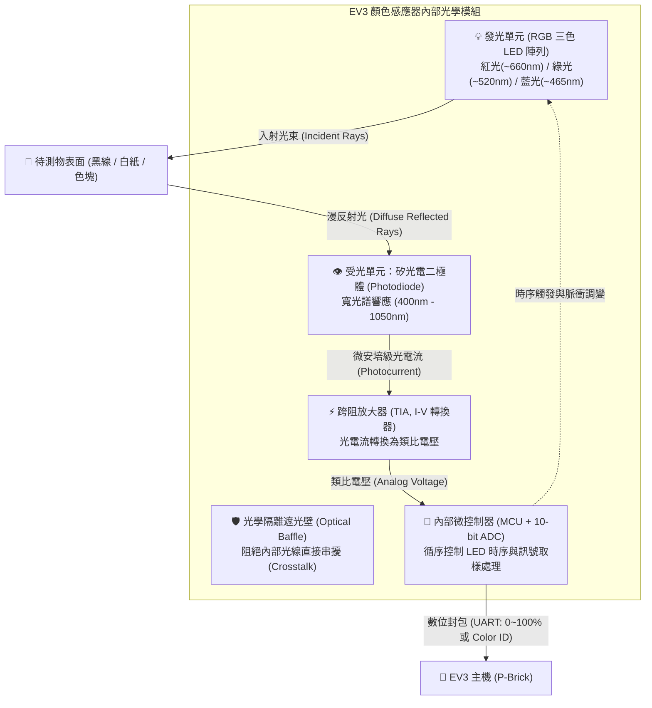
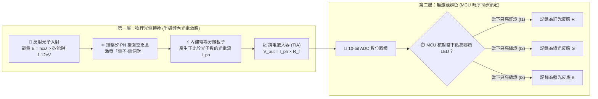
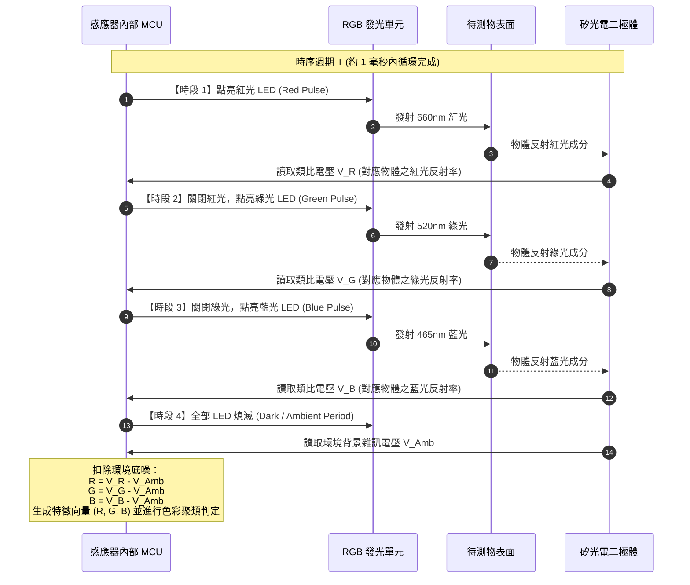
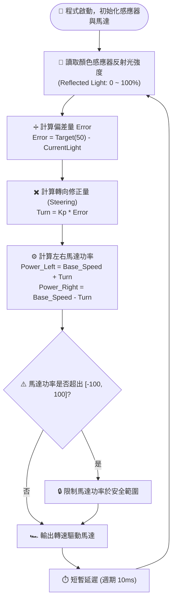
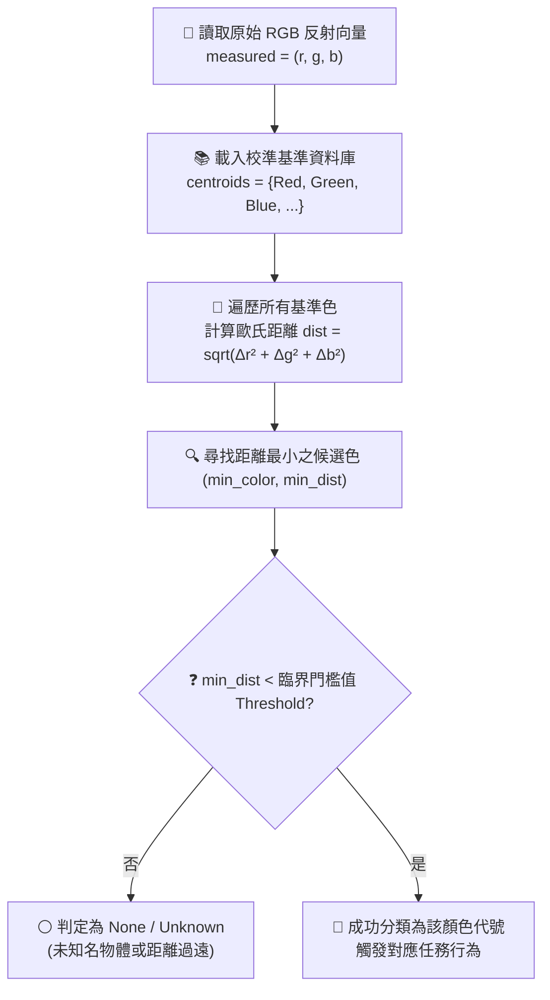
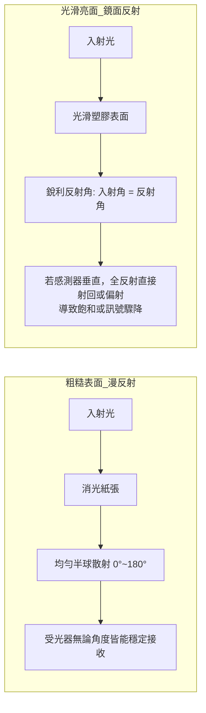
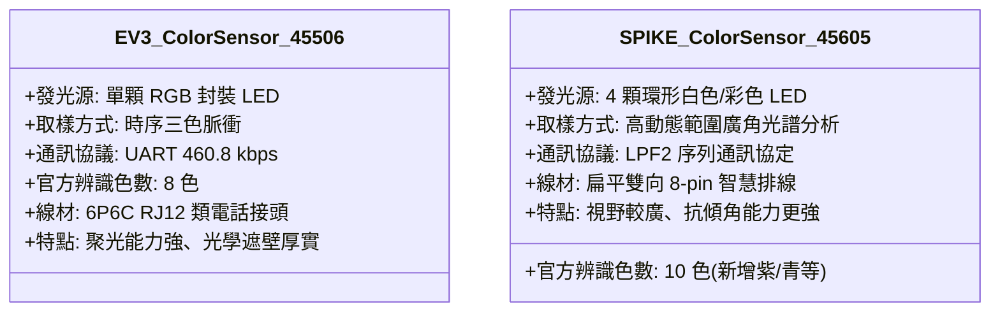

# 🔍 LEGO MINDSTORMS EV3 顏色感應器：光反射強度與色彩辨識原理全解析

> **最後更新時間**: 2026-11-09 14:00:35 (UTC+8)  
> **使用模型**: Gemini 4 Argon  
> **執行 Agent**: Antigravity  

---

## 📌 目錄
1. [核心概念剖析 (Core Concepts)](#1-核心概念剖析-core-concepts)
   - [1.1 硬體光學架構剖析 (Hardware Optical Architecture)](#11-硬體光學架構剖析-hardware-optical-architecture)
   - [1.2 反射光強度 (Reflected Light Intensity) 偵測原理](#12-反射光強度-reflected-light-intensity-偵測原理)
   - [1.3 色彩辨識 (Color Recognition) 原理：時序三色光脈衝掃描](#13-色彩辨識-color-recognition-原理時序三色光脈衝掃描)
   - [1.4 環境光消減與動態校準機制 (Ambient Subtraction & Calibration)](#14-環境光消減與動態校準機制-ambient-subtraction--calibration)
   - [1.5 顏色分類演算法：特徵空間歐氏距離判定](#15-顏色分類演算法特徵空間歐氏距離判定)
2. [實作與應用範例 (Practical Examples)](#2-實作與應用範例-practical-examples)
   - [2.1 循線機器人比例控制器 (P-Controller Line Follower)](#21-循線機器人比例控制器-p-controller-line-follower)
   - [2.2 自訂 RGB 原始數值色彩判別器 (Custom RGB Classifier)](#22-自訂-rgb-原始數值色彩判別器-custom-rgb-classifier)
3. [延伸思考與進階主題 (Extensions & Advanced Topics)](#3-延伸思考與進階主題-extensions--advanced-topics)
   - [3.1 鏡面反射 (Specular) vs. 漫反射 (Diffuse) 的光學陷阱](#31-鏡面反射-specular-vs-漫反射-diffuse-的光學陷阱)
   - [3.2 為何採用「RGB 時序分光」而非「白光 LED + 濾色片」？](#32-為何採用rgb-時序分光而非白光-led--濾色片)
   - [3.3 機器人機構幾何最佳化 (安裝高度、傾角與遮光罩)](#33-機器人機構幾何最佳化-安裝高度傾角與遮光罩)
   - [3.4 EV3 (45506) 與 SPIKE Prime (45605) 顏色感應器橫向比較](#34-ev3-45506-與-spike-prime-45605-顏色感應器橫向比較)
4. [📚 參考資料與技術文獻 (References)](#4--參考資料與技術文獻-references)
5. [📝 提示詞歷史與變更記錄 (Prompt Archive)](#5--提示詞歷史與變更記錄-prompt-archive)

---

## 1. 核心概念剖析 (Core Concepts)

LEGO MINDSTORMS EV3 顏色感應器（零件編號：#45506）是機器人競賽（如 WRO、FLL）與機電整合專案中最關鍵的感測模組之一。許多初學者常誤以為感應器內部是一顆像手機鏡頭一樣的高畫質微型相機，但事實上，它內部僅由**「單一顆高靈敏度矽光電二極體 (Photodiode)」**搭配**「多色 LED 發光元件」**與**「專屬微控制器 (MCU/ADC)」**構成。

它能在極低成本與極高反應頻率（取樣頻率約 1 kHz）下精準量測光反射率並辨識 8 種顏色，其核心機制體現了光電量測學的極致工藝。

### 1.1 硬體光學架構剖析 (Hardware Optical Architecture)

拆解 EV3 顏色感應器正面，可以看到以下核心元件：



#### 關鍵內部元件功能：
1. **發光光源 (Active Emitter)**：
   - 整合了可獨立定址控制的 RGB 發光二極體，可發出單色紅光（660 nm）、綠光（520 nm）、藍光（465 nm），或同時點亮混成白光。
2. **光接收器 (Photodetector)**：
   - 採用單一像素（Single-pixel）矽光電二極體。光子撞擊 PN 結時產生電子-電洞對，輸出正比於入射光通量（Luminous Flux）的微弱光電流 $I_{ph}$。
3. **光學遮光隔板 (Optical Isolation Baffle)**：
   - 位於發光腔與受光腔之間。若沒有此隔板，LED 發出的光會直接穿透外殼內部射入光電二極體，造成嚴重的內部漏光（Crosstalk / Optical Bleed），使黑色表面測得反射率偏高。
4. **前端訊號處理電路 (Front-end Signal Conditioning)**：
   - 跨阻放大器（Transimpedance Amplifier, TIA）將微安培級的光電流轉換為類比電壓訊號：$V_{out} = I_{ph} \times R_f$。
   - 接著送入內部 ADC（類比轉數位轉換器）進行高速取樣與均值數位濾波。

#### 🔬 深度剖析：接收感應端有「彩色濾鏡」嗎？它是靠什麼原理判斷光反應的？

這是理解 EV3 顏色感應器最核心的問題：
> **結論：接收端「完全沒有 RGB 彩色濾光片 (No Color Filter)」！它純粹靠一顆「色盲（全光譜黑白）的矽光電二極體／光電晶體」，透過半導體「內光電效應」測量總光量，再配合微控制器 (MCU) 的「發射-接收時間同步」來分辨顏色。**

我們可以將接收端的運作拆解為**「物理光電轉換（怎麼測光強）」**與**「無濾鏡辨色機制（怎麼知顏色）」**兩個層次：



##### 1. 接收端如何判斷「光反應強弱」？（靠半導體「內光電效應 / 光電導效應」）
接收孔後方的元件是一顆**矽基光電二極體（Silicon Photodiode / Phototransistor）**，它判斷光強弱的物理過程如下：
1. **光子吸收與能隙躍遷**：當物體表面反射的光子（Photon）射入接收孔，只要光子能量大於矽半導體的能隙（Bandgap $E_g \approx 1.12\text{ eV}$，涵蓋 $400\sim 1050\text{ nm}$ 所有可見光），就會被矽晶格吸收。
2. **激發電子-電洞對 (Electron-Hole Pairs)**：**1 顆光子會激發出 1 對自由電子與電洞**。反射光越強（光子數越多），激發出的自由電荷就越多。
3. **形成光電流 (Photocurrent, $I_{ph}$)**：在 PN 接面內建電場（或逆向偏壓）拉動下，電子與電洞反向移動形成微安培（$\mu\text{A}$）等級的光電流：
   $$I_{ph} = \mathcal{R}(\lambda) \cdot P_{optical}$$
   （其中 $P_{optical}$ 為入射光功率，$\mathcal{R}(\lambda)$ 為矽對該波長的光譜響應度）。
4. **電流轉電壓 (I-V 轉換)**：後級的跨阻放大器（TIA）將光電流乘上高阻值回授電阻 $R_f$，輸出 $0\text{V} \sim 3.3\text{V}$ 的類比電壓給 ADC。**電壓越高，代表剛才反射進來的光子越多**。

##### 2. 接收端到底有沒有「濾鏡」？
* **沒有 RGB 分色濾鏡**：一般手機鏡頭或 TCS34725 色彩感應器會在感光元件表面鍍上「紅、綠、藍拜爾彩色濾光膜 (Bayer Color Filter)」，但 EV3 感應器**完全沒有**這層彩色濾鏡。
* **僅有透明聚光透鏡與基礎抗紅外線封裝**：接收端外層只有透明光學級環氧樹脂構成的**凸透鏡（聚集漫反射光線）**，以及抑制環境熱輻射干擾的基礎近紅外線衰減配方，對紅、綠、藍可見光則是**全通（無差別接收）**。

##### 3. 既然接收端是「色盲」且沒有彩色濾鏡，它怎麼知道收到的是紅光、綠光還是藍光？
* **靠「時間同步（Time-Synchronized Sampling）」取代「彩色濾鏡」**：
  * 雖然接收端光電二極體只會呆呆地回報：「現在光電流是 $8\,\mu\text{A}$！」（它自己不知道這 $8\,\mu\text{A}$ 是什麼顏色的光造成的）。
  * 但**主控微控制器 (MCU) 同時控制發射端與接收端**！MCU 心裡非常清楚：
    * 「現在是我下令**只開紅燈**的第 1 微秒 $\rightarrow$ 所以二極體回報的這 $8\,\mu\text{A}$，百分之百是**紅光的反射反應**！」
    * 「下一微秒我把紅燈關掉、**只開綠燈** $\rightarrow$ 二極體回報 $1\,\mu\text{A}$，這百分之百是**綠光的反射反應**！」
* **矽晶片的「天生偏心」與白平衡補償**：
  * 物理上，裸矽（Silicon）對不同波長的光敏感度並不相同：對**紅光 (660nm) 最敏感**（響應度約 $0.45\text{ A/W}$），綠光次之（約 $0.35\text{ A/W}$），對**藍光 (465nm) 最遲鈍**（約 $0.25\text{ A/W}$）。
  * 因此 EV3 感應器在硬體上會配置不同的 LED 限流電阻，並在韌體中對 R、G、B 三次採樣乘上不同的**白平衡校準係數 $(w_R, w_G, w_B)$**，確保照射標準白紙時，三原色讀數能齊平對齊。

---

### 1.2 反射光強度 (Reflected Light Intensity) 偵測原理

在「反射光強度模式（Reflected Light Intensity Mode）」下，感應器測量待測物表面反射的特定光線比例，輸出值介於 **0% 至 100%**。

#### 運作流程：
1. **單色紅光照明**：
   - 感應器**僅點亮紅色 LED**（紅光光強度強、發光效率高且對常見白紙/黑墨水有最大吸收對比）。
2. **表面朗伯漫反射 (Lambertian Diffuse Reflection)**：
   - 入射紅光穿透物體表面微觀粗糙層，在紙張纖維或墨水微粒中經歷多重散射，遵循朗伯餘弦定律散射回半球空間。
   - **白色表面**：幾乎不吸收紅光，散射回來的光通量大，受光二極體產生大光電流。
   - **黑色表面**：碳黑墨水吸收了絕大部分紅光光子，反射回來的散射光極微弱，光電流趨近於零。
3. **電壓轉換與歸一化**：
   - 測得之類比電壓值 $V_{raw}$ 經過工廠校準參數，線性映射為百分比：
     $$\text{Reflected Intensity (\%)} = \text{clamp}\left( \frac{V_{raw} - V_{black}}{V_{white} - V_{black}} \times 100\%, \; 0\%, \; 100\% \right)$$

```
[極暗/吸光 (黑色)] V_black ≈ 0.1V  ───────────────► 顯示 0%
[中灰/過渡邊緣]   V_mid   ≈ 1.6V  ───────────────► 顯示 50%
[極亮/全反射 (白色)] V_white ≈ 3.0V  ───────────────► 顯示 100%
```

---

### 1.3 色彩辨識 (Color Recognition) 原理：時序三色光脈衝掃描

一般彩色相機依賴感光元件表面覆蓋的**拜爾濾鏡 (Bayer Filter)**，將不同像素分別感應紅、綠、藍光。然而，EV3 顏色感應器為了兼顧小體積與平價工業結構，採用了巧妙的**「時序三色光脈衝掃描 (Time-multiplexed Sequential RGB Strobe)」**技術！

由於受光的光電二極體是「色盲」（對所有可見光譜皆有響應，只認光子能量，無法分辨入射光顏色），感應器透過**控制光源的時序**來解算出 RGB 分量：



#### 時序脈衝物理機制分析：
- **紅蘋果範例**：
  - 紅光 LED 照射時：表皮反射大量紅光 $\rightarrow V_R$ 極高。
  - 綠光 LED 照射時：表皮花青素與色素吸收綠光 $\rightarrow V_G$ 極低。
  - 藍光 LED 照射時：表皮吸收藍光 $\rightarrow V_B$ 極低。
  - 組合特徵：$(R, G, B) = (\text{高}, \text{低}, \text{低})$，演算法判定為**紅色 (Red)**。
- **黃色積木範例**：
  - 黃色顏料反射紅光與綠光，吸收藍光。
  - 組合特徵：$V_R$ 高、$V_G$ 高、$V_B$ 低 $\rightarrow$ 判定為**黃色 (Yellow)**。

#### 💡 關鍵釋疑：RGB 光源到底發射幾個設定好的固定顏色？

**答案是：硬體光源只發射「3 種」設定好的固定單色光波長！**

感應器內部的三色 LED 封裝（RGB LED Package）中，實際上嵌合了 **3 顆各自獨立、波長固定不變的半導體發光晶粒 (LED Dies)**，它**不會**也**無法**直接發出黃光、棕光或紫光，而是嚴格固定為以下 **3 種光學基色**：

| 發光晶粒代號 | 固定發射顏色 | 中心峰值波長 ($\lambda_p$) | 半導體材料體系 | 在不同感測模式下的點亮行為 |
| :--- | :--- | :--- | :--- | :--- |
| **1. R (Red)** | **純紅光** | **約 640 ~ 660 nm** | 磷化鋁鎵銦 (AlGaInP) | • **反射光模式**：恆亮紅光<br>• **色彩辨識模式**：時段 1 脈衝點亮 |
| **2. G (Green)** | **純綠光** | **約 520 ~ 530 nm** | 氮化銦鎵 (InGaN) | • **色彩辨識模式**：時段 2 脈衝點亮 |
| **3. B (Blue)** | **純藍光** | **約 465 ~ 470 nm** | 氮化鎵 (GaN / InGaN) | • **色彩辨識模式**：時段 3 脈衝點亮<br>• **環境光模式**：微亮作為模式指示燈 |

##### 為什麼只發射 3 種固定顏色，肉眼看起來卻像白光，還能辨識 8 種顏色？
1. **肉眼看起來像白光/淡紫光的原因（視覺暫留 Persistence of Vision）**：
   - 在「色彩辨識模式」下，紅、綠、藍 3 顆固定顏色的燈是以 **約 1,000 Hz（每毫秒一輪）** 的極高頻率**輪流單獨閃爍**。
   - 每個微秒瞬間，感應器**只發射 1 種固定顏色**；但因為閃爍速度遠超人眼視覺暫留極限（約 24~60 Hz），紅、綠、藍三色光在視網膜上自動混色，因此肉眼直視感應器時會覺得它恆亮著一團**偏白／淡藍紫色的光**。
2. **用 3 種固定光源辨識 8 種顏色的原理（三原色反射率指紋）**：
   - 感應器不需要發射「黃光」去測黃色，也不需要發射「棕光」去測棕色。任何物體表面顏料對 **紅(660nm)、綠(520nm)、藍(465nm)** 這 3 種固定色光的「吸收與反射比例」都是獨一無二的：

| 官方辨識顏色 (Color ID) | 照射固定**紅光 (R)** 反射率 | 照射固定**綠光 (G)** 反射率 | 照射固定**藍光 (B)** 反射率 | 物理光學成因與特徵指紋 |
| :--- | :---: | :---: | :---: | :--- |
| **0: 無色 (None)** | 極低 (~0%) | 極低 (~0%) | 極低 (~0%) | 距離過遠，3 種固定光散射後皆無法回到受光孔 |
| **1: 黑色 (Black)** | 低 (<10%) | 低 (<10%) | 低 (<10%) | 黑色顏料同時強烈吸收紅、綠、藍 3 種固定光 |
| **2: 藍色 (Blue)** | 低 (~10%) | 中低 (~25%) | **高 (~80%)** | 藍色表面只反射固定藍光，吸收紅光與大部分綠光 |
| **3: 綠色 (Green)** | 低 (~15%) | **高 (~70%)** | 低 (~20%) | 綠色表面強烈反射固定綠光，吸收紅光與藍光 |
| **4: 黃色 (Yellow)** | **高 (~85%)** | **高 (~80%)** | 低 (~15%) | 黃色表面**同時反射固定紅光與固定綠光**，但吸收藍光 |
| **5: 紅色 (Red)** | **高 (~80%)** | 低 (~12%) | 低 (~12%) | 紅色表面強烈反射固定紅光，吸收綠光與藍光 |
| **6: 白色 (White)** | **高 (~90%)** | **高 (~90%)** | **高 (~90%)** | 白色表面對紅、綠、藍 3 種固定光皆無差別高反射 |
| **7: 棕色 (Brown)** | **中低 (~35%)** | 低 (~18%) | 極低 (~8%) | 暗橘紅/咖啡色系，對固定紅光有部分反射，綠光次之，藍光最低 |

---

### 1.4 環境光消減與動態校準機制 (Ambient Subtraction & Calibration)

若感應器直接測量，當天花板日光燈閃爍或陽光斜射時，量測值會劇烈漂移。EV3 感應器導入了高頻**相關雙重取樣 (Correlated Double Sampling, CDS)** 思維：

$$R_{corrected} = \max(0, \; V_R - V_{ambient})$$
$$G_{corrected} = \max(0, \; V_G - V_{ambient})$$
$$B_{corrected} = \max(0, \; V_B - V_{ambient})$$

藉由在每組 RGB 點亮之前或之後熄滅 LED 取樣「純背景環境光（Ambient Light）」，即時扣除直流光雜訊，大幅提高了在不同室內光線條件下的魯棒性（Robustness）。

---

### 1.5 顏色分類演算法：特徵空間歐氏距離判定

EV3 原廠韌體支援辨識 **8 種標準顏色代碼**：
- `0`: None (無顏色 / 距離太遠 / 超出量程)
- `1`: Black (黑色)
- `2`: Blue (藍色)
- `3`: Green (綠色)
- `4`: Yellow (黃色)
- `5`: Red (紅色)
- `6`: White (白色)
- `7`: Brown (棕色)

其內部演算法將修正後的向量 $(R, G, B)$ 投影至色彩特徵空間，計算該點與各標準參考中心點 $C_k = (R_k, G_k, B_k)$ 之間的加權歐氏距離（Weighted Euclidean Distance）：

$$D_k = \sqrt{w_r(R - R_k)^2 + w_g(G - G_k)^2 + w_b(B - B_k)^2}$$

演算法選取最小距離 $D_{\min} = \min(D_k)$：
- 若 $D_{\min} < \text{Threshold}$，則輸出對應之顏色代碼 $k$。
- 若所有標準色的距離皆超過門檻值，或總光通量過低，則判定為 `0 (None)`。

---

## 2. 實作與應用範例 (Practical Examples)

### 2.1 循線機器人比例控制器 (P-Controller Line Follower)

循線車（Line Tracker）利用反射光強度測量「黑線邊緣（Line Edge）」的灰階過渡值。當機器人位於黑白邊緣時，測量值大約為 $50\%$。藉由計算與目標值 $50\%$ 的誤差，動態調整左右輪馬達轉速。

#### 控制器邏輯流程圖：



#### MicroPython (Pybricks / ev3dev) 實作程式碼：

```python
#!/usr/bin/env pybricks-micropython
"""
LEGO EV3 比例循線控制器 (P-Line Follower)
說明：利用反射光強度 (0-100%) 追蹤黑線左側邊緣 (反射強度約 50% 處)
"""

from pybricks.hubs import EV3Brick
from pybricks.ev3devices import Motor, ColorSensor
from pybricks.parameters import Port, Stop
from pybricks.tools import wait

# 1. 硬體物件初始化
ev3 = EV3Brick()
left_motor = Motor(Port.B)       # 左輪馬達
right_motor = Motor(Port.C)      # 右輪馬達
color_sensor = ColorSensor(Port.S3) # 顏色感應器接在 Port 3

# 2. 控制參數設定
TARGET_LIGHT = 50.0   # 目標光反射值：黑線(約10%)與白地(約90%)邊界
KP = 1.2              # 比例控制增益 (Proportional Gain)
BASE_SPEED = 200      # 基準前進速度 (度/秒 deg/s)

ev3.speaker.beep(frequency=1000, duration=100)
print("=== EV3 P-Controller 循線系統啟動 ===")

# 3. 控制迴圈 (取樣頻率約 100Hz)
try:
    while True:
        # 讀取當前反射光強度 (0% ~ 100%)
        current_light = color_sensor.reflection()
        
        # 計算誤差 (Error)
        error = TARGET_LIGHT - current_light
        
        # 計算轉向校正量 (Steering Correction)
        # 當偏向白地(current > 50) -> error < 0 -> turn < 0 -> 左輪減速、右輪加速 -> 向左切回黑線
        turn_rate = KP * error
        
        # 計算左右輪目標速度
        speed_left = BASE_SPEED + turn_rate
        speed_right = BASE_SPEED - turn_rate
        
        # 輸出馬達驅動
        left_motor.run(speed_left)
        right_motor.run(speed_right)
        
        # 迴圈週期控制 (10 ms)
        wait(10)

except KeyboardInterrupt:
    # 安全剎車停止
    left_motor.stop(Stop.BRAKE)
    right_motor.stop(Stop.BRAKE)
    print("=== 循線結束，馬達已煞車 ===")
```

---

### 2.2 自訂 RGB 原始數值色彩判別器 (Custom RGB Classifier)

在進階競賽中，官方的 8 色判定有時會因場地印刷墨水反光特性而產生誤判（例如深藍被誤判為黑色、橙色被誤判為棕色或紅色）。此時可使用 `color_sensor.rgb()` 獲取未加工的 RGB 反射強度，並透過歐氏距離法進行自訂顏色分類。

#### 分類器演算法流程圖：



#### 自訂 RGB 歐氏距離分類器程式碼：

```python
#!/usr/bin/env pybricks-micropython
"""
自訂 RGB 歐氏距離色彩分類演算法
說明：讀取原始 (R, G, B) 反射數值，計算與校準樣本點的幾何距離，避免原廠 8 色誤判。
"""

import math
from pybricks.ev3devices import ColorSensor
from pybricks.parameters import Port
from pybricks.tools import wait

color_sensor = ColorSensor(Port.S3)

# 預先校準之顏色基準中心點 (R, G, B) 範例數據
COLOR_CENTROIDS = {
    "Black":  (3, 4, 3),
    "White":  (88, 92, 95),
    "Red":    (78, 12, 11),
    "Green":  (14, 65, 18),
    "Blue":   (9, 28, 82),
    "Yellow": (85, 78, 15)
}

DISTANCE_THRESHOLD = 30.0  # 超過此距離則視為未知物體

def classify_color(measured_rgb):
    r, g, b = measured_rgb
    best_color = "Unknown"
    min_dist = float("inf")
    
    for name, (cr, cg, cb) in COLOR_CENTROIDS.items():
        # 計算 3D 歐氏距離: sqrt((r-cr)^2 + (g-cg)^2 + (b-cb)^2)
        dist = math.sqrt((r - cr)**2 + (g - cg)**2 + (b - cb)**2)
        if dist < min_dist:
            min_dist = dist
            best_color = name
            
    if min_dist > DISTANCE_THRESHOLD:
        return "Unknown", min_dist
    return best_color, min_dist

# 測試迴圈
while True:
    raw_rgb = color_sensor.rgb()
    color_name, dist = classify_color(raw_rgb)
    print("RGB: {:3d}, {:3d}, {:3d} => 判別結果: {:<8} (距離: {:.2f})".format(
        raw_rgb[0], raw_rgb[1], raw_rgb[2], color_name, dist
    ))
    wait(200)
```

---

## 3. 延伸思考與進階主題 (Extensions & Advanced Topics)

### 3.1 鏡面反射 (Specular) vs. 漫反射 (Diffuse) 的光學陷阱

在實際賽場上，常常遇到**「平滑亮面 PVC 膠帶」**或**「壓克力亮面地墊」**。此時光學行為會偏離理想朗伯表面：



- **鏡面反射（Specular Flare）**：當感應器嚴格垂直於亮面光滑表面（例如黑色電工亮面膠帶）時，黑膠帶的鏡面反射會直接將光子彈回光電二極體，使原本應為 0% 的黑線突然飆高到 60% 以上，造成自走車脫軌。
- **解法**：將感測器安裝微幅傾斜約 **5° ~ 8°**，讓鏡面全反射光線偏離受光孔，僅讓深層漫反射光進入受光器。

---

### 3.2 為何採用「RGB 時序分光」而非「白光 LED + 濾色片」？

| 比較維度 | 白光 LED + 拜爾濾色片 (Bayer Matrix) | EV3 的 RGB 時序脈衝掃描 (Sequential Strobe) |
| :--- | :--- | :--- |
| **受光單元** | 需多像素感光陣列（Array Sensor） | **僅需 1 顆單晶矽光電二極體** |
| **硬體成本** | 高（微透鏡 + 微光學彩色濾光膜） | **極低（標準光電晶體 + 標準 3 色 LED）** |
| **光譜分離度** | 濾色片物理重疊較大，色彩串擾顯著 | **RGB LED 發光光譜半峰寬窄 (FWHM ~20nm)，分離度高** |
| **反應頻率** | 受限於感光影像讀出（約 30~60 FPS） | **可達 1,000 Hz 以上超高速時序切換** |
| **光衰校準** | 單一白光螢光粉老化會導致色溫整體漂移 | **可分別調控 R、G、B LED 驅動電流完成硬體微調** |

---

### 3.3 機器人機構幾何最佳化 (安裝高度、傾角與遮光罩)

感應器的物理安裝位置直接決定了訊號的信噪比 (Signal-to-Noise Ratio, SNR)：

1. **最佳偵測距離 (Optimal Working Distance)**：
   - 官方建議距離為 **8 mm ~ 16 mm**（約 1 到 2 個樂高孔位高度）。
   - **太近 (< 4 mm)**：發光 LED 的光錐與光電二極體的視野（Field of View, FOV）無法有效在待測表面交會，造成**光學盲區**。
   - **太遠 (> 25 mm)**：根據平方反比定律（$E = I / r^2$），返回的光通量大幅衰減，容易被環境光淹沒。
2. **防環境光遮光罩 (Lens Shroud)**：
   - 在戶外或強烈聚光燈賽場下，光學二極體容易產生飽和（Saturation）。使用黑色樂高橫樑圍繞感應器四周製作物理遮光罩，可降低 90% 以上的外來斜射光干擾。

---

### 3.4 EV3 (45506) 與 SPIKE Prime (45605) 顏色感應器橫向比較



---

## 4. 📚 參考資料與技術文獻 (References)

### 4.1 LEGO 官方硬體規範與韌體原始碼
1. **LEGO Group (2013)**. *LEGO MINDSTORMS EV3 Hardware Developer Kit (HDK)* — 包含 EV3 Color Sensor (Part #45506 / 95650) 硬體電路圖、RJ12 6P6C 腳位定義與 UART 感測器通訊協定。
2. **LEGO Education**. *LEGO MINDSTORMS Education EV3 Color Sensor User Guide & Technical Specifications* — 官方光學量測規格（1 kHz 取樣頻率、8~16 mm 最佳工作距離、反射光／環境光／8 色辨識模式說明）。
3. **LEGO Group / `lms2012` Open Source Firmware** (`mindstorms/ev3sources`, GitHub) — EV3 主機與感應器底層 C 語言韌體原始碼（包含三色 LED 時序脈衝控制、ADC 暗電流扣除與 8 色分類查表演算法）。

### 4.2 開源機器人軟體框架與驅動文件
4. **Pybricks Documentation**. *`pybricks.ev3devices.ColorSensor` API Reference* — MicroPython 針對 EV3 顏色感應器之 `reflection()`、`ambient()`、`color()` 與 `rgb()` 函式實作與校準說明（[https://docs.pybricks.com/](https://docs.pybricks.com/)）。
5. **ev3dev.org Linux Kernel Drivers**. *LEGO EV3 Color Sensor (`lego-ev3-color`) Driver Specification* — 詳載 `COL-REFLECT`、`COL-AMBIENT`、`COL-COLOR`、`REF-RAW` 與 `RGB-RAW`（10-bit 原始未校準三通道數值）暫存器結構（[https://docs.ev3dev.org/](https://docs.ev3dev.org/)）。
6. **Hurbain, Philippe (Philo)**. *LEGO MINDSTORMS EV3 & NXT Sensors Internals and Optical Characteristics Analysis* — 樂高光學與色彩感應器硬體拆解、光譜響應實測與距離線性度分析（[https://www.philohome.com/](https://www.philohome.com/)）。

### 4.3 光電半導體物理與訊號處理文獻
7. **Sze, S. M., & Ng, K. K. (2006)**. *Physics of Semiconductor Devices* (3rd ed.). Wiley-Interscience. — 第 13 章（Photodetectors）：詳述矽 PN 接面內光電效應、能隙躍遷（$E_g \approx 1.12\text{ eV}$）、量子效率與波長光譜響應度 $\mathcal{R}(\lambda)$。
8. **Graeme, J. G. (1995)**. *Photodiode Amplifiers: OP AMP Solutions*. McGraw-Hill. — 光電二極體前端跨阻放大器（Transimpedance Amplifier, TIA）之電流轉電壓（I-V）增益設計與環境雜訊抑制。
9. **Vishay Semiconductors**. *Silicon PIN Photodiode & Ambient Light Sensor Application Notes* — 矽基光電感測元件對 465 nm（藍）、525 nm（綠）、650 nm（紅）三波段之相對光譜靈敏度與透明環氧樹脂封裝光學特性。

---

## 5. 📝 提示詞歷史與變更記錄 (Prompt Archive)

### 🔹 [2026-11-09 13:40:15] [Gemini 3.8 Flash] 筆記初版建立
- **模型/Agent**: Gemini 3.8 Flash / Antigravity
- **Prompt 原文**:
  ```text
  lego ev3的顏色感應器 是如何偵測到光的反射強度，以及色彩辨識的原理 設計詳細的解說動畫HTML檔
  ```
- **變更摘要**: 建立 EV3 顏色感應器原理全解析筆記，包含光學架構拆解、反射光強度計算公式、時序三色脈衝 (Sequential RGB Strobe) 色彩辨識機制、環境光抵銷原理、P 控制循線程式與自訂 RGB 歐氏距離分類器實作範例，並深入探討鏡面漫反射與機構幾何佈局。

### 🔹 [2026-11-09 13:53:16] [Gemini 4 Argon] 補充 RGB 光源固定發射顏色數量與 8 色反射率對照表
- **模型/Agent**: Gemini 4 Argon / Antigravity
- **Prompt 原文**:
  ```text
  rgh的光源是發射固定顏色
  rgh的光源是發射幾個設定好的固定顏色?
  ```
- **變更摘要**: 增補說明 EV3 顏色感應器內部 RGB LED 僅發射「3 種」固定波長單色光（紅 660nm、綠 520nm、藍 465nm），詳解視覺暫留混光現象，並新增 3 種固定色光如何透過反射率指紋辨識出樂高 8 種標準顏色的完整物理對照表；同步更新 HTML 檔案與全站索引。

### 🔹 [2026-11-09 13:57:14] [Gemini 4 Argon] 深入剖析接收感應端光電轉換原理與無濾鏡辨色機制
- **模型/Agent**: Gemini 4 Argon / Antigravity
- **Prompt 原文**:
  ```text
  接收感應端是透過什麼原理判斷光反應的?有濾鏡或是靠感應器?
  ```
- **變更摘要**: 於 1.1 節增補接收感應端（Silicon Photodiode）的物理光電轉換機制（光子激發 PN 接面電子-電洞對、內光電效應、TIA 跨阻放大與矽光譜響應曲線），闡明接收端「無 RGB 彩色濾光片」，而是靠全光譜感應器搭配 MCU 發射-接收時間同步（Time-Synchronized Sampling）與白平衡補償來判斷各色光反應。

### 🔹 [2026-11-09 14:00:35] [Gemini 4 Argon] 新增參考資料與技術文獻區塊
- **模型/Agent**: Gemini 4 Argon / Antigravity
- **Prompt 原文**:
  ```text
  將參考資料加到筆記最下方
  ```
- **變更摘要**: 於筆記最下方新增「參考資料與技術文獻 (References)」專章，收錄 LEGO EV3 官方硬體開發文件 (HDK)、`lms2012` 開源韌體、Pybricks / ev3dev 驅動規格及光電半導體物理文獻，並同步更新 HTML 檔案與全站索引。
