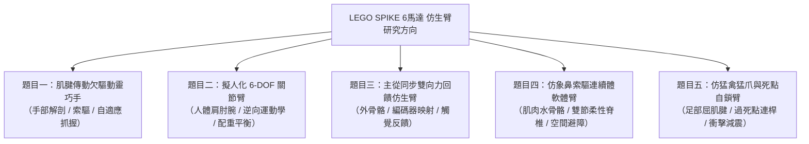
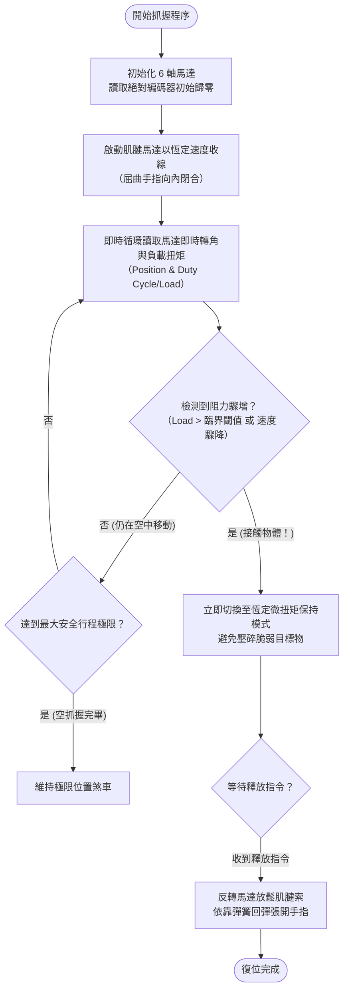

# 🦾 LEGO SPIKE 仿生機械手臂專題研究指南：六馬達配置與五大研究題目解析

> **最後更新時間**: 2026-10-30 09:40:00 (UTC+8)
> **使用模型**: Gemini 3.8 Flash
> **執行 Agent**: Antigravity Assistant

---

## 👨‍🏫 生活科技老師的話 (Teacher's Introduction)

同學你好！看到你想用 **6 顆 LEGO SPIKE 馬達** 來挑戰「仿生機械手臂（Bionic Robotic Arm）」的研究，老師非常肯定你的選題方向！

仿生學（Biomimetics）是現代工程與生活科技領域中極具前瞻性的跨領域學門。它不是單純做出一隻「長得像手臂」的積木模型，而是**探究生物演化數百萬年所形成的精妙機構**（如肌腱牽引、韌帶彈性、骨骼連桿死點自鎖、無關節柔性連續體等），並透過機電整合與程式演算法在工程結構上重現。

### 🔍 老師先帶你剖析手中的「硬體限制與戰略優勢」：
1. **連接埠的極限配置（Constraints）**：
   - 標準 LEGO SPIKE Prime 大集線器（Hub）恰好擁有 **6 個 I/O 連接埠（Port A ~ F）**。
   - 當你將 6 顆馬達全數插滿時，代表**無法外接額外的感測器**（如超音波、顏色或力感測器）。
   - **破解之道**：SPIKE 的大型/中型角度馬達本體皆內建了**高解析度絕對位置編碼器（Absolute Position Encoder）**，並支援轉速、轉角與「馬達負載轉矩/堵轉（Stall）」偵測；此外 Hub 本身內建 **6 軸陀螺儀/加速度感測器**。這意味著：**馬達本身就是最敏銳的感測器**！
2. **機構負載與剛性挑戰**：
   - 樂高積木為工程塑膠卡榫結構，當機械臂伸長時，力臂放大（$\tau = F \times d$），關節容易產生晃動與變形。
   - 如何運用**肌腱索驅（Tendon-driven）**將重型馬達後置於基座、或運用**高減速比蝸輪蝸桿與彈簧配重**，將是專題成敗的技術關鍵。

以下老師為你精心規劃了五個具備**科學探究深度**、符合**生活科技工程設計流程（EDP）**的題目供你選擇與深化。

---

## 🎯 五大仿生機械手臂研究題目評估與架構



---

### 1️⃣ 題目一：【肌腱傳動型仿生人手】基於索驅（Tendon-driven）與欠驅動（Underactuated）機構之五指自適應靈巧手研究

#### 🌿 仿生原型剖析 (Biological Prototype)
人類的手指內部並沒有肌肉，所有彎曲手指的肌群實際上都位於**前臂（Forearm）**，透過長長的**屈指肌腱（Flexor Tendons）**穿過腕隧道拉動指骨關節；手指伸直則由伸肌腱與韌帶的彈性回彈達成。

#### ⚙️ 6 顆馬達分配方案 (Motor Assignment)
* **馬達 A (Wrist)**：手腕俯仰/自轉（提供抓握姿態空間調整）。
* **馬達 B (Thumb Opposition)**：大拇指對掌關節（拇指轉向掌心面向其他四指，人類抓握關鍵！）。
* **馬達 C (Thumb Flexion)**：大拇指指節屈伸。
* **馬達 D (Index Finger)**：食指獨立屈伸（精準捏取 Pinching）。
* **馬達 E (Middle Finger)**：中指獨立屈伸（主要支撐力）。
* **馬達 F (Ring & Pinky)**：無名指與小指欠驅動連動驅動（透過差動滑輪組，以 1 顆馬達自適應包覆抓持物）。

#### 🔬 核心研究與科學探究變因
1. **操作變因**：不同線纜導引路徑摩擦係數（光滑樂高孔 vs 特氟龍導管）、回位橡皮筋預緊力。
2. **應變變因**：對不同幾何物體（圓球、長方體、圓錐、不規則脆弱紙杯）的**外包絡抓持包覆面積**與**最大靜摩擦拉脫力（N）**。
3. **生活科技工藝亮點**：釣魚線或高拉力編織線走線設計、滑輪組張力配置、指尖防滑矽膠/橡皮材質整合。

---

### 2️⃣ 題目二：【擬人化 6 自由度 (6-DOF) 機械臂】逆向運動學（IK）空間軌跡追蹤與重力補償研究

#### 🌿 仿生原型剖析 (Biological Prototype)
完全參照人體手臂解剖學的自由度配置：**胸肩關節（Ball-and-Socket 3-DOF）+ 肘關節（Hinge 1-DOF）+ 腕關節（Condyloid 2-DOF）**，構成能在三維笛卡爾空間中任意到達指定位置與姿態的完整 6 軸機械臂。

#### ⚙️ 6 顆馬達分配方案 (Motor Assignment)
* **馬達 A (Joint 1 - Base Yaw)**：底座水平迴轉（模擬人體軀幹/肩部水平轉向）。
* **馬達 B (Joint 2 - Shoulder Pitch)**：肩部大臂俯仰抬升（負擔最大力矩，需雙層大齒輪或蝸輪減速）。
* **馬達 C (Joint 3 - Arm Roll)**：大臂軸向自轉（模擬肱骨旋轉）。
* **馬達 D (Joint 4 - Elbow Pitch)**：肘關節屈伸（尺骨與橈骨鉸鏈活動）。
* **馬達 E (Joint 5 - Wrist Pitch)**：手腕上下屈伸。
* **馬達 F (Joint 6 - Wrist Roll / Gripper)**：手腕翻轉或末端兩爪夾持。

#### 🔬 核心研究與科學探究變因
1. **操作變因**：末端負重（0g、50g、100g）、有無加入**彈簧/配重塊輔助平衡機構**。
2. **應變變因**：末端執行器在執行「三維空間直線軌跡」時的定位誤差（mm）、馬達堵轉電流與齒輪背隙（Backlash）累積誤差。
3. **生活科技工藝亮點**：幾何三角函數逆向運動學解算（Python IK 演算法）、樂高結構桁架抗扭剛性強化。

---

### 3️⃣ 題目三：【主從同步遙控與雙向擬態力回饋仿生臂】利用 SPIKE 馬達編碼器與阻抗負載檢測之遠端遙操作系統

#### 🌿 仿生原型剖析 (Biological Prototype)
人體神經系統具備**「本體感覺（Proprioception）」**與**「觸覺反射弧」**：當手部碰到堅硬阻礙或拿起脆弱物體時，神經受體會立即將壓力回傳至大腦，大腦即時調整肌肉發力。

#### ⚙️ 6 顆馬達分配方案 (Motor Assignment)
* **單 Hub 雙向系統架構（3 + 3 模式）**：
  - **主控端（Master 外骨骼輸入部）**：
    - 馬達 A：手肘關節角度感測輸入
    - 馬達 B：手腕俯仰角度感測輸入
    - 馬達 C：手掌抓握夾取輸入
  - **受控端（Slave 仿生機械臂執行部）**：
    - 馬達 D：鏡像追隨手肘運動
    - 馬達 E：鏡像追隨手腕運動
    - 馬達 F：鏡像執行夾爪抓握
* *註：若未來擴充雙 Hub，則可升級為 6 主控 ↔ 6 受控的完整 1:1 人體外骨骼同步系統！*

#### 🔬 核心研究與科學探究變因
1. **操作變因**：受控端夾取不同剛性物體（海綿、木塊、塑膠杯）、力回饋增益係數 $K_p$。
2. **應變變因**：主從同步延遲時間（ms）、利用馬達負載（Stall / Current Load）反推給操作者阻力之「接觸感知靈敏度」。
3. **生活科技工藝亮點**：人因工程穿戴式夾具設計、即時雙向閉迴路阻抗控制程式。

---

### 4️⃣ 題目四：【仿象鼻/章魚觸手之索驅連續體手臂】柔性脊柱曲率變形與空間避障抓取研究

#### 🌿 仿生原型剖析 (Biological Prototype)
傳統機械臂是由剛性骨骼與鉸鏈關節構成，而象鼻（Elephant Trunk）與章魚觸手是生物學上的**「肌肉水骨骼（Muscular Hydrostat）」**，全段無剛性骨關節，能形成連續平滑的三維空間彎曲與螺旋纏繞，擁有無限自由度的避障潛力。

#### ⚙️ 6 顆馬達分配方案 (Motor Assignment)
* **雙節索驅連續體（2 Segments × 3 Cables = 6 Motors）**：
  - **近端段（Proximal Segment 1，基部柔性段）**：
    - 馬達 A、B、C：各自連接一根高張力拉索，三索在圓周上互呈 $120^\circ$ 佈局，控制近端段的空間向位與曲率。
  - **遠端段（Distal Segment 2，梢部柔性段）**：
    - 馬達 D、E、F：同樣以 $120^\circ$ 間隔穿過近端段，獨立控制梢部彎曲變形。

#### 🔬 核心研究與科學探究變因
1. **操作變因**：中心柔性脊椎材質剛性（樂高彈性軟軸 vs 內嵌鋼絲軟管）、纜繩拉動差值量。
2. **應變變因**：末端空間彎曲極限角度（$\theta$）、在充滿障礙物的迷宮/S型管道中的**空間無碰撞穿透成功率**。
3. **生活科技工藝亮點**：多孔盤狀隔板結構設計、拉索等長捲線軸機構、空間曲率三維幾何座標換算。

---

### 5️⃣ 題目五：【仿猛禽利爪高速俯衝捕捉與被動自鎖減震臂】死點連桿自鎖與著陸衝擊吸收研究

#### 🌿 仿生原型剖析 (Biological Prototype)
老鷹與獵鷹在高速俯衝撲擊獵物或棲息於樹枝時，使用的是極其節能的**「被動趾屈肌鎖定機制（Digital Flexor Tendon Lock Mechanism）」**——當爪底接觸樹枝或獵物受力壓縮時，關節幾何自動卡入自鎖狀態，**完全不需要肌肉持續消耗能量發力**；同時腿部具備仿生懸吊能瞬間吸收衝擊。

#### ⚙️ 6 顆馬達分配方案 (Motor Assignment)
* **馬達 A (Shoulder Extension)**：大臂高速下壓伸展（快速撲擊）。
* **馬達 B (Forearm Deployment)**：前臂協同聯動展開。
* **馬達 C (Wrist Pitch & Angle)**：腕部抓取傾角動態調校。
* **馬達 D (Front Claw Left)**：前左側仿生利爪（具備死點連桿）。
* **馬達 E (Front Claw Right)**：前右側仿生利爪。
* **馬達 F (Rear Opposing Talon)**：後側對向猛禽大爪（形成三點包絡抓鎖）。

#### 🔬 核心研究與科學探究變因
1. **操作變因**：爪部連桿機構的**過死點（Over-center Toggle）偏置角度**、緩衝減震彈簧的彈性係數 $k$。
2. **應變變因**：在高速衝擊接觸瞬間（<0.3秒）之捕捉成功率、抓住獵物後**馬達關閉動力（零功耗狀態）下的最大持重抗拉脫力（g）**。
3. **生活科技工藝亮點**：過死點四連桿機構計算、連桿死點自鎖釋放機構、衝擊吸能幾何緩衝結構。

---

## 📊 五個研究題目綜合比較與評估矩陣

| 題目編號與名稱 | 機構難度 | 程式控制難度 | 仿生學創新性 | 科展/生活科技專題競爭力 | 推薦關鍵優勢 |
| :--- | :---: | :---: | :---: | :---: | :--- |
| **1. 肌腱傳動欠驅動靈巧手** | ⭐⭐⭐⭐ | ⭐⭐⭐ | ⭐⭐⭐⭐⭐ | 🥇 極高 | 仿生度最高、欠驅動抓取效果視覺衝擊強烈 |
| **2. 擬人化 6-DOF 關節臂** | ⭐⭐⭐⭐ | ⭐⭐⭐⭐⭐ | ⭐⭐⭐ | 🥈 高 | 紮實的工業機器人學與逆向運動學基礎 |
| **3. 主從同步力回饋仿生臂** | ⭐⭐⭐ | ⭐⭐⭐⭐ | ⭐⭐⭐⭐ | 🥇 極高 | 兼具外骨骼穿戴與人機協同互動，展示性極佳 |
| **4. 仿象鼻索驅連續體軟體臂** | ⭐⭐⭐⭐⭐ | ⭐⭐⭐⭐ | ⭐⭐⭐⭐⭐ | 🥇 頂尖 | 跳脫傳統剛性關節，柔性機構研究前沿題材 |
| **5. 仿猛禽死點自鎖減震臂** | ⭐⭐⭐ | ⭐⭐⭐ | ⭐⭐⭐⭐ | ⭐⭐⭐⭐ | 連桿死點自鎖機構精巧、具備零功耗節能特色 |

---

## 💻 程式實作範例：肌腱傳動仿生手指之閉迴路負載自我調適控制

以下以「題目一：肌腱傳動仿生靈巧手」為例，展示如何利用 LEGO SPIKE Python 內建 API，透過馬達編碼器與負載（Load/Stall）監控，實現**「接觸脆弱物體時自動停機並維持剛好抓力」**的智慧仿生自適應控制演算法。

### 🔄 程式控制邏輯流程圖 (Mermaid Flowchart)



### 🐍 SPIKE Prime Python 實作程式碼

```python
"""
LEGO SPIKE Prime 仿生機械手臂 - 肌腱驅動自適應抓握控制程式
適用題目：題目一（肌腱傳動欠驅動靈巧手）
核心邏輯：利用馬達負載檢測與編碼器回饋，達到自適應輕柔抓持（避免夾碎雞蛋/紙杯）
"""

import hub
import utime

# ================= 1. 硬體連接埠常數定義 =================
# 6 顆馬達全配置
PORT_WRIST       = hub.port.A  # 手腕俯仰
PORT_THUMB_OPP   = hub.port.B  # 拇指對掌
PORT_THUMB_FLEX  = hub.port.C  # 拇指屈伸
PORT_INDEX       = hub.port.D  # 食指肌腱
PORT_MIDDLE      = hub.port.E  # 中指肌腱
PORT_RING_PINKY  = hub.port.F  # 無名指與小指連動肌腱

# 抓握靈敏度參數
TOUCH_LOAD_THRESHOLD = 35    # 觸碰負載閾值 (Duty cycle 百分比 0-100)
MAX_GRIP_DEGREES     = 360   # 各指最大收線安全行程 (度)
APPROACH_SPEED       = 25    # 接觸前進速度 (百分比，不宜過快)
HOLD_POWER           = 12    # 夾住物體後維持接觸之輕柔保持力

# ================= 2. 輔助函式定義 =================
def init_motor(port_obj, name="Motor"):
    """檢查並取得馬達物件"""
    motor = port_obj.motor
    if motor is None:
        print("警告: 連接埠未檢測到馬達 ->", name)
    return motor

def adaptive_single_finger_grip(motor, name="Finger"):
    """
    單指自適應閉合控制核心演算法：
    以低速牽引肌腱，當檢測到負載超過閾值（接觸物體）即刻煞車並切換為低功率保壓。
    """
    if motor is None:
        return
    
    # 紀錄起始絕對編碼器角度
    start_pos = motor.get()[1]
    print(f"[{name}] 開始閉合抓握... 起始角度: {start_pos}")
    
    # 以正向低速平穩轉動拉動肌腱
    motor.pwm(APPROACH_SPEED)
    
    grasped = False
    start_time = utime.ticks_ms()
    
    while True:
        pos_data = motor.get()
        current_pos = pos_data[1]
        current_speed = abs(pos_data[0])
        
        # 計算位移量
        travel = abs(current_pos - start_pos)
        
        # 條件 A: 遇到障礙物（速度驟降至近乎零且已經過初期啟動時間）
        elapsed = utime.ticks_diff(utime.ticks_ms(), start_time)
        if elapsed > 150 and current_speed < 5:
            print(f"[{name}] 檢測到物體接觸！位移量: {travel}°，切換至微力保壓。")
            # 切換至極低微功率保持住，避免馬達高扭矩燒毀或壓壞物體
            motor.pwm(HOLD_POWER)
            grasped = True
            break
            
        # 條件 B: 達到極限行程（空抓，未碰到物體）
        if travel >= MAX_GRIP_DEGREES:
            print(f"[{name}] 達到最大行程極限，停止收線。")
            motor.brake()
            break
            
        utime.sleep_ms(10)
        
    return grasped

def release_all_fingers(motors):
    """釋放所有肌腱，利用橡皮筋/回位彈簧張開手指"""
    print("釋放所有手指...")
    for m in motors:
        if m:
            m.pwm(-APPROACH_SPEED)  # 反轉放線
    utime.sleep_ms(800)
    for m in motors:
        if m:
            m.float()  # 放鬆狀態，完全依靠彈簧恢復初始張開姿態
    print("手掌已完全張開！")

# ================= 3. 主程序示範 =================
def main():
    print("=== LEGO SPIKE 仿生手控制系統啟動 ===")
    
    # 初始化 6 顆馬達
    m_wrist      = init_motor(PORT_WRIST, "Wrist")
    m_thumb_opp  = init_motor(PORT_THUMB_OPP, "Thumb Opposition")
    m_thumb_flex = init_motor(PORT_THUMB_FLEX, "Thumb Flex")
    m_index      = init_motor(PORT_INDEX, "Index")
    m_middle     = init_motor(PORT_MIDDLE, "Middle")
    m_ring_pinky = init_motor(PORT_RING_PINKY, "Ring & Pinky")
    
    all_finger_motors = [m_thumb_flex, m_index, m_middle, m_ring_pinky]
    
    # 步驟 1: 大拇指轉向對掌姿態 (Opposition)
    if m_thumb_opp:
        print("步驟 1: 大拇指旋轉對掌面向掌心...")
        m_thumb_opp.run_for_degrees(90, 30)
        utime.sleep_ms(500)
        
    # 步驟 2: 各手指同時執行自適應抓握
    print("步驟 2: 執行自適應包覆抓握...")
    for f_motor in all_finger_motors:
        adaptive_single_finger_grip(f_motor)
        
    print(">> 抓握完成！維持抓取狀態 3 秒...")
    utime.sleep_ms(3000)
    
    # 步驟 3: 釋放物品並復位
    print("步驟 3: 釋放目標物...")
    release_all_fingers(all_finger_motors)
    
    if m_thumb_opp:
        m_thumb_opp.run_for_degrees(-90, 30)  # 大拇指復位
        
    print("=== 專題示範流程結束 ===")

if __name__ == "__main__":
    main()
```

---

## 💡 生活科技老師的專題研究推展建議 (Action Plan)

1. **第一階段：文獻與原型驗證（1~2週）**
   - 先不要一次組裝整隻手！先用 **1 顆馬達 + 樂高長樑 + 釣魚線 + 橡皮筋** 做出一隻單指肌腱彎曲原型（Proof of Concept）。
   - 觀察手指彎曲時的骨關節限位、線纜磨損點與回彈速度。
2. **第二階段：機構整合與配重（2~3週）**
   - 解決樂高結構剛性不足的問題：使用「三角桁架構造」加強主幹、善用「雙層齒輪減速」降低馬達發熱。
   - 儘可能將 6 顆馬達集中在底座或前臂後端，透過連桿或拉索將動力傳遞至末端，避免「頭重腳輕」導致機械臂下垂。
3. **第三階段：量化數據與科學探究（2週）**
   - 好的生活科技與科展作品必須有**量化實驗數據**！
   - 例如：測試抓取 10 種不同日常物件（乒乓球、馬克杯、鑰匙、紙張、生雞蛋）的抓握成功率（%）、夾持靜摩擦力極限（拉力計讀數），繪製成柱狀圖與雷達圖。

---

## 📝 提示詞歷史與變更記錄 (Prompt Archive)

### 🔹 [2026-10-30 09:40:00] [Gemini 3.8 Flash / Antigravity Assistant] 變更紀錄
- **模型/Agent**: Gemini 3.8 Flash / Antigravity Assistant
- **Prompt 原文**:
  ```text
  你是一個生活科技老師，我想要做一個仿生機械手臂的研究，目前我有6個 lego spike的馬達，提供給我五個研究題目參考
  ```
- **變更摘要**: 依據生活科技老師角色設定，針對 6 顆 LEGO SPIKE 馬達的硬體規格與連接埠極限進行架構分析，提出五大兼具仿生原理、機構設計與科學探究價值的研究題目（肌腱傳動欠驅動手、6-DOF擬人臂、主從力回饋臂、索驅連續體軟體臂、仿猛禽自鎖臂），提供詳細馬達分配、探究變因、綜合評估矩陣、Mermaid 控制流程圖、完整 Python 註解範例程式碼，以及專題推進階段性建議。

---
